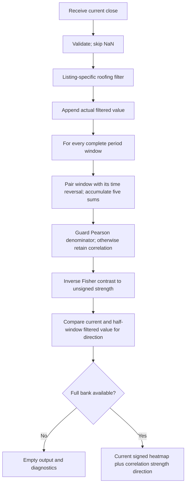

# Swami Convolution: research prototype master

Master: `swami-convolution.py`, class `SwamiConvolution`. One accepted chronological update returns a heatmap column and named per-period diagnostics. This is the authoritative standalone conversion contract for this folder.

## What a SwamiChart measures

A SwamiChart is a bank of related indicators evaluated at many observation or cycle periods. Its horizontal axis is time and its vertical axis is the period parameter. One streaming update produces one vertical column. Shorter periods usually react earlier but respond to smaller fluctuations; longer periods reveal persistence with more lag. Reading the shorter-period response in the context of longer-period responses is the central idea in the March article and Chapter 16. It makes parameter sensitivity visible instead of choosing one allegedly optimal period.

This resembles a measuring instrument with several selectable time constants, all read simultaneously. For a filter bank it also resembles a collection of resonators tuned to different frequencies. It is not automatically an estimate of spectral power: the vertical parameter means lookback or cycle period as defined below, and the values are normalized indicator responses. Adjacent rows use highly overlapping data and are not independent observations. A colored pattern does not by itself supply a statistical test, calibrated probability, trading rule, or proof of predictive value.

Let $v_t(P)$ be the numerical response at bar $t$ and period $P$. For integer periods $P_0,\ldots,P_1$, the column is

$$\mathbf v_t=[v_t(P_0),v_t(P_0+1),\ldots,v_t(P_1)].$$

Except for Convolution's signed representation, the conventional stoplight palette maps $v\in[0,1]$ to RGB channels:

$$
(R,G,B)=
\begin{cases}
(255,510v,0),&v<1/2,\\
(510(1-v),255,0),&v\ge1/2.
\end{cases}
$$

Thus 0 is red, 0.5 yellow, and 1 green. The numerical master returns values rather than RGB integers. Platform rounding of channel values and interpolation between rows belongs to rendering. The original Swing Wave uses blue/orange and Convolution uses signed red/green intensity; see their specific equations below. Palette changes alone do not warrant new indicator folders.

## Streaming and heatmap contract

The Python file in this folder is self-contained and uses the standard library only. Copying this folder is sufficient; there are no runtime imports from other prepared masters or zpano. Numerical helpers above the fixture-tooling separator are the parts to port. Lists implement bounded newest-first histories; a port may use circular buffers but must preserve the logical order of all sums and comparisons.

`Heatmap` is a named tuple compatible with the requested fields in `external/zpano/py/indicators/core/outputs/heatmap.py`:

| Field | Meaning |
| --- | --- |
| `time` | Optional caller timestamp; does not affect the calculation. |
| `parameter_first`, `parameter_last` | Inclusive first and last displayed periods. |
| `parameter_resolution` | 1.0; row $i$ is $P_0+i$. |
| `value_min`, `value_max` | Actual minimum and maximum of this column, not fixed palette endpoints. |
| `values` | Fresh list of $P_1-P_0+1$ values, independently owned. |

Until the entire selected bank is available, return an empty values list with NaN min/max. During reference export only, expand that empty column to the full row width filled with NaNs. A map is wholly available or wholly unavailable; this avoids differently primed rows within the same public column. `warmup_bars` counts the leading unavailable finite-input observations. `is_primed` reports complete-bank availability, not convergence of recursive transients.

A NaN input means an omitted observation: return an empty public column and preserve every history, retained value, and accepted-bar count. The next finite input follows the preceding finite input, regardless of timestamps. Infinity and invalid OHLC order raise `ValueError` before any normal update. Finite negative or zero prices are accepted. As in the source listings, arithmetic assumes finite, ordinary-magnitude financial samples; extreme finite magnitudes can overflow intermediate arithmetic and are outside the reference-data domain. `reset()` restores all histories, seeds and counters. A missing input must never be saved as NaN recursive state.

## Precision and source fidelity

Use IEEE 754 binary64, full-precision $\pi$ and $\sqrt2$, and radian trigonometric functions. Convert an EasyLanguage degree argument $a$ to $a\pi/180$. Replace printed `1.414` with $\sqrt2$, `.707` with $1/\sqrt2$ where applicable, and `3.14159` or `6.28` with $\pi$ or $2\pi$. This is the requested precision convention, so fixtures cannot also match every decimal of a platform running the rounded printed constants.

Explicit EMA weights `.33/.67`, `.5/.5`, `.2/.8`, CCI's `.015`, and Convolution's contrast factor 3 remain the source constants. In particular, `.33` is not silently replaced by $1/3$. Do not round intermediates. Export alone uses **15 significant digits**, Python `.15g`, rather than 15 digits after the decimal point. Go, Rust, Zig and other math libraries may differ in their last bits; compare finite fixture values with a suitable relative/absolute tolerance such as $10^{-11}$, while matching NaN positions exactly.

Chart platforms choose historical availability, MaxBarsBack, seeds, and invocation timing differently. This master defines a standalone startup explicitly below: actual raw differences, zero recursive seeds, and actual complete finite windows. It preserves the source recurrence and the documented degenerate branches, rather than claiming a unique cross-platform first-bar oracle. Independent tests evaluate the selected source formulas over the same standalone history convention, including startup. The documented corrections or extensions are part of the conversion contract.

## Reference-data workflow

All five shared input files are copied into this folder: `test_testdata.py`, `testdata_test.go`, `testdata.ts`, `testdata.rs`, and `testdata.zig`. The master `__main__` embeds the exact 252 shared close/high/low values and demonstrates the default. Run `python3 swami-convolution.py` for that demonstration. The user confirmed all 56 Swami combinations on 2026-10-21, including the eight combinations in this folder. The source flag `REFERENCE_CASES_CONFIRMED` records that authorization and is true. All five language fixtures now contain 48 generated expected arrays for the eight cases.

To regenerate the confirmed data, run `python3 swami-convolution.py --generate-reference-data`. The generator appends a marked expected-data section to Python, reopens and verifies every rounded value, NaN and dimension, then translates those verified Python literals to the other four languages. Regeneration replaces only that marked section and preserves all inputs. Run `python3 verify_reference_data.py` to check the resulting values, names, comments, shapes and NaN masks in all five languages. [validation.md](validation.md) records completed checks and [reference_manifest.json](reference_manifest.json) records the full fixture inventory. Each array contains 252 time positions; heatmaps and per-period diagnostics have a second dimension equal to the bin count. Every array has two comments: the exact What it tests description below, then parameter values and input convention.

Names are `EXPECTED_<parameter tokens>_<component>`. Period bounds use `P0`, `P1`; variants use `V2012` and `V2013`; `LP/HP` are filter periods; `RA/OA/A` are EMA weights; `C` is RSI contrast; `D/F/PA` are bandwidth, fraction and peak-average length. Decimal points become underscores. For example `EXPECTED_V2013_P05_P148_LP10_5_HEATMAP` identifies the fractional roofed case. Unspecified parameters take the documented defaults; the comments list every explicitly varied parameter and the source input convention.

Python uses `NaN = math.nan`, Go `math.NaN()`, TypeScript `NaN`, Rust `f64::NAN`, and Zig `nan` with `const math = @import("std").math; const nan = math.nan(f64);`. Go packages use the folder name with hyphens/underscores removed. Go/TypeScript/Zig expected names begin `expected` with uppercase shortcuts; Rust functions begin `expected_` with lowercase tokens. TypeScript exports valid typed constants; Rust returns vectors; Zig returns `[252]f64` or `[252][bins]f64`. These are compilable versions of the intended language formats.

## Roofing and SuperSmoother mathematics

Ehlers describes market prices as having spectral dilation: slower components often have larger amplitudes and can dominate oscillators meant to describe shorter cycles. The roofing stage is analogous to placing a detrending circuit and a noise-removal circuit ahead of an instrument. A two-pole high-pass rejects DC and attenuates slow components; the following SuperSmoother attenuates very short periods. Together they pass a gradual band of cycles, not an ideal rectangular frequency band.

Let $x_t$ be input, $H$ the longest-period coefficient control, and $L$ the shortest-period coefficient control. In Chapter 16 use $\theta=\sqrt2\pi/H$, the precise form of `.707*360/H` degrees. In **Convolution listing 13-1 use $\theta=2\sqrt2\pi/H$**, the precise form of `1.414*360/H` degrees. The latter is a factor of two larger and is intentionally preserved. Define

$$\alpha=\frac{\cos\theta+\sin\theta-1}{\cos\theta},\quad q=1-\alpha,\quad g=1-\alpha/2.$$

Using $u=\tan(\theta/2)$ and the half-angle sine/cosine identities gives

$$\alpha=\frac{2u}{1+u}.$$

The master uses this algebraically equivalent expression to avoid a removable $0/0$ at $\theta=\pi/2$ and cancellation near zero. Its admitted angles satisfy $0<\theta<\pi$, giving $|q|<1$. The source two-pole recurrence is

$$h_t=g^2(x_t-2x_{t-1}+x_{t-2})+2qh_{t-1}-q^2h_{t-2}.$$

The two DC zeros remove a sustained linear trend after startup transients; the repeated pole controls the memory. The explanatory transfer function is

$$H_{HP}(z)=\frac{g^2(1-z^{-1})^2}{(1-qz^{-1})^2}.$$

Chapter 3 equation 3-3 supplies the SuperSmoother coefficients:

$$\omega=\frac{\sqrt2\pi}{L},\quad a=e^{-\omega},\quad c_2=2a\cos\omega,\quad c_3=-a^2,\quad c_1=1-c_2-c_3.$$

Apply them to the high-pass output:

$$f_t=\frac{c_1(h_t+h_{t-1})}{2}+c_2f_{t-1}+c_3f_{t-2}.$$

The numerator average supplies a Nyquist zero. Its transfer function is

$$H_{SS}(z)=\frac{(c_1/2)(1+z^{-1})}{1-c_2z^{-1}-c_3z^{-2}},\qquad H_{Roof}(z)=H_{HP}(z)H_{SS}(z).$$

Short periods are high frequencies and long periods are low frequencies. Do not reverse the meanings of the two cutoffs while converting. Keep the sign of $c_3$ negative and add its signed product in the recurrence. No adaptive dominant period is measured here.

The first two accepted prices are stored without fabricating raw prehistory. On bar 3 the first real second difference produces the first finite internal $f_t$; $h$ and $f$ prehistory are zero. Every later filtered value, including values hidden by public bank warm-up, advances the histories. Book RSI/Stochastic share $c_1,c_2,c_3$ between roofing and the final per-bin smoother. This differs from importing a standalone Roofing indicator and feeding only its already-visible outputs into each bin.

## Authoritative numerical source and folding analogy

`SwamiConvolution` uses **Chapter 13 listing 13-1**, with default roofing controls $L=40,H=80$ and displayed windows 3..48. The October article supplies the folding idea and examples but no complete code. It describes correlating half-window data with the negative of the other half; the executable book instead compares a whole filtered window with its **time reversal**. This master follows the executable listing and documents the prose discrepancy.

At an ideal V-shaped trough or inverted-V crest, the two sides match when folded about the turning point. In a monotonic trend, folding reverses the slope, giving negative correlation. For a symmetric window of length $P$, the fold is roughly $(P-1)/2$ bars before the current bar. Longer windows need more post-turn evidence and react later; plotting many lengths produces plumes that point backward toward a turning point. Brief interruptions in a larger trend tend to produce only short-period plumes.

This is a normalized symmetry measure, not ordinary linear convolution $\sum_j x_j y_{t-j}$ and not a spectral estimate. Positive correlation measures shape overlap after reversal; it does not distinguish a peak from a trough without direction information.

## Complete folded-window correlation

After the listing-specific roofing stage above, for each $P$ define

$$X_j=f_{t-j},\qquad Y_j=f_{t-(P-1-j)},\qquad j=0,\ldots,P-1.$$

Compute the five raw-moment sums in the source's order:

$$S_x=\sum X_j,\quad S_y=\sum Y_j,\quad S_{xx}=\sum X_j^2,\quad S_{yy}=\sum Y_j^2,\quad S_{xy}=\sum X_jY_j.$$

Then

$$D=(P S_{xx}-S_x^2)(P S_{yy}-S_y^2),$$
$$\rho_t(P)=\begin{cases}\dfrac{P S_{xy}-S_xS_y}{\sqrt D},&D>0,\\\rho_{t-1}(P),&D\le0.\end{cases}$$

The previous correlation starts at zero. This raw-moment Pearson expression retains the source's degeneracy rule and has no extra epsilon or clip. It can be less stable for very large offsets than a centered formulation, which would change numerical results. Reversal permutes the window, so the two theoretical variances are equal; independent accumulation order can still differ in binary64.

Apply the source contrast transformation:

$$q_t(P)=\frac{1+(e^{3\rho_t(P)}-1)/(e^{3\rho_t(P)}+1)}2=\frac{1+\tanh(1.5\rho_t(P))}2.$$

The master evaluates the printed exponential expression, avoiding different last-bit rounding from a substituted tanh. At $\rho=0$ the strength is .5; at theoretical $\rho=\pm1$ it is approximately .0474259 and .9525741, so zero symmetry is not zero brightness. Keep this scale rather than renormalizing it to span exactly 0..1.

Book internal `Slope=1`, changed to -1 when $f_{t-\lfloor P/2\rfloor}<f_t$. It maps positive Slope to red and negative to green. The public semantic direction is its negative:

$$d_t(P)=\begin{cases}+1,&f_{t-\lfloor P/2\rfloor}<f_t\quad\text{(green)},\\-1,&\text{otherwise}\quad\text{(red)}.\end{cases}$$

Equality follows red. Return a signed renderable value

$$v_t(P)=d_t(P)q_t(P).$$

A renderer reproduces the book colors as $R=255\max(-v,0),G=255\max(v,0),B=0$. `SwamiConvolutionOutput` additionally returns the separate `correlation`, `strength` and `direction` lists so the signed representation never loses the published unsigned strength or Pearson correlation. All four lists are independently owned. The earlier archived product shows lavender on blue; that is a different historical presentation, not this listing's palette.

## Timing: retrospective display shift

Both the October article and the book explicitly shift the chart **four bars left**, listing `PlotN[4]`. The master returns current calculation-time output and declares `display_offset_bars=-4` for optional rendering metadata. It never writes current results into earlier output positions. A value calculated at bar $t$ may be displayed at $t-4$, but was available only at $t$. Using that shifted location as if the value were known four bars earlier would create look-ahead in a backtest. Folding-window delay and filter lag also remain; the chart shift does not remove them.

## Configuration and startup

| Parameter | Default | Valid range |
| --- | --- | --- |
| `min_period` | 3 | Integer $\ge3$; shorter windows are degenerate/trivial. |
| `max_period` | 48 | Integer $\ge P_0$. |
| `shortest_cycle_period` | 40 | Finite real $L\ge2$. |
| `longest_cycle_period` | 80 | Finite real $H>L$ and $H>2\sqrt2$ so the listing HP angle is in $(0,\pi)$. |

There are also binary64 stability checks. Bin ranges generalize the printed display limits. Original calculations at periods 1 and 2 are independent and not displayed; omitting these unused bins cannot affect the displayed results. The listing's factor-two high-pass coefficient is preserved, even though Chapter 16 uses the usual different angle. No automatic correction to the standard roofing cutoff is applied.

Each bin starts after its full actual filtered window exists. The first filtered value is bar 3; the full bank is first visible on bar $P_1+2$, so `warmup_bars=P1+1`. For default 48 the first public bar is 50. The four-bar display offset is not subtracted from warm-up or fixture indices. Work is $O(\sum P)$ and storage $O(P_1)$ plus per-bin correlation state.

## Calculation flow



## Confirmed reference combinations (2026-10-21)

| Case | Parameters | What it tests |
| --- | --- | --- |
| 1 | `min_period=3, max_period=48, shortest_cycle_period=40.0, longest_cycle_period=80.0` | Book default 40/80 filters and full folded-window map. |
| 2 | `min_period=3, max_period=48, shortest_cycle_period=10.0, longest_cycle_period=48.0` | Faster smoothing exposes short reversal structures. |
| 3 | `min_period=3, max_period=48, shortest_cycle_period=20.0, longest_cycle_period=80.0` | Intermediate smoothing with unchanged long-wave rejection. |
| 4 | `min_period=3, max_period=48, shortest_cycle_period=40.5, longest_cycle_period=80.0` | Fractional smoother period retains real coefficient arithmetic. |
| 5 | `min_period=3, max_period=24, shortest_cycle_period=40.0, longest_cycle_period=80.0` | Compact folded-window map. |
| 6 | `min_period=3, max_period=3, shortest_cycle_period=10.0, longest_cycle_period=48.0` | Shortest supported convolution window as one bin. |
| 7 | `min_period=24, max_period=48, shortest_cycle_period=40.0, longest_cycle_period=80.0` | Long-window-only plume display. |
| 8 | `min_period=3, max_period=48, shortest_cycle_period=40.0, longest_cycle_period=160.0` | Longer high-pass memory preserves the book angle factor. |

Unlisted parameters retain the configuration-table defaults. Each case exports `HEATMAP`, `MIN` and `MAX`. It also exports `CORRELATION`, `STRENGTH` and `DIRECTION` matrices.

## References and BibTeX

These references supply the theory, formulas, source comparisons and archived presentation notes above. All numerical steps needed for conversion are included in this document; the following links are provenance rather than runtime dependencies.

- Ehlers and Way, March 2012, [Introducing SwamiCharts](../../tasc/2012-03-introducing-swami-charts/content.md), and [March TradeStation code](../../tasc/2012-03-introducing-swami-charts/tips/SwamiCharts.els).
- Ehlers and Way, April 2012, [Setting Strategies With SwamiCharts](../../tasc/2012-04-setting-strategies-with-swami-charts/content.md), and [April Trader's Tips](../../tasc/2012-04-setting-strategies-with-swami-charts/tips/tips.md).
- Ehlers and Way, October 2012, [SwamiCharts Convolution](../../tasc/2012-10-swami-charts-convolution/content.md).
- Ehlers, 2013, *Cycle Analytics for Traders*: [Chapter 3](../../2013-cycle-analytics-for-traders/ch3.md) (SuperSmoother), [Chapter 5](../../2013-cycle-analytics-for-traders/ch5.md) (band-pass), [Chapter 7](../../2013-cycle-analytics-for-traders/ch7.md) (spectral dilation), [Chapter 13](../../2013-cycle-analytics-for-traders/ch13.md) (Convolution listing 13-1), and [Chapter 16](../../2013-cycle-analytics-for-traders/ch16.md) (Swami RSI/Stochastic listings 16-1/16-2).
- [Archived SwamiConvolution page](../../../../external/swami/SwamiConvolution.mht), a description/screenshot source with no numerical implementation.
- [NinjaTrader BPF](../../tasc/2012-04-setting-strategies-with-swami-charts/tips/ninja-trader/BPF.cs) and [SwamiWave](../../tasc/2012-04-setting-strategies-with-swami-charts/tips/ninja-trader/SwamiWave.cs), for the selected Swing Wave variant.

```bibtex
@article{ehlers_way_2012_swami_intro,
  author = {Ehlers, John F. and Way, Ric},
  title = {Introducing SwamiCharts},
  journal = {Technical Analysis of STOCKS \& COMMODITIES},
  volume = {30}, number = {3}, pages = {15--22}, year = {2012}, month = mar
}
@article{ehlers_way_2012_swami_strategies,
  author = {Ehlers, John F. and Way, Ric},
  title = {Setting Strategies With SwamiCharts},
  journal = {Technical Analysis of STOCKS \& COMMODITIES},
  volume = {30}, number = {4}, year = {2012}, month = apr
}
@article{ehlers_way_2012_swami_convolution,
  author = {Ehlers, John F. and Way, Ric},
  title = {SwamiCharts Convolution},
  journal = {Technical Analysis of STOCKS \& COMMODITIES},
  volume = {30}, number = {10}, pages = {10--13}, year = {2012}, month = oct
}
@book{ehlers2013cycle,
  author = {Ehlers, John F.},
  title = {Cycle Analytics for Traders: Advanced Technical Trading Concepts},
  publisher = {Wiley}, year = {2013}, isbn = {9781118728604}
}
@misc{traders_tips_2012_march,
  author = {{Technical Analysis of STOCKS \& COMMODITIES}},
  title = {Traders' Tips: March 2012}, year = {2012}, month = mar,
  url = {https://www.traders.com/Documentation/FEEDbk_docs/2012/03/TradersTips.html},
  note = {Includes TradeStation listings by Chris Imhof and differing vendor implementations}
}
@misc{traders_tips_2012_april,
  author = {{Technical Analysis of STOCKS \& COMMODITIES}},
  title = {Traders' Tips: April 2012}, year = {2012}, month = apr,
  url = {https://www.traders.com/Documentation/FEEDbk_docs/2012/04/TradersTips.html},
  note = {Includes NinjaTrader SwamiWave/BPF and OmniTrader SwamiMM/OptimizedMarketMode by Jeremy Williams}
}
@misc{swami_archived_product,
  author = {{Securities Analytics, Inc.}},
  title = {SwamiCharts Archived Product Pages},
  howpublished = {Repository-local MHT snapshots in external/swami},
  note = {Descriptions and screenshots; snapshot footer copyright 1998--2011 does not establish the capture date}
}
```
