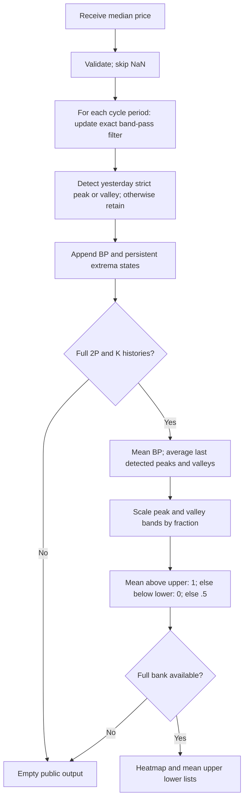

# Swami Market Mode: research prototype master

Master: `swami-market-mode.py`, class `SwamiMarketMode`. One accepted chronological update returns a heatmap column and named per-period diagnostics. This is the authoritative standalone conversion contract for this folder.

## What a SwamiChart measures

A SwamiChart is a bank of related indicators evaluated at many observation or cycle periods. Its horizontal axis is time and its vertical axis is the period parameter. One streaming update produces one vertical column. Shorter periods usually react earlier but respond to smaller fluctuations; longer periods reveal persistence with more lag. Reading the shorter-period response in the context of longer-period responses is the central idea in the March article and Chapter 16. It makes parameter sensitivity visible instead of choosing one allegedly optimal period.

This resembles a measuring instrument with several selectable time constants, all read simultaneously. For a filter bank it also resembles a collection of resonators tuned to different frequencies. It is not automatically an estimate of spectral power: the vertical parameter means lookback or cycle period as defined below, and the values are normalized indicator responses. Adjacent rows use highly overlapping data and are not independent observations. A colored pattern does not by itself supply a statistical test, calibrated probability, trading rule, or proof of predictive value.

Let $v_t(P)$ be the numerical response at bar $t$ and period $P$. For integer periods $P_0,\ldots,P_1$, the column is

$$\mathbf v_t=[v_t(P_0),v_t(P_0+1),\ldots,v_t(P_1)].$$

Except for Convolution's signed representation, the conventional stoplight palette maps $v\in[0,1]$ to RGB channels:

$$
(R,G,B)=
\begin{cases}
(255,510v,0),&v<1/2,\\
(510(1-v),255,0),&v\ge1/2.
\end{cases}
$$

Thus 0 is red, 0.5 yellow, and 1 green. The numerical master returns values rather than RGB integers. Platform rounding of channel values and interpolation between rows belongs to rendering. The original Swing Wave uses blue/orange and Convolution uses signed red/green intensity; see their specific equations below. Palette changes alone do not warrant new indicator folders.

## Streaming and heatmap contract

The Python file in this folder is self-contained and uses the standard library only. Copying this folder is sufficient; there are no runtime imports from other prepared masters or zpano. Numerical helpers above the fixture-tooling separator are the parts to port. Lists implement bounded newest-first histories; a port may use circular buffers but must preserve the logical order of all sums and comparisons.

`Heatmap` is a named tuple compatible with the requested fields in `external/zpano/py/indicators/core/outputs/heatmap.py`:

| Field | Meaning |
| --- | --- |
| `time` | Optional caller timestamp; does not affect the calculation. |
| `parameter_first`, `parameter_last` | Inclusive first and last displayed periods. |
| `parameter_resolution` | 1.0; row $i$ is $P_0+i$. |
| `value_min`, `value_max` | Actual minimum and maximum of this column, not fixed palette endpoints. |
| `values` | Fresh list of $P_1-P_0+1$ values, independently owned. |

Until the entire selected bank is available, return an empty values list with NaN min/max. During reference export only, expand that empty column to the full row width filled with NaNs. A map is wholly available or wholly unavailable; this avoids differently primed rows within the same public column. `warmup_bars` counts the leading unavailable finite-input observations. `is_primed` reports complete-bank availability, not convergence of recursive transients.

A NaN input means an omitted observation: return an empty public column and preserve every history, retained value, and accepted-bar count. The next finite input follows the preceding finite input, regardless of timestamps. Infinity and invalid OHLC order raise `ValueError` before any normal update. Finite negative or zero prices are accepted. As in the source listings, arithmetic assumes finite, ordinary-magnitude financial samples; extreme finite magnitudes can overflow intermediate arithmetic and are outside the reference-data domain. `reset()` restores all histories, seeds and counters. A missing input must never be saved as NaN recursive state.

## Precision and source fidelity

Use IEEE 754 binary64, full-precision $\pi$ and $\sqrt2$, and radian trigonometric functions. Convert an EasyLanguage degree argument $a$ to $a\pi/180$. Replace printed `1.414` with $\sqrt2$, `.707` with $1/\sqrt2$ where applicable, and `3.14159` or `6.28` with $\pi$ or $2\pi$. This is the requested precision convention, so fixtures cannot also match every decimal of a platform running the rounded printed constants.

Explicit EMA weights `.33/.67`, `.5/.5`, `.2/.8`, CCI's `.015`, and Convolution's contrast factor 3 remain the source constants. In particular, `.33` is not silently replaced by $1/3$. Do not round intermediates. Export alone uses **15 significant digits**, Python `.15g`, rather than 15 digits after the decimal point. Go, Rust, Zig and other math libraries may differ in their last bits; compare finite fixture values with a suitable relative/absolute tolerance such as $10^{-11}$, while matching NaN positions exactly.

Chart platforms choose historical availability, MaxBarsBack, seeds, and invocation timing differently. This master defines a standalone startup explicitly below: actual raw differences, zero recursive seeds, and actual complete finite windows. It preserves the source recurrence and the documented degenerate branches, rather than claiming a unique cross-platform first-bar oracle. Independent tests evaluate the selected source formulas over the same standalone history convention, including startup. The documented corrections or extensions are part of the conversion contract.

## Reference-data workflow

All five shared input files are copied into this folder: `test_testdata.py`, `testdata_test.go`, `testdata.ts`, `testdata.rs`, and `testdata.zig`. The master `__main__` embeds the exact 252 shared close/high/low values and demonstrates the default. Run `python3 swami-market-mode.py` for that demonstration. The user confirmed all 56 Swami combinations on 2026-10-21, including the eight combinations in this folder. The source flag `REFERENCE_CASES_CONFIRMED` records that authorization and is true. All five language fixtures now contain 48 generated expected arrays for the eight cases.

To regenerate the confirmed data, run `python3 swami-market-mode.py --generate-reference-data`. The generator appends a marked expected-data section to Python, reopens and verifies every rounded value, NaN and dimension, then translates those verified Python literals to the other four languages. Regeneration replaces only that marked section and preserves all inputs. Run `python3 verify_reference_data.py` to check the resulting values, names, comments, shapes and NaN masks in all five languages. [validation.md](validation.md) records completed checks and [reference_manifest.json](reference_manifest.json) records the full fixture inventory. Each array contains 252 time positions; heatmaps and per-period diagnostics have a second dimension equal to the bin count. Every array has two comments: the exact What it tests description below, then parameter values and input convention.

Names are `EXPECTED_<parameter tokens>_<component>`. Period bounds use `P0`, `P1`; variants use `V2012` and `V2013`; `LP/HP` are filter periods; `RA/OA/A` are EMA weights; `C` is RSI contrast; `D/F/PA` are bandwidth, fraction and peak-average length. Decimal points become underscores. For example `EXPECTED_V2013_P05_P148_LP10_5_HEATMAP` identifies the fractional roofed case. Unspecified parameters take the documented defaults; the comments list every explicitly varied parameter and the source input convention.

Python uses `NaN = math.nan`, Go `math.NaN()`, TypeScript `NaN`, Rust `f64::NAN`, and Zig `nan` with `const math = @import("std").math; const nan = math.nan(f64);`. Go packages use the folder name with hyphens/underscores removed. Go/TypeScript/Zig expected names begin `expected` with uppercase shortcuts; Rust functions begin `expected_` with lowercase tokens. TypeScript exports valid typed constants; Rust returns vectors; Zig returns `[252]f64` or `[252][bins]f64`. These are compilable versions of the intended language formats.

## Band-pass filter mathematics

A bank of band-pass filters acts like resonators with different natural cycle periods. Let $P$ be a row's center period and $\delta$ its bandwidth control. The April article's filter is

$$\beta_P=\cos(2\pi/P),\qquad \gamma_P=\frac1{\cos(4\pi\delta/P)},\qquad \alpha_P=\gamma_P-\sqrt{\gamma_P^2-1},$$

$$b_t(P)=\frac{1-\alpha_P}{2}(x_t-x_{t-2})+\beta_P(1+\alpha_P)b_{t-1}(P)-\alpha_Pb_{t-2}(P).$$

The transfer function explaining the two zeros and resonant poles is

$$H_P(z)=\frac{(1-\alpha_P)(1-z^{-2})/2}{1-\beta_P(1+\alpha_P)z^{-1}+\alpha_Pz^{-2}}.$$

The zeros at DC and Nyquist remove a constant offset and an alternating one-bar component. The poles emphasize an intermediate cycle. Changing the bandwidth changes decay/memory; it does not make the row a Fourier power estimate or a cycle forecast. The API admits $P\ge3$ and $0<\delta<P_0/8$ so every $\gamma_P$ is positive and every $\alpha_P$ is strictly between zero and one in binary64. It rejects coefficients rounded to marginal stability. Fractional $\delta$ is allowed; displayed $P$ is an integer.

Store the first two input prices. The first actual $x_t-x_{t-2}$ is computed on bar 3, with both recursive $b$ seeds zero. Subsequent rolling windows contain only these actual band-pass outputs; no fabricated zeros count toward a full observation window. Public availability is separate from recursive state updates.

## Authoritative numerical source and regime analogy

`SwamiMarketMode` selects the April OmniTrader `SwamiMM`/`OptimizedMarketMode` **three-category classification**. The article's scalar indicator computes a band-pass mean and average detected peaks/valleys. OmniTrader supplies the heatmap decision that turns those bands into trend-up, trend-down and cycle rows. This is a named Trader's Tips variant; the proprietary website describes a trend-slope/peak-to-peak ratio whose exact numerical construction is not fully published.

The intuition resembles comparing the drift of an oscillator's center with the scale of its excursions. A strong upward or downward drift suggests trading the trend; a center within the cycle bands suggests oscillation or range behavior. However the actual mean is a finite rolling average of band-pass output, not a separate fitted price slope. Persistent last peaks and valleys are averaged at every bar, so the amplitude estimate weights extrema by the time for which each remains the latest detected one.

## Exact reconstruction of the optimized table

The source hardcodes $A=.41421$ at $P=4$, $.50953$ at 5, $.57735$ at 6, and so on, with $B=\cos(2\pi/P)$. Those $A$ values are

$$A_P=\sec(\pi/P)-\tan(\pi/P),$$

which equal the general band-pass $\alpha_P$ above for **$\delta=.25$**, since $\sqrt{\sec^2 u-1}=\tan u$ in this admitted positive range. Recompute coefficients from the full-precision formulas; do not reproduce a table of rounded decimals. The optimized default is therefore .25 even though the separate scalar OmniTrader example says .1 and the article defaults to .5. The grid includes article parameters as another explicitly documented configuration of this classifier.

The default actual source heatmap range is 4..48 and fraction .25. The archive describes 12..48. A period range is a parameter choice; it does not make the variants equivalent to the unavailable original product.

## Full trend and amplitude-band calculation

Use input $x_t=(h_t+l_t)/2$ to match source median price and compute $b_t(P)$ with the band-pass recurrence above. For each row,

$$m_t(P)=\frac1{2P}\sum_{j=0}^{2P-1}b_{t-j}(P).$$

Keep the most recently detected peak $p_t$ and valley $n_t$, both initially zero:

$$p_t(P)=\begin{cases}b_{t-1}(P),&b_{t-1}(P)>b_t(P)\ \text{and}\ b_{t-1}(P)>b_{t-2}(P),\\p_{t-1}(P),&\text{otherwise},\end{cases}$$

$$n_t(P)=\begin{cases}b_{t-1}(P),&b_{t-1}(P)<b_t(P)\ \text{and}\ b_{t-1}(P)<b_{t-2}(P),\\n_{t-1}(P),&\text{otherwise}.\end{cases}$$

The one-bar confirmation is causal: today's sample confirms yesterday's extremum; a flat plateau is not a strict extremum. For averaging length $K=50$ and fraction $F=.25$,

$$\overline p_t(P)=\frac1K\sum_{j=0}^{K-1}p_{t-j}(P),\quad \overline n_t(P)=\frac1K\sum_{j=0}^{K-1}n_{t-j}(P),$$

$$u_t(P)=F\overline p_t(P),\qquad l_t(P)=F\overline n_t(P).$$

OmniTrader's ordered decision is

$$v_t(P)=\begin{cases}1,&m_t(P)>u_t(P),\\0,&m_t(P)<l_t(P)\text{ and the first test failed},\\1/2,&\text{otherwise}.\end{cases}$$

Use strict comparisons and evaluate the upward test first. Equality is cycle mode. No division by zero or inverse Fisher transform is needed. Return `SwamiMarketModeOutput(heatmap, mean, upper, lower)` to preserve the source scalar lines and permit classification verification. A longer history requirement applies to every diagnostic as to the map.

The article's separate scalar defaults are $P=20,\delta=.5,F=.1,K=50$, plotting $m,u,l$. The website's conceptual ratio $\text{trend}/\text{cycle amplitude}$ and threshold $\pm1$ is useful interpretation but is **not** silently substituted for this classifier. Wealth-Lab uses tanh of a different amplitude ratio and acknowledges incorrect yellow regions; eSignal's heatmap uses unscaled mean and leaves its fraction parameter unused; AmiBroker has a different ratio and a missing $\pi$ in its bandwidth cosine. These are not interchangeable reference oracles.

## Configuration and startup

| Parameter | Default | Valid range |
| --- | --- | --- |
| `min_period` | 4 | Integer $\ge3$. |
| `max_period` | 48 | Integer $\ge P_0$. |
| `delta` | .25 | Finite $0<\delta<P_0/8$, representably stable poles. |
| `fraction` | .25 | Finite real $F>0$. Smaller thresholds tend to classify more trends. |
| `peak_average_length` | 50 | Integer $K\ge1$. |

`update(price, time=None)` consumes one scalar. The demonstration and fixtures pass `(INPUT_HIGH + INPUT_LOW)/2`. Passing closes is a caller-controlled input variant, not the source fixture convention. Peak-average length and exact coefficient controls are research generalizations of the optimized table and fixed 50-bar source average.

The first band-pass/peak-state samples occur on bar 3. A row needs $2P$ actual $b$ samples and $K$ actual persistent-peak/valley-state samples; the full bank therefore first exposes bar $\max(2P_1,K)+2$, and `warmup_bars=max(2*P1,K)+1`. Default first output is bar 98. Zero extremum seeds are valid internal states even before any peak is detected; they do not count as fictitious price observations. Peaks/valleys are updated continuously before visibility. Work/storage are $O(\sum_P(2P+K))$ with simple bounded scans.

## Calculation flow



## Confirmed reference combinations (2026-10-21)

| Case | Parameters | What it tests |
| --- | --- | --- |
| 1 | `min_period=4, max_period=48, delta=0.25, fraction=0.25, peak_average_length=50` | OmniTrader heatmap defaults with exact coefficient-table reconstruction. |
| 2 | `min_period=12, max_period=48, delta=0.5, fraction=0.1, peak_average_length=50` | Article scalar defaults across the advertised Swami cycle span. |
| 3 | `min_period=4, max_period=24, delta=0.25, fraction=0.25, peak_average_length=50` | Compact market-mode bank with shorter trend averages. |
| 4 | `min_period=4, max_period=48, delta=0.1, fraction=0.25, peak_average_length=50` | Narrower band-pass than the optimized heatmap table. |
| 5 | `min_period=4, max_period=48, delta=0.25, fraction=0.1, peak_average_length=50` | Lower cycle threshold favors trend classification. |
| 6 | `min_period=4, max_period=48, delta=0.25, fraction=0.5, peak_average_length=50` | Higher cycle threshold favors cycle classification. |
| 7 | `min_period=4, max_period=48, delta=0.25, fraction=0.25, peak_average_length=20` | Shorter averaging of persistent detected extrema. |
| 8 | `min_period=4, max_period=48, delta=0.25, fraction=0.25, peak_average_length=251` | Insufficient record for peak averaging: every public result is NaN. |

Unlisted parameters retain the configuration-table defaults. Each case exports `HEATMAP`, `MIN` and `MAX`. It also exports `MEAN`, `UPPER` and `LOWER` matrices.

## References and BibTeX

These references supply the theory, formulas, source comparisons and archived presentation notes above. All numerical steps needed for conversion are included in this document; the following links are provenance rather than runtime dependencies.

- Ehlers and Way, March 2012, [Introducing SwamiCharts](../../tasc/2012-03-introducing-swami-charts/content.md), and [March TradeStation code](../../tasc/2012-03-introducing-swami-charts/tips/SwamiCharts.els).
- Ehlers and Way, April 2012, [Setting Strategies With SwamiCharts](../../tasc/2012-04-setting-strategies-with-swami-charts/content.md), and [April Trader's Tips](../../tasc/2012-04-setting-strategies-with-swami-charts/tips/tips.md).
- Ehlers and Way, October 2012, [SwamiCharts Convolution](../../tasc/2012-10-swami-charts-convolution/content.md).
- Ehlers, 2013, *Cycle Analytics for Traders*: [Chapter 3](../../2013-cycle-analytics-for-traders/ch3.md) (SuperSmoother), [Chapter 5](../../2013-cycle-analytics-for-traders/ch5.md) (band-pass), [Chapter 7](../../2013-cycle-analytics-for-traders/ch7.md) (spectral dilation), [Chapter 13](../../2013-cycle-analytics-for-traders/ch13.md) (Convolution listing 13-1), and [Chapter 16](../../2013-cycle-analytics-for-traders/ch16.md) (Swami RSI/Stochastic listings 16-1/16-2).
- [Archived SwamiMarketMode page](../../../../external/swami/SwamiMarketMode.mht), a description/screenshot source with no numerical implementation.
- [NinjaTrader BPF](../../tasc/2012-04-setting-strategies-with-swami-charts/tips/ninja-trader/BPF.cs) and [SwamiWave](../../tasc/2012-04-setting-strategies-with-swami-charts/tips/ninja-trader/SwamiWave.cs), for the selected Swing Wave variant.

```bibtex
@article{ehlers_way_2012_swami_intro,
  author = {Ehlers, John F. and Way, Ric},
  title = {Introducing SwamiCharts},
  journal = {Technical Analysis of STOCKS \& COMMODITIES},
  volume = {30}, number = {3}, pages = {15--22}, year = {2012}, month = mar
}
@article{ehlers_way_2012_swami_strategies,
  author = {Ehlers, John F. and Way, Ric},
  title = {Setting Strategies With SwamiCharts},
  journal = {Technical Analysis of STOCKS \& COMMODITIES},
  volume = {30}, number = {4}, year = {2012}, month = apr
}
@article{ehlers_way_2012_swami_convolution,
  author = {Ehlers, John F. and Way, Ric},
  title = {SwamiCharts Convolution},
  journal = {Technical Analysis of STOCKS \& COMMODITIES},
  volume = {30}, number = {10}, pages = {10--13}, year = {2012}, month = oct
}
@book{ehlers2013cycle,
  author = {Ehlers, John F.},
  title = {Cycle Analytics for Traders: Advanced Technical Trading Concepts},
  publisher = {Wiley}, year = {2013}, isbn = {9781118728604}
}
@misc{traders_tips_2012_march,
  author = {{Technical Analysis of STOCKS \& COMMODITIES}},
  title = {Traders' Tips: March 2012}, year = {2012}, month = mar,
  url = {https://www.traders.com/Documentation/FEEDbk_docs/2012/03/TradersTips.html},
  note = {Includes TradeStation listings by Chris Imhof and differing vendor implementations}
}
@misc{traders_tips_2012_april,
  author = {{Technical Analysis of STOCKS \& COMMODITIES}},
  title = {Traders' Tips: April 2012}, year = {2012}, month = apr,
  url = {https://www.traders.com/Documentation/FEEDbk_docs/2012/04/TradersTips.html},
  note = {Includes NinjaTrader SwamiWave/BPF and OmniTrader SwamiMM/OptimizedMarketMode by Jeremy Williams}
}
@misc{swami_archived_product,
  author = {{Securities Analytics, Inc.}},
  title = {SwamiCharts Archived Product Pages},
  howpublished = {Repository-local MHT snapshots in external/swami},
  note = {Descriptions and screenshots; snapshot footer copyright 1998--2011 does not establish the capture date}
}
```
