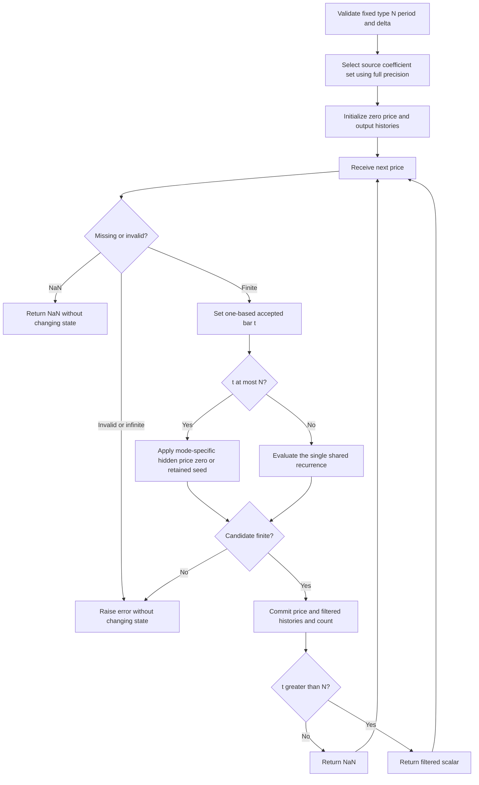

# Swiss Army Knife

This folder is the standalone **research prototype master reference** for John F. Ehlers' January 2006 **“Swiss Army Knife Indicator”** and its corresponding MESA paper. One second-order recurrence implements nine selectable responses: EMA, SMA, Gaussian, approximate Butterworth, three-tap smoothing, one-pole high-pass, two-pole high-pass, bandpass and band-stop.

`SwissArmyKnife.update(price)` returns a single floating-point value, the source's `Filt`. During the source's initialization/plot suppression interval it returns NaN while preserving the required hidden numerical state. The implementation uses only Python's standard library and bounded history. Each instance has one fixed coefficient set; instantiate several filters to construct differences or filter banks.

## Numerical authority and source contract

The authority is the complete recurrence and coefficient branches in [the article](../../tasc/2006-01-swiss-army-knife-indicator/content.md) and [the MESA paper](../../tasc/2006-01-swiss-army-knife-indicator/mesa/content.md). Important transcription and interpretation details are resolved explicitly:

| Source detail | Master behavior |
|---|---|
| Article code references `Type` without declaring that input | Use the MESA listing's declared default `Type("BP")`. |
| Nine real modes are implemented in the code; a tenth complex DFT is discussed theoretically | Implement the nine executable modes. Reject `DFT`; reproduce its theoretical discussion and table discrepancies below. |
| Band-filter prose uses $2\pi\delta/P$, executable code uses `720*delta/Period` | Use **$4\pi\delta/P$**, matching article/MESA code and the tips. |
| General printed transfer function puts delayed subtraction outside the rational expression | Follow the executable recurrence. Its actual transfer function places the subtraction in the numerator, as derived below. |
| Two-pole factor is printed as `2.415` | Restore **$1/(\sqrt2-1)=1+\sqrt2$**, derived from the two-stage half-power cutoff, following the user's full-precision instruction. |
| Source initializes all variables to zero | Use zero absent price/output history. Apply each mode's explicit first-$N$ startup assignments. |
| Source plots only when `CurrentBar > N` | Return exactly $N$ leading NaNs, then public filter values. Do not add an unrelated warmup period. |
| SMA startup sets `Filt = Price` through bar $N$ | Preserve this source behavior, including its persistent offset from a conventional SMA. |

The executable's variable initializers are $c_0=1$, $b_0=1$ and all other recurrence coefficients zero. The MESA summary table's “default” row has different values; it is not used as a coefficient set. A fixed configuration starts from the actual code initializers and sets only that mode's coefficients, so coefficients cannot leak from a previously selected type.

All mathematical trigonometric constants use full binary64 precision. Degree arguments in EasyLanguage become radians with `math.pi`. The restored Gaussian factor changes Gauss, Butter and 2PHP slightly relative to **literal `2.415` source output**. The reference therefore preserves the article's algorithm and state rules with the requested full-precision mathematical constant, rather than claiming bitwise equality with rounded code. No other filter redesign or cutoff substitution is made.

### Traders' Tips differences

The [January 2006 tips](../../tasc/2006-01-swiss-army-knife-indicator/tips/tips.md) provide useful corroboration, but platform variants differ:

| Reference | Material difference |
|---|---|
| TradeStation contribution | Describes all nine response families and a bandpass example with period 21, delta 0.1. |
| [eSignal SWAK.efs](../../tasc/2006-01-swiss-army-knife-indicator/tips/SWAK.efs) | Excludes Smooth from its selection list. BP/BS seed zero through `N+4`, unlike the article's price seed through $N$. SMA substitutes 1 for a zero length instead of reporting invalid input. |
| [AmiBroker SWAK.afl](../../tasc/2006-01-swiss-army-knife-indicator/tips/SWAK.afl) | Couples SMA length to `Period`, starts its loop at `max(N,2)` with prices in the output series, uses truncated pi, and has **BS $b_2=-1$**, where article/MESA require $+1$. |
| [NeuroShell SWAK.tsl](../../tasc/2006-01-swiss-army-knife-indicator/tips/SWAK.tsl) | Its generic recurrence corroborates the delayed-input placement. Some coefficient calls differ: the Butter call omits feedback; HP uses a different feedforward factor; the BS call uses a different $c_0$. Those calls are not substituted here. |
| Wealth-Lab example | Demonstrates chirped input and differences of bandpass filters, with the actual filter delegated to an external library. |

The numerical authority remains the article/MESA executable coefficient sets. Unrelated tips and strategy execution are outside this master.

## Principles and physical analogies

Market bars are samples of a signal. A one-bar delay is a unit memory element. Weighted current/past inputs form a feedforward filter; weighted prior outputs form feedback. Combining a few memory elements and coefficients yields many familiar indicators without changing the recurrence.

Ehlers compares the Z-transform to the Laplace transform: the latter simplifies differential equations for continuous signals, while the former simplifies difference equations for sampled signals. In the Z domain, multiplication by $z^{-1}$ represents one sample of delay. Poles describe the stored response and its decay; zeros describe frequencies canceled by the input combination.

Low-pass filters suppress rapid fluctuations and retain price level/trend. High-pass filters reject a constant level and slow movement, producing momentum-like outputs. Bandpass filters select a range of cyclic frequencies, rejecting both trend and fast noise. Band-stop filters remove that cyclic range and retain the surrounding components.

A resonator behaves like a bell: a narrow passband can ring long after a shock. Wider bandwidth reduces persistence but separates nearby frequencies less well. Filter phase also matters: a bandpass has zero phase at its fixed center frequency in steady state, but off-center signals and transients have different timing. The article's turning-point suggestions rely on approximately stationary cyclic behavior; the filter is not a general predictor of future price.

The Gaussian and Butter labels refer to Ehlers' specific approximations. The Gaussian is a cascade of two identical one-pole low-pass stages. The printed Butter response uses the **same repeated real poles** with a binomial numerator; it is not the later Ehlers Super Smoother or a separately designed textbook Butterworth biquad.

## General mathematical derivation

For the introductory first-order system, the article gives

$$\frac{Y(z)}{X(z)}=\frac{b_0+b_1z^{-1}}{a_0+a_1z^{-1}}.$$

Cross-multiplication gives

$$Y(z)=\frac{1}{a_0}\left[b_0X(z)+b_1z^{-1}X(z)-a_1z^{-1}Y(z)\right],$$

or in time-domain notation,

$$y_t=\frac{1}{a_0}\left(b_0x_t+b_1x_{t-1}-a_1y_{t-1}\right).$$

Setting $a_0=1$, $b_0=\alpha$, $b_1=0$ and $a_1=-(1-\alpha)$ yields

$$y_t=\alpha x_t+(1-\alpha)y_{t-1},$$

the familiar EMA. Input and feedback weights sum to one, giving unity gain for a constant input after transient decay.

### The Swiss Army Knife recurrence

The article/MESA print the generalized transfer expression as

$$H_{\mathrm{printed}}(z)=\frac{c_0(b_0+b_1z^{-1}+b_2z^{-2})}{1-a_1z^{-1}-a_2z^{-2}}-c_1z^{-N}.$$

They then implement

$$y_t=c_0(b_0x_t+b_1x_{t-1}+b_2x_{t-2})+a_1y_{t-1}+a_2y_{t-2}-c_1x_{t-N}.$$

The **actual transfer function of that recurrence**, with zero initial state, is

$$H(z)=\frac{c_0(b_0+b_1z^{-1}+b_2z^{-2})-c_1z^{-N}}{1-a_1z^{-1}-a_2z^{-2}}.$$

These expressions differ when $c_1\ne0$. Placing subtraction outside the feedback denominator would require additional delayed-input terms. The implemented form is the one that produces the intended running-SMA recurrence and is the sole numerical kernel in this master.

The SWAK $a_1,a_2$ already carry the required feedback signs; the denominator is $1-a_1z^{-1}-a_2z^{-2}$, and the recurrence **adds** $a_1y_{t-1}+a_2y_{t-2}$. Do not negate $a_2$ again when porting.

## Coefficient definitions and full table

Let $P$ denote `period`, $N$ denote `n`, and $\delta$ denote `delta`. Define $\omega=2\pi/P$. Alpha has a different definition in different families:

$$\alpha_E=\frac{\cos\omega+\sin\omega-1}{\cos\omega},$$

$$\beta_G=(1+\sqrt2)(1-\cos\omega),\qquad
\alpha_G=-\beta_G+\sqrt{\beta_G^2+2\beta_G},$$

$$\beta_B=\cos\omega,\qquad \gamma_B=\frac{1}{\cos(4\pi\delta/P)},\qquad
\alpha_B=\gamma_B-\sqrt{\gamma_B^2-1}.$$

The source coefficient table, with the alpha definitions made explicit, is:

| Type | $c_0$ | $c_1$ | Delay $N$ in source table | $b_0$ | $b_1$ | $b_2$ | $a_1$ | $a_2$ |
|---|---|---|---|---|---|---|---|---|
| EMA | $1$ | $0$ | $0$ | $\alpha_E$ | $0$ | $0$ | $1-\alpha_E$ | $0$ |
| SMA | $1$ | $1/N$ | $N$ | $1/N$ | $0$ | $0$ | $1$ | $0$ |
| Gauss | $\alpha_G^2$ | $0$ | $0$ | $1$ | $0$ | $0$ | $2(1-\alpha_G)$ | $-(1-\alpha_G)^2$ |
| Butter | $\alpha_G^2/4$ | $0$ | $0$ | $1$ | $2$ | $1$ | $2(1-\alpha_G)$ | $-(1-\alpha_G)^2$ |
| Smooth | $1/4$ | $0$ | $0$ | $1$ | $2$ | $1$ | $0$ | $0$ |
| HP | $1-\alpha_E/2$ | $0$ | $0$ | $1$ | $-1$ | $0$ | $1-\alpha_E$ | $0$ |
| 2PHP | $(1-\alpha_G/2)^2$ | $0$ | $0$ | $1$ | $-2$ | $1$ | $2(1-\alpha_G)$ | $-(1-\alpha_G)^2$ |
| BP | $(1-\alpha_B)/2$ | $0$ | $0$ | $1$ | $0$ | $-1$ | $\beta_B(1+\alpha_B)$ | $-\alpha_B$ |
| BS | $(1+\alpha_B)/2$ | $0$ | $0$ | $1$ | $-2\beta_B$ | $1$ | $\beta_B(1+\alpha_B)$ | $-\alpha_B$ |

The delay column is zero for modes with $c_1=0$, since that delayed input is unused. The executable nevertheless also uses its common input $N$ as a startup gate for every mode. A nonzero startup $N$ for EMA/Gauss/etc. does not change their coefficients or invent an additional delayed subtraction.

### Why `2.415` becomes $1+\sqrt2$

The original article and MESA formulas use

$$\beta_{G,\mathrm{printed}}=2.415(1-\cos\omega).$$

For a single EMA with $q=1-\alpha$, the squared frequency response is

$$|H_1(e^{i\omega})|^2=\frac{\alpha^2}{\alpha^2+2(1-\alpha)(1-\cos\omega)}.$$

Two cascaded identical stages have power response $|H_1|^4$. Setting the total power at the cutoff to $1/2$ gives

$$\frac{\alpha^2}{\alpha^2+2(1-\alpha)(1-\cos\omega)}=\frac{1}{\sqrt2},$$

$$\alpha^2=2\beta_G(1-\alpha),\qquad
\beta_G=\frac{1-\cos\omega}{\sqrt2-1}=(1+\sqrt2)(1-\cos\omega).$$

The positive quadratic root is exactly the article's alpha expression. Thus the intended mathematical factor is approximately **2.414213562373095**, rather than 2.415. The master restores it; the independent test verifies total Gaussian power gain $1/2$ at the configured cutoff. Butter and 2PHP still reuse the same alpha as the source; this does not assert that their different numerators have the same half-power cutoff.

## The nine responses in detail

### EMA

$$y_t=\alpha_E x_t+(1-\alpha_E)y_{t-1},\qquad
H_E(z)=\frac{\alpha_E}{1-(1-\alpha_E)z^{-1}}.$$

The article also gives the usual SMA-equivalent EMA length relation

$$\alpha=\frac{2}{L+1},\qquad L=\frac{2}{\alpha}-1.$$

The executable chooses $\alpha_E$ by **frequency period $P$**, not by that length relation. At $P=20$, $\alpha_E\approx0.2735$, roughly a six-bar SMA-equivalent EMA. Setting `period=20` therefore does not mean an ordinary EMA length 20.

### SMA

$$y_t=y_{t-1}+\frac{x_t-x_{t-N}}{N},$$

$$H_{\mathrm{SMA}}(z)=\frac{1-z^{-N}}{N(1-z^{-1})}
=\frac{1}{N}\sum_{j=0}^{N-1}z^{-j}.$$

This running form has an integrator with a canceled pole at one. A correct seed makes it a conventional SMA; an erroneous seed contributes a constant homogeneous solution. The source's seed is discussed separately below. `period` is unused, and a valid SMA needs $N\ge1$.

### Gauss

With $q_G=1-\alpha_G$:

$$y_t=\alpha_G^2x_t+2q_Gy_{t-1}-q_G^2y_{t-2},$$

$$H_G(z)=\frac{\alpha_G^2}{(1-q_Gz^{-1})^2}.$$

This equals two cascaded EMAs using $\alpha_G$, with repeated poles at $q_G$. It does not equal two instances of the SWAK EMA with the same period, because that mode uses $\alpha_E$.

### Butter

$$y_t=\frac{\alpha_G^2}{4}(x_t+2x_{t-1}+x_{t-2})
+2q_Gy_{t-1}-q_G^2y_{t-2},$$

$$H_{\mathrm{Butter}}(z)=H_G(z)\frac{(1+z^{-1})^2}{4}.$$

The binomial numerator adds two zeros at the Nyquist frequency. This explains its smoothing and its approximation label. With aligned zero states and $N=0$, it equals a Gauss followed by the three-tap Smooth response.

### Smooth

$$y_t=\frac{x_t+2x_{t-1}+x_{t-2}}{4},\qquad
H_S(z)=\frac{(1+z^{-1})^2}{4}.$$

This finite impulse response has unity DC gain, one-bar linear-phase delay, and zero gain at the two-bar/Nyquist component. It provides modest smoothing. Its coefficients ignore `period` and `delta`.

### HP

With $q_E=1-\alpha_E$:

$$y_t=(1-\alpha_E/2)(x_t-x_{t-1})+q_Ey_{t-1},$$

$$H_{\mathrm{HP}}(z)=\frac{(1-\alpha_E/2)(1-z^{-1})}{1-q_Ez^{-1}}.$$

Its DC zero rejects constant price; its recursive pole smooths the momentum-like difference. Its gain at Nyquist is one in exact arithmetic.

### 2PHP

$$y_t=(1-\alpha_G/2)^2(x_t-2x_{t-1}+x_{t-2})
+2q_Gy_{t-1}-q_G^2y_{t-2},$$

$$H_{\mathrm{2PHP}}(z)=\left[\frac{(1-\alpha_G/2)(1-z^{-1})}{1-q_Gz^{-1}}\right]^2.$$

There are two DC zeros and repeated recursive poles. The source deliberately computes its alpha with the **Gaussian formula**. Cascading two SWAK HP instances at the same period therefore gives a different result. It also differs from the later book's two-pole high-pass coefficient formula; this master does not replace the source design.

### BP

$$y_t=\frac{1-\alpha_B}{2}(x_t-x_{t-2})
+\beta_B(1+\alpha_B)y_{t-1}-\alpha_By_{t-2},$$

$$H_{\mathrm{BP}}(z)=\frac{(1-\alpha_B)(1-z^{-2})/2}
{1-\beta_B(1+\alpha_B)z^{-1}+\alpha_Bz^{-2}}.$$

It rejects both DC and Nyquist. With fixed coefficients at center frequency $\omega=2\pi/P$, substitution gives $H_{\mathrm{BP}}(e^{i\omega})=1$: unity gain and zero phase for a steady center-frequency sinusoid. This property is not universal zero lag for arbitrary input. The roots of the denominator have modulus $\sqrt{\alpha_B}$ when complex; narrower bandwidth makes longer-lived ringing.

The article uses examples of weekly period 5 and monthly periods 20–22. Its prose defines half-bandwidth as a fraction of the center and recommends roughly $0.05<\delta<0.5$. The code's doubled angle relative to its prose is preserved, so do not silently recalibrate the supplied delta.

### BS

$$y_t=\frac{1+\alpha_B}{2}(x_t-2\beta_Bx_{t-1}+x_{t-2})
+\beta_B(1+\alpha_B)y_{t-1}-\alpha_By_{t-2},$$

$$H_{\mathrm{BS}}(z)=\frac{(1+\alpha_B)(1-2\beta_Bz^{-1}+z^{-2})/2}
{1-\beta_B(1+\alpha_B)z^{-1}+\alpha_Bz^{-2}}.$$

This numerator cancels the center-frequency sinusoid, retaining components outside the notch. For identical period/delta and aligned zero histories,

$$H_{\mathrm{BP}}(z)+H_{\mathrm{BS}}(z)=1.$$

Consequently BP plus BS reconstructs the input for $N=0$. Price-seeding both modes through a positive startup $N$ changes their homogeneous responses, so the identity must not be assumed for arbitrarily seeded finite records.

The article suggests banks of bandpass or band-stop filters, differences of two Gaussian filters, or differences of differently tuned bandpass filters. Since $\mathrm{BS}=1-\mathrm{BP}$ under aligned zero initial conditions, differences of two BS responses are the negative of the matching differences of two BP responses. An ordinary MACD similarly comes from the difference of two EMAs. These combinations require separate streaming instances and are not additional outputs of this master.

## The theoretical sliding DFT

The article includes a tenth coefficient row but explicitly states that the complex solution is **not implemented in the EasyLanguage code**. Its printed row is $c_0=re^{j\theta}$, $c_1=re^{j\theta}$, $N=N$, $b_0=1$, $b_1=b_2=0$, $a_1=1$, $a_2=0$. The MESA row changes $c_1$ to $r^Nre^{j\theta}$, but still prints $a_1=1$.

Both sources specify $r$ slightly below one, for example 0.999, and

$$\theta=2\pi k/N,\qquad k\le N,$$

with integer Fourier bins. A sliding Fourier bin requires rotation of its retained complex state. For background, define $w=re^{j\theta}$ and the finite weighted sum

$$X_t=\sum_{m=0}^{N-1}w^{m+1}x_{t-m}.$$

Its exact recurrence is

$$X_t=wX_{t-1}+wx_t-w^{N+1}x_{t-N}.$$

At integer Fourier bins $w^N=r^N$, so

$$X_t=wX_{t-1}+wx_t-r^Nwx_{t-N}.$$

This derivation requires feedback coefficient $a_1=w$, not the printed table's 1, and the damped delayed-input factor $r^N$. The derivation is included to explain the table discrepancies, **not to silently add a corrected tenth mode** to the real-valued master. Complex-bin phase orientation also depends on the chosen Fourier sign convention.

The source dismisses Fourier estimates for short-lived market cycles and suggests MESA/Hilbert alternatives. That is the author's judgment at the time, not a mathematical prohibition: finite Fourier sums exist for changing data, but their spectral interpretation is affected by window length, stationarity, leakage and resolution. The subsequently prepared 2007/2013 DFT indicators are separate algorithms.

## Startup, priming and the SMA offset

The exact source gate is `CurrentBar > N`, with one-based accepted bar $t$. Before it opens:

| Modes | Hidden state for $t\le N$ |
|---|---|
| EMA, SMA, Gauss, Butter, BP, BS | $y_t=x_t$ |
| HP, 2PHP | $y_t=0$ |
| Smooth | No source assignment; retain its initialized zero |

All actual inputs still enter the delay history. The hidden filtered values also enter recursive history. At $t=N+1$, evaluate the recurrence using those histories. Public outputs are NaN for $t\le N$ and actual values thereafter:

$$\texttt{warmup\_bars}=N,\qquad t_{\mathrm{first}}=N+1.$$

With default $N=0$, the **first input** produces a valid output using zero absent history; there is no extra two-bar mask. “Primed” means the article's plot gate is open, not that an IIR transient has settled. `N` is independent from coefficient `period` for all non-SMA modes.

### Why the source SMA can differ from an ordinary SMA

Let the conventional complete-window mean be

$$\overline x_t=\frac{1}{N}\sum_{j=0}^{N-1}x_{t-j}.$$

For $t>N$, both it and the source obey the same running update, so their difference is constant. The source seeds $y_N=x_N$, rather than $\overline x_N$. Therefore

$$y_t=\overline x_t+e,\qquad
e=x_N-\frac{1}{N}\sum_{i=1}^{N}x_i,\qquad t>N.$$

For example, $N=3$ and inputs $1,2,3,4$ give hidden seeds $1,2,3$, then the source's first public output is $4$; the conventional mean of $2,3,4$ is $3$. The difference 1 persists. The article's suggested price seeding can suppress an obvious startup ramp, but it does **not guarantee recovery to the true SMA**, because the integrator's initial error does not decay.

This reference intentionally preserves that behavior. A conventional SMA would seed the running state with the complete first-window average, or apply the zero-padded running sum from the start. That would be a different initialization variant and would change these expected arrays. $N=1$ is a special case where the source seed is correct and later outputs equal the current input.

### Missing values and finite-record conventions

NaN input is an omitted observation: return NaN and preserve numerical state, accepted count and stored last accepted `output`. The next finite input follows the previous finite input. Invalid types, booleans, infinity and non-finite candidate arithmetic raise `ValueError` before committing state. A large finite input can be rejected because the literal intermediate arithmetic overflows, even when an algebraically rearranged expression might stay finite.

NaN warmup outputs never enter feedback; hidden price/zero seeds do. All absent history before the first supplied bar is zero. Actual EasyLanguage chart prehistory can differ; reproducing such a chart requires aligned initialization and earlier bars. Periods are in evenly spaced **accepted observations**, so handle calendar gaps externally if omitted bars should occupy time.

## Configuration

| Parameter | Shortcut | Default | Valid range | Meaning |
|---|---|---|---|---|
| `filter_type` | T | `BP` | Exact strings `EMA`, `SMA`, `Gauss`, `Butter`, `Smooth`, `HP`, `2PHP`, `BP`, `BS` | Coefficient family |
| `n` | N | 0 | Integer $\ge0$; SMA requires $\ge1$ | Common startup gate; also SMA length and delayed-input offset |
| `period` | P | 20.0 | Finite real $>4$ | Frequency coefficient period; ignored by SMA/Smooth |
| `delta` | D | 0.1 | Finite real in $[0.05,0.5]$ | Band-filter width input; ignored by other modes |

The period domain is a conservative common range that avoids the one-pole cosine singularity and keeps the band-filter cosine positive for the supported widths. The article's bandwidth guideline is strict; the reference permits its two endpoints for boundary fixtures. Even unused parameters follow the common validation rules. There is no requirement that $N=P$. Fractional period is permitted; integer delay length is not rounded from a float. SMA selected with the global default $N=0$ is invalid in the original expression, so the master reports it rather than dividing by zero or silently choosing another length.

There is no arbitrary maximum $N$ or period. Large $N$ consumes history memory, and extreme periods can reach floating-point coefficient limits. Fixed coefficients are calculated once. Unknown types are rejected rather than falling through to an implicit identity filter, and theoretical `DFT` is rejected explicitly.

## Algorithmic flow and porting notes



The Python buffer holds the previous $\max(N,2)$ inputs, newest first. On update, `input[1]` is buffer index 0, `input[2]` is index 1, and `input[N]` is index $N-1$ for $N>0$. **For $N=0$, the delayed input is the current price**, not the last buffer element. The two retained output values correspond to `Filt[1]` and `Filt[2]` before update. Shift histories only after the complete candidate is finite.

The recurrence is constant-cost. Python's transparent history-list copy costs $O(\max(N,2))$ per update; a ring buffer in a port reduces that history operation to $O(1)$ with $O(\max(N,2))$ memory. Do not replace the source running SMA with a new summation, compensate its drift, normalize oscillator outputs, retune coefficients per bar, or alter initialization while claiming these fixtures still apply.

`coefficients` exposes an immutable named tuple, including diagnostic alpha. `state` exposes an owned immutable snapshot of accepted count, current/previous hidden filtered values and price history. `reset()` restores zero history without changing the configuration. Numerical code is above the fixture-tooling separator in the executable; generators and validators are not part of the recurrence to port.

## Reference fixture format and confirmed cases

The five original input files are copied into this folder. All four original 252-value OHLC inputs are preserved, but expected output uses **`INPUT_CLOSE` only**. The executable's `__main__` also embeds those exact 252 closes and verifies equality with the copied Python array when generating fixtures.

Each case has one 252-value expected array. Its first $N$ values are NaN; for $N=252$ the whole reference record is unprimed. Names follow `EXPECTED_TBP_N0_P20_D0_1`, with the type token uppercased. Floating parameter decimal points become underscores; `P20_5` means 20.5. Every array has two preceding comments: the following table's “What it tests” text, then all parameter names/values plus `input=close`.

All **36** combinations were explicitly confirmed by the user. Type names remain case-sensitive in the API; uppercasing here is an array-name convention.

| Case | Type (T) | N | Period (P) | Delta (D) | What it tests |
|---|---|---|---|---|---|
| 1 | EMA | 0 | 20 | 0.1 | EMA coefficient set at default period |
| 2 | SMA | 20 | 20 | 0.1 | SMA coefficient set at default period |
| 3 | Gauss | 0 | 20 | 0.1 | Gauss coefficient set at default period |
| 4 | Butter | 0 | 20 | 0.1 | Butter coefficient set at default period |
| 5 | Smooth | 0 | 20 | 0.1 | Smooth coefficient set at default period |
| 6 | HP | 0 | 20 | 0.1 | HP coefficient set at default period |
| 7 | 2PHP | 0 | 20 | 0.1 | 2PHP coefficient set at default period |
| 8 | BP | 0 | 20 | 0.1 | BP coefficient set at default period |
| 9 | BS | 0 | 20 | 0.1 | BS coefficient set at default period |
| 10 | EMA | 0 | 5 | 0.1 | Short-cycle coefficients: EMA |
| 11 | Gauss | 0 | 5 | 0.1 | Short-cycle coefficients: Gauss |
| 12 | Butter | 0 | 5 | 0.1 | Short-cycle coefficients: Butter |
| 13 | HP | 0 | 5 | 0.1 | Short-cycle coefficients: HP |
| 14 | 2PHP | 0 | 5 | 0.1 | Short-cycle coefficients: 2PHP |
| 15 | BP | 0 | 5 | 0.1 | Short-cycle coefficients: BP |
| 16 | BS | 0 | 5 | 0.1 | Short-cycle coefficients: BS |
| 17 | EMA | 0 | 50 | 0.1 | Slow poles and longer transients: EMA |
| 18 | Gauss | 0 | 50 | 0.1 | Slow poles and longer transients: Gauss |
| 19 | Butter | 0 | 50 | 0.1 | Slow poles and longer transients: Butter |
| 20 | HP | 0 | 50 | 0.1 | Slow poles and longer transients: HP |
| 21 | 2PHP | 0 | 50 | 0.1 | Slow poles and longer transients: 2PHP |
| 22 | BP | 0 | 50 | 0.1 | Slow poles and longer transients: BP |
| 23 | BS | 0 | 50 | 0.1 | Slow poles and longer transients: BS |
| 24 | BP | 0 | 20 | 0.05 | Narrow resonator: BP |
| 25 | BS | 0 | 20 | 0.05 | Narrow resonator: BS |
| 26 | BP | 0 | 20 | 0.5 | Wide resonator: BP |
| 27 | BS | 0 | 20 | 0.5 | Wide resonator: BS |
| 28 | SMA | 1 | 20 | 0.1 | SMA minimum length |
| 29 | SMA | 5 | 20 | 0.1 | SMA startup bias |
| 30 | SMA | 251 | 20 | 0.1 | SMA first valid output at final input |
| 31 | SMA | 252 | 20 | 0.1 | SMA fully unprimed record |
| 32 | Gauss | 5 | 20 | 0.1 | Price-seeded two-pole startup |
| 33 | HP | 5 | 20 | 0.1 | Zero-seeded high-pass startup |
| 34 | BP | 5 | 20 | 0.1 | Price-seeded resonator startup |
| 35 | Smooth | 5 | 20 | 0.1 | Delayed three-tap FIR startup |
| 36 | BP | 0 | 20.5 | 0.1 | Fractional coefficient period |

Only fixture serialization rounds to **15 significant decimal digits**, using `.15g`; internal state retains binary64 precision. Integral floating values include `.0` so Rust/Zig literals have the intended type. Python uses `NaN = math.nan`. Go uses package `swissarmyknife`, `math.NaN()` and `expected` names with uppercase parameter shortcuts. TypeScript uses exported `number[]` constants and `NaN`. Rust uses `expected_` functions with lowercase shortcuts, `Vec<f64>` and `f64::NAN`, inside the copied test module. Zig retains its `math.nan(f64)` declarations and returns `[252]f64` arrays.

Suggested port tolerance is relative and absolute $3\times10^{-11}$ for these fixtures, with exact NaN masks. This is not a promise of bitwise equality between different math libraries. The restored two-pole constant is part of the reference; compare source-literal 2.415 as a separately labeled variant if desired.

## Usage, generation and verification

From this folder:

```bash
python3 swiss-army-knife.py
python3 -m unittest discover -s . -p test_swiss_army_knife.py -v
python3 swiss-army-knife.py --generate-reference-data
python3 verify_reference_data.py
python3 verify_native_fixtures.py
```

The demo streams all embedded closes through the default BP and prints its final value and coefficients. Since the requested filename contains hyphens, import it with `importlib.util.spec_from_file_location`, then instantiate `SwissArmyKnife(filter_type='BP', n=0, period=20.0, delta=0.1)` and call `update(price)`. Select a source SMA explicitly with `SwissArmyKnife('SMA', n=20)`.

Generation runs all confirmed cases, replaces only marked generated sections, reopens the Python arrays to verify dimensions and every rounded value/NaN, then exports **those canonical Python decimals** into the four other languages. Original inputs stay unchanged; regeneration is idempotent.

The independent tests use a full chronological transcription of the article/MESA recurrence and separate coefficient calculations. They compare every public and hidden value for all 36 cases. Additional tests prove Gaussian equivalence to two EMAs using its own alpha, Butter equivalence to Gauss followed by Smooth, BP/BS complementarity with aligned zero states, DC step responses, correct startup branches, SMA's persistent seed offset, exact full-precision half-power cutoff, record boundaries, missing/overflowing input atomicity, reset and parameter handling.

`verify_reference_data.py` checks all names, parameter comments, 15-digit values, dimensions and NaN masks across five languages, plus preservation of all four input arrays. There are **36 expected arrays and 9,072 expected scalar values per language**.

`verify_native_fixtures.py` compiles/executes every native expected array/function and checks dimensions and a checksum over every binary64 value, canonicalizing NaN payloads while preserving their positions. Including inputs, it checks **40 arrays and 10,080 values** in each foreign language. Go, Node's TypeScript stripping, Rust and Zig run independently in temporary directories with no downloaded dependencies. Select one toolchain with `--language go`, `ts`, `rs` or `zig`. These are native fixture checks, not separate indicator ports.

Validation passed: **13 numerical tests**, agreement of all five fixture languages, and native checks using Go 1.27.1, Node 24.15.0, Rust 1.98.1 and Zig 0.16.0. Regenerating the confirmed reference data produced byte-identical copies of all five fixture files.

## References and BibTeX

1. Ehlers, John F. (2006). “Swiss Army Knife Indicator.” *Technical Analysis of STOCKS & COMMODITIES*, 24(1), January, pp. 28–31, 50–53. [Local article](../../tasc/2006-01-swiss-army-knife-indicator/content.md); [publisher PDF](https://technical.traders.com/archive/article.asp?file=\V24\C01\005EHL.pdf). Primary numerical authority.
2. Ehlers, John F. “Swiss Army Knife Indicator.” MESA Software paper. [Local paper](../../tasc/2006-01-swiss-army-knife-indicator/mesa/content.md); [MESA PDF](https://www.mesasoftware.com/papers/SwissArmyKnifeIndicator.pdf). Provides the missing type default and corresponding mathematical description; the paper's independent publication date is not stated in the supplied text.
3. *Technical Analysis of STOCKS & COMMODITIES* (2006). “Traders' Tips,” January. [Local tips](../../tasc/2006-01-swiss-army-knife-indicator/tips/tips.md); [publisher page](http://traders.com/Documentation/FEEDbk_docs/2006/01/TradersTips/TradersTips.html). Platform differences are documented above.
4. Lyons, Richard, and Amy Bell (2004). “The Swiss Army Knife of Digital Networks.” *IEEE Signal Processing Magazine*, May. Conceptual DSP reference cited by the article/MESA paper; the primary paper itself was not supplied.
5. Ehlers, John (2004). *Cybernetic Analysis for Stocks and Futures*. Wiley. Suggested reading in the article.
6. Ehlers, John (2002). *MESA and Trading Market Cycles*, 2nd edition. Wiley. Suggested reading in the article.
7. Ehlers, John (2001). *Rocket Science for Traders*. Wiley. Suggested reading in the article.
8. Ehlers, John (2000). “Hilbert Indicators Tell You When To Trade.” *Technical Analysis of STOCKS & COMMODITIES*, 18, March. Suggested reading in the article.
9. Wu, Amy (2002). “Fast Fourier Transform.” *Technical Analysis of STOCKS & COMMODITIES*, 20, July. Suggested reading in the article.

The suggested books/papers are cited for provenance; no numerical algorithm was inferred from unavailable chapters. The complete mathematics required for this master is reproduced above.

```bibtex
@article{ehlers_swiss_army_knife_2006,
  author  = {Ehlers, John F.},
  title   = {Swiss Army Knife Indicator},
  journal = {Technical Analysis of STOCKS \& COMMODITIES},
  volume  = {24},
  number  = {1},
  pages   = {28--31, 50--53},
  year    = {2006},
  month   = jan,
  url     = {https://technical.traders.com/archive/article.asp?file=\V24\C01\005EHL.pdf}
}

@misc{ehlers_mesa_swiss_army_knife,
  author       = {Ehlers, John F.},
  title        = {Swiss Army Knife Indicator},
  howpublished = {MESA Software paper},
  url          = {https://www.mesasoftware.com/papers/SwissArmyKnifeIndicator.pdf},
  note         = {Corresponds to the January 2006 article; independent paper date not stated}
}

@misc{traders_tips_2006_01,
  author       = {{Technical Analysis of STOCKS \& COMMODITIES}},
  title        = {Traders' Tips: Swiss Army Knife Indicator},
  howpublished = {Online column},
  year         = {2006},
  month        = jan,
  url          = {http://traders.com/Documentation/FEEDbk_docs/2006/01/TradersTips/TradersTips.html}
}

@article{lyons_bell_2004_swiss_army_knife_digital_networks,
  author  = {Lyons, Richard and Bell, Amy},
  title   = {The Swiss Army Knife of Digital Networks},
  journal = {IEEE Signal Processing Magazine},
  year    = {2004},
  month   = may,
  note    = {Conceptual reference cited by Ehlers; primary article not supplied}
}

@book{ehlers_2004_cybernetic_analysis,
  author    = {Ehlers, John},
  title     = {Cybernetic Analysis for Stocks and Futures},
  publisher = {John Wiley \& Sons},
  year      = {2004}
}

@book{ehlers_2002_mesa_market_cycles,
  author    = {Ehlers, John},
  title     = {MESA and Trading Market Cycles},
  edition   = {2},
  publisher = {John Wiley \& Sons},
  year      = {2002}
}

@book{ehlers_2001_rocket_science,
  author    = {Ehlers, John},
  title     = {Rocket Science for Traders},
  publisher = {John Wiley \& Sons},
  year      = {2001}
}

@article{ehlers_2000_hilbert_indicators,
  author  = {Ehlers, John},
  title   = {Hilbert Indicators Tell You When To Trade},
  journal = {Technical Analysis of STOCKS \& COMMODITIES},
  volume  = {18},
  year    = {2000},
  month   = mar
}

@article{wu_2002_fast_fourier_transform,
  author  = {Wu, Amy},
  title   = {Fast Fourier Transform},
  journal = {Technical Analysis of STOCKS \& COMMODITIES},
  volume  = {20},
  year    = {2002},
  month   = jul
}
```
