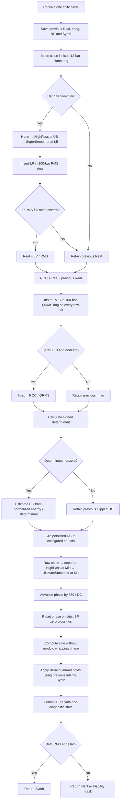

# Synthetic Oscillator — research prototype master reference

This folder provides a standalone specification, a standard-library Python
streaming implementation, and reference data for Python, Go, TypeScript, Rust
and Zig. It implements John F. Ehlers' **April 2026 “A Synthetic Oscillator”**
using the complete supplied TradeStation Traders' Tips listing as the primary
algorithmic source. All 16 parameter cases were confirmed on **2026-10-16**.

`SyntheticOscillator(lower_bound=15, upper_bound=25, length=4).update(close)`
returns the synthesized oscillator as a scalar in $[-1,1]$. The first **110
returned values are NaN** under the fresh-stream contract below. The internal
clock and zero-crossing synchronization continue throughout that interval.
The horizontal zero plot is a constant reference line. `state` exposes the
intermediate calculations as a `SyntheticState` named tuple.

## Source scope and fidelity

The input folder contains `tips/tips.md`, complete EasyLanguage code, and
several platform translations. It contains **no article `content.md` and no
Mesa paper**. Consequently, this document reproduces all mathematical steps
in the supplied EasyLanguage listing, and derives their theoretical meaning;
it does not claim to reproduce equations or prose from an unavailable article
or book chapter. The article's bibliographic link is recorded in the local
indicator catalog. References and BibTeX appear at the end.

The master follows the TradeStation assignment order, conditional persistence,
fixed Hann/RMS lengths, separate filter instances, phase resets and glitch
holds. The user's established full-precision preference is the default:
`math.pi`, `math.sqrt(2.0)` and $2\pi$ replace the printed `3.14159`, `1.414`
and `6.28`. `coefficient_mode="article"` preserves the printed constants.
The full-precision fixtures therefore intentionally differ slightly from the
printed-constant calculation. Startup without preloaded chart history is
defined explicitly here; exact TradeStation chart startup depends on history
and platform settings not supplied with the listing.

## Principles and physical analogies

A conventional oscillator often plots a detrended, filtered price. Its
amplitude, shape and phase can change when price trends or volatility changes.
This construction instead measures a bounded cycle period and uses it to
advance a sine-wave clock. A second filtered-price path supplies timing events
that reset that clock. It produces a prescribed waveform whose frequency and
alignment depend on the observed market, rather than preserving the market's
filtered amplitude.

The measurement path first attenuates very fast price variation with a Hann
FIR. A highpass removes slow components, and a SuperSmoother attenuates fast
components. Their cascade favors an intermediate range of periods. RMS
normalization expresses its output relative to recent signal energy. A
normalized backward difference provides an approximate quadrature component.
Together these components describe a rotating point in a plane. Angular speed
of that point gives a period estimate.

The electrical analogy is a pair of frequency-selective networks followed by
amplitude normalization and phase detection. The real and imaginary components
resemble orthogonal channels of a rotating phasor. The derivative channel is
only approximate quadrature; the construction is not an exact Hilbert
transform or an exact analytic-signal estimator for arbitrary prices.

The synthesis path resembles an oscillator clock synchronized by external
events. The clock advances according to the measured period; upward and
downward zero crossings of a separate bandpass re-align it twice per observed
cycle. This is analogous to phase synchronization, but the source uses abrupt
resets rather than a conventional continuously corrected phase-locked loop.
Its quadrant rules hold the previous output when a reset would create a
particular backward step. Filtering is linear, while normalization, period
clipping, resets and holds make the complete indicator nonlinear.

The Traders' Tips discussion presents it for responsive, smooth signals and
mean-reversion trading. A smooth unit-amplitude output does not establish that
a reliable cycle is present. For example, zero input still drives a sine clock
at `lower_bound` after warmup. Period bounds constrain the model; they do not
prove that the price contains a cycle within those bounds.

## Notation and complete filter equations

Let $x_t$ denote the close at zero-based raw-bar index $t$. A subscript $t-1$
means the preceding observation of that particular series. Each recursive
filter has independent raw-input and output histories. The source's
`Cosine` and `Sine` take **degrees**; Python trigonometric functions take
radians.

### Hann-windowed lowpass FIR

For $N=12$, the source loops from $c=1$ through $N$, inclusive:

$$
\begin{aligned}
w_c&=1-\cos_{\mathrm{degrees}}\left(\frac{360c}{N+1}\right)
    =1-\cos\left(\frac{2\pi c}{N+1}\right),\\
C_N&=\sum_{c=1}^{N}w_c,\\
h_t&=\frac{\sum_{c=1}^{N} w_c x_{t-c+1}}{C_N}.
\end{aligned}
$$

The newest close has weight $w_1$; the oldest has weight $w_N$. Both endpoint
weights are nonzero because the denominator is $N+1$, not $N-1$. The normalized
weights are symmetric and sum to one. In exact arithmetic $C_N=N+1=13$ for
$N=12$. The master computes the sequential coefficient sum as the source
does, rather than replacing it with 13. Both numerator and denominator use
ordinary newest-to-oldest addition, without compensated summation.

As a derived FIR property, the symmetric length-12 kernel has group delay
$(N-1)/2=5.5$ bars wherever its frequency response has a consistent phase
branch. This delay belongs to the measurement path. The separate timing path
uses raw closes and bypasses Hann. A partial-window Hann would have different
startup weights and would alter recursive states later in the stream.

### Shared second-order coefficients

For a fixed positive period $P$, the printed HighPass and UltimateSmoother
coefficients are

$$
\begin{aligned}
a_1&=\exp\left(-\frac{1.414\cdot3.14159}{P}\right),\\
b_1&=2a_1\cos_{\mathrm{degrees}}\left(\frac{1.414\cdot180}{P}\right),\\
c_2&=b_1,\qquad c_3=-a_1a_1,\\
c_1&=\frac{1+c_2-c_3}{4}.
\end{aligned}
$$

For the full-precision master, define

$$
\theta_P=\frac{\sqrt{2}\pi}{P},\qquad
r_P=e^{-\theta_P},\qquad b_P=2r_P\cos\theta_P,\qquad
s_P=r_Pr_P,\qquad g_P=\frac{1+b_P+s_P}{4}.
$$

Then $c_2=b_P$, $c_3=-s_P$, and $c_1=g_P$. In article mode the exponential
uses both rounded constants, while the cosine converts its degree angle using
full pi. Using rounded pi to convert that degree angle would change the source
formula. Hann and sine degree conversion also use full pi in both modes.

### HighPass

For input $v_t$, the complete source recurrence is

$$
p_t=c_1(v_t-2v_{t-1}+v_{t-2})+c_2p_{t-1}+c_3p_{t-2}.
$$

The first three actual inputs return zero; recursion begins on the fourth
actual input (`CurrentBar >= 4`). This rule is applied on each helper's local
clock under the startup contract. The measurement instance uses
$P=UpperBound$; the independent timing instance uses $P=Mid$.

The derived transfer function, with $q=z^{-1}$ denoting a delay, is

$$
H_{HP,P}(z)=\frac{g_P(1-q)^2}{1-b_Pq+s_Pq^2}.
$$

Its numerator is a second difference with a double zero at DC, suppressing
constant and slowly varying components. In full precision $H_{HP,P}(-1)=1$.
The denominator has poles $r_Pe^{\pm j\theta_P}$, inside the unit circle for
finite positive $P$ in exact arithmetic.

### SuperSmoother

The supplied listing names its coefficients differently:

$$
\begin{aligned}
Q&=\exp\left(-\frac{1.414\cdot3.14159}{P}\right),\\
C_1&=2Q\cos_{\mathrm{degrees}}\left(\frac{1.414\cdot180}{P}\right),\\
C_2&=QQ,\\
A_0&=\frac{1-C_1+C_2}{2},\\
l_t&=A_0(v_t+v_{t-1})+C_1l_{t-1}-C_2l_{t-2}.
\end{aligned}
$$

The first three actual inputs pass through; recursion begins on the fourth.
The measurement instance uses $P=LowerBound$. Full precision substitutes
$Q=r_P$, $C_1=b_P$ and $C_2=s_P$. Preserve the source's folded divide by two
in $A_0$ and multiplication by $(v_t+v_{t-1})$ when porting; algebraically
equivalent rearrangements can change floating-point rounding.

Its derived response is

$$
H_{SS,P}(z)=\frac{[(1-b_P+s_P)/2](1+q)}{1-b_Pq+s_Pq^2}.
$$

It has DC gain one and a zero at the Nyquist frequency. The measurement
cascade is $H_{Hann}(z)H_{HP,UpperBound}(z)H_{SS,LowerBound}(z)$.
Periods are filter design scales; the cascade does not have perfectly sharp
edges at the bounds.

### UltimateSmoother

Using the HighPass coefficient names, the complete source recurrence is

$$
u_t=(1-c_1)v_t+(2c_1-c_2)v_{t-1}-(c_1+c_3)v_{t-2}
    +c_2u_{t-1}+c_3u_{t-2}.
$$

The first three actual inputs pass through; recursion begins on the fourth.
The timing instance uses $P=Mid$ and consumes the timing HighPass output.
Since $c_3$ is negative, its contribution must not be negated a second time.
In master notation the input's second-lag term is $-(g_P-s_P)v_{t-2}$.

Its derived response is

$$
\begin{aligned}
H_{US,P}(z)&=\frac{(1-g_P)+(2g_P-b_P)q-(g_P-s_P)q^2}
                   {1-b_Pq+s_Pq^2}\\
           &=1-H_{HP,P}(z).
\end{aligned}
$$

Subtracting a highpass from an unfiltered signal preserves slow components
with small phase displacement near DC. This explains the smoother's low-lag
design; it is not a prediction of future prices. The timing cascade is
$H_{HP,Mid}(z)H_{US,Mid}(z)$, with both DC and Nyquist attenuation. The filters
share coefficients but must keep separate histories.

## RMS normalization and quadrature

For either input series $v$, the source's length-$M$ RMS, with $M=100$, is

$$
S_t=\sum_{k=0}^{M-1}v_{t-k}v_{t-k},\qquad
R_t=\begin{cases}
\sqrt{S_t/M},&S_t\ne0,\\
R_{t-1},&S_t=0.
\end{cases}
$$

The result is initialized to zero. The zero-sum branch retains the previous
RMS, because the source only assigns a function result when `SumSq <> 0`.
Thus a full zero window after nonzero history can retain a nonzero result.
The sum runs newest to oldest and divides by the fixed 100. It does not
subtract a sample mean: RMS measures signal energy, whereas centered standard
deviation measures deviation from the window mean.

The complete normalization steps are

$$
\begin{aligned}
RMS_t&=RMS_{100}(LP)_t,\\
Real_t&=\begin{cases}LP_t/RMS_t,&RMS_t\ne0,\\Real_{t-1},&RMS_t=0,\end{cases}\\
ROC_t&=Real_t-Real_{t-1},\\
QRMS_t&=RMS_{100}(ROC)_t,\\
Imag_t&=\begin{cases}ROC_t/QRMS_t,&QRMS_t\ne0,\\Imag_{t-1},&QRMS_t=0.\end{cases}
\end{aligned}
$$

Before the first complete LP RMS window, `Real` retains its initialized zero.
`ROC` and its RMS still consume one actual held-state difference on every raw
bar. Before a complete QRMS window, `Imag` retains zero. These availability
rules supplement the source's conditional assignments for a fresh stream.

For an ideal sinusoid, differentiation gives a sine approximately 90 degrees
from the cosine. A backward difference instead has response

$$
1-e^{-j\omega}=2j\sin(\omega/2)e^{-j\omega/2},
$$

which includes a half-bar phase offset. Independent RMS normalization removes
much of the amplitude difference but cannot make arbitrary signals perfectly
orthogonal. This approximation and changing normalization windows affect the
cycle estimate.

## Dominant cycle measurement

The exact signed denominator in the supplied listing is

$$
D_t=(Real_t-Real_{t-1})Imag_t-(Imag_t-Imag_{t-1})Real_t.
$$

The source calculates and persists a period, then clips that stored period:

$$
\begin{aligned}
DC_t^*&=\begin{cases}
K\dfrac{Real_t^2+Imag_t^2}{D_t},&D_t\ne0,\\
DC_{t-1},&D_t=0,
\end{cases}\\
DC_t&=\min\bigl(UpperBound,\max(LowerBound,DC_t^*)\bigr),\\
K&=\begin{cases}2\pi,&\text{full precision},\\6.28,&\text{article constants}.\end{cases}
\end{aligned}
$$

`DC` starts at zero and is immediately clipped to `LowerBound` on the first
raw bar. On a zero denominator, retain the **previous clipped DC**, not a
fresh zero, a lower-bound fallback, or the previous unclipped estimate. Do not
take an absolute value or replace the exact zero check with an epsilon.
Negative estimates clip to `LowerBound`.

The following theoretical derivation explains the denominator and its sign.
For $z(t)=R(t)+jI(t)$, where $R=Real$ and $I=Imag$, the argument derivative is

$$
\frac{d}{dt}\arg z(t)=\frac{R I'-I R'}{R^2+I^2}.
$$

The source's $D$ approximates the numerator of the **negative** argument
derivative. With $R=\cos(\omega t)$ and $I=-\sin(\omega t)$ the phasor rotates
clockwise, so the source denominator is positive. In the continuous ideal,
$D/(R^2+I^2)=\omega$ and the period is $2\pi/\omega$.

For ideal unit-circle samples with that orientation, backward differences give

$$
D_t=R_tI_{t-1}-R_{t-1}I_t=\sin\omega,\qquad
DC_t^*=\frac{2\pi}{\sin\omega}.
$$

Thus the discrete formula is not exactly $2\pi/\omega$ even for ideal
quadrature. For a 20-bar sinusoid it gives about 20.33 bars before clipping.
The discrepancy becomes small for long cycles, since $\sin\omega\approx
\omega$. The actual derivative-based channel, finite RMS windows and filters
introduce further departures from that ideal.

## Independent phase synchronization and synthesis

The timing period is the fixed geometric midpoint of the configured bounds:

$$
Mid=\sqrt{LowerBound\cdot UpperBound},\qquad
HP2_t=HighPass(x,Mid)_t,\qquad BP_t=UltimateSmoother(HP2,Mid)_t.
$$

It satisfies $Mid/LowerBound=UpperBound/Mid$. It is symmetric on a logarithmic
period scale, rather than an arithmetic average or the current measured $DC$.
Retain fractional $Mid$; truncation can shift bandpass zero crossings.

For each raw bar, the complete phase calculation, in degrees, is

$$
\begin{aligned}
\widetilde{\phi}_t&=\phi_{t-1}+360/DC_t,\\
\phi_t&=\begin{cases}
180/DC_t,&BP_t>0\ \text{and}\ BP_{t-1}\le0,\\
180+180/DC_t,&BP_t<0\ \text{and}\ BP_{t-1}\ge0,\\
\widetilde{\phi}_t,&\text{otherwise}.
\end{cases}
\end{aligned}
$$

Initial $\phi$, $BP$ and `Synth` states are zero. A crossing requires the
current BP to be strictly positive or strictly negative. Landing exactly on
zero alone causes no reset. A subsequent departure from zero to the opposite
strict sign qualifies under the contract above. Each reset is offset by
$180/DC_t$, half the normal $360/DC_t$ step.

The sine and source glitch rules are

$$
\begin{aligned}
s_t^*&=\sin(\pi\phi_t/180),\\
Synth_t&=\begin{cases}
Synth_{t-1},&0<\phi_t<90\ \text{and}\ s_t^*<Synth_{t-1},\\
Synth_{t-1},&180<\phi_t<270\ \text{and}\ s_t^*>Synth_{t-1},\\
s_t^*,&\text{otherwise}.
\end{cases}
\end{aligned}
$$

Phase is **not reduced modulo 360**. Although sine is periodic, the hold rules
compare the actual accumulated angle to the literal ranges $(0,90)$ and
$(180,270)$. Modulo wrapping would activate holds on later revolutions and
change the output. The previous `Synth` used by these rules is always the
previous internal finite value, even when the API returned NaN during warmup.
The holds do not change the stored phase.

## Parameters, API and availability

| Parameter | Default | Valid range | Role |
| --- | --- | --- | --- |
| `lower_bound` / LB | 15 | Finite real $\ge1$, no greater than UB | SuperSmoother period and minimum measured DC. |
| `upper_bound` / UB | 25 | Finite real $\ge1$, no less than LB | Measurement HighPass period and maximum measured DC. |
| `length` / L | 4 | Positive integer; booleans excluded | Declared source input, unused by the core oscillator. |
| `coefficient_mode` | `"full_precision"` | `"full_precision"` or `"article"` | Selects filter constants and $K$. |
| Hann length | 12 | Fixed in this oscillator | Measurement preprocessing window. |
| LP RMS length | 100 | Fixed in this oscillator | Real-channel energy normalization. |
| ROC RMS length | 100 | Fixed in this oscillator | Imaginary-channel energy normalization. |

The product `lower_bound * upper_bound` must remain finite. Bounds can be
equal, fixing $DC$ while leaving the filters and crossing resets active.
The accepted periods 1 and 2 test numerical boundary behavior; they do not
identify price cycles below the sampling system's Nyquist limit. Very large
periods can lose coefficient resolution or have transients longer than a
252-bar record. Priming means required observations exist, not that those
transients have decayed.

`Length` does not change any oscillator computation. `Synth2` and `ROC2` are
also declared but unused in the TradeStation oscillator listing. The Python,
RealTest and Wealth-Lab demonstrations apply an additional Hann of `Length`
to `Synth`, then take its one-bar difference to make trading signals. Those
extra strategy calculations are outside this scalar master.

`update(close)` processes one finite close exactly once and returns one float.
NaN and infinity inputs raise `ValueError` before advancing any stage. Helper
calculations also reject nonfinite intermediate filter/RMS values; unusually
large magnitudes that overflow are outside the supported numerical domain.
No missing-input skip, resampling or automatic restart is implied. `reset()`
clears all history and reproduces a fresh run. Parameters are fixed for an
instance; changing them requires another instance.

The diagnostic named tuple `state` contains, in order, `hann`, `highpass`,
`lowpass`, `real`, `roc`, `imag`, `denominator`, `dominant_cycle`, `bandpass`,
`phase_degrees`, `synth`. Unavailable measurement filters appear as NaN there;
held Real/Imag states and the timing/synthesis states remain available.
`is_primed` is true when both RMS rings contain 100 observations.
`warmup_bars` is 110; `midpoint`, bounds, length and mode are readable
properties.

### Reproducible fresh-stream startup

| Raw close index | Measurement availability | Other state updates |
| --- | --- | --- |
| 0–10 | Hann has fewer than 12 actual closes; measurement HP/LP do not advance. | Real/Imag stay initialized zero; ROC, QRMS, timing HP/US, DC, phase and Synth advance. |
| 11–13 | Hann is available; first three measurement HP inputs return zero and SS passes through those zeros. LP RMS starts filling at index 11. | Timing filters already use their recurrences; phase/reset logic continues. |
| 14–98 | Measurement HP/SS recurse; LP RMS remains incomplete. | ROC/QRMS continue to observe held Real differences each raw bar. |
| 99–109 | LP RMS remains incomplete; Real is still zero. | QRMS has a complete 100-observation ring, initially all zero. |
| 110 onward | LP RMS has 100 actual LP observations; both RMS rings are primed. | Nonzero RMS values permit normalization; returned Synth is finite. |

The last row follows $11+(100-1)=110$. There is no additional 100-bar delay
after Real becomes available because its held zeros and resulting ROC values
have already filled the QRMS ring. There are exactly 110 leading NaNs, indices
0–109, and 142 finite results in each 252-element expected array.

These NaNs are an **output availability mask**, not recursive input values.
Do not store them in previous Synth or feed them to any filter. The master
does not zero-pad missing Hann/LP history or divide RMS by a partial count.
Preloaded platform charts can use earlier price history and different
function clocks; compare them using equivalent history and initialization,
rather than treating the first visible chart bar as a fresh stream.

## Algorithmic calculation flow



Each Biquad retains two inputs and two outputs. Hann stores 12 closes; each
RMS stores 100 squared observations. History storage is bounded independently
of the stream length. Ordinary sequential sums take $O(12+100+100)$ work per
fully active update. Avoid a rolling RMS sum when exact master arithmetic is
desired: addition/subtraction of an accumulator changes rounding compared
with the source's fresh newest-to-oldest sum.

## Confirmed reference cases

All cases use full precision, a fresh instance and the same 252 `INPUT_CLOSE`
values. The comments in the “What it tests” column are copied verbatim before
every expected array, followed by a separate parameter-value comment.

| LB | UB | L | What it tests |
| ---: | ---: | ---: | --- |
| 15 | 25 | 4 | TradeStation default. |
| 15 | 25 | 8 | Unused Length input leaves output unchanged. |
| 17 | 23 | 8 | Python tip's example bounds. |
| 1 | 2 | 4 | Minimum supported periods. |
| 8 | 16 | 4 | Short-cycle response. |
| 10 | 20 | 4 | One-octave range. |
| 12 | 24 | 4 | Intermediate-cycle range. |
| 20 | 20 | 4 | Equal bounds fix the measured period. |
| 20 | 40 | 4 | Longer one-octave range. |
| 30 | 60 | 4 | Slower cycle range. |
| 60 | 120 | 4 | Long filter memory. |
| 100 | 200 | 4 | Periods near the record length. |
| 126 | 252 | 4 | Upper bound equals the record length. |
| 15.5 | 25.5 | 4 | Fractional periods. |
| 15 | 25 | 1 | Minimum unused Length value. |
| 15 | 25 | 12 | Larger unused Length value. |

There are 16 expected arrays, totaling 4,032 outputs, in each language file.
All four copied input arrays (Close, High, Low, Open) remain intact; only Close
is consumed by this indicator. With inputs included, each file has 20 arrays
and 5,040 values. The four LB15/UB25 cases are identical apart from their names
and parameter comments, explicitly demonstrating that Length is inert.

| Language/file | Default expected name | NaN spelling |
| --- | --- | --- |
| Python `test_testdata.py` | `EXPECTED_LB15_UB25_L4` | `math.nan` |
| Go `testdata_test.go` | `expectedLB15_UB25_L4` | `math.NaN()` |
| TypeScript `testdata.ts` | `expectedLB15_UB25_L4` | `NaN` |
| Rust `testdata.rs` | `expected_lb15_ub25_l4()` | `f64::NAN` |
| Zig `testdata.zig` | `expectedLB15_UB25_L4()` | `nan` |

Fractional tokens replace the decimal point with an underscore, for example
`EXPECTED_LB15_5_UB25_5_L4`. Go's package is `syntheticoscillator`. TypeScript
uses valid exported `number[]` constants; Rust functions return `Vec<f64>`;
Zig functions return `[252]f64`. Go imports `math`. Zig defines
`const math = @import("std").math;` and `const nan = math.nan(f64);`.

Floating-point calculations use binary64 throughout; rounding happens only
when emitting decimal literals with `.15g` (**15 significant digits**, not 15
decimal places). The emitted Python arrays are reopened and verified before
their values are translated to the other languages. Compare calculated ports
with an absolute/relative tolerance such as $5\times10^{-13}$, treating NaNs
separately. Bitwise fixture equality checks validate literal translation, not
bitwise equality of all platforms' exponential and trigonometric libraries.

The default first five available values, indices 110–114, are

```text
0.4067366430758
-0.20791169081776
-0.444635179184928
0.125333233564304
0.368124552684678
```

## Usage and regeneration

Run from this folder:

```sh
python3 synthetic-oscillator.py
python3 synthetic-oscillator.py --generate-reference-data
python3 -m unittest -v test_synthetic_oscillator.py
```

The first command demonstrates streaming updates on the embedded 252 closes
and prints the first available default results. The second generates all 16
confirmed cases in all five fixture files. It appends a marked expected-data
section on the first generation, then replaces only that section on reruns.
The embedded Close array is checked against the copied Python fixture.

Because the requested filename contains a hyphen, import it explicitly by
path when embedding it in another Python program:

```python
import importlib.util
import math
from pathlib import Path

path = Path("synthetic-oscillator.py")
spec = importlib.util.spec_from_file_location("synthetic_master", path)
master = importlib.util.module_from_spec(spec)
spec.loader.exec_module(master)

oscillator = master.SyntheticOscillator(15, 25, 4)
for close in closes:  # Supply chronological finite closes.
    value = oscillator.update(close)
    if not math.isnan(value):
        print(value, oscillator.state.dominant_cycle)
```

## Differences among supplied platform implementations

The platform files are useful corroboration but are not interchangeable
numeric oracles. The following differences are present in the supplied code.

| Source | Material differences from this master |
| --- | --- |
| TradeStation EasyLanguage | Primary formulas and state persistence; printed constants. Full-window availability and local measurement-helper startup are explicitly supplied by this master for a fresh stream. |
| TradingView Pine | Hann numerator is written `filt += 1.0 - p*src[c-1]`, missing parentheses around `(1-p)`. It is not the TradeStation Hann. Mid is truncated to an integer; IIR recursion starts at zero-based `bar_index >= 4`; filter coefficients use 1.414 with full pi; DC uses 6.28 and zero-denominator DC is reset to zero then clipped. Phase uses radians, which is otherwise an equivalent formulation. |
| Python tip and notebook | Hann uses partial windows; RMS divides by the available-window count during startup. Filters use rounded 1.414 with full pi. Core phase/DC loops start at index 1. Crossings include arrival at zero from a strict sign, unlike the strict current-sign rule above. Zero-denominator DC falls back to LB; the estimator uses full $2\pi$. The demo adds Hann(`Length`) and ROC2 trading signals. |
| NinjaTrader | Hann and RMS permit partial-history startup; main output skips the first four zero-based bars. Zero-denominator DC falls back to LB, and Real/Imag return zero on zero normalization. DC uses full $2\pi$, while filter damping still uses rounded 1.414. HannLength is separately exposed. |
| RealTest | Uses printed coefficient/DC constants. On a zero denominator it retains previous **rawDC**, then clips; TradeStation retains its previously clipped DC. It also adds Hann(`Len`) and ROC2 strategy calculations. |
| Wealth-Lab | The supplied C# file is a trading strategy calling an opaque built-in `SyntheticOscillator`. It does not expose the core implementation for numerical verification. Length controls an added Hann/Momentum signal calculation. |
| NeuroShell | Tips explain using an external DLL, but supply no additional oscillator recurrence. |

These are implementation differences, not variants silently combined into the
master. In particular, changing Hann parentheses, midpoint rounding, zero
conditions or startup changes histories and may affect much later outputs.

## Verification record — 2026-10-16

All **13 Python tests pass, with no skips**. They compare all 16 cases in both
precision modes against an independent batch oracle that extracts expressions
from the actual supplied EasyLanguage listing and uses this documented startup
contract. Additional checks cover Hann weights, all three filter transfer
responses, the exact 110-NaN prefix, continuous timing state, crossing resets,
quadrant holds, unwrapped phase, cycle orientation, zero-denominator
persistence, bounds, inert Length, zero-input clocks, conditional RMS
persistence, causal prefixes, reset reproducibility, scale behavior and
invalid input.

Every generated Python array is checked for length, names, comments, warmup
and agreement with the oracle; translated arrays are compared with Python.
Regenerating twice in a temporary directory produces byte-for-byte identical
fixture files and preserves every copied input array and the embedded closes.

Temporary native validators also compile/load Go, Rust, Zig and TypeScript
fixtures and verify **all 20 arrays / 5,040 values per language** against the
Python fixture. Finite literals match binary64 bit patterns exactly; NaNs are
checked with each language's NaN predicate. These checks validate the supplied
data files, not indicator implementations in those four languages.

## References

1. John F. Ehlers, “A Synthetic Oscillator,” *Technical Analysis of STOCKS &
   COMMODITIES*, April 2026, volume 44. [Article link from the local
   catalog](https://technical.traders.com/archive/article.asp?file=\V44\C04\106EHLE.pdf).
   The article body was not supplied or consulted.
2. *Traders' Tips: April 2026 — A Synthetic Oscillator*, Technical Analysis,
   Inc. [Publisher page](https://www.traders.com/Documentation/FEEDbk_docs/2026/04/TradersTips.html).
   Local discussion: `../../tasc/2026-04-a-synthetic-oscillator/tips/tips.md`.
3. John F. Ehlers' complete EasyLanguage indicator and five helper functions,
   presented by John Robinson for TradeStation in that Tips issue. Local
   `tips/SyntheticOscillator.els` is the primary equation source. Function
   comments carry 2004–2024 or 2025 copyrights; the issue is April 2026.
4. PineCoders, TradingView Pine Script v6 translation in the same issue,
   local `tips/SyntheticOscillator.pine`.
5. Rajeev Jain, February 2026 Python contribution and supporting notebook,
   local `tips/SyntheticOscillator.py` and
   `tips/other/Apr_2026_synthetic_oscilator_final.ipynb`.
   [Contributor repository](https://github.com/jainraje/TraderTipArticles).
6. NinjaTrader contribution, credited to Jesse N. in Tips and
   NinjaTrader_ChelseaB in source, local `tips/ninja-trader/` oscillator and
   Hann, HighPass, SuperSmoother, UltimateSmoother and RMS helper files.
7. Marsten Parker, RealTest contribution, local
   `tips/SyntheticOscillator.rtest`.
8. Robert Sucher, Wealth-Lab strategy contribution, local
   `tips/SyntheticOscillator.cs`.

All paths in items 3–8 are relative to
`../../tasc/2026-04-a-synthetic-oscillator/`. The phasor derivative, discrete
determinant, transfer functions and group-delay discussion above are
derivations from the supplied formulas, not additional cited article content.

```bibtex
@article{ehlers2026synthetic,
  author = {Ehlers, John F.},
  title = {A Synthetic Oscillator},
  journal = {Technical Analysis of STOCKS \& COMMODITIES},
  volume = {44},
  year = {2026},
  month = apr,
  url = {https://technical.traders.com/archive/article.asp?file=%5CV44%5CC04%5C106EHLE.pdf},
  note = {Bibliographic link from local catalog; article body not supplied}
}

@misc{traders_tips_2026_04,
  author = {{Technical Analysis, Inc.}},
  title = {Traders' Tips: April 2026 -- A Synthetic Oscillator},
  year = {2026},
  month = apr,
  url = {https://www.traders.com/Documentation/FEEDbk_docs/2026/04/TradersTips.html},
  note = {Local tips.md and accompanying source listings; consulted 2026-10-16}
}

@misc{ehlers_robinson2026synthetic_code,
  author = {Ehlers, John F. and Robinson, John},
  title = {Synthetic Oscillator: TradeStation EasyLanguage Listing and Helpers},
  year = {2026},
  month = apr,
  howpublished = {Traders' Tips, TradeStation contribution},
  url = {https://www.traders.com/Documentation/FEEDbk_docs/2026/04/TradersTips.html},
  note = {Local tips/SyntheticOscillator.els; primary algorithmic reference}
}

@misc{pinecoders2026synthetic,
  author = {{PineCoders}},
  title = {A Synthetic Oscillator: TradingView Pine Script v6},
  year = {2026},
  month = apr,
  howpublished = {Traders' Tips, TradingView contribution},
  url = {https://www.traders.com/Documentation/FEEDbk_docs/2026/04/TradersTips.html},
  note = {Local tips/SyntheticOscillator.pine}
}

@misc{jain2026synthetic,
  author = {Jain, Rajeev},
  title = {A Synthetic Oscillator: Python Code and Supporting Notebook},
  year = {2026},
  month = feb,
  url = {https://github.com/jainraje/TraderTipArticles},
  note = {April 2026 Traders' Tips; local SyntheticOscillator.py and
          other/Apr_2026_synthetic_oscilator_final.ipynb, including helper definitions}
}

@misc{ninjatrader2026synthetic,
  author = {{NinjaTrader}},
  title = {Synthetic Oscillator and Filter Helpers for NinjaTrader 8},
  year = {2026},
  month = apr,
  howpublished = {Traders' Tips, NinjaTrader contribution},
  url = {https://www.traders.com/Documentation/FEEDbk_docs/2026/04/TradersTips.html},
  note = {Local tips/ninja-trader/*.cs; credits Jesse N. and NinjaTrader_ChelseaB}
}

@misc{parker2026synthetic,
  author = {Parker, Marsten},
  title = {Synthetic Oscillator: RealTest Indicator and Strategy},
  year = {2026},
  month = apr,
  howpublished = {Traders' Tips, MHP Trading contribution},
  url = {https://www.traders.com/Documentation/FEEDbk_docs/2026/04/TradersTips.html},
  note = {Local tips/SyntheticOscillator.rtest}
}

@misc{sucher2026synthetic,
  author = {Sucher, Robert},
  title = {Synthetic Oscillator: Wealth-Lab Strategy Demonstration},
  year = {2026},
  month = apr,
  howpublished = {Traders' Tips, Wealth-Lab contribution},
  url = {https://www.traders.com/Documentation/FEEDbk_docs/2026/04/TradersTips.html},
  note = {Local tips/SyntheticOscillator.cs; calls the built-in oscillator}
}
```
