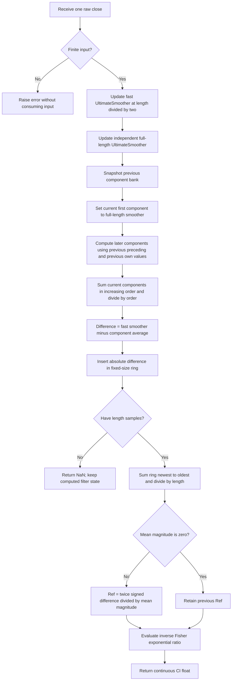

# The Continuation Index: research prototype master reference

This folder defines a causal, streaming reference for John F. Ehlers' **The Continuation Index**, published in the September 2025 issue of *Technical Analysis of Stocks & Commodities*. Its single output is a dimensionless oscillator that usually spends time near +1 or -1. It compares a fast UltimateSmoother to a slower filtered trend reference, normalizes their signed difference by its trailing mean absolute magnitude, and compresses that normalized difference with an inverse Fisher transform.

The algorithm follows the **EasyLanguage equations in the TASC article and Mesa paper**, using full-precision $\pi$ and $\sqrt{2}$ at the user's request. These replace the printed 3.14159 and 1.414 approximations, so the current expected values differ slightly from the literal-constant version. Several accompanying platform implementations also differ in startup or normalization. In particular, the Python Traders' Tip uses a centered convolution that reads future samples. This master preserves the article's trailing average and its printed component recurrence instead. All relevant source mathematics, startup assumptions, and discrepancies are recorded here so a port needs no access to the original articles.

## 1. Sources and intended interpretation

The supplied materials are:

- [TASC article](../../tasc/2025-09-the-continuation-index/content.md): *The Continuation Index — Trend Onset And Trend Exhaustion*, John F. Ehlers, September 2025, volume 43, issue 9, pages 9–12.
- [Mesa paper](../../tasc/2025-09-the-continuation-index/mesa/content.md): *Continuation Index*, with the same explanation and all three EasyLanguage code listings.
- [September 2025 Traders' Tips](../../tasc/2025-09-the-continuation-index/tips/tips.md), including TradeStation, TradingView, Python, and NinjaTrader implementations, plus Wealth-Lab and NeuroShell examples.
- [TradeStation code](../../tasc/2025-09-the-continuation-index/tips/TradeStation_ContinuationIndex.els), [TradingView code](../../tasc/2025-09-the-continuation-index/tips/TradingView_ContinuationIndex.pine), [Python code](../../tasc/2025-09-the-continuation-index/tips/Python_ContinuationIndex.py), and [NinjaTrader code](../../tasc/2025-09-the-continuation-index/tips/ninja-trader/ContinuationIndex.cs), with its companion [UltimateSmoother](../../tasc/2025-09-the-continuation-index/tips/ninja-trader/UltimateSmoother.cs) and [LaguerreFilter](../../tasc/2025-09-the-continuation-index/tips/ninja-trader/LaguerreFilter.cs).

The input collection does not contain a book chapter. Books and earlier articles mentioned in the supplied further reading are included in the references and BibTeX. No missing chapter equations are invented or attributed to them. Transfer-function and physical-analogy derivations below supplement the supplied equations and are identified as explanations of those equations.

Ehlers' initial observation is that prices tend to stay on one side of a Laguerre-filter trend line during a trend. He interprets a CI near +1 as a long bias, and a CI near -1 as a flat or short bias. A reversal then suggests exhaustion of one trend and onset of the other. Departures from a stable positive state are described as potential "buy on a dip" opportunities, with analogous "sell short on a pop" behavior in a negative state.

These are the article's intended uses, not discrete states returned by the algorithm. The output is continuous. The master does not place orders, determine position size, or impose a trading threshold. A zero-crossing depends on the **fast filtered price minus the trend reference**, not literally on the raw close crossing that reference.

## 2. Basic principles and physical analogies

### 2.1 A fast measurement compared with a delayed reference

Write the input as $x_t$, where $t=0,1,\ldots$ is a zero-based bar index. A fast smoother suppresses some noise while retaining current movement. A slower reference describes the recent trend with greater delay. Their signed separation,

$$\Delta_t=U_t-L_t,$$

is positive when the fast estimate is above the reference and negative when it is below. This is analogous to comparing a rapidly responding sensor with a slower, damped sensor of the same process. The slower sensor represents persistence; their separation measures the departure from that persistent level. There is no physical prediction of the next price and no need to read a future bar.

Increasing damping or adding more delayed stages usually makes the reference slower. This can make a trend state steadier, while smaller delay can produce faster reversals and more whipsaws. These tradeoffs explain the article's gamma and order comparisons.

### 2.2 UltimateSmoother as allpass minus highpass

The TradingView source explains the UltimateSmoother as subtracting a highpass response from an allpass response. Here the allpass path is the unfiltered input with transfer function 1. If a highpass removes the slow components, subtracting its output leaves a lowpass result that retains low-frequency movement.

For a fixed period $P$, the original printed source defines

$$q(P)=\exp\!\left(-\frac{1.414\times3.14159}{P}\right),$$

$$c_1(P)=2q(P)\cos\!\left(\frac{1.414\times180}{P}\text{ degrees}\right),$$

$$c_2(P)=q(P)^2,\qquad a_0(P)=\frac{1+c_1(P)+c_2(P)}{4}.$$

Those equations record the article's literal form. **The executable master uses full-precision constants**: `EHLERS_PI = math.pi` and `EHLERS_SQRT_TWO = math.sqrt(2.0)`, whose binary64 values are approximately 3.141592653589793 and 1.4142135623730951. Its current coefficients are

$$\theta(P)=\frac{\sqrt{2}\,\pi}{P},\qquad q(P)=e^{-\theta(P)},\qquad c_1(P)=2q(P)\cos\theta(P),$$

$$c_2(P)=q(P)^2,\qquad a_0(P)=\frac{1+c_1(P)+c_2(P)}{4}.$$

EasyLanguage `Cosine` accepts degrees; the current master expresses that angle directly in radians and uses the same full-precision angle for the exponential and cosine. Language ports must use their full-precision pi and square-root values to match these fixtures. This precision policy changes coefficient values, while the recurrence, startup, parameter cases, and NaN positions retain their definitions below. The expected arrays have been regenerated for this policy and remain serialized at 15 significant digits.

The complete UltimateSmoother recurrence is

$$\begin{aligned}
S_t(P)={}&(1-a_0)x_t+(2a_0-c_1)x_{t-1}+(c_2-a_0)x_{t-2}\\
&+c_1S_{t-1}(P)-c_2S_{t-2}(P).
\end{aligned}$$

It is applied on `CurrentBar >= 4`. For a standalone stream with `CurrentBar = t+1`, the source startup is

$$S_t(P)=x_t,\qquad t=0,1,2,$$

and the recurrence first runs at $t=3$. These three pass-through values populate both input and output histories. They are **valid filter values**, even while the final CI is still unprimed.

The following transfer functions are derived explanations of that recurrence. With $r=z^{-1}$,

$$H_{\mathrm{US}}(z)=
\frac{(1-a_0)+(2a_0-c_1)r+(c_2-a_0)r^2}
{1-c_1r+c_2r^2},$$

$$H_{\mathrm{HP}}(z)=
\frac{a_0(1-r)^2}{1-c_1r+c_2r^2},\qquad
H_{\mathrm{US}}(z)=1-H_{\mathrm{HP}}(z).$$

The highpass has a double zero at $z=1$, so the lowpass retains unity gain at zero frequency. The pole radius is $q<1$ for finite positive periods. This is stable damping, analogous to a damped second-order system. The UltimateSmoother can overshoot; it is not an EMA convex combination, and stability does not imply monotone response.

The source period is a coefficient-setting parameter expressed in bars, not a count of price observations to average. Larger $P$ gives slower damping and stronger long-term memory. No exact discrete-time cutoff identity is required for conversion; use the full-precision master coefficients above.

### 2.3 The article's actual Laguerre component bank

Let $g$ denote `gamma`, $N$ denote `order`, and $W$ denote `length`. The first component is a full-length UltimateSmoother:

$$\ell_{0,t}=S_t(W).$$

For each subsequent zero-based component $j=1,\ldots,N-1$, the **printed** source recurrence is

$$\boxed{\ell_{j,t}=-g\ell_{j-1,t-1}+\ell_{j-1,t-1}+g\ell_{j,t-1}.}$$

All components start with zero previous state:

$$\ell_{j,-1}=0.$$

The filtered trend output is an equal-weight average of the current components:

$$\boxed{L_t=\frac{1}{N}\sum_{j=0}^{N-1}\ell_{j,t}.}$$

The source's EasyLanguage indexing is one-based: `LG[count, 1]` holds the current value, and `LG[count, 2]` holds the previous value. It copies all current values to the previous column first. Both occurrences of the preceding component in its update then read the **previous column**. The master snapshots the previous bank before calculating current values, avoiding accidental use of a current preceding stage.

Algebraically, its later-stage update can be written

$$\ell_{j,t}=(1-g)\ell_{j-1,t-1}+g\ell_{j,t-1}.$$

This is a first-order damped relaxation driven by a **one-bar delayed preceding stage**, analogous to cascaded storage tanks: each tank receives yesterday's upstream level and retains some of its own level. The code retains the original three-term expression to preserve floating-point evaluation order.

Its derived stage transfer function is

$$A(z)=\frac{(1-g)z^{-1}}{1-gz^{-1}},$$

so the overall trend transfer function, after accounting for the input UltimateSmoother, is

$$H_L(z)=H_{\mathrm{US},W}(z)\frac{1}{N}\sum_{j=0}^{N-1}A(z)^j.$$

For $0\leq g<1$, a constant upstream value eventually propagates through all stages, giving $A(1)=1$. A stage's derived low-frequency delay is $1/(1-g)$ bars. Averaging the stages gives an approximate additional low-frequency delay of $(N-1)/(2(1-g))$ bars, before the full-length UltimateSmoother's contribution. These derived relationships explain why high gamma and high order make this particular bank slower. The complete finite-start response still depends on its zero initialization.

### 2.4 Important discrepancy: this is not the conventional Laguerre allpass update

A conventional Laguerre allpass cascade would contain the **current** preceding stage in a term:

$$\ell_{j,t}=-g\ell_{j-1,t}+\ell_{j-1,t-1}+g\ell_{j,t-1}.$$

That is a different recurrence. The supplied article, Mesa, TradeStation, TradingView, Python, and NinjaTrader listings consistently use the previous preceding stage in **both** first terms. This master implements that common printed code and does not silently repair it into a conventional Laguerre filter.

The prose also says that gamma zero makes the Laguerre output exactly an UltimateSmoother. The printed code actually gives, for $g=0$,

$$\ell_{j,t}=\ell_{j-1,t-1},\qquad
L_t=\frac{1}{N}\sum_{j=0}^{N-1}S_{t-j}(W),$$

with unavailable pre-stream values zero. Thus gamma zero produces a delayed $N$-tap FIR average of the full-length UltimateSmoother, and equals that smoother only when $N=1$ or in appropriate constant steady state. The **order-one** reduction asserted in the prose is correct for every gamma: $L_t=S_t(W)$.

Even when $N=1$, the CI does not generally vanish: it still compares $S_t(W/2)$ against $S_t(W)$. Parameter boundary tests preserve these distinctions.

## 3. Complete Continuation Index equations

Use two **separate** UltimateSmoother states, one for $P=W/2$ and one for $P=W$:

$$U_t=S_t(W/2),\qquad \ell_{0,t}=S_t(W).$$

Run the component bank above to obtain $L_t$, then compute the signed difference and magnitude:

$$\Delta_t=U_t-L_t,\qquad a_t=|\Delta_t|.$$

The source's variable `Variance` is a **trailing mean absolute filter difference**, not statistical variance:

$$\boxed{V_t=\frac{1}{W}\sum_{k=0}^{W-1}|U_{t-k}-L_{t-k}|.}$$

There are no squared deviations, square root, price-volatility estimate, or degrees-of-freedom correction. The window includes the current bar and reads only current and previous observations. It does not center on the current bar or read any future bar.

Once all $W$ magnitudes have been observed, update the normalized reference according to the source's conditional assignment:

$$\boxed{R_t=\begin{cases}
2\Delta_t/V_t,&V_t\ne0,\\
R_{t-1},&V_t=0.
\end{cases}}$$

The held reference is initialized to zero. Prior to priming, no reference update is emitted or calculated from an incomplete window. A zero denominator is **not** handled by resetting $R_t$ to zero, adding epsilon, or dividing by a partial window length.

Finally apply the printed inverse Fisher compression:

$$\boxed{CI_t=\frac{\exp(2R_t)-1}{\exp(2R_t)+1}=\tanh(R_t).}$$

The complete transform therefore has the mathematical form

$$CI_t=\tanh\!\left(\frac{2(U_t-L_t)}{V_t}\right)$$

when $V_t>0$. Be careful with the two factors of two: the normalized reference has a factor of 2, and the exponential's argument is twice that reference, i.e. $4\Delta_t/V_t$.

The inverse Fisher identity follows from the ordinary Fisher transform for $s\in(-1,1)$,

$$F(s)=\frac12\ln\!\left(\frac{1+s}{1-s}\right).$$

Solving $r=F(s)$ gives $s=(e^{2r}-1)/(e^{2r}+1)=\tanh r$. The master does not apply the forward Fisher transform to any data; this derivation explains why the final expression is called an inverse transform.

For finite mathematical $R_t$, $CI_t$ lies strictly inside $(-1,1)$. Binary64 rounding can return exactly +1 or -1 when the function saturates. Its sign matches $\Delta_t$ when $V_t>0$, and its local sensitivity is

$$\frac{dCI}{dR}=1-\tanh^2 R.$$

Near zero the transform responds approximately linearly; near either extreme it compresses large reference changes. A value near +1 is not a calibrated probability, forecast certainty, or position fraction.

Because the current magnitude contributes to its denominator,

$$V_t\geq\frac{|\Delta_t|}{W},\qquad |R_t|\leq2W$$

when the current magnitude is nonzero and arithmetic is exact. The exponential argument can nevertheless approach $4W$, which is enough to overflow a binary64 exponential for long windows. The ordinary path in the master preserves the source's `exp`, subtraction, addition, and division. Only if the positive exponential overflows does it use the equivalent ratio

$$\frac{1-e^{-2R_t}}{1+e^{-2R_t}}.$$

This yields the saturated output without infinity divided by infinity. A port may use `tanh` if it accepts small last-bit differences; for the serialized reference, preserve the supplied evaluation path and compare with tolerance.

## 4. Configuration, startup, and numerical contract

| Parameter | Shortcut | Default | Valid range | Purpose |
|---|---|---:|---|---|
| `gamma` | `G` | 0.8 | Finite real $0\leq g<1$ | Controls later-component retention. High gamma slows filling and response; low gamma responds faster. |
| `order` | `O` | 8 | Integer 1 through 10 | Number of equally weighted components, including the full-length UltimateSmoother. |
| `length` | `L` | 40 | Positive integer | Full smoother period and trailing normalization-window size; the fast period is exactly `length / 2.0`. |

Booleans and fractional values are rejected for integer parameters rather than silently truncated. Gamma 1 is excluded as the source's function comment requires: at 1 the zero-seeded later stages would never respond. The source does not provide a formal minimum normalization length beyond positivity. Very short lengths are useful mathematical boundary tests even if they are poor choices for market analysis.

The article suggests $W=20$ for a desired month-long holding horizon and $W=60$ for a quarter. These are parameter suggestions in bars, not a promise that a position will actually be held for that duration. Figures compare gamma 0.4 with 0.8 and order 4 with 8. Near-default gamma is recommended in the article to reduce whipsaws.

**Odd length is not rounded.** For $W=21$, the fast smoother's period is 10.5. The article's numeric division supports this. The supplied TradingView and NinjaTrader implementations truncate that period to an integer, so their odd-length outputs differ.

The standalone startup is completely defined:

1. The first input is `CurrentBar = 1`, or zero-based $t=0$.
2. Each UltimateSmoother passes through its first three input prices and recurses from $t=3$.
3. The component bank's prior values are all zero; they are not seeded with the first price.
4. Every observed $|U_t-L_t|$, including filter-startup values, enters the rolling ring.
5. The first $W-1$ CI outputs are `NaN`. The first defined CI is at index $W-1$, after $W$ samples.
6. The held reference starts at zero and retains its previous value on a zero denominator after priming.

The source platform's implicit prehistory and MaxBarsBack are not available from the supplied 252 samples. This explicit startup provides a reproducible standalone interpretation of its equations; it does not claim that a chart with earlier bars has the same startup transient. NaN denotes missing normalization history, not filter instability. Do not suppress startup prices, inject NaNs into recursive state, or add another delay equal to filter order or period.

`ContinuationIndex.update(price)` returns one float. `is_primed` becomes true after $W$ successful finite-price updates, `warmup_bars` is $W-1$, and `reset()` restores all startup conditions. Prices may be zero or negative. A NaN or infinite input raises `ValueError` before consuming that bar or changing state. All filter arithmetic and fixture generation use IEEE-754 binary64.

The normalization removes multiplicative scale: multiplying all inputs by a positive constant multiplies both the difference and its mean magnitude by that constant, leaving CI unchanged in exact arithmetic. Negating the input negates CI. **Adding an offset is not exactly invariant during startup for order greater than one**, because later components begin at zero instead of the initial price. Translation invariance is approached after those startup transients decay. This matters when reproducing fixtures on newly started versus long-running series.

## 5. Algorithmic flow and porting guidance



The input must be fed once per sample, oldest to newest. The two smoothers have separate histories. The component bank has $N$ persistent values plus a current scratch bank. The normalization ring has $W$ values and a cursor. Total state is $O(W+N)$ and update cost is $O(W+N)$.

The master intentionally scans the full ring **newest to oldest** on each primed bar rather than maintaining a running sum. This specifies the finite-precision addition order and avoids long-run subtract-and-add drift. Neither `math.fsum` nor a compensated summation algorithm is required. A port can implement exactly this scan in an ordinary loop. Streaming requires bounded historical state and no future data; it does not require constant-time updates.

Use ordinary binary64 multiplication, addition, subtraction, division, square root, exponential, and cosine, with full-precision pi. Preserve the master coefficient expressions, recurrence, and stage summation order. Avoid forced fused multiply-add or algebraic reassociation if matching the reference at the last bits. Correctly normalize negative ring indices to the range $0,\ldots,W-1$ in languages whose remainder operator can produce negative results.

Fixtures are rounded only for serialization, with **15 significant digits** using `.15g`. No rounded output is fed back into state. A comparison tolerance such as `rel_tol=5e-13, abs_tol=5e-14` accommodates serialization and routine libm differences. Compare NaNs with an `isNaN` classification, not equality, and require the exact leading NaN count. Zero is a valid primed output.

## 6. Platform differences that affect reproducibility

| Source | Difference from the master |
|---|---|
| TASC / Mesa EasyLanguage | Algorithmic source; uses printed 3.14159 and 1.414 approximations where the master now uses full precision. The master explicitly defines standalone prehistory and returns NaNs before the first full trailing window. Built-in `Average` summation details and chart prehistory are not independently executed here. |
| TradeStation tip | Same component bank; uses the printed approximations. Its smoother is written with different coefficient names and algebraic signs but is mathematically equivalent apart from the precision policy. Its arithmetic rearrangement may also change final bits. |
| Python tip | Uses full `math.pi` but still 1.414 for coefficients, and a centered `np.convolve(..., mode='same')` for normalization. The centered window uses future data and zero-pads boundaries, so it cannot reproduce causal CI. It resets Ref to zero on zero denominator and uses NumPy summation for the component bank. Its first three smoother inputs do pass through, matching the chosen standalone timing. |
| TradingView tip | Uses full pi but still 1.414, passes through zero-based indices 0 through 3, and starts recursion at index 4. Truncates `length/2` to an integer. Uses a causal SMA with a full-window warm-up, but resets Ref to zero on zero denominator. |
| NinjaTrader tip | Uses full pi but still 1.414, and recursion from zero-based index 4. Truncates half length. Its custom `Average` divides by `min(CurrentBar, bars)` and sums that many samples; its first bar therefore divides zero by zero, and early windows exclude one available sample. |
| NeuroShell instructions | Printed block uses different smoothing lengths and contains an incomplete normalization expression, so it is an illustration rather than the numeric authority. |

For a centered Python convolution with $n\geq W$, its reported value at index $t$ uses magnitudes with indices

$$t-\left\lfloor\frac{W}{2}\right\rfloor
\quad\text{through}\quad
t+\left\lfloor\frac{W-1}{2}\right\rfloor,$$

with zero padding outside the input. With $W=40$, that reaches 19 future bars. This explains why changing future prices can change the tip's historical CI, and why its denominator differs at both ends of the record.

## 7. Optional intraday de-gapping from the article

Ehlers suggests removing daily opening gaps before applying the indicator to intraday trends. The supplied two lines are

```easylanguage
If Time = SessionStartTime + BarSize Then gap = Open - Degap[1];
Degap = Close - gap;
```

In mathematical form, for the designated first session bar,

$$\mathrm{gap}_t=\mathrm{Open}_t-\mathrm{Degap}_{t-1};$$

on other bars retain the previous gap, and on every bar calculate

$$\mathrm{Degap}_t=\mathrm{Close}_t-\mathrm{gap}_t.$$

The intention is to connect the new session's open to the previous adjusted close by maintaining a cumulative offset. Session detection, timestamp arithmetic, and an initial gap convention require additional data and platform definitions. They are outside the requested close-only fixtures. A user can feed a separately prepared scalar de-gapped series to the same `update()` method. The 252 reference closes are used unchanged.

## 8. Confirmed reference parameter combinations

The user confirmed all **16 targeted combinations** before expected-data generation. They are below the maximum of 64 and cover the defaults, both article comparisons, short and long windows, fractional half periods, gamma boundaries, and component-order boundaries without a large redundant Cartesian grid.

| Python expected array | `gamma` | `order` | `length` | What it tests |
|---|---:|---:|---:|---|
| `EXPECTED_G0_8_O8_L40` | 0.8 | 8 | 40 | Article defaults: eighth-order trend reference and forty-bar normalization. |
| `EXPECTED_G0_8_O8_L20` | 0.8 | 8 | 20 | One-month horizon: shorter smoothing and normalization window. |
| `EXPECTED_G0_8_O8_L60` | 0.8 | 8 | 60 | Quarter-length horizon: longer smoothing and normalization window. |
| `EXPECTED_G0_8_O8_L21` | 0.8 | 8 | 21 | Odd length: fast UltimateSmoother period must be 10.5 bars. |
| `EXPECTED_G0_8_O8_L2` | 0.8 | 8 | 2 | Short two-bar window: early priming and strongly saturated output. |
| `EXPECTED_G0_8_O8_L252` | 0.8 | 8 | 252 | Full-input window: 251 NaNs followed by exactly one primed output. |
| `EXPECTED_G0_O8_L40` | 0 | 8 | 40 | Gamma zero: preserve the published delayed-component FIR behavior. |
| `EXPECTED_G0_4_O8_L40` | 0.4 | 8 | 40 | Article gamma comparison: faster stage relaxation at gamma 0.4. |
| `EXPECTED_G0_95_O8_L40` | 0.95 | 8 | 40 | High gamma: persistent component memory and a long startup transient. |
| `EXPECTED_G0_999_O8_L40` | 0.999 | 8 | 40 | Gamma near one: slow component filling while remaining in the valid domain. |
| `EXPECTED_G0_8_O1_L40` | 0.8 | 1 | 40 | Order one: slow filter reduces to the full-length UltimateSmoother. |
| `EXPECTED_G0_8_O2_L40` | 0.8 | 2 | 40 | Order two: smallest nontrivial delayed component bank. |
| `EXPECTED_G0_8_O4_L40` | 0.8 | 4 | 40 | Article order comparison: fourth-order rather than eighth-order trend reference. |
| `EXPECTED_G0_8_O10_L40` | 0.8 | 10 | 40 | Maximum supported order: exercise all ten components. |
| `EXPECTED_G0_O1_L40` | 0 | 1 | 40 | Gamma zero and order one: isolate the two different UltimateSmoother periods. |
| `EXPECTED_G0_4_O4_L20` | 0.4 | 4 | 20 | Combined fast configuration: low gamma, lower order, and short length. |

Every case processes all 252 closes independently. The first `length-1` array elements are NaN, followed by the defined CI outputs. All arrays have 252 elements even when only one output is primed. Two comment lines precede every array: the exact text of its "What it tests" cell, followed by `gamma`, `order`, and `length` values.

Names use `G` for gamma, `O` for order, and `L` for length; decimal points become underscores. The example default names are

| Language | Declaration |
|---|---|
| Python | `EXPECTED_G0_8_O8_L40 = [...]` |
| Go | `var expectedG0_8_O8_L40 = []float64{...}` |
| TypeScript | `export const expectedG0_8_O8_L40: number[] = [...];` |
| Rust | `pub fn expected_g0_8_o8_l40() -> Vec<f64>` |
| Zig | `pub fn expectedG0_8_O8_L40() [252]f64` |

The Go package is `thecontinuationindex`. The existing copied input declarations are preserved, including the Rust `#[cfg(test)] pub mod testdata` containing the input functions; its expected functions are appended at file scope. NaN syntax is `math.nan` in Python, `math.NaN()` in Go, `NaN` in TypeScript, `f64::NAN` in Rust, and `nan` in Zig. Go imports `math`, and Zig starts with `const math = @import("std").math;` and `const nan = math.nan(f64);`.

## 9. Reproduction and verification

The Python implementation is standalone and requires no NumPy, pandas, plotting libraries, or network access. From this folder, run

```bash
python3 the-continuation-index.py
python3 -m unittest discover -p 'test_continuation_index.py' -v
```

The first command runs a streaming example on the embedded copy of all 252 `INPUT_CLOSE` values and prints the confirmed cases. The default produces 39 leading NaNs; its first five primed outputs are approximately

```text
0.226024037264327, 0.162138469111953, 0.126488354908425,
0.166040326909328, 0.248139305825041
```

The verification suite compares streaming outputs with an independent batch evaluation of expressions extracted directly from the article's EasyLanguage listings, explicitly substituting full-precision pi and square root of two in the coefficients and expressing the cosine angle in radians. A separate regression comparison confirms that the current values differ from the original printed-constant calculation. The suite also verifies causality, exact priming, zero-window handling, order-one reduction, gamma-zero delayed averaging, odd-length division, reset, domain validation, bounded output, input preservation, and every generated reference value and NaN position in all five languages. Missing expected data is a test failure.

Regenerate the confirmed reference fixtures with

```bash
python3 the-continuation-index.py --generate-reference-data
```

The generator first checks the embedded closes against the copied Python input, writes all Python expected arrays at 15 significant digits, then reads those arrays back and verifies names, lengths, NaN positions, and retained precision. It appends translations of those same written values to Go, TypeScript, Rust, and Zig. Marked sections make repeat generation replace the prior generated outputs without duplicating arrays or disturbing copied OHLC inputs.

The completed reference contains **16 expected arrays of 252 values in each of the five fixture files**, with exactly `length-1` leading NaNs per case. All 15 Python tests pass, including evaluation of the article's expressions with full-precision coefficients and comparison of every translated value and NaN position against the Python fixture. Temporary validators compiled and exercised all 16 arrays in Go, Rust, and Zig; Node.js loaded the TypeScript fixture and verified its arrays at runtime. Those checks also verified the first and last primed values, finite primed output, and the interval from -1 to +1. Regeneration produced byte-for-byte identical files across all five languages.

## 10. References and BibTeX

1. Ehlers, John F. (2025). "The Continuation Index — Trend Onset And Trend Exhaustion." *Technical Analysis of Stocks & Commodities*, 43(9), pp. 9–12, September. [Article](https://technical.traders.com/archive/article.asp?file=\V43\C09\012EHLE.pdf).
2. Ehlers, John F. "Continuation Index." [Mesa Software paper](https://www.mesasoftware.com/papers/Continuation%20Index.pdf). Code copyright is 2025; the supplied transcription's bibliography labels the paper 2026, without establishing the PDF's original publication date.
3. Technical Analysis, Inc. (2025). ["Traders' Tips — September 2025"](https://www.traders.com/Documentation/FEEDbk_docs/2025/09/TradersTips.html). Contributors include John Robinson (TradeStation), Dion Kurczek (Wealth-Lab), PineCoders (TradingView), Ward Systems Group (NeuroShell), Rajeev Jain (Python), and Chelsea Bell (NinjaTrader).
4. Ehlers, John F. (2025). *Cybernetic Trading Indicators*. Listed through Amazon in the supplied further reading.
5. Ehlers, John F. (2013). *Cycle Analytics for Traders*. John Wiley & Sons.
6. Ehlers, John F. (2004). *Cybernetic Analysis for Stocks and Futures*. John Wiley & Sons.
7. Ehlers, John F. (2021). "A Technical Description of Market Data for Traders." *Technical Analysis of Stocks & Commodities*, 39, May.
8. Ehlers, John F. (2014). "Predictive And Successful Indicators." *Technical Analysis of Stocks & Commodities*, 32, January.
9. Ehlers, John F. (2025). "The Ultimate Oscillator." *Technical Analysis of Stocks & Commodities*, 43, April.
10. Ehlers, John F. (2025). "Laguerre Filters." *Technical Analysis of Stocks & Commodities*, 43, July. The article's prose calls it "The Laguerre Filter"; the supplied further reading uses "Laguerre Filters."

```bibtex
@article{ehlers2025continuationIndex,
  author = {Ehlers, John F.},
  title = {The Continuation Index: Trend Onset And Trend Exhaustion},
  journal = {Technical Analysis of Stocks \& Commodities},
  year = {2025}, volume = {43}, number = {9}, pages = {9--12}, month = sep,
  url = {https://technical.traders.com/archive/article.asp?file=\V43\C09\012EHLE.pdf}
}

@misc{ehlersMesaContinuationIndex,
  author = {Ehlers, John F.}, title = {Continuation Index},
  howpublished = {Mesa Software},
  url = {https://www.mesasoftware.com/papers/Continuation%20Index.pdf},
  note = {Undated publication; code copyright 2025; supplied transcription metadata says 2026}
}

@misc{traderstips2025sep,
  author = {{Technical Analysis, Inc.}}, title = {Traders' Tips --- September 2025},
  howpublished = {Technical Analysis of Stocks \& Commodities},
  year = {2025}, month = sep,
  url = {https://www.traders.com/Documentation/FEEDbk_docs/2025/09/TradersTips.html},
  note = {Continuation Index platform implementations and strategy examples}
}

@misc{jain2025continuationIndexPython,
  author = {Jain, Rajeev}, title = {Python Implementation of the Continuation Index},
  year = {2025}, month = sep,
  howpublished = {Traders' Tips, Technical Analysis of Stocks \& Commodities},
  url = {https://www.traders.com/Documentation/FEEDbk_docs/2025/09/TradersTips.html},
  note = {Code dated July 23, 2025; centered convolution is not the causal article average}
}

@book{ehlers2025cyberneticIndicators,
  author = {Ehlers, John F.}, title = {Cybernetic Trading Indicators},
  year = {2025}, note = {Listed through Amazon in the supplied article}
}

@book{ehlers2013cycleAnalytics,
  author = {Ehlers, John F.}, title = {Cycle Analytics for Traders},
  publisher = {John Wiley \& Sons}, year = {2013}
}

@book{ehlers2004cyberneticAnalysis,
  author = {Ehlers, John F.}, title = {Cybernetic Analysis for Stocks and Futures},
  publisher = {John Wiley \& Sons}, year = {2004}
}

@article{ehlers2021marketData,
  author = {Ehlers, John F.}, title = {A Technical Description of Market Data for Traders},
  journal = {Technical Analysis of Stocks \& Commodities},
  year = {2021}, volume = {39}, month = may
}

@article{ehlers2014predictiveIndicators,
  author = {Ehlers, John F.}, title = {Predictive And Successful Indicators},
  journal = {Technical Analysis of Stocks \& Commodities},
  year = {2014}, volume = {32}, month = jan
}

@article{ehlers2025ultimateOscillator,
  author = {Ehlers, John F.}, title = {The Ultimate Oscillator},
  journal = {Technical Analysis of Stocks \& Commodities},
  year = {2025}, volume = {43}, month = apr
}

@article{ehlers2025laguerreFilters,
  author = {Ehlers, John F.}, title = {Laguerre Filters},
  journal = {Technical Analysis of Stocks \& Commodities},
  year = {2025}, volume = {43}, month = jul
}
```
