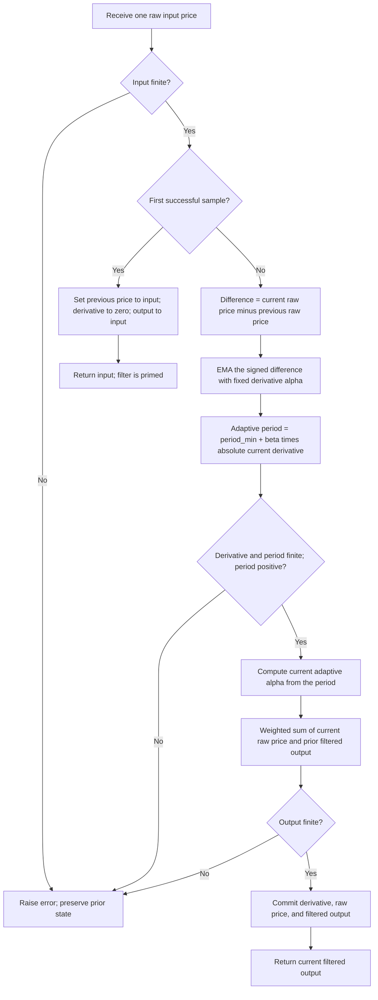

# The One Euro Filter: research prototype master reference

This folder specifies John F. Ehlers' **December 2025 period-based adaptation** of the One Euro Filter. It contains a streaming, standard-library-only Python implementation and copied input fixtures for Python, Go, TypeScript, Rust, and Zig. The canonical output is the single filtered price, not a trading signal. All 252 closes are processed in chronological order, once each, without look-ahead.

The numeric authority is `calc_one_euro_filter` in the supplied **Traders' Tips Python implementation by Rajeev Jain**. The article, Mesa paper, and TradeStation code give the same recursive equations but differ in constants and first-bar execution. This reference uses `math.pi`, seeds the first output with the first input, and begins the recursive calculation at the second input. These choices reproduce the Python Traders' Tip and the numerical smoothing recurrence used in the supplied NinjaTrader implementation. They do not promise identical first-bar values or final bits across every platform listing.

## 1. Sources and scope

The full relevant theory and equations are recorded below so that a port does not need access to the source articles. The supplied source collection is:

- [TASC article: Low-Latency Smoothing: The One Euro Filter](../../tasc/2025-12-the-one-euro-filter/content.md), John F. Ehlers, December 2025.
- [Mesa paper: The One Euro Filter](../../tasc/2025-12-the-one-euro-filter/mesa/content.md), the same explanation and EasyLanguage listing.
- [December 2025 Traders' Tips](../../tasc/2025-12-the-one-euro-filter/tips/tips.md), including the platform implementations.
- [Python source](../../tasc/2025-12-the-one-euro-filter/tips/Python_OneEuroFilter.py), [TradeStation source](../../tasc/2025-12-the-one-euro-filter/tips/TradeStation_OneEuroFilter.els), [TradingView source](../../tasc/2025-12-the-one-euro-filter/tips/TradingView_OneEuroFilter.pine), [Zorro source](../../tasc/2025-12-the-one-euro-filter/tips/Zorro_OneEuroFilter.c), and [NinjaTrader source](../../tasc/2025-12-the-one-euro-filter/tips/ninja-trader/OneEuroFilter.cs).

The input folder contains no book chapter. The books in the article's further reading are included in the bibliography, but no unprovided chapter equations or experimental results are attributed to them. The original CHI 2012 filter is discussed for context; it is a different parameterization from the executable reference here.

## 2. Basic principles and physical analogies

### 2.1 Lowpass smoothing, wavelength, and latency

A price record contains slowly changing components, trends, cycles, and faster fluctuations. A lowpass filter attenuates the faster components while passing slower components. The **critical frequency** conventionally denotes the frequency at which power is half its zero-frequency value. Since power is proportional to squared amplitude, the amplitude ratio there is $1/\sqrt{2}$, approximately $-3.0103$ dB, not an amplitude ratio of $1/2$.

For one sample per bar, frequency $f$ in cycles per bar and wavelength or period $P$ in bars satisfy

$$P=\frac{1}{f},\qquad \omega=2\pi f=\frac{2\pi}{P}.$$

Smoothing necessarily stores some past information. A conventional exponential moving average (EMA) uses

$$y_t=\alpha x_t+(1-\alpha)y_{t-1},\qquad 0<\alpha\leq1.$$

Small $\alpha$ puts more weight on history and smooths more strongly; large $\alpha$ follows a new value more quickly. An adaptive EMA changes $\alpha$ on each bar. It still uses a recursive weighted sum and does not require a rolling array.

### 2.2 Electrical and mechanical interpretations

A resistor-capacitor lowpass circuit obeys the continuous-time equation

$$\tau\frac{dy(t)}{dt}+y(t)=x(t),\qquad \tau=RC.$$

The capacitor stores the previous output, and the resistor limits the rate at which it can change. Increasing $\tau$ smooths more and responds more slowly. A first-order mechanical relaxation model, where a strongly damped position moves toward a target without inertia-driven ringing, has the same equation. These are analogies for the EMA memory; this program does not simulate electrical or mechanical components.

Backward-Euler discretization at interval $\Delta t$ gives

$$y_t=\frac{\Delta t}{\tau+\Delta t}x_t+
\frac{\tau}{\tau+\Delta t}y_{t-1},\qquad
\alpha=\frac{1}{1+\tau/\Delta t}.$$

The canonical 2012 One Euro Filter adapts a **frequency** parameter: with a smoothed speed estimate $\widehat{\dot{x}}_t$, its conceptual structure is

$$\dot{x}_t=\frac{x_t-x_{t-1}}{\Delta t},\qquad
\widehat{\dot{x}}_t=\alpha_d\dot{x}_t+(1-\alpha_d)\widehat{\dot{x}}_{t-1},$$

$$f_{c,t}=f_{\min}+\beta\left|\widehat{\dot{x}}_t\right|,\qquad
\tau_t=\frac{1}{2\pi f_{c,t}},\qquad
\alpha_t=\frac{1}{1+\tau_t/\Delta t}.$$

Increasing its cutoff frequency at high speed permits faster tracking while a low cutoff smooths stationary jitter. This is why the original paper calls it a speed-based lowpass filter. These frequency-based equations explain the historical idea and are **not used by this master implementation**. Ehlers substitutes a period mapping, fixes the derivative period at ten bars, and takes raw one-bar price differences without timestamp scaling.

### 2.3 Ehlers' period adaptation changes the sign of the effect

Both supplied Ehlers documents give the period-to-alpha equation

$$\boxed{\alpha(P)=\frac{2\pi}{4\pi+P}.}$$

This exact expression is the master calculation rule. It is not the conventional EMA span rule $2/(N+1)$, and $P$ is not a window length to be filled. For positive $P$, $0<\alpha(P)<1/2$. At the internal derivative period $P=10$,

$$\alpha_d=\frac{2\pi}{4\pi+10}\approx0.278431362072089.$$

For Ehlers' adaptive period $P_t=P_{\min}+\beta|d_t|$,

$$\frac{\partial P_t}{\partial |d_t|}=\beta,\qquad
\frac{\partial\alpha_t}{\partial |d_t|}=
-\frac{2\pi\beta}{(4\pi+P_t)^2}.$$

Thus **positive beta increases the effective period and reduces responsiveness** as smoothed speed increases. It is a smoothing mode. Negative beta reduces the period at high speed and sharpens the output, exactly as the TASC article suggests. In that mode, read `period_min` as the baseline **maximum** period, despite its historical name. Substituting a frequency-based adaptation or silently reversing beta would change the published Ehlers recurrence.

### 2.4 Signed movement is smoothed before its magnitude is taken

The internal EMA acts on $x_t-x_{t-1}$, which has a sign. Only after smoothing is its magnitude used. Consequently,

$$\left|\operatorname{EMA}(x_t-x_{t-1})\right|
\ne \operatorname{EMA}(|x_t-x_{t-1}|).$$

Alternating positive and negative changes can cancel in the signed EMA. This is a smoothed directional rate of change, not a rolling standard deviation, mean absolute return, or true range. The article describes it as one-bar volatility; that language does not alter the code. A trend and an oscillation of the same absolute one-bar change can produce different adaptive periods.

### 2.5 Unity gain, stability, and the limits of the no-overshoot claim

With a fixed alpha, the transfer function is

$$H(z)=\frac{Y(z)}{X(z)}=\frac{\alpha}{1-(1-\alpha)z^{-1}},\qquad H(1)=1.$$

For a constant input, the seeded output remains at that input (up to floating-point roundoff). More generally, the weights sum to one on every update. For admissible adaptive alpha,

$$\min(x_t,y_{t-1})\leq y_t\leq\max(x_t,y_{t-1}).$$

This convex-combination property explains the absence of the ringing associated with underdamped filters after a step. It does not imply zero lag or that the output always lies inside the current bar's high-low range. After a price reversal, a delayed output can still continue in the prior direction. Unity DC gain alone is not a general proof of no overshoot for arbitrary filters; the convex EMA update is the relevant additional property here.

The adaptive system is nonlinear because alpha depends on the input. One fixed transfer function does not describe all possible amplitudes. If alpha is frozen for analysis,

$$|H(e^{j\omega})|^2=
\frac{\alpha^2}{1+(1-\alpha)^2-2(1-\alpha)\cos\omega},$$

and its exact discrete-time half-power frequency satisfies

$$\cos\omega_c=1-\frac{\alpha^2}{2(1-\alpha)}.$$

This identity is a derived DSP clarification, not an equation supplied in the article. Ehlers' quoted period mapping is the required coefficient convention; it is not an algebraic inversion of this exact discrete-time frequency response. Do not replace it with an alternative "exact cutoff" formula during conversion.

For a constant-alpha ramp $x_t=x_0+vt$, steady-state lag in output units is

$$x_t-y_t=\frac{1-\alpha}{\alpha}v.$$

These response formulas explain the tradeoff between smoothing and delay. They do not establish performance or trading profitability on any market.

### 2.6 Related adaptive moving averages

The article relates this filter to Chande's VIDYA, which measures volatility and uses it to alter an EMA coefficient, and Kaufman's KAMA, whose efficiency ratio compares net trend to total movement. A common mathematical expression for that ratio is

$$ER_t=\frac{|x_t-x_{t-N}|}{\sum_{k=0}^{N-1}|x_{t-k}-x_{t-k-1}|}.$$

This is contextual explanation of the ratio named by the article, not another computation in this implementation. The One Euro Filter uses its **current-bar** derivative estimate immediately; there is no separate rolling volatility window. Its derivative EMA still has memory and therefore introduces smoothing delay.

## 3. Complete executable mathematics

Let $t=0,1,\ldots$ be the zero-based input index. The notation maps to the supplied code as follows:

| Symbol | Source variable | Meaning |
|---|---|---|
| $x_t$ | `Price`, `close[t]` | Current raw input, normally Close |
| $D$ | `PeriodDX`, `period_dx` | Fixed derivative period, 10 bars |
| $\alpha_d$ | `AlphaDX`, `alpha_dx` | Fixed derivative EMA coefficient |
| $d_t$ | `SmoothedDX`, `smoothed_dx[t]` | Smoothed signed one-bar difference |
| $P_{\min}$ | `PeriodMin`, `period_min` | Baseline adaptive period |
| $\beta$ | `Beta`, `BetaVal`, `beta` | Magnitude multiplier |
| $P_t$ | `Cutoff`, `cutoff` | Current adaptive **period**, in bars |
| $\alpha_t$ | `Alpha3`, `alpha3` | Current price EMA coefficient |
| $y_t$ | `Smoothed`, `smoothed[t]` | Single returned filtered output |

Compute the fixed coefficient once:

$$D=10,\qquad \alpha_d=\frac{2\pi}{4\pi+D}.$$

Seed on the first sample and return immediately:

$$\boxed{d_0=0,\qquad y_0=x_0.}$$

For every subsequent sample, execute **all** of these equations in this order:

$$\Delta x_t=x_t-x_{t-1},$$

$$\boxed{d_t=\alpha_d\Delta x_t+(1-\alpha_d)d_{t-1},}$$

$$\boxed{P_t=P_{\min}+\beta|d_t|,}$$

$$\boxed{\alpha_t=\frac{2\pi}{4\pi+P_t},}$$

$$\boxed{y_t=\alpha_t x_t+(1-\alpha_t)y_{t-1}.}$$

The price difference uses raw $x_{t-1}$; the output EMA uses filtered $y_{t-1}$. The cutoff uses $d_t$, not $d_{t-1}$. No division by price, percent-return transformation, sample-frequency inference, output rounding, clipping, or additional averaging occurs. Rounding applies only when fixtures are serialized.

For example, with the default parameters, the first close $91.5$ produces $91.5$. The next close $94.815$ uses $\Delta x_1=3.315$, then the signed derivative EMA, then the adaptive period, then the price EMA. This first-bar seed is part of the observable API.

## 4. Configuration, ranges, units, and initialization

| Parameter | Shortcut | Default | Accepted range and interpretation |
|---|---|---:|---|
| `period_min` | `PM` | 10.0 | Any finite positive real number. Measured in bars; fractional periods are algebraically valid. Smaller values respond faster. |
| `beta` | `B` | 0.2 | Any finite real number, provided every computed cutoff stays finite and positive. Zero disables adaptation; positive smooths; negative sharpens. |
| `period_dx` | fixed, omitted from names | 10.0 | Internal constant, not a constructor argument. Matches the article and canonical Python implementation. |

`beta` multiplies a difference measured in input units per bar to produce a period in bars. Its numeric value is therefore sensitive to price scale. Scaling or splitting a price series changes the adaptation unless beta is adjusted inversely. Adding a constant offset to every input leaves differences and alpha unchanged and adds that offset to the seeded filtered output, apart from roundoff.

For negative beta, the valid input-dependent domain is

$$P_t>0\quad\Longleftrightarrow\quad |d_t|<\frac{P_{\min}}{|\beta|}.$$

No fixed negative-beta value is guaranteed valid for all unbounded inputs. If all raw differences are bounded by $M$ and the derivative is seeded at zero, the convex derivative EMA satisfies $|d_t|\leq M$, so $P_{\min}>|\beta|M$ is sufficient. The master rejects a nonpositive or nonfinite cutoff with `ValueError` and does not mutate the stream on that failed update. It applies no clamp, since a clamp would change the published valid-domain outputs.

The article does not supply formal validation rules. The finite-positive-period policy is a research API decision that keeps the weighted-average interpretation intact. It is not an additional smoothing equation. A NaN or infinity input is rejected without consuming a bar. Missing-value handling is not specified by the article and is not tested by silently filling data.

`OneEuroFilter.update(price)` returns one float. `is_primed` is false before the first successful update and true afterward. `reset()` clears the state and begins a new stream with the same parameters. `warmup_bars` is **0**: the canonical Python source explicitly returns an initialized first output. No NaN prefix should be invented just because the internal period is ten bars. The initial condition is defined even though a filter transient persists beyond the first bar.

## 5. Calculation flow and porting rules



The port requires three state scalars, one initialization flag, two configuration scalars, and the fixed alpha. The master uses `None` as the initialization sentinel; a port can use a boolean. Complexity is $O(1)$ time and $O(1)$ state per sample. Array storage in the fixture generator is not part of the streaming algorithm.

Use IEEE-754 binary64 (`float64`, `f64`, or JavaScript `number`) and the language's full-precision pi constant. Keep the expression order, especially `alpha * price + (1 - alpha) * previous_output`. Avoid algebraic reassociation and forced fused multiply-add if attempting the same final binary64 bits. Fixtures have only 15 significant decimal digits, so use a tolerant float comparison; `rel_tol=5e-14, abs_tol=5e-14` is suitable for these 252-close fixtures. Compare NaNs by classification rather than equality if a later extension introduces unprimed fields.

## 6. Differences between supplied listings

| Listing | Relevant behavior | Effect on this reference |
|---|---|---|
| Article, Mesa, TradeStation | Literal `3.14159`; initialization assigns current values but both later recurrences still use historical `[1]` slots. | The assignment to current `Smoothed` does not by itself seed `Smoothed[1]`. First-bar results depend on platform history / MaxBarsBack semantics. Literal pi also changes later numeric values. |
| Traders' Tips Python | `np.pi`; `smoothed[0] = close[0]`; `smoothed_dx[0] = 0`; loop begins at index 1. | **Canonical arithmetic and initialization**. `math.pi` equals its binary64 `np.pi`. |
| NinjaTrader | `Math.PI`; derivative period 10; seed at `CurrentBar == 0` and return. | Same seeded numerical recurrence. The first-bar early return precedes plot assignment; reference returns the seeded numerical output, not the plot buffer. UI disallows negative beta. |
| TradingView | Full pi; exposes derivative period; first derivative references a missing source history, and `nz` fills prior recursive values. | Different first-bar / missing-history behavior and an extra configurable parameter. |
| Zorro | `series(Data[0], 2)` initializes both derivative and output buffers from price. | Different startup derivative history unless platform warm-up erases that transient. |

The article's brief comments call `PeriodMin` a "minimum cutoff frequency". The actual formula adds it to another **period** and places it in the denominator of the period mapping. Formula behavior and units govern this reference.

## 7. Optional oscillator discussed in the articles

Both Ehlers documents propose replacing `Price = Close` with

```easylanguage
Price = $Highpass(Close, 54);
```

Conceptually, feed the output of a highpass filter into a separate `OneEuroFilter` instance:

$$h_t=\operatorname{Highpass}_{54}(x)_t,\qquad o_t=\operatorname{OneEuroFilter}(h)_t.$$

This removes slowly changing levels first, so the smoothed output can oscillate around zero. The One Euro class accepts such scalar inputs without modification. The expected arrays in this folder cover the requested **raw INPUT_CLOSE smoother**, not an additional highpass implementation.

For completeness, the supplied Python Traders' Tip gives these two-pole highpass coefficients and recursion:

$$a=e^{-1.414\pi/L},\qquad b=2a\cos(1.414\pi/L),$$

$$c_2=b,\qquad c_3=-a^2,\qquad c_1=\frac{1+c_2-c_3}{4},$$

$$h_t=c_1(x_t-2x_{t-1}+x_{t-2})+c_2h_{t-1}+c_3h_{t-2},\qquad t\geq2.$$

The original Python uses degree-to-radian conversion inside the cosine, equivalent to the argument above. Its actual execution initializes the entire highpass output array to zero, runs the recursion from index 2, and **only afterward** replaces indices 0 and 1 with the first two prices. Thus early recursive values were computed using zero history, not those later replacements. Its plotting example also calls `calc_highpass` alone for `Osc`, rather than feeding that highpass result through the One Euro smoother. Do not confuse that plotting example with the oscillator cascade described by Ehlers. These startup and plotting differences are reasons not to fold that optional helper into the canonical close fixture silently.

## 8. Confirmed reference parameter combinations

The user confirmed these **12 combinations** before generation. They are well below the limit of 64 and cross three baseline periods with disabled, default, strong positive, and negative adaptation. The derivative period remains 10 in every case.

| Python expected array | `period_min` | `beta` | What it tests |
|---|---:|---:|---|
| `EXPECTED_PM2_B0` | 2 | 0 | Short-period fixed EMA; adaptation disabled. |
| `EXPECTED_PM2_B0_2` | 2 | 0.2 | Short baseline with the article's positive beta. |
| `EXPECTED_PM2_B2` | 2 | 2 | Short baseline with strong positive adaptation. |
| `EXPECTED_PM2_Bm0_2` | 2 | -0.2 | Short-period sharpening near the positive-cutoff boundary. |
| `EXPECTED_PM10_B0` | 10 | 0 | Default-period fixed EMA; adaptation disabled. |
| `EXPECTED_PM10_B0_2` | 10 | 0.2 | Published article and Traders' Tips Python defaults. |
| `EXPECTED_PM10_B2` | 10 | 2 | Default baseline with strong positive adaptation. |
| `EXPECTED_PM10_Bm0_2` | 10 | -0.2 | Article's negative-beta sharpening at the default period. |
| `EXPECTED_PM30_B0` | 30 | 0 | Long-period fixed EMA; sustained lag and seed decay. |
| `EXPECTED_PM30_B0_2` | 30 | 0.2 | Long baseline with the article's positive beta. |
| `EXPECTED_PM30_B2` | 30 | 2 | Long baseline with strong positive adaptation. |
| `EXPECTED_PM30_Bm0_2` | 30 | -0.2 | Long-period sharpening with a conservative cutoff margin. |

On the supplied 252-close sequence, the maximum absolute derivative EMA is approximately **4.768711243522509**. The smallest adaptive period in these cases, for `period_min=2, beta=-0.2`, is approximately **1.046257751295498** bars, which remains positive. This is a check for these fixtures, not a guarantee for future inputs.

Each case creates one independent filter. Every array contains 252 returned values, with no leading NaNs because the first value primes this filter. The two comments before every array copy this table's test description and then give `period_min`, `beta`, and fixed `period_dx=10`.

Naming uses `PM` for `period_min`, `B` for beta, `_` for a decimal point, and `m` for a negative sign so names remain valid identifiers:

| Language | Example for period 10, beta -0.2 |
|---|---|
| Python | `EXPECTED_PM10_Bm0_2` |
| Go | `var expectedPM10_Bm0_2 = []float64{ ... }` |
| TypeScript | `export const expectedPM10_Bm0_2: number[] = [ ... ];` |
| Rust | `pub fn expected_pm10_bm0_2() -> Vec<f64>` |
| Zig | `pub fn expectedPM10_Bm0_2() [252]f64` |

The Go package is `theoneeurofilter`, removing separators from the folder name. Rust retains the copied `#[cfg(test)] pub mod testdata` for inputs and appends expected functions at file scope. The canonical input API names already present in the templates are preserved. Valid language NaN spellings are `math.nan`, `math.NaN()`, `NaN`, `f64::NAN`, and `nan`, respectively. Go includes a blank reference to `math.NaN` because there are no NaN array elements to use its requested import. Zig retains `const math = @import("std").math;` and `const nan = math.nan(f64);`.

## 9. Reproduction and verification

Run from this folder:

```bash
python3 the-one-euro-filter.py
python3 -m unittest discover -p 'test_one_euro_filter.py' -v
```

The first command demonstrates streaming on an embedded copy of all 252 `INPUT_CLOSE` values and prints the confirmed cases. It does not write fixture arrays. To regenerate the confirmed reference data, run

```bash
python3 the-one-euro-filter.py --generate-reference-data
```

The generator checks the embedded input against the copied Python fixture, calculates full-precision outputs, formats them with **15 significant digits** using `.15g`, and appends marked expected sections to `test_testdata.py`. It reads the written Python arrays back, verifies names, lengths, and retained precision, and translates those same values into Go, TypeScript, Rust, and Zig. It preserves all copied OHLC input arrays. Repeated generation replaces its marked sections rather than duplicating arrays.

The verification suite extracts only the published `calc_one_euro_filter` function and executes its original body with a minimal scalar adapter for `np.asarray`, `np.zeros`, and `np.pi`. This compares against the supplied calculation without requiring NumPy, plotting packages, or a network price download. It additionally checks analytic fixed-EMA behavior, first-bar seeding, signed-change cancellation, causal prefix equivalence, reset, admissible negative beta, invalid-update state preservation, and all generated fixture values and comments across the five languages.

The completed reference contains **12 expected arrays of 252 values in each of the five fixture files**. All 13 Python tests pass. Temporary native-language validators also compiled and exercised all expected arrays with Go 1.27.1, Rust 1.98.1, and Zig 0.16.0; Node.js 24.15.0 loaded the TypeScript fixture directly and exercised its exported arrays. Every translated value matches the written Python fixture, and a second generation produced byte-for-byte identical files. No external Python dependencies were installed or required.

## 10. References

1. Ehlers, John F. (2025). "Low-Latency Smoothing: The One Euro Filter." *Technical Analysis of Stocks & Commodities*, 43(12), December. [Article](https://technical.traders.com/archive/article.asp?file=\V43\C12\054EHLE.pdf).
2. Ehlers, John F. "The One Euro Filter." [Mesa Software PDF](https://www.mesasoftware.com/papers/The%20One%20Euro%20Filter.pdf). Supplied code is copyright 2025; the local transcription's bibliography labels it 2026. The PDF publication date is not independently established here.
3. Technical Analysis, Inc. (2025). ["Traders' Tips — December 2025"](https://www.traders.com/Documentation/FEEDbk_docs/2025/12/TradersTips.html). Platform contributors include John Robinson (TradeStation), Jesse N. (NinjaTrader), Petra Volkova (Zorro), PineCoders (TradingView), Dion Kurczek (Wealth-Lab), Ward Systems Group (NeuroShell), and Rajeev Jain (Python).
4. Casiez, Géry, Nicolas Roussel, and Daniel Vogel (2012). "1€ Filter: A Simple Speed-Based Low-Pass Filter for Noisy Input in Interactive Systems." *CHI '12*, pp. 2207–2210. [Paper](https://gery.casiez.net/publications/CHI2012-casiez.pdf), [DOI](https://doi.org/10.1145/2207676.2208639). The supplied Ehlers prose calls the first author "Georges"; the bibliographic author name is Géry Casiez.
5. Ehlers, John F. (2024). "What Is The Real Meaning Of The EMA Alpha?" *Technical Analysis of Stocks & Commodities*, 42, July. Cited by both supplied Ehlers documents for the period-to-alpha mapping.
6. Ehlers, John F. (2025). *Cybernetic Trading Indicators*. Amazon, as listed in the article's further reading.
7. Ehlers, John F. (2004). *Cybernetic Analysis for Stocks and Futures*. John Wiley & Sons.
8. Ehlers, John F. (2013). *Cycle Analytics for Traders*. John Wiley & Sons.
9. Ehlers, John F. (2021). "A Technical Description of Market Data for Traders." *Technical Analysis of Stocks & Commodities*, 39, May.
10. Kaufman, Perry J. (2022). *Learn To Trade*. Amazon, as listed in the article's further reading.
11. Kaufman, Perry J. (2020). *Trading Systems and Methods*, 6th edition. Wiley, using the year given in the supplied further reading.
12. Chande, Tushar S. (1995). "Identifying Powerful Breakouts Early [Using VIDYA]." *Technical Analysis of Stocks & Commodities*, 13, October.

### BibTeX

```bibtex
@article{ehlers2025oneEuroFilter,
  author = {Ehlers, John F.},
  title = {Low-Latency Smoothing: The One Euro Filter},
  journal = {Technical Analysis of Stocks \& Commodities},
  year = {2025}, volume = {43}, number = {12}, month = dec,
  url = {https://technical.traders.com/archive/article.asp?file=\V43\C12\054EHLE.pdf}
}

@misc{ehlersMesaOneEuroFilter,
  author = {Ehlers, John F.},
  title = {The One Euro Filter},
  howpublished = {Mesa Software},
  url = {https://www.mesasoftware.com/papers/The%20One%20Euro%20Filter.pdf},
  note = {Undated publication; code copyright 2025; supplied transcription metadata says 2026}
}

@misc{traderstips2025dec,
  author = {{Technical Analysis, Inc.}},
  title = {Traders' Tips --- December 2025},
  year = {2025}, month = dec,
  url = {https://www.traders.com/Documentation/FEEDbk_docs/2025/12/TradersTips.html},
  note = {One Euro Filter implementations and platform differences}
}

@misc{jain2025oneEuroPython,
  author = {Jain, Rajeev},
  title = {Python Implementation of the One Euro Filter},
  year = {2025}, month = dec,
  howpublished = {Traders' Tips, Technical Analysis of Stocks \& Commodities},
  url = {https://www.traders.com/Documentation/FEEDbk_docs/2025/12/TradersTips.html},
  note = {calc_one_euro_filter is the numeric authority for this master reference}
}

@inproceedings{casiez2012oneEuro,
  author = {Casiez, G{\'e}ry and Roussel, Nicolas and Vogel, Daniel},
  title = {1{\texteuro} Filter: A Simple Speed-Based Low-Pass Filter for Noisy Input in Interactive Systems},
  booktitle = {Proceedings of the SIGCHI Conference on Human Factors in Computing Systems},
  year = {2012}, pages = {2207--2210}, publisher = {ACM},
  doi = {10.1145/2207676.2208639},
  url = {https://gery.casiez.net/publications/CHI2012-casiez.pdf}
}

@article{ehlers2024emaAlpha,
  author = {Ehlers, John F.},
  title = {What Is The Real Meaning Of The EMA Alpha?},
  journal = {Technical Analysis of Stocks \& Commodities},
  year = {2024}, volume = {42}, month = jul
}

@book{ehlers2025cyberneticIndicators,
  author = {Ehlers, John F.}, title = {Cybernetic Trading Indicators},
  year = {2025}, note = {Listed through Amazon in the supplied article}
}

@book{ehlers2004cyberneticAnalysis,
  author = {Ehlers, John F.}, title = {Cybernetic Analysis for Stocks and Futures},
  publisher = {John Wiley \& Sons}, year = {2004}
}

@book{ehlers2013cycleAnalytics,
  author = {Ehlers, John F.}, title = {Cycle Analytics for Traders},
  publisher = {John Wiley \& Sons}, year = {2013}
}

@article{ehlers2021marketData,
  author = {Ehlers, John F.}, title = {A Technical Description of Market Data for Traders},
  journal = {Technical Analysis of Stocks \& Commodities},
  year = {2021}, volume = {39}, month = may
}

@book{kaufman2022learnToTrade,
  author = {Kaufman, Perry J.}, title = {Learn To Trade},
  year = {2022}, note = {Listed through Amazon in the supplied article}
}

@book{kaufman2020tradingSystems,
  author = {Kaufman, Perry J.}, title = {Trading Systems and Methods},
  edition = {6}, publisher = {Wiley}, year = {2020},
  note = {Bibliographic year follows the supplied article's further reading}
}

@article{chande1995vidya,
  author = {Chande, Tushar S.}, title = {Identifying Powerful Breakouts Early [Using VIDYA]},
  journal = {Technical Analysis of Stocks \& Commodities},
  year = {1995}, volume = {13}, month = oct
}
```
