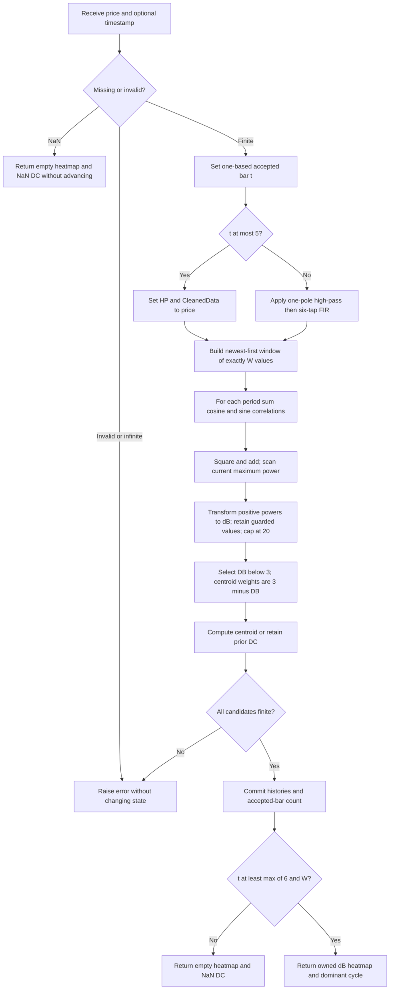

# Transformed Discrete Fourier Transform Spectrum

This folder is the standalone **research prototype master reference** for John F. Ehlers' January 2007 article, **“Fourier Transform For Traders,”** and the corresponding MESA paper. It estimates cyclic power with a moving Fourier calculation, applies the article's nonlinear spectrum transform, and extracts a dominant cycle. The master uses only Python's standard library and receives one chronological price per `update()`.

The returned named tuple has two fields:

| Field | Meaning | Units |
|---|---|---|
| `heatmap` | One timestamped column of transformed relative dB values, ascending by cycle period | Transformed dB attenuation: 0 hottest, 20 coldest |
| `dominant_cycle` | Weighted centroid of the channels passing the article's transformed-dB threshold | Bars per cycle, possibly fractional |

The article's `ShowDC` flag controls plotting, not calculation. The master always returns the requested dominant cycle when primed. Fourier cosine/sine sums are available as diagnostic state, but they are not separate oscillator outputs. No RSI, trading strategy, phase prediction or execution rule is included.

## Numerical authority and source differences

The primary source is [the complete article sidebar](../../tasc/2007-01-fourier-transform-for-traders/content.md). The [MESA paper](../../tasc/2007-01-fourier-transform-for-traders/mesa/content.md) repeats the same calculation and includes the mathematical and resolution discussion. Its code copyright is 2006; the TASC article was published in January 2007. These dates refer to the same earlier algorithm, not the 2013 book version.

Source fidelity means preserving all of the following:

1. The default observation window is **50 values**, offsets $0,\ldots,49$, and the spectrum centers are periods **8 through 50 inclusive**. Period bounds and window length are independent in the article's Fourier loop.
2. During accepted bars 1–5, both `HP` and `CleanedData` are set to the **unmodified input price**. The high-pass recurrence and six-tap FIR first run on bar 6. This is different from the March 2008 filter-bank startup.
3. The article's printed high-pass recurrence has **one pole**. Its prose calls it a two-pole filter, but this master follows the executable equation.
4. Fourier components are summed newest sample first and squared and added. No division by period, mean subtraction, taper, autocorrelation calculation or running Fourier recurrence is added.
5. Each bar normalizes against its own maximum power. The maximum is not smoothed, decayed, or retained as an automatic gain control envelope.
6. The nonlinear dB transform is exactly the article's expression, capped only above at 20. If maximum power or a channel's power is not positive, that channel's dB retains its prior value, initially zero.
7. The centroid uses **strictly `DB < 3`** and weight **`3 - DB`**. If its denominator is zero, the previous dominant cycle is retained. There is no median or fallback period.
8. All mathematical constants use full binary64 precision. EasyLanguage's degree arguments become radians with `math.pi`; the AmiBroker tip's truncated `3.1415926` is not used. Decimal design constants `0.01`, `0.99`, `3` and `20` retain their source values.

The relevant [Traders' Tips](../../tasc/2007-01-fourier-transform-for-traders/tips/tips.md) corroborate the calculation but are not interchangeable implementations:

| Source | Relevant difference |
|---|---|
| [TradeStation EasyLanguage](../../tasc/2007-01-fourier-transform-for-traders/tips/FourierTransform.els) | Repeats the article's estimator, then adds a DFT-adapted RSI strategy. Its maximum-50 window note belongs to this strategy, which also uses 50-element RSI arrays. Those strategy arrays are not part of this master. |
| [eSignal](../../tasc/2007-01-fourier-transform-for-traders/tips/FourierTransform.efs) | With `nWindow=50`, its loop `n <= nWindow` sums **51** values, and it waits for offset `-nWindow`. This differs from the article's exact 50-value sum. |
| [AmiBroker](../../tasc/2007-01-fourier-transform-for-traders/tips/FourierTransform.afl) | Couples the upper period bound to window size, uses a truncated pi constant, and delegates initialization to `AMA2`. Its absolute-bar trigonometric reference rotates/reflections the Fourier components without changing their ideal summed power, but its configuration/startup differs. |
| MESA code | Matches the article's preprocessing, Fourier window, transformed dB and centroid. |

This master follows the article/MESA calculation. Other language tips are reference material for platform variants; unrelated tips such as entropy analysis are outside this indicator's scope.

The supplied [zpano Heatmap](../../../../external/zpano/py/indicators/core/outputs/heatmap.py) and [autocorrelation periodogram](../../../../external/zpano/py/indicators/john_ehlers/auto_correlation_periodogram/) provide the **output shape and empty-column convention only**. Their autocorrelation, Super Smoother, spectral squaring and AGC calculations are not used.

## Purpose and physical intuition

Ehlers motivates adaptive indicators with driving on a curving mountain road through fog: a fixed cruise-control setting is poorly suited to changing conditions. In the same way, a fixed 14-bar RSI or nine-bar stochastic cannot automatically follow a changing market cycle. A measured dominant period can tune a downstream indicator. The article's example suggests an RSI observation period near **half the measured cycle**, so one directional half-cycle fills its observation interval. This is motivation, not a trading-performance guarantee or an RSI implementation here.

A Fourier estimator asks how strongly the recent data correlates with candidate sine and cosine waves. Think of a bank of reference pitches: a candidate near an oscillation in the input receives a stronger combined response. Using both cosine and sine avoids sensitivity to the unknown sinusoid's starting phase. Squaring and adding the two responses measures relative power.

The high-pass filter removes slow price-level and trend components, analogous to AC coupling in a circuit. The six-tap low-pass FIR reduces rapid variations. Preprocessing matters because a finite observation window can leak a strong trend or price offset into apparent cycles.

The heatmap puts cycle period on the vertical axis and bars on the horizontal axis. Color encodes spectral strength. This lets changes in cyclic activity line up with the price chart rather than requiring separate amplitude-versus-frequency plots. Periods are measured in **accepted bars**, not seconds, and a period axis is nonlinear in frequency because $f=1/N$.

## Resolution, stationarity and the transform's limits

A moving Fourier calculation averages over its observation window. Long windows can distinguish closer frequencies but mix changing regimes and retain older behavior. Short windows react sooner but give broad spectral peaks. Increasing the number of evaluated period channels interpolates the sampled response; it does not supply more historical observations.

For an ideal sinusoid at frequency $f_0$ and a rectangular window of $W$ observations, its positive-frequency correlation includes

$$\sum_{n=0}^{W-1}e^{i2\pi(f_0-f)n}
=e^{i\pi(W-1)(f_0-f)}\frac{\sin(\pi W(f_0-f))}{\sin(\pi(f_0-f))}.$$

The continuous limit of the ratio is $W$ at $f=f_0$. This finite-window response explains leakage and a characteristic frequency separation of order $1/W$. Real sine waves also have a negative-frequency component. Exact integer cycles in the window reduce endpoint leakage for conventional Fourier bins, but a Fourier calculation still exists for noninteger cycles or nonstationary data. The assumptions concern interpretation and resolution, not whether the sum can be computed.

The article and MESA paper discuss Kay and Demeure's illustrated relationship between a Bartlett-type spectrum and a MUSIC spectrum:

$$S_{\mathrm{MUSIC}}=\frac{1}{1-S_{\mathrm{Bartlett}}},\qquad 0\le S_{\mathrm{Bartlett}}\le1.$$

As the normalized Bartlett value approaches one, the transformed value becomes large. This can turn a visually broad peak into a sharp-looking line. The implementation regularizes that idea to a finite **100:1 peak transform**, then expresses it in dB, as derived below.

This relationship is the source's conceptual illustration; the master does **not** implement an eigendecomposition or the MUSIC algorithm. A monotone display transform cannot recover information absent from the finite window. The article tests equal-amplitude **20-bar and 24-bar cycles** and reports that the transformed DFT still cannot separate them, while its MESA8 example can. Low signal-to-noise ratios, rapid period changes and simultaneous cycles remain practical limitations. A weighted centroid of competing peaks can lie between their actual periods.

## Complete calculation and equations

Let $x_t$ be the input at one-based accepted bar $t$, $H$ the high-pass coefficient period, $W$ the Fourier window length, and $N$ an integer candidate period. Defaults are $H=40$, $W=50$, $N=8,\ldots,50$. The source uses $(\mathrm{High}+\mathrm{Low})/2$ as its default price; this reference consumes the user's **Close** array instead. Absent prehistory is zero.

### 1. Preprocess the price

During the first five bars:

$$h_t=x_t,\qquad y_t=x_t,\qquad 1\le t\le5.$$

Here $h_t$ is `HP`, and $y_t$ is `CleanedData`. After bar 5, define

$$a=\frac{1-\sin(2\pi/H)}{\cos(2\pi/H)},$$

$$h_t=\frac{1+a}{2}(x_t-x_{t-1})+a h_{t-1},\qquad t>5,$$

$$y_t=\frac{h_t+2h_{t-1}+3h_{t-2}+3h_{t-3}+2h_{t-4}+h_{t-5}}{12},\qquad t>5.$$

The high-pass transfer function once the recurrence is active is

$$H_{\mathrm{HP}}(z)=\frac{1+a}{2}\frac{1-z^{-1}}{1-a z^{-1}}.$$

It has a zero at DC and a single recursive pole $a$. For finite $H>4$, exact arithmetic gives $0<a<1$. The six-tap FIR is

$$H_{\mathrm{FIR}}(z)=\frac{1+2z^{-1}+3z^{-2}+3z^{-3}+2z^{-4}+z^{-5}}{12}.$$

Its factorization,

$$H_{\mathrm{FIR}}(z)=\frac{(1+z^{-1}+z^{-2})(1+z^{-1}+z^{-2}+z^{-3})}{12},$$

shows the zeros at two-, three- and four-bar cycles described in the article. Its weights sum to 12, so its DC gain is one, and its symmetric coefficients give a **2.5-bar linear-phase delay in isolation**. The preceding high-pass rejects DC. This is not the later Ehlers Super Smoother or two-pole roofing filter.

### 2. Compute the moving Fourier sums

For every candidate period $N$ on every bar:

$$C_{N,t}=\sum_{n=0}^{W-1} y_{t-n}\cos(2\pi n/N),$$

$$S_{N,t}=\sum_{n=0}^{W-1} y_{t-n}\sin(2\pi n/N).$$

The current sample is offset $n=0$. All sums proceed newest to oldest. The arrays are reset at each bar; they do not hold recursive Fourier history. They are period-sampled Fourier correlations rather than an FFT restricted to equally spaced frequency bins.

The familiar theoretical amplitude identity is

$$A^2=A^2\sin^2(u)+A^2\cos^2(u).$$

Accordingly, compute the article's relative power:

$$P_{N,t}=C_{N,t}^{2}+S_{N,t}^{2}.$$

No square root is taken. No period-dependent scale or common window normalization is applied. A common amplitude divisor would cancel in same-bar normalization, but a period-dependent divisor would change relative channel powers.

### 3. Find the maximum and transform power to dB

The current maximum is

$$P_{\max,t}=\max_{N=N_{\min},\ldots,N_{\max}}P_{N,t}.$$

For a positive channel and positive maximum, its normalized power is

$$r_{N,t}=P_{N,t}/P_{\max,t}.$$

The regularized amplification implied by the source is

$$F(r)=\frac{1}{1-0.99r},\qquad F(0)=1,\quad F(1)=100.$$

The relative attenuation from that peak is

$$d(r)=20-10\log_{10}F(r)
=-10\log_{10}\left(\frac{0.01}{1-0.99r}\right).$$

The literal executable form, using natural logs, is

$$d_{N,t}=-10\frac{\ln\left(0.01/(1-0.99P_{N,t}/P_{\max,t})\right)}{\ln10}.$$

Evaluate it only when $P_{\max,t}>0$ and $P_{N,t}>0$. Otherwise retain $d_{N,t-1}$. In either case apply the source cap $d_{N,t}=\min(d_{N,t},20)$. Initial $d_{N,0}=0$.

In exact arithmetic, $r=1$ gives dB 0 and $r\to0$ gives dB 20. Binary64 calculation may leave tiny residuals near zero; the master does not add a lower cap. Keep the source order `0.99 * power / maximum` when translating, rather than rearranging it casually.

This is **not ordinary relative attenuation $-10\log_{10}r$**. For example, ordinary half-power attenuation is about 3.01 dB, while this transform maps $r=0.5$ to about **17.03 dB**. Replacing it with ordinary dB would change both the display and dominant cycle.

### 4. Extract the weighted dominant period

The code's threshold is strictly below transformed dB 3. Define

$$w_{N,t}=\begin{cases}3-d_{N,t},&d_{N,t}<3,\\0,&\text{otherwise}.\end{cases}$$

Then

$$D_t=\frac{\sum_{N=N_{\min}}^{N_{\max}}Nw_{N,t}}
{\sum_{N=N_{\min}}^{N_{\max}}w_{N,t}}$$

when the denominator is nonzero; otherwise $D_t=D_{t-1}$. Initial $D_0=0$. There is no median, rounding to an integer, minimum-period fallback, or separate oscillator tuning. All channels that pass the threshold participate, and the centroid visits them in increasing period order.

The transformed threshold corresponds to

$$r>\frac{1-0.01\,10^{3/10}}{0.99}\approx0.989946845303345.$$

Thus eligible powers are within roughly one percent of the strongest channel. The centroid behaves much closer to peak selection than a conventional half-power centroid. Its weights still taper continuously to zero at the threshold; they are not raw power, `20 - DB`, or $10^{-d/10}$.

### 5. Reproduce the spectrum color scale

The article's channel colors are

$$R(d)=\begin{cases}255,&d\le10,\\255(2-d/10),&d>10,\end{cases}$$

$$G(d)=\begin{cases}255(1-d/10),&d\le10,\\0,&d>10,\end{cases}\qquad B(d)=0.$$

They transition from yellow at dB 0 to red at dB 10 to black at dB 20. The heatmap stores the dB values themselves so ports can implement this scale without storing packed colors. A renderer should clamp tiny floating-point excursions and explicitly choose integer color rounding. An increasing-strength brightness interface can use $1-d/20$ externally; the canonical fixtures remain the transformed dB data.

## Configuration, startup and missing data

| Parameter | Shortcut | Default | Valid range | Interpretation |
|---|---|---:|---|---|
| `min_period` | P | 8 | Integer $\ge8$ | First candidate period |
| `max_period` | Q | 50 | Integer $\ge\texttt{min_period}$ | Last candidate period, inclusive |
| `window_length` | W | 50 | Integer $\ge1$ | Exact count of cleaned observations in each Fourier sum |
| `highpass_period` | HP | 40.0 | Finite real $>4$ | High-pass coefficient period |

`window_length` corresponds to the article's configurable `Window`. Candidate bounds and high-pass period generalize its fixed constants for research. Windows beyond 50 and upper candidate periods beyond 50 are explicitly research extensions. A one-value window is allowed for a degenerate test, although it has no frequency discrimination: every cosine basis at offset zero equals one and every sine equals zero. High-pass period can be fractional because it controls coefficients rather than the length of an integer array. Booleans are rejected as numeric configuration values.

There is no requirement that window length equal the largest period. Such a match is only a design convention. Large windows and banks require more memory/computation; there is no arbitrary upper cap. Extremely large coefficient periods can reach floating-point limits, so the supported exact-arithmetic stability range does not promise meaningful behavior for every representable extreme.

The five-bar passthrough, six FIR weights, constants 0.01/0.99, dB cap 20 and threshold 3 are fixed source rules. Price selection is the caller's responsibility: the fixtures use Close consistently, while the article and most tips default to HL2.

### Initial state and priming

All missing historical values and retained array states begin at zero. The first five actual prices are inserted into **both** the HP and Fourier histories unchanged. Every internal Fourier sum, dB and centroid is calculated from bar 1, using zeros for absent history. Do not delay those calculations until priming, and do not replace the first five prices with detrended values.

The API withholds public outputs until both the first six-tap calculation and full Fourier history are available:

$$t_{\mathrm{first}}=\max(6,W),\qquad \texttt{warmup\_bars}=\max(5,W-1).$$

By default one-based bar 50, array index 49, is the first valid output. During warmup the heatmap is empty with NaN extrema, and `dominant_cycle` is NaN. This is an output-availability convention; the article's internal calculation still evolves from bar 1. Priming denotes history availability, not the disappearance of filter transients. The 252-window case first publishes on the final input and still contains the first five passthrough prices in its window.

An EasyLanguage chart can expose actual prehistory or apply platform lookback rules. Matching such a chart requires matching its initialization. This preparation specifies the finite-record convention explicitly rather than claiming identical startup for every loaded platform chart.

### Degenerate states

For an all-zero input, all powers are zero, so all initialized dB values remain zero. Every channel then passes the threshold, and the source centroid is the average of the configured periods. Defaults give **29 bars**, with a hot-looking all-zero heatmap. This source behavior is preserved; it is not evidence of a real oscillation. A silent channel can retain a nonzero prior dB value, and an empty threshold selection retains a prior dominant period. Neither automatically clears to NaN after priming.

### Missing or rejected observations

`update(NaN, time)` returns an empty/NaN result without changing numerical state, the accepted-bar count, or stored last accepted `output`. Infinite values, booleans, unsupported types and non-finite candidate arithmetic raise `ValueError` before any state commit. A subsequent finite observation follows the preceding accepted finite observation. This compresses the sampling timeline; interpolate or handle calendar gaps before calling the indicator if each calendar bar must occupy a sample. Timestamps are metadata and never enter the calculations.

## Algorithm and conversion notes



Use channel index $j=N-N_{\min}$ in compact arrays; the source arrays instead index by period. Store the HP history newest first and the cleaned window newest first. A fixed ring buffer can replace the Python list copies as long as each sum visits logical offsets $0,\ldots,W-1$ in that order. The current cleaned sample is added before the DFT. Coefficient/basis tables are computed once with ordinary standard-library sine/cosine functions, not a Fourier library.

The algorithm deliberately recomputes the full block at every update. A sliding Fourier recurrence is possible but introduces different accumulated roundoff and changes the reference implementation. With $K=Q-P+1$ channels, updates cost $O(KW)$. State uses $O(K+W)$ without precomputed bases, or $O(KW+K+W)$ with the master's two trig tables. The six HP values are a constant amount of additional history.

Every returned heatmap has its own values list. Mutating an old list or making future updates cannot alter the internal dB state. Diagnostic `state` uses immutable tuples and includes HP, cleaned data, maximum, centroid, both Fourier parts, raw powers and dB. `reset()` restores zero history and reproduces a replay.

## Comparison with the 2013 book and 2008 filter bank

This algorithm is distinct from the existing [2013 book DFT preparation](../discrete-fourier-transform-spectrum/description.md), even though both use moving sine/cosine sums:

| Aspect | This 2007 master | Book chapter 9, listing 9-1 |
|---|---|---|
| Default periods/window | 8–50 / 50 observations | 10–48 / 48 observations |
| Preprocessing | One-pole HP 40, six-tap FIR, five-bar passthrough | Two-pole HP 48, Super Smoother 10 |
| Period compensation | None | Divide Fourier amplitudes by period by default |
| Maximum normalization | Current maximum | Fast attack, slow decay envelope |
| Spectrum quantity | Nonlinear transformed dB | Normalized power, optionally cubed for display |
| Centroid | DB below 3, weight 3 minus DB | Power at least 0.5, weight power |

For clarity, the book's different preprocessing can be written with $H_b=48$, $L_b=10$:

$$\theta=\sqrt2\pi/H_b,\quad a_b=(\cos\theta+\sin\theta-1)/\cos\theta,$$

$$h_t^b=(1-a_b/2)^2(x_t-2x_{t-1}+x_{t-2})
+2(1-a_b)h_{t-1}^b-(1-a_b)^2h_{t-2}^b,$$

$$u=e^{-\sqrt2\pi/L_b},\quad c_2=2u\cos(\sqrt2\pi/L_b),\quad
c_3=-u^2,\quad c_1=1-c_2-c_3,$$

$$y_t^b=c_1(h_t^b+h_{t-1}^b)/2+c_2y_{t-1}^b+c_3y_{t-2}^b.$$

It calculates Fourier components from $y^b$, dividing each component by $N$ when compensation is enabled. Therefore its powers scale by $1/N^2$. Its normalization is

$$G_t=\max\left(0.995G_{t-1},\max_N P_{N,t}^b\right),\qquad p_{N,t}=P_{N,t}^b/G_t,$$

and its centroid is

$$D_t^b=\frac{\sum_{N:p_{N,t}\ge0.5}Np_{N,t}}{\sum_{N:p_{N,t}\ge0.5}p_{N,t}}.$$

These equations are included to distinguish the related version; they are **not executed by this master**. The literal book coefficient 0.995 is a design setting and remains unchanged. The article's nonlinear transform cannot be reproduced by the book's optional cubic contrast, and that contrast is applied after the book centroid.

The prepared [March 2008 Filter Bank Spectrum](../filter-bank-spectrum/description.md) shares the same nonlinear dB/color transform but estimates power using recursive bandpass channels instead of Fourier windows. It also uses `20 - DB` weights, a different threshold comparison, median smoothing and different startup preprocessing. Sharing its heatmap layout or serialization utilities does not make the numerical algorithms interchangeable.

## Heatmap and expected-data contract

`Heatmap` has `time`, `parameter_first`, `parameter_last`, `parameter_resolution`, `value_min`, `value_max`, `values`, `is_empty()` and `empty()`, close to the supplied zpano class. A valid column has `parameter_first=P`, `parameter_last=Q`, resolution 1.0 and $K=Q-P+1$ transformed dB values. Extrema are the actual min/max in that column. An empty column keeps axis metadata but has `values=[]` and NaN extrema.

All five original input fixtures are copied into this folder. Each retains the four original 252-value OHLC arrays; the master computes from `INPUT_CLOSE` only. Its `__main__` embeds those exact 252 closes and generation verifies their equality with the copied Python array.

For every reference case:

| Component suffix | Shape | Meaning |
|---|---|---|
| `HEATMAP` | $252\times K$ | Row $t-1$, column $N-P$: transformed dB |
| `MIN` | 252 | Heatmap value minimum |
| `MAX` | 252 | Heatmap value maximum |
| `DOMINANT_CYCLE` | 252 | Published dominant period |

Empty runtime columns become **full NaN rows** in rectangular fixtures. All scalar fields have NaN at the corresponding unprimed indices. This preserves fixed native matrix dimensions without changing the runtime empty-column contract. Fixed period-axis metadata and optional timestamps are not repeated in numeric arrays. `MIN`/`MAX` are heatmap metadata expectations, not additional indicator outputs.

Python names follow `EXPECTED_P8_Q50_W50_HP40_HEATMAP`, with other component suffixes appended to the same parameter tokens. Decimal parameter points become underscores: `HP40_5` means 40.5, while 40.0 becomes `HP40`. Each array is preceded by its “What it tests” comment and a second comment listing all parameter values plus `input=close`.

Only serialization rounds to **15 significant decimal digits**, using `.15g`. Integral floating values receive `.0` for Rust/Zig compatibility. Internal state is never rounded. Ports should compare exact NaN masks and finite values with relative and absolute tolerance around $3\times10^{-11}$ for these fixtures; investigate threshold-sensitive disagreements instead of broadening tolerance blindly.

Go uses package `transformeddiscretefouriertransformspectrum`, `math.NaN()` and `expected` names with uppercase shortcuts. TypeScript uses valid exported `number[]`/`number[][]` constants and `NaN`. Rust uses `expected_` functions with lowercase shortcuts, `Vec<f64>`/`Vec<Vec<f64>>` and `f64::NAN`, inside the copied test module. Zig uses `math.nan(f64)`, `[252]f64`/`[252][K]f64` return arrays and `expected` names with uppercase shortcuts.

## Confirmed reference cases

All 12 cases were explicitly confirmed by the user. Each produces four arrays, giving **48 expected arrays per language**.

| Case | P–Q | W | HP | What it tests |
|---|---|---:|---:|---|
| 1 | 8–50 | 50 | 40 | Article defaults |
| 2 | 8–50 | 1 | 40 | Minimum window and equal-power channels |
| 3 | 8–50 | 20 | 40 | Short window and broad spectral peaks |
| 4 | 8–50 | 48 | 40 | Window matching the 2013 book |
| 5 | 8–50 | 64 | 40 | Longer observation window |
| 6 | 8–50 | 252 | 40 | First valid output at the final input |
| 7 | 8–50 | 50 | 20 | Short high-pass cutoff |
| 8 | 8–50 | 50 | 80 | Long high-pass cutoff |
| 9 | 8–50 | 50 | 40.5 | Fractional high-pass coefficient period |
| 10 | 10–30 | 50 | 40 | Compact period bank |
| 11 | 8–80 | 50 | 40 | Extended period bank |
| 12 | 20–20 | 50 | 40 | Single-channel normalization and centroid |

The one-value case deliberately has no spectral resolution; after priming its equal channel powers yield approximately the mean candidate period, 29. The single-channel case yields period 20. The full-record window tests exactly 251 leading unprimed entries and one valid final output. Matching the book's window alone does not reproduce its different preprocessing/normalization.

## Usage, generation and validation

From this folder:

```bash
python3 transformed-discrete-fourier-transform-spectrum.py
python3 -m unittest discover -s . -p test_transformed_discrete_fourier_transform_spectrum.py -v
python3 transformed-discrete-fourier-transform-spectrum.py --generate-reference-data
python3 verify_reference_data.py
python3 verify_native_fixtures.py
```

The default demonstration streams the embedded closes and prints the final output. Generation evaluates every confirmed case, appends/replaces only marked generated sections, reopens the canonical Python arrays to verify dimensions and every 15-digit value/NaN, then exports **those Python decimals** to the other languages. Inputs remain unchanged and regeneration is idempotent. The executable can be imported with `importlib.util.spec_from_file_location` because its requested filename contains hyphens; instantiate `TransformedDiscreteFourierTransformSpectrum()` and call `update(price, time=None)`.

The ten numerical tests use a separate full-history transcription with one-based bar/period indices and independently evaluated trigonometric coefficients. They compare hidden preprocessing, Fourier components, powers, maximum, dB and centroid for all 12 cases. Additional checks cover the first five passthrough values and sixth-bar FIR, exact window length, the record boundary, zero input, retained dB/centroid, correct `3 - DB` weights, absence of AGC, nonlinear threshold meaning, a steady 20-bar sinusoid, atomic rejection of invalid inputs, missing observations, owned heatmap lists, reset replay and parameter domains.

`verify_reference_data.py` independently parses fixture literals and checks names, comments, dimensions, NaN masks, exact rounded master values and preservation of all 1,008 OHLC input values in each language. There are **130,536 expected scalar values per language**, including heatmap entries.

`verify_native_fixtures.py` constructs temporary native harnesses and calls every expected array/function: **52 arrays including the four inputs**, with **131,544 numeric values**. It checks dimensions and a checksum over each binary64 value, canonicalizing NaN payloads while preserving their positions. Go, Node's TypeScript stripping, Rust and Zig are exercised independently, with compiler caches in temporary directories and no dependency downloads. Select a single toolchain with `--language go`, `ts`, `rs` or `zig`.

Numerical validation establishes agreement with the article/MESA equations under the documented finite-record conventions. Native fixture checks establish syntactically valid, numerically identical reference data; they are not separate foreign-language indicator ports or tests of trading profitability.

Validation results for this preparation: all ten numerical tests passed; all 48 expected arrays agreed across five languages; Go, TypeScript, Rust and Zig compiled and verified all 131,544 fixture values per language. Regeneration left all five fixture files byte-identical. The native tools were Go 1.27.1, Node 24.15.0, Rust 1.98.1 and Zig 0.16.0.

## References and BibTeX

1. Ehlers, John F. (2007). “Fourier Transform For Traders.” *Technical Analysis of STOCKS & COMMODITIES*, 25(1), January, pp. 24–34. [Local article](../../tasc/2007-01-fourier-transform-for-traders/content.md); [publisher PDF](https://technical.traders.com/archive/article.asp?file=\V25\C01\005EHL.pdf). Primary numerical authority.
2. Ehlers, John F. “Fourier Transform for Traders.” MESA Software paper. [Local paper](../../tasc/2007-01-fourier-transform-for-traders/mesa/content.md); [MESA PDF](https://www.mesasoftware.com/papers/FourierTransformForTraders.pdf). Same equations and theory; code bears copyright 2006, local citation associates the paper with 2007.
3. *Technical Analysis of STOCKS & COMMODITIES* (2007). “Traders' Tips,” January. [Local tips](../../tasc/2007-01-fourier-transform-for-traders/tips/tips.md); [publisher page](http://traders.com/Documentation/FEEDbk_docs/2007/01/TradersTips/TradersTips.html). Includes the TradeStation adapted-RSI strategy and Jason Keck's eSignal/Tomasz Janeczko's AmiBroker implementations; differences are documented above.
4. Kay, Steven, and Cedric Demeure (1984). “The High-Resolution Spectrum Estimator—A Subjective Entity.” *Proceedings of the IEEE*, 72(12), December, pp. 1815–1816. Bibliographic details are reproduced from the article/MESA citations; the primary paper itself was not supplied.
5. Ehlers, John F. (2013). *Cycle Analytics for Traders: Advanced Technical Trading Concepts*. Wiley, chapter 9, listing 9-1. [Local chapter](../../2013-cycle-analytics-for-traders/ch9.md). Comparison source for the later DFT variant, not this master's numerical authority.
6. Local zpano `core/outputs/heatmap.py` and `john_ehlers/auto_correlation_periodogram/` excerpts. Output-interface provenance only; detached source version metadata was not supplied.

```bibtex
@article{ehlers_fourier_transform_2007,
  author    = {Ehlers, John F.},
  title     = {Fourier Transform For Traders},
  journal   = {Technical Analysis of STOCKS \& COMMODITIES},
  volume    = {25},
  number    = {1},
  pages     = {24--34},
  year      = {2007},
  month     = jan,
  publisher = {Technical Analysis, Inc.},
  url       = {https://technical.traders.com/archive/article.asp?file=\V25\C01\005EHL.pdf}
}

@misc{ehlers_mesa_fourier_transform_for_traders,
  author       = {Ehlers, John F.},
  title        = {Fourier Transform for Traders},
  year         = {2007},
  howpublished = {MESA Software paper},
  url          = {https://www.mesasoftware.com/papers/FourierTransformForTraders.pdf},
  note         = {Same algorithm as the January 2007 article; printed code copyright 2006}
}

@misc{traders_tips_2007_01,
  author       = {{Technical Analysis of STOCKS \& COMMODITIES}},
  title        = {Traders' Tips: Fourier Transform For Traders},
  year         = {2007},
  month        = jan,
  howpublished = {Online column},
  url          = {http://traders.com/Documentation/FEEDbk_docs/2007/01/TradersTips/TradersTips.html}
}

@article{kay_demeure_1984_subjective_spectrum_estimator,
  author  = {Kay, Steven and Demeure, Cedric},
  title   = {The High-Resolution Spectrum Estimator---A Subjective Entity},
  journal = {Proceedings of the IEEE},
  volume  = {72},
  number  = {12},
  pages   = {1815--1816},
  year    = {1984},
  month   = dec,
  note    = {Cited by Ehlers; original paper not supplied in this workspace}
}

@book{ehlers_2013_cycle_analytics,
  author    = {Ehlers, John F.},
  title     = {Cycle Analytics for Traders: Advanced Technical Trading Concepts},
  publisher = {Wiley},
  year      = {2013},
  note      = {Chapter 9, Fourier Transforms, code listing 9-1; later variant comparison}
}

@misc{zpano_local_heatmap_interface,
  author       = {{zpano project}},
  title        = {Heatmap Output and Autocorrelation Periodogram: Local Python Excerpts},
  howpublished = {Local source files supplied for conversion},
  note         = {external/zpano/py/indicators/core/outputs/heatmap.py;
                  external/zpano/py/indicators/john_ehlers/auto_correlation_periodogram/.
                  Used for output structure only; version not supplied}
}
```
