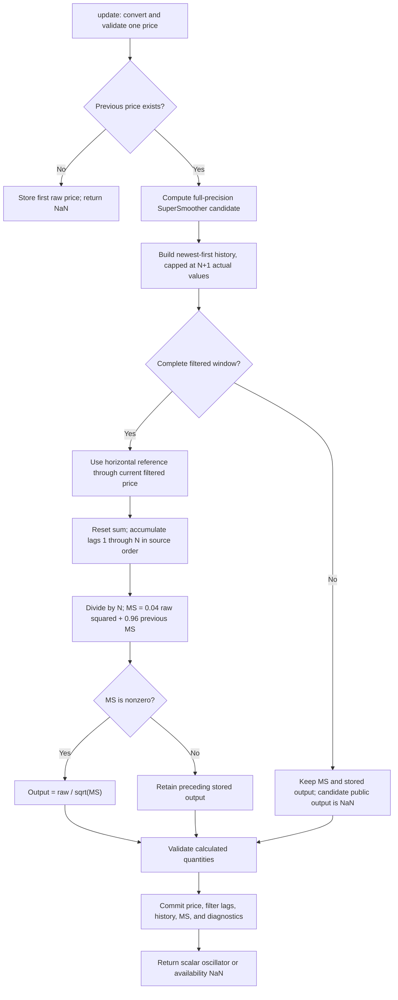

# Trendflex: research prototype master reference

This folder is a complete conversion reference for John F. Ehlers' **Trendflex** oscillator from “Reflex: A New Zero-Lag Indicator,” *Technical Analysis of Stocks & Commodities*, February 2020. The executable master is [trendflex.py](trendflex.py). It consumes one chronological price per `update` and returns one scalar oscillator value. It depends only on Python's standard library.

Trendflex averages signed distances between the present smoothed price and earlier smoothed prices, using a horizontal reference through the present value. It retains directional trend movement while expressing the result as an oscillator in units of an exponentially weighted root mean square.

The user requested separate Reflex and Trendflex masters and full-precision constants. Accordingly, this implementation uses **`math.pi` and `math.sqrt(2.0)`** in the SuperSmoother. It preserves the source recurrences and their arithmetic order, with those explicit substitutions. The article uses rounded constants and delegates startup to the charting platform, so this master specifies its own reproducible finite-record startup below. Reference values are authoritative for this documented variant; they are not claimed to be bit-identical to every commercial platform or to the rounded-constant article.

The user confirmed the shared 12-length table, and **all expected data has been generated and verified**. Each of the five language files contains the preserved inputs and 12 arrays of 252 reference outputs. Normal execution of the master demonstrates the indicator without modifying any fixtures.

## 1. Price model, physical analogy, and intended behavior

Ehlers models prices locally as a cyclic component superimposed on a trend. If the assumed wavelength is $N$ bars and that wavelength is correct, the cyclic phase at the present sample and the sample $N$ bars earlier is the same. A line connecting those two prices therefore describes the intervening trend. The default estimate is $N=20$, approximately one trading month on daily data. On intraday, tick, or volume bars, $N$ still counts observations rather than elapsed clock time.

The name Reflex comes from a bow and arrow. The sampled waveform forms a curved bow; the line connecting two observations one wavelength apart is the bowstring. Sum the signed vertical distances between that string and the observations underneath it. At a cyclic peak the line is high and the average distance is positive; at a valley it is negative. A constant linear trend contributes equally to the line and the data, and cancels.

Trendflex uses a horizontal line through the current observation instead of a sloping string. An upward trend leaves the current observation above most historical observations, producing a positive average distance. A downward trend produces a negative value. Both indicators use the same smoothed price and the same normalization; their distance geometry differs.

For Trendflex, positive output means the present smoothed value is above the preceding smoothed observations on average; negative output means it is below them on average. A persistent upward slope therefore retains a positive raw response, while a downward slope retains a negative raw response.

The article's diagrams describe raw prices, while the executable formulas first filter prices with a two-pole SuperSmoother. The period of that smoother is $N/2$, providing gentle smoothing relative to the assumed cycle. Averaging the distances adds stability, but each distance contains the present endpoint, so this geometry does not suppress high-frequency noise as an ordinary trailing average does.

“Zero lag” needs a precise scope: the distance geometry is in phase with a sinusoid at the assumed wavelength, measured relative to the **filtered input**. The causal SuperSmoother still contributes frequency-dependent lag relative to raw Close. A mismatched wavelength, changing trend, multiple cycles, recursive startup, and adaptive amplitude normalization change the displayed response. Neither oscillator reads future samples or forecasts the future.

## 2. Symbols and source arithmetic

Let:

| Symbol | Meaning |
|---|---|
| $p_t$ | Accepted raw price at chronological index $t$, with $t=0$ for the first input. |
| $N$ | Positive integer `length`, in bars. |
| $P=N/2$ | Derived SuperSmoother period; never rounded to an integer. |
| $f_t$ | SuperSmoother output, called `Filt` in EasyLanguage. |
| $s_t$ | Backward-index chord slope, used only by Reflex. |
| $R_t$ | Unnormalized Reflex distance average. |
| $T_t$ | Unnormalized Trendflex distance average. |
| $u_t$ | The distance average of the indicator in this folder. |
| $M_t$ | EMA of $u_t^2$, called `MS` in the source. |
| $y_t$ | Normalized oscillator returned by `update`. |

EasyLanguage `X[k]` means the value $k$ bars before the current one. `Cosine` takes degrees; Python `math.cos` takes radians. All mathematical equations below are complete enough to implement the indicators without access to the article or sibling master.

### 2.1 SuperSmoother exactly as printed

The article and TradeStation tip use:

$$
\begin{aligned}
P &= 0.5N,\\
a_1 &= \exp\left(-\frac{1.414\cdot3.14159}{P}\right),\\
b_1 &= 2a_1\cos_{\mathrm{degrees}}\left(\frac{1.414\cdot180}{P}\right),\\
c_2 &= b_1,\\
c_3 &= -a_1a_1,\\
c_1 &= 1-c_2-c_3,\\
f_t &= c_1\frac{p_t+p_{t-1}}{2}+c_2f_{t-1}+c_3f_{t-2}.
\end{aligned}
$$

This is also the two-pole SuperSmoother of *Cycle Analytics for Traders*, Chapter 3, equation (3-3), with its `Period` set to $P=N/2$. Note that the negative $c_3$ is **added as a signed coefficient** in the recurrence.

### 2.2 Full-precision coefficients used by this master

Replace the printed approximations with the user-requested constants and convert the cosine angle to radians:

$$
\begin{aligned}
\theta &= \frac{\sqrt{2}\pi}{P}
        = \frac{2\sqrt{2}\pi}{N},\\
a_1 &= e^{-\theta},\\
b_1 &= 2a_1\cos(\theta),\\
c_2 &= b_1,\\
c_3 &= -a_1^2,\\
c_1 &= 1-c_2-c_3.
\end{aligned}
$$

The implemented evaluation order is:

```python
PI = math.pi
SQRT_TWO = math.sqrt(2.0)
smoothing_period = 0.5 * length
angle = SQRT_TWO * PI / smoothing_period
a1 = math.exp(-angle)
c2 = 2.0 * a1 * math.cos(angle)
c3 = -a1 * a1
c1 = 1.0 - c2 - c3
filtered = c1 * (price + previous_price) / 2.0 + c2 * filt1 + c3 * filt2
```

Compute the coefficients once per instance. Keep full binary64 precision in all state. Do not round the angle, period, coefficients, price history, mean square, or outputs during calculation.

The decay and rotation share the same full-precision angle. This is an intentional numerical improvement authorized by the user, not a hidden approximation to the rounded source. Different implementations of transcendental functions can differ by a few floating-point units; conversion tests should compare finite values with an appropriate tolerance rather than require identical internal binary64 bits.

### 2.3 Complete Reflex geometry

The backward chord slope and line value at lag $k$ are:

$$
s_t=\frac{f_{t-N}-f_t}{N},
\qquad
\ell_t(k)=f_t+ks_t.
$$

The raw average is:

$$
R_t=\frac{1}{N}\sum_{k=1}^{N}
\left(f_t+ks_t-f_{t-k}\right).
$$

The source includes $k=N$, whose distance is zero in exact arithmetic, excludes $k=0$, and still divides by $N$. The article's prose says the two endpoints are excluded from averaging; **the executable code above is the numerical authority**. Dividing by $N-1$ would implement a different indicator.

Preserve the source's left association:

```python
slope = (history[length] - filtered) / length
total = 0.0
for count in range(1, length + 1):
    total = total + (filtered + count * slope) - history[count]
raw_average = total / length
```

In floating-point arithmetic, the included old endpoint can leave a tiny residual. Do not remove it, reassociate the additions, use a compensated accumulator, or substitute an algebraically simplified expression when producing these master reference values.

### 2.4 Complete Trendflex geometry

Set the comparison line horizontally at the present filtered price:

$$
\ell_t(k)=f_t,
\qquad
T_t=\frac{1}{N}\sum_{k=1}^{N}(f_t-f_{t-k}).
$$

The literal source evaluation is:

```python
total = 0.0
for count in range(1, length + 1):
    total = total + filtered - history[count]
raw_average = total / length
```

Again, reset `total` to zero on every bar and preserve left association. The source does not accumulate the preceding bar's average into the present sum.

For interpretation only, the two averages satisfy:

$$
R_t=T_t+\frac{N+1}{2N}(f_{t-N}-f_t).
$$

This identity explains their relationship but is not used to compute reference values, because its floating-point association differs.

### 2.5 Mean-square normalization and zero-denominator guard

Use $u_t=T_t$ in this folder. Both source indicators normalize as follows:

$$
M_t=0.04u_t^2+0.96M_{t-1}.
$$

$$
y_t=
\begin{cases}
u_t/\sqrt{M_t},& M_t\ne0,\\
y_{t-1}^{\mathrm{stored}},& M_t=0.
\end{cases}
$$

The source has an `If MS <> 0 Then ...` with no `Else`. Its output variable starts at zero and retains its preceding stored value when $M_t=0$. The master preserves that behavior. Public unprimed NaNs do not replace the stored output.

The article calls this scaling “in terms of standard deviations.” Precisely, it uses an exponentially weighted **root mean square**, with no subtraction of an estimated mean. If $\mu_t$ denotes the same EMA of $u_t$, a centered exponentially weighted variance would be $M_t-\mu_t^2$ under consistent initialization. This centered variance is not calculated. The distinction matters especially for Trendflex, whose trend-retaining raw average can have a nonzero mean.

The fixed smoothing factor $\alpha=0.04$ has conventional EMA equivalent length:

$$
L_{\mathrm{EMA}}=\frac{2}{\alpha}-1=49,
\qquad
h_{1/2}=\frac{\ln(0.5)}{\ln(0.96)}
       \approx16.979748\ \text{bars}.
$$

With nonnegative preceding mean square, exact arithmetic gives $M_t\ge0.04u_t^2$, so $|y_t|\le5$ whenever the denominator is positive. No output clamp is applied. Underflow and floating-point cancellation can affect this theoretical statement for extreme or nearly degenerate streams.

When the first raw average is nonzero and the mean square starts at zero, the first output is approximately:

$$
\frac{u}{\sqrt{0.04u^2}}=5\,\operatorname{sign}(u).
$$

This is an initialization consequence, not evidence of an exceptionally strong market signal. A persistent nonzero raw average approaches an output of $\pm1$ as the mean square settles. A persistent zero raw average has no centered volatility estimate to fall back on.

## 3. Geometry and filter response

For an affine filtered sequence $f_t=A+bt$, direct substitution gives:

$$
s_t=-b,\qquad R_t=0,\qquad T_t=\frac{b(N+1)}{2}.
$$

Thus Reflex removes constant and linear components of the **filtered series**. Trendflex removes a constant level but retains constant slope. During the recursive smoother's startup, a constant or linear raw input need not yet give a constant or linear filtered series.

Before RMS normalization, both systems are linear and time invariant once startup is separated. With the lag variable $z^{-1}$:

$$
H_S(z)=
\frac{c_1(1+z^{-1})/2}
     {1-c_2z^{-1}-c_3z^{-2}},
$$

$$
G_T(z)=1-\frac1N\sum_{k=1}^{N}z^{-k},
$$

$$
G_R(z)=G_T(z)+\frac{N+1}{2N}(z^{-N}-1).
$$

The raw oscillator transfer is $H_S(z)G_R(z)$ for Reflex and $H_S(z)G_T(z)$ for Trendflex. The normalized oscillator is nonlinear because its divisor depends on the evolving input amplitude; it does not have one fixed linear transfer function.

The smoother's poles are $a_1e^{\pm i\theta}$, with radius $0<a_1<1$ for finite positive meaningful periods. Since $c_1=1-c_2-c_3$, its DC gain is unity. The numerator $1+z^{-1}$ gives a zero at the Nyquist frequency $\omega=\pi$, corresponding to a two-bar alternating sequence. Recursive memory yields a sharper transition than a comparable short finite moving average, while producing frequency-dependent phase.

Both distance geometries have a DC zero. For $N>1$, Reflex has a double DC zero, consistent with cancellation of affine trends; Trendflex has a single DC zero. For $N=1$, Reflex is identically zero in exact arithmetic and is geometrically degenerate.

For a cycle exactly matching $N>1$:

$$
\omega=\frac{2\pi}{N},
\qquad
\sum_{k=1}^{N}e^{-i\omega k}=0,
\qquad
e^{-i\omega N}=1,
$$

so:

$$
G_R(e^{i\omega})=G_T(e^{i\omega})=1.
$$

This is the mathematical basis of the matched-cycle “zero lag” claim for the distance geometry. For a useful sampled cycle below Nyquist, use $N>2$; at $N=2$ the SuperSmoother rejects the exactly matched Nyquist component. At other wavelengths the geometry has a different amplitude and phase. At a matched cycle, the raw oscillator still has the phase of $H_S$, and the normalization can further reshape the waveform.

For ordinary finite inputs, scaling all prices by a positive constant approximately preserves normalized output, while a negative scale reverses its sign. In exact arithmetic this follows because the numerator scales linearly and the mean square quadratically. Floating-point rounding can perturb that invariance. With the specified zero recursive seeds, adding a constant to all raw prices changes the initial smoother transient, so startup is not translation invariant.

## 4. SuperSmoother background from Cycle Analytics for Traders

This section reproduces the mathematical filter background in the supplied Chapter 3 so a conversion agent can understand the smoother without the book. These alternative filters provide design context; Trendflex uses only equation (3-3) with the full-precision substitution in Section 2.2.

### 4.1 Symmetric nonrecursive filters

For an $m$-tap finite impulse response filter with symmetric real coefficients:

$$
v_t=\frac1S\sum_{k=0}^{m-1}b_kp_{t-k},
\qquad b_k=b_{m-1-k},
\qquad S=\sum_{k=0}^{m-1}b_k.
$$

Its linear-phase delay is $(m-1)/2$ bars away from response zeros and sign changes. Symmetric even-tap filters have a zero at Nyquist. An $m$-tap SMA has:

$$
H_{\mathrm{SMA},m}(z)=\frac1m\sum_{k=0}^{m-1}z^{-k}.
$$

Chapter 3 gives these coefficient examples:

$$
[1,1,1,1]/4,\qquad [1,1,1,1,1,1]/6,
$$

$$
[1,2,2,1]/6,\qquad [1,2,3,3,2,1]/12.
$$

The actual tap counts imply delays $1.5$, $2.5$, $1.5$, and $2.5$ bars, respectively. Some delay and rejection-period statements in the supplied chapter prose conflict with these arrays; use the coefficient equations rather than those prose statements. For example, the six-tap SMA rejects cycles of two, three, and six bars, and the factorization of $[1,2,3,3,2,1]/12$ gives two- and three-bar rejection zeros.

Halving the endpoints of an odd-tap SMA, then renormalizing, gives:

$$
[0.5,1,1,1,0.5]/4.
$$

For a general odd tap count $m>1$, this construction factors into an $(m-1)$-tap SMA and a two-tap average:

$$
H_{\mathrm{modified},m}(z)
=\frac{1+z^{-1}}2
 \frac{1}{m-1}\sum_{k=0}^{m-2}z^{-k}.
$$

Because $m-1$ is even, both factors have a Nyquist zero, giving a double zero with only half a bar of additional delay over the even-tap SMA.

The chapter's modified least-squares quadratic examples, attributed there to Hamming, are:

$$
[7,24,34,24,7]/96,
$$

$$
[1,6,12,14,12,6,1]/52,
$$

$$
[-1,28,78,108,118,108,78,28,-1]/544,
$$

$$
[-11,18,88,138,168,178,168,138,88,18,-11]/980.
$$

Their symmetry gives delays of $2$, $3$, $4$, and $5$ bars. Their endpoint-modified design improves rejection near Nyquist. They are not substituted into Trendflex.

### 4.2 Recursive Butterworth context and supplied equations (3-1), (3-2)

An analog Butterworth low-pass is maximally flat near zero frequency. In the digital approximations discussed by Ehlers, two- and three-pole versions include numerator coefficient patterns $[1,2,1]$ and $[1,3,3,1]$. Removing all but the constant numerator term reduces lag. Restoring only a two-tap average gives the SuperSmoother's Nyquist rejection for a half-bar numerator delay.

For completeness, the supplied Chapter 3 transcribes its modified two-pole Butterworth equation (3-1) as:

$$
\begin{aligned}
a &= \exp(-1.414\cdot3.14159/\mathrm{Period}),\\
b &= 2a\cos_{\mathrm{degrees}}(1.414\cdot1.25\cdot180/\mathrm{Period}),\\
c_2 &= b,\qquad c_3=-a^2,\qquad c_1=1-c_2-c_3,\\
\mathrm{Output}_t
&=c_1\mathrm{Input}_t
 -c_2\mathrm{Output}_{t-1}
 -c_3\mathrm{Output}_{t-2}.
\end{aligned}
$$

Its three-pole equation (3-2) is transcribed as:

$$
\begin{aligned}
a &= \exp(-3.14159/\mathrm{Period}),\\
b &= 2a\cos_{\mathrm{degrees}}(1.738\cdot180/\mathrm{Period}),\\
c &= a^2,\\
d_2 &= b+c,\\
d_3 &= -(c+bc),\\
d_4 &= c^2,\\
d_1 &= 1-d_2-d_3-d_4,\\
\mathrm{Output}_t
&=d_1\mathrm{Input}_t
 -d_2\mathrm{Output}_{t-1}
 -d_3\mathrm{Output}_{t-2}
 -d_4\mathrm{Output}_{t-3}.
\end{aligned}
$$

These are preserved here as the **supplied transcription**, not an implementation recommendation. Their subtractive recurrence signs conflict with the signed coefficients and normalization convention; equation (3-1) also contains an extra $1.25$ in its angle. Neither equation is used by this master. The article's executable recurrence and Chapter 3's additive-sign SuperSmoother equation (3-3), reproduced in Section 2.1, agree and define the actual smoother.

### 4.3 Sampling, smoothing, and phase

One Close per bar is one sample per bar. The Nyquist limit is $0.5$ cycles per bar, or a two-bar period. Frequencies above this limit alias into the observable range. A post-sampling smoother can suppress unwanted high-frequency content but cannot recover information already lost through aliasing.

Ehlers' chapter describes an empirical market-noise model in which aliasing-related noise falls roughly $6$ dB per octave as cycle period grows, systemic trade noise often sits about $10$ dB below cyclic information, and the two-pole SuperSmoother supplies approximately $12$ dB-per-octave attenuation beyond its cutoff. On that basis he recommends smoothing periods around ten bars in many applications, and treating cycles shorter than about eight bars cautiously. These are the author's modeling heuristics, not universal sampling theorems or guarantees about market data.

For Trendflex, the source's default $N=20$ implies that ten-bar SuperSmoother period. Smaller $N$ is valid algebraically and useful for boundary coverage, but provides much less practical smoothing. Larger $N$ means longer history collection and recursive settling. Recursive filters can have lower lag for comparable rejection than long finite averages, but their delay varies with frequency and can disperse a waveform containing several cycles.

## 5. Configuration and streaming contract

| Setting | Default | Valid range and meaning |
|---|---:|---|
| `length` ($N$) | 20 | Positive Python integer, excluding booleans. Length 1 is accepted and gives a one-bar smoothed-price difference. The shared reference table starts at 2 so its geometry is also nondegenerate for Reflex; ordinarily use more than 2 for a cycle below Nyquist. |
| Price argument to `update` | No default | Any finite float-convertible observation; zero and negative values are allowed. |
| Derived smoother period | $N/2$ | Fixed relation to `length`; can be fractional. |
| Mean-square EMA factor | 0.04 | Fixed source constant; not an exposed parameter. |
| Recursive initial values | 0 | Fixed startup policy, described below. |

There is no manually chosen forecast, offset, phase compensation, separate smoother length, variance length, or signal-line parameter. The source's plotted zero reference is a constant visual aid, not a second indicator output.

The constructor rejects invalid integer lengths and coefficient sets that are no longer numerically resolvable as stable in binary64. Mathematically there is no finite positive upper limit on $N$, but huge values can overflow integer-to-float conversion or make $a_1$ round to one or $c_1$ to zero. Storage and work are $O(N)$ per instance/bar, so practical periods should remain reasonable. A length greater than available history is allowed and returns NaNs until enough observations arrive.

Each `update` advances one accepted observation. Nonfinite inputs are rejected with `ValueError`. Conversion failures raise Python's normal conversion exception. Intermediate overflow/nonfinite results are rejected before recursive state is committed. A rejected input does not advance the history. There is no automatic missing-value imputation or gap policy. To reinitialize after a gap, call `reset` or construct a new instance.

## 6. Explicit finite-record initialization and priming

The article declares recursive variables as zero but relies on a platform for historical indexing and first executable bar. It does not give a complete raw-array startup protocol. A standalone master must choose one; use this protocol in every conversion:

1. Construct the instance with both recursive filter lags, mean square, and stored oscillator output equal to zero. Filtered history is empty and previous raw price is absent.
2. The first accepted raw input, $p_0$, establishes the previous price. Return NaN. Do not manufacture an observation for $f_0$.
3. At raw index $t=1$, calculate $f_1$ from $p_1,p_0$ with the two zero filter seeds. Subsequently evaluate the recurrence on every accepted input, including while the distance window is collecting.
4. Retain the newest $N+1$ **actual filtered observations**, with current value at history index zero.
5. Until $N+1$ actual filtered observations exist, leave $M=0$, do not evaluate the distance average, and return NaN.
6. At raw index $t=N+1$, $f_1$ through $f_{N+1}$ supply the first complete window. Compute the raw distance average, update the zero-seeded mean square, and return the first available normalized output.
7. Thereafter compute one output per accepted bar. NaNs are availability markers only; they never enter recursive state.

Thus the first $N+1$ outputs, at indices $0,\ldots,N$, are NaN:

$$
\mathrm{warmup\_bars}=N+1,
\qquad
\mathrm{first\ available\ raw\ index}=N+1,
\qquad
\mathrm{minimum\ accepted\ prices}=N+2.
$$

For the 252-input fixture, the available-output count is:

$$
\max(0,252-(N+1)).
$$

At $N=250$, exactly one output is available at index 251. At $N=251$, all 252 outputs remain NaN, and the next accepted price would provide the first output.

“Primed” means the full geometric history exists, not that the infinite-impulse-response smoother or mean square has settled. Starting a chart with additional historical prices generally changes later outputs, especially near the left edge.

All-zero prices produce zero internal values and, once primed, zero outputs. Constant nonzero prices initially excite the zero-seeded filter, so the first normalized value can still be approximately $\pm5$. After long settling, Reflex can normalize tiny cancellation residuals because the source provides neither an epsilon denominator floor nor a centered variance. Preserve the source rule rather than inventing a tolerance-based zero or clamping.

## 7. Calculation flow and API



No state is committed from a later-stage arithmetic failure. The diagram describes accepted bars; validation exceptions return control to the caller without advancing the stream.

```python
from trendflex import Trendflex

indicator = Trendflex(length=20)
for close in closes:                 # chronological, one observation per call
    oscillator = indicator.update(close)
    if indicator.is_primed:
        print(oscillator)

print(indicator.length)              # 20, read-only configuration
print(indicator.warmup_bars)         # 21
print(indicator.state)               # read-only NamedTuple diagnostics
indicator.reset()                   # discard all history and restart
```

`state` returns `TrendflexState(filtered, raw_average, mean_square, trendflex)`. Before a complete window, `raw_average` and `trendflex` are NaN; `filtered` is NaN only before the first smoother calculation. `mean_square` stays zero until priming. After `reset`, the diagnostics restore those initial values. Trendflex has no slope field because its comparison line is horizontal.

Only the scalar returned by `update` is a required expected-data output. Diagnostics help inspect smoothing, geometry, and normalization; they are not extra configurable indicators. The runtime implementation imports neither the sibling master nor original article files. A conversion agent can implement the same bounded history with a ring buffer, provided lag order and source summation order are preserved.

## 8. Source selection and platform discrepancies

The numerical authority is the article's EasyLanguage code, corroborated by the February 2020 TradeStation `_Reflex` and `_TrendFlex` functions. This master changes the two approximate mathematical constants as requested and supplies the finite-record startup contract. No Mesa supplement exists in the supplied article folder.

| Supplied implementation | Relevant behavior and conversion consequence |
|---|---|
| Article EasyLanguage | Resets Sum each bar, uses rounded $1.414$ and $3.14159$, declares zero recursive variables, leaves chart history implicit. |
| TradeStation functions | Same core recurrences. The additional example compares independently normalized fast Trendflex(20) and slow Trendflex(50). |
| eSignal | Uses full `Math.PI` but rounded $1.414$. Holds normalization until its bar-count history gate, with platform null/new-bar handling. Supports both outputs in one study. Its startup is not this master's finite-record contract. |
| NinjaTrader 8 `Reflex.cs` and `TrendFlex.cs` | Uses full pi and rounded $1.414$, forces initial Filter values to zero, and **does not reset the member `sum` on each bar**. Because the previous divided sum is fed into the next accumulation, this is a different recurrence and is not an oracle for this master. |
| TradersStudio | Function geometry and normalization follow the article. Supplied plotting wrappers call length 20 directly even though they declare a length setting. |
| thinkorswim | The tip explicitly uses `ExpAverage` with prefetch for normalization initialization, so chart-start results can differ from zero-seeded recursion. |
| Wealth-Lab / Quantacula / NeuroShell | Library or DLL interfaces are described, but their underlying indicator arithmetic is not supplied here. They cannot establish an independent numerical oracle. |

The article's copyright comment says 2019; the publication date is February 2020. Preserve those as distinct dates in attribution.

The TradeStation difference plot is:

$$
D_t=\mathrm{Trendflex}_{20,t}-\mathrm{Trendflex}_{50,t}.
$$

Its strategy example trades crossings of the two separate normalized outputs. This comparison is a use case, not a third return value or hidden stage of either scalar master.

## 9. Confirmed reference cases

The user confirmed all 12 lengths for both independent folders. Each case generates one array of 252 scalar outputs per language. There are **12 combinations per master**, below the limit of 64; together the two masters have 24 case runs. Each has only the `length` parameter.

| Length | Python expected array | What it tests |
|---:|---|---|
| 20 | `EXPECTED_L20` | Article and TradeStation default assumed cycle length. |
| 2 | `EXPECTED_L2` | Shortest nondegenerate Reflex window and very short smoother period. |
| 3 | `EXPECTED_L3` | Short odd-length window and asymmetric sampling about the current bar. |
| 5 | `EXPECTED_L5` | Fast response to reversals with a short assumed cycle. |
| 8 | `EXPECTED_L8` | Short even-length window with a four-bar smoother period. |
| 10 | `EXPECTED_L10` | Ten-bar cycle with a five-bar SuperSmoother period. |
| 14 | `EXPECTED_L14` | Intermediate response between fast and default settings. |
| 30 | `EXPECTED_L30` | Slower cycle and longer smoother memory. |
| 50 | `EXPECTED_L50` | TradeStation slow Trendflex comparison length. |
| 126 | `EXPECTED_L126` | Half-record window with extended collection and recursive transient. |
| 250 | `EXPECTED_L250` | Largest length with one primed output in the 252-price record. |
| 251 | `EXPECTED_L251` | Insufficient filtered history; all 252 outputs remain NaN. |

Length 1 is supported by the API but omitted from the shared reference table because Reflex's ideal one-endpoint distance is identically zero. Separate analytical/unit checks cover that accepted boundary. Lengths 250 and 251 explicitly test availability rather than settled market behavior.

### 9.1 Input preservation and serialization

The five files were copied from the prepared-for-conversion parent directory. All existing input arrays are retained. The executable `__main__` embeds the exact 252 `INPUT_CLOSE` prices from `test_testdata.py`, checks that they match the copied fixture during generation, and does not require a sibling import.

To regenerate the confirmed reference arrays from this folder, run:

```bash
python3 trendflex.py --generate-reference-data
```

The generator:

1. Calculates the table with fresh independent streaming instances.
2. Appends/replaces a clearly marked generated section in Python, using `EXPECTED_L{length}`.
3. Writes finite numbers with **15 significant digits** using `.15g`, adds a decimal suffix where necessary, and writes Python unavailable values as `math.nan`.
4. Reopens the Python file, verifies array names, all 252 lengths, exact availability prefixes, preserved input arrays, and decimal rounding against the generated values.
5. Exports those **parsed Python decimal values** to the other four languages, with native NaN syntax and the same two comment lines.
6. Replaces its own marked section on subsequent runs without duplicating expected arrays or modifying input values.

The resulting names and declarations are:

| Language | Default-case declaration | Unprimed literal |
|---|---|---|
| Python | `EXPECTED_L20 = [...]` | `math.nan` |
| Go, package `trendflex` | `var expectedL20 = []float64{...}` | `math.NaN()`, with `import "math"` |
| TypeScript | `export const expectedL20: number[] = [...];` | `NaN` |
| Rust | `pub fn expected_l20() -> Vec<f64> { vec![...] }` | `f64::NAN` |
| Zig | `pub fn expectedL20() [252]f64 { return .{...}; }` | `nan` |

Zig declares `const math = @import("std").math;` and `const nan = math.nan(f64);`. Rust expected functions stay inside the copied `#[cfg(test)] pub mod testdata`. Other languages retain their copied input declaration style; expected declarations use valid native syntax.

Before every generated array, copy the table's exact “What it tests” cell, then its parameters:

```python
# Article and TradeStation default assumed cycle length.
# length=20
EXPECTED_L20 = [
    # 252 values, including the first 21 availability NaNs
]
```

Other languages use `//` comments with the same text. The example above illustrates the structure; it is not an actual expected-data array. There are no floating-point configuration parameters in this indicator; if later adding one, encode a decimal point as an underscore in its name.

Serialization rounds the emitted reference text, not recursive state. A useful default port comparison is `abs(actual-expected) <= 5e-13 + 5e-13*abs(expected)` for finite values, checking NaNs separately. Near-zero Reflex cancellation on nearly affine data may require analysis of summation and state precision rather than blindly increasing tolerance.

## 10. Validation and reproducibility

Run the demonstration without fixture mutation:

```bash
python3 trendflex.py
```

With the embedded 252 prices and default length 20, the current full-precision master reports:

- First available raw index: **21**.
- First available value: **5** at 15 significant digits.
- Final value: **-0.125900210463259** at 15 significant digits.
- Latest filtered price: **108.99695924051748** before serialization.

The accompanying [test_trendflex.py](test_trendflex.py) has **13 passing tests with no skips**. Eleven cover exact agreement with independently evaluated TradeStation expressions after the requested constant substitutions; differences from the rounded constants; warmup boundaries; smoother stability/DC/Nyquist properties; sinusoidal transfer at matched and mismatched cycles; linear-trend behavior after settling; the source zero-mean-square guard; scale/reflection and constant-input startup; reset/causality/rejected inputs; parameter validation; and preservation of embedded/copied inputs.

```bash
python3 -m unittest discover -p 'test_trendflex.py' -v
```

The other two tests verify the confirmed table, comments, all 252-value arrays, per-language numerical agreement, and repeatable generation preserving inputs. All expected-data checks are mandatory; removing or corrupting a fixture causes a test failure.

The independent source-expression tests read the original local `ReflexTrendFlex.els` to establish provenance. The production master and this description are standalone; moving the tests to a repository without the source requires copying that source fixture or replacing the oracle with the complete equations documented here.

Native fixture checks also passed using Go 1.27.1, Rust 1.98.1, Zig 0.16.0, and Node 24.15.0 with native TypeScript stripping. Each native harness loaded the four input arrays and 12 expected arrays, checking all **4,032 values** against the parsed Python fixture. Every finite value matched its Python binary64 bits, and every NaN matched availability; NaN payload bits are deliberately not compared. These checks validate the exported data and native declarations, rather than a translated indicator implementation. Python validation used Python 3.14.3.

Exact source-oracle equality is scoped to the same Python mathematical functions and documented startup. It does not demonstrate equality to rounded-constant EasyLanguage, undisclosed library startup, the divergent NinjaTrader recurrence, or live chart prefetch. The requested high-precision constants and explicit NaN priming policy take precedence for conversion.

## 11. Sources and BibTeX

The supplied article contains all Reflex and Trendflex expressions; the supplied book chapter contains the SuperSmoother background. No additional book chapter defines a different Reflex or Trendflex algorithm in this preparation.

1. John F. Ehlers, “Reflex: A New Zero-Lag Indicator,” *Technical Analysis of Stocks & Commodities* **38(2)**, February 2020, pp. **6–8, 21**. Local source: [content.md](../../tasc/2020-02-reflex-a-new-zero-lag-ndicator/content.md). No archive PDF URL is supplied in the local source.
2. “Traders' Tips: Reflex: A New Zero-Lag Indicator,” February 2020. [Online collection](https://www.traders.com/Documentation/FEEDbk_docs/2020/02/TradersTips.html); local [tips.md](../../tasc/2020-02-reflex-a-new-zero-lag-ndicator/tips/tips.md) and [TradeStation source](../../tasc/2020-02-reflex-a-new-zero-lag-ndicator/tips/ReflexTrendFlex.els). The platform comparison also inspected the local [NinjaTrader Reflex](../../tasc/2020-02-reflex-a-new-zero-lag-ndicator/tips/ninja-trader/Reflex.cs) and [NinjaTrader TrendFlex](../../tasc/2020-02-reflex-a-new-zero-lag-ndicator/tips/ninja-trader/TrendFlex.cs).
3. John F. Ehlers, *Cycle Analytics for Traders: Advanced Technical Trading Concepts*, Wiley, 2013, ISBN **9781118728604**, Chapter 3, “Smoothing Filters on Steroids,” especially equation (3-3). Local [chapter](../../2013-cycle-analytics-for-traders/ch3.md).
4. R. W. Hamming, *Digital Filters*, 3rd ed., Prentice Hall, 1997, p. 49, as cited by the supplied Chapter 3 for its finite-filter examples. That original book was not independently consulted here.
5. Karl Montevirgen, “Market Data Insights With John Ehlers,” *Technical Analysis of Stocks & Commodities* **37**, September 2019, interview listed as further reading by the article. It is background attribution, not a numerical source for these masters.

```bibtex
@article{ehlers2020reflex,
  author  = {Ehlers, John F.},
  title   = {Reflex: A New Zero-Lag Indicator},
  journal = {Technical Analysis of Stocks \& Commodities},
  volume  = {38},
  number  = {2},
  pages   = {6--8, 21},
  month   = feb,
  year    = {2020},
  note    = {Includes the Reflex and Trendflex EasyLanguage indicators}
}

@misc{traderstips2020reflex,
  author       = {{Technical Analysis of Stocks \& Commodities}},
  title        = {Traders' Tips: Reflex: A New Zero-Lag Indicator},
  howpublished = {Traders.com},
  month        = feb,
  year         = {2020},
  url          = {https://www.traders.com/Documentation/FEEDbk_docs/2020/02/TradersTips.html},
  note         = {TradeStation and other platform implementations accompanying Ehlers' article}
}

@book{ehlers2013cycle,
  author    = {Ehlers, John F.},
  title     = {Cycle Analytics for Traders: Advanced Technical Trading Concepts},
  publisher = {Wiley},
  year      = {2013},
  isbn      = {9781118728604},
  note      = {Chapter 3: Smoothing Filters on Steroids; SuperSmoother equation (3-3)}
}

@book{hamming1997digital,
  author    = {Hamming, R. W.},
  title     = {Digital Filters},
  edition   = {3},
  publisher = {Prentice Hall},
  address   = {Upper Saddle River, NJ},
  year      = {1997},
  note      = {Page 49, cited by Ehlers' supplied Chapter 3}
}

@article{montevirgen2019market,
  author  = {Montevirgen, Karl},
  title   = {Market Data Insights With John Ehlers},
  journal = {Technical Analysis of Stocks \& Commodities},
  volume  = {37},
  month   = sep,
  year    = {2019},
  note    = {Interview; further reading in the February 2020 Reflex article}
}
```
