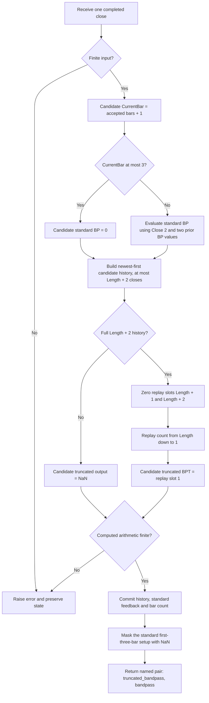

# Truncated Bandpass Filter and Bandpass Filter

This folder is the self-contained Python research prototype and mathematical master reference for John F. Ehlers' **Truncated Indicators**, *Technical Analysis of STOCKS & COMMODITIES*, July 2020, volume 38, pages 20–23. It returns both requested outputs on every accepted input: `truncated_bandpass` (article `BPT`) and `bandpass` (article `BP`). The recurrence follows the article, the Mesa paper and the TradeStation Traders' Tip. The five fixtures provide the same 252 closes and 40 expected output arrays in Python, Go, TypeScript, Rust and Zig. All 20 parameter combinations below were confirmed by the user on 2026-10-19.

The file and folder retain the requested spelling `truncated-bandpass-Filter`. The Python class is `TruncatedBandpassFilter`; Go's package is `truncatedbandpassfilter`. The Python implementation uses only the standard library and can be copied to another repository together with this document and the fixtures. No source article is needed to understand or port the mathematics described here.

## Purpose, principles and physical interpretation

A bandpass filter isolates a range of oscillatory frequencies around a chosen center period. It rejects a constant price level and the alternating, one-sample-high/one-sample-low component at the Nyquist frequency. Ehlers uses it to expose potentially tradable price cycles. The output has the same units as the input and is centered around zero; it is not an RSI-like bounded oscillator, a probability, or a normalized amplitude estimate.

The standard filter is an **infinite impulse response**, or IIR, filter. Its current answer contains two previous answers. Those previous answers contain still earlier answers, so an old disturbance can keep influencing the result indefinitely in exact arithmetic. A narrow passband corresponds to weak damping and long memory. A sharp price jump or drop excites that memory and may produce oscillations well after the jump has passed.

The article compares a price disturbance to a rock thrown into a lake: the disturbance is brief, but its ripples persist and travel outward. A bell gives the related resonator analogy: a brief strike excites its natural oscillation, which decays at a rate determined by damping. The standard two-pole bandpass is a discrete-time resonator with this behavior. Nonstationary market data has changing distributions and cycles, so an old event can be an unhelpful part of today's estimate.

A **finite impulse response**, or FIR, filter uses a finite sliding input window, as a simple moving average does. Ehlers argues that arbitrarily cutting an already designed FIR generally degrades that design. He also lists RSI and stochastic indicators as finite-window examples; that classification depends on the specific implementation, because a Wilder-smoothed RSI is recursive. The mathematical distinction here is finite input support versus recursive feedback, not the indicator's name.

Truncation in this implementation replays the standard recurrence on a finite set of recent price differences, with its two feedback states set to zero at the beginning of each replay. This makes the current truncated result independent of any earlier recursive state once the complete price window exists. It does **not** change or restart the concurrently calculated standard filter.

The article's example uses SPY daily prices around 2019, `period=20`, `bandwidth=0.1`, and `length=10`. It reports that the December 2018 drop caused months of standard-filter ringing, while the truncated filter better followed the depicted subsequent price swings. This is an observation about that example. The Zorro Traders' Tip demonstrates with a sine chirp that truncation can broaden the passband, shift its effective peak frequency and create sidelobes. A truncated narrow filter therefore has its own frequency response; it is not a perfect copy of the original with only old transients removed.

## Notation and indexing

Let $x_t$ be the current supplied close, with $t=0$ for the first observation. Let $P$ be `period`, $B$ be `bandwidth`, and $N$ be `length`. Let $y_t$ be the standard bandpass and $v_t$ the truncated bandpass. Source `Close[k]` denotes $x_{t-k}$. All inputs arrive in chronological order at a constant sampling interval.

EasyLanguage variables such as `BP[1]` carry a time delay. By contrast, `Trunc[count]` is an ordinary array slot in a historical replay performed **within the current update**. Confusing these two indexing meanings will implement a different filter.

The standalone convention here is `CurrentBar=t+1`. Chart engines can supply prehistory before their first calculation bar; their first `CurrentBar=1` may therefore correspond to a later price than this folder's `INPUT_CLOSE[0]`. The explicit initialization contract below defines the alignment for all five language ports.

## Complete EMA truncation argument from the article and Mesa paper

The papers explain the idea first with an exponential moving average. This section reproduces the full chain of mathematical expressions, using $u_t$ for the EMA output and $0<\alpha<1$ for its smoothing coefficient:

$$
u_t=\alpha x_t+(1-\alpha)u_{t-1}.
$$

Rearranging gives

$$
u_t-(1-\alpha)u_{t-1}=\alpha x_t.
$$

Let $z^{-1}$ denote one sample of delay. In transform notation,

$$
U(z)\bigl(1-(1-\alpha)z^{-1}\bigr)=\alpha X(z).
$$

The transfer response is the output-to-input ratio,

$$
H_{\mathrm{EMA}}(z)=\frac{U(z)}{X(z)}
=\frac{\alpha}{1-(1-\alpha)z^{-1}}.
$$

With $c=1-\alpha$, this becomes

$$
H_{\mathrm{EMA}}(z)=\frac{\alpha}{1-cz^{-1}}.
$$

Long division of numerator by denominator gives the geometric series

$$
H_{\mathrm{EMA}}(z)
=\alpha\bigl(1+cz^{-1}+c^2z^{-2}+c^3z^{-3}
+c^4z^{-4}+c^5z^{-5}+\cdots\bigr)
=\alpha\sum_{k=0}^{\infty}c^kz^{-k}.
$$

The series converges for $|cz^{-1}|<1$, including the unit circle when $|c|<1$. Stopping after an inclusive highest lag $M$ gives

$$
H_{\mathrm{EMA},M}(z)=\alpha\sum_{k=0}^{M}c^kz^{-k},
\qquad
u_t^{(M)}=\alpha\sum_{k=0}^{M}c^kx_{t-k}.
$$

This is the article's source fragment, including its inclusive loop:

```text
Output = 0;
For count = 0 to Length Begin
    Output = Output + Power(c, count)*Input[count];
End;
Output = a*Output;
```

Here source `a` denotes $\alpha$; `Length=M` yields $M+1$ terms. The geometric weights shrink, so a desired truncation can be chosen when their remaining contribution is small. Derived from those expressions, the omitted sum of weights is $c^{M+1}$, the truncated DC gain is $1-c^{M+1}$, and for $|x_t|\leq K$ the omitted output magnitude is bounded by $Kc^{M+1}$. The papers do not renormalize the truncated sum to unit gain.

The Mesa paper also gives a backward-indexed replay example:

```text
Output[Length + 1] = Input[Length]; // initialization
For count = Length DownTo 1 Begin
    Output[count] = a*Input[count] + (1 - a)*Output[count + 1];
End;
EMA = Output[1]; // converts array to a variable
```

Writing the literal array recurrence as $E_{M+1}=I_M$ and

$$
E_j=\alpha I_j+cE_{j+1},\qquad j=M,M-1,\ldots,1,
$$

gives $E_1=\alpha\sum_{j=1}^{M}c^{j-1}I_j+c^MI_M$. This illustration seeds with an input value and indexes its newest replay input as `Input[1]`. It is not the same zero-seeded convolution as the preceding EMA fragment and is not the bandpass's initialization. For the bandpass below, **both older replay outputs are exactly zero on every update**, and the final iteration explicitly uses the current close.

## Bandpass coefficients and standard recurrence

The supplied bandpass code defines the following coefficients. The first displayed form shows the source's degree-based cosine; the second shows equivalent radians:

$$
L_1=\cos_{\mathrm{degrees}}\left(\frac{360}{P}\right)
=\cos\left(\frac{2\pi}{P}\right),
$$

$$
G_1=\cos_{\mathrm{degrees}}\left(\frac{360B}{P}\right)
=\cos\left(\frac{2\pi B}{P}\right),
$$

$$
S_1=\frac{1}{G_1}-\sqrt{\frac{1}{G_1^2}-1}.
$$

Define $a=\tfrac12(1-S_1)$ and $b=L_1(1+S_1)$ for explanation. The standard recurrence is

$$
y_t=\frac12(1-S_1)(x_t-x_{t-2})
+L_1(1+S_1)y_{t-1}-S_1y_{t-2}
=a(x_t-x_{t-2})+by_{t-1}-S_1y_{t-2}.
$$

The source subsequently applies the startup override

$$
y_t=0\quad\text{if CurrentBar}\leq3.
$$

Those forced zeros become feedback state. The recurrence first produces an unmasked standard result at $t=3$, using $x_3-x_1$ and zero feedback. The public interface replaces only the three setup outputs with NaN; it does not replace the internal zero state.

For mathematical analysis after startup, the zero-state transfer function derived from the recurrence is

$$
H_{\mathrm{BP}}(z)=\frac{a(1-z^{-2})}{1-bz^{-1}+S_1z^{-2}}.
$$

The numerator has zeros at $z=1$ and $z=-1$, so the ideal steady response vanishes at DC and Nyquist. On $z=e^{i\omega}$, multiplying numerator and denominator by $e^{i\omega}$ gives

$$
H_{\mathrm{BP}}(e^{i\omega})
=\frac{i(1-S_1)\sin\omega}
{(1+S_1)(\cos\omega-L_1)+i(1-S_1)\sin\omega}.
$$

At the configured center frequency $\omega_0=2\pi/P$, the real denominator term vanishes and $H_{\mathrm{BP}}(e^{i\omega_0})=1$. This is an ideal steady sinusoidal response, not a promise that an initialized stream instantly has unit amplitude.

The poles solve

$$
z^2-bz+S_1=0,\qquad
p_{\pm}=\frac{b\pm\sqrt{b^2-4S_1}}{2}.
$$

For a complex conjugate pair, their magnitude is $\sqrt{S_1}$ and their angle satisfies

$$
\cos\phi=\frac{b}{2\sqrt{S_1}}.
$$

The ringing envelope scales as $(\sqrt{S_1})^k$. Narrow bandwidth makes $S_1$ closer to one and the envelope slower to decay. For example, at the default parameters $S_1\approx0.9690674$, the complex-pole envelope retains roughly 85% after ten bars. Large bandwidth can produce real poles instead; the magnitude statement above assumes a conjugate pair.

For the supported principal branch, $0<G_1<1$, $0<S_1<1$ and $-1<L_1<1$. The second-order stability inequalities are then

$$
1-S_1>0,\qquad
1-b+S_1=(1+S_1)(1-L_1)>0,\qquad
1+b+S_1=(1+S_1)(1+L_1)>0.
$$

They put both standard-filter poles inside the unit circle. Extremely small positive bandwidth can still round the computed $S_1$ to one in binary64; the implementation rejects unresolved boundary coefficients.

## Truncated recurrence, exact finite support and frequency response

For each current bar $t$, introduce a fresh one-based array $T_j^{(t)}$. Initialize the two older output states:

$$
T_{N+2}^{(t)}=0,\qquad T_{N+1}^{(t)}=0.
$$

Evaluate from the oldest replay step to the newest:

$$
T_j^{(t)}=\frac12(1-S_1)\bigl(x_{t-j+1}-x_{t-j-1}\bigr)
+L_1(1+S_1)T_{j+1}^{(t)}-S_1T_{j+2}^{(t)},
\qquad j=N,N-1,\ldots,1.
$$

Return

$$
v_t=T_1^{(t)}.
$$

At $j=N$, the inputs are $x_{t-N+1}$ and $x_{t-N-1}$. At $j=1$, they are $x_t$ and $x_{t-2}$. Consequently **N recurrence steps require N+2 actual prices**, spanning lags zero through $N+1$. The article calls this ten bars of data for `Length=10`, but its literal recurrence accesses twelve closes. Ports must follow the indexing in the code.

The article and TradeStation code first shift yesterday's `Trunc` array with `Trunc[count]=Trunc[count-1]`. Both older boundary slots are then overwritten with zero, and every slot from $N$ down to 1 is overwritten before it is used by a newer step. Thus none of yesterday's values influences the answer. Allocating a fresh zero workspace is equivalent and avoids the redundant shift. The Mesa paper already omits the shift.

The following FIR derivation is additional explanation of the published recurrence, not a separate implementation. Let the impulse weights of its all-pole denominator be

$$
q_0=1,\quad q_1=b,\quad
q_k=bq_{k-1}-S_1q_{k-2}\quad(k\geq2).
$$

Expanding the finite replay gives

$$
v_t=a\sum_{k=0}^{N-1}q_k(x_{t-k}-x_{t-k-2}).
$$

The corresponding transfer function is

$$
H_{\mathrm{BPT},N}(z)=a(1-z^{-2})\sum_{k=0}^{N-1}q_kz^{-k}.
$$

Using $q_k=0$ outside $0\leq k<N$, its direct price weights are

$$
h_j=a(q_j-q_{j-2}),\qquad j=0,\ldots,N+1.
$$

This explains the extra two price lags: the all-pole expansion is truncated to $N$ terms, then multiplied by the two-bar-difference numerator. Simply retaining the first $N$ coefficients of the full standard BP impulse response omits the last two boundary terms and is a different filter.

The finite transfer function retains exact zeros at DC and Nyquist, but generally loses the standard filter's unit gain at the configured center. Its response is

$$
H_{\mathrm{BPT},N}(e^{i\omega})
=a(1-e^{-2i\omega})\sum_{k=0}^{N-1}q_ke^{-ik\omega}.
$$

An impulse can influence it through lag $N+1$ only; beyond that, it has no memory of the impulse. Its coefficients need not be symmetric, so the general linear-phase FIR group-delay approximation of half a window does not directly apply. Truncation changes gain and phase; do not renormalize, append a smoother, or assume an unchanged center response when reproducing the article.

Useful exact-arithmetic checks derived from the equations are:

- Constant prices give zero truncated output as soon as the window exists, and zero standard output under the stated startup rule.
- For $N=1$, $v_t=a(x_t-x_{t-2})$; the truncated output is first available at index 2, one bar before the standard output.
- For $N=2$, $v_t=a(x_t-x_{t-2})+ba(x_{t-1}-x_{t-3})$.
- For a ramp $x_t=d+rt$, the primed truncated value is the constant $2ar\sum_{k=0}^{N-1}q_k$. The standard filter tends to $2ar/(1-b+S_1)$ after its transient. Rejecting a constant level does not imply rejecting a price ramp.
- Two streams with the same last $N+2$ prices have identical current truncated output, irrespective of earlier inputs. Their standard outputs can differ.

## Parameters and numeric domain

| Python parameter | Source input | Default | Valid prototype range | Meaning |
| --- | --- | --- | --- | --- |
| `period` | `Period` | 20 | Integer $P\geq3$ | Center cycle period in input bars; center frequency is $1/P$ cycles per bar. |
| `bandwidth` | `Bandwidth` | 0.1 | Finite $0<B<P/4$, also numerically resolved $0<S_1<1$ | Source fractional bandwidth parameter; 0.1 is ten percent. Typical settings are 0.01 to 1.0. |
| `length` | `Length` | 10 | Integer $1\leq N\leq97$ | Number of zero-seeded replay steps; history requirement is $N+2$ closes. |

The article's fixed workspace has a comment that Length “must be less than 98 due to array size.” This prototype conservatively honors that strict comment with a maximum of 97. The mathematics supports a dynamically allocated larger window; that extension is outside this source-compatible parameter contract. Although an EasyLanguage array indexed through 100 can fit $N=98$, one supplied C# port allocates only indices 0–99, so its maximum is 97. The eSignal UI allows 98; it is not this prototype's limit.

The broader chart UI ranges for period and bandwidth are not sufficient stability constraints. Requiring $P\geq3$ avoids center frequency at or above Nyquist. Requiring $B<P/4$ restricts $2\pi B/P$ to $(0,\pi/2)$, where the coefficient expression has the intended stable branch. Bandwidth zero makes $S_1=1$ and input gain zero; it is rejected. No cap of 1 is imposed on bandwidth, because the actual coefficient constraint is $B<P/4$.

Python booleans are rejected as configuration parameters. Each input must convert to a finite binary64 float. NaN and infinity are rejected before state changes; they do not count as bars. Negative finite prices are mathematically allowed. Arithmetic that becomes nonfinite is also rejected without consuming the bar. Reference data uses ordinary price-scale magnitudes.

Parameters are read-only properties. Reconfiguration requires a new instance. `reset()` retains the parameters and coefficients while discarding every input, output and bar counter.

## Streaming initialization and public availability

There is no fabricated price prehistory. Standard feedback starts at zero and stays zero on the first three supplied observations, exactly following `If CurrentBar <= 3 Then BP=0` under the explicitly chosen standalone bar numbering. Public `bandpass` is NaN at indices 0, 1 and 2, and first numeric at index 3. This is an availability mask over the article's startup zeros; later numeric values use those zeros as their recursive seeds.

The truncated field is NaN at indices $0,\ldots,N$, and first numeric at index $N+1$, when all $N+2$ real closes exist. Each complete replay always starts from two zero output states. It does not apply the global first-three-bars override inside the replay loop, because that override belongs only to the standard BP in the source.

| Field | NaN prefix length | First numeric zero-based index | Number of accepted closes needed |
| --- | --- | --- | --- |
| `bandpass` | 3 | 3 | 4 |
| `truncated_bandpass` | $N+1$ | $N+1$ | $N+2$ |
| Both fields | $\max(3,N+1)$ | $\max(3,N+1)$ | $\max(4,N+2)$ |

At default Length 10, indices 3–10 have a valid standard BP and an unavailable BPT. At Length 1, index 2 has a valid BPT and an unavailable standard BP. `warmup_bars` is the prefix length before the **pair** is complete; separate properties give each field's prefix. `is_primed` becomes true after both components are available. `output` exposes the latest named tuple without advancing the stream. It is `(NaN, NaN)` before the first update and after reset.

Priming and settling are different. A standard filter at Period 252 starts output at index 3 and can remain strongly influenced by initialization throughout a 252-close record. A truncated filter at any supported period starts as soon as its finite input window exists. It does not wait a full center period.

Source equality means the same published recurrence, coefficient expressions, zero seeds and chosen input/bar alignment on numeric outputs. Comparing to a platform chart requires supplying identical prehistory and starting standard recursion on the same bar. The source articles do not specify a standalone 252-element file or a NaN policy; the contract here supplies those details without pretending missing closes are zeros. Decimal outputs are rounded for export only, and math-library differences can affect final floating-point digits across languages.

## Calculation flow and storage

Coefficients are computed once for an instance. At update entry, `_prices[0]` is the previous close and `_prices[1]` is the close two bars before the new observation. The bounded list after adding the new input is newest first, covering current lag zero through lag $N+1$ if primed. `_bp1` and `_bp2` are separate standard-feedback values. Temporary replay storage contains indices 0 through $N+2$, with slot zero unused.



The streaming class uses $O(N)$ price and replay storage and $O(N)$ work per complete update. A port can replace the bounded list with a ring buffer while preserving exact lag meanings. Another optimization uses two scalar replay states instead of the workspace, but it must retain the same oldest-to-newest arithmetic order. The master keeps the one-based workspace to make comparison with the article transparent.

## Authoritative source listing and implementation differences

The complete filter calculation in the article is reproduced below. It contains all equations necessary to implement the requested outputs, including the zero line for plotting. The zero line is not a third output.

```text
Inputs: Period(20), Bandwidth(.1), Length(10);
// Length must be less than 98 due to array size.
Vars: L1(0), G1(0), S1(0), count(0), BP(0), BPT(0);
Arrays: Trunc[100](0);

// Standard Bandpass
L1 = Cosine(360 / Period);
G1 = Cosine(Bandwidth*360 / Period);
S1 = 1 / G1 - SquareRoot(1 / (G1*G1) - 1);
BP = .5*(1 - S1)*(Close - Close[2])
     + L1*(1 + S1)*BP[1] - S1*BP[2];
If CurrentBar <= 3 Then BP = 0;

// Stack the Trunc Array
For count = 100 DownTo 2 Begin
    Trunc[count] = Trunc[count - 1];
End;

// Truncated Bandpass
Trunc[Length + 2] = 0;
Trunc[Length + 1] = 0;
For count = Length DownTo 1 Begin
    Trunc[count] = .5*(1 - S1)*(Close[count - 1] - Close[count + 1])
                   + L1*(1 + S1)*Trunc[count + 1]
                   - S1*Trunc[count + 2];
End;
BPT = Trunc[1];
Plot1(BP);
Plot4(0);
Plot2(BPT);
```

| Supplied source | Relevant behavior | Master decision |
| --- | --- | --- |
| TASC article / TradeStation Tip | Three-bar BP zero override, two-bar input difference, zero-seeded reverse replay, redundant workspace shift. | Computational authority; keep formulas and override, omit the overwritten shift. |
| Mesa paper | Same bandpass formulas and zero seeds; no workspace shift. | Confirms that the shift is unnecessary. Includes the EMA replay illustration discussed above. |
| eSignal `TruncBP.efs` | Returns before `getCurrentBarCount() > Length`, thereby delaying standard recursion as well; uses radians. | Preserve article BP startup independently of truncated availability. |
| NinjaTrader `BandPassFilter.cs` | Returns for zero-based `CurrentBar < Length+1` or `<2`; starts standard feedback later for most lengths; allocates `double[100]`. | Preserve article three-bar BP startup; use complete BPT history and enforce Length at most 97. |
| TradersStudio | Standard helper omits the explicit first-three-bar zero override. | Retain article/TradeStation override. |
| Wealth-Lab / Quantacula | Supplied material calls a library indicator rather than providing its numeric implementation. | No independent recurrence authority available in those wrappers. |
| Zorro | Demonstrates general recursive-indicator truncation and chirp-response tradeoffs; uses its own platform BandPass. | Useful theory and comparison, not the exact numeric authority for these fixtures. |
| Excel | Compares ordinary/truncated filters and Voss variants; notes Voss uses bandwidth 0.25. | Use 0.25 as an additional test case, without adding the Voss predictor. |

## Confirmed reference parameter combinations

There are **20 parameter combinations**, below the requested maximum of 64. They produce **40 arrays per language**, one BPT and one BP array for each triple, with 252 values in every array. Repeating the standard BP for cases differing only in Length is intentional: it verifies that truncation length never changes the standard recurrence.

| # | Period P | Bandwidth B | Length L | What it tests |
| --- | --- | --- | --- | --- |
| 1 | 20 | 0.1 | 10 | Article, Mesa and TradeStation defaults. |
| 2 | 20 | 0.1 | 1 | Minimum replay length: one two-bar price difference. |
| 3 | 20 | 0.1 | 2 | Two-step replay and independently staged output warmups. |
| 4 | 20 | 0.1 | 5 | Short truncation at one quarter of the center period. |
| 5 | 20 | 0.1 | 20 | Truncation spanning one full nominal center cycle. |
| 6 | 20 | 0.1 | 40 | Two-cycle replay with a longer finite memory. |
| 7 | 20 | 0.1 | 97 | Maximum documented replay length and 99-close input history. |
| 8 | 3 | 0.1 | 10 | Minimum supported center period near the Nyquist limit. |
| 9 | 5 | 0.1 | 10 | Fast five-bar center cycle with two-cycle truncation. |
| 10 | 10 | 0.1 | 10 | Ten-bar center cycle with equal replay length. |
| 11 | 14 | 0.1 | 10 | Intermediate center period with the default finite memory. |
| 12 | 30 | 0.1 | 10 | Slower thirty-bar center cycle with short truncation. |
| 13 | 48 | 0.1 | 10 | Long center cycle with strong finite-memory damping. |
| 14 | 252 | 0.1 | 10 | Full-record center period does not postpone filter availability. |
| 15 | 20 | 0.01 | 10 | Very narrow bandwidth with slowly decaying standard ringing. |
| 16 | 20 | 0.25 | 10 | Moderate bandwidth used by the Voss-related Traders' Tip. |
| 17 | 20 | 0.5 | 10 | Wide bandwidth with faster standard-filter decay. |
| 18 | 20 | 1.0 | 10 | One-hundred-percent bandwidth on the stable coefficient branch. |
| 19 | 10 | 0.25 | 5 | Coupled fast center, moderate bandwidth and half-cycle replay. |
| 20 | 48 | 0.25 | 24 | Coupled slow center, moderate bandwidth and half-cycle replay. |

Python names have parameter suffixes `P{period}_B{bandwidth}_L{length}`, replacing a bandwidth decimal point with `_`, and an output suffix `BPT` or `BP`. For defaults these are `EXPECTED_P20_B0_1_L10_BPT` and `EXPECTED_P20_B0_1_L10_BP`. The output suffix distinguishes the two requested arrays and is not a fourth configuration parameter. Integral bandwidth 1.0 is encoded as `B1`.

Before every array, the first comment is the **exact What it tests text** above. The second comment gives `period=..., bandwidth=..., length=...`. Both arrays for a triple have the same two comments. Naming and NaN spellings are:

| Language | Default BPT array/function | Missing value |
| --- | --- | --- |
| Python | `EXPECTED_P20_B0_1_L10_BPT = [...]` | `math.nan` |
| Go | `var expectedP20_B0_1_L10_BPT = []float64{...}` | `math.NaN()` |
| TypeScript | `export const expectedP20_B0_1_L10_BPT: number[] = [...]` | `NaN` |
| Rust | `pub fn expected_p20_b0_1_l10_bpt() -> Vec<f64>` | `f64::NAN` |
| Zig | `pub fn expectedP20_B0_1_L10_BPT() [252]f64` | `nan` |

Go imports `math` after generation. Zig already contains `const math = @import("std").math;` and `const nan = math.nan(f64);`. Rust expected functions are appended **inside** the copied `#[cfg(test)] pub mod testdata` alongside its input functions. The code uses the syntactically valid spellings `math.NaN()` and `f64::NAN`.

## Usage, generation and verification

From this folder:

```sh
python3 truncated-bandpass-Filter.py
python3 -m unittest -v test_truncated_bandpass_filter.py
```

The no-argument `__main__` embeds the exact 252 `INPUT_CLOSE` values, streams them through a default instance, displays the first complete pair and final pair with 15 significant digits, and demonstrates reset. Access the results as `result.truncated_bandpass` and `result.bandpass`; the tuple order follows the two outputs requested for this task.

Regenerate the confirmed reference outputs:

```sh
python3 truncated-bandpass-Filter.py --generate-reference-data
```

The generator checks that its embedded closes match the copied Python fixture. It appends all Python expected arrays first, reloads the actual written file using AST parsing, and verifies names, 252-element lengths, each field's exact NaN prefix, finite numeric suffixes and the 15-digit serialization of every value. It then renders the other four language files from those **written Python values** with identical comments. On reruns it replaces only marked generated sections, retaining all original input text and preventing duplicate arrays.

Formatting uses **15 significant decimal digits** (`.15g`) and adds `.0` to integral floating-point literals for portable `f64` syntax. All computation and feedback state remain unrounded binary64. NaNs must be compared by classification rather than equality. For independent implementations, a mixed absolute/relative tolerance such as $10^{-12}+10^{-12}|\mathrm{expected}|$ is appropriate for these price-scale fixtures; rounded exports are not guaranteed bit-identical to recomputed binary64 values.

The tests compare streaming output against expressions extracted from the supplied EasyLanguage, including its workspace shift, as well as an independently expanded FIR convolution. They check minimum replay cases, constants, ramps, finite-memory impulse behavior, standard startup independent of Length, reset, causality and transactional rejection of invalid input or nonfinite arithmetic. They also validate every expected scalar and each translated comment, name and literal. Missing expected data is a test failure.

Verification completed on 2026-10-19: **all 12 Python tests passed with no skips**, including exact comparisons to the supplied source expressions across all 20 confirmed combinations and verification of all 40 expected arrays in each language. Native Go, Rust and Zig validators loaded all 40 arrays, checked their lengths and NaN prefixes, and matched checksums of every numeric value against the written Python data. TypeScript execution through Node matched every value and NaN directly. All five fixture files regenerated **byte-for-byte identically**. The default demonstration ran successfully over all 252 closes.

## References and BibTeX

The mathematical sources actually supplied and used are [the July TASC article](../../tasc/2020-07-truncated-indicators/content.md), [the Mesa paper](../../tasc/2020-07-truncated-indicators/mesa/content.md), and [the July Traders' Tips](../../tasc/2020-07-truncated-indicators/tips/tips.md). The separate [TradeStation code](../../tasc/2020-07-truncated-indicators/tips/TruncBP.els), [eSignal code](../../tasc/2020-07-truncated-indicators/tips/TruncBP.efs), and [NinjaTrader code](../../tasc/2020-07-truncated-indicators/tips/ninja-trader/BandPassFilter.cs) establish the implementation differences above. The shared input provenance is [the parent Python fixture](../test_testdata.py).

The TASC article cites Ehlers' *Cycle Analytics for Traders* (2013) and “The Super Passband Indicator” (July 2016) as further reading. No book chapter or 2016 passband article is included in this task's source folder; this master does not claim to reproduce unsupplied chapters or to implement that distinct indicator. All mathematical material contained in the supplied article and Mesa paper is included above, with their executable bandpass formulas and the additional derivations clearly identified.

```bibtex
@article{ehlers_truncated_indicators_2020,
  author = {Ehlers, John F.},
  title = {Truncated Indicators},
  journal = {Technical Analysis of STOCKS \& COMMODITIES},
  volume = {38},
  number = {7},
  pages = {20--23},
  month = jul,
  year = {2020},
  url = {https://technical.traders.com/archive/article.asp?file=\V38\C07\082EHLE.pdf}
}

@misc{ehlers_mesa_truncated_indicators_2020,
  author = {Ehlers, John F.},
  title = {Truncated Indicators},
  howpublished = {MESA Software paper},
  year = {2020},
  url = {https://www.mesasoftware.com/papers/TRUNCATED%20INDICATORS.pdf}
}

@misc{traders_tips_2020_07,
  author = {{Technical Analysis of STOCKS \& COMMODITIES}},
  title = {Traders' Tips: Truncated Indicators},
  month = jul,
  year = {2020},
  url = {https://www.traders.com/Documentation/FEEDbk_docs/2020/07/TradersTips.html},
  note = {TradeStation: Doug McCrary; eSignal: Eric Lippert; NinjaTrader: Jim Dooms;
          Zorro: Petra Volkova; TradersStudio: Richard Denning; Excel: Ron McAllister}
}

@book{ehlers_cycle_analytics_2013,
  author = {Ehlers, John F.},
  title = {Cycle Analytics for Traders: Advanced Technical Trading Concepts},
  publisher = {John Wiley \& Sons},
  year = {2013},
  note = {Further reading cited by the 2020 article; no chapter supplied here}
}

@article{ehlers_super_passband_2016,
  author = {Ehlers, John F.},
  title = {The Super Passband Indicator},
  journal = {Technical Analysis of STOCKS \& COMMODITIES},
  volume = {34},
  month = jul,
  year = {2016},
  note = {Further reading cited by the 2020 article; distinct from this bandpass}
}
```
