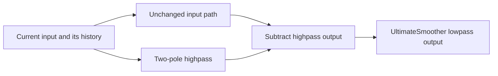
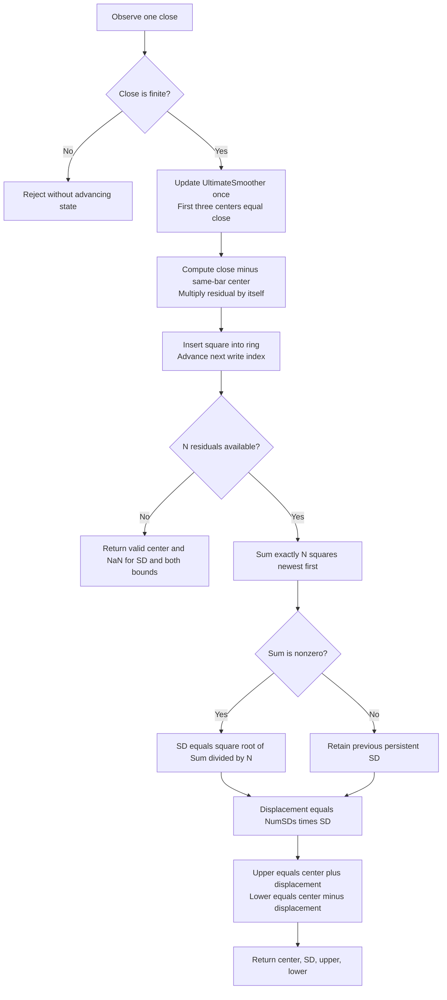

# Ultimate Bands: research prototype master reference

This standalone, standard-library-only Python master processes one close at a time. It returns the UltimateSmoother center, the historical residual RMS called SD in the article, and both band boundaries. The center is available immediately; the other fields require a full residual window.

## 1. Source authority and scope

The requested April 2024 folder defines the prerequisite **Ultimate Smoother**, not the two channel and band indicators. Their actual definitions are present locally in **May 2024**. Both months are used here, with the May EasyLanguage article and matching TradeStation listing determining the composite calculation and the April function determining smoother coefficients and startup.

- [May TASC article](../../tasc/2024-05-ultimate-channels-and-ultimate-bands/content.md), John F. Ehlers, *Ultimate Channels And Ultimate Bands — Getting The Lag Out Of Two Classic Indicators*, volume 42, issue 5, May 2024, pages 9–11.
- [May Mesa paper](../../tasc/2024-05-ultimate-channels-and-ultimate-bands/mesa/content.md), *Ultimate Channel and Ultimate Bands*, containing the same two indicator listings.
- [May Traders' Tips](../../tasc/2024-05-ultimate-channels-and-ultimate-bands/tips/tips.md), including [TradeStation Channel](../../tasc/2024-05-ultimate-channels-and-ultimate-bands/tips/tradestation-ultimate-channel.els), [TradeStation Bands](../../tasc/2024-05-ultimate-channels-and-ultimate-bands/tips/tradestation-ultimate-bands.els), and [TradeStation smoother](../../tasc/2024-05-ultimate-channels-and-ultimate-bands/tips/tradestation-ultimate-smoother.els).
- [April TASC article](../../tasc/2024-04-the-ultimate-smoother/content.md), *The Ultimate Smoother*, volume 42, issue 4, April 2024, pages 8–15; [April Mesa paper](../../tasc/2024-04-the-ultimate-smoother/mesa/content.md); and [April Traders' Tips](../../tasc/2024-04-the-ultimate-smoother/tips/tips.md).
- May comparison implementations: [TradingView](../../tasc/2024-05-ultimate-channels-and-ultimate-bands/tips/tradingview-ultimate-channels-bands.pine), [NinjaTrader Channel](../../tasc/2024-05-ultimate-channels-and-ultimate-bands/tips/ninja-trader/UltimateChannel.cs), [NinjaTrader Bands](../../tasc/2024-05-ultimate-channels-and-ultimate-bands/tips/ninja-trader/UltimateBand.cs), [NinjaTrader smoother](../../tasc/2024-05-ultimate-channels-and-ultimate-bands/tips/ninja-trader/UltimateSmoother.cs), [RealTest](../../tasc/2024-05-ultimate-channels-and-ultimate-bands/tips/realtest-ultimate-channels-bands.rtest), [Zorro Channel](../../tasc/2024-05-ultimate-channels-and-ultimate-bands/tips/zorro-ultimate-channel.c), [Zorro Bands](../../tasc/2024-05-ultimate-channels-and-ultimate-bands/tips/zorro-ultimate-bands.c), and [Excel workbook](../../tasc/2024-05-ultimate-channels-and-ultimate-bands/tips/EhlersUltimateChannelsAndBands.xlsm). These illustrate platform choices; macros are not executed as a numeric oracle.

The May article contains no additional z-transform derivation. Its complete mathematical definition is the smoother plus the two short indicator listings, expanded below into equations. All prerequisite April mathematical expressions are also included, including its EMA, SuperSmoother, highpass and bandpass comparisons. The comparisons provide context; they are not extra implemented outputs. No book chapter is supplied. The cited 2004 book and January 2014 article are bibliographic background; no unprovided chapter formula is attributed to them.

This master carries forward the user's preference for **full-precision pi and square root of two**. Those substitutions change results slightly from the printed constants. Numerical parity means the article's recurrence and arithmetic order with those explicit substitutions and the defined standalone history policy. Running a chart with additional prior bars, truncated constants, or a different startup branch yields different early values.

## 2. Basic principles and physical analogies

### 2.1 Frequency, period, smoothing, and filter order

A lowpass filter passes slowly changing components and attenuates faster fluctuations. With one observation per bar, frequency $f$ in cycles per bar, wavelength or period $P$ in bars, and angular frequency $\omega$ satisfy

$$P=\frac{1}{f},\qquad \omega=2\pi f=\frac{2\pi}{P}.$$

The Nyquist limit is $f=1/2$ cycles per bar, corresponding to a two-bar period. The article's **critical period** labels the division between passband and stopband; the division is gradual rather than an ideal brick wall. Longer wavelengths are the slow components. A coefficient-setting period is not a moving-average window or a number of observations that must be collected first.

A first-order IIR uses one previous output. A second-order IIR uses two previous outputs, and its effect can persist indefinitely after a change even though it stores only two output histories. Higher filter order can sharpen transitions but introduces more state and often greater delay. The article points out that directly calculating high-order filters can also suffer numerical issues on trading platforms.

### 2.2 Inductors, capacitors, and stored energy

Ehlers connects the filter design to his experience with physical inductors and capacitors. Their stored energies are

$$E_C=\frac12CV^2,\qquad E_L=\frac12LI^2.$$

These energy expressions are standard physical background, not extra price calculations. An analog filter responds while electric and magnetic fields build up and decay. A low-frequency design often needs larger reactive components, much as a large woofer handles slower sound cycles while a small tweeter handles faster ones. The analogy explains why conventional smoothing accumulates history and often delays a changing input.

In the digital filter, past output values play the role of stored state. The two poles describe damped memory, with complex rotation and exponential decay. No physical energy, circuit simulation, or speaker model is calculated by this implementation.

### 2.3 Cancellation rather than slowing the whole input path

The UltimateSmoother sends the input along an unchanged path and subtracts a highpass-filtered version of that input. At sufficiently low frequency, the highpass output approaches zero, so subtraction leaves the original low-frequency signal with little phase shift. At high frequency, the highpass output approaches the input, and subtraction cancels it.

This is analogous to estimating the rapidly fluctuating part of a measurement and subtracting that estimate from the measurement itself. It uses current and past data only. It does not extrapolate from a future observation or make arbitrary future prices available.



The production recurrence below combines both paths algebraically, so it does not need to store or compute a separate highpass stream.

## 3. Original source equations and full-precision coefficients

### 3.1 Literal coefficients printed in the article and Mesa paper

For critical period $P$, the supplied EasyLanguage listings use

$$a_1=\exp\!\left(-\frac{1.414\times3.14159}{P}\right),$$

$$b_1=2a_1\cos\!\left(\frac{1.414\times180}{P}\text{ degrees}\right),$$

$$c_2=b_1,\qquad c_3=-a_1^2,\qquad c_1=\frac{1+c_2-c_3}{4}.$$

EasyLanguage `Cosine` accepts degrees. Full pi appears implicitly in the degrees-to-radians conversion; substituting a truncated-pi radian angle is not an exact evaluation of that degree-based literal listing.

### 3.2 Coefficients used by this master

The master carries forward the user's preference for full-precision mathematical constants. It computes one radian angle, then reuses it for exponential damping and cosine rotation:

$$\boxed{\theta=\frac{\sqrt{2}\,\pi}{P},\qquad a_1=e^{-\theta},\qquad b_1=2a_1\cos\theta.}$$

$$\boxed{c_2=b_1,\qquad c_3=-a_1^2,\qquad c_1=\frac{1+c_2-c_3}{4}.}$$

Use `PI = math.pi` and `SQRT_TWO = math.sqrt(2.0)`, whose binary64 values are approximately 3.141592653589793 and 1.4142135623730951. A port should use the corresponding standard pi constant and square-root operation. Do not use the article's shorter decimal constants when comparing against this folder's expected outputs.

These constants change the coefficient values while preserving the filter design, recurrence, parameter meaning, and startup. This master is a full-precision interpretation of the supplied algorithm, rather than a claim of bitwise equality to every platform's literal code. The reference verification independently evaluates the supplied expressions with these explicit substitutions.

### 3.3 Complete transfer functions copied from the articles

Both the TASC and Mesa documents express subtraction of the highpass from the allpass path as

$$\boxed{H_{\mathrm{US}}(z)=1-
\frac{c_1(1-2z^{-1}+z^{-2})}
{1-c_2z^{-1}-c_3z^{-2}}.}$$

Putting both terms over a common denominator gives the supplied closed form

$$\boxed{H_{\mathrm{US}}(z)=
\frac{(1-c_1)+(2c_1-c_2)z^{-1}-(c_1+c_3)z^{-2}}
{1-c_2z^{-1}-c_3z^{-2}}.}$$

Here $z^{-1}$ denotes one bar of delay and $z^{-2}$ denotes two. Multiplying both sides by the denominator and translating delays into historical samples yields the article's full recursive calculation:

$$\boxed{\begin{aligned}
y_t={}&(1-c_1)x_t+(2c_1-c_2)x_{t-1}-(c_1+c_3)x_{t-2}\\
&+c_2y_{t-1}+c_3y_{t-2}.
\end{aligned}}$$

$x_t$ is the current raw price and $y_t$ is the current filtered output. The middle terms read previous **raw inputs**, while the last two read previous **outputs**. The sign of $c_3$ is negative. The last term remains written as $+c_3y_{t-2}$ to match the article's April 2024 notation.

The numerator is not an EMA coefficient. Replacing the formula with $\alpha x_t+(1-\alpha)y_{t-1}$, or substituting an EMA span rule, gives a different filter.

### 3.4 Source startup and the exact standalone sequence

The source specifies `If CurrentBar < 4 Then US = Price` and applies the recurrence on `CurrentBar >= 4`. For a standalone stream with zero-based index $t$ and `CurrentBar=t+1`, this means

$$\boxed{y_t=x_t\quad\text{for }t=0,1,2,}$$

followed by the recurrence for $t\geq3$. Each pass-through sample also populates both raw-input and output histories. No synthetic prior price is used once recursion begins.

The underlying smoother returns a valid center from the first observation. Its three pass-through outputs are initialization values, not missing outputs. A smoother period of 252 does not require 252 observations. Composite Channel and Bands priming is specified separately below; Bands needs a complete residual window even though its center is already valid.

The chart platform's implicit earlier bars are not provided with the 252-close input array. This explicit startup makes the standalone reference reproducible. Applying the filter to a longer preceding history and then selecting the last 252 bars can give different initial transient values.

## 4. Derived response properties and the scope of "zero lag"

### 4.1 Stable damped poles

The denominator factors as

$$1-c_2z^{-1}-c_3z^{-2}
=1-2a_1\cos\theta\,z^{-1}+a_1^2z^{-2}.$$

Its poles are

$$z_{1,2}=a_1e^{\pm j\theta}.$$

For finite positive $P$ in exact arithmetic, $0<a_1<1$, so both poles are inside the unit circle. A transient envelope decays with powers of $a_1$. The derived e-folding scale is

$$\tau_{\mathrm{bars}}=-\frac{1}{\ln a_1}=\frac{P}{\sqrt{2}\,\pi}.$$

This is an exponential transient scale, not a warm-up rule or exact settling-time guarantee. Long periods place poles closer to the unit circle. The usual finite-precision interpretation of these equations assumes coefficient values remain numerically resolved; the fixture grid tests periods through 252.

### 4.2 Unity DC gain and cancellation at Nyquist

The complementary highpass is

$$H_{\mathrm{HP}}(z)=
\frac{c_1(1-z^{-1})^2}{1-c_2z^{-1}-c_3z^{-2}}.$$

Its double zero at $z=1$ gives $H_{\mathrm{HP}}(1)=0$, and hence

$$H_{\mathrm{US}}(1)=1.$$

A constant input is therefore preserved in steady state. With a constant sequence and the source's pass-through startup, the exact-arithmetic filtered value stays at that constant. Binary64 roundoff can create tiny residual differences.

At Nyquist, $z=-1$. The selected $c_1$ satisfies

$$H_{\mathrm{HP}}(-1)=\frac{4c_1}{1+c_2-c_3}=1,$$

so

$$H_{\mathrm{US}}(-1)=0.$$

An alternating input at the sample-by-sample Nyquist frequency is attenuated after startup transients decay.

### 4.3 What low lag means mathematically

The article says that the UltimateSmoother has "zero lag in the passband" and describes this conceptually. The precise low-frequency consequence of its transfer function is that the highpass starts at second order in frequency:

$$H_{\mathrm{HP}}(e^{j\omega})=O(\omega^2),\qquad
H_{\mathrm{US}}(e^{j\omega})=1+O(\omega^2),\quad\omega\to0.$$

For phase $\phi(\omega)$, group delay is

$$\tau_g(\omega)=-\frac{d\phi(\omega)}{d\omega}.$$

The limiting group delay at zero frequency is zero. At other frequencies, including portions of the practical passband and transition band, phase and amplitude are not exactly those of the raw input. A causal smoother does not provide perfect undelayed knowledge of arbitrary price changes. The numerator cancellation explains low-frequency tracking; it is not a forecasting guarantee.

In exact arithmetic a linear ramp is also preserved after the appropriately initialized history, since the second difference driving the complementary highpass vanishes:

$$x_t-2x_{t-1}+x_{t-2}=0.$$

This ramp identity is a useful verification oracle distinct from replaying the recurrence.

### 4.4 Overshoot and smoother tradeoffs

The update is not a convex combination of the current price and a prior output. Coefficients can have signs that permit overshoot and damped ringing after a step or abrupt reversal. An output outside the latest input range is therefore possible and should not be clamped when reproducing the algorithm.

The article notes that cancellation-based UltimateSmoother output is not quite as smooth as the SuperSmoother because the highpass amplitude and phase do not exactly match the input over the entire high-frequency band. Less delay, stronger attenuation, and less ringing are competing design goals. The mathematical lowpass label does not imply gain is at most one at every frequency.

## 5. Complete mathematics of related filters in the sources

These equations preserve the supplied article's comparison material. They explain the design but are not additional outputs of `UltimateSmoother.update()`.

### 5.1 EMA comparison

The article gives

$$\mathrm{EMA}_t=\alpha x_t+(1-\alpha)\mathrm{EMA}_{t-1}.$$

Its comparison code selects

$$\alpha=\frac{3}{P}.$$

This is the article's particular comparison setting, not the conventional span formula $2/(P+1)$ and not a coefficient used in UltimateSmoother. For periods shorter than 3, the comparison alpha would exceed one; that observation does not invalidate the separately defined UltimateSmoother period.

### 5.2 SuperSmoother

The source computes the same $a_1,b_1,c_2,c_3$ values from its printed constants but uses a different first coefficient,

$$k_1=1-c_2-c_3.$$

The recurrence is

$$\mathrm{SS}_t=k_1\frac{x_t+x_{t-1}}{2}
+c_2\mathrm{SS}_{t-1}+c_3\mathrm{SS}_{t-2},$$

for source `CurrentBar >= 4`, with $\mathrm{SS}_t=x_t$ on the first three standalone samples. Its transfer function, derived from that recurrence, is

$$H_{\mathrm{SS}}(z)=
\frac{k_1(1+z^{-1})/2}{1-c_2z^{-1}-c_3z^{-2}}.$$

The article describes SuperSmoother as adapted from an analog maximally flat Butterworth lowpass design with reduced lag. It recommends this smoother over an EMA for its comparisons.

To approximate a higher-order smoothing response, the article suggests applying a SuperSmoother to the output of another SuperSmoother. The cascade transfer function is $H_{\mathrm{SS}}(z)^2$, with a fourth-order denominator. This is a cascade of two two-pole sections, not necessarily the exact fourth-order Butterworth design.

### 5.3 Highpass and its initial conditions

With $c_1=(1+c_2-c_3)/4$, the source highpass recurrence is

$$h_t=c_1(x_t-2x_{t-1}+x_{t-2})+c_2h_{t-1}+c_3h_{t-2},$$

for `CurrentBar >= 4`, and $h_t=0$ on the first three standalone samples. Subtracting it from the input produces the UltimateSmoother in exact arithmetic when startup histories are aligned. Evaluating the combined formula avoids separately storing that highpass.

### 5.4 Cascaded bandpass

The source bandpass example uses

$$h_t=\mathrm{HighPass}_{30}(x)_t,\qquad
\mathrm{BP}_t=\mathrm{SuperSmoother}_{15}(h)_t.$$

The intended passband covers wavelengths approximately between 15 and 30 bars. The variable name `LowerPeriod(30)` corresponds to the lower **frequency** edge, while `UpperPeriod(15)` corresponds to the upper frequency edge; period and frequency are reciprocal.

The article favors a passband at least one octave wide, a ratio of two in frequency or period edges, over a very narrow second-order bandpass. It explains that narrow filters, especially around 25% bandwidth or less, can make output look sinusoidal while phase changes across their passband and transition bands can approach 180 degrees. That can change the apparent direction of a signal when the input spectrum changes. Cascading separate lowpass and highpass sections gives two poles for each edge.

The example is exactly one octave. The conclusions also say that bandwidth should exceed an octave; this is a design recommendation in the source, not a parameter validation rule for UltimateSmoother.

## 6. Complete May indicator equations

The article applies the same smoother operator, written here as $\mathcal U_P$, to construct two envelopes. A single filter instance owns its own history. The mathematical symbol describes a whole stream, not a second update on the current bar.

### 6.1 Ultimate Channel

For closing price $C_t$, high $H_t$, low $L_t$, center period $P$, range period $R$, and multiplier $m_{\mathrm{TR}}$, the article's true high and low are

$$\mathrm{TH}_t=\max(H_t,C_{t-1}),\qquad
\mathrm{TL}_t=\min(L_t,C_{t-1}).$$

$$\mathrm{TR}_t=\mathrm{TH}_t-\mathrm{TL}_t
=\max(H_t,C_{t-1})-\min(L_t,C_{t-1}).$$

When $L_t\leq H_t$, this is equivalently

$$\mathrm{TR}_t=\max(H_t-L_t,\lvert H_t-C_{t-1}\rvert,\lvert L_t-C_{t-1}\rvert).$$

The first form preserves the article's actual subtraction order and is used in the code. It includes a gap from the preceding close even if that close lies outside the current high-low interval. For example, previous close 100 with current high 112 and low 110 gives true range 12, not intrabar range 2.

The two independent smoothed streams are

$$M_t=\mathcal U_P(C)_t,\qquad
S_t=\mathcal U_R(\mathrm{TR})_t.$$

The article's complete boundary formulas are

$$\boxed{U_t=M_t+m_{\mathrm{TR}}S_t,\qquad
D_t=M_t-m_{\mathrm{TR}}S_t.}$$

$S_t$ is **smooth true range (STR)**, not Wilder ATR, an SMA of range, or an EMA of range. `Length` selects $P$, `STRLength` selects $R$, and `NumSTRs` selects $m_{\mathrm{TR}}$. Defaults are 20, 20, and 1. The unused article variable `ROC` has no role in either formula and is omitted from the master state.

### 6.2 Ultimate Bands

Let $N$ be the integer `Length`, $m_{\mathrm{SD}}$ the `NumSDs` multiplier, and $M_t=\mathcal U_N(C)_t$. Each residual is paired with its own contemporaneous smoother value:

$$e_t=C_t-M_t,\qquad q_t=e_t e_t.$$

The inclusive loop `For count = 0 to Length - 1` gives **exactly $N$ terms**, starting at the newest bar:

$$\boxed{Q_t=\sum_{k=0}^{N-1}(C_{t-k}-M_{t-k})
(C_{t-k}-M_{t-k})=\sum_{k=0}^{N-1}q_{t-k}.}$$

The complete source assignment is conditional, because `SD` is a persistent variable initialized to zero:

$$\boxed{\sigma_t=
\begin{cases}
\sqrt{Q_t/N},&Q_t\ne0,\\
\sigma_{t-1},&Q_t=0.
\end{cases}}$$

For the first calculated full window, the prior persistent value is initialized as zero if no earlier full window was computed. The formula retains the previous SD when an entire later residual window becomes zero. This detail comes directly from `If Sum <> 0 Then SD = SquareRoot(Sum / Length)`; a port must not silently replace that branch with unconditional assignment.

Finally,

$$\boxed{U_t=M_t+m_{\mathrm{SD}}\sigma_t,\qquad
D_t=M_t-m_{\mathrm{SD}}\sigma_t.}$$

Defaults are $N=20$ and $m_{\mathrm{SD}}=1$. The price center uses UltimateSmoother, but the residual-square sum uses the finite rectangular window shown above. The prose statement that both averages are replaced by UltimateSmoothers should be read in conjunction with this executable listing: **there is no second UltimateSmoother of residual squares in the Bands code**.

### 6.3 RMS, standard deviation, and probability interpretation

Ehlers calls $\sigma$ a standard deviation, but his formula is the **root mean square of historical residuals about zero**. For residual mean $\bar e_t=N^{-1}\sum_{k=0}^{N-1}e_{t-k}$, the population variance identity is

$$\frac1N\sum_{k=0}^{N-1}e_{t-k}^2
=\frac1N\sum_{k=0}^{N-1}(e_{t-k}-\bar e_t)^2+\bar e_t^2.$$

Thus centered standard deviation differs whenever the residual mean is nonzero. The source does not subtract that mean and uses denominator $N$, not $N-1$. It also does not use $C_{t-k}-M_t$, which would compare all past prices to today's center. The paired historical residuals are part of its definition.

The width is not a confidence interval or a guaranteed Gaussian coverage level. The changing filter center and serial dependence of prices make that interpretation unwarranted without an additional statistical model. Both indicators operate in price units. Channel width describes gap-aware trading range; Bands width describes the magnitude of recent tracking errors.

## 7. Ultimate Bands configuration and streaming contract

| Parameter | Source name / shortcut | Default | Accepted values | Meaning |
|---|---|---:|---|---|
| `length` | `Length` / `L` | 20 | Integer at least 1 | Both close-smoother critical period and residual-square window count. |
| `num_sds` | `NumSDs` / `M` | 1.0 | Finite real number at least 0 | Multiplier of the source's residual RMS. |

Length must be an actual integer; `20.0`, `10.5`, and booleans are rejected rather than rounded or truncated. Unlike the standalone smoother, Bands uses the same Length in an inclusive historical loop, so a fractional value would have ambiguous window semantics. No sample-count or multiplier upper cap is imposed. Period 1 is an algebraic boundary case below the two-bar Nyquist wavelength. Configure once at construction; use a new instance to change the window or multiplier.

```python
indicator = UltimateBands(length=20, num_sds=1)
result = indicator.update(91.5)
# BandsResult(center=91.5, standard_deviation=NaN, upper=NaN, lower=NaN)
```

`update(close)` returns a named tuple with fields `center`, `standard_deviation`, `upper`, and `lower`. `standard_deviation` is named after the source's `SD` and means the RMS with conditional zero-sum retention in Section 6, not centered standard deviation. All finite binary64-compatible closes are supported; zero and negative values are valid. NaN and infinity are rejected before the smoother or residual ring is updated. `reset()` clears the smoother history, squared-residual ring and persistent SD value.

### 7.1 Priming and unavailable chart history

The source assumes historical `Close[count]` and `Smooth[count]` can be accessed, but no preceding chart data is supplied for the 252-value reference. The standalone master publishes a band only after a **full $N$-residual window** exists. Missing historical residuals are not synthesized, padded with zeros, or replaced by a partial-window mean.

At $t=0,1,2$, the underlying smoother outputs the price unchanged; its actual residuals are therefore zero and count as valid window observations. For $0\leq t<N-1$, the center is valid but SD and both bounds are **NaN**. At $t=N-1$, the first complete sum is calculated. Subsequently every bar evicts the oldest square and includes the newest. Thus `warmup_bars=N-1` refers to SD and the bounds, while `center` has no NaN prefix. `is_primed` becomes true when that first window is complete.

For Length 1, all fields are valid from the first sample, and SD initially remains zero. For Length 3, the first complete residual window consists of the three startup zeros. For Length 252 on the supplied 252 closes, only index 251 has a primed SD and boundary pair. A zero multiplier does not bypass the window requirement: bounds remain NaN until the window is available, then collapse onto the center.

The persistent internal SD starts at zero. Returning NaN before priming does not assign NaN to that persistent variable. Once primed, preserve `If Sum <> 0` precisely: a later zero-sum window retains prior SD. This differs from ideal unconditional RMS when the prior value was nonzero, but it is the behavior of the article and matching TradeStation code.

### 7.2 Ring-buffer calculation and arithmetic order

Store squared residuals in a circular array of capacity $N$, filling it incrementally. Let `next` be the next slot to overwrite after insertion. The newest square is at

$$i_k=(\mathrm{next}-1-k)\bmod N,\qquad k=0,\ldots,N-1.$$

The source uses left-to-right sequential addition starting with the newest residual. Recompute that full sum every bar, with no compensated summation or rolling-total update. A running sum is faster but can change binary64 results and accumulate drift. The master deliberately takes $O(N)$ time per update and $O(N)$ persistent memory to preserve the direct research recurrence.

Python modulo returns a nonnegative index. Ports using unsigned indices or a remainder operator with negative results should avoid underflow by computing `(next + N - 1 - k) % N`, or by decrementing and wrapping at zero. Growing storage during warmup avoids allocating an arbitrarily large requested window before observing prices.



The squared residual is analogous to instantaneous tracking-error energy. Averaging that quantity and taking a square root returns a price-scale measure, much like RMS measurement of an electrical signal. This is a statistical width around the cancellation-filter center, not a second physical filter or a forecast. The rectangular residual window can introduce width delay even though the center has low limiting delay at zero frequency.

## 8. Source differences that affect conversion

| Supplied implementation | Important behavior | Master policy |
|---|---|---|
| May TASC, Mesa and TradeStation | Channel uses max/min true range. Bands sums all $N$ paired squared residuals and retains SD on a zero sum. | Composite numeric authority. Explicit standalone first-bar and full-window rules resolve unavailable platform prehistory. |
| April / May EasyLanguage smoother | Printed 1.414 and 3.14159; degree cosine; recurse from one-based CurrentBar 4. | Full-precision sqrt(2) and pi; radians; first three samples pass through. |
| May TradingView smoother | Uses 1.414 and full pi; starts recursion at zero-based bar_index 4. | Does not use its extra fourth pass-through bar or approximate square root. |
| May TradingView Bands | `ta.stdev(src-mid,length)` centers the residuals around their window mean. | Uses article RMS about zero; these quantities are different when mean residual is nonzero. |
| May TradingView Channel | Uses `ta.tr`, with platform handling of missing first previous-close history. | First range is high-low; subsequent bars use the preceding observed close. |
| May NinjaTrader Bands | Loop uses `count < Length - 1`, omitting one term, yet divides by Length. Also gates plotting at BarsRequiredToPlot. | Includes all $N$ terms as in the article; priming depends on residual availability, not a fixed plotting threshold. |
| May RealTest Bands | Uses `StdDev(ult_sm_close, Len)`, dispersion of smoothed closes. | Uses paired price-minus-smoother residual squares instead. |
| May Zorro Bands | Uses `sqrt(SumSq(Diffs,Length)/Length)` and platform series seeding. | Same nonzero-sum RMS intention; preserves article's conditional zero-sum assignment and explicit standalone initialization. |
| Wealth-Lab, NeuroShell, Optuma, Excel | Supply trading examples, platform-specific indicator calls, or workbook plots. | Usage context; no assumption that defaults or implicit history match these fixtures. |

The May article suggests following the direction of the UltimateSmoother and exiting when price crosses outside the envelope in the opposite direction. This is a suggested trend-following stop application, not a backtested strategy or an extra output implemented here. Neither envelope supplies an entry/exit boolean, Gaussian confidence guarantee, or future price data.

## 9. Confirmed reference cases

The user confirmed all **12 cases** before generation. This is below the limit of 64 parameter combinations. Each case starts a fresh instance and consumes 252 chronological closes.

| Array stem | Length | NumSDs | What it tests |
|---|---:|---:|---|
| `EXPECTED_L20_M1` | 20 | 1 | Article default: twenty-bar historical residual RMS with unit width. |
| `EXPECTED_L1_M1` | 1 | 1 | Minimum window: one residual, immediate priming, and zero-sum SD retention. |
| `EXPECTED_L2_M1` | 2 | 1 | Two-bar window: newest-first residual summation and short warmup. |
| `EXPECTED_L3_M1` | 3 | 1 | Three-bar window: first full window consists of pass-through residuals. |
| `EXPECTED_L5_M1` | 5 | 1 | Short window: eviction of startup zeros and rapid residual-width response. |
| `EXPECTED_L8_M1` | 8 | 1 | Intermediate short window: residual ring-buffer wraparound. |
| `EXPECTED_L40_M1` | 40 | 1 | Long window: historical residuals paired with their own smoothed prices. |
| `EXPECTED_L60_M1` | 60 | 1 | Longer window: extended warmup and slower RMS width changes. |
| `EXPECTED_L252_M1` | 252 | 1 | Full-record window: only the final band pair is primed. |
| `EXPECTED_L20_M0` | 20 | 0 | Zero multiplier: primed bands collapse to the center but keep window warmup. |
| `EXPECTED_L20_M0_5` | 20 | 0.5 | Fractional multiplier: half-width without changing residual RMS. |
| `EXPECTED_L20_M2` | 20 | 2 | Double multiplier: doubled band displacement without changing residual RMS. |

Every stem has four scalar arrays: `CENTER`, `SD`, `UPPER`, `LOWER`. The suffix distinguishes the result field without introducing another parameter combination. For example, `EXPECTED_L20_M1_UPPER` is the upper boundary for the default case. Decimal points in parameter tokens become underscores.

There are **48 arrays of 252 values per language**. Each center array is entirely finite. SD, upper and lower arrays have exactly `length-1` leading NaNs, followed by finite values.

Before every array, the first comment is the exact table text from "What it tests". The next comment contains all parameter names and values. All five files carry identical comments and serialized numeric data.

| Language | Example declaration | NaN spelling |
|---|---|---|
| Python | `EXPECTED_L20_M1_UPPER = [...]` | `math.nan` |
| Go | `var expectedL20_M1_UPPER = []float64{...}` | `math.NaN()` |
| TypeScript | `export const expectedL20_M1_UPPER: number[] = [...];` | `NaN` |
| Rust | `pub fn expected_l20_m1_upper() -> Vec<f64>` | `f64::NAN` |
| Zig | `pub fn expectedL20_M1_UPPER() [252]f64` | `nan` |

The Go package is `ultimatebands`. Its required math import is retained with a blank reference to `math.NaN` even if no fixture needs NaNs. Zig keeps `const math = @import("std").math;` and `const nan = math.nan(f64);` at the top. Rust retains the copied input functions inside their original `#[cfg(test)] pub mod testdata` and appends expected functions at file scope. Existing input declarations and all OHLC values are preserved.

## 10. Reproduction, precision and verification

From this folder:

```bash
python3 ultimate-bands.py
python3 ultimate-bands.py --generate-reference-data
python3 -m unittest discover -p 'test_ultimate_bands.py' -v
```

The `__main__` embeds the exact 252 shared INPUT_CLOSE values.

The no-flag example constructs a default instance, streams all observations, and prints sample named results and the approved parameter cases. The generation flag regenerates the five expected-data sections. There is no runtime dependency on a sibling indicator folder; both the underlying smoother and fixture helpers are included in the master file. Conversion agents should port the classes and result types, not the Python AST parsing and file-generation tooling.

Compute in IEEE-754 binary64 using full-precision standard pi and `sqrt(2.0)`. Preserve the source expression order and signs, including negative $c_3$. Do not feed rounded display values back into recursion. Floats are serialized with `.15g`, giving **15 significant digits** rather than 15 digits after the decimal point. A fixture comparison tolerance of `rel_tol=5e-13, abs_tol=5e-13` accommodates serialization and ordinary last-bit math-library differences at these price scales. Compare NaNs by classification, never by equality.

The generator verifies each embedded input array against the copied Python fixture. It computes Python outputs, writes the Python arrays, reloads the actual written values, and checks all expected names, lengths, NaN locations and serialization precision. Only then does it translate those written values into Go, TypeScript, Rust and Zig. Re-running replaces marked generated sections rather than duplicating arrays; all copied input data is retained. The generated array names include a field suffix because a multiple-output indicator cannot be verified with a single boundary array.

The tests independently evaluate expressions extracted from the source articles with the explicit full-precision coefficient substitutions. They also verify analytic and synthetic boundary cases, causal prefixes, reset, invalid input handling, correct NaN warmup, input integrity, every expected value, and the comments and numeric literals in all translated files. A missing array is a failure. Arithmetic on extraordinarily large finite magnitudes can overflow binary64; use price-scale data as in these fixtures. No infinite output is permitted by the fixture generator.

Verification completed on 2026-10-16: all **14 Python tests** passed, including independent source-expression comparisons for all 12 confirmed cases, exact NaN warmup, zero-sum SD retention, and every translated fixture value and comment. Native Go, Rust and Zig validators passed; TypeScript execution through Node verified all 48 arrays against the written Python values. All five fixture files regenerated byte-for-byte identically, with 252 values in every expected array.

## 11. References and BibTeX

1. Ehlers, John F. (2024). *Ultimate Channels And Ultimate Bands*. Technical Analysis of Stocks & Commodities, 42(5), 9–11, May. [Article](https://technical.traders.com/archive/article.asp?file=\V42\C05\791EHLE.pdf).
2. Ehlers, John F. (2024). *Ultimate Channel and Ultimate Bands*. Mesa Software. [Paper](https://www.mesasoftware.com/papers/UltimateChannel.pdf). Year follows the supplied transcription.
3. Ehlers, John F. (2024). *The Ultimate Smoother*. Technical Analysis of Stocks & Commodities, 42(4), 8–15, April. [Article](https://technical.traders.com/archive/article.asp?file=\V42\C04\778EHLE.pdf).
4. Ehlers, John F. (2024). *The Ultimate Smoother*. Mesa Software. [Paper](https://www.mesasoftware.com/papers/UltimateSmoother.pdf). Year follows the supplied transcription.
5. Technical Analysis, Inc. (2024). *Traders' Tips — May 2024: Ultimate Channels And Ultimate Bands*. [Tips](https://www.traders.com/Documentation/FEEDbk_docs/2024/05/TradersTips.html). Covers the platform sources linked in Section 1.
6. Technical Analysis, Inc. (2024). *Traders' Tips — April 2024: The Ultimate Smoother*. [Tips](https://www.traders.com/Documentation/FEEDbk_docs/2024/04/TradersTips.html).
7. Ehlers, John F. (2014). *Predictive And Successful Indicators*. Technical Analysis of Stocks & Commodities, volume 32, January. Cited by the supplied articles for the earlier smoothing work.
8. Ehlers, John F. (2004). *Cybernetic Analysis for Stocks and Futures*. John Wiley & Sons. Background book cited by the source articles; no chapter was supplied.
9. McAllister, Ron (2024). *EhlersUltimateChannelsAndBands.xlsm*. Workbook accompanying the May Excel Traders' Tip. [Workbook](https://www.traders.com/Documentation/FEEDbk_docs/2024/05/images/code/EhlersUltimateChannelsAndBands.xlsm).

```bibtex
@article{ehlers2024ultimateChannelsBands,
  author = {Ehlers, John F.}, title = {Ultimate Channels And Ultimate Bands},
  journal = {Technical Analysis of Stocks \& Commodities},
  year = {2024}, volume = {42}, number = {5}, pages = {9--11}, month = may,
  url = {https://technical.traders.com/archive/article.asp?file=\V42\C05\791EHLE.pdf}
}
@misc{ehlers2024mesaUltimateChannelBands,
  author = {Ehlers, John F.}, title = {Ultimate Channel and Ultimate Bands},
  year = {2024}, howpublished = {Mesa Software},
  url = {https://www.mesasoftware.com/papers/UltimateChannel.pdf},
  note = {Year follows supplied transcription}
}
@article{ehlers2024ultimateSmoother,
  author = {Ehlers, John F.}, title = {The Ultimate Smoother},
  journal = {Technical Analysis of Stocks \& Commodities},
  year = {2024}, volume = {42}, number = {4}, pages = {8--15}, month = apr,
  url = {https://technical.traders.com/archive/article.asp?file=\V42\C04\778EHLE.pdf}
}
@misc{ehlers2024mesaUltimateSmoother,
  author = {Ehlers, John F.}, title = {The Ultimate Smoother},
  year = {2024}, howpublished = {Mesa Software},
  url = {https://www.mesasoftware.com/papers/UltimateSmoother.pdf},
  note = {Year follows supplied transcription}
}
@misc{tradersTips2024may,
  author = {{Technical Analysis, Inc.}},
  title = {Traders' Tips --- May 2024: Ultimate Channels And Ultimate Bands},
  year = {2024}, month = may,
  url = {https://www.traders.com/Documentation/FEEDbk_docs/2024/05/TradersTips.html}
}
@misc{tradersTips2024apr,
  author = {{Technical Analysis, Inc.}},
  title = {Traders' Tips --- April 2024: The Ultimate Smoother},
  year = {2024}, month = apr,
  url = {https://www.traders.com/Documentation/FEEDbk_docs/2024/04/TradersTips.html}
}
@article{ehlers2014predictiveIndicators,
  author = {Ehlers, John F.}, title = {Predictive And Successful Indicators},
  journal = {Technical Analysis of Stocks \& Commodities},
  year = {2014}, volume = {32}, month = jan
}
@book{ehlers2004cyberneticAnalysis,
  author = {Ehlers, John F.}, title = {Cybernetic Analysis for Stocks and Futures},
  publisher = {John Wiley \& Sons}, year = {2004}
}
@misc{mcallister2024ultimateChannelsBandsExcel,
  author = {McAllister, Ron}, title = {EhlersUltimateChannelsAndBands.xlsm},
  year = {2024}, month = may,
  howpublished = {Workbook accompanying the Excel Traders' Tip},
  url = {https://www.traders.com/Documentation/FEEDbk_docs/2024/05/images/code/EhlersUltimateChannelsAndBands.xlsm}
}
```
