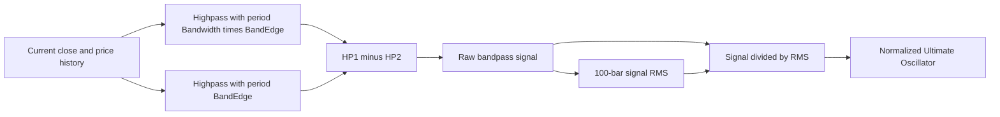
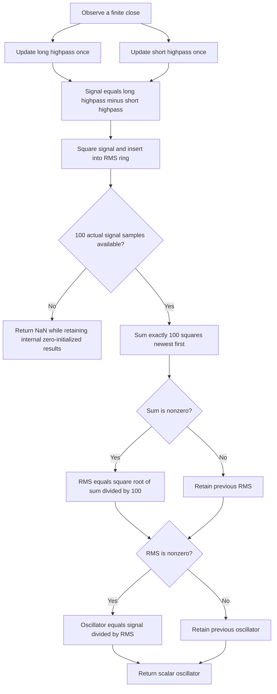

# Ultimate Oscillator: research prototype master reference

John F. Ehlers' April 2025 Ultimate Oscillator uses two parallel second-order highpass filters with different critical periods. Subtracting the short-period highpass from the long-period highpass cancels their shared high-frequency response and leaves a bandpass signal. Dividing that signal by its 100-bar root mean square (RMS) produces a dimensionless oscillator in approximate standard-deviation units.

The standalone, standard-library-only Python master consumes one close at a time and returns one scalar normalized oscillator. It follows the article and matching TradeStation expressions with the user's established **full-precision pi and square root of two** preference. Its first three internal highpass outputs are zero. Its first **99 final outputs are NaN**, because no prior signal history is supplied and normalization requires a complete 100-sample RMS window. Both source conditional assignments, for RMS and for the normalized oscillator, are preserved.

This is Ehlers' two-highpass oscillator, published in 2025. The similarly named classic Ultimate Oscillator based on buying pressure and multiple true-range windows uses a different formula and is not implemented here.

## 1. Sources, authority and scope

- [April 2025 TASC article](../../tasc/2025-04-the-ultimate-oscillator/content.md), *The Ultimate Oscillator*, John F. Ehlers, Technical Analysis of Stocks & Commodities, 43(4), pages 8–13.
- [Mesa paper](../../tasc/2025-04-the-ultimate-oscillator/mesa/content.md), *The Ultimate Oscillator*, with the same indicator, highpass and RMS listings. The supplied transcription's bibliography lists 2026; the paper text itself does not establish that publication date. April 2025 is the magazine date, and the Mesa record's metadata discrepancy is retained in its BibTeX note.
- [April 2025 Traders' Tips](../../tasc/2025-04-the-ultimate-oscillator/tips/tips.md) and [TradeStation functions and indicator](../../tasc/2025-04-the-ultimate-oscillator/tips/TradeStation_UltimateOscillator.els), which match the three source formulas and serve as the composite numeric authority.
- Comparison implementations: [TradingView](../../tasc/2025-04-the-ultimate-oscillator/tips/TradingView_UltimateOscillator.pine), [NinjaTrader oscillator](../../tasc/2025-04-the-ultimate-oscillator/tips/ninja-trader/EhlersUltimateOscillator.cs), [NinjaTrader highpass](../../tasc/2025-04-the-ultimate-oscillator/tips/ninja-trader/HighPassFilter.cs), [NinjaTrader RMS](../../tasc/2025-04-the-ultimate-oscillator/tips/ninja-trader/RMS.cs), [MetaStock](../../tasc/2025-04-the-ultimate-oscillator/tips/MetaStock_UltimateOscillator.txt), [RealTest](../../tasc/2025-04-the-ultimate-oscillator/tips/RealTest_UltimateOscillator.rts), [Zorro](../../tasc/2025-04-the-ultimate-oscillator/tips/Zorro_UltimateOscillator.c), [Python tip](../../tasc/2025-04-the-ultimate-oscillator/tips/Python_UltimateOscillator.py), its [notebook](../../tasc/2025-04-the-ultimate-oscillator/tips/apr_2025_ultimate_oscillator_final.ipynb), and the [Excel workbook](../../tasc/2025-04-the-ultimate-oscillator/tips/UltimateOscillator.xlsm). Their differences are documented below. No workbook macros or network data downloads are run as a numeric oracle.
- [April 2024 Ultimate Smoother article](../../tasc/2024-04-the-ultimate-smoother/content.md) and [Mesa paper](../../tasc/2024-04-the-ultimate-smoother/mesa/content.md), cited by the oscillator article for its cancellation-filter foundation.

No book chapter is supplied. The books and earlier articles cited in the further-reading list are included in the bibliography, without attributing unprovided chapter formulas to them. The complete mathematics present in the three supplied oscillator code listings is expanded into equations here. Transfer-function, pole, delay and scaling identities beyond those listings are explicitly mathematical derivations; the related UltimateSmoother transfer functions come from the April 2024 source.

## 2. Basic principles and physical analogies

### 2.1 Frequency and critical wavelength

A bar is one sample. For frequency $f$ in cycles per bar, critical wavelength or period $P$ in bars and angular frequency $\omega$,

$$P=\frac1f,\qquad \omega=2\pi f=\frac{2\pi}{P}.$$

The Nyquist frequency is one-half cycle per bar, corresponding to a two-bar wavelength. A lowpass preserves slow components; a highpass rejects slow components and preserves fast ones. A bandpass suppresses both very slow and very fast components while retaining an intermediate frequency range. Critical periods describe gradual transition regions, not exact brick-wall edges or required counts of historical prices.

The master uses `band_edge = E` and `bandwidth = W`. The two highpass periods are

$$P_1=WE,\qquad P_2=E.$$

The first period is longer and its critical frequency is lower. The second period is shorter and its critical frequency is higher. The rough retained frequency interval is between $1/(WE)$ and $1/E$, or wavelengths between $E$ and $WE$. Width is a **dimensionless ratio**, not an additive number of bars. In octave units the edge separation is $\log_2 W$: $W=2$ gives one octave, $W=4$ two, and $W=8$ three.

### 2.2 Inductors, capacitors and damped memory

Ehlers explains the design through analog filters that separate bass and treble using inductors and capacitors. Physical electric and magnetic fields take time to build up and decay. The standard stored-energy formulas, included for this analogy, are

$$E_C=\frac12CV^2,\qquad E_L=\frac12LI^2.$$

Larger low-frequency reactive components resemble a woofer handling slow sound cycles, while smaller high-frequency components resemble a tweeter. In the digital filter, previous outputs supply damped state rather than physical stored energy. No capacitor, inductor or energy simulation is part of the price calculation. The analogy motivates reducing delay by cancelling unwanted signal components rather than making the whole input pass through a long averaging process.

### 2.3 Parallel cancellation

Both highpasses read the same close. At very low frequency both outputs vanish. At very high frequency they both approach the input, so their difference vanishes. Between their critical frequencies the longer-period highpass passes components that the shorter-period highpass still suppresses, producing the intermediate-band response.



The paths are parallel, not a cascade. Running a second highpass on HP1's output, or substituting a lowpass/EMA, changes the filter. Subtraction order also matters: `HP1 - HP2` determines the sign of every oscillator value.

## 3. Complete highpass calculation from the sources

### 3.1 Literal coefficients in TASC, Mesa and TradeStation

For each critical period $P$, the source calculates

$$a_1=\exp\!\left(-\frac{1.414\times3.14159}{P}\right),$$

$$b_1=2a_1\cos\!\left(\frac{1.414\times180}{P}\text{ degrees}\right),$$

$$c_2=b_1,\qquad c_3=-a_1^2,\qquad c_1=\frac{1+c_2-c_3}{4}.$$

EasyLanguage cosine uses degrees. Its conversion to radians implicitly uses full pi, whereas the source exponential uses the printed pi approximation. Using one truncated-pi radian angle for both operations is not identical to evaluating that literal degree-based listing.

### 3.2 Full-precision reference coefficients

The established user preference replaces the truncated constants with the mathematical constants. The master calculates a single radian angle:

$$\boxed{\theta=\frac{\sqrt2\,\pi}{P},\qquad a_1=e^{-\theta},\qquad
c_2=2a_1\cos\theta,\qquad c_3=-a_1^2,\qquad c_1=\frac{1+c_2-c_3}{4}.}$$

`PI = math.pi` and `SQRT_TWO = math.sqrt(2.0)` are computed in binary64. Other languages should use their standard pi constant and square-root function. These substitutions preserve filter design and source recurrence but slightly change results relative to the literal constants. All fixtures and independent oracle calculations use this same explicit policy.

### 3.3 Recurrence, signs and startup

For raw close $C_t$ and the highpass output $h_t(P)$, the complete source recurrence is

$$\boxed{h_t(P)=c_1(C_t-2C_{t-1}+C_{t-2})
+c_2h_{t-1}(P)+c_3h_{t-2}(P).}$$

The source enables it at one-based `CurrentBar >= 4`. In a standalone zero-based stream,

$$\boxed{h_t(P)=0\quad\text{for }t=0,1,2,}$$

then recurse for $t\geq3$. Raw close histories are still filled on those first three observations. Their output histories contain zero, not the initial prices. The negative coefficient $c_3$ remains multiplied in a written `+ c3 * previous_previous_output` term. Preserve the parenthesized second difference and its arithmetic order.

Each highpass needs only two prior raw inputs, two prior outputs and a count. It consumes every observed close once, independently of final oscillator priming. A zero or negative close is valid. Invalid nonfinite input is rejected before state changes. No synthetic pre-stream price is needed because no recursive formula is evaluated until actual raw histories exist.

### 3.4 Complete parallel difference

The indicator's source formulas are

$$HP1_t=h_t(WE),\qquad HP2_t=h_t(E),$$

$$\boxed{S_t=HP1_t-HP2_t.}$$

`Signal` in the source means $S_t$. It is in price units and has no fixed amplitude limit before normalization. The article's first three internal signals are exactly zero under the defined standalone initialization.

## 4. RMS and normalized output: both source conditionals

### 4.1 Exact 100-term RMS sum

The indicator calls `$RMS(Signal,100)`. Its helper resets `SumSq` and loops **inclusively** from 0 to Length minus 1. With $N=100$,

$$\boxed{Q_t=\sum_{k=0}^{99}S_{t-k}S_{t-k}.}$$

Terms are added newest first, starting from zero. This is a finite rectangular-window sum; it is not an EMA of squares, centered variance, sample variance with denominator 99, or RMS of closes. Store squared signal samples and recompute the sum in this order to match the research reference. A rolling sum or compensated summation can change rounding and is not used here.

The source RMS function only assigns its result when SumSq is nonzero. Its persistent result starts at zero. Thus, for a complete window,

$$\boxed{R_t=\begin{cases}
\sqrt{Q_t/100},&Q_t\ne0,\\
R_{t-1},&Q_t=0.
\end{cases}}$$

On the first computed full window, previous RMS state is zero because earlier unavailable windows were not computed. A later all-zero window retains any prior positive RMS. Setting RMS unconditionally to zero would change that source helper's behavior.

### 4.2 Conditional final oscillator

The indicator initializes `UltimateOsc(0)` and only assigns it when RMS is nonzero:

$$\boxed{O_t=\begin{cases}
S_t/R_t,&R_t\ne0,\\
O_{t-1},&R_t=0,
\end{cases}\qquad O_{\mathrm{initial}}=0.}$$

The two conditions are distinct. When a full initial window has only zeros, RMS remains zero and the oscillator remains zero. When an all-zero window follows a prior positive RMS, the helper retains that positive RMS and the current signal is zero, so the oscillator becomes **zero by division**, rather than holding a previous nonzero oscillator. A port must preserve both assignments, not just a generalized division guard.

No epsilon, clipping, percentile rank or rescaling to 0–100 is applied. The article's zero plot is a visual reference, not another calculated output. A nonzero divisor is all the final source guard requires.

### 4.3 RMS versus standard deviation

The article says RMS is synonymous with standard deviation because the raw oscillator has nominal zero mean. For the actual finite window, define $\bar S_t=100^{-1}\sum_{k=0}^{99}S_{t-k}$. The exact identity is

$$\frac1{100}\sum_{k=0}^{99}S_{t-k}^2
=\frac1{100}\sum_{k=0}^{99}(S_{t-k}-\bar S_t)^2+\bar S_t^2.$$

RMS equals population standard deviation only when the finite-window mean is zero. A bandpass removes the DC component in steady state, but its current finite window can still have a nonzero mean. The source **does not subtract that mean**. Its standard-deviation interpretation is approximate, and no Gaussian probability or confidence-interval guarantee follows from the scaling.

### 4.4 Range and scale identities, derived

The oscillator is dimensionless and can exceed $\pm1$. For any nonzero current full-window sum, the current squared signal is included, so

$$|O_t|=\frac{|S_t|}{\sqrt{Q_t/100}}\leq\sqrt{100}=10.$$

This is an algebraic window bound, not a typical trading range or an instruction to clamp. All-zero windows give zero or the initialized zero under the preserved source logic. The reference does not assume RSI-like $[-1,1]$ bounds.

In exact arithmetic, translating all prices by a constant leaves the second differences unchanged. Multiplying price changes by a positive factor multiplies signal and RMS equally, leaving the normalized ratio unchanged. There is no fixed price-unit threshold as in USI. Binary64 roundoff, underflow or different initial histories can affect these identities numerically.

## 5. Transfer functions and limits of the lag claim

### 5.1 Highpass response and poles, derived

With $q=z^{-1}$, define $D_P(q)=1-c_{2,P}q-c_{3,P}q^2$. The highpass recurrence gives

$$H_P(z)=\frac{c_{1,P}(1-z^{-1})^2}{1-c_{2,P}z^{-1}-c_{3,P}z^{-2}}.$$

The two zeros at $z=1$ remove constant and linear-ramp components with aligned zero highpass initialization. The denominator factors into poles

$$z_{1,2}=a_1 e^{\pm j\theta}.$$

For finite positive period in exact arithmetic their radius $a_1$ is below one. The derived e-folding transient scale is $P/(\sqrt2\pi)$ bars. Long periods create longer memory even though only two previous outputs are stored. Extremely large finite periods can lose coefficient resolution in binary64; the fixture periods are moderate and reach 504 for the long highpass.

At zero frequency, $H_P(1)=0$. At Nyquist, $z=-1$, the chosen coefficient gives

$$H_P(-1)=\frac{4c_{1,P}}{1+c_{2,P}-c_{3,P}}=1.$$

### 5.2 Bandpass difference, derived

The raw signal transfer function is

$$\boxed{B(z)=H_{WE}(z)-H_E(z).}$$

Putting the difference over a common denominator gives

$$\boxed{B(z)=\frac{(1-q)^2\left[c_{1,WE}D_E(q)-c_{1,E}D_{WE}(q)\right]}
{D_{WE}(q)D_E(q)},\qquad q=z^{-1}.}$$

This combines two second-order responses and generally has a fourth-order denominator. It is not the same transfer as a two-filter cascade. It has $B(1)=0$ because both paths have a double zero at DC, and $B(-1)=0$ because their unit Nyquist gains cancel. Between those extremes its gain and phase depend on both edge periods and width.

The prerequisite April 2024 article describes UltimateSmoother as

$$H_{\mathrm{US},P}(z)=1-\frac{c_{1,P}(1-2z^{-1}+z^{-2})}
{1-c_{2,P}z^{-1}-c_{3,P}z^{-2}},$$

with closed form

$$H_{\mathrm{US},P}(z)=\frac{(1-c_{1,P})+(2c_{1,P}-c_{2,P})z^{-1}
-(c_{1,P}+c_{3,P})z^{-2}}{1-c_{2,P}z^{-1}-c_{3,P}z^{-2}}.$$

Consequently, the derived identity $B(z)=H_{\mathrm{US},E}(z)-H_{\mathrm{US},WE}(z)$ is another way to understand the cancellation. The master directly computes the article's two highpasses, preserving its arithmetic and zero highpass startup; it does not depend on another module's smoother implementation.

### 5.3 Phase, group delay and normalization

For a raw bandpass sinusoidal component $e^{j\omega t}$, response amplitude is $|B(e^{j\omega})|$ and phase shift is $\arg B(e^{j\omega})$. Group delay is

$$\tau_g(\omega)=-\frac{d}{d\omega}\arg B(e^{j\omega}).$$

The source's "no lag" phrasing describes close alignment seen in its example charts. Phase is not exactly zero at all retained frequencies, and a causal filter does not reveal arbitrary future turning points. The nonlinear changing RMS denominator can further alter amplitudes and the timing of peaks. The fully normalized oscillator has no single linear time-invariant transfer function. A decaying raw signal can remain visibly nonzero after normalization because its RMS is also decaying; raw high-frequency rejection and final normalized amplitude are distinct properties.

The article recommends Bandwidth at least 1.4 and says there is no desired upper limit. Wider spacing changes the frequency interval rather than imposing a longer rolling normalization window. The default 2 gives a useful octave separation. Minimum-width cases test the algebra; they are not evidence of better trading performance.

## 6. Parameters, output contract and standalone priming

| Parameter | Shortcut | Default | Accepted values | Meaning |
|---|---|---:|---|---|
| `band_edge` | `BE` | 20.0 | Finite real number at least 1 | Critical period of HP2, in bars. |
| `bandwidth` | `BW` | 2.0 | Finite real ratio at least 1.4 | Multiplier setting HP1 period to band_edge times bandwidth. |

The product must remain finite. Fractional periods and widths are supported because both only set coefficients. BandEdge 1 is an algebraic boundary below the two-bar Nyquist wavelength, not a recommended interpretation of market cycles. The source gives no BandEdge minimum; this API adopts the minimum of one shown in supplied platform controls and enforces the article's minimum recommended width. There is no artificial upper cap, subject to finite-precision resolution.

RMS length is fixed at **100**, not an extra indicator parameter. The `RootMeanSquare` helper accepts an integer window for direct unit verification, but `UltimateOscillator` always constructs it with 100. Changing that normalization window would define a separate variant.

`update(close)` consumes one finite close and returns one float. `band_edge` and `bandwidth` are read-only. `reset()` clears both highpass histories, their counts, the RMS ring and persistent results. Invalid NaN/infinite input is rejected before the composite advances. Zero and negative price values are valid. Ordinary price-scale inputs are the tested domain; extreme finite magnitudes can overflow intermediate arithmetic and are rejected by the helpers or generator.

### 6.1 Full-window priming

The source chart code can reference historical signal values that are unavailable before the first fixture sample. This master does not invent missing prehistory or pad a partial RMS with additional zeros. It consumes every bar into both highpasses and stores each actual signal square. Its real first three signal zeros count as valid observations.

For indices $0\leq t<99$, normalized output is NaN, while internal highpasses and squared-signal history keep advancing. At index 99 the first complete 100-sample RMS is calculated; there are 153 primed outputs in each 252-value fixture. **`warmup_bars=99`**, and **`is_primed` first becomes true after update 100**. Even a completely zero record is unprimed before that complete window; its first primed oscillator is zero.

Returning NaN before priming does not store NaN in the persistent RMS or oscillator. Both remain internally initialized to zero until complete-window calculations begin. This avoids contaminating valid future state. Priming depends on the fixed normalization window, not BandEdge or the long highpass period; BandEdge 252 still primes on sample 100.

Additional chart history, truncated constants, a fourth highpass startup zero, a partial-window denominator or immediate normalization will change early values. Numeric parity means the article's expressions with the explicit full-precision constants and standalone full-window policy. No equality to every platform's mutually different history initialization is assumed.

### 6.2 Ring-buffer and streaming flow

After inserting a square, let `next` be the next write index in a full ring of length $N=100$. The newest-to-oldest index is

$$i_k=(\mathrm{next}-1-k)\bmod100,\qquad k=0,\ldots,99.$$

Python modulo yields nonnegative indices. For languages with negative remainders or unsigned indices, use `(next+100-1-k)%100` or decrement with explicit wrap at zero. The ring fills incrementally and begins overwriting the oldest square once full.



The highpasses use $O(1)$ time and memory. The RMS helper uses $O(N)$ memory and $O(N)$ time per update to preserve the source's summation order. For the fixed $N=100$ indicator these costs are bounded constants; they do not grow with BandEdge, Bandwidth, or total record length. File-generation arrays are separate tooling and are not part of persistent indicator state.

## 7. Example usage and interpretation

```python
indicator = UltimateOscillator(band_edge=20, bandwidth=2)
for close in INPUT_CLOSE:
    value = indicator.update(close)
    if indicator.is_primed:
        # Use this scalar now, with no access to later prices.
        pass
```

The first five primed default outputs, at indices 99–103, are

```text
-2.34550990627494, -2.05180527159966, -1.86873923562469,
-1.84592000546858, -1.84633187313689
```

The article interprets positive oscillator readings as bullish and negative readings as bearish. It proposes detecting turning points when the oscillator's rate of change crosses zero. A one-bar difference would be $\Delta O_t=O_t-O_{t-1}$, and a transition from positive to negative slope marks a discrete local peak once the new bar is observed. No universal instantaneous peak-detection guarantee follows from the example. This master returns only the oscillator; slope, crossings, markers, trades and the plotted zero reference are not extra outputs or configurations.

The code default is (20,2). Several Traders' Tips charts reproduce an example at (30,2), using 30- and 60-bar highpasses. Both cases are included in the confirmed fixture grid. The strategy demonstrations in the tips are contextual examples, not validations of profitability or alternative numeric definitions.

## 8. Material differences in supplied platform code

| Source | Relevant behavior | Master choice |
|---|---|---|
| TASC, Mesa, TradeStation | Two highpasses; first three standalone outputs zero; 100-term signal RMS; conditional RMS and final results; printed coefficients. | Numeric algorithm authority with full-precision constants and explicit full-window priming. |
| TradingView | Full pi and sqrt(2), but zero-based recursion begins at bar_index 4, giving four startup zeros. Uses library RMS and returns zero when RMS is zero. Its supplied version directive is written `//version=6`. | First three zeros; preserves source conditionals; does not rely on the library or platform directive. |
| Python tip | Highpass returns the initial price for the first four samples rather than zero. Uses approximate sqrt(2), numpy/pandas, oldest-first rolling RMS, and unconditional division. The extracted script also references plotting/EMA helpers not defined in that file. | Standard library only; article's zero highpass initialization and guarded normalization; independent source-expression oracle. |
| NinjaTrader RMS | Loops to `Math.Min(CurrentBar,Length)` rather than requiring a full window; uses fixed Length denominator and different early plot-state conventions. | Exactly 100 actual samples before output, then all 100 terms. |
| RealTest | Same zero highpass recursion from one-based bar 4; default BandEdge 30; unconditional signal/RMS division. | Code default 20 and both source conditionals; (30,2) separately tested. |
| MetaStock | Its supplied RMS uses `Sum(C*C,100)` of CLOSES, not signal squares. | RMS of the raw highpass difference, as in the article. |
| Zorro | Cosine uses `1.414*PI/2/Period`, half the article's corresponding radian rotation; uses platform series seeding and `fix0(RMS)` unguarded normalization. | Matched full-precision exponent/cosine angle, zero highpass startup, explicit RMS/output guards. |
| Wealth-Lab, NeuroShell, Excel | Built-ins, external DLL integration or workbook plots. | Contextual implementations; no assumption of identical implicit state or initialization. |

The supplied tips are not mutually numerically equivalent. Using their names without checking coefficients, startup, window inputs and denominator policies is insufficient to reproduce this reference.

## 9. Confirmed reference cases

The user confirmed all **16 cases** before output generation, below the limit of 64 combinations. Every case starts a fresh filter, consumes the 252 shared INPUT_CLOSE values, and produces one array with exactly 99 leading NaNs followed by 153 finite normalized values.

| Python array | BandEdge | Bandwidth | What it tests |
|---|---:|---:|---|
| `EXPECTED_BE20_BW2` | 20 | 2 | Article default: twenty-bar short edge and forty-bar long edge, one octave apart. |
| `EXPECTED_BE1_BW2` | 1 | 2 | Minimum band edge: algebraic boundary below the two-bar Nyquist wavelength. |
| `EXPECTED_BE2_BW2` | 2 | 2 | Two-bar band edge: shortest Nyquist-scale short highpass. |
| `EXPECTED_BE3_BW2` | 3 | 2 | Three-bar band edge: very short parallel highpass periods. |
| `EXPECTED_BE5_BW2` | 5 | 2 | Short band edge: rapid signal response after the zero-output startup. |
| `EXPECTED_BE10_BW2` | 10 | 2 | Intermediate short band edge: ten- and twenty-bar highpasses. |
| `EXPECTED_BE20_5_BW2` | 20.5 | 2 | Fractional band edge: preserve coefficient periods without integer truncation. |
| `EXPECTED_BE30_BW2` | 30 | 2 | Article chart and Traders Tips example: thirty- and sixty-bar highpasses. |
| `EXPECTED_BE60_BW2` | 60 | 2 | Longer band edge: sixty- and one-hundred-twenty-bar highpasses. |
| `EXPECTED_BE100_BW2` | 100 | 2 | Band edge equals the fixed RMS window while filter and RMS state remain separate. |
| `EXPECTED_BE252_BW2` | 252 | 2 | Full-record band edge: long pole memory but priming still takes exactly one hundred bars. |
| `EXPECTED_BE20_BW1_4` | 20 | 1.4 | Minimum recommended bandwidth: closely spaced twenty- and twenty-eight-bar edges. |
| `EXPECTED_BE20_BW1_5` | 20 | 1.5 | Fractional bandwidth: twenty- and thirty-bar edges without ratio truncation. |
| `EXPECTED_BE20_BW3` | 20 | 3 | Moderately wide band: twenty- and sixty-bar edges. |
| `EXPECTED_BE20_BW4` | 20 | 4 | Two-octave band: twenty- and eighty-bar edges. |
| `EXPECTED_BE20_BW8` | 20 | 8 | Three-octave band: twenty- and one-hundred-sixty-bar edges. |

Before each array, the first comment is the exact table's "What it tests" text and the second states `band_edge=<value>, bandwidth=<value>`. The parameter shortcuts are `BE` and `BW`; floating-point decimal separators become underscores.

| Language | Fractional-bandwidth example | NaN spelling |
|---|---|---|
| Python | `EXPECTED_BE20_BW1_4 = [...]` | `math.nan` |
| Go | `var expectedBE20_BW1_4 = []float64{...}` | `math.NaN()` |
| TypeScript | `export const expectedBE20_BW1_4: number[] = [...];` | `NaN` |
| Rust | `pub fn expected_be20_bw1_4() -> Vec<f64>` | `f64::NAN` |
| Zig | `pub fn expectedBE20_BW1_4() [252]f64` | `nan` |

Go package name is `ultimateoscillator`, with `import "math"`. Zig retains `const math = @import("std").math;` and `const nan = math.nan(f64);` at the top. Rust preserves the copied input functions inside their existing `#[cfg(test)] pub mod testdata`, while expected functions are appended at file scope. All copied OHLC input values and input declaration names are retained; this indicator uses only INPUT_CLOSE.

## 10. Reproduction, precision and validation

From this folder:

```bash
python3 ultimate-oscillator.py
python3 ultimate-oscillator.py --generate-reference-data
python3 -m unittest discover -p 'test_ultimate_oscillator.py' -v
```

The `__main__` embeds the exact 252 shared closes and demonstrates one update per bar. Without a generation flag it prints the first five primed default values and the confirmed cases. Generation writes Python expected arrays first, reloads the written values, verifies all names and 252-element lengths, checks the exact NaN prefix and finite suffix, and verifies the 15-digit serialization. The other four files are rendered from those written Python values with identical comments, not recalculated by another implementation.

Repeated generation replaces only marked expected-data sections, preserving all copied inputs and preventing duplicate arrays. The class and helpers are self-contained; Python AST parsing, file generation and CLI helpers are tooling that need not be ported.

Compute in IEEE-754 binary64: Go float64, Rust/Zig f64, TypeScript number. Use full-precision standard pi and sqrt(2), preserve multiplication/addition order, and do not round persistent state. Serialization uses `.15g`, giving **15 significant digits**, not 15 digits after the decimal point. A suitable fixture comparison tolerance is `rel_tol=5e-13, abs_tol=5e-13` for these data. Compare NaNs by classification rather than equality. Forced fused operations, reassociation or different library implementations can change last bits.

The tests independently evaluate extracted article highpass and RMS expressions under the documented precision and initialization policies. They also test analytic zero and ramp behavior, frequency-domain response, exact warmup, source conditional persistence, fractional parameters, reset, causal prefixes, nonfinite input rejection, all written reference values and every translated comment and literal. Source-expression checks need the original article path in this repository; the master, mathematical document and fixtures are self-contained for conversion elsewhere.

Verification completed on 2026-10-16: all **17 Python tests** passed, including independent source-expression comparisons for all 16 confirmed cases, analytic frequency response, exact 99-bar warmup, both conditional assignments, and every translated value and comment. Native Go, Rust and Zig fixture validators passed; TypeScript execution through Node checked all 16 arrays against the written Python values. Every expected array contains 252 values with 99 leading NaNs and 153 finite outputs. All five fixture files regenerated byte-for-byte identically.

## 11. References and BibTeX

1. Ehlers, John F. (2025). *The Ultimate Oscillator*. Technical Analysis of Stocks & Commodities, 43(4), 8–13, April. [Article](https://technical.traders.com/archive/article.asp?file=\V43\C04\945EHLE.pdf).
2. Ehlers, John F. *The Ultimate Oscillator*. Mesa Software. [Paper](https://www.mesasoftware.com/papers/The%20Ultimate%20Oscillator.pdf). Publication date is not established in the supplied text; transcription bibliography says 2026.
3. Technical Analysis, Inc. (2025). *Traders' Tips — April 2025: The Ultimate Oscillator*. [Tips](https://www.traders.com/Documentation/FEEDbk_docs/2025/04/TradersTips.html), including the platform code, Python notebook and comparisons linked in Section 1.
4. Ehlers, John F. (2024). *The Ultimate Smoother*. Technical Analysis of Stocks & Commodities, 42(4), 8–15, April. [Article](https://technical.traders.com/archive/article.asp?file=\V42\C04\778EHLE.pdf).
5. Ehlers, John F. (2024). *The Ultimate Smoother*. Mesa Software. [Paper](https://www.mesasoftware.com/papers/UltimateSmoother.pdf). Year follows the supplied transcription.
6. Ehlers, John F. (2014). *Predictive And Successful Indicators*. Technical Analysis of Stocks & Commodities, volume 32, January. Further reading cited by April 2025.
7. Ehlers, John F. (2004). *Cybernetic Analysis for Stocks and Futures*. John Wiley & Sons. Further-reading book; no chapter supplied.
8. Ehlers, John F. (2013). *Cycle Analytics for Traders*. John Wiley & Sons. Further-reading book; no chapter supplied.
9. Ehlers, John F. (2021). *A Technical Description of Market Data for Traders*. Technical Analysis of Stocks & Commodities, volume 39, May. Further reading cited by April 2025.
10. McAllister, Ron (2025). *UltimateOscillator.xlsm*. Workbook accompanying the Excel Traders' Tip. [Workbook](https://www.traders.com/Documentation/FEEDbk_docs/2025/04/images/code/UltimateOscillator.xlsm).

```bibtex
@article{ehlers2025ultimateOscillator,
  author = {Ehlers, John F.}, title = {The Ultimate Oscillator},
  journal = {Technical Analysis of Stocks \& Commodities},
  volume = {43}, number = {4}, pages = {8--13}, year = {2025}, month = apr,
  url = {https://technical.traders.com/archive/article.asp?file=\V43\C04\945EHLE.pdf}
}
@misc{ehlersMesaUltimateOscillator,
  author = {Ehlers, John F.}, title = {The Ultimate Oscillator},
  howpublished = {Mesa Software},
  url = {https://www.mesasoftware.com/papers/The%20Ultimate%20Oscillator.pdf},
  note = {Publication date not established; supplied transcription bibliography lists 2026}
}
@misc{tradersTips2025apr,
  author = {{Technical Analysis, Inc.}},
  title = {Traders' Tips --- April 2025: The Ultimate Oscillator},
  year = {2025}, month = apr,
  url = {https://www.traders.com/Documentation/FEEDbk_docs/2025/04/TradersTips.html}
}
@article{ehlers2024ultimateSmoother,
  author = {Ehlers, John F.}, title = {The Ultimate Smoother},
  journal = {Technical Analysis of Stocks \& Commodities},
  volume = {42}, number = {4}, pages = {8--15}, year = {2024}, month = apr,
  url = {https://technical.traders.com/archive/article.asp?file=\V42\C04\778EHLE.pdf}
}
@misc{ehlers2024mesaUltimateSmoother,
  author = {Ehlers, John F.}, title = {The Ultimate Smoother},
  year = {2024}, howpublished = {Mesa Software},
  url = {https://www.mesasoftware.com/papers/UltimateSmoother.pdf},
  note = {Year follows supplied transcription}
}
@article{ehlers2014predictiveIndicators,
  author = {Ehlers, John F.}, title = {Predictive And Successful Indicators},
  journal = {Technical Analysis of Stocks \& Commodities},
  volume = {32}, year = {2014}, month = jan
}
@book{ehlers2004cyberneticAnalysis,
  author = {Ehlers, John F.}, title = {Cybernetic Analysis for Stocks and Futures},
  publisher = {John Wiley \& Sons}, year = {2004}
}
@book{ehlers2013cycleAnalytics,
  author = {Ehlers, John F.}, title = {Cycle Analytics for Traders},
  publisher = {John Wiley \& Sons}, year = {2013}
}
@article{ehlers2021marketData,
  author = {Ehlers, John F.}, title = {A Technical Description of Market Data for Traders},
  journal = {Technical Analysis of Stocks \& Commodities},
  volume = {39}, year = {2021}, month = may
}
@misc{mcallister2025ultimateOscillatorWorkbook,
  author = {McAllister, Ron}, title = {UltimateOscillator.xlsm},
  year = {2025}, month = apr,
  howpublished = {Workbook accompanying the Excel Traders' Tip},
  url = {https://www.traders.com/Documentation/FEEDbk_docs/2025/04/images/code/UltimateOscillator.xlsm}
}
```
