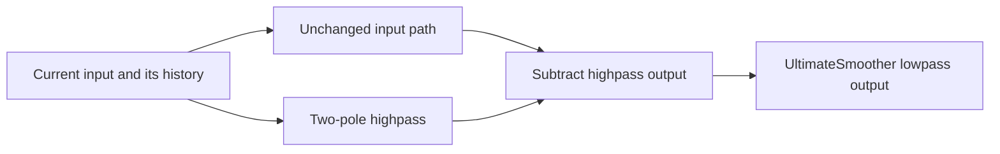
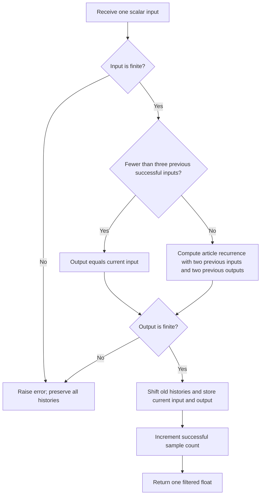

# Ultimate Smoother: research prototype master reference

This folder provides a streaming, standard-library-only reference for John F. Ehlers' **The Ultimate Smoother**, published in April 2024. One observed scalar input produces one filtered scalar output. The filter is a second-order infinite impulse response (IIR) lowpass, constructed by subtracting a two-pole highpass response from the unchanged input. It accepts closing prices or other scalar indicators, with no future-data access or rolling input array.

The algorithm follows the article's **April 2024 UltimateSmoother recurrence and startup branch**. Following the user's established preference, its coefficients use full-precision `math.pi` and `math.sqrt(2.0)` in place of the source's printed 3.14159 and 1.414. The original mathematical listings and the precise master coefficient policy are both recorded below. Expected values generated here represent this full-precision variant and therefore differ slightly from literal-constant platform implementations.

## 1. Sources and scope

The supplied sources are:

- [TASC article](../../tasc/2024-04-the-ultimate-smoother/content.md), *The Ultimate Smoother — Digital Signal Processing: Smoothing Data With Less Lag*, John F. Ehlers, volume 42, issue 4, April 2024, pages 8–15.
- [Mesa paper](../../tasc/2024-04-the-ultimate-smoother/mesa/content.md), *The Ultimate Smoother*, containing the same theory, transfer functions, and six code listings.
- [April 2024 Traders' Tips](../../tasc/2024-04-the-ultimate-smoother/tips/tips.md), with TradeStation, TradingView, NinjaTrader, RealTest, Zorro, and other platform examples.
- [TradeStation function](../../tasc/2024-04-the-ultimate-smoother/tips/tradestation-ultimate-smoother-function.els) and [indicator](../../tasc/2024-04-the-ultimate-smoother/tips/tradestation-ultimate-smoother-indicator.els), [TradingView code](../../tasc/2024-04-the-ultimate-smoother/tips/tradingview-ultimate-smoother.pine), [NinjaTrader code](../../tasc/2024-04-the-ultimate-smoother/tips/ninja-trader/UltimateSmoother.cs), [RealTest code](../../tasc/2024-04-the-ultimate-smoother/tips/realtest-ultimate-smoother.txt), [Zorro function](../../tasc/2024-04-the-ultimate-smoother/tips/zorro-ultimate-smoother.c), and [Zorro comparison](../../tasc/2024-04-the-ultimate-smoother/tips/zorro-ultimate-smoother-comparison.c).
- [Excel workbook](../../tasc/2024-04-the-ultimate-smoother/tips/EhlersUltimateSmoother.xlsm) by Ron McAllister, accompanying the comparisons discussed in Traders' Tips. The workbook's macros are not executed or used as the numeric authority.

There is no book chapter in the supplied folder. The article cites Ehlers' 2004 book and January 2014 article; both are included in the bibliography. All mathematical material supplied for the UltimateSmoother and its related filter comparisons is transcribed below so conversion agents need no original article access. Transfer-function consequences and physical explanations beyond those listings are identified as derivations.

The master implements **UltimateSmoother only**. The EMA, SuperSmoother, highpass, and bandpass equations are included as theoretical context and to explain its derivation; their outputs are not additional fixture arrays or extra configuration parameters.

## 2. Basic principles and physical analogies

### 2.1 Frequency, period, smoothing, and filter order

A lowpass filter passes slowly changing components and attenuates faster fluctuations. With one observation per bar, frequency $f$ in cycles per bar, wavelength or period $P$ in bars, and angular frequency $\omega$ satisfy

$$P=\frac{1}{f},\qquad \omega=2\pi f=\frac{2\pi}{P}.$$

The Nyquist limit is $f=1/2$ cycles per bar, corresponding to a two-bar period. The article's **critical period** labels the division between passband and stopband; the division is gradual rather than an ideal brick wall. Longer wavelengths are the slow components. A coefficient-setting period is not a moving-average window or a number of observations that must be collected first.

A first-order IIR uses one previous output. A second-order IIR uses two previous outputs, and its effect can persist indefinitely after a change even though it stores only two output histories. Higher filter order can sharpen transitions but introduces more state and often greater delay. The article points out that directly calculating high-order filters can also suffer numerical issues on trading platforms.

### 2.2 Inductors, capacitors, and stored energy

Ehlers connects the filter design to his experience with physical inductors and capacitors. Their stored energies are

$$E_C=\frac12CV^2,\qquad E_L=\frac12LI^2.$$

These energy expressions are standard physical background, not extra price calculations. An analog filter responds while electric and magnetic fields build up and decay. A low-frequency design often needs larger reactive components, much as a large woofer handles slower sound cycles while a small tweeter handles faster ones. The analogy explains why conventional smoothing accumulates history and often delays a changing input.

In the digital filter, past output values play the role of stored state. The two poles describe damped memory, with complex rotation and exponential decay. No physical energy, circuit simulation, or speaker model is calculated by this implementation.

### 2.3 Cancellation rather than slowing the whole input path

The UltimateSmoother sends the input along an unchanged path and subtracts a highpass-filtered version of that input. At sufficiently low frequency, the highpass output approaches zero, so subtraction leaves the original low-frequency signal with little phase shift. At high frequency, the highpass output approaches the input, and subtraction cancels it.

This is analogous to estimating the rapidly fluctuating part of a measurement and subtracting that estimate from the measurement itself. It uses current and past data only. It does not extrapolate from a future observation or make arbitrary future prices available.



The production recurrence below combines both paths algebraically, so it does not need to store or compute a separate highpass stream.

## 3. Original source equations and full-precision coefficients

### 3.1 Literal coefficients printed in the article and Mesa paper

For critical period $P$, the supplied EasyLanguage listings use

$$a_1=\exp\!\left(-\frac{1.414\times3.14159}{P}\right),$$

$$b_1=2a_1\cos\!\left(\frac{1.414\times180}{P}\text{ degrees}\right),$$

$$c_2=b_1,\qquad c_3=-a_1^2,\qquad c_1=\frac{1+c_2-c_3}{4}.$$

EasyLanguage `Cosine` accepts degrees. Full pi appears implicitly in the degrees-to-radians conversion; substituting a truncated-pi radian angle is not an exact evaluation of that degree-based literal listing.

### 3.2 Coefficients used by this master

The master carries forward the user's preference for full-precision mathematical constants. It computes one radian angle, then reuses it for exponential damping and cosine rotation:

$$\boxed{\theta=\frac{\sqrt{2}\,\pi}{P},\qquad a_1=e^{-\theta},\qquad b_1=2a_1\cos\theta.}$$

$$\boxed{c_2=b_1,\qquad c_3=-a_1^2,\qquad c_1=\frac{1+c_2-c_3}{4}.}$$

Use `PI = math.pi` and `SQRT_TWO = math.sqrt(2.0)`, whose binary64 values are approximately 3.141592653589793 and 1.4142135623730951. A port should use the corresponding standard pi constant and square-root operation. Do not use the article's shorter decimal constants when comparing against this folder's expected outputs.

These constants change the coefficient values while preserving the filter design, recurrence, parameter meaning, and startup. This master is a full-precision interpretation of the supplied algorithm, rather than a claim of bitwise equality to every platform's literal code. The reference verification independently evaluates the supplied expressions with these explicit substitutions.

### 3.3 Complete transfer functions copied from the articles

Both the TASC and Mesa documents express subtraction of the highpass from the allpass path as

$$\boxed{H_{\mathrm{US}}(z)=1-
\frac{c_1(1-2z^{-1}+z^{-2})}
{1-c_2z^{-1}-c_3z^{-2}}.}$$

Putting both terms over a common denominator gives the supplied closed form

$$\boxed{H_{\mathrm{US}}(z)=
\frac{(1-c_1)+(2c_1-c_2)z^{-1}-(c_1+c_3)z^{-2}}
{1-c_2z^{-1}-c_3z^{-2}}.}$$

Here $z^{-1}$ denotes one bar of delay and $z^{-2}$ denotes two. Multiplying both sides by the denominator and translating delays into historical samples yields the article's full recursive calculation:

$$\boxed{\begin{aligned}
y_t={}&(1-c_1)x_t+(2c_1-c_2)x_{t-1}-(c_1+c_3)x_{t-2}\\
&+c_2y_{t-1}+c_3y_{t-2}.
\end{aligned}}$$

$x_t$ is the current raw price and $y_t$ is the current filtered output. The middle terms read previous **raw inputs**, while the last two read previous **outputs**. The sign of $c_3$ is negative. The last term remains written as $+c_3y_{t-2}$ to match the article's April 2024 notation.

The numerator is not an EMA coefficient. Replacing the formula with $\alpha x_t+(1-\alpha)y_{t-1}$, or substituting an EMA span rule, gives a different filter.

### 3.4 Source startup and the exact standalone sequence

The source specifies `If CurrentBar < 4 Then US = Price` and applies the recurrence on `CurrentBar >= 4`. For a standalone stream with zero-based index $t$ and `CurrentBar=t+1`, this means

$$\boxed{y_t=x_t\quad\text{for }t=0,1,2,}$$

followed by the recurrence for $t\geq3$. Each pass-through sample also populates both raw-input and output histories. No synthetic prior price is used once recursion begins.

The first observed price is immediately a valid output, so **`warmup_bars` is 0** and expected arrays have no leading NaNs. The three pass-through values are initialization outputs, not missing outputs. A period of 252 does not require 252 inputs before returning a value.

The chart platform's implicit earlier bars are not provided with the 252-close input array. This explicit startup makes the standalone reference reproducible. Applying the filter to a longer preceding history and then selecting the last 252 bars can give different initial transient values.

## 4. Derived response properties and the scope of "zero lag"

### 4.1 Stable damped poles

The denominator factors as

$$1-c_2z^{-1}-c_3z^{-2}
=1-2a_1\cos\theta\,z^{-1}+a_1^2z^{-2}.$$

Its poles are

$$z_{1,2}=a_1e^{\pm j\theta}.$$

For finite positive $P$ in exact arithmetic, $0<a_1<1$, so both poles are inside the unit circle. A transient envelope decays with powers of $a_1$. The derived e-folding scale is

$$\tau_{\mathrm{bars}}=-\frac{1}{\ln a_1}=\frac{P}{\sqrt{2}\,\pi}.$$

This is an exponential transient scale, not a warm-up rule or exact settling-time guarantee. Long periods place poles closer to the unit circle. The usual finite-precision interpretation of these equations assumes coefficient values remain numerically resolved; the fixture grid tests periods through 252.

### 4.2 Unity DC gain and cancellation at Nyquist

The complementary highpass is

$$H_{\mathrm{HP}}(z)=
\frac{c_1(1-z^{-1})^2}{1-c_2z^{-1}-c_3z^{-2}}.$$

Its double zero at $z=1$ gives $H_{\mathrm{HP}}(1)=0$, and hence

$$H_{\mathrm{US}}(1)=1.$$

A constant input is therefore preserved in steady state. With a constant sequence and the source's pass-through startup, the exact-arithmetic filtered value stays at that constant. Binary64 roundoff can create tiny residual differences.

At Nyquist, $z=-1$. The selected $c_1$ satisfies

$$H_{\mathrm{HP}}(-1)=\frac{4c_1}{1+c_2-c_3}=1,$$

so

$$H_{\mathrm{US}}(-1)=0.$$

An alternating input at the sample-by-sample Nyquist frequency is attenuated after startup transients decay.

### 4.3 What low lag means mathematically

The article says that the UltimateSmoother has "zero lag in the passband" and describes this conceptually. The precise low-frequency consequence of its transfer function is that the highpass starts at second order in frequency:

$$H_{\mathrm{HP}}(e^{j\omega})=O(\omega^2),\qquad
H_{\mathrm{US}}(e^{j\omega})=1+O(\omega^2),\quad\omega\to0.$$

For phase $\phi(\omega)$, group delay is

$$\tau_g(\omega)=-\frac{d\phi(\omega)}{d\omega}.$$

The limiting group delay at zero frequency is zero. At other frequencies, including portions of the practical passband and transition band, phase and amplitude are not exactly those of the raw input. A causal smoother does not provide perfect undelayed knowledge of arbitrary price changes. The numerator cancellation explains low-frequency tracking; it is not a forecasting guarantee.

In exact arithmetic a linear ramp is also preserved after the appropriately initialized history, since the second difference driving the complementary highpass vanishes:

$$x_t-2x_{t-1}+x_{t-2}=0.$$

This ramp identity is a useful verification oracle distinct from replaying the recurrence.

### 4.4 Overshoot and smoother tradeoffs

The update is not a convex combination of the current price and a prior output. Coefficients can have signs that permit overshoot and damped ringing after a step or abrupt reversal. An output outside the latest input range is therefore possible and should not be clamped when reproducing the algorithm.

The article notes that cancellation-based UltimateSmoother output is not quite as smooth as the SuperSmoother because the highpass amplitude and phase do not exactly match the input over the entire high-frequency band. Less delay, stronger attenuation, and less ringing are competing design goals. The mathematical lowpass label does not imply gain is at most one at every frequency.

## 5. Complete mathematics of related filters in the sources

These equations preserve the supplied article's comparison material. They explain the design but are not additional outputs of `UltimateSmoother.update()`.

### 5.1 EMA comparison

The article gives

$$\mathrm{EMA}_t=\alpha x_t+(1-\alpha)\mathrm{EMA}_{t-1}.$$

Its comparison code selects

$$\alpha=\frac{3}{P}.$$

This is the article's particular comparison setting, not the conventional span formula $2/(P+1)$ and not a coefficient used in UltimateSmoother. For periods shorter than 3, the comparison alpha would exceed one; that observation does not invalidate the separately defined UltimateSmoother period.

### 5.2 SuperSmoother

The source computes the same $a_1,b_1,c_2,c_3$ values from its printed constants but uses a different first coefficient,

$$k_1=1-c_2-c_3.$$

The recurrence is

$$\mathrm{SS}_t=k_1\frac{x_t+x_{t-1}}{2}
+c_2\mathrm{SS}_{t-1}+c_3\mathrm{SS}_{t-2},$$

for source `CurrentBar >= 4`, with $\mathrm{SS}_t=x_t$ on the first three standalone samples. Its transfer function, derived from that recurrence, is

$$H_{\mathrm{SS}}(z)=
\frac{k_1(1+z^{-1})/2}{1-c_2z^{-1}-c_3z^{-2}}.$$

The article describes SuperSmoother as adapted from an analog maximally flat Butterworth lowpass design with reduced lag. It recommends this smoother over an EMA for its comparisons.

To approximate a higher-order smoothing response, the article suggests applying a SuperSmoother to the output of another SuperSmoother. The cascade transfer function is $H_{\mathrm{SS}}(z)^2$, with a fourth-order denominator. This is a cascade of two two-pole sections, not necessarily the exact fourth-order Butterworth design.

### 5.3 Highpass and its initial conditions

With $c_1=(1+c_2-c_3)/4$, the source highpass recurrence is

$$h_t=c_1(x_t-2x_{t-1}+x_{t-2})+c_2h_{t-1}+c_3h_{t-2},$$

for `CurrentBar >= 4`, and $h_t=0$ on the first three standalone samples. Subtracting it from the input produces the UltimateSmoother in exact arithmetic when startup histories are aligned. Evaluating the combined formula avoids separately storing that highpass.

### 5.4 Cascaded bandpass

The source bandpass example uses

$$h_t=\mathrm{HighPass}_{30}(x)_t,\qquad
\mathrm{BP}_t=\mathrm{SuperSmoother}_{15}(h)_t.$$

The intended passband covers wavelengths approximately between 15 and 30 bars. The variable name `LowerPeriod(30)` corresponds to the lower **frequency** edge, while `UpperPeriod(15)` corresponds to the upper frequency edge; period and frequency are reciprocal.

The article favors a passband at least one octave wide, a ratio of two in frequency or period edges, over a very narrow second-order bandpass. It explains that narrow filters, especially around 25% bandwidth or less, can make output look sinusoidal while phase changes across their passband and transition bands can approach 180 degrees. That can change the apparent direction of a signal when the input spectrum changes. Cascading separate lowpass and highpass sections gives two poles for each edge.

The example is exactly one octave. The conclusions also say that bandwidth should exceed an octave; this is a design recommendation in the source, not a parameter validation rule for UltimateSmoother.

## 6. Configuration, output contract, and calculation flow

| Parameter | Shortcut | Default | Accepted values | Meaning |
|---|---|---:|---|---|
| `period` | `P` | 20.0 | Finite real number at least 1.0 | Critical-period coefficient setting, in bars. Fractional values are supported. |

The article's example and most platform defaults use 20. The supplied NinjaTrader UI permits values from 1 upward; this master adopts that minimum. Period 1 is an algebraic boundary case below the two-bar Nyquist wavelength, not a suggested market-analysis setting. Practical critical periods of several bars or more provide more interpretable lowpass behavior. The selected fixtures include period 10.5 to catch accidental integer truncation.

`update(price)` returns one float. `is_primed` is false before the first successful call and true afterward. `warmup_bars` is 0. `reset()` clears both input histories, both output histories, and the startup count. A zero or negative input is valid; a NaN or infinity raises `ValueError` before any state is changed. A nonfinite calculated output is likewise rejected before state is committed.



Only four historical scalars, a count, the period, and three coefficients are stored. Calculation and persistent memory are $O(1)$ per update. Array storage in the fixture generator is separate tooling, not part of the streaming filter.

Use IEEE-754 binary64 for arithmetic (`f64`, `float64`, or JavaScript `number`). Preserve the source's multiplication, addition, and subtraction order, especially the third term's explicit minus sign and the negative $c_3$. Avoid forced fused multiply-add or reassociation when trying to reproduce the same last bits. The September 2025 Continuation Index uses different coefficient names for the equivalent smoother; the mathematical filter is the same, while arithmetic rearrangement can change last-bit results.

Serialize generated fixture floats at **15 significant digits** using `.15g`, only after computing the stream in full binary64 precision. A suitable fixture tolerance is `rel_tol=5e-13, abs_tol=5e-13` for these price-scale data. Do not round outputs before storing their recursive state. If a later port adds a missing-value policy, it must be tested separately rather than altering these defined startup outputs.

## 7. Differences among supplied platform implementations

| Source | Coefficients and startup | Relationship to this reference |
|---|---|---|
| TASC / Mesa / TradeStation | Printed 1.414 and 3.14159; degree cosine; pass-through while one-based CurrentBar < 4. | Algorithmic and startup authority; master substitutes full-precision constants. |
| RealTest | Printed constants; `BarNum >= 4` recursion; otherwise price. | Same intended one-based startup and recurrence, apart from precision policy. |
| TradingView | Full pi but still 1.414; zero-based `bar_index >= 4`. | Four initial pass-through samples rather than three, plus approximate square root. |
| NinjaTrader | Full pi but still 1.414; zero-based `CurrentBar >= 4`. | Same four-sample startup difference. Its comment records use of radians at the author's direction. |
| Zorro | Full PI but still 1.414; `series(*Data,4)` seeds output history from current price and recurrence executes immediately. | Platform-specific price history and initial series seeding determine the early values. |
| Excel / other platforms | Described charts and integration examples, with their own history and runtime conventions. | Contextual comparisons; not an independently executed numeric authority here. |

Wealth-Lab's example crosses a period-20 UltimateSmoother against a period-20 EMA for entries and exits. Excel exposes the EMA alpha numerator as a control and compares highpass and bandpass outputs. Zorro's comparison uses period 30 and plots UltimateSmoother, SuperSmoother, and an EMA with $\alpha=3/30$. These examples illustrate use; they are not a second output or a strategy implemented in this master.

## 8. Confirmed reference parameter cases

The user confirmed all **12 periods** before expected-output generation. They are fewer than the limit of 64. A single scalar parameter makes a targeted list sufficient.

| Python expected array | `period` | What it tests |
|---|---:|---|
| `EXPECTED_P1` | 1 | Minimum supported period: valid coefficients and defined startup at one bar. |
| `EXPECTED_P2` | 2 | Nyquist-period boundary: shortest two-bar critical period. |
| `EXPECTED_P3` | 3 | Very short period: fast damping and strong direct-input contribution. |
| `EXPECTED_P5` | 5 | Short-period smoothing: rapid response to price changes. |
| `EXPECTED_P8` | 8 | Intermediate short period: transition between rapid and moderate damping. |
| `EXPECTED_P10_5` | 10.5 | Fractional period: preserve real-valued coefficient calculation without truncation. |
| `EXPECTED_P15` | 15 | Fifteen-bar period used as the fast band edge in the article's comparison. |
| `EXPECTED_P20` | 20 | Article and Traders' Tips default: twenty-bar critical period. |
| `EXPECTED_P30` | 30 | Thirty-bar period used in the Zorro smoother comparison. |
| `EXPECTED_P40` | 40 | Longer smoothing horizon: slower pole damping and reversal response. |
| `EXPECTED_P60` | 60 | Quarter-length horizon: sustained filter memory over daily bars. |
| `EXPECTED_P252` | 252 | Full-record-length period: long memory while startup outputs remain immediately valid. |

Each case starts a fresh filter and consumes all 252 `INPUT_CLOSE` values. Every expected array contains 252 finite outputs. The first three values match the first three input closes exactly; there is no unprimed NaN prefix. The generator supports each language's NaN spelling, but no missing values should be inserted in these valid-startup fixtures.

Before every array, copy the table's exact "What it tests" text as one comment line, followed by `period=<value>` on the next comment line. Parameter naming uses `P`, with underscores replacing decimal points. For the fractional case:

| Language | Expected declaration |
|---|---|
| Python | `EXPECTED_P10_5 = [...]` |
| Go | `var expectedP10_5 = []float64{...}` |
| TypeScript | `export const expectedP10_5: number[] = [...];` |
| Rust | `pub fn expected_p10_5() -> Vec<f64>` |
| Zig | `pub fn expectedP10_5() [252]f64` |

The Go package is `ultimatesmoother`, omitting separators from the folder name. It imports `math`; a blank reference to `math.NaN` keeps that requested import valid because these arrays contain no NaNs. Rust keeps the copied inputs in their existing `#[cfg(test)] pub mod testdata` and appends expected functions at file scope. Zig retains `const math = @import("std").math;` and `const nan = math.nan(f64);` at the top.

Valid language NaN spellings are Python `math.nan`, Go `math.NaN()`, TypeScript `NaN`, Rust `f64::NAN`, and Zig `nan`. Existing input declaration names and all copied OHLC arrays are preserved. TypeScript uses a valid exported `number[]` constant, and Zig functions explicitly return `[252]f64` arrays.

## 9. Reproduction and verification

From this folder:

```bash
python3 ultimate-smoother.py
python3 -m unittest discover -p 'test_ultimate_smoother.py' -v
```

The script embeds all 252 closes copied from the shared `test_testdata.py`. It demonstrates streaming on the default and prints the confirmed cases. The first five default outputs are

```text
91.5, 94.815, 94.375, 94.165977832698, 93.9584337081153
```

The tests compare the streaming filter with independent batch evaluation of expressions extracted from the supplied April 2024 EasyLanguage article, with the explicitly documented full-precision coefficient substitutions. They also verify exact startup, causality, reset, constant and ramp preservation, highpass complement, Nyquist rejection, overshoot, fractional periods, invalid-input state preservation, copied input integrity, and every expected value and pair of comments across the five languages. Missing expected arrays are a test failure.

Regenerate all five languages with

```bash
python3 ultimate-smoother.py --generate-reference-data
```

The generator verifies the embedded input against the copied Python fixture, computes each stream, appends Python expected arrays at 15 significant digits, and reads those arrays back to verify names, counts, finite outputs, and precision. It then appends language-specific representations of those written Python values to Go, TypeScript, Rust, and Zig. Marked generated sections are replaced on regeneration, preventing duplicated arrays and preserving all copied input data.

Verification completed on 2026-10-16: all 15 Python tests passed, and native Go, Rust, and Zig fixture validators and a TypeScript runtime validator passed. Every language contains all 12 expected arrays of 252 values. Regenerating the fixtures produced byte-for-byte identical files in all five languages.

## 10. References and BibTeX

1. Ehlers, John F. (2024). "The Ultimate Smoother — Smoothing Data With Less Lag." *Technical Analysis of Stocks & Commodities*, 42(4), pp. 8–15, April. [Article PDF](https://technical.traders.com/archive/article.asp?file=\V42\C04\778EHLE.pdf).
2. Ehlers, John F. (2024). "The Ultimate Smoother." [Mesa Software paper](https://www.mesasoftware.com/papers/UltimateSmoother.pdf). The year follows the supplied transcription's bibliography.
3. Technical Analysis, Inc. (2024). ["Traders' Tips — April 2024: The Ultimate Smoother"](https://www.traders.com/Documentation/FEEDbk_docs/2024/04/TradersTips.html). Contributors include John Robinson (TradeStation), Gene Geren / Eugene (Wealth-Lab), NinjaTrader, PineCoders (TradingView), Ward Systems Group (NeuroShell), Marsten Parker (RealTest), Optuma, Petra Volkova (Zorro), and Ron McAllister (Excel).
4. Ehlers, John F. (2014). "Predictive And Successful Indicators." *Technical Analysis of Stocks & Commodities*, 32, January. Cited by the article and Mesa paper for earlier smoothing work.
5. Ehlers, John F. (2004). *Cybernetic Analysis for Stocks and Futures*. John Wiley & Sons. Cited by both supplied source documents.
6. McAllister, Ron (2024). *EhlersUltimateSmoother.xlsm*. Workbook accompanying the Excel Traders' Tip. [Workbook](https://www.traders.com/Documentation/FEEDbk_docs/2024/04/images/code/EhlersUltimateSmoother.xlsm).

```bibtex
@article{ehlers2024ultimateSmoother,
  author = {Ehlers, John F.}, title = {The Ultimate Smoother: Smoothing Data With Less Lag},
  journal = {Technical Analysis of Stocks \& Commodities},
  year = {2024}, volume = {42}, number = {4}, pages = {8--15}, month = apr,
  url = {https://technical.traders.com/archive/article.asp?file=\V42\C04\778EHLE.pdf}
}

@misc{ehlersMesaUltimateSmoother,
  author = {Ehlers, John F.}, title = {The Ultimate Smoother},
  year = {2024}, howpublished = {Mesa Software},
  url = {https://www.mesasoftware.com/papers/UltimateSmoother.pdf},
  note = {Year follows the supplied transcription's bibliography}
}

@misc{traderstips2024apr,
  author = {{Technical Analysis, Inc.}}, title = {Traders' Tips --- April 2024: The Ultimate Smoother},
  year = {2024}, month = apr,
  howpublished = {Technical Analysis of Stocks \& Commodities},
  url = {https://www.traders.com/Documentation/FEEDbk_docs/2024/04/TradersTips.html}
}

@article{ehlers2014predictiveIndicators,
  author = {Ehlers, John F.}, title = {Predictive And Successful Indicators},
  journal = {Technical Analysis of Stocks \& Commodities},
  year = {2014}, volume = {32}, month = jan
}

@book{ehlers2004cyberneticAnalysis,
  author = {Ehlers, John F.}, title = {Cybernetic Analysis for Stocks and Futures},
  publisher = {John Wiley \& Sons}, year = {2004}
}

@misc{mcallister2024ultimateSmootherExcel,
  author = {McAllister, Ron}, title = {EhlersUltimateSmoother.xlsm},
  year = {2024}, month = apr,
  howpublished = {Workbook accompanying Traders' Tips},
  url = {https://www.traders.com/Documentation/FEEDbk_docs/2024/04/images/code/EhlersUltimateSmoother.xlsm}
}
```
