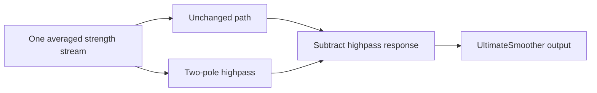
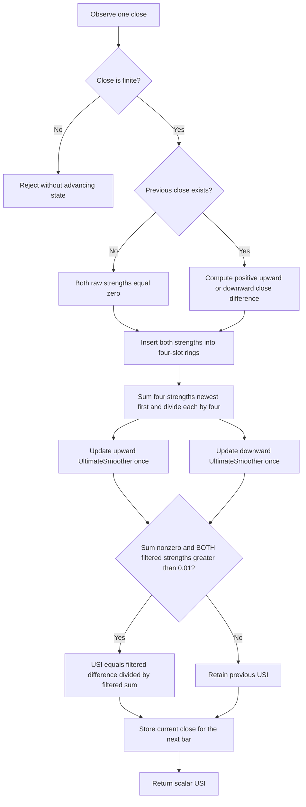

# Ultimate Strength Index: research prototype master reference

The Ultimate Strength Index (USI) is John F. Ehlers' low-lag variation of RSI, published in November 2024. It separates upward and downward one-bar price changes, averages each over four bars, applies independent UltimateSmoothers, and normalizes the difference of the filtered strengths by their sum. This master consumes one close per `update` and returns a single scalar USI. It uses only standard Python and contains its own smoother, so no sibling indicator module is needed when converting it.

The numeric authority is the November article's EasyLanguage code and the matching TradeStation Traders' Tip. Following the user's established preference, coefficients use full-precision `math.pi` and `math.sqrt(2.0)`. Startup is defined explicitly below because the supplied 252-close record has no preceding chart history. The master preserves the article's **four-bar pre-average**, **strict 0.01 tests on both strengths**, and **persistent previous USI when the guard fails**. These details matter as much as the smoother recurrence.

## 1. Sources and scope

- [November 2024 article](../../tasc/2024-11-ultimate-strength-index-(usi)/content.md), *Ultimate Strength Index (USI) — Less Lag, More Data*, John F. Ehlers, Technical Analysis of Stocks & Commodities, 42(11), pages 8–12.
- [November Traders' Tips](../../tasc/2024-11-ultimate-strength-index-(usi)/tips/tips.md) and [TradeStation code](../../tasc/2024-11-ultimate-strength-index-(usi)/tips/TradeStation_USI.els), which repeats the source smoother and USI algorithm.
- [TradingView](../../tasc/2024-11-ultimate-strength-index-(usi)/tips/TradingView_USI.pine), [NinjaTrader USI](../../tasc/2024-11-ultimate-strength-index-(usi)/tips/ninja-trader/UltimateStrengthIndex.cs), [NinjaTrader smoother](../../tasc/2024-11-ultimate-strength-index-(usi)/tips/ninja-trader/UltimateSmoother.cs), [NinjaTrader SMA](../../tasc/2024-11-ultimate-strength-index-(usi)/tips/ninja-trader/@SMA.cs), [MetaStock](../../tasc/2024-11-ultimate-strength-index-(usi)/tips/MetaStock_USI.txt), [RealTest](../../tasc/2024-11-ultimate-strength-index-(usi)/tips/RealTest_USI.rts), [NeuroShell](../../tasc/2024-11-ultimate-strength-index-(usi)/tips/NeuroShell_USI.txt), [Zorro USI](../../tasc/2024-11-ultimate-strength-index-(usi)/tips/Zorro_USI_Indicator.c), [Zorro smoother](../../tasc/2024-11-ultimate-strength-index-(usi)/tips/Zorro_UltimateSmoother.c), and [Excel workbook](../../tasc/2024-11-ultimate-strength-index-(usi)/tips/UltimateStrengthIndex.xlsm). These platform versions differ in important respects, recorded in Section 8. Workbook macros are not executed as the numeric authority.
- [April 2024 Ultimate Smoother article](../../tasc/2024-04-the-ultimate-smoother/content.md) and its [Mesa paper](../../tasc/2024-04-the-ultimate-smoother/mesa/content.md), which supply the cancellation-filter derivation used below. Their recurrence is also repeated in the November article.
- [January 2022 improved RSI article](../../tasc/2022-01-(yet-another)-improved-rsi/content.md), cited by November and used here to explain the Hann-filtered comparison without requiring access to that original document.

There is no `mesa/` paper or book chapter supplied inside the November USI folder. The further-reading books and articles are listed in the bibliography; no unsupplied chapter equations are invented. All three explicit November RSI/MyRSI/USI equations, the complete source coefficient and recursive definitions, the four-bar averages, and the conditional USI assignment are recorded here. Extra transfer-function and delay equations are identified as derivations or as April source context. RSIH is explanatory context, not an additional output implemented in this folder.

## 2. From RSI to a centered strength balance

For close $C_t$ and the preceding close $C_{t-1}$, define upward and downward strength by the article's branches:

$$SU_t=\begin{cases}C_t-C_{t-1},&C_t>C_{t-1},\\0,&\text{otherwise},\end{cases}
\qquad
SD_t=\begin{cases}C_{t-1}-C_t,&C_t<C_{t-1},\\0,&\text{otherwise}.\end{cases}$$

Equivalently, with $\Delta_t=C_t-C_{t-1}$,

$$SU_t=\max(\Delta_t,0),\qquad SD_t=\max(-\Delta_t,0).$$

The raw strengths are nonnegative, one is zero on each changing bar, and both are zero on an unchanged bar. `SD` means **strength down**, not standard deviation. These are absolute price differences, not returns, percentages, highs/lows, or volume-weighted moves.

The article writes its normalized RSI as

$$\boxed{\mathrm{RSI}=\frac{\operatorname{Avg}(SU)}{\operatorname{Avg}(SU)+\operatorname{Avg}(SD)}.}$$

If the denominator is positive, zero upward average gives RSI 0 and zero downward average gives RSI 1. Classical displayed RSI multiplies by 100. The article's generic `Avg` notation describes the strength-average construction; this master does not add a separate traditional RSI or replace USI with Wilder's exponential averaging.

Ehlers maps the balance point to zero by dilation and translation:

$$\mathrm{MyRSI}=2\mathrm{RSI}-1
=\frac{2\operatorname{Avg}(SU)-\operatorname{Avg}(SU)-\operatorname{Avg}(SD)}
{\operatorname{Avg}(SU)+\operatorname{Avg}(SD)}.$$

The resulting explicit November equation is

$$\boxed{\mathrm{MyRSI}=\frac{\operatorname{Avg}(SU)-\operatorname{Avg}(SD)}
{\operatorname{Avg}(SU)+\operatorname{Avg}(SD)}.}$$

The conceptual USI equation replaces those averages by UltimateSmoother filtering:

$$\boxed{\mathrm{USI}=\frac{\operatorname{Ult}(SU)-\operatorname{Ult}(SD)}
{\operatorname{Ult}(SU)+\operatorname{Ult}(SD)}.}$$

The executable article adds a four-bar preliminary average to each path and a conditional assignment. Omitting either gives a different algorithm. Filtering takes place **before division**, not by smoothing an already calculated RSI; a nonlinear normalization does not commute with filtering.

## 3. Complete executable USI calculation

### 3.1 Four-bar preprocessing

The code passes `Average(SU,4)` and `Average(SD,4)` to the two smoothers. Thus

$$A^u_t=\frac{SU_t+SU_{t-1}+SU_{t-2}+SU_{t-3}}4,\qquad
A^d_t=\frac{SD_t+SD_{t-1}+SD_{t-2}+SD_{t-3}}4.$$

Let $\mathcal U_P$ denote the UltimateSmoother of critical period $P=\text{Length}$. The filtered strengths are

$$U_t=\mathcal U_P(A^u)_t,\qquad D_t=\mathcal U_P(A^d)_t.$$

$U_t$ corresponds to `USU`, and $D_t$ to `USD`. They use **separate filter state**, the same configured period, and one update per observed bar on each path. The short SMA length is always four, independent of Length. No further filter is applied to the normalized result.

### 3.2 Conditional assignment and persistent output

The source initializes `USI(0)` and assigns it only when its entire condition passes. With $\varepsilon=0.01$, define

$$G_t=(U_t+D_t\ne0)\;\land\;(U_t>\varepsilon)\;\land\;(D_t>\varepsilon).$$

The exact stream definition is

$$\boxed{I_t=\begin{cases}
\dfrac{U_t-D_t}{U_t+D_t},&G_t,\\[4pt]
I_{t-1},&\text{otherwise},
\end{cases}\qquad I_{-1}=0.}$$

The inequality is **strict**. A filtered strength equal to 0.01 fails the condition. The threshold is applied to each filtered strength, not their absolute values and not merely the sum. The denominator test is retained exactly even though the two positive-threshold tests imply a positive sum for ordinary finite values.

When the condition fails, the prior value persists. This is not an instruction to set zero, clamp to an endpoint, return NaN, or skip updating filter histories. A completely flat record initialized from zero produces zero throughout. A purely rising or falling record can also stay at the initialized zero because the opposite strength never exceeds the threshold. After a mixed record has produced a nonzero USI, a later insufficient-strength interval holds that last value. The usual RSI intuition that uninterrupted gains must produce +1 therefore does not describe this guarded source code.

Both raw strengths are nonnegative, but the cancellation IIR can overshoot below zero. Those negative filtered values fail the positive-threshold gate. A successful update uses two positive values, so in exact arithmetic $-1<I_t<1$; held initialized or prior values stay within $[-1,1]$. Binary64 can round a value extremely close to an endpoint onto that endpoint. The implementation does not clamp or rescale to 0–100. The black zero plot in the article is a visual balance reference, not a second computed output.

### 3.3 Units and partial loss of scale invariance

The ratio is dimensionless. Without the fixed gate, multiplying all price changes by a positive constant would multiply $U_t$ and $D_t$ equally, leaving the ratio unchanged. Translating prices by a constant also leaves changes unchanged, subject to ordinary floating-point subtraction effects.

The fixed 0.01 threshold is in **price-change units**, not relative tolerance units. Scaling prices enough to move strengths across that threshold changes when the ratio updates. The article's normalization is useful across instruments, but the executable gate prevents complete scale invariance. It is not replaced by machine epsilon, a percentage, or a tick-size setting in this master.

## 4. UltimateSmoother equations and physical background

### 4.1 Critical period and printed coefficients

A bar is one sample. Frequency $f$ in cycles per bar, wavelength $P$ in bars and angular frequency $\omega$ satisfy

$$P=1/f,\qquad \omega=2\pi f=2\pi/P.$$

The Nyquist wavelength is two bars. The critical period labels the gradual transition between slowly varying components and fast components, not an exact brick-wall cutoff or a rolling-window count. The November source repeats these EasyLanguage coefficients:

$$a_1=\exp\!\left(-\frac{1.414\times3.14159}{P}\right),\qquad
b_1=2a_1\cos\!\left(\frac{1.414\times180}{P}\text{ degrees}\right),$$

$$c_2=b_1,\qquad c_3=-a_1^2,\qquad c_1=\frac{1+c_2-c_3}{4}.$$

EasyLanguage cosine takes degrees. The exponent uses the printed pi approximation, while the degree cosine implicitly uses the full degrees-to-radians conversion. Replacing both with a truncated-pi radian angle is not bitwise identical to the literal listing.

### 4.2 Full-precision policy used by this master

The established user preference is to replace the truncated constants by the mathematical constants. In radians:

$$\boxed{\theta=\frac{\sqrt2\,\pi}{P},\qquad a_1=e^{-\theta},\qquad
c_2=2a_1\cos\theta,\qquad c_3=-a_1^2,\qquad c_1=\frac{1+c_2-c_3}{4}.}$$

The code computes `SQRT_TWO = math.sqrt(2.0)` and `PI = math.pi`. Ports should use their standard binary64 constants and square-root/exponential/cosine operations. These substitutions preserve filter design, recurrence and source startup but slightly change coefficients and expected values from literal-constant platform implementations. The fixture oracle explicitly makes the same substitutions when evaluating the article expressions. No claim of identical values across differing constants or platform initial histories is made.

### 4.3 Complete source recurrence and startup

For one smoothed input stream $x_t$ and output $y_t$, the source recurrence is

$$\boxed{\begin{aligned}
y_t={}&(1-c_1)x_t+(2c_1-c_2)x_{t-1}-(c_1+c_3)x_{t-2}\\
&+c_2y_{t-1}+c_3y_{t-2}.
\end{aligned}}$$

The source runs the recurrence for one-based `CurrentBar >= 4`; for the first three standalone samples it returns its current input:

$$y_t=x_t,\qquad t=0,1,2.$$

Histories are updated on these startup samples. Recursion begins at zero-based index 3, uses two previous **raw averaged strengths** and two previous **filtered strengths**, and retains the negative sign of $c_3$. Updating a shared filter twice on a bar, substituting previous outputs for previous raw inputs, or beginning recursion one bar later changes the indicator.

### 4.4 Cancellation transfer functions from the April derivation

The prerequisite April article writes the UltimateSmoother as the unchanged input minus a highpass response:

$$\boxed{H_{\mathrm{US}}(z)=1-
\frac{c_1(1-2z^{-1}+z^{-2})}{1-c_2z^{-1}-c_3z^{-2}}.}$$

Putting this over a common denominator gives its complete closed form:

$$\boxed{H_{\mathrm{US}}(z)=
\frac{(1-c_1)+(2c_1-c_2)z^{-1}-(c_1+c_3)z^{-2}}
{1-c_2z^{-1}-c_3z^{-2}}.}$$

$z^{-1}$ is one bar of delay. The complementary highpass has numerator $c_1(1-z^{-1})^2$. Its two zeros at zero frequency remove constant and linear-ramp components. In derived notation,

$$H_{\mathrm{HP}}(z)=\frac{c_1(1-z^{-1})^2}{1-c_2z^{-1}-c_3z^{-2}},
\qquad H_{\mathrm{US}}(z)=1-H_{\mathrm{HP}}(z).$$

The derived poles are $a_1e^{\pm j\theta}$. In exact arithmetic their radius is below one for finite positive periods, giving damped recursive memory. The derived e-folding scale is $P/(\sqrt2\pi)$ bars. At DC, $H_{\mathrm{US}}(1)=1$; at Nyquist, $H_{\mathrm{US}}(-1)=0$. Long periods place poles closer to the unit circle, affecting filtering character and transients without requiring that many samples before output is defined. Very large periods can lose coefficient resolution in finite precision; the reference cases extend through 252.

### 4.5 Inductors, capacitors, and cancellation

Ehlers connects his smoother to analog filters made from inductors and capacitors. Slow physical filters store energy while magnetic and electric fields build up, explaining their delayed response. For physical context the standard energy expressions are

$$E_L=\tfrac12LI^2,\qquad E_C=\tfrac12CV^2.$$

A large woofer responds to slower sound cycles, while a small tweeter handles faster ones. In digital filtering, previous outputs play the role of stored state. The UltimateSmoother leaves an unchanged input path and subtracts an estimate of fast fluctuations: the highpass output is near zero at low frequencies, while at high frequencies it approaches the input and cancels it. This physical analogy explains low lag; no circuit energy or speaker simulation is calculated by USI.



Cancellation filters are not convex averages and can overshoot. The November article emphasizes that reducing lag compromises smoothing efficiency: its SU/SD inputs are ragged, prompting the extra four-bar SMA. The two USI paths share the same filter design but maintain independent memory.

### 4.6 What the lag claim means

The derived low-frequency behavior is $H_{\mathrm{HP}}(e^{j\omega})=O(\omega^2)$ and $H_{\mathrm{US}}(e^{j\omega})=1+O(\omega^2)$. Its limiting group delay at zero frequency is zero; phase shift is not exactly zero at every finite frequency. Group delay is $\tau_g(\omega)=-d\arg H(e^{j\omega})/d\omega$.

The fixed four-bar SMA has transfer function

$$H_4(z)=\frac{1+z^{-1}+z^{-2}+z^{-3}}4.$$

As a symmetric FIR it has a group delay of $(4-1)/2=1.5$ bars away from its zeros and phase discontinuities. The source describes its practical lag penalty as about two bars. Each linear strength path has transfer $H_4(z)H_{\mathrm{US}}(z)$. The complete USI adds nonlinear gain/loss separation, division and conditional persistence, so it has no single linear time-invariant transfer function or universal lag value. Zero crossing timing also depends on data, length and held-output intervals. Low lag is not future-data access or a guarantee that every reversal is identified without delay.

## 5. RSIH comparison and article application

The November article compares USI with MyRSIH from January 2022. For an RSIH length $N$, the supplied January listing weights one-bar strengths with the Hann window

$$w_k=1-\cos\!\left(\frac{2\pi k}{N+1}\right),\qquad k=1,\ldots,N.$$

$$CU_t=\sum_{k=1}^{N}w_k SU_{t-k+1},\qquad
CD_t=\sum_{k=1}^{N}w_k SD_{t-k+1},\qquad
\mathrm{MyRSIH}_t=\frac{CU_t-CD_t}{CU_t+CD_t}$$

when the denominator is nonzero; the source retains its prior value otherwise. January's classical RSI expression is $100-100/(1+CU/CD)$, algebraically equivalent to $100CU/(CU+CD)$ when defined. The common Hann normalization cancels from the ratio. This comparison is a finite weighted window with delay, whereas USI uses four-bar preprocessing followed by recursive cancellation filtering. Neither the Hann filter nor a separate RSIH output is implemented here.

In the November figures, USI Length 28 is compared with MyRSIH Length 14. The article reports USI zero crossings about three bars earlier in that example. Length 112 is four times the swing setting and is used to reduce trend whipsaws. Those chart observations are examples, not guaranteed timing properties or separate parameter defaults; the actual EasyLanguage default remains 14.

The article discusses using zero crossings for bullish/bearish transitions and comparing USI to itself delayed by two bars to approach detection of swing peaks and valleys. The comparison value would be $I_{t-2}$, which requires two prior USI outputs. This master returns only $I_t$: strategies, delayed overlays, buy/sell markers and peak detectors are not additional indicator outputs. A positive held output means the last accepted balance was bullish; it does not prove that today's filtered strengths passed the gate.

## 6. Configuration, initialization and output contract

| Parameter | Shortcut | Default | Accepted values | Meaning |
|---|---|---:|---|---|
| `length` | `L` | 14.0 | Finite real number at least 1 | Critical period of both strength UltimateSmoothers, in bars. |

Fractional Length is valid because it only sets coefficients. The preliminary window is always four bars. The article does not state a minimum; the master adopts the minimum of one shown by the supplied NinjaTrader and TradingView controls. Periods 1–2 serve as boundary tests, and several-bar periods are easier to interpret as filters. MetaStock's narrower 4–150 UI range is a platform choice. There is no artificial upper cap; ordinary finite-precision limitations apply.

`PREAVERAGE_LENGTH=4` and `MINIMUM_STRENGTH=0.01` are fixed source constants, not configuration axes. Do not replace 0.01 with `syminfo.mintick` or machine epsilon when testing these fixtures.

`UltimateStrengthIndex(length=14)` owns two smoother instances, two four-slot strength rings, their shared write index, the preceding close and the last scalar USI. `update(close)` consumes one finite closing price and returns one float. Zero and negative price levels are valid. A NaN or infinity is rejected before any state changes. `reset()` restores all startup state. Length is read-only; construct a fresh instance to change configuration.

### 6.1 Exact standalone startup policy

The chart listing reads `Close[1]` and four historical strengths, but no prehistory is supplied with `INPUT_CLOSE`. This master defines its standalone initialization as follows:

1. Before the first close, the previous close is absent, the last USI is 0, and both four-slot strength histories are filled with zero.
2. The first close establishes the baseline and supplies $SU_0=SD_0=0$. It is not compared to an invented zero price.
3. For the early four-bar averages, unobserved preceding strengths are zero and the divisor remains 4. Equivalently, $SU_t=SD_t=0$ for negative standalone indices.
4. Both smoothers receive an input on every observed close. At indices 0, 1 and 2 they pass through their current averages, then recurse starting at index 3.
5. On every bar, evaluate the exact source guard and either update or retain the initialized/persisted USI.

This defines a finite scalar from the first observation, so **`warmup_bars=0`** and **no expected fixture has a leading NaN**. `is_primed` is false before the first observation and true afterward. Primed means the standalone output is defined; it does not promise settled filter transients, four independently observed changes, or a successful guard on that bar. A first-bar value 0 and later held values are valid stateful source outputs, not unavailable results.

A longer chart record or a platform with partial-window divisors, full-window-only SMA, additional pass-through bars or implicit prior closes can produce different early transients. The standalone seed choices are explicit reference conventions, not claims about TradeStation's chart engine initialization. Numerical parity is checked against the article expressions under these conventions and the established full-precision coefficient substitutions.

### 6.2 Calculation flow and complexity



Histories always advance even when USI is held. Persistent storage is eight raw strengths, eight smoother-history scalars, coefficients and counters, the previous close and last USI. Update time and storage are both $O(1)$; Length does not size any price buffer. Python's ring index `(next-1-lag)%4` is nonnegative. Other languages should wrap a decrement at zero or use `(next+4-1-lag)%4` to avoid negative-remainder or unsigned-underflow differences.

The four sums are recomputed in newest-to-oldest order on each bar. A rolling-total implementation may be mathematically equivalent but can change rounding over time. Retain the stated sum order and the article's direct-form smoother multiplication/addition order when comparing fixtures.

## 7. Streaming example

```python
indicator = UltimateStrengthIndex(length=14)
for close in INPUT_CLOSE:
    usi = indicator.update(close)
    # Use or store this scalar now; subsequent bars have not been observed.
```

The first five default outputs on the supplied record, serialized at 15 significant digits, are

```text
0.0, 0.0, 0.765645805592544, 0.643886751384232, 0.511060385162539
```

The first down movement occurs at index 2, allowing both strengths to pass the gate there. Until then the zero-initialized USI is held. The class needs no array or file at runtime; the array is only convenient example input.

## 8. Important differences among supplied platform tips

| Implementation | Relevant differences | Reference policy |
|---|---|---|
| Article and TradeStation | Length 14, four-bar Average, literal constants, strict 0.01 tests and previous-value retention. | Algorithm and conditional assignment authority; full precision and explicit standalone seeds are documented substitutions. |
| TradingView | UI default 28; 1.414 with full pi; recursion begins at zero-based bar_index 4; SMA may be unavailable until its window exists; threshold is instrument tick size. | Default 14, full sqrt(2), recursion at index 3, zero-seeded fixed-divisor preprocessing, fixed 0.01 threshold. |
| NinjaTrader | Skips first bar; underlying smoother starts later; bundled SMA uses a partial-window divisor initially. Preserves strict 0.01 and prior USI. | Same final guard; explicit article-aligned smoother indexing and standalone SMA seeds. |
| MetaStock | UI Length range 4–150; pass-through before cum(1) reaches 8; checks the sum rather than both 0.01 tests; returns 0 for zero denominator. | All three article guard tests and persistent prior output retained. |
| RealTest | Default USI length 28; gates recursive strength outputs with `BarNum > rsi_len` (comparison RSI length 14), using zero before that threshold. | Startup depends on the source smoother's CurrentBar 4, not the comparison RSI length. |
| Zorro | Uses series seeding and immediate recurrence; divides by `fix0(USU+USD)` without the article's two-strength threshold and hold gate. Indicator calls `UltimateSmooth` while supplied function is named `UltimateSmoother`. | Self-contained matching filter, direct guarded ratio and persistent output from the article. |
| NeuroShell, Wealth-Lab, Excel | Provide built-ins, example strategies, or workbook visuals. | Context; no assumption of numeric equivalence from platform labels alone. |

The master is not intended to reproduce all mutually different tips simultaneously. Source code guards, initialization, constants and averaging conventions determine the actual numeric stream. The selected policy is documented so another language can reproduce the fixtures exactly within binary64/serialization tolerance.

## 9. Confirmed reference cases

The user confirmed the following **12 cases** before generation, below the limit of 64 parameter combinations. Every case constructs a new instance and consumes all 252 closes. There is one scalar expected array per case.

| Python array | Length | What it tests |
|---|---:|---|
| `EXPECTED_L1` | 1 | Minimum period: four-bar pre-average dominates while the source guard remains active. |
| `EXPECTED_L2` | 2 | Two-bar period: shortest Nyquist-scale smoother coefficients. |
| `EXPECTED_L3` | 3 | Very short period: rapid strength smoothing after the three startup bars. |
| `EXPECTED_L4` | 4 | Four-bar period: smoother critical period equals the fixed pre-average length. |
| `EXPECTED_L8` | 8 | Short practical period: responsive zero crossings with four-bar pre-averaging. |
| `EXPECTED_L14` | 14 | Article and TradeStation default: fourteen-bar strength smoothing. |
| `EXPECTED_L20` | 20 | Intermediate period: comparison with the established twenty-bar UltimateSmoother. |
| `EXPECTED_L28` | 28 | Article swing example: twenty-eight-bar USI compared with fourteen-bar MyRSIH. |
| `EXPECTED_L28_5` | 28.5 | Fractional period: preserve real-valued coefficients without integer truncation. |
| `EXPECTED_L56` | 56 | Longer intermediate period: twice the article swing setting. |
| `EXPECTED_L112` | 112 | Article trend example: four times the twenty-eight-bar swing setting. |
| `EXPECTED_L252` | 252 | Full-record period: long recursive memory with defined startup and guarded holds. |

Each expected array has 252 finite values. Before it, the first comment is the exact "What it tests" text in this table and the second is `length=<value>`. Parameter shortcut `L` means Length; decimal points become underscores, so 28.5 is named `EXPECTED_L28_5`.

| Language | Fractional-case declaration | NaN spelling |
|---|---|---|
| Python | `EXPECTED_L28_5 = [...]` | `math.nan` |
| Go | `var expectedL28_5 = []float64{...}` | `math.NaN()` |
| TypeScript | `export const expectedL28_5: number[] = [...];` | `NaN` |
| Rust | `pub fn expected_l28_5() -> Vec<f64>` | `f64::NAN` |
| Zig | `pub fn expectedL28_5() [252]f64` | `nan` |

Although no NaNs occur under this defined startup, the renderers support each language's valid spelling. Go package name is `ultimatestrengthindex`; the required math import is kept valid with a blank reference to `math.NaN`. Zig retains `const math = @import("std").math;` and `const nan = math.nan(f64);` at the top. Rust leaves copied input functions inside their existing `#[cfg(test)] pub mod testdata` and appends expected functions at file scope. All copied OHLC inputs and original input function/array names are retained, though only INPUT_CLOSE is used for USI.

## 10. Reproduction and precision

From this folder:

```bash
python3 ultimate-strength-index.py
python3 ultimate-strength-index.py --generate-reference-data
python3 -m unittest discover -p 'test_ultimate_strength_index.py' -v
```

The `__main__` embeds the exact shared 252 INPUT_CLOSE values and shows streaming usage. The generation flag writes the 12 Python expected arrays first, reloads their actual serialized values, checks their names, lengths, finiteness and precision, and then translates those written Python values into the other four files with identical comments. Marked generated sections are replaced on repeat runs, preventing duplicate arrays while preserving the original inputs. The generator uses only the standard library.

Use IEEE-754 binary64 in ports: Go float64, Rust/Zig f64, and TypeScript number. Preserve the source expression order; avoid forced fused multiply-add or arithmetic reassociation when seeking the same last bits. Internal filter state is never rounded. Serialization uses `.15g`, meaning **15 significant digits**, not 15 decimal places. A suitable comparison tolerance for the supplied fixture record is `rel_tol=5e-13, abs_tol=5e-13`.

The verification tests independently evaluate expressions extracted from the local November article under the explicit precision and seed choices. Additional tests cover strict threshold boundaries, previous-output retention, monotone and flat data, scale effects, causal prefixes, reset, invalid input handling, fractional lengths, and every output literal and comment across all five languages. Source-expression checks require this repository's original article files; the master classes, generated fixtures, and this mathematical documentation are self-contained for conversion elsewhere. The reference fixture generator rejects infinite outputs. Arithmetic on extraordinarily large finite prices or unresolved huge-period coefficients is outside the tested price-scale domain.

Verification completed on 2026-10-16: all **14 Python tests** passed, including independent article-expression comparisons for every confirmed case and every translated literal and comment. Native Go, Rust and Zig fixture validators passed; TypeScript execution through Node checked all 12 arrays against the written Python values. Each language contains 12 arrays of 252 finite outputs. Regeneration produced byte-for-byte identical fixture files in all five languages.

## 11. References and BibTeX

1. Ehlers, John F. (2024). *Ultimate Strength Index (USI)*. Technical Analysis of Stocks & Commodities, 42(11), 8–12, November. [Article](https://technical.traders.com/archive/article.asp?file=\V42\C11\870EHLE.pdf).
2. Technical Analysis, Inc. (2024). *Traders' Tips — November 2024: Ultimate Strength Index (USI)*. [Tips](https://www.traders.com/Documentation/FEEDbk_docs/2024/11/TradersTips.html). Includes the platform sources linked in Section 1.
3. Ehlers, John F. (2024). *The Ultimate Smoother*. Technical Analysis of Stocks & Commodities, 42(4), 8–15, April. [Article](https://technical.traders.com/archive/article.asp?file=\V42\C04\778EHLE.pdf).
4. Ehlers, John F. (2024). *The Ultimate Smoother*. Mesa Software. [Paper](https://www.mesasoftware.com/papers/UltimateSmoother.pdf). Year follows the supplied transcription.
5. Ehlers, John F. (2022). *(Yet Another) Improved RSI: Enhanced With Hann Windowing*. Technical Analysis of Stocks & Commodities, volume 40, January. [Local source](../../tasc/2022-01-(yet-another)-improved-rsi/content.md).
6. Ehlers, John F. (2014). *Predictive And Successful Indicators*. Technical Analysis of Stocks & Commodities, volume 32, January. Further reading cited by November.
7. Ehlers, John F. (2004). *Cybernetic Analysis for Stocks and Futures*. John Wiley & Sons. Further-reading book; no chapter supplied.
8. Ehlers, John F. (2013). *Cycle Analytics for Traders*. John Wiley & Sons. Further-reading book; no chapter supplied.
9. Ehlers, John F. (2021). *A Technical Description of Market Data for Traders*. Technical Analysis of Stocks & Commodities, volume 39, May. Further reading cited by November.
10. McAllister, Ron (2024). *UltimateStrengthIndex.xlsm*. Workbook accompanying the November Excel Traders' Tip. Local workbook is linked in Section 1; macros were not run.

```bibtex
@article{ehlers2024usi,
  author = {Ehlers, John F.}, title = {Ultimate Strength Index (USI)},
  journal = {Technical Analysis of Stocks \& Commodities},
  volume = {42}, number = {11}, pages = {8--12}, year = {2024}, month = nov,
  url = {https://technical.traders.com/archive/article.asp?file=\V42\C11\870EHLE.pdf}
}
@misc{tradersTips2024nov,
  author = {{Technical Analysis, Inc.}},
  title = {Traders' Tips --- November 2024: Ultimate Strength Index (USI)},
  year = {2024}, month = nov,
  url = {https://www.traders.com/Documentation/FEEDbk_docs/2024/11/TradersTips.html}
}
@article{ehlers2024ultimateSmoother,
  author = {Ehlers, John F.}, title = {The Ultimate Smoother},
  journal = {Technical Analysis of Stocks \& Commodities},
  volume = {42}, number = {4}, pages = {8--15}, year = {2024}, month = apr,
  url = {https://technical.traders.com/archive/article.asp?file=\V42\C04\778EHLE.pdf}
}
@misc{ehlers2024mesaUltimateSmoother,
  author = {Ehlers, John F.}, title = {The Ultimate Smoother},
  year = {2024}, howpublished = {Mesa Software},
  url = {https://www.mesasoftware.com/papers/UltimateSmoother.pdf},
  note = {Year follows supplied transcription}
}
@article{ehlers2022improvedRSI,
  author = {Ehlers, John F.},
  title = {(Yet Another) Improved RSI: Enhanced With Hann Windowing},
  journal = {Technical Analysis of Stocks \& Commodities},
  volume = {40}, number = {1}, year = {2022}, month = jan
}
@article{ehlers2014predictiveIndicators,
  author = {Ehlers, John F.}, title = {Predictive And Successful Indicators},
  journal = {Technical Analysis of Stocks \& Commodities},
  volume = {32}, year = {2014}, month = jan
}
@book{ehlers2004cyberneticAnalysis,
  author = {Ehlers, John F.}, title = {Cybernetic Analysis for Stocks and Futures},
  publisher = {John Wiley \& Sons}, year = {2004}
}
@book{ehlers2013cycleAnalytics,
  author = {Ehlers, John F.}, title = {Cycle Analytics for Traders},
  publisher = {John Wiley \& Sons}, year = {2013}
}
@article{ehlers2021marketData,
  author = {Ehlers, John F.}, title = {A Technical Description of Market Data for Traders},
  journal = {Technical Analysis of Stocks \& Commodities},
  volume = {39}, year = {2021}, month = may
}
@misc{mcallister2024usiWorkbook,
  author = {McAllister, Ron}, title = {UltimateStrengthIndex.xlsm},
  year = {2024}, month = nov,
  howpublished = {Workbook accompanying the Excel Traders' Tip}
}
```
