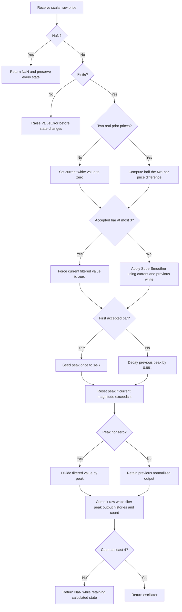

# Universal Oscillator: research prototype master reference

`universal-oscillator.py` implements John F. Ehlers' January 2015 Universal Oscillator. Class `UniversalOscillator(band_edge=20)` consumes one scalar raw price per `update(price)` and returns one dimensionless value. Its calculation is raw price → two-bar difference divided by two → SuperSmoother → fast-attack, slow-decay automatic gain control (AGC). Only the SuperSmoother period is configurable.

The supplied article and TradeStation listing are the numeric authority. This document contains their relevant theory and complete article listings, relevant book mathematics, source differences, startup conventions, porting instructions, and references. It is sufficient to implement the indicator after copying this folder without the source tree.

## Article and book investigation

All 17 supplied chapters and the contents of the 2013 *Cycle Analytics for Traders* were searched. There is no Universal Oscillator definition or listing. The article describes a new combination of familiar components, so there is no book Universal Oscillator implementation to use as a competing reference.

Book equation 3-3 is the same SuperSmoother, while chapter 5 derives the same 0.991 AGC envelope. Chapter 2 supplies the EMA used in the article's market synthesizer. Chapters 6 and 7 discuss spectral power laws and spectral dilation. Chapter 12's Even Better Sinewave has a related aim of interpreting both cycles and trends, but its recursive high-pass and three-bar RMS normalization are different calculations. The complete source investigation and concrete Tips differences are reproduced below.

This oscillator also differs from the earlier Quotient Transform: it replaces the fixed 100-bar recursive two-pole high-pass with a finite two-bar difference, uses default low-pass period 20, retains explicit first-three-bar filter overrides and an initial peak of 1e-7, and applies no final quotient mapping. Do not substitute a two-pole Roofing filter or a book Sinewave calculation.

## Principles, physical analogies, and the market model

The article motivates the method with colored noise. White light contains a broad range of wavelengths; white noise is described by a flat power spectral density. Pink or red noise gives more weight to slower components. The article uses the analogy of a bright radio hiss for white noise and a gentle rain shower for pink noise. Its engineering example generates correlated radar echoes with a white-noise source followed by a first-order smoothing circuit; the financial analogue is random numbers followed by an EMA.

A recursive smoothing circuit retains a fading contribution from previous input, much like energy stored in a capacitor. This motivates the author's phrase “noise with memory.” The model is an approximate way to describe a spectrum, not an assertion that independent Gaussian noise accurately describes all price behavior. A flattened spectrum alone does not establish independent samples or erase all market information.

The article prints the general power law

$$\text{Pink noise}=\frac{K}{f^\alpha}.$$

It sets $\alpha=1$ and uses amplitude doubling when period doubles, equivalent to approximately $20\log_{10}2=6.0206$ dB per octave. It calls $\alpha=0$ white and $\alpha=2$ red. These statements mix amplitude and power conventions. Under the conventional **power spectral density** convention, $S_p(f)\propto1/f$ is pink and its amplitude density is $\sqrt{S_p(f)}\propto1/\sqrt f$; $S_p(f)\propto1/f^2$ is red/Brownian and has amplitude density $1/f$. The EMA simulation and differentiator argument correspond approximately to the latter amplitude slope. This distinction changes theoretical claims about whitening, but not the listed indicator equations.

Chapter 6 explicitly observes that differentiation lowers a power-spectrum exponent by two and integration raises it by two. For conventional $S_p(f)\propto f^{-\alpha}$, a low-frequency differentiator produces approximately $S_w(f)\propto f^{2-\alpha}$; exact low-frequency whitening would correspond to $\alpha=2$. The chapter's supplied log equation has a missing minus sign: the correct relation is $\log(C/f^\alpha)=\log C-\alpha\log f$. Its accompanying prose correctly describes slope $-\alpha$.

## From the EMA synthesizer to approximate whitening

The article's synthetic market uses random $r_t$ between 0 and 100 and

$$s_t=0.004r_t+0.996s_{t-1},\qquad s_1=50.$$

Auxiliary half-smoothed random variables create high and low bars. They are source context only: the master consumes the supplied closes and does not generate random prices.

Book equation 2-2 supplies the general EMA,

$$m_t=\lambda p_t+(1-\lambda)m_{t-1},\qquad 0<\lambda\le1,$$

with transfer function and impulse response

$$H_{EMA}(z)=\frac{\lambda}{1-(1-\lambda)z^{-1}},\qquad h_n=\lambda(1-\lambda)^n\quad(n\ge0).$$

The book's impulse input has amplitude $1/\lambda$, so its displayed output sequence is $1,(1-\lambda),(1-\lambda)^2,\ldots$. Under an indefinitely rising unit-per-bar input, its static lag is $L=(1-\lambda)/\lambda$, equivalently $\lambda=1/(L+1)$; matching an N-bar SMA's static lag gives book equation 2-3, $\lambda=2/(N+1)$. These are EMA background relationships, not Universal Oscillator parameters.

An exact inverse of the synthetic recursion, if applied to observed prices, would be

$$r_t=\frac{p_t-0.996p_{t-1}}{0.004}.$$

The author deliberately approximates 0.996 by 1 and discards a scale factor, yielding

$$p_t\approx\text{WhiteSpectrum}_t+p_{t-1},\qquad \Delta p_t=p_t-p_{t-1}\approx\text{WhiteSpectrum}_t.$$

The exact EMA inverse is **not** implemented. Neither 0.004 nor 0.996 is an oscillator configuration parameter.

A one-bar difference has transfer response $1-z^{-1}$ and gain 2 at Nyquist. The article avoids that high-frequency amplification by averaging two adjacent differences:

$$w_t=\frac{(p_t-p_{t-1})+(p_{t-1}-p_{t-2})}{2}=\frac{p_t-p_{t-2}}{2}.$$

This three-tap finite impulse response filter uses coefficients $(1/2,0,-1/2)$. The zero middle coefficient does not change the two-bar historical requirement. Its transfer function and frequency response, with $\omega=2\pi f$, are

$$H_W(z)=\frac{1-z^{-2}}2,\qquad H_W(e^{i\omega})=i e^{-i\omega}\sin\omega,$$

$$|H_W(e^{i\omega})|=|\sin\omega|,\qquad 0\le f\le0.5\ \text{cycles/bar}.$$

It has zero transmission at DC ($f=0$), unit gain at a four-bar cycle ($f=0.25$), zero transmission at Nyquist ($f=0.5$), and never amplifies a sinusoid above unit gain. Near DC, $|\sin\omega|\approx\omega$, giving approximately 6 dB/octave amplitude equalization. This is exact mathematics for the FIR filter; interpreting its result as “white noise” relies on the approximate input-spectrum model.

The equivalent pair of stages is a first difference followed by a two-element average. Preserve the direct `(price-price_two_bars_ago)/2` arithmetic in ports so rounding follows the master.

## SuperSmoother: complete coefficient and recurrence equations

Let $B$ be the configured BandEdge period in bars. The full-precision implementation of book equation 3-3 and the article is

$$
\begin{aligned}
\beta&=\frac{\sqrt2\pi}{B},&a&=e^{-\beta},\\
c_2&=2a\cos\beta,&c_3&=-a^2,\\
c_1&=1-c_2-c_3,\\
f_t&=\frac{c_1(w_t+w_{t-1})}{2}+c_2f_{t-1}+c_3f_{t-2}.
\end{aligned}
$$

The article names a, c2 as `a1`, `b1`/`c2`. Its printed exponential uses 1.414 and 3.14159, while its cosine uses degrees `1.414*180/BandEdge`. Replace the constants with sqrt(2) and pi and use radians for the cosine. Both use exactly the same radian angle beta in the master. Keep c3 negative and **add** its historical contribution.

The filter originates from a modified digital Butterworth approximation. Two damped rotating poles describe recursive memory; the input average supplies a zero at Nyquist at the cost of half a bar of delay. Its transfer response is

$$H_{SS}(z)=\frac{\frac{c_1}{2}(1+z^{-1})}{1-c_2z^{-1}-c_3z^{-2}},$$

with poles $ae^{\pm i\beta}$. For finite ordinary B values these poles have magnitude $a<1$. The DC gain is 1 in exact arithmetic. “Band edge” is the source's critical-period setting; it does not define a hard rectangular cutoff. Shorter-period components are attenuated gradually, and the digital approximation need not have exactly -3 dB at the configured period for every B.

The extra average of $w_t+w_{t-1}$ is required even though w itself already averages two differences. Omitting it changes the filter. Before AGC, the complete linear response is

$$H_{linear}(z)=\frac{c_1(1-z^{-1})(1+z^{-1})^2}{4(1-c_2z^{-1}-c_3z^{-2})}.$$

It has a single DC zero and a double Nyquist zero. Unlike two-pole Roofing with its double DC zero, a continuing linear price ramp produces a sustained momentum input rather than fading to zero. AGC makes the complete indicator nonlinear and state dependent, so $H_{linear}$ is not a transfer function of the normalized output.

## Peak-envelope normalization: complete equations and derivation

Let $d=0.991$ and $\varepsilon_0=10^{-7}$. The seed is fixed and is used **once**. With the startup conditions below,

$$P_1=\varepsilon_0,\qquad P_t=\max(dP_{t-1},|f_t|)\quad(t\ge2).$$

Initialize $U_0=0$ and apply the exact article conditional

$$U_t=\begin{cases}f_t/P_t,&P_t\ne0,\\U_{t-1},&P_t=0.\end{cases}$$

Compare today's magnitude against the **decayed** prior peak, not the undecayed prior peak. The recurrence is a peak detector with fast attack and slow discharge, analogous to an audio AGC circuit. The peak immediately resets when a new magnitude exceeds the decayed envelope. Otherwise it retains fading memory. It is neither a rolling maximum nor RMS normalization.

Because $P_t\ge|f_t|$, the normal finite-arithmetic ratio is within [-1,1]. New envelope peaks may produce repeated +1 or -1 values. No extra clipping, percentage scaling, quotient transform, output smoother, or fixed-period maximum is applied. The plotted zero line is a reference level rather than another computed output.

Between resets, $P_{t+n}=d^nP_t$ and the half-life is

$$n_{1/2}=\frac{\ln(1/2)}{\ln(0.991)}\approx76.6693\ \text{accepted bars}.$$

Chapter 5 uses K for this decay (there is no quotient K in this oscillator). Its complete design argument uses the half-cycle decay factor $G(T)=d^{T/2}$. For periods 10 and 48 bars,

$$R=\frac{d^{24}}{d^5}=d^{19},\qquad -1.5=20\log_{10}R,$$

$$R=10^{-1.5/20}=10^{-0.075}\approx0.841395,\qquad d=10^{-1.5/(20\cdot19)}\approx0.990952029793611.$$

The provided book prints `10^(-0.75)` at the intermediate step; -1.5/20 equals -0.075, and its approximate 0.841 ratio agrees with the corrected exponent. The author explicitly selects **0.991** for his algorithms. Keep that setting rather than substituting 0.990952... or retuning it to BandEdge. The source calls the envelope factor “Gain”; the actual multiplier applied to the signal is $1/P_t$, which varies with reset timing and signal shape.

Similarly, keep the initial peak of **1e-7**. It is an algorithmic initialization choice, not a truncated mathematical constant. It is not a repeated epsilon floor. Tiny signals initially normalize against the decaying seed, so arbitrary price-scale invariance is not exact before the signal sets the envelope. After the envelope becomes signal dominated, positive scaling of price variations cancels approximately in numerator and denominator. A constant input gives zero output while the seed decays.

## Configuration, public interface, and valid ranges

| Setting | Shortcut | Default | Valid values | Meaning |
| --- | --- | ---: | --- | --- |
| `band_edge` | `BE` | 20.0 | Finite real $B\ge2$ | SuperSmoother coefficient period in accepted bars. Fractional values supported. |
| Fixed peak decay | — | 0.991 | Fixed source value | Fast-attack/slow-decay envelope. |
| Fixed initial peak | — | 1e-7 | Fixed source value | One-time first-bar seed. |

Only `band_edge` is a constructor parameter. The article does not prescribe a strict parameter range; TradeStation rejects values at or below zero, AmiBroker's user interface uses 2–100, and the article itself discusses values 150–200. This master requires at least 2 bars to respect the sampling limit and accepts fractional periods. It imposes no arbitrary 100-bar upper cap. Extremely large finite periods can reach binary64 coefficient-resolution limits; such settings have little practical meaning.

Default 20 is the article's short-term example, 50 its trend example, and 150–200 its suggested longer trend range. A smaller B admits more high-frequency activity; a larger B smooths more strongly and increases phase delay. There is no lookback window of size B, and B does not determine startup length.

`update(price)` accepts finite positive, zero, or negative raw prices and returns one float. Infinity raises `ValueError` before any state change. A NaN input returns NaN without changing any state. `band_edge` is read-only; create a new object for a different coefficient setting. `reset()` clears all histories and restarts the source initialization. `warmup_bars` is 3; `is_primed` becomes true on accepted finite bar 4.

## Exact startup and missing-input contract

The article explicitly overrides the first three filtered values. With zero historical filter states the overrides simplify to

$$f_1=0,\quad f_2=c_2f_1=0,\quad f_3=c_2f_2+c_3f_1=0.$$

Store the first two real raw prices with $w_1=w_2=0$. On bar 3 compute $w_3=(p_3-p_1)/2$ and retain it, even though $f_3$ is forced to zero. Initialize $P_1=10^{-7}$; decay it on bars 2 and 3. These bars have internal $U=0$ and are returned as **NaN** to indicate startup. The original platform plots these zeros; masking them is the master's explicit API availability convention.

On bar 4, calculate

$$w_4=(p_4-p_2)/2,\qquad f_4=c_1(w_4+w_3)/2,$$

$$P_4=\max(0.991^3\cdot10^{-7},|f_4|),\qquad U_4=f_4/P_4.$$

Bar 4 is the first visible output for every B. This matches the article's explicit filter override order and eliminates the need for unknown raw price prehistory: old white-noise values on the first two bars do not affect later calculations because those filter outputs are overridden. Starting the ordinary filter on bar 3, forgetting to save w3, seeding the peak anew on bar 2, or waiting B bars would create different outputs.

For the shared closes at default B=20, the first five visible outputs are approximately `1, 1, 0.901016533908932, 0.387820052439119, -0.672900416889213`. The first value is bar 4, not bar 5.

A NaN call is an omitted observation: no count increment, raw-price shift, white-history shift, filter update, output-state update, or peak decay. The next finite input follows the previous finite input. Consequently coefficients operate on accepted observations rather than elapsed calendar time. Infinity is rejected before mutations. Priming means availability, not that a long-period recursive transient has settled.

Compute white noise, filtered value or startup override, decayed/reset peak, normalized output, then commit histories and increment the count. All old histories must be read before shifting. Scalar work and storage are O(1): two raw prices, one previous white value, two filtered values, peak, previous normalized output, and count.

## Calculation flow



## Interpretation and limits of source claims

The normalized output is momentum-like. Positive values mean the smoothed whitened difference is positive; negative values mean it is negative. Larger B lets slower variations dominate. A rising linear price ramp has $w_t$ equal to its slope, SuperSmoother output tending to that slope, and normalized output tending toward +1 for a positive slope or -1 for a negative slope.

The whitening FIR removes DC, has an approximate differentiating phase lead relative to a low-frequency price cycle, and suppresses Nyquist. SuperSmoother still has frequency-dependent phase delay. These effects can align oscillator turning points closely with price swings in selected data, but do not give a universal zero-delay or predictive filter. AGC is memory dependent and changes waveform shape; it does not preserve an exact linear spectrum.

A price step of size A produces two whitening pulses of amplitude A/2, followed by zero. Smoothing these pulses creates a transient response, and normalization can make that response prominent. The article's observed reduced gap ringing is a qualitative comparison; the implementation neither deletes gaps nor guarantees absence of ringing. No gap detector, reset-on-session-opening rule, trading position, alert, or crossover event is part of the scalar master output.

The synthetic EMA and random generator illustrate a model. Similar-looking charts and profitable trading on one synthetic example are not mathematical proofs of predictability or optimality. Source statements about an “optimum” oscillator and “zero lag” are preserved below so later agents can distinguish the author's motivation from the exact implementable recurrence.

## Precision and reference-data contract

Numeric calculation uses scalar binary64 and standard-library `math`. Use full-precision sqrt(2) and pi; do not round coefficients or recursive state. Preserve subtraction and recurrence operation order when practical. A port may produce small differences from math-library implementations or fused arithmetic; compare finite fixture values with a suitable relative/absolute tolerance, such as $10^{-11}$ for these dimensionless examples. Compare NaN masks and array lengths exactly.

The required full-precision constants cannot simultaneously reproduce every decimal of code evaluated with literal 1.414 and 3.14159. The independent test oracle extracts the original article expressions and replaces these constants precisely. It separately verifies source startup, seed, decay order, and synthetic inputs rather than trusting generated fixtures alone. Across all 12 cases on the shared closes, the largest absolute difference between master and precise source expressions is `4.44089209850063e-16`. At the default BandEdge=20, precise versus literal truncated-source output differs by up to `0.000238041045997561`.

Only fixture serialization rounds, to **15 significant decimal digits** with `.15g`. Integral outputs are written with a decimal suffix, for example `1.0`, so Rust and Zig can use f64 literals. All expected arrays contain 252 values with three leading NaNs. The copied original input-close/high/low/open arrays remain unchanged.

The master embeds all 252 INPUT_CLOSE values inside `__main__`. Generation checks that these exactly match `test_testdata.py`, writes Python expected lists, rereads and verifies their decimal precision and length, then copies the saved decimals to the other languages. No port independently computes the reference. Generated-section markers allow repeat generation without duplicating arrays or changing input data.

From this folder:

```bash
python3 universal-oscillator.py
python3 test_universal_oscillator.py
# Regenerate all confirmed reference cases:
python3 universal-oscillator.py --generate-reference-data
```

The numeric class is above the fixture-tooling boundary. File parsing and formatting helpers below it are optional conversion utilities. All use the standard Python library.

## Confirmed reference parameter cases

The following **12 cases** were confirmed by the user on 2026-10-20. Each uses fixed decay 0.991 and one-time peak seed 1e-7. The limit is 64 cases.

| Array suffix | Parameters | What it tests |
| --- | --- | --- |
| `BE2` | `band_edge=2` | Minimum supported band edge: two-bar sampling limit and short-period coefficients. |
| `BE4` | `band_edge=4` | Band edge at the whitening filter maximum-gain four-bar period. |
| `BE5` | `band_edge=5` | Very short smoothing: sensitivity to rapid price changes. |
| `BE10` | `band_edge=10` | Book SuperSmoother recommendation: short-cycle smoothing with article whitening. |
| `BE20` | `band_edge=20` | Article default: short-term universal oscillator. |
| `BE20_5` | `band_edge=20.5` | Fractional band edge: real-valued coefficient calculation without integer truncation. |
| `BE30` | `band_edge=30` | Intermediate smoothing between the default and trend example. |
| `BE50` | `band_edge=50` | Article trend illustration: suppress cycles shorter than fifty bars. |
| `BE100` | `band_edge=100` | Long smoothing: persistent recursive memory and reduced short-term variation. |
| `BE150` | `band_edge=150` | Lower endpoint of the article suggested trend-identification range. |
| `BE200` | `band_edge=200` | Upper endpoint of the article suggested trend-identification range. |
| `BE252` | `band_edge=252` | Full-record-length band edge: long transient while output remains available from bar four. |

BandEdge uses shortcut `BE`; decimal points become underscores, e.g. `BE20_5` for 20.5. Python names start `EXPECTED_`, for example `EXPECTED_BE20`. Go, TypeScript, and Zig use `expectedBE20`; Rust uses `expected_be20`.

| Language | File | Expected declaration | NaN |
| --- | --- | --- | --- |
| Python | `test_testdata.py` | List assignment | `math.nan` |
| Go | `testdata_test.go` | `package universaloscillator`; `var expectedBE20 = []float64{...}` | `math.NaN()` |
| TypeScript | `testdata.ts` | `export const expectedBE20: number[] = [...]` | `NaN` |
| Rust | `testdata.rs` | `pub fn expected_be20() -> Vec<f64> { vec![...] }` | `f64::NAN` |
| Zig | `testdata.zig` | `pub fn expectedBE20() [252]f64 { return .{...}; }` | `nan` |

Every array is preceded by two comments: its “What it tests” text and the parameter name/value. Rust copied inputs remain within their existing `#[cfg(test)] pub mod testdata`; expected functions are at file scope. Zig retains `const math = @import("std").math;` and `const nan = math.nan(f64);`. Go imports `math`.

## References and BibTeX

- John F. Ehlers, “Whiter Is Brighter,” *Technical Analysis of STOCKS & COMMODITIES*, 33(1), January 2015, pp. 17–22. [Local article](../../tasc/2015-01-whiter-is-brighter/content.md), [published article](https://technical.traders.com/archive/article.asp?file=%5CV33%5CC01%5C908EHLE.pdf).
- [Traders' Tips, January 2015](https://www.traders.com/Documentation/FEEDbk_docs/2015/01/TradersTips.html), [local collection](../../tasc/2015-01-whiter-is-brighter/tips/tips.md). Numeric comparisons of the supplied files are reproduced below.
- John F. Ehlers, *Cycle Analytics for Traders: Advanced Technical Trading Concepts*, Wiley, 2013. [Contents](../../2013-cycle-analytics-for-traders/toc.md), [chapter 2](../../2013-cycle-analytics-for-traders/ch2.md), [chapter 3](../../2013-cycle-analytics-for-traders/ch3.md), [chapter 5](../../2013-cycle-analytics-for-traders/ch5.md), [chapter 6](../../2013-cycle-analytics-for-traders/ch6.md), [chapter 7](../../2013-cycle-analytics-for-traders/ch7.md), [chapter 12](../../2013-cycle-analytics-for-traders/ch12.md).
- [Implementation investigation](../../tasc/2015-01-whiter-is-brighter/implementation-comparison.md), project source audit dated 2026-10-20, reproduced below.

The article's further reading is retained with the original text. Those works were not used as independent numeric oracles; their records below identify the works cited by the article.

```bibtex
@article{ehlers2015whiter,
  author    = {Ehlers, John F.},
  title     = {Whiter Is Brighter},
  journal   = {Technical Analysis of STOCKS \& COMMODITIES},
  volume    = {33},
  number    = {1},
  pages     = {17--22},
  year      = {2015},
  month     = jan,
  publisher = {Technical Analysis, Inc.},
  url       = {https://technical.traders.com/archive/article.asp?file=%5CV33%5CC01%5C908EHLE.pdf}
}
@misc{traderstips2015january,
  author       = {{Technical Analysis of STOCKS \& COMMODITIES}},
  title        = {Traders' Tips: Whiter Is Brighter},
  year         = {2015},
  month        = jan,
  howpublished = {Online},
  url          = {https://www.traders.com/Documentation/FEEDbk_docs/2015/01/TradersTips.html}
}
@book{ehlers2013cycle,
  author    = {Ehlers, John F.},
  title     = {Cycle Analytics for Traders: Advanced Technical Trading Concepts},
  publisher = {Wiley},
  year      = {2013},
  series    = {Wiley Trading},
  isbn      = {9781118728604},
  note      = {Chapters 2, 3, 5, 6, 7, and 12; no Universal Oscillator listing}
}
@article{ehlers2014quotient,
  author  = {Ehlers, John F.},
  title   = {The Quotient Transform},
  journal = {Technical Analysis of STOCKS \& COMMODITIES},
  volume  = {32},
  number  = {8},
  year    = {2014},
  month   = aug,
  note    = {Further reading cited by the 2015 article}
}
@article{ehlersway2010fractal,
  author  = {Ehlers, John F. and Way, Ric},
  title   = {Fractal Dimension As A Market Mode Sensor},
  journal = {Technical Analysis of STOCKS \& COMMODITIES},
  volume  = {28},
  year    = {2010},
  month   = jun,
  note    = {Further reading cited by the 2015 article}
}
@book{mandelbrothudson2004markets,
  author    = {Mandelbrot, Benoit and Hudson, Richard},
  title     = {The (Mis)behavior of Markets},
  publisher = {Basic Books},
  year      = {2004},
  note      = {Further reading cited by the 2015 article}
}
@book{morris2013trend,
  author    = {Morris, Gregory},
  title     = {Investing With The Trend},
  publisher = {Wiley},
  year      = {2013},
  note      = {Year and title as cited by the supplied 2015 article}
}
```

## Original article: complete relevant theory and listings

The following source text preserves the article's full mathematical argument, examples, and both EasyLanguage listings. Printed constants and qualitative claims remain as supplied for audit. Figure image links are omitted; captions remain. Use the precise equations and explicit API startup contract above for conversion.

**by John F. Ehlers**

White noise, pink noise---does it make a difference? It sure does, and here is how you can use noise theory to create an indicator with zero lag that works both as a countertrend oscillator and as a trend identifier.

Noise spectra are often described by color. Just like white light, white noise contains all frequency components having equal power. When I surveyed analysts' description of market data, it led me to the conclusion that they describe it as pink noise. Pink noise is noise with memory, and I use this noise-with-memory concept to derive a market data synthesizer.

## Here's What I Did To Make It Useful

I turned the data synthesizer inside out to derive a white spectrum from the observed data. While simple, it is profound, because whitening the data negates the phenomenon I have called spectral dilation. Just because the derived white noise spectrum has uniform amplitude at all frequencies, it does not preclude the waveform from containing information. I then show how to extract the information in the waveform using a SuperSmoother filter. Since the derived waveform has a uniform power density at all frequencies, a range of optimum indicators can be created. These optimum indicators can be used on intraday data, in short-term trading strategies, and in longer-term trend followers.

It is important to note that the optimum indicators are created by carefully examining the parameters in the frequency domain. I only examine time waveforms of the indicators after the indicators have been created.

While not precise, the market model has an elegance of simplicity, only leading to the optimum indicators. I hope you find the journey through the derivations to be as fascinating as it was to me. To quote Albert Einstein, "The joy of looking and comprehending is nature's most beautiful gift."

## The Market Model

Early in my career, my model of the market was formed from linear system theory. The model was one of a deterministic waveform with additive white noise. The technical analysis problem using this model was simple and straightforward, and the model removed the noise by filtering or smoothing. What was left was free of noise, which therefore must be the true signal. Since I had the true signal, all I had to do was to properly interpret it to create algorithmic rules for a profitable trading system. Judging from all that has been written, it appears that most technical analysts favor this linear system model as well.

Experience has persuaded me that a more correct model of market data is one comprised solely of pink noise. White noise is noise that has the same power spectral density at all frequencies. The pink coloring means that the power spectral density is stronger at lower frequencies. Mathematically, pink noise can be expressed as:

$$\text{Pink noise} = \frac{K}{f^\alpha}$$

where $K$ is a constant.

This means the noise amplitude is inversely proportional to frequency. The alpha exponent term controls the hue of the pink noise. At $\alpha = 0$, the noise is white. At $\alpha = 2$, the noise is red. When alpha is equal to unity, each doubling of the wavelength doubles the noise amplitude. The generalized $1/f$ noise is ubiquitous. A search on the Internet for the term pink noise will lead you to read about endless applications. At an audio level, white noise is a bright hiss, as heard when tuned to an unused radio channel. On the other hand, pink noise has characteristics of a gentle rain shower, and is often used in calming and sleep-aid devices.

The observation that market data behaves like pink noise is hardly novel. Mathematician Benoit Mandelbrot described it as self-replicating fractals. Fibonaccians describe the growth rate of the logarithmic spiral as 1.618, as opposed to 2:1 for pure $1/f$ noise, but the difference is easily explained by using a value of alpha that is slightly different from unity. In addition, the Hurst coefficient attempts to measure the alpha term. The Hurst coefficient is more estimated than measured, and in a 2010 STOCKS & COMMODITIES article I wrote with Ric Way titled "Fractal Dimensions As A Market Mode Sensor," we showed one technique to make the estimate. Just to keep the subject as simple as possible, I will assume that the alpha term is unity. With this assumption, the pink noise amplitude doubles every time the frequency variable in the spectrum is halved. The shorthand notation for this growth rate is that the noise spectral power grows 6 dB per octave.

$1/f$ noise is often referred to as noise with memory. This characterization certainly fits market data, because intraday traders remember the opening price, yesterday's daily range, and so on. It works on every scale. Most traders remember what happened to prices in 2008. This noise-with-memory perspective works in other fields as well.

Peter Swerling is best known for the class of statistically fluctuating target scattering models he developed in the early 1950s to characterize the performance of pulsed radar systems. He noted the return echoes from aircraft appeared to be noisy on several different time scales. The noise was explained as independent reflections from different parts of the airplane that added together in a noise-like way as the airplane changed aspect angle relative to the radar transmitter. Thus, any given reflected pulse was almost like the previous pulse (memory), but still, each return echo was different. Elimination of these individual reflectors is the basis of stealth technology. In my career as an engineer, I was successfully able to build a deception radar jammer that looked like anything from an F-117 to a B-52 using a white noise source followed by a filter that is the analog equivalent of an exponential moving average (EMA).

With the experience of building a radar jammer, I have also built a market data simulator using a random number generator as a white noise source and an EMA. The exponential in EMA means the attenuation rolloff increases as the exponent of period. So if the cycle period is doubled, then the filter attenuation is also doubled. In other words, the filter attenuation rolloff is 6 dB per octave. Thus, the output of an EMA gives a perfect $1/f$ power spectral density by filtering the white noise of a random number generator. The EasyLanguage code to generate a pure pink noise generation of synthetic data can be seen in sidebar "EasyLanguage Code To Create Synthetic Prices." The white noise source is a random number generator that creates random numbers between zero and 100 with an average of 50. I chose an EMA constant of 0.004 because that offers a critical period of about one year for the filter. That provides a range of about eight octaves above the Nyquist period (having exactly two samples per cycle), which is adequate to test the principle. The variables Value1 and Value2 are lightly filtered random variables that are added and subtracted, respectively, from the pink noise variable to give a price high and price low. By plotting the variables Hi and Lo as histograms, and by coloring the Lo the same as the background color, the simulated data can be displayed as price bars as shown in Figure 1.

**FIGURE 1: SIMULATED MARKET DATA AND MEASURED SPECTRUM.** Modeling the data as pink noise doesn't make the price data look any different from real-world data. The simulated data can be used to extract some useful data.

To my eye, it would be hard to challenge that the simulated data is any different than real-world data. There are probably a host of statistical measures to test the differences, but the point is to extract some useful information from the concept rather than to seek perfection of the model.

Just because market data can be modeled as pink noise, it does not mean that the data does not contain cyclic information. In the same sense that a prism can break white light into its spectral components, you can also separate analogous components in market data by analysis. Market data is subject to spectral dilation, since the pink noise power spectrum is increasing at the rate of 6 dB per octave of the reciprocal of frequency. It is this spectral dilation that distorts spectral measurements, because the cycle amplitudes are not equal as a function of frequency (or period). For this reason, I recommend that the market data spectrum be measured with an autocorrelation periodogram, because this technique automatically removes the effects of spectral dilation. Otherwise, with a Fourier transform, for example, careful compensation preprocessing must be employed. The first subgraph of Figure 1 shows the measured spectrum using my autocorrelation periodogram. The vertical scale is the length of the measured period and the color intensity is representative of the spectral power at that period. Again, the measurement looks the same as it does on real data. I even applied the StockSpotter trading system on the simulated data, and it trades profitably, as I would expect. In short, white noise filtered by an EMA is a pretty good simulator of market data.

## Introducing The Universal Oscillator

I love theory because it can usually lead you to the limits of what is possible. I am also a pragmatist and am comfortable with kinda-sorta instead of an exact equation. With that preamble in mind, let's look at the one line of code that really does the generation of the synthetic data. That line is:

```
Pink = .004*Random(100) + .996*Pink[1];
```

If I now translate that expression for use in the real world, it might look something like this in pseudocode:

```
Close = .004*WhiteSpectrum + .996*Close[1];
```

By examination, 0.004 is just a scale factor on the white noise and 0.996 is almost unity. So I can write an approximate equation as:

```
Close = WhiteSpectrum + Close[1];
```

```
Close - Close[1] = WhiteSpectrum;
```

The last equation says that the one-bar difference (or momentum, if you prefer) is just the white spectrum of the real-world data. Philosophically, that is a big deal. On the other hand, if you plot the simple one-bar difference of prices, that one-bar difference of price looks pretty noisy.

There is one problem introduced by taking the one-bar difference of the input data. At the Nyquist frequency, where there are exactly two samples per cycle, those samples are exactly 180 degrees out of phase. Therefore, taking the difference of these samples doubles the amplitude of the noise. This, in effect, is the noise gain of the filter. The gain in noise at the Nyquist frequency can be easily eliminated by using a two-bar average of the difference. Thus, the modified white spectrum is computed as:

```
WhiteSpectrum = ((Close - Close[1]) + (Close[1] - Close[2])) / 2;
             = (Close - Close[2]) / 2;
```

**FIGURE 2: SPECTRAL SHAPE OF FILTER.** Here you see the frequency response of the filter generating white spectrum from market data.

Figure 2 shows the spectral shape of the filter that creates the white spectrum from the market data. This filter has a zero transmission at the Nyquist frequency (0.5 cycles per bar, or a two-bar cycle period); has unity gain at a frequency of 0.25 cycles per bar (or a four-bar cycle period); and has a zero transmission at zero frequency. Thus, white spectral density can be generated by the filter with no noise amplification. Further, the filter attenuation of 6 dB per octave starts at a four-bar cycle. The attenuation of frequency components whose period is shorter than four bars has the additional advantage that much of the aliasing energy produced by the sampling process is suppressed.

Having created a white spectrum from real data, you can build the best possible oscillator from that signal simply by filtering the white spectrum to remove the undesired spectral components. The best filter for this job is my SuperSmoother filter because it has an attenuation rate of 12 dB per octave and a zero in the transfer response at the Nyquist frequency. I put all this together in something I call the universal oscillator. You can find the code in the sidebar "EasyLanguage Code For Universal Oscillator."

The only input for the universal oscillator is the band edge (BandEdge) period of the SuperSmoother filter. The default setting is 20 bars, which attenuates frequency components higher than monthly frequency (using daily bars). If you set the band edge to a smaller number, you will include more high-frequency components in the input, and the resulting oscillator will be more irregular. If you set the band edge to a larger number, the oscillator waveform will be smoother, but you'll have more lag. You will note that the variations of the variable Filt are directly proportional to the amplitudes of the short-term variations in the input data, and the amplitude changes from symbol to symbol.

It is convenient for the oscillator to be normalized so that it ranges between -1 and +1. The Automatic Gain Control (AGC) detects absolute value of the peak amplitude, which it uses as the normalizing term. If the new sample of the SuperSmoother output is less than the normalizing term, then the normalizing term is attenuated by exactly 0.991. The process is repeated for each new sample of the SuperSmoother output until that filter output exceeds the normalizing term, whereupon the normalizing term is reset to the new peak. The 0.991 decay value is critical to maintain a minimum of distortion without introducing lag.

**FIGURE 3: UNIVERSAL OSCILLATOR APPLIED TO DAILY DATA.** The universal oscillator accurately follows price variations.

The chart in Figure 3 shows an example of the universal oscillator applied to daily data of the stock of Raytheon Co. (RTN). It only takes a cursory examination of the chart to see that the cyclic variations of the oscillator are almost perfectly aligned with the short-term variations in the price data with no delay. Since the universal oscillator was derived from a white noise spectrum, I doubt that a better oscillator can be generated.

## It's Also A Trend Indicator

If the spectrum of the price data has been whitened, this means an indicator will work the same on all time scales. This is the important point that has wide implications for the wide range of existing and widely accepted technical indicators.

For example, the use of the universal oscillator is not limited to short-term trading. When I change the BandEdge parameter to 50, I get the result shown in Figure 4. The setting means that spectrum components with a periodicity shorter than 50 bars are attenuated. In this case, the oscillator waveform has much smaller short-term variations but shows the longer-term price action as an oscillator. The uptrend from October 2013 through the end of March 2014 is reflected by the indicator being above zero for that entire duration.

**FIGURE 4: UNIVERSAL OSCILLATOR APPLIED TO TRENDS.** The whitened spectrum data is robust at all time scales. Changing the BandEdge parameter from 20 to 50 attenuates the spectrum components that have a periodicity shorter than 50 bars.

I have plotted a 50-bar simple moving average (SMA) in Figure 4 for comparison to the universal oscillator with a BandEdge setting of 50. The generally accepted definition of an uptrend is when the prices are above the 50-bar SMA. Note that the price crossings of the 50-bar SMA are closely associated with the universal oscillator crossings of the zero line. The implication is that all your trading rules using conventional indicators can be applied robustly in all time frames if you start with a whitened spectrum.

BandEdge parameter settings are reasonably robust in the range between 150 and 200 to identify trends. It is primarily because of the upward bias of the market that long and short strategies are not so robust. The universal oscillator can be used as a component of more comprehensive trend-trading strategies such as those described by Gregory Morris in his book *Investing With The Trend*.

## It Even Works On Intraday Data

Gap openings are features that bedevil most technical indicators, causing an artificial ringing in their output. In the time domain, these gaps in the data are called step functions and are transient rather than repetitive. The Fourier transform (the response in the frequency domain) varies as the reciprocal of frequency. In other words, the step function behaves exactly the same in the frequency domain as pink noise. Since the universal oscillator whitens the spectrum, it also tends to remove the effects of the gap openings at the indicator output.

While entire books can (and have) been written about intraday trading, the application of the universal oscillator is summarized in the chart seen in Figure 5. The chart uses 15-minute bars on the emini futures (ES) contract for the regular trading day where a reasonable volume is maintained. Note that the indicator has no harsh responses to the opening gaps in price yet maintains an accurate representation of the intraday turning points.

**FIGURE 5: GAP OPENINGS.** The universal oscillator minimizes the effects of gap openings.

## To Sum It Up

I have shown that while many analysts have described market data in different ways, they are all describing data that is basically pink noise. The hue, or pinkness, can vary with time, which complicates the already difficult analysis. However, truly representative data can be synthesized from a pink noise generator. Such pink noise even passes the measured spectrum test. The simplified model of the market data was used to create a real-world waveform that has a uniform amplitude white spectrum. Then, by filtering with a SuperSmoother filter, I derived the optimum universal oscillator. The universal oscillator has essentially zero lag as an indicator and can also be used as the basis of identifying trends.

## EasyLanguage Code To Create Synthetic Prices

```easylanguage
// Synthetic Price Generator
// (c) 2014 John F. Ehlers

Vars:
    Pink(0),
    Hi(0),
    Lo(0);

//Note: Pink[1] means the value of Pink one bar ago

Pink = .004*Random(100) + .996*Pink[1];
If Currentbar = 1 Then Pink = 50;

Value1 = .5*Random(.25) + .5*Value1[1];
Value2 = .5*Random(.25) + .5*Value2[1];

Hi = Pink + Value1;
Lo = Pink - Value2;

Plot1(Hi);
Plot2(Lo);
```

## EasyLanguage Code For Universal Oscillator

```easylanguage
// Universal Oscillator
// (c) 2014 John F. Ehlers

Inputs:
    BandEdge(20);

Vars:
    WhiteNoise(0),
    a1(0),
    b1(0),
    c1(0),
    c2(0),
    c3(0),
    Filt(0),
    Peak(0),
    Universal(0);

WhiteNoise = (Close - Close[2]) / 2;

// SuperSmoother Filter
a1 = expvalue(-1.414*3.14159 / BandEdge);
b1 = 2*a1*Cosine(1.414*180 / BandEdge);

c2 = b1;
c3 = -a1*a1;
c1 = 1 - c2 - c3;

Filt = c1*(WhiteNoise + WhiteNoise[1]) / 2 + c2*Filt[1] + c3*Filt[2];

If Currentbar = 1 Then Filt = 0;
If Currentbar = 2 Then Filt = c1*0*(Close + Close[1])/2 + c2*Filt[1];
If Currentbar = 3 Then Filt = c1*0*(Close + Close[1])/2 + c2*Filt[1] + c3*Filt[2];

// Automatic Gain Control (AGC)
Peak = .991*Peak[1];
If Currentbar = 1 Then Peak = .0000001;
If AbsValue(Filt) > Peak Then Peak = AbsValue(Filt);
If Peak <> 0 Then Universal = Filt / Peak;

Plot1(Universal);
Plot2(0);
```

## Further Reading

- Ehlers, John [2013]. *Cycle Analytics For Traders*, Wiley & Sons.
- Ehlers, John [2014]. "The Quotient Transform," *Technical Analysis of STOCKS & COMMODITIES*, Volume 32: August.
- Ehlers, John, and Ric Way [2010]. "Fractal Dimension As A Market Mode Sensor," *Technical Analysis of STOCKS & COMMODITIES*, Volume 28: June.
- Mandelbrot, Benoit, and Richard Hudson [2004]. *The (Mis)behavior Of Markets*, Basic Books.
- Morris, Gregory [2013]. *Investing With The Trend*, Wiley & Sons.

## Original book: EMA background

An EMA is computed by taking a fraction of the current price added to the complementary fraction of the EMA calculation one bar ago. The first ­fraction is usually called alpha, and can have a value between zero and one. The two fractions must sum to unity, so the second fraction must have the value of one minus alpha. The equation to compute an EMA is:

$$\text{EMA} = \alpha \cdot \text{Price} + (1 - \alpha) \cdot \text{EMA}[1]$$

(2-2)

The EMA becomes a moving average by moving from bar to bar, from left to right, across the price data.

Imagine a case where the input data set has only one sample at an amplitude of $1 / \alpha$. When the EMA is applied to these data, the first output from the filter is unity because there was no previous value for the EMA. On subsequent calculations, the price value is zero, and so the sequence of calculations is:

$$\begin{aligned}
\text{EMA}(0) &= 1 \\
\text{EMA}(1) &= (1 - \alpha) \\
\text{EMA}(2) &= (1 - \alpha)(1 - \alpha) = (1 - \alpha)^2 \\
\text{EMA}(3) &= (1 - \alpha)^2 (1 - \alpha) = (1 - \alpha)^3 \\
&\;\;\vdots \\
\text{EMA}(N) &= (1 - \alpha)^N
\end{aligned}$$

Since the quantity (1 − α) must be less than one, the amplitude decays as the exponent of each succeeding calculation from an impulse input, hence the name exponential moving average. In principle, a part of any data input remains in subsequent calculations, although the contribution becomes vanishingly small. This attribute makes an EMA part of a general class of filters called infinite impulse response (IIR) filters.

It is instructive to examine the EMA response to a step function. A step function has a series of constant values and then jumps to another series of constant values. Assume the price has been zero for a long time and then suddenly jumps up to a value of 1 and maintains that value thereafter. On the first bar, the EMA will have a value of $\alpha$. On the second bar, the value will be $\alpha + \alpha * (1 − \alpha)$. On the third bar, the value will be $\alpha + \alpha * (1 − \alpha) + \alpha * (1 − \alpha)2$, and so on. The EMA will gradually approach the value of $1$. A common error in programming is to insert a value for $\alpha$, such as $.2$, and inserting another number for $(1 − \alpha)$, such as $.9$. The two terms must sum to unity or the recursive algorithm will lead to erratic results or might even cause your computer to crash. You should always check your computer code to ensure that the two terms sum to unity. I am so cautious on this point that I assign the value $\alpha$ as a global variable and write out the EMA equation in terms of $\alpha$. By letting the computer do the work, I know the two terms must sum correctly.

We can assert that the price on day “$d$” is $d$. If we assume the lag of the EMA is “$L$”, then the current value of the EMA is $(d − L)$. Further, the previous EMA would have a value of $(d − L − 1)$, since price is rising one unit per bar. Putting these values into the equation for the EMA, we obtain

$$\begin{aligned}
(d - L) &= \alpha \cdot d + (1 - \alpha)(d - L - 1) \\
&= \alpha \cdot d + (d - L) - 1 - \alpha \cdot d + \alpha (L + 1) \\
0 &= \alpha (L + 1) - 1 \\
\alpha &= 1 / (L + 1)
\end{aligned}$$

This equation shows that we can select an acceptable lag and, from that lag, compute the alpha term of the EMA. For example, if we can accept a three-bar lag resulting from the EMA, we would use $\alpha = 0.25$.

We can also relate an EMA to an SMA on the basis of their equivalent static lags. Recalling that the lag of an SMA is $(N − 1) / 2$ for an $N$-bar SMA, we can substitute this value of lag into the alpha calculation of the EMA as

$$\begin{aligned}
\alpha &= 1 / ((N - 1)/2 + 1) \\
&= 2 / ((N - 1) + 2) \\
&= 2 / (N + 1)
\end{aligned}$$

(2-3)

This is the relationship between an $N$-bar SMA and the alpha of an EMA that is quoted in most technical analysis books. The frequency responses of a five-bar SMA and its EMA equivalent are compared in Figure 2.2. Figure 2.3 shows that the lags of the SMA and EMA are equal only at zero frequency.

Although the lags at static frequencies align, note that the critical period of the EMA is not aligned with that of the SMA. We can obtain a better calculation for the fraction $\alpha$ by examining the transfer response of the EMA.

## Original book: SuperSmoother theory and equation 3-3

Equations 3-1 and 3-2 are preceding filter context only. Their unusual factors/signs in the supplied transcription do not enter the master; equation 3-3 agrees with the article.

One of the advantages of recursive filters is that the transition between the pass band and the stop band can be much sharper compared to that of the nonrecursive filters. As a matter of computational simplicity, the critical period of the filter can be established independently from the degree of the filter. On the downside, recursive filters don’t have the same delay at all frequencies. This variable delay across the spectrum leads to dispersion distortion of the output waveform. Most of the dispersion occurs at those frequency components that have been attenuated, so the effect of the distortion is a relatively minor one.

A Butterworth filter is a favorite analog filter because its frequency response is maximally flat, near zero frequency. Years ago, I translated analog Butterworth filters to their digital approximations having like degrees in the numerator and denominator of the transfer response. The transfer response is characterized by a single variable: the critical period. The critical period is that where the output is attenuated by $3$ dB relative to the input data.

The digital Butterworth filter approximations included numerators whose coefficients were $[1,2,1]$ and $[1,3,3,1]$ for two- and three-pole configurations, respectively. However, for applications to trading, I noted that the primary contribution of the numerator terms was to increase the filter lag. So I created modified versions simply by deleting all but the constant term in the numerator of the Butterworth transfer response.

The equations for the two-pole modified Butterworth filter are:

$$\begin{aligned}
a &= e^{-1.414 \cdot 3.14159 / \text{Period}} \\
b &= 2 a \cos(1.414 \cdot 1.25 \cdot 180 / \text{Period}) \\
c_2 &= b \\
c_3 &= -a \cdot a \\
c_1 &= 1 - c_2 - c_3 \\
\text{Output} &= c_1 \cdot \text{Input} - c_2 \cdot \text{Output}[1] - c_3 \cdot \text{Output}[2]
\end{aligned}$$

(3-1)

The equations for the three-pole modified Butterworth filter are:

$$\begin{aligned}
a &= e^{-3.14159 / \text{Period}} \\
b &= 2 a \cos(1.738 \cdot 180 / \text{Period}) \\
c &= a \cdot a \\
d_2 &= b + c \\
d_3 &= -(c + b \cdot c) \\
d_4 &= c \cdot c \\
d_1 &= 1 - d_2 - d_3 - d_4 \\
\text{Output} &= d_1 \cdot \text{Input} - d_2 \cdot \text{Output}[1] - d_3 \cdot \text{Output}[2] - d_4 \cdot \text{Output}[3]
\end{aligned}$$

(3-2)

The frequency responses for two- and three-pole modified Butterworth filters whose critical period was set at a 10-bar cycle are shown in ­Figure 3.8. The three-pole version gives about 6 dB more attenuation at the Nyquist frequency than the two-pole version. That means the output wave amplitude of the three-pole version would be half the wave amplitude at the Nyquist frequency. In some applications, this difference in filtered amplitude could be important.


**Figure 3.8** *Frequency Response of Two- and Three-Pole Modified Butterworth Filters Where Period = 10*

The delay of the two- and three-pole modified Butterworth filters whose critical period was set at a 10-bar cycle is shown in Figure 3.9. The price to be paid for the additional rejection band attenuation is an increase of almost two bars of additional delay near the critical period. In addition, there is greater percentage dispersion distortion across the pass band.

Having obtained good filtering with minimum delay and minimum delay distortion, it is relatively easy to obtain a zero in the transfer response at the Nyquist frequency by adding a two-element moving average in the numerator. The delay cost is only half a bar, and that cost seems worth it. By doing this, a filter I call the SuperSmoother is created. The equations for the SuperSmoother filter are:

$$\begin{aligned}
a &= e^{-1.414 \cdot 3.14159 / \text{Period}} \\
b &= 2 a \cos(1.414 \cdot 180 / \text{Period}) \\
c_2 &= b \\
c_3 &= -a \cdot a \\
c_1 &= 1 - c_2 - c_3 \\
\text{Output} &= c_1 \cdot (\text{Input} + \text{Input}[1]) / 2 + c_2 \cdot \text{Output}[1] + c_3 \cdot \text{Output}[2]
\end{aligned}$$

(3-3)


**Figure 3.9** *Lags of Two- and Three-Pole Modified Butterworth Filters Where Period = 10*

The frequency response of the SuperSmoother filter where the critical period is set to $10$ is shown in Figure 3.10.


**Figure 3.10** *Frequency Response of a SuperSmoother Filter Where Period = 10*

## SuperSmoother Filter Applications

A SuperSmoother filter is used anytime a moving average of any type would otherwise be used, with the result that the SuperSmoother filter output would have substantially less lag for an equivalent amount of smoothing produced by the moving average. For example, a five-bar SMA has a cutoff period of approximately 10 bars and has two bars of lag. A SuperSmoother filter with a cutoff period of 10 bars has a lag a half bar larger than the two-pole modified Butterworth filter shown in Figure 3.9. Therefore, such a SuperSmoother filter has a maximum lag of approximately 1.5 bars and even less lag into the attenuation band of the filter. The differential in lag between moving average and SuperSmoother filter outputs becomes even larger when the cutoff periods are larger.

Market data contain noise, and removal of noise is the reason for using smoothing filters. In fact, market data contain several kinds of noise. I’ll group one kind of noise as systemic, caused by the random events of trades being exercised. A second kind of noise is aliasing noise, caused by the use of sampled data. Aliasing noise is the dominant term in the data for shorter cycle periods.

It is easy to think of market data as being a continuous waveform, but it is not. Using the closing price as representative for that bar constitutes one sample point. It doesn’t matter if you are using an average of the high and low instead of the close, you are still getting one sample per bar. Since sampled data is being used, there are some DSP aspects that must be considered. For example, the shortest analysis period that is possible (without aliasing) $2$ is a two-bar cycle. This is called the Nyquist frequency, $0.5$ cycles per sample. A perfect two-bar sine wave cycle sampled at the peaks becomes a square wave due to sampling. However, sampling at the cycle peaks cannot be guaranteed, and the interference between the sampling frequency and the data frequency creates the aliasing noise. The noise is reduced as the data period is longer. For example, a four-bar cycle means there are four samples per cycle. Because there are more samples, the sampled data are a better replica of the sine wave component. The replica is better yet for an eight-bar data component. The improved fidelity of the sampled data means the aliasing noise is reduced at longer and longer cycle periods. The rate of reduction is $6$ dB per octave. My experience is that the systemic noise rarely is more than $10$ dB below the level of cyclic information, so that we create two conditions for effective smoothing of aliasing noise:

1. It is difficult to use cycle periods shorter that two octaves below the Nyquist frequency. That is, an eight-bar cycle component has a quantization noise level 12 dB below the noise level at the Nyquist frequency. Longer cycle components therefore have a systemic noise level that ­exceeds the aliasing noise level.
2. A smoothing filter should have sufficient selectivity to reduce aliasing noise below the systemic noise level. Since aliasing noise increases at the rate of $6$ dB per octave above a selected filter cutoff frequency and since the SuperSmoother attenuation rate is $12$ dB per octave, the SuperSmoother filter is an effective tool to virtually eliminate aliasing noise in the output signal.

I urge readers to universally adapt the SuperSmoother filter set to a cutoff period of $10$ bars or so on all data to attenuate aliasing noise. The output of the SuperSmoother filter can be used directly as an indicator or as the sampled data fed to any other indicator.

## Original book: complete AGC derivation

A band-pass filter described by Equations 5-1 and 5-2 will accurately ­display the amplitude of the cyclic swings in the input data. Consequently, the amplitude of these swings will vary among stock ticker signals because the ­prices range from penny stocks to well over \$100 per share. A penny stock just cannot have as large a swing as a blue-chip stock because the basis is much smaller. Traders are used to indicators being normalized to a range like $0$ to $100$ so that the indicator scales the same regardless of the price amplitude swings. The purpose of the AGC is to provide a consistent indicator appearance independently from the range of the price swings. The process of the AGC divides the current price by the absolute value of the recent maximum swing so that the normalized waveform has a maximum of $1$ or a minimum of $−1$. I have never seen the AGC concept applied to technical indicators, which is a shame because it can be applied universally.

The specific kind of AGC is called a fast attack−slow decay AGC. The normalizing factor is allowed to decay a small amount before being compared to the next sample of the signal so the normalizing is not done on the largest swing throughout history. If the next sample of the signal is larger than the normalizing factor, then the normalizing factor is immediately assigned the value of the next sample. However, if the next sample of the signal is smaller than the normalizing factor, then the normalizing factor is allowed to decay another small amount and then is compared to the third sample, and so on. The amount of decay is exponential if the normalizing factor is not reset. If the decay factor is $K$ for the first sample, then it is $K * K = K^2$ for the next sample, and is $K * K * K = K^3$ for the third sample, and so on.

Figure 5.9 depicts the AGC action, where the absolute value of the sine wave signal is shown by the solid line. The normalizing factor, shown by the dashed line, decays exponentially with each sample. When the signal exceeds the normalizing factor, the normalizing factor is assigned the new value of the signal so that when the input signal is divided by the normalizing factor the AGC algorithm output normalized the input value to be 1. The process is repeated for each new sample of data. When changes are made in the time domain, there are always implications made in the frequency domain. Considering theoretical sine wave signals, the effective gain of the AGC is the decay factor to the exponent of the half period of the sine wave as

$$\text{Gain} = K^{(\text{Period} / 2)}$$


**Figure 5.9** *The AGC Normalizing Factor Decays Exponentially and Is Rapidly Reset to the Absolute Value of the Cyclic Swing*

About the shortest cycle period useful for trading is a $10$-bar cycle, and cycle periods longer than 48 bars can often be considered trends. Therefore, we are concerned with the gain slope over the range from a 10-bar period to a $48$-bar period. The gain ratio over this range can be expressed as

$$\text{Ratio} = \frac{K^{24}}{K^5} = K^{(24-5)} = K^{19}$$

Since we must accept some gain slope across the cycle periods of interest, an arbitrary but reasonable selection is $1.5$ dB. The numerical value of the ratio is computed as:

$$\begin{aligned}
-1.5 &= 20 \cdot \log_{10}(\text{Ratio}) \\
10^{(-1.5/20)} &= 10^{-0.75} = \text{Ratio} \\
\text{Ratio} &= 0.841
\end{aligned}$$

Knowing the desired gain ratio across the band, we can compute the decay factor as:

$$\begin{aligned}
K^{19} &= 0.841 \\
K &= 0.841^{(1/19)} \\
K &= 0.991
\end{aligned}$$

I will use this value for the AGC decay factor throughout the remainder of the book unless the AGC is used for amplitude compensation as a function of the cycle period.

## Original book: power-spectrum exponent and differentiation

The excerpt below retains the supplied chapter 6 equation with its missing minus sign. The prose specifies slope -alpha; the corrected equation is given in the model discussion above.

It is well understood that white noise has no correlation in time, and random walk (Brownian motion) noise has no correlation between increments. Brownian walks can be generated from a function where the spectral density is proportional to $1/F^ {\alpha}$, where $F$ is frequency, $\alpha$ is a power law, and $\alpha = 1$ generally signifies “long memory,” as I will describe in Chapter 8. Thus, $1/F$ noise is synonymous with long-range dependence. Integration of noise increases the exponent $\alpha$ by $2$, whereas the inverse operation of differentiation decreases it by $2$. Therefore, $1/F^ {\alpha}$ noise cannot be obtained by the simple procedure of integration or of differentiation of such convenient signals. The widespread occurrence of signals exhibiting such behavior suggests that a generic mathematical explanation might exist. The ubiquity of $1/F^ {\alpha}$ noise is one of the oldest puzzles of contemporary physics and science in general.

Figure 6.1: displays some time series and, in the same colors, their associated power spectra. Such time series arise in many natural systems. Power spectra are plotted in log-log coordinates, as is customary, because

$$\begin{aligned}
\log(S(F)) &= \log(\text{constant} / F^{\alpha}) \\
&= \alpha \log(F) + \log(\text{constant})
\end{aligned}$$


**Figure 6.1** *Time Series and Spectral Densities for Several Kinds of Noise*

In other words, the logarithmic transform renders the $1/F^ {\alpha}$ power spectrum a straight line whose slope, $−\alpha$, can be easily estimated. Clearly, for such natural systems, observed by humans, neither arbitrarily small nor arbitrarily large frequencies can be recorded. These models are simply relevant to physically plausible situations.

## Original book: spectral dilation motivation

*“The cycle swings are getting bigger,” said Tom expansively.*

Linear system theory teaches that any problem can be divided into three “boxes”: an input box, a transfer box, and an output box. The transfer box can be as complex as desired and can be composed of many less complex boxes wired together. For this reason, I assumed that if I applied a filter to input data the output would contain only frequency components defined by the filter. I have certainly been aware of the fractal nature of market data and the log spiral used by Fibonaccians, but it just did not oc- cur to me that the concept would extend to the frequency range of swing- trading filters.

I coined the term Spectral Dilation to encapsulate the significance of the effect. This effect has a profound influence on all technical indicators and is commonly neglected because these indicators are not viewed from the perspective of their frequency content. The interpretation of common indicators such as the relative strength index (RSI) or Stochastic are described with the frequency distortions of Spectral Dilation imbedded in the output.

## Related book indicator: Even Better Sinewave

This complete mathematical description and listing are included to show why the related book indicator is not Universal Oscillator. Duration controls a recursive high-pass, smoothing stays at 10 bars, and normalization uses three-bar RMS rather than a decaying peak.

The original Sinewave Indicator was created by seeking the dominant cycle phase angle that had the best correlation between the price data and a theoretical dominant cycle sine wave. The Even Better Sinewave Indicator skips all the cycle measurements completely and relies on a strong normalization of the waveform at the output of a modified roofing filter. The modified roofing filter uses a single-pole high-pass filter to deliberately retain the longer-period trend components. The single-pole high-pass filter basically levels the amplitude of all the cycle components that would otherwise be larger with longer wavelengths due to Spectral Dilation. Therefore, when the waveform is normalized to the power in the waveform over a short period of time, the longer wavelength contributions tend to be an indication to stay in a trade when the market is in a trend.

The Even Better Sinewave Indicator works extraordinarily well when the market is in a trend mode. This means that the spectacular failures of most swing wave indicators are mitigated when the expected price turning point does not occur.

Although I have not studied it extensively, it appears that the Even Better Sinewave Indicator works well on futures intraday data. It takes a position in the correct direction and tends to stay with the good trades without excessive whipsawing.

## Even Better Sinewave Description

The Even Better Sinewave Indicator is described with reference to the EasyLanguage code given in Code Listing 12-1. The only user input for the indicator is the expected maximum duration of the trades when the market is in a trend. Making the duration input parameter shorter will increase the number of trades over a given time span, and will have a minor effect of entering the trades a little sooner. Conversely, increasing the duration input parameter has the primary effect of holding and indicated trade position longer.

After declaring variables, the data is filtered in a single-pole high-pass filter. A single-pole high-pass filter is deliberately selected to equalize the data spectrum and allow trending components through the filter into the indicator. The degree of the spectrum allowed through the filter is established by the duration input. The value of the duration input is set to be approximately the length of a trade position in a continuing trend. The default value of the duration input is 40 bars, so a maximum trade duration of about two months can be expected with this setting. Increasing the duration input will increase the maximum duration of a trade in a trend. This has the implication that you will be working through some additional drawdowns throughout the trade with the benefit that you will not be whipsawed out of a profitable trending trade.

The high-pass filtered data is then filtered in a SuperSmoother filter whose critical period is set to $10$ bars.

After the data is passed through the modified roofing filter the three-bar average of the wave amplitude and the power are computed. Power is proportional to the square of the wave amplitude. The Even Better Sinewave is then computed by normalizing the averaged wave amplitude to the square root of the averaged power, causing the indicator to swing between $−1$ and $+1$.

**Code Listing 12-1. Even Better Sinewave Indicator EasyLanguage Code**

```easylanguage
{
  Even Better Sinewave Indicator
  © 2013  John F. Ehlers
}
Inputs:
  Duration(40);

Vars:
  alpha1(0),
  HP(0),
  a1(0),
  b1(0),
  c1(0),
  c2(0),
  c3(0),
  Filt(0),
  count(0),
  Wave(0),
  Pwr(0);

//HighPass filter cyclic components whose periods are shorter than Duration input
alpha1 = (1 - Sine (360 / Duration)) / Cosine(360 / Duration);

HP = .5*(1 + alpha1)*(Close - Close[1]) + alpha1*HP[1];

//Smooth with a Super Smoother Filter from equation 3-3
a1 = expvalue(-1.414*3.14159 / 10);
b1 = 2*a1*Cosine(1.414*180 / 10);
c2 = b1;
c3 = -a1*a1;
c1 = 1 - c2 - c3;
Filt = c1*(HP + HP[1]) / 2 + c2*Filt[1] + c3*Filt[2];

//3 Bar average of Wave amplitude and power
Wave = (Filt + Filt[1] + Filt[2]) / 3;
Pwr = (Filt*Filt + Filt[1]*Filt[1] + Filt[2]*Filt[2]) / 3;

//Normalize the Average Wave to Square Root of the Average Power
Wave = Wave / SquareRoot(Pwr);

Plot1(Wave);
```

## Source investigation and Traders' Tips comparison

### Book search

The supplied 2013 [book contents](../../2013-cycle-analytics-for-traders/toc.md) and all 17 chapters contain no Universal Oscillator definition or implementation. The article presents it as a new indicator. Related book material is not an alternative implementation:

- [Chapter 2](../../2013-cycle-analytics-for-traders/ch2.md): the EMA market-model building block.
- [Chapter 3](../../2013-cycle-analytics-for-traders/ch3.md), equation 3-3: the same SuperSmoother recurrence, with a generic period rather than BandEdge.
- [Chapter 5](../../2013-cycle-analytics-for-traders/ch5.md): the same fast-attack, slow-decay peak envelope with decay 0.991.
- [Chapter 6](../../2013-cycle-analytics-for-traders/ch6.md): power-spectrum exponents and the effect of differentiation; this highlights the amplitude/PSD distinction in the article.
- [Chapter 7](../../2013-cycle-analytics-for-traders/ch7.md): spectral dilation and Roofing, whose two-pole high-pass is different from the article's finite difference.
- [Chapter 12](../../2013-cycle-analytics-for-traders/ch12.md): Even Better Sinewave deliberately preserves trend components, but uses a recursive single-pole high-pass, fixed 10-bar smoothing, and three-bar amplitude/RMS normalization. It is a different indicator.

### Article authority and initialization

The [article](../../tasc/2015-01-whiter-is-brighter/content.md), corroborated by [TradeStation](../../tasc/2015-01-whiter-is-brighter/tips/UO_indicator.els), defines:

$$w_t=(p_t-p_{t-2})/2,$$

$$a=e^{-\sqrt2\pi/B},\quad c_2=2a\cos(\sqrt2\pi/B),\quad c_3=-a^2,\quad c_1=1-c_2-c_3,$$

$$f_t=c_1(w_t+w_{t-1})/2+c_2f_{t-1}+c_3f_{t-2},$$

$$P_t=\max(0.991P_{t-1},|f_t|),\qquad U_t=f_t/P_t\text{ if }P_t\ne0.$$

The first three filtered values are explicitly zero. The peak is explicitly seeded to **1e-7 on bar 1**, then decays on every accepted bar before comparison. This seed matters on tiny signals; it must not be removed or replaced by a continuing epsilon floor. The previous Universal value is retained if peak is exactly zero.

For a standalone finite sequence, store the first two real raw prices with zero white-noise values. Compute and retain the first real white-noise value on **bar 3**, while still forcing that bar's filter to zero. Bar 4 uses both bar 4 and bar 3 white-noise values in the normal filter recurrence. Hide bars 1–3 as NaN and expose bar 4. This NaN visibility convention is declared by the master; the original plots those zeros and relies on platform price prehistory. The calculations from bar 4 preserve its explicit startup conditions without requiring prices before the supplied sequence.

Only BandEdge is configurable, default 20. The master uses finite real `band_edge >= 2` to respect the two-bar sampling limit; the TradeStation code merely requires positive values. Decay 0.991 and initial peak 1e-7 are fixed source settings. NaN calls omit every state update and count increment; infinite input is rejected.

### Supplied Traders' Tips differences

| Source | Difference | Master choice |
| --- | --- | --- |
| [TradeStation](../../tasc/2015-01-whiter-is-brighter/tips/UO_indicator.els) | Same recurrence, zero first-three filter outputs, and first-bar peak seed; adds positive-parameter validation, alerts, and a separate strategy. | Article and TradeStation are the numeric authority. |
| [eSignal](../../tasc/2015-01-whiter-is-brighter/tips/UO.efs) | Uses `(Close-Close[1])/2` rather than lag 2, and passes a degree-valued angle to JavaScript `Math.cos`, which requires radians. | Retain lag 2 and full-precision radian coefficients. |
| [AmiBroker](../../tasc/2015-01-whiter-is-brighter/tips/UO.afl) | Uses sqrt(2), rounded pi, and null-to-zero averaged input; begins IIR at index 2 without explicitly suppressing three bars, and decays the seed from that loop rather than bar 2. Its null handling makes the first complete averaged input available at index 3. | Explicit article startup and peak decay, full pi. |
| [NinjaTrader](../../tasc/2015-01-whiter-is-brighter/tips/ninja-trader/UniversalOsc.cs) | Seeds both first bars, then writes startup overrides **before** the ordinary Filt assignment, which overwrites them. Consequently nonzero filtering starts on bar 3. | Apply article overrides after calculation, equivalently keep first three Filt values zero. |
| [Updata](../../tasc/2015-01-whiter-is-brighter/tips/UO.updata) | Cosine argument has an extra factor 0.5, changing filter poles. Date-loop startup is shifted. | Use article coefficient and declared bar numbering. |
| [TradersStudio](../../tasc/2015-01-whiter-is-brighter/tips/UO.trs) | Mostly article arithmetic, but `CurrentBar-1` shifts the zero overrides and peak seed relative to its initialization. | Use explicit one-based article startup. |
| [MetaStock](../../tasc/2015-01-whiter-is-brighter/tips/UO.txt) | Peak compares current magnitude with **undecayed** previous peak; startup is expressed with platform-specific Cum/PREV. | Decay first, then compare as the article does. |
| [AIQ](../../tasc/2015-01-whiter-is-brighter/tips/UO.eds) | A ten-day recursion boundary seeds history from closes; envelope history lacks the reset maximum, and output is multiplied by 10. | Preserve the recursively reset peak and dimensionless [-1,1] output. |
| [Wealth-Lab](../../tasc/2015-01-whiter-is-brighter/tips/UO.cs) | Strategy invokes an unavailable `UniversalOscillator.Series` library implementation. | No executable numeric oracle is supplied. |

No mesa source folder is supplied.

### Precision and theory cautions

Use sqrt(2) and pi instead of printed 1.414 and 3.14159. Keep **0.991** and **1e-7** unchanged as chosen algorithmic settings. Exact last-digit equality with truncated constants is incompatible with the requested full precision.

The article alternates between amplitude and power descriptions of pink noise. A strict PSD `1/f` model has amplitude density proportional to `1/sqrt(f)`; a 1/f amplitude spectrum has PSD proportional to `1/f^2`. Its EMA model and 6 dB/octave amplitude argument use the latter convention. Whitening here is approximate equalization, not proof that markets are independent white-noise samples. The differencer and smoothing have phase response, AGC changes shape, and price gaps still create transient responses; the source's zero-lag and gap claims are qualitative observations.

The book AGC derivation prints `10^(-0.75)` for `10^(-1.5/20)`. The correct exponent is -0.075. Its numerical ratio approximately 0.841 and chosen decay 0.991 agree with that correction. The source's decay setting is retained.

The new standalone master follows the article; the book indicators are different methods. All 12 reference-data parameter cases were confirmed by the user on 2026-10-20.

