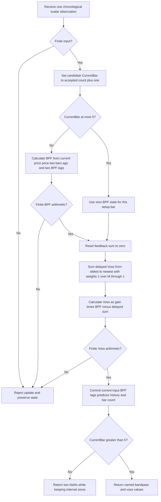

# Voss predictive filter (VPF)

This folder is the **research prototype master reference** for John F.
Ehlers' “A Peek Into The Future,” *Technical Analysis of Stocks & Commodities*,
August 2019. The streaming calculation is in `voss-predictive-filter.py`.
This document supplies the complete implemented equations, physical
interpretation, initialization, parameter contract, source differences,
numerical conventions, references, and fixture specification for ports to
Python, Go, TypeScript, Rust, and Zig.

The indicator first extracts a cyclic component with a two-pole bandpass
filter, then feeds that component to a multiple-delay negative-feedback
predictor. `update(value)` returns a named tuple,
`VossOutput(bandpass, voss)`, containing both curves plotted in the article.
Both outputs use the input's units; neither is normalized or bounded.
The default settings are `period=20`, `predict=3`, and `bandwidth=0.25`.

The predictor can lead cyclic turns of its **band-limited input**. Every
update uses only present and past observations. A lead relative to the
bandpass output does not establish an exact forecast of raw prices, an
exact `predict`-bar shift, or a profitable trading rule. The prerequisite
is useful signal content within the bandpass. A trend outside that passband
can make a cycle-based signal ineffective, as Ehlers' article illustrates.

## Sources and reference decisions

The authoritative recurrence is the matching article, Mesa paper, and
TradeStation indicator. TradeStation's supplied `.els` file also contains
a strategy; only the indicator calculation is implemented. The optional
`bandwidth` parameter follows the Excel Traders' Tip, which exposes the
article's fixed `Bandwidth(.25)` as a control. At `bandwidth=0.25`, this
master implements the primary source calculation.

The article cites Chapter 5, “Band-Pass Filters,” of Ehlers' *Cycle Analytics
for Traders*. That chapter is supplied elsewhere in this repository and was
read for this task. Its full mathematical material relevant to the cited
filter, including supplementary AGC/high-pass/cycle-measurement equations,
is included below. The chapter's additional processing stages are explicitly
distinguished from the simpler 2019 VPF cascade.

Henning U. Voss' 2017 paper is the theoretical reference named by the article.
Its full text is not supplied locally. The predictor frequency response,
delay, and stability derivations below are independently derived from the
supplied recurrence, rather than presented as quotations of an unseen paper.

The finite-record initialization is explicit: the first supplied observation
is source `CurrentBar=1`; all pre-start **recursive output state** is zero;
the first five bars force `Filt=0` and therefore `Voss=0`. The public API
returns NaN for those five setup bars, retaining the source's zeros internally.
The first available pair is input index 5, on the sixth accepted observation.
Do not defer the bandpass until `period` or predictor `order` observations
have accumulated. That would change every subsequent IIR output.

## Phase delay, group delay, and anticipatory coupling

### Delay definitions

Let $H(e^{i\omega})=A(\omega)e^{i\phi(\omega)}$ be a discrete filter's
frequency response. Frequency $f$ is in cycles per bar and angular frequency
$\omega=2\pi f$ is in radians per bar. A sinusoid of period $P_s$ has
$\omega=2\pi/P_s$. Unwrapped phase is required when differentiating it.

$$
\tau_{\rm phase}(\omega)=-\frac{\phi(\omega)}{\omega},\qquad
\tau_{\rm group}(\omega)=-\frac{d\phi(\omega)}{d\omega}.
$$

Phase delay describes the displacement of a sinusoidal carrier; group delay
describes the displacement of a narrow-band envelope and the local phase
slope. They agree for a pure delay or linear-phase filter, but need not agree
for an IIR predictor or bandpass.

The article's five-bar SMA example has exactly two bars of group delay:

$$
H_{\rm SMA5}(\omega)=\frac15\sum_{k=0}^{4}e^{-ik\omega}
=e^{-2i\omega}\frac{\sin(5\omega/2)}{5\sin(\omega/2)}.
$$

Away from response zeros and phase jumps, its delay is two bars. In the
low-frequency passband, those two bars give the article's phase examples:

$$
\theta_{\rm lag}=360^\circ\frac{2}{P_s},\qquad
P_s=20\Rightarrow36^\circ,\qquad P_s=10\Rightarrow72^\circ.
$$

For comparison, an EMA $y_t=\alpha x_t+(1-\alpha)y_{t-1}$, with
$r=1-\alpha$, has:

$$
H_{\rm EMA}(z)=\frac{\alpha}{1-rz^{-1}},\qquad
\tau_{\rm group,EMA}(\omega)=
\frac{r\cos\omega-r^2}{1-2r\cos\omega+r^2}.
$$

Its low-frequency group delay is $r/(1-r)$, and its Nyquist group delay is
$-r/(1+r)$. This makes precise the article's observation that an EMA's
delay varies across the spectrum. Frequency-dependent delays change the
relative phase relationships between components, distorting a broad-band
waveform.

### Physical interpretation

The bandpass resembles a damped resonator, such as an electronic resonant
circuit or a bell: it selects oscillations near its resonant frequency,
stores energy in its recursive state, and rings after excitation. A narrow
bandwidth raises selectivity but also prolongs ringing and adaptation time.
Wider bandwidth responds more quickly and passes more unwanted variation.

The Voss stage uses **anticipatory coupling**: weighted delayed copies of
its own output are subtracted from an amplified current bandpass input.
Within a suitable low-frequency band, the resulting phase response can
advance a smooth cyclic waveform. The feedback reshapes the response to
already observed information. It cannot reveal the onset of a wholly
unobserved event, and no future sample is read or written.

Increasing `predict` increases the number of feedback taps and potential
high-frequency amplification. Narrowing the preceding bandpass limits this
noise exposure while increasing that filter's lag. Ehlers therefore
recommends no more than three nominal bars of prediction. The bandwidth/
prediction tradeoff cannot be removed by treating the predictor as a
literal future-price oracle.

## Complete implemented mathematics

Let $x_t$ be the chronological scalar input at zero-based index $t$.
Close is only the source variable name; any finite scalar series is valid.
Use only `INPUT_CLOSE` from the shared fixture. Retain the copied High,
Low, and Open arrays unchanged for shared dataset compatibility.

Write:

$$
P=\mathrm{period},\qquad p=\mathrm{predict},\qquad
B=\mathrm{bandwidth},\qquad M=\mathrm{Order}=3p.
$$

The paper calls Order approximately three times the desired prediction;
the implemented assignment is **exactly** $M=3p$.

### Constants, computed once

The source's degree-based coefficients are:

$$
F_1=\cos_{\rm degrees}\left(\frac{360}{P}\right),\qquad
G_1=\cos_{\rm degrees}\left(\frac{360B}{P}\right),\qquad
S_1=\frac1{G_1}-\sqrt{\frac1{G_1^2}-1}.
$$

Equivalently, put $\omega_0=2\pi/P$ and $\theta=2\pi B/P$:

$$
F_1=\cos\omega_0,\qquad G_1=\cos\theta,\qquad
S_1=\sec\theta-\sqrt{\sec^2\theta-1}.
$$

On the supported branch $0<\theta<\pi/2$, the square root is
$\tan\theta$, so:

$$
S_1=\sec\theta-\tan\theta
=\frac{1-\sin\theta}{\cos\theta}
=\tan\left(\frac\pi4-\frac\theta2\right),\qquad0<S_1<1.
$$

These equivalent forms help analysis. The reference calculates the original
$1/G_1-\sqrt{1/(G_1G_1)-1}$ expression to preserve source arithmetic.
EasyLanguage Cosine accepts degrees; Python `math.cos` accepts radians.
The master calculates the degree expressions then converts with
`math.radians`, using full-precision $\pi$.

### Two-pole bandpass

For $t\ge5$, the source recurrence is:

$$
F_t=\frac12(1-S_1)(x_t-x_{t-2})
+F_1(1+S_1)F_{t-1}-S_1F_{t-2}.
$$

The input difference spans **two bars**. The state initial conditions and
five-bar override are:

$$
F_t=0\quad\text{for }t<0,\qquad
F_t=0\quad\text{for }t=0,1,2,3,4.
$$

Missing initial prices are never invented. The primary article computes
then overrides the expression; the TradeStation tip branches around it
while `CurrentBar<=5`. The master uses the latter equivalent behavior,
which avoids accessing an unavailable $x_{t-2}$ on the first two inputs.

After setup, the transfer function is:

$$
H_{\rm BP}(z)=
\frac{\frac12(1-S_1)(1-z^{-2})}
{1-F_1(1+S_1)z^{-1}+S_1z^{-2}}.
$$

It has zeros at $z=1$ (DC, a constant input) and $z=-1$ (Nyquist, an
alternating-bar input). The two denominator poles give the two recursive
states. For $|F_1|<1$ and $0<S_1<1$, the Jury stability inequalities are:

$$
1-S_1>0,\qquad
1-F_1(1+S_1)+S_1=(1+S_1)(1-F_1)>0,\qquad
1+F_1(1+S_1)+S_1=(1+S_1)(1+F_1)>0.
$$

At its precisely tuned center frequency, the bandpass has unity gain and
zero phase shift:

$$
H_{\rm BP}(e^{i\omega_0})=1.
$$

Zero phase at that one frequency does **not** imply zero group delay. Its
center-frequency phase slope gives:

$$
\tau_{\rm group,BP}(\omega_0)=\frac{1+S_1}{1-S_1}
=\cot\left(\frac\theta2\right)
=\cot\left(\frac{\pi B}{P}\right).
$$

For $P=20$, $B=0.25$, this is approximately 25.4517 bars. A steady
20-bar sinusoid is in phase after transients, but its changing envelope is
delayed. This distinction is essential when interpreting “no lag” at exact
tuning versus delayed reactions to a newly appearing cycle.

### Voss predictor

The source accumulation visits **oldest delayed predictor first**:

$$
C_t=\sum_{c=0}^{M-1}\frac{c+1}{M}V_{t-(M-c)},\qquad
V_t=\frac{M+3}{2}F_t-C_t.
$$

In lag notation $k=M-c$, the same feedback sum is:

$$
C_t=\sum_{k=1}^{M}a_kV_{t-k},\qquad
a_k=\frac{M-k+1}{M}.
$$

Thus, the newest lag $V_{t-1}$ has weight 1, and the oldest lag
$V_{t-M}$ has weight $1/M$. Do not reverse those coefficients.
Do not shift the current $V_t$ into history before calculating $C_t$.
Initialize $V_t=0$ for all pre-start recursive indexes $t<0$. Since the
first five $F_t$ values are zero, their computed predictor values are also
zero. These state seeds remain zero even if $M$ exceeds five.

At the first active input, $t=5$:

$$
F_5=\frac12(1-S_1)(x_5-x_3),\qquad
V_5=\frac{M+3}{2}F_5.
$$

For the default $M=9$, the feedback equation can be written explicitly as:

$$
V_t=6F_t-
\left(\frac19V_{t-9}+\frac29V_{t-8}+\frac39V_{t-7}
+\frac49V_{t-6}+\frac59V_{t-5}+\frac69V_{t-4}
+\frac79V_{t-3}+\frac89V_{t-2}+V_{t-1}\right).
$$

This recursive output is not a finite-window polynomial extrapolation of
raw Close, not an FIR of the last $M$ input prices, and not a calendar
timestamp shift. Recursive memory persists beyond the stored lag buffer.

### Predictor frequency response and delay

For $M>0$, the independently derived transfer response from $F$ to $V$ is:

$$
H_V(z)=\frac{(M+3)/2}{D_M(z)},\qquad
D_M(z)=1+\sum_{k=1}^{M}\frac{M-k+1}{M}z^{-k}.
$$

The overall post-setup response is the cascade:

$$
H_{\rm total}(z)=H_{\rm BP}(z)H_V(z).
$$

At zero frequency the denominator equals the numerator, so predictor DC
gain is unity for every positive order:

$$
D_M(1)=1+\frac{M+1}{2}=\frac{M+3}{2},\qquad H_V(1)=1.
$$

The first moment of its delayed denominator coefficients is:

$$
\sum_{k=1}^{M}k\,a_k=\frac{(M+1)(M+2)}6.
$$

It follows that the low-frequency group delay is negative:

$$
\tau_{\rm group,V}(0)
=-\frac{(M+1)(M+2)}{3(M+3)}.
$$

For large $M$, the magnitude approaches $M/3$, explaining the approximate
$M=3p$ relationship. For the default $M=9$, the low-frequency group delay
is $-110/36\approx-3.05556$ bars. It varies with frequency and is not
exactly $-p$ throughout the passband.

At $P=20$, $p=3$, $B=0.25$, evaluated at the 20-bar center sinusoid:

| Quantity | Value, approximately |
|---|---:|
| Bandpass gain / phase | 1 / $0^\circ$ |
| Predictor gain | 1.3527523362 |
| Predictor phase lead | $52.2629543364^\circ$ |
| Predictor phase lead expressed in bars | 2.9034974631 |
| Predictor group delay | $-2.55563698$ bars |
| Bandpass group delay | 25.45169958 bars |
| Cascade group delay | 22.89606260 bars |

The predictor leads the bandpass carrier while the cascade still delays a
changing narrow-band envelope. Group delays add in a cascade wherever the
frequency responses are nonzero. High-frequency predictor amplification
can be large; the bandpass's Nyquist zero does not imply all nearby noise
is harmless.

### Predictor stability and the zero-order extension

For positive supported predictions, $M=3p\ge3$. The predictor's
characteristic polynomial is:

$$
Q_M(z)=z^M+z^{M-1}+\frac{M-1}{M}z^{M-2}+\cdots+\frac1M.
$$

Multiplying by $z-1$ gives a useful stability identity:

$$
(z-1)Q_M(z)=z^{M+1}-\frac1M\sum_{k=0}^{M-1}z^k.
$$

If a root of $Q_M$ had modulus $r>1$, the triangle inequality would imply
$r^{M+1}\le r^{M-1}$, a contradiction. On the unit circle, equality
requires the terms $1,z,\ldots,z^{M-1}$ to have the same direction; for
$M>1$ that forces $z=1$, where $Q_M(1)=(M+3)/2\ne0$. Thus all
predictor poles lie strictly inside the unit circle for $M\ge3$.
Stability does not remove potentially large transient or high-frequency
gain, and very large orders can require long settling times.

The master accepts `predict=0` as a documented boundary extension. Its
feedback loop is empty, so no division by zero occurs and the original
gain formula remains:

$$
M=0\Rightarrow C_t=0,\qquad V_t=\frac32F_t.
$$

This is **not** an identity or bypass predictor. Some platform languages
handle reversed loop bounds differently, so this explicit empty-loop
contract is part of the portable master rather than a claim about every
commercial runtime's zero-prediction behavior.

## Configuration and availability contract

| Parameter or property | Meaning and valid values |
|---|---|
| `period` ($P$) | Integer $P\ge3$, default 20, center wavelength in bars. Values 1 and 2 lie at degenerate sampled frequencies and are rejected. |
| `predict` ($p$) | Integer $p\ge0$, default 3; 1–3 recommended by the article. Zero is the explicit empty-loop extension. Larger values are accepted for research. |
| `bandwidth` ($B$) | Finite fraction with $0<B<P/4$, default 0.25. Typical fractions are 0.1–0.7; the upper inequality keeps $0<2\pi B/P<\pi/2$ on the stable principal branch. |
| Resolvable coefficients | Constructor additionally requires computed $0<S_1<1$ and $-1<F_1<1$. Numerically collapsed coefficients from extreme parameters are rejected. |
| `order` | Read-only $M=3p$. No separate independently configurable order. |
| Input | One finite, float-convertible scalar per completed chronological bar; zero and negative inputs are valid. |
| Output | `VossOutput(bandpass, voss)`; both values are in input units, with no output clamp or AGC. |
| `warmup_bars` | Exactly 5. Input indexes 0 through 4 return two NaNs. |
| `is_primed` | True after 6 accepted observations. This means available under the source initialization, not fully settled. |
| `reset()` | Restore zero BPF/predictor state, discard input history, and restart the five-bar gate. |
| Rejected update | Nonfinite input or arithmetic overflow raises `ValueError` before committing any state. No silent gap fill. |

Booleans are rejected as configuration values. Parameter values are
read-only after construction; create a new instance to change them.
There is no arbitrary maximum period or prediction order, but memory and
time are $O(3p)$ and long-period/narrow-band filters can settle slowly.

The article's `Bandwidth(.25)` is a fixed variable, not a third original
user input. Exposing it changes configuration only; the same equations
apply. Its coefficient-domain upper bound is not a recommendation to use
huge fractional bandwidths in trading.

All twenty confirmed cases return 5 NaNs and 247 available values per component
on the 252-price record. `period=252` still has available results: period is
a frequency parameter of an IIR filter, not a requested finite history length.
Similarly, `order` initializes recursive state and does not set the warmup
duration. Period 252 produces a long initialization transient that the short
record does not eliminate.

## Algorithm flow and porting map



The constructor computes constants and feedback weights once. At update
entry `_prices[0]` is `Close[1]` and `_prices[1]` is `Close[2]`;
the current Close is the supplied argument. `_filt1` and `_filt2` are the
preceding two BPF outputs. `_voss_history[0]` is `Voss[1]`, so the source
`Voss[Order-count]` maps to `_voss_history[Order-count-1]`.

The oldest-first feedback order is intentionally preserved. A port can use
a ring buffer instead of a list as long as the lag mapping and summation
order remain the same. Compute both current outputs locally, validate them,
then move them into history. One `update` consumes one observation; there
is no intrabar replacement, resampling, future indexing, or batch dependency.

### Complete primary-source listing

This is the mathematical calculation from the article and Mesa paper.
The TradeStation tip uses the equivalent explicit startup branch.

```easylanguage
Inputs:
  Period(20),
  Predict(3);

Vars:
  Order(0),
  F1(0), G1(0), S1(0), Bandwidth(.25),
  count(0), SumC(0), Filt(0), Voss(0);

If CurrentBar = 1 Then Begin
  Order = 3*Predict;
  F1 = Cosine(360 / Period);
  G1 = Cosine(Bandwidth*360 / Period);
  S1 = 1 / G1 - SquareRoot(1 / (G1*G1) - 1);
End;

Filt = .5*(1 - S1)*(Close - Close[2])
       + F1*(1 + S1)*Filt[1] - S1*Filt[2];
If CurrentBar <= 5 Then Filt = 0;

SumC = 0;
For count = 0 to Order - 1 Begin
  SumC = SumC + ((count + 1) / Order)*Voss[Order - count];
End;
Voss = ((3 + Order) / 2)*Filt - SumC;

Plot1(Filt);
Plot2(Voss);
```

## Mathematical background from the supplied book chapter

The following preserves the chapter's mathematical material so future
readers need not access it. Supplementary equations belong to Chapter 5's
full indicator and period-measurement examples; the implemented VPF only
uses the bare two-pole bandpass, followed by Voss feedback. Typography and
transcription issues are called out because copying them into code would
change the indicator.

### Chapter 5 transfer response and difference equation

The local chapter transcription prints this expression under Equation 5-1:

$$
H(z)=\frac{1-\sigma z^{-1}}
{(1-\gamma z^{-1})(1-\gamma z^{-2})}.
\tag{5-1, first transcribed expression}
$$

It next prints:

$$
\gamma=\cos_{\rm degrees}(360/\mathrm{Period}),\qquad
\delta=\text{bandwidth as a fraction of Period},\qquad
\lambda=\cos_{\rm degrees}(360/\mathrm{Period}).
$$

That first expression is inconsistent with the chapter's subsequent
two-pole bandpass equation and executable listing: its denominator is
third degree after expansion, and the listed symbols do not fully define
$\sigma$. Preserve it as source transcription, not as an alternative
implementation formula. The subsequent printed response is the consistent
two-pole expression:

$$
H(z)=\frac{0.5(1-\sigma)(1-z^{-2})}
{1-\lambda(1+\sigma)z^{-1}+\sigma z^{-2}}.
$$

Its code supplies the missing consistent definitions, in degree notation:

$$
\lambda=\cos_{\rm degrees}(360/P),\qquad
\gamma_1=\frac1{\cos_{\rm degrees}(360B/P)},\qquad
\sigma=\gamma_1-\sqrt{\gamma_1^2-1}.
$$

Thus $\lambda=F_1$, $\sigma=S_1$ in the 2019 article. The chapter's
Equation 5-2 reads:

$$
\mathrm{Output}_t=0.5(1-\sigma)
(\mathrm{Input}_t-\mathrm{Input}_{t-2})
+\lambda(1+\sigma)\mathrm{Output}_{t-1}
-\sigma\mathrm{Output}_{t-2}.
\tag{5-2}
$$

The chapter illustrates a bandpass tuned to a ten-bar cycle with 30%
bandwidth, and a 20-bar filter applied to cycles ranging from 10 to 60 bars.
A precisely matched static sine has unity gain and zero phase shift after
transients. The chapter's 17/20/23-bar examples illustrate how tuning
mismatch produces phase changes; source prose and some captions reverse
which tuning is “too long.” Use the actual frequency response to determine
the sign: an input below the tuned center frequency leads, and one above
it lags for this recurrence. This statement describes the bare BPF, not
the additional Voss stage.

The supplied chapter also prints a chirp construction with counter $n$:

$$
\mathrm{PhaseRate}_n\approx0.1-0.000075n,\qquad
x_n=60+5\sin\left(6.28318(0.1-0.000075n)\right).
$$

The second printed formula uses the frequency expression directly as phase;
it does not accumulate it and therefore does not generate the described
oscillatory chirp. A consistent discrete chirp uses
$\varphi_n=\varphi_{n-1}+2\pi\mathrm{PhaseRate}_n$ and
$x_n=60+5\sin\varphi_n$. These background examples do not supply the
reference inputs for this folder; the mandated INPUT_CLOSE record does.

### Quality factor and ringing

The chapter's percentage-bandwidth approximation is $Q\approx1/B$.
For its 30% example:

$$
Q\approx\frac1{0.30}=3.33,\qquad
Q=\frac{20}{23-17}=\frac{20}{6}=3.33.
$$

The latter expresses a period-domain bandwidth approximation; precise
selectivity is normally measured in frequency. Its physical definition is:

$$
Q=2\pi\frac{\mathrm{Energy\ Stored}}
{\mathrm{Energy\ Dissipated\ per\ Cycle}}.
\tag{5-3}
$$

A high-$Q$ bell rings for a long time: good frequency selectivity comes
with slow time response. The chapter compares $Q=3.33$, $Q=10$, and
$Q=2$, recommending a roughly 30% bandwidth compromise for its examples.
The VPF article instead uses a 25% bandwidth coefficient and emphasizes
the extra predictor noise-versus-bandwidth tradeoff.

### Automatic gain control equations

The chapter describes fast-attack/slow-decay AGC, with decay $K$ and peak
normalizer $A_t$:

$$
A_t=\max(KA_{t-1},|BP_t|),\qquad
\mathrm{Signal}_t=\frac{BP_t}{A_t}\quad\text{when }A_t\ne0.
$$

On the chapter's code's zero-denominator branch, Signal retains its seeded
or preceding value. Between new peaks, the normalizer decays as
$K,K^2,K^3,\ldots$. The chapter's gain-slope discussion states:

$$
\mathrm{Gain}=K^{P/2},\qquad
\mathrm{Ratio}=\frac{K^{24}}{K^5}=K^{24-5}=K^{19}.
$$

It chooses a 1.5 dB amplitude ratio over ten- to 48-bar periods:

$$
-1.5=20\log_{10}(\mathrm{Ratio}),\qquad
\mathrm{Ratio}=10^{-1.5/20}\approx0.841.
$$

The supplied transcription additionally prints $10^{-0.75}$ in that
derivation. The exponent must be $-0.075$ to produce 0.841. Continuing
with the intended ratio:

$$
K^{19}=0.841,\qquad K=0.841^{1/19}\approx0.991.
$$

That is why the chapter uses `.991` in its AGC listings. The VPF article
does **not** use this AGC; its outputs can exceed $\pm1$.

### Spectral-dilation high-pass and leading trigger

The chapter warns that the raw price spectrum can emphasize longer cycles,
which the bare BPF's approximately 6 dB/octave reject-band slopes may not
fully remove. Its full indicator adds a single-pole high-pass before the
BPF. In radian notation, for angle $a$:

$$
\alpha_{\rm HP}(a)=\frac{\cos a+\sin a-1}{\cos a},\qquad
HP_t=\left(1+\frac{\alpha_2}{2}\right)(x_t-x_{t-1})
+(1-\alpha_2)HP_{t-1},\qquad
a=\frac{2\pi(0.25B)}{P}.
$$

This exactly preserves the chapter listing's $1+\alpha_2/2$ coefficient;
do not assume a different standard high-pass normalization. Its full BPF
then substitutes $HP$ for the raw input:

$$
BP_t=0.5(1-\alpha_1)(HP_t-HP_{t-2})
+\beta_1(1+\alpha_1)BP_{t-1}-\alpha_1BP_{t-2},
$$

$$
\beta_1=\cos(2\pi/P),\qquad
\gamma_1=1/\cos(2\pi B/P),\qquad
\alpha_1=\gamma_1-\sqrt{\gamma_1^2-1}.
$$

The chapter forces $BP=0$ on its first two source bars, applies AGC, and
optionally makes a leading trigger with a second high-pass:

$$
\alpha_T=\alpha_{\rm HP}\left(\frac{2\pi(1.5B)}{P}\right),\qquad
T_t=\left(1+\frac{\alpha_T}{2}\right)
(\mathrm{Signal}_t-\mathrm{Signal}_{t-1})
+(1-\alpha_T)T_{t-1}.
$$

The chapter prose describes setting the preliminary high-pass one octave
below the lower half-bandwidth edge; the unambiguous executable tuning
factors are `0.25*Bandwidth` for the preliminary high-pass and
`1.5*Bandwidth` for the trigger. Neither high-pass, normalization, nor the
chapter's two-bar override belongs in the 2019 VPF implementation, whose
five-bar override and raw Close difference are retained.

### Dominant period by zero crossings

The chapter's separate zero-crossing example widens bandwidth to 0.70,
approximately an octave around a 20-bar center: its period-domain example
is $20\pm7$, or 13–27 bars. It counts bars $c$ since the last zero
crossing and estimates a full cycle as twice the half-cycle spacing:

$$
DC_{\rm raw}=2c.
$$

Its complete measurement update retains the preceding $DC$ between
crossings, floors the working value to six, and resets the counter at a
crossing. At a crossing, the code sequentially assigns:

$$
DC\leftarrow2c;\qquad
\text{if }2c>1.25DC_{t-1},\ DC\leftarrow1.25DC_{t-1};\qquad
\text{if }2c<0.8DC_{t-1},\ DC\leftarrow0.8DC_{t-1};\qquad c\leftarrow0.
$$

The code multiplies Peak by `.991`, replaces it when the absolute BPF
exceeds it, and sets $\mathrm{Real}=BP/\mathrm{Peak}$ when nonzero before
testing crossings. Its prose describes limiting measurement changes to
about 25%; the actual implemented multipliers are 1.25 and 0.8.
This is background period estimation, not an adaptive step in VPF.

## Differences among the supplied implementations

| Supplied implementation | Relationship to this master |
|---|---|
| Article / Mesa | Canonical coefficients, zero initial variables, first five one-based bars forced to zero, full oldest-to-newest Voss feedback. |
| TradeStation `.els` indicator | Same recurrence, explicit `CurrentBar>5` branch, once-only coefficient initialization. The file's second half is a strategy, outside this master. |
| NinjaTrader | Uses zero-based `CurrentBar<Order` as its early return, making startup depend on prediction. Default begins calculation at index 9 rather than index 5, so its subsequent histories differ. |
| eSignal | Waits until current count reaches both `Periods` and `3*Predict` before initializing/running BPF; therefore uses different startup. The delayed predictor indexing matches its shifted array convention. |
| TradersStudio | Same coefficients/feedback but omits the explicit first-five-bar BPF zero override; platform prehistory determines its startup. |
| Excel | Makes Bandwidth configurable; the master adopts that configuration extension, while retaining the article's recurrence and seeds. The workbook is not the calculation oracle. |
| Wealth-Lab / Quantacula | Supplied C# calls a proprietary/library `VossPredictor`; its actual implementation is not included. Strategy conditions and ADX/Lowest filters are not part of VPF. |
| NeuroShell | Tip describes calling an external DLL; no independent recurrence implementation is supplied. |

These platforms need not agree on initial bars because they choose different
computation gates or load different prehistory. This master defines its own
zero-seeded finite record from the article/TradeStation initialization and
masks the five setup outputs as requested. Commercial plot defaults on
suppressed bars are not treated as expected reference NaNs.

## Floating-point and fixture rules

Use IEEE 754 binary64 throughout. Source divisions involving period,
order, weights, and gain must be floating point. Compute `F1` and `G1`
from their degree expressions, convert to radians, and retain the original
`1/(G1*G1)` square-root form. Preserve multiplication/addition order in the
two-pole recurrence and sequentially sum feedback oldest to newest.

Do not replace the recurrence with a rolling-sum optimization, reorder
feedback, use compensated summation, apply an extra high-pass or AGC,
normalize amplitudes, clamp output, change the source startup, or round the
state on each bar. These choices can produce a different reference output.
The expression $2\pi/P$ is mathematically equivalent to degree conversion,
but operation order can change a last bit.

Different language cosine implementations can differ at roundoff. Recommended
indicator-output comparison is $5\times10^{-13}$ absolute plus
$5\times10^{-13}$ relative for ordinary fixture values. Near cancellations,
an absolute allowance is essential. NaN positions must match exactly and be
tested with the language's NaN predicate. The master has exact binary64
agreement with the separate evaluator using the same Python math runtime;
this does not claim live TradeStation execution or cross-runtime trig-bit
identity.

Finite expected values are serialized with **15 significant digits**
(`.15g`), adding `.0` when needed for float-literal syntax. This is not
fifteen decimal places. Formatting occurs only after the streaming calculation,
and formatted output never feeds back into state. NaNs only mark availability
in the public outputs and generated fixtures.

## Confirmed reference cases

Twenty selected parameter triples cover ordinary tuning, bandwidth effects,
and a few explicit research/boundary behaviors without a large Cartesian
product. The majority use the canonical 0.25 bandwidth. The twenty
combinations were confirmed by the user on 2026-10-19 and are below the
requested maximum of 64. Each generates two 252-value scalar arrays, BPF
and VOSS, for 40 expected arrays and 10,080 expected values per language.
Every component has 5 NaNs followed by 247 finite values.

| Period | Predict | Bandwidth | What it tests |
|---:|---:|---:|---|
| 20 | 3 | 0.25 | Article, Mesa and TradeStation defaults. |
| 20 | 1 | 0.25 | One-bar nominal prediction at the default center period. |
| 20 | 2 | 0.25 | Two-bar nominal prediction at the default center period. |
| 10 | 1 | 0.25 | Fast ten-bar cycle with short predictor feedback. |
| 10 | 3 | 0.25 | Fast ten-bar cycle with the recommended maximum prediction. |
| 14 | 1 | 0.25 | Intermediate cycle period with one-bar nominal prediction. |
| 14 | 3 | 0.25 | Intermediate cycle period with nine delayed feedback taps. |
| 30 | 1 | 0.25 | Slower thirty-bar cycle with short predictor feedback. |
| 30 | 3 | 0.25 | Slower thirty-bar cycle with the default predictor order. |
| 48 | 1 | 0.25 | Long cycle near the book's cycle/trend boundary. |
| 48 | 3 | 0.25 | Long cycle with stronger anticipatory feedback. |
| 3 | 1 | 0.25 | Minimum supported integer period near the Nyquist limit. |
| 20 | 3 | 0.1 | Narrow bandwidth with longer bandpass ringing and startup transient. |
| 20 | 3 | 0.5 | Wide bandwidth with faster bandpass response. |
| 20 | 3 | 0.7 | Very wide bandwidth and greater high-frequency predictor exposure. |
| 20 | 0 | 0.25 | Zero-order extension; empty feedback loop and source gain of 1.5. |
| 20 | 4 | 0.25 | Research prediction beyond the recommended three-bar limit. |
| 20 | 8 | 0.25 | Long research predictor with twenty-four delayed feedback taps. |
| 126 | 3 | 0.25 | Half-record center period with a slowly settling bandpass. |
| 252 | 3 | 0.25 | Full-record center period; five-bar setup still permits outputs. |

Each array's first comment is the table's exact “What it tests” text.
The second comment is `period=P, predict=p, bandwidth=B`, copied identically
to every language. The output component is encoded in the array name.
Name shortcuts are `P` for period, `PR` for predict, and `B` for bandwidth.
Replace decimal dots by underscores, and append `_BPF` or `_VOSS` to keep
the two scalar reference outputs distinct.

| Language | Default bandpass / predictor declaration |
|---|---|
| Python | `EXPECTED_P20_PR3_B0_25_BPF = [...]`; `EXPECTED_P20_PR3_B0_25_VOSS = [...]`; `math.nan` |
| Go | `var expectedP20_PR3_B0_25_BPF = []float64{...}` and `_VOSS`; package `vosspredictivefilter`; import `math`; `math.NaN()` |
| TypeScript | `export const expectedP20_PR3_B0_25_BPF: number[] = [...]` and `_VOSS`; `NaN` |
| Rust | `pub fn expected_p20_pr3_b0_25_bpf() -> Vec<f64>` and `_voss()` inside original `testdata` module; `f64::NAN` |
| Zig | `pub fn expectedP20_PR3_B0_25_BPF() [252]f64` and `_VOSS()` with `return .{...};`; `nan` |

These use valid native language syntax, including Rust's double colon and
Go's `math.NaN()` capitalization. Zig retains
`const math = @import("std").math;` and `const nan = math.nan(f64);` at
the top. Rust output functions remain inside the copied `#[cfg(test)] pub
mod testdata` with its input functions.

The generator first writes Python expected arrays, reopens that file,
and verifies names, counts, precision, NaN masks, and unchanged input arrays.
Only then does it export the parsed Python values to the four other languages.
Begin/end markers support deterministic regeneration without duplicated
outputs or changes to the copied input declarations.

## Running and validation

From this folder, run the embedded-input example and tests:

```sh
python3 voss-predictive-filter.py
python3 -m unittest discover -p 'test_voss_predictive_filter.py' -v
```

Regenerate all twenty confirmed combinations in all five fixtures with:

```sh
python3 voss-predictive-filter.py --generate-reference-data
```

All **14 Python checks pass**, with no skipped tests. Source validation
independently extracts the supplied TradeStation coefficients and recurrence
expressions and evaluates them
against chronological batch histories with zero seeds. All twenty confirmed
cases match exactly in binary64 for both components. Additional checks cover
the five-bar gate, large-order seeds, two-bar input difference, feedback lag
direction, empty-loop gain, BPF independence from prediction, constant input,
translation/scaling/reflection, reset, rejected updates, and causal replay.

Analytical validation compares settled sinusoids at several wavelengths
against the independent complex transfer response, verifies low-frequency
predictor delay and gain, checks positive BPF group delay at resonance, and
confirms impulse decay across all confirmed cases. Tests use no third-party
Python packages and do not require commercial trading software.

The fixture tests check both arrays per case, exact NaN counts, comments,
preserved input arrays, identical native
language numeric values, and byte-for-byte repeatable regeneration in a
temporary directory. These are output-data checks, not implementations of
the indicator in the target languages.

Native fixture checks also pass with Go 1.27.1, Rust 1.98.1 (2021 edition),
Zig 0.16.0, and Node 24.15.0 executing the TypeScript fixtures with native
type stripping. Each check loads all **44 arrays / 11,088 values**—four
input arrays and forty expected arrays—and compares them against the parsed
Python fixture. Finite values have identical binary64 bit patterns, and
unavailable values are NaN. These checks validate native fixture syntax and
serialized data; the indicator implementation remains the Python master.

For the default settings on the shared closes, the first available pair is:

```text
index 5: bandpass = -0.0177682344603214
         voss     = -0.106609406761928
```

The last pair, at index 251, is:

```text
bandpass = 0.964156253563274
voss     = 1.41761292510865
```

## References

1. John F. Ehlers, “A Peek Into The Future,” *Technical Analysis of Stocks &
   Commodities* 37(8), August 2019, pp. 9–11.
   [Article PDF](https://technical.traders.com/archive/article.asp?file=%5CV37%5CC08%5C894EHLE.pdf).
   Supplied [article text](../../tasc/2019-08-a-peek-into-the-future/content.md).
2. John F. Ehlers, “A Peek Into the Future,” Mesa Software paper, 2019.
   [PDF](https://www.mesasoftware.com/papers/A%20PEEK%20INTO%20THE%20FUTURE.pdf).
   Supplied [Mesa text](../../tasc/2019-08-a-peek-into-the-future/mesa/content.md).
3. *Stocks & Commodities*, “Traders' Tips: A Peek Into The Future,” August 2019.
   [Tips page](https://www.traders.com/Documentation/FEEDbk_docs/2019/08/TradersTips.html).
   Supplied [tips text](../../tasc/2019-08-a-peek-into-the-future/tips/tips.md),
   [TradeStation](../../tasc/2019-08-a-peek-into-the-future/tips/VPF.els),
   [TradersStudio](../../tasc/2019-08-a-peek-into-the-future/tips/VPF.trs),
   [NinjaTrader](../../tasc/2019-08-a-peek-into-the-future/tips/ninja-trader/VPF.cs),
   [eSignal](<../../tasc/2019-08-a-peek-into-the-future/tips/code/Voss Predictive Filter.efs>),
   [Excel workbook](../../tasc/2019-08-a-peek-into-the-future/tips/code/VossPredictor.xlsm),
   [Wealth-Lab strategy](../../tasc/2019-08-a-peek-into-the-future/tips/VPF-WealthLab.cs),
   and [Quantacula strategy](../../tasc/2019-08-a-peek-into-the-future/tips/VPF-Quantacula.cs).
4. John F. Ehlers, *Cycle Analytics for Traders: Advanced Technical Trading
   Concepts*, Wiley, 2013, Chapter 5, “Band-Pass Filters.”
   Supplied [chapter](../../2013-cycle-analytics-for-traders/ch5.md) and
   [book metadata](../../2013-cycle-analytics-for-traders/toc.md).
5. Henning U. Voss, “A universal negative group delay filter for the prediction
   of band-limited signals,” arXiv:1706.07326, 2017.
   [arXiv reference](https://arxiv.org/abs/1706.07326).
   Theoretical source cited by the primary papers; full text not supplied.

```bibtex
@article{ehlers2019peekFuture,
  author = {Ehlers, John F.},
  title = {A Peek Into The Future},
  journal = {Technical Analysis of Stocks \& Commodities},
  volume = {37},
  number = {8},
  pages = {9--11},
  year = {2019},
  month = aug,
  url = {https://technical.traders.com/archive/article.asp?file=%5CV37%5CC08%5C894EHLE.pdf}
}

@misc{ehlers2019peekFutureMesa,
  author = {Ehlers, John F.},
  title = {A Peek Into the Future},
  year = {2019},
  howpublished = {Mesa Software paper},
  url = {https://www.mesasoftware.com/papers/A%20PEEK%20INTO%20THE%20FUTURE.pdf}
}

@misc{tasc2019traderstips08,
  author = {{Technical Analysis of Stocks \& Commodities}},
  title = {Traders' Tips: A Peek Into The Future},
  year = {2019},
  month = aug,
  url = {https://www.traders.com/Documentation/FEEDbk_docs/2019/08/TradersTips.html},
  note = {TradeStation, eSignal, NinjaTrader, TradersStudio, Excel,
          Wealth-Lab, Quantacula, and other platform contributions}
}

@book{ehlers2013cycle,
  author = {Ehlers, John F.},
  title = {Cycle Analytics for Traders: Advanced Technical Trading Concepts},
  publisher = {Wiley},
  year = {2013},
  series = {Wiley Trading},
  isbn = {9781118728604},
  note = {Chapter 5, Band-Pass Filters; supplied locally}
}

@misc{voss2017negativeGroupDelay,
  author = {Voss, Henning U.},
  title = {A Universal Negative Group Delay Filter for the Prediction of Band-Limited Signals},
  year = {2017},
  eprint = {1706.07326},
  archivePrefix = {arXiv},
  url = {https://arxiv.org/abs/1706.07326},
  note = {Theoretical reference cited by Ehlers' supplied papers}
}
```
