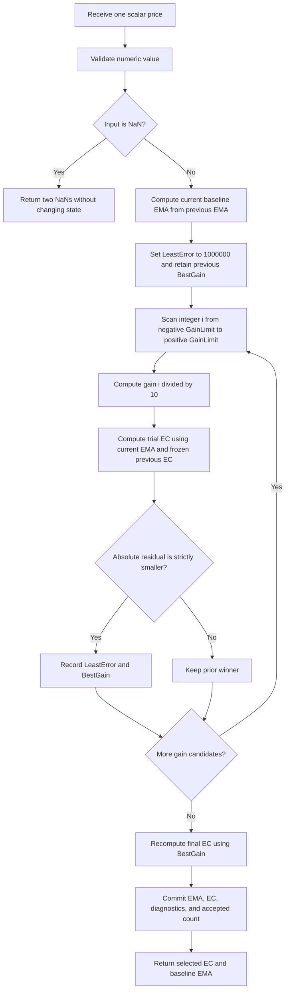

# Zero-Lag Error-Correcting Exponential Moving Average

This folder is the self-contained research prototype master for the indicator described by John F. Ehlers and Ric Way in **“Zero Lag (Well, Almost)”**, *Technical Analysis of STOCKS & COMMODITIES* (TASC), November 2010, volume 28, pages 30–35. It contains a causal streaming Python implementation, the complete mathematical specification, a comparison with the copied zpano implementation, and input/expected fixtures for Python, Go, TypeScript, Rust, and Zig.

The numerical authority is the article's **EasyLanguage code**, which is repeated in the MESA paper and TradeStation Traders' Tip. A consequential difference exists between the explanatory prose and the actual code: the prose introduces error correction applied directly to Price, while the complete code applies it to a **newly computed baseline EMA**. This master implements the complete code. At gain zero, its EC output is therefore **two cascaded EMAs**, not the single EMA described by the introductory equation.

The master returns both plotted source lines: `value` is the error-corrected line EC, and `ema` is the ordinary baseline EMA. `best_gain` and `least_error` are available as diagnostic properties. No trading strategy, timestamp framework, or additional filter is added.

## Purpose and physical interpretation

Every smoothing filter that combines current and past observations trades response speed for smoothing. A small EMA smoothing factor suppresses short-term fluctuations but keeps older information influential for longer. A larger factor responds more quickly while retaining more of the fluctuations. Removing all visible lag would amount to tracing the input price, with little smoothing left. The authors therefore seek a controlled reduction of lag rather than an unconditional promise of perfect zero lag.

Their method resembles a proportional feedback correction. The previous corrected output is compared with the current price, and a signed gain scales that discrepancy. A bounded search chooses the correction that makes the current corrected value as close as possible to the current observed price. Positive and negative gains are allowed because the prior corrected value and the baseline EMA can lie on different sides of price. The result is a leading line **relative to the slower baseline EMA**, not a forecast of an unobserved future price.

The authors explain smoothing through **impulse response**, a standard physical-engineering description of a system's reaction to a brief disturbance. A passive first-order response, such as charge decaying in an RC circuit, has exponential memory. An EMA has the corresponding discrete decay. Step inputs test how quickly a filter responds to a new level; finite bursts of sine waves test its response to oscillatory disturbances and transients. These are the article's engineering analogies, not additional data transforms.

The article illustrates a step and a three-cycle burst of 20-bar sine waves with `Length=12` and `GainLimit=50`. It reports faster EC response than EMA and no significant overshoot in those illustrations. That observation is not a universal stability theorem for every gain sequence or parameter choice. The master retains the literal bounded search instead of introducing a separate overshoot clamp.

## Notation, parameters, and output

Let $x_t$ be the scalar close/price at accepted observation $t=0,1,\ldots$. Let $m_t$ be the ordinary EMA and $c_t$ the selected error-corrected value EC. The source's `X[1]` means the value on the previous bar, $X_{t-1}$; it does not mean the preceding trial within a gain loop.

| Parameter | Default | Valid range | Meaning |
|---|---:|---|---|
| `length` ($L$) | 20 | Integer $L\ge1$, with representable stable EMA coefficients | Equivalent SMA length used to calculate alpha; no actual $L$-sample window is maintained. |
| `gain_limit` ($G$) | 50 | Nonnegative integer | Source `GainLimit` in **tenths**; actual gain candidates span $-G/10$ through $G/10$. |
| Input `price` ($x_t$) | Caller supplied | Finite real scalar or NaN to skip | References pass the 252 `INPUT_CLOSE` values. |

The source gain step is fixed at 0.1. It is **not** a separate configurable parameter in this article-faithful master. The natural zero-gain endpoint $G=0$ is supported, giving a one-candidate search. Boolean and non-integer settings are rejected. An extremely large length that rounds the EMA complement to one is rejected instead of accepting a numerically marginal coefficient. There is no arbitrary finite-window priming requirement based on length.

| Public field/property | Meaning |
|---|---|
| Output `value` | Selected EC, $c_t$, in price units. |
| Output `ema` | Baseline EMA, $m_t$, in price units. |
| `alpha` | Exact binary64 evaluation of $2/(L+1)$. |
| `best_gain` | Selected gain in actual gain units, e.g. 5.0 for source GainLimit 50. |
| `least_error` | The source search variable, usually $|x_t-c_t|$; retains its finite sentinel if no trial improves it. |
| `samples_seen` | Number of accepted finite observations. |
| `warmup_bars` | Zero: source recursion computes on the first accepted observation. |
| `is_primed` | True after at least one accepted observation. |
| `output` | Last accepted immutable `(value, ema)` tuple. |

Settings are exposed as an immutable `Parameters` tuple. To change settings, create a new stream. `reset()` restores the zero recursive states, zero internal BestGain, empty count, and NaN public output while preserving settings.

## Complete mathematical development from the articles

### Ordinary EMA and its memory

The article's EMA equation is

$$
\boxed{m_t=\alpha x_t+(1-\alpha)m_{t-1}.}
$$

Let $q=1-\alpha$. The coefficients sum to one, so a stable EMA's response to a constant input converges to that input rather than introducing a DC scale error. The smoothing factor and equivalent SMA length are related by

$$
\boxed{\alpha=\frac{2}{L+1},\qquad
L=\frac{2}{\alpha}-1.}
$$

The article credits Jack Hutson's 1984 discussion of moving averages and refers to Ehlers' *Rocket Science for Traders* for the lag derivation. The implementation uses the full rational expression. At $L=20$,

$$
\alpha=\frac{2}{21}=0.09523809523809523\ldots,
$$

which is not the copied implementation's default decimal `0.095`. The numbers 2 and 1 are exact structural constants. The listing contains no $\sqrt2$ or $\pi$ terms requiring replacements of `1.414` or `3.14159`; no truncated approximations are introduced into this master.

For initial state zero and a unit impulse $x_0=1$, $x_t=0$ for $t>0$, the impulse weights are

$$
h_m(t)=\alpha q^t,\qquad t\ge0.
$$

The article instead normalizes its impulse amplitude to $1/\alpha$, giving the sequence

$$
1,\quad q,\quad q^2,\quad q^3,\ldots.
$$

This geometric decay explains the name “exponential moving average.” For a constant input $x_t=P$ and zero seed,

$$
m_t=P(1-q^{t+1}).
$$

For $0<\alpha<1$, the decay time constant in bar units is $\tau=-1/\ln q$. The mean age of the impulse weights, and the low-frequency EMA lag, is

$$
\sum_{j=0}^{\infty}j\alpha q^j=\frac{q}{\alpha}
=\frac{L-1}{2}.
$$

These additional formulas follow directly from the source EMA equation and explain its physical memory. They are not separate algorithm stages.

### The conceptual error-correction equation in the prose

The article introduces an EMA discrepancy as

$$
\mathrm{Error}_t=x_t-m_{t-1}.
$$

It then writes a conceptual corrected recursion using the prior EC as the correction reference:

$$
\boxed{
c_t^{\mathrm{prose}}=\alpha\bigl[x_t+g_t(x_t-c_{t-1})\bigr]
+q c_{t-1}.
}
$$

For fixed gain $g$, this simplifies mathematically to

$$
c_t^{\mathrm{prose}}=\alpha(1+g)x_t+
\bigl[1-\alpha(1+g)\bigr]c_{t-1}.
$$

Thus the prose version is an EMA with effective factor $\alpha(1+g)$ when its gain is fixed. Gain zero reduces this conceptual equation to an ordinary EMA. This is the origin of the article's introductory explanation that gain zero produces an EMA and sufficiently large gain approaches direct tracking.

### The actual coded filter

Both complete EasyLanguage listings instead use **EMA** as the first argument inside the corrected expression. The implemented trial value is

$$
\boxed{
\widetilde c_t(g)=\alpha\bigl[m_t+g(x_t-c_{t-1})\bigr]+q c_{t-1},
}
$$

where $m_t$ is computed once at the start of the current bar. The error used by the optimizer is

$$
e_t(g)=x_t-\widetilde c_t(g),\qquad E_t(g)=|e_t(g)|.
$$

The two different notions of “error” in the narrative and the loop should not be confused. The correction input is $x_t-c_{t-1}$, while the search score is the absolute residual **after** computing a trial corrected value.

The baseline-update, correction, and scoring order is essential. Every trial uses the same $m_t$ and the same previous-bar $c_{t-1}$. No trial may feed the next trial, and the newly selected EC is not committed until the search is complete.

### Discrete gain search and strict ties

For the integer parameter $G$, the candidate grid is

$$
\mathcal G=\left\{\frac{i}{10}:i=-G,-G+1,\ldots,G\right\}.
$$

It includes both endpoints and contains $2G+1$ values. The source resets `LeastError` to 1,000,000 and scans the grid in ascending order. It replaces the winner only when a trial has **strictly smaller** absolute error:

$$
\ell\leftarrow1{,}000{,}000,
\qquad
\text{if }E_t(i/10)<\ell:\quad
\ell\leftarrow E_t(i/10),\quad g_t\leftarrow i/10.
$$

On equal errors, the first winning gain is retained. Thus an exact tie favors the earlier, more negative candidate. Do not change `<` to `<=`, add an epsilon comparison, or replace the source grid with a continuously optimized gain. BestGain is initially zero and persists across bars unless the current loop records an improvement.

After the loop, recompute the final selected output using BestGain:

$$
\boxed{c_t=\alpha\bigl[m_t+g_t(x_t-c_{t-1})\bigr]+q c_{t-1}.}
$$

Do not return the last trial merely because it is stored in the source's temporary `EC` variable during the loop. The final source statement intentionally recalculates EC with BestGain.

### Literal finite-sentinel behavior

The source resets LeastError to a finite sentinel, not positive infinity. If every candidate error is at least 1,000,000, no candidate wins; BestGain carries over from the previous accepted bar and LeastError remains exactly 1,000,000. The final EC still uses that retained gain. In this case, the diagnostic LeastError need not equal the actual residual of the selected output.

This master preserves that rule because the requested reference follows the original code. The supplied 252-price fixtures are far below this exceptional scale, but a dedicated behavioral test exercises it. Replacing the sentinel with infinity would improve the optimization domain while changing the source algorithm; that is what the copied zpano implementation does.

### The gain-zero consequence of the coded equation

At $g_t=0$, the actual code reduces to

$$
c_t=\alpha m_t+q c_{t-1},
$$

an EMA of the baseline EMA. In zero-initialized transfer-function notation,

$$
H_m(z)=\frac{\alpha}{1-qz^{-1}},\qquad
H_{c,g=0}(z)=H_m(z)^2.
$$

Its unit-impulse response is

$$
h_{c,g=0}(t)=(t+1)\alpha^2q^t,
$$

and its low-frequency lag is $2q/\alpha=L-1$ bars. This deliberate distinction is tested by the $L=20,G=0$ reference combination. Treating zero gain as equality between EC and EMA would reproduce the introductory prose rather than the complete code.

## Additional analysis of the implemented correction

For fixed $g$, the actual coded recursion can be written

$$
c_t=\alpha m_t+\alpha g x_t+
\bigl[q-\alpha g\bigr]c_{t-1}.
$$

Let $\rho=1-\alpha(1+g)=q-\alpha g$. Its fixed-gain transfer function is

$$
H_c(z)=\frac{\alpha H_m(z)+\alpha g}{1-\rho z^{-1}}
=\frac{\alpha^2+\alpha g(1-qz^{-1})}
{(1-qz^{-1})(1-\rho z^{-1})}.
$$

The baseline pole is $q$, and the correction pole is $\rho$. For the correction pole to be strictly stable,

$$
|\rho|<1
\quad\Longleftrightarrow\quad
-1<g<\frac2\alpha-1=L.
$$

The article's candidate set can include gains outside this **fixed-gain** interval. The per-bar optimizer does not enforce that bound; this master does not silently remove those candidates. The complete adaptive filter is not a single linear time-invariant system, and this pole analysis should not be misrepresented as a theorem for a changing gain sequence.

For $g\ne-1$, the formal constant-input gain is one after transients in the stable regime. At $g=-1$, the correction pole is one and the unity-gain argument degenerates; the preceding stability condition excludes that fixed-gain case. For a stable constant gain and a ramp input, the steady lag of the coded cascade is

$$
\lambda_c=\frac{2q-\alpha g}{\alpha(1+g)}.
$$

This becomes $2q/\alpha$ at gain zero and can become zero at $g=2q/\alpha=L-1$. A zero low-frequency ramp lag does not imply perfect tracking of every waveform. The actual indicator chooses discrete gains anew on every bar rather than holding this special gain fixed.

The current-bar trial is affine in gain. Define

$$
b_t=\alpha m_t+q c_{t-1},\qquad
a_t=\alpha(x_t-c_{t-1}),\qquad
\widetilde c_t(g)=b_t+a_tg.
$$

If $a_t\ne0$, the unconstrained gain that exactly matches the current price is

$$
g_t^*=\frac{x_t-b_t}{a_t}.
$$

The discrete optimization normally selects the allowed grid point nearest this value, after accounting for the limits and floating-point evaluation. If $a_t=0$, gain cannot alter the trial at all, so every gain has the same mathematical score. With an improving score below the sentinel, the strict ascending scan chooses the negative endpoint. These identities explain the search but **do not replace it** in the master: analytic rounding would risk changing ties, endpoints, evaluation order, and finite-sentinel behavior.

## Initialization, priming, and missing inputs

The EasyLanguage declarations initialize EMA, EC, and BestGain to zero. The article/TradeStation calculation has no initial-price seed, initial SMA, or three-observation priming branch. The master defines a deterministic cold start with $m_{-1}=c_{-1}=0$ and BestGain zero, then executes the complete recurrence on **every accepted finite observation**, beginning with $t=0$.

Both outputs are therefore available after one accepted observation, and all 252 values in each dense-input reference array are finite. There are **no leading warmup NaNs** for these source-faithful cases, including `length=252`. Length controls alpha, not a history-buffer requirement. Before the first observation, public outputs and diagnostics are NaN; internal recursive seeds are finite zeros.

This convention can produce a visible startup transient on a price series that begins far from zero. It is expected and differs from a first-price-seeded EMA. Chart platforms may run with prior bars through their history/MaxBarsBack machinery; matching an existing plotted chart requires matching that earlier state, not discarding or rewriting these explicit cold-start values.

A NaN input means an omitted observation: return a two-NaN tuple and freeze all recursive state, the accepted count, selected gain, error diagnostic, and saved output. Infinity, invalid numeric values, Boolean samples, and detected arithmetic overflow raise `ValueError` before state is committed. These validation conventions extend the article, which assumes dense finite prices. `reset()` restores the same cold start and leaves the immutable parameters unchanged.

The Go fixture keeps the requested `math` import even though its dense references have no NaN literals. A blank reference `var _ = math.NaN` keeps that import compilable and allows future unavailable/missing-output fixtures to use the standard NaN function. No artificial leading NaNs are inserted merely to make an import used.

## Source strategy interpretation

The authors propose comparing EC and EMA: EC above EMA suggests a bullish mode relative to the baseline, while EC below EMA suggests a bearish mode. Crossovers can supply long/short entries, but close lines during consolidation can generate whipsaws. Their strategy adds a normalized residual threshold:

$$
r_t=100\frac{\mathrm{LeastError}_t}{x_t},\qquad
r_t>\mathrm{Thresh}.
$$

The complete strategy enters long on an EC crossover above EMA and short on an EC crossover below EMA, only when the threshold also passes, with orders placed for the **next bar's open**. The source strategy defaults to Thresh 1 and illustrates MSFT with $L=32,G=22,\mathrm{Thresh}=0.75$. These parameters do not imply performance on other data or justify omitting the initialization specification.

Threshold is not an indicator parameter in this master because it does not alter EC or EMA. The residual normalization assumes the source's ordinary positive, nonzero close; callers handling zero or negative prices must define their own downstream interpretation. Strategy signals, order timing, alert dots, paint bars, and execution are not returned or generated as expectations.

## Comparison with the copied zpano implementation

The user-supplied code under `external/zpano/py/indicators/john_ehlers/zero_lag_error_correcting_exponential_moving_average/` was inspected statically. It was neither imported as a detached framework package nor modified.

| Aspect | Article / TradeStation | Copied zpano code | New master |
|---|---|---|---|
| Base correction expression | Uses new EMA inside EC | Also uses new EMA | Same as complete source code. |
| Default alpha | $2/21$ for Length 20 | Literal `0.095` | Exact expression $2/(L+1)$. |
| User smoothing setting | Integer equivalent SMA Length | Direct alpha; rounded length stored for metadata | Source Length parameter. |
| Gain-limit units | Integer tenths; default 50 means actual 5.0 | Actual-gain float; default 5.0 | Source integer tenths. |
| Gain step | Integer counter divided by 10 | Configurable repeated float addition | Source 0.1 grid computed from each integer. |
| Search endpoints | Both included | `while gain <= limit` can miss a rounded endpoint | Both included by integer range. |
| Tie rule | Strict `<`, first improvement wins | Strict improvement, also first winner | Same strict rule. |
| Error initializer | Finite 1,000,000 | Positive infinity | Source finite sentinel. |
| Initial EMA | Zero | First input price | Source zero state. |
| Initial EC | Zero, search runs on first observation | Set to EMA on second observation | Source zero state, search each accepted bar. |
| Public priming | No source warmup branch | First two outputs NaN; primes on third input | Available on first accepted input. |
| Winner result | Recompute with BestGain | Return saved best candidate | Mathematically same selection under equivalent state/grid; master keeps source statement order. |
| Plot/output count | EC and EMA | Only EC via framework line adapter | Tuple containing both source lines. |
| Missing inputs | Unspecified | NaN freezes numeric state | Two-NaN result and atomic whole-observation freeze. |
| Validation | Platform-specific | Positive settings checked, nonfinite cases not consistently rejected | Explicit integer/range/finite validation. |

The copied default alpha corresponds to a mathematical equivalent length

$$
L_{\mathrm{equiv}}=2/0.095-1=20.05263157894737\ldots,
$$

not exactly 20. Its factory rounds a derived length to 20, but that stored length does not change the filter's alpha or its fixed three-input priming. Setting direct alpha to $2/21$ would fix this one difference, while leaving the copied startup and gain grid distinct.

Repeated floating addition also matters independently of smoothing. For the copied default actual limit 5.0 and step 0.1, its loop visits 101 values but finishes at approximately `4.999999999999997`, rather than the source's separately calculated `5.0`. With actual limit 2.2, repeated addition visits only 44 values and ends near 2.1, whereas source GainLimit 22 visits 45 values and includes 2.2. A tiny grid drift can change exact ties, and losing an endpoint can materially change the winner.

The copied implementation's infinity initializer removes the source's large-error sentinel limitation. That is an intentional algorithmic difference rather than a generic arithmetic-equivalence change. Its price-based initialization also makes a constant input immediately stable once primed; the source's zero state yields an initial transient. Existing copied tests should therefore not be treated as expected values for this master.

Both implementations use **EMA**, not raw Price, in the corrected candidate. The copied code is aligned with the published code on that central point. Its entity adapters and metadata require the missing surrounding repository, but the framework does not affect this static numerical comparison.

## Other supplied Traders' Tips and numerical authority

The supplied TradeStation tip by Chris Imhof preserves the article's coefficient, baseline update, finite sentinel, candidate grid, strict tie test, and final BestGain recalculation. Its added chart controls, threshold alerts, dots, and paint bars do not change the two line calculations.

Other platform files are not interchangeable numerical oracles:

- **NinjaTrader `ZLagEMA.cs`:** the supplied code records BestGain but commits `currEC`, the **last trial**, without recomputing the selected best result. It also skips its first bar. Its optimizer diagnostics therefore do not establish that its plotted EC is the minimizing candidate. This master implements the article's missing final-selection statement.
- **AmiBroker:** the supplied file uses a floating gain loop with a strict upper endpoint, initializes from the first close, and stores BestEC in the plotted series while leaving the loop's final EC as feedback state for the next bar. Those choices change the source recurrence.
- **Wealth-Lab:** the archived file invokes the external TASCIndicators EC and LeastError classes but does not include their internal numerical implementations. It suggests letting the strategy stabilize before trading; that is not a definition of the source indicator's first computable result.
- **Other tips:** implementations and strategy examples for additional platforms have their own history, rendering, and execution conventions. The original article, MESA code, and matching TradeStation calculation resolve this master.

## Streaming flow and storage



Invalid inputs and detected arithmetic overflow raise before the commit step. Storage is $O(1)$: previous EMA, previous EC, BestGain, LeastError, count, and the output tuple. Time per bar is $O(2G+1)$. No batch history, future values, NumPy, pandas, external numerical library, or sibling master is used. A port should preserve normal binary64 evaluation order and avoid fused or algebraically reordered operations when matching the reference closely.

## Confirmed reference combinations

All 16 combinations were confirmed by the user on 2026-10-25. Each generates two arrays of 252 values, hence **32 expected arrays per language**. Each starts from fresh zero states and uses exactly the copied `INPUT_CLOSE` scalar values. High, low, and open input arrays remain available in the copied fixtures but are not used by this indicator.

| # | Length $L$ | GainLimit $G$ | What it tests |
|---|---:|---:|---|
| 1 | 20 | 50 | Article defaults with full-precision alpha=2/21. |
| 2 | 12 | 50 | Parameters used for the article's step and wave-burst demonstrations. |
| 3 | 32 | 22 | Parameters used for the article's MSFT example. |
| 4 | 20 | 0 | Zero gain: EC is a second EMA of the first EMA. |
| 5 | 20 | 1 | Minimal nonzero gain range, from -0.1 to +0.1. |
| 6 | 20 | 10 | Gain range from -1.0 to +1.0. |
| 7 | 20 | 22 | Reduced correction range, isolating gain-limit effects. |
| 8 | 20 | 100 | Wider correction range, from -10.0 to +10.0. |
| 9 | 1 | 50 | Alpha=1: EC and EMA track the input. |
| 10 | 2 | 50 | Very fast baseline EMA. |
| 11 | 5 | 50 | Short lookback and fast response. |
| 12 | 10 | 50 | Intermediate baseline smoothing. |
| 13 | 40 | 50 | Longer baseline smoothing. |
| 14 | 100 | 50 | Slow EMA and substantial startup transient. |
| 15 | 252 | 50 | Long nominal length; recursive outputs are still available from the first bar. |
| 16 | 20 | 49 | Non-round gain endpoint and inclusive search from -4.9 to +4.9. |

Before each expected array, the first comment copies the exact “What it tests” text from the table. The second lists both settings, fixed gain step, input convention, and initialization, for example:

```text
length=20, gain_limit=50; gain_step=0.1; input=INPUT_CLOSE; initialization=zeros
```

Names use `L` and `G` shortcuts followed by output suffix `EC` or `EMA`:

```text
EXPECTED_L20_G50_EC
EXPECTED_L20_G50_EMA
```

There are no fractional configuration parameters in this source interface. If added in a future variant, decimal points in names must become underscores. The source grid is fractional, but it is completely determined by the integer GainLimit.

Finite expected literals use **15 significant decimal digits**; integer-valued floats retain `.0` for Rust/Zig type correctness. Internal states are not rounded. Python expectations are reread from disk and become the canonical serialized values for the other languages. For conversions, compare NaN locations exactly and use both relative and absolute tolerances around $10^{-12}$ for finite results. Very close candidate scores can be sensitive to expression reordering, so preserving the source scan and arithmetic order is preferable to broadening tolerances indiscriminately.

| Language file | Example expected declaration | Unavailable-value spelling |
|---|---|---|
| `test_testdata.py` | `EXPECTED_L20_G50_EC = [...]` | `NaN`, with `NaN = math.nan` |
| `testdata_test.go` | `var expectedL20_G50_EC = []float64{...}` | `math.NaN()` |
| `testdata.ts` | `export const expectedL20_G50_EC: number[] = [...]` | `NaN` |
| `testdata.rs` | `pub fn expected_l20_g50_ec() -> Vec<f64>` | `f64::NAN` |
| `testdata.zig` | `pub fn expectedL20_G50_EC() [252]f64` | `nan` |

Go uses the separator-stripped lowercase package `zerolagerrorcorrectingexponentialmovingaverage`. Rust functions remain inside the copied `#[cfg(test)] pub mod testdata`. TypeScript uses valid exported typed arrays. Zig retains `const math = @import("std").math;` and `const nan = math.nan(f64);` and explicit `return .{...};` array functions.

## Running and verifying the master

Work in this folder and run:

```bash
python3 zero-lag-error-correcting-exponential-moving-average.py
python3 zero-lag-error-correcting-exponential-moving-average.py --generate-reference
python3 -m unittest discover -s . -p 'test_zero_lag_error_correcting_exponential_moving_average.py' -v
```

The master embeds all 252 shared close observations in `__main__`. Generation checks them against the copied Python input, runs each fresh stream, writes the 32 Python arrays, reopens the file to verify names, lengths, 15-digit values, and NaN masks, then exports the other four languages from those reopened arrays. Its marked generated blocks are replaced on repeated runs so data are not duplicated. All copied input arrays are preserved.

The tests compare against an independently written chronological translation of the complete source. Behavioral checks cover zero-state startup, full-precision alpha, inclusive gain endpoints, strict tie selection, frozen previous EC across trials, finite-sentinel carryover, zero-gain cascade impulse response, the alpha-one limit, NaN gaps, reset, and invalid observations. Fixture tests compare all inputs and expected values across the five languages, confirm comments, and check byte-identical regeneration. Native compiler/runtime checks instantiate every exported fixture array.

For a Python application, import the hyphenated filename by path:

```python
import importlib.util
from pathlib import Path

path = Path("zero-lag-error-correcting-exponential-moving-average.py")
spec = importlib.util.spec_from_file_location("zecema_master", path)
module = importlib.util.module_from_spec(spec)
spec.loader.exec_module(module)

zecema = module.ZeroLagErrorCorrectingExponentialMovingAverage(length=20, gain_limit=50)
for close in closes:
    result = zecema.update(close)
    # result.value is EC; result.ema is the baseline.
    # zecema.best_gain and zecema.least_error are current diagnostics.
```

## References

All numerical equations needed for conversion are included above. The following sources provide provenance and background:

1. **Ehlers, John F., and Ric Way (2010). “Zero Lag (Well, Almost).”** *Technical Analysis of STOCKS & COMMODITIES*, 28(11), 30–35, November. [Publisher article](https://technical.traders.com/archive/article.asp?file=%5CV28%5CC011%5C211EHLE.pdf). Local article: `../../tasc/2010-11-zero-lag-(well-almost)/content.md`.
2. **Ehlers, John F., and Ric Way (2010). “Zero Lag (well, almost).”** MESA Software paper. [PDF](https://www.mesasoftware.com/papers/ZeroLag.pdf). Local paper: `../../tasc/2010-11-zero-lag-(well-almost)/mesa/content.md`. Repeats both complete listings and the impulse-response development.
3. **Technical Analysis, Inc. (2010). “Traders' Tips: Zero Lag (Well, Almost).”** [Publisher page](https://www.traders.com/Documentation/FEEDbk_docs/2010/11/TradersTips.html). Local collection: `../../tasc/2010-11-zero-lag-(well-almost)/tips/tips.md`.
4. **Imhof, Chris (2010), TradeStation Securities. “ZeroLagEMAInd2.”** TradeStation contribution to the same tips. Local `../../tasc/2010-11-zero-lag-(well-almost)/tips/ZeroLag.els`. Preserves the article's numerical algorithm while adding presentation and alerts.
5. **NinjaTrader and AmiBroker contributions (2010).** Local `../../tasc/2010-11-zero-lag-(well-almost)/tips/ninja-trader/ZLagEMA.cs` and `../../tasc/2010-11-zero-lag-(well-almost)/tips/ZeroLag.afl`. Inspected for the documented final-trial feedback/selection differences, not adopted as numerical authorities.
6. **Copied zpano project source. “ZeroLagErrorCorrectingExponentialMovingAverage.”** User-supplied local [implementation](../../../../external/zpano/py/indicators/john_ehlers/zero_lag_error_correcting_exponential_moving_average/zero_lag_error_correcting_exponential_moving_average.py), [parameters](../../../../external/zpano/py/indicators/john_ehlers/zero_lag_error_correcting_exponential_moving_average/params.py), and [tests](../../../../external/zpano/py/indicators/john_ehlers/zero_lag_error_correcting_exponential_moving_average/test_zero_lag_error_correcting_exponential_moving_average.py). Statically compared; not a runtime dependency.
7. **Hutson, Jack (1984). “Filter Price Data: Moving Averages Vs. Exponential Moving Averages.”** *Technical Analysis of STOCKS & COMMODITIES*, 2(2). Named in the TASC article for the EMA/SMA lag relationship.
8. **Ehlers, John F. (2001). *Rocket Science for Traders*.** John Wiley & Sons. Cited by the article for the EMA lag derivation; no additional book-specific algorithm is inserted here.
9. **Chande, Tushar S., and Stanley Kroll (1994). *The New Technical Trader*.** John Wiley & Sons. Suggested adaptive-filter background in the article and MESA paper.
10. **Kaufman, Perry J. (1998/2005). *Trading Systems and Methods*, 3rd edition / *New Trading Systems and Methods*, 4th edition.** John Wiley & Sons. The MESA paper cites the earlier edition, pages 436–438; the TASC suggested-reading list names the 2005 edition.
11. **Jurik Research.** [Jurik Research](https://www.jurikres.com). Named in the MESA paper as related commercial lag-reducing filters; no proprietary Jurik calculation is used.

## BibTeX

```bibtex
@article{ehlers_way_zero_lag_2010,
  author = {John F. Ehlers and Ric Way},
  title = {Zero Lag (Well, Almost)},
  journal = {Technical Analysis of STOCKS \& COMMODITIES},
  volume = {28}, number = {11}, pages = {30--35},
  year = {2010}, month = nov,
  url = {https://technical.traders.com/archive/article.asp?file=%5CV28%5CC011%5C211EHLE.pdf}
}

@misc{ehlers_way_zero_lag_mesa_2010,
  author = {John F. Ehlers and Ric Way},
  title = {Zero Lag (well, almost)}, year = {2010},
  howpublished = {MESA Software paper},
  url = {https://www.mesasoftware.com/papers/ZeroLag.pdf}
}

@misc{traders_tips_zero_lag_2010,
  author = {{Technical Analysis, Inc.}},
  title = {Traders' Tips: Zero Lag (Well, Almost)},
  year = {2010}, month = nov,
  url = {https://www.traders.com/Documentation/FEEDbk_docs/2010/11/TradersTips.html},
  note = {Includes the inspected NinjaTrader, AmiBroker, and Wealth-Lab contributions}
}

@misc{imhof_tradestation_zero_lag_2010,
  author = {Chris Imhof}, title = {ZeroLagEMAInd2},
  organization = {TradeStation Securities, Inc.},
  year = {2010}, month = nov,
  howpublished = {Traders' Tips contribution; EasyLanguage source},
  url = {https://www.traders.com/Documentation/FEEDbk_docs/2010/11/TradersTips.html}
}

@misc{zpano_zecema_local,
  title = {ZeroLagErrorCorrectingExponentialMovingAverage: Copied zpano Implementation},
  howpublished = {User-supplied local source archive},
  note = {external/zpano/py/indicators/john\_ehlers/zero\_lag\_error\_correcting\_exponential\_moving\_average/; statically inspected}
}

@article{hutson_filter_price_data_1984,
  author = {Jack Hutson},
  title = {Filter Price Data: Moving Averages Vs. Exponential Moving Averages},
  journal = {Technical Analysis of STOCKS \& COMMODITIES},
  volume = {2}, number = {2}, year = {1984}
}

@book{ehlers_rocket_science_2001,
  author = {John F. Ehlers}, title = {Rocket Science for Traders},
  publisher = {John Wiley \& Sons}, year = {2001}
}

@book{chande_kroll_new_technical_trader_1994,
  author = {Tushar S. Chande and Stanley Kroll}, title = {The New Technical Trader},
  publisher = {John Wiley \& Sons}, year = {1994}
}

@book{kaufman_trading_systems_1998,
  author = {Perry J. Kaufman}, title = {Trading Systems and Methods},
  edition = {3}, publisher = {John Wiley \& Sons}, year = {1998},
  note = {Pages 436--438 cited in the MESA paper}
}

@book{kaufman_new_trading_systems_2005,
  author = {Perry J. Kaufman}, title = {New Trading Systems and Methods},
  edition = {4}, publisher = {John Wiley \& Sons}, year = {2005}
}

@misc{jurik_research_filters,
  author = {{Jurik Research}}, title = {Jurik Research: Commercial Trading Filters},
  url = {https://www.jurikres.com},
  note = {Background reference named by the MESA paper; no proprietary formula is used}
}
```
