# Decoding the Hidden Market Rhythm

## 2. HOW TO DETECT AND MEASURE CYCLES IN THE STOCK MARKET

In this chapter, I will introduce a new proprietary algorithm for detecting active cycles in any financial instrument for any time period. All my research results have been integrated into a digital signal processing engine for cycle analysis. The engine is embedded in the WhenToTrade charting platform and is available through a public Application Programming Interface ("API") to use the cycle tools with any third-party application. Our API removes the need to limit yourself to our WTT platform alone. The robustness and reliability of this algorithm surpass most existing engines that I personally know. Thus, you will get a unique set of tools for cycle detection. With this "weapon," you will be able to discover new areas for applying cyclic information to trading.

### 2.1 Putting the Cyclic Approach into Practice

Most approaches try to identify cycles based on known reasons/forces and apply them to actual price movement by selecting the last visible trough or peak and plotting the known cycle length into the future. Such approaches have two main problems:

(1) You must be able to "detect" the correct high or low to establish the starting point for cycle forecasting. However, markets are not usually that clear, and it is very difficult to identify the correct highs/lows with the naked eye on the chart. The market does not consist of just one cycle—there are always many cycles active simultaneously, making it practically impossible to detect the correct ones.

(2) You need to know the reasons/forces behind each cycle and which ones to select (such as tidal movements, planetary positions/aspects, etc.). However, there are simply too many potential cycle factors that could be active. It is always easy to say one was right or wrong after the fact. There are also too many cycles with a high probability potential to influence the markets. In hindsight, it is always easy to identify which cycle was active at a given time and why. However, this approach is of little use for identifying the right moment in real-time for trading. In retrospect, it may seem very likely that such active cycles correspond to important turning points in the market. Yet, there are simply too many potential cycles to consider in real-time—that is, when looking forward. Evaluating the probability in advance that a particular cycle will actually be active at a given time is like buying the winning lottery ticket.

From a research perspective, I include a large number of these approaches in the analysis of planetary movements and their influence on financial markets. However, my own experiences also tell me that these approaches are not suitable for real-time trading—that is, for planning ahead. Therefore, I would like to present an alternative approach. In principle, I am convinced that astrological cycles have an influence on us, particularly those related to the Sun and the Moon.

Regarding stock market trading, however, I am less interested in precisely determining which astrological cycle—based on which constellation, ephemeris, and planetary aspects—is currently exerting influence on the market. Rather, I am interested in "simply" identifying the cycles that are actually active in selected financial instruments (the index) and their relevance for trading the stock market. This approach could be compared to reverse engineering. The endpoint, as it is (the index), is taken and decomposed into its basic components to understand how everything is linked. The insights gained in this way are then used for one’s own purposes. As for the end result, it does not matter which basic component is used. In other words, the reason why specific cycles are active is not important—the key point is that they are. And this idea alone is meaningful for further processing this information to achieve successful trading. The essence of this fundamental approach, therefore, is a method that can precisely determine which cycle is currently active with respect to length, amplitude, and the duration of the last high and low in a data series.

### 2.2 The Cycle Scanner: Introducing a Cycle Detection Algorithm

Borrowing from engineering terminology, frequency analysis is used to measure cycles. As traders, however, we should not be deterred by these "technical" terms. Frequency is nothing more than "oscillations (cycles) per time period." In technical-mathematical analysis, the measurement of frequency is thus described on multiple occasions. Time-frequency analysis identifies the point in time at which various signal frequencies are present, typically by calculating a spectrum at regular time intervals.

The application of frequency analysis to financial data is, in principle, nothing new and has already been described in numerous papers. However, current methods often stumble upon barriers when it comes to practical application in financial markets. This is attributable to the specific characteristics of financial markets. Financial markets are influenced by numerous overlapping waves, whose strength and phases vary over time and are therefore not constant. The data are also overlaid with significant one-time events (noise) and quasi-linear trends. Classical frequency analysis methods are not designed for the special characteristics of financial markets. Thus, established methods are largely unable to provide reliable results in terms of practical trading signals.

However, this book is designed for practical application in trading and forecasting and does not claim to be a scientific publication on new algorithms. In this context, I would like, on the one hand, to refrain from academic debate on the advantages and disadvantages of individual methods and, on the other hand, not to repeat what has already been said in other publications. For readers with an academic inclination who are interested in the topics addressed here, the publications from Meyer Analytics ([www.meyeranalytics.com](www.meyeranalytics.com)) and John Ehlers ([www.mesa.com](www.mesa.com)) are recommended as introductory reading.

I have experimented with almost all frequency analysis approaches and algorithms, particularly with the Discrete Fourier Transform (DFT) algorithms, Maximum Entropy Spectral Analysis (MESA), and wavelets. Ultimately, however, none of these methods reliably and adequately identified cycles to meet my needs. It took me approximately three years of intense research and development to adapt these methods for cycle detection in financial instruments in a truly reliable manner. My method is specifically designed for analyzing financial time series datasets. It combines the advantages of current methods while attempting, as far as possible, to eliminate the disadvantages of individual approaches with reference to the specific characteristics of financial time series. By combining special DFT methods (including the Goertzel algorithm),

Based on my experience as an engineer, software developer, and trader, I have been able to develop and integrate this method into an independent charting platform. Furthermore, I have made the methods accessible through a modern API, allowing the tools to be integrated into various solutions. My proposed method provides the frequency analysis spectrum for every possible financial instrument and every possible time frame. The following results are thus provided:

1. Presentation of a visual spectrum of wave analysis for a length of 5–300 price bars;
2. Determination of peaks in the spectrum analysis—that is, the relevant and significant cycles;
3. Filtering of values derived from frequency analysis through statistical validation, i.e., identifying the cycles that are truly "active";
4. Determination of the precise phase and amplitude of each active cycle;
5. Output of the data in a form understandable to traders, i.e.,
   • the phase in the form of the date of the last low point,
   • the amplitude in the form of the current price scale, and
   • the wave length in the form of the number of bars on the chart;
6. Determination of the "strength" of a cycle by establishing the price movement per bar ("cycle strength").

In classical cycle analysis, waves with the largest amplitude are generally described as dominant. However, for us as traders, the relative influence of a cycle per unit of time—that is, per bar on the price chart—is of much greater interest. Thus, the so-called cycle strength is ultimately used as a measurement value for the cycle with the greatest influence per price bar. The value with the highest cycle strength will be used later as representing the dominant cycle.

These results and the mathematical method alone would fill an entire book on their own. Since this publication is designed for more practical purposes and aims to advance the successful application of the method in trading, I prefer to focus on how the method is actually applied.

The following examples serve to illustrate the application of this analytical algorithm.

### 2.3 Examples: The Cycle Scanner in Action

#### Example 1: Dataset with 2 Cycles

This example is of a more theoretical nature, considering that this type of "pure" data is, of course, not available in financial markets. However, I would like to start with this example for illustrative purposes.

Before moving to real financial series, independent test data are used for verification. These test data are produced separately and reloaded into the WhenToTrade charting platform for analysis as simple daily charts. This case involves two simple, combined waves:

Cycle 1: Length 30 / Amplitude 40
Cycle 2: Length 95 / Amplitude 55

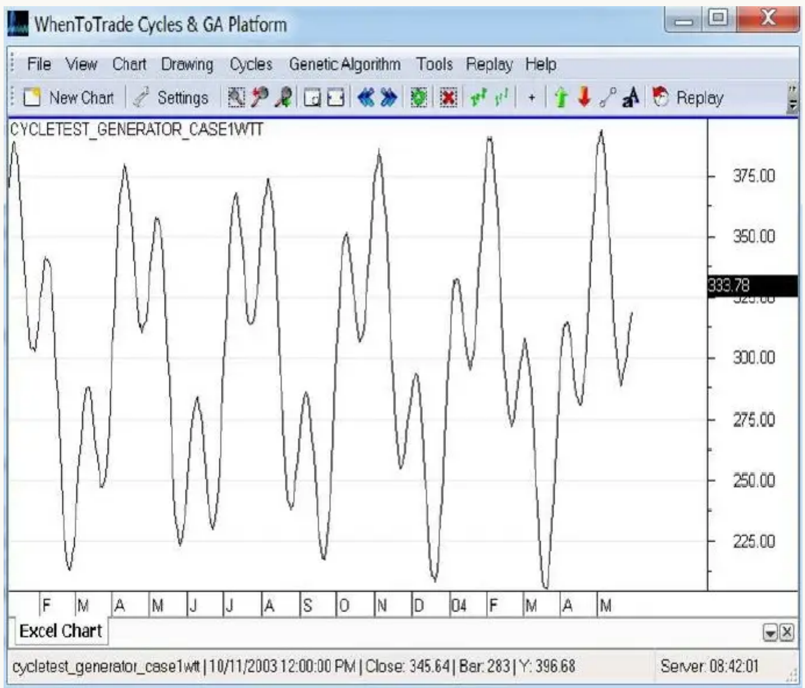

**Figure 2-1:** Sample Data 1

The indicator at the bottom of the chart shows the full wave analysis spectrum. Two peaks can be clearly identified. The first is located at a length of precisely 30, and the second at a length of exactly 95 days. The data are also detailed in the log:

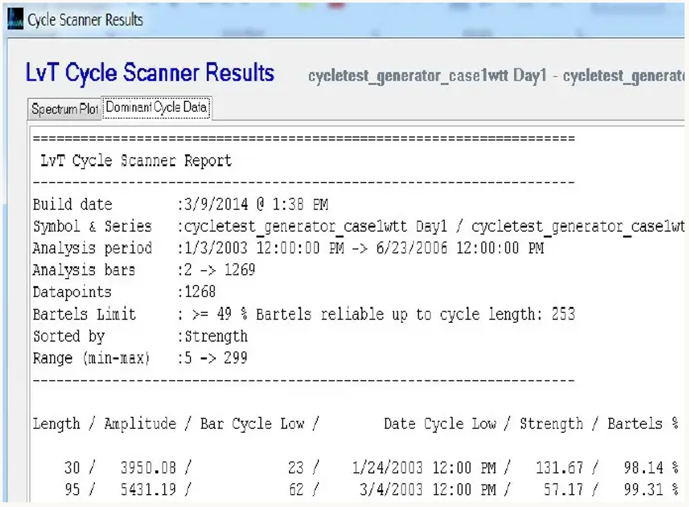

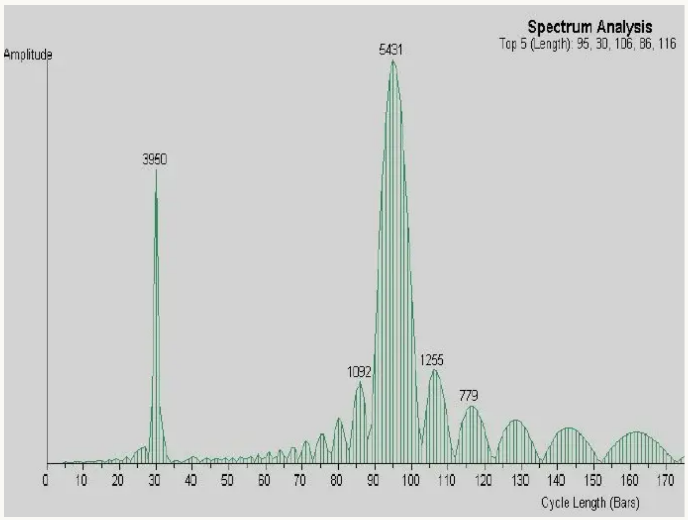

**Figure 2-2:** Cycle Scanner Log File and Spectrum Plot for Sample Dataset 1

The method was thus able to identify the two waves with absolute precision regarding their length and amplitude. It was also able to output the phases based on the date of the first low.

The additional statistical test result (Bartels score) of over 98% also confirms the actual presence of the cycles in the data series. When working with cycles in financial data, I recommend disregarding identified cycles with a Bartels score below 50%. A lower value indicates that this wave length does not have a reliably stable presence in the data series over a specific time period. Such information is particularly relevant for subsequent use in trading. Even if a cycle may have been correctly identified by spectrum analysis, it may well be that this cycle only occurs (or has occurred) once or twice in the entire data series. We do not want to use cycles that only "appear once" as our trading signals. The Bartels test is thus a measure indicating whether the presence of the statistically identified cycle in the data series over multiple runs could be confirmed.

The fact that these two waves can be identified despite using a time frame for analysis that does not even cover two full wave lengths (relative to 95 days) is of greater importance. Below is the test analysis when only approximately 170 data points (i.e., about five months of daily data) are used for the analysis:

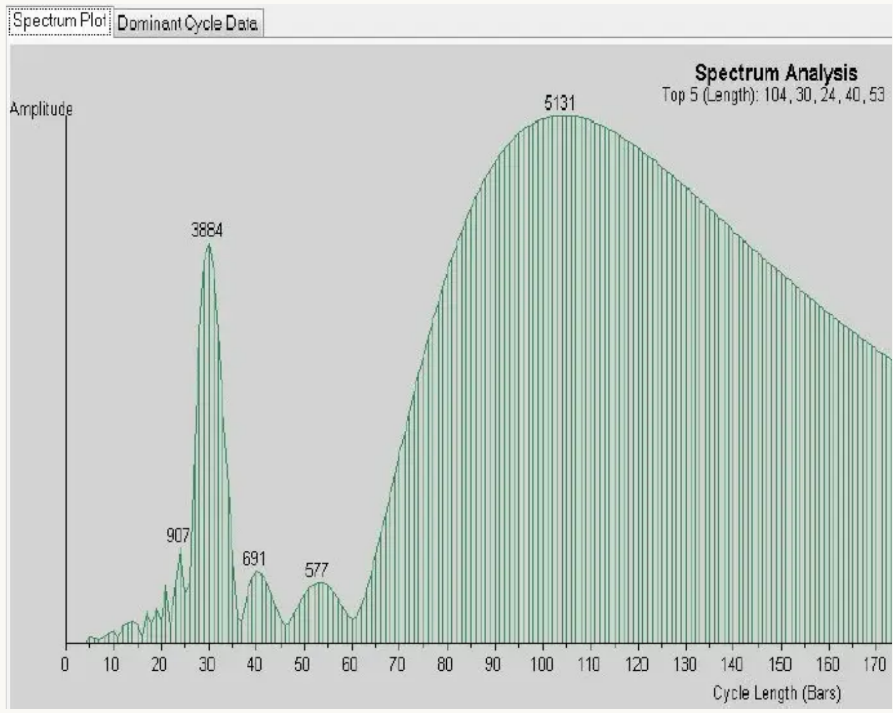

**Figure 2-3:** Spectrum Diagram for Dataset 1 with Small Amount of Data

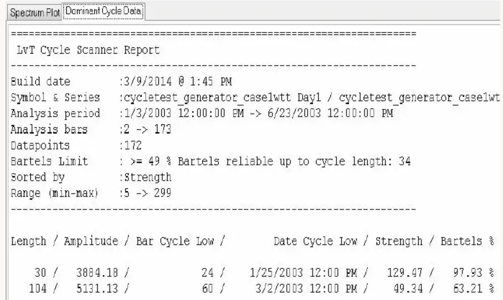

**Figure 2-4:** Detected Cycles with Small Amount of Data

Even the cycle with a length of 95 days (three months) was thus identified at a measured length of 104 days in this short data series (an analysis series of only five months) with an accuracy of over 90%.

This is another important advantage of this new combined method. While classical methods often require four or more complete waves to be present and the analysis range to be at least 3–4 times longer than the largest wave length to be identified, less than two times the longest wave length of analytical data is sufficient to complete the analysis in this case.

#### Example 2: Dataset with 2 Cycles + Trend

In this example, we add trends of varying strengths to the previously determined waves. This reflects a key characteristic of financial markets and will thus be of vital importance later. The algorithm does not necessarily have to be affected by trends.

We need to ensure that the cycles can still be correctly identified despite the additional trends.

Here, we will again combine two waves and add upward, downward, and sideways trends of different strengths.

The following wave lengths were used for the test data:

• Wave 1: Length 30 / Amplitude 20
• Wave 2: Length 200 / Amplitude 80

Consequently, the chart looks like this:

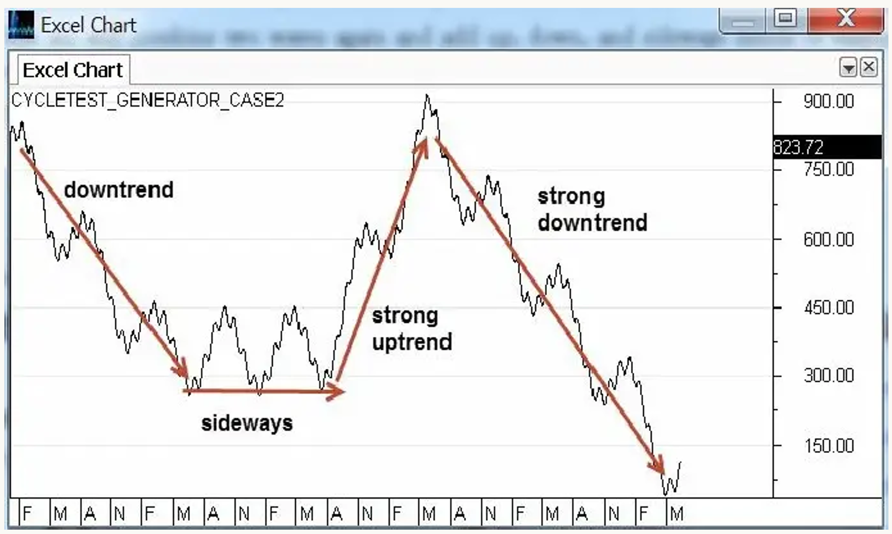

**Figure 2-5:** Sample Data 2 / Two Waves with Different Linear Trends

The spectrum analysis over a predefined short time frame now provides the following result:

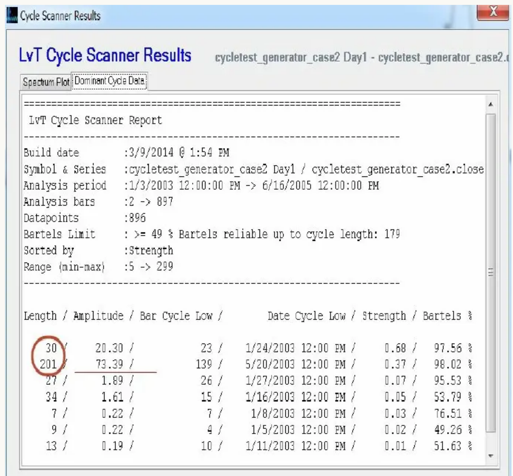

**Figure 2-6:** Spectrum Analysis Result for Dataset 2 in the Output Log

It is clearly visible that the algorithm was able to detect both cycles. The algorithm was not affected by the trends that were included. It succeeded in "detrending" the data before frequency analysis. That is, the algorithm has a proprietary detrending function, as it can handle different forms and strengths of trends. As this example shows, we included four different trends in the analysis. Nevertheless, the algorithm was able to filter out all these trends.

The other identified cycles printed in the log with lengths of 27 and 34 days can easily be classified as non-relevant noise. This is clearly discernible when looking at the amplitude information. The first two had a price amplitude of 20 and 74 (as was precisely the case for the input cycles). Then there is a large jump in the detected amplitudes, from 74 to 1 and below. This is a clear signal that this information can be disregarded because the "low" amplitude will have no effect.

Conclusion:

The cycle scanner is capable of handling different trends.

#### Example 3: Dataset with 2 Cycles + Trend + Noise

Now, we will increase the complexity and add the third characteristic of financial markets: a large amount of random noise. This "noise" can, for example, be generated by news that causes the market to "jump" in one direction or another. We will use the same dataset from Example 2 (wave lengths of 30 and 200 with trends) for this example and add a large amount of noise to the data. This is what our test dataset looks like now. Go ahead and compare it with the previous chart. You can clearly see how distorted the price data looks and that the smaller cycle is lost in the noise.

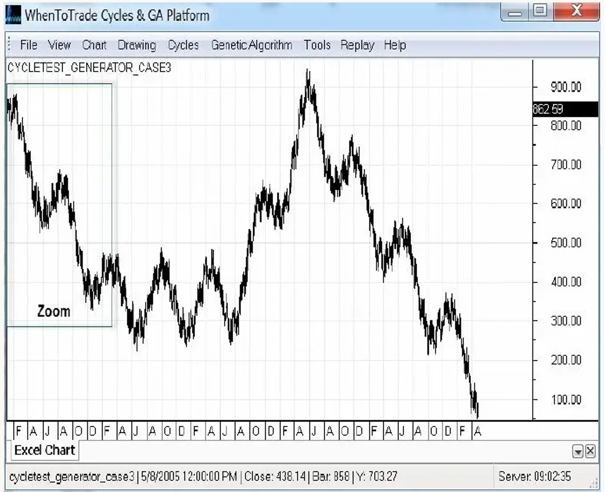

**Figure 2-7:** Sample Dataset 3 – 2 Waves + Trends + Noise

A note: The noise level is much higher than the amplitude of the smaller cycle. Thus, we have a low signal-to-noise ratio here with respect to the smaller cycle. A closer look at the data demonstrates what I am talking about:

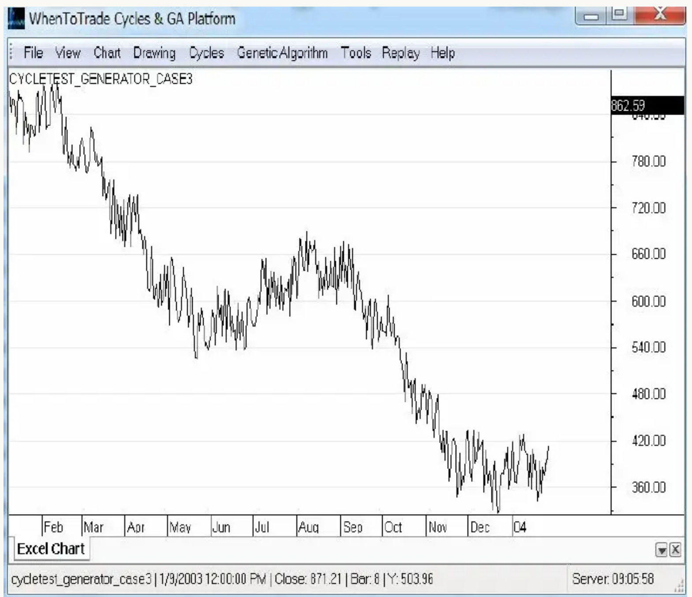

**Figure 2-8:** Close-Up of the Same Data

Here comes the challenge for our new algorithm:

1. The longer-term cycle with a length of 200 days occurs only 1.5 times in the one-year dataset. Therefore, it would be difficult to detect the 200-bar cycle if we only had a short data history to analyze.
2. The short-term wave with a length of 30 days is completely "lost" in the high noise ratio.
3. The actual downward trend also distorts and stretches the dataset.

Let’s see if our algorithm is still able to detect the two cycles. Here is the result of the analysis:

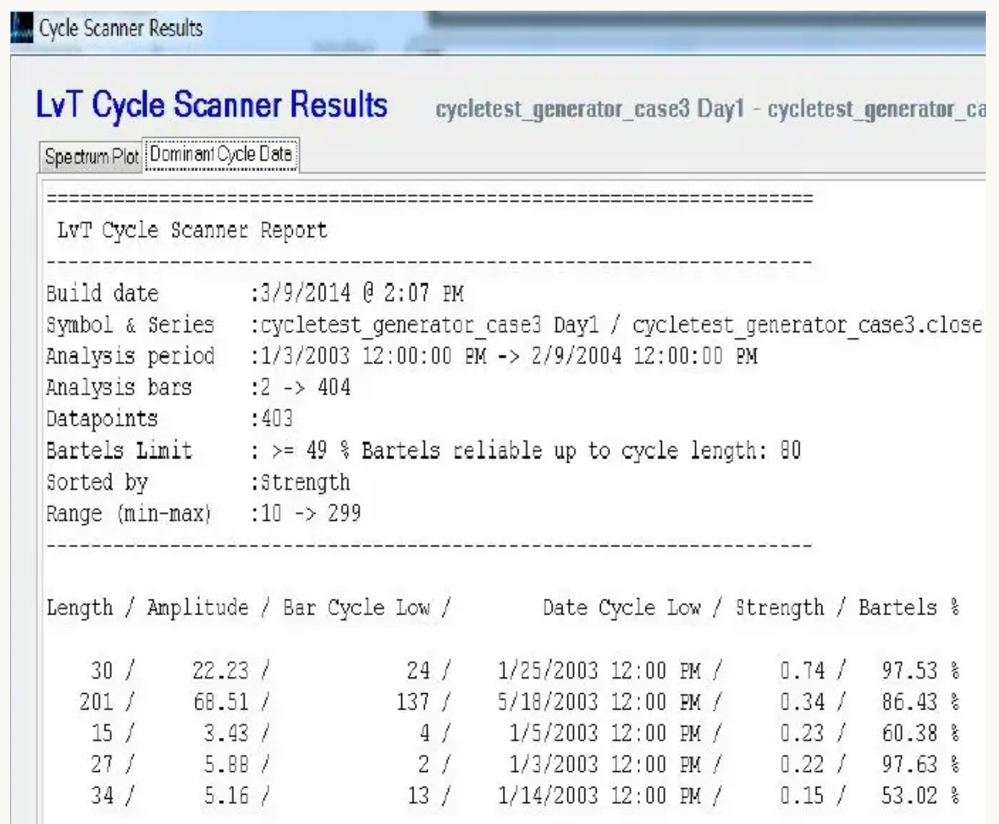

**Figure 2-9:** Analysis Results for Sample Dataset 3

And again:

The algorithm was not affected by all the noise and trend information. It correctly identified the two cycles with lengths of 30 and 201 days. The other cycles with lengths of 15, 27, and 34 days can be "overlooked" when compared to the amplitude of the first two cycles.

Conclusion: The algorithm is capable of handling a high noise ratio!

Before moving on to real financial data, I will give you a brief overview of why this information is so important and of special interest for trading.

##### Step by Step: How to Build a Forecast Based on Cycle Detection

When we know what cycles are driving the market, we can use this information to build a cycle-based forecast. Now, let’s go through this forecasting technique step by step.

##### Step 1: Cycle Analysis

At any given point in time, perform a cycle analysis based on your preferred market/index and time frame. We will use Example 3 for this particular scenario. So, let’s say it is February 9, and we are looking at the actual chart.

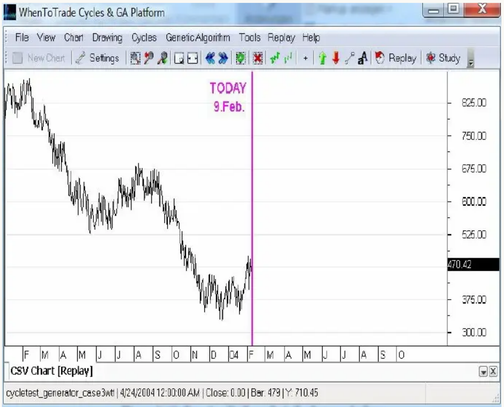

**Figure 2-10:** Step 1 – Cycle Analysis for Last Year’s Data

Start the Cycle Scanner, which will carry out the cycle analysis following the steps explained in the previous examples. For a daily chart analysis, I would recommend using 1–2 years of daily data. In the present example, we are using "only" one year for our analysis. The results of this analysis:

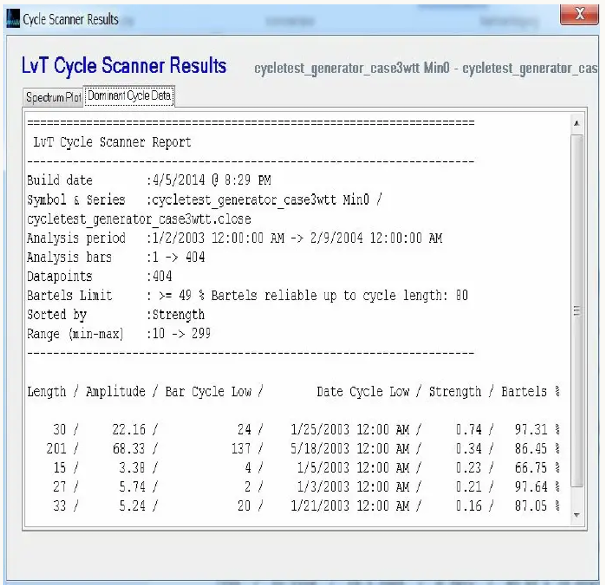

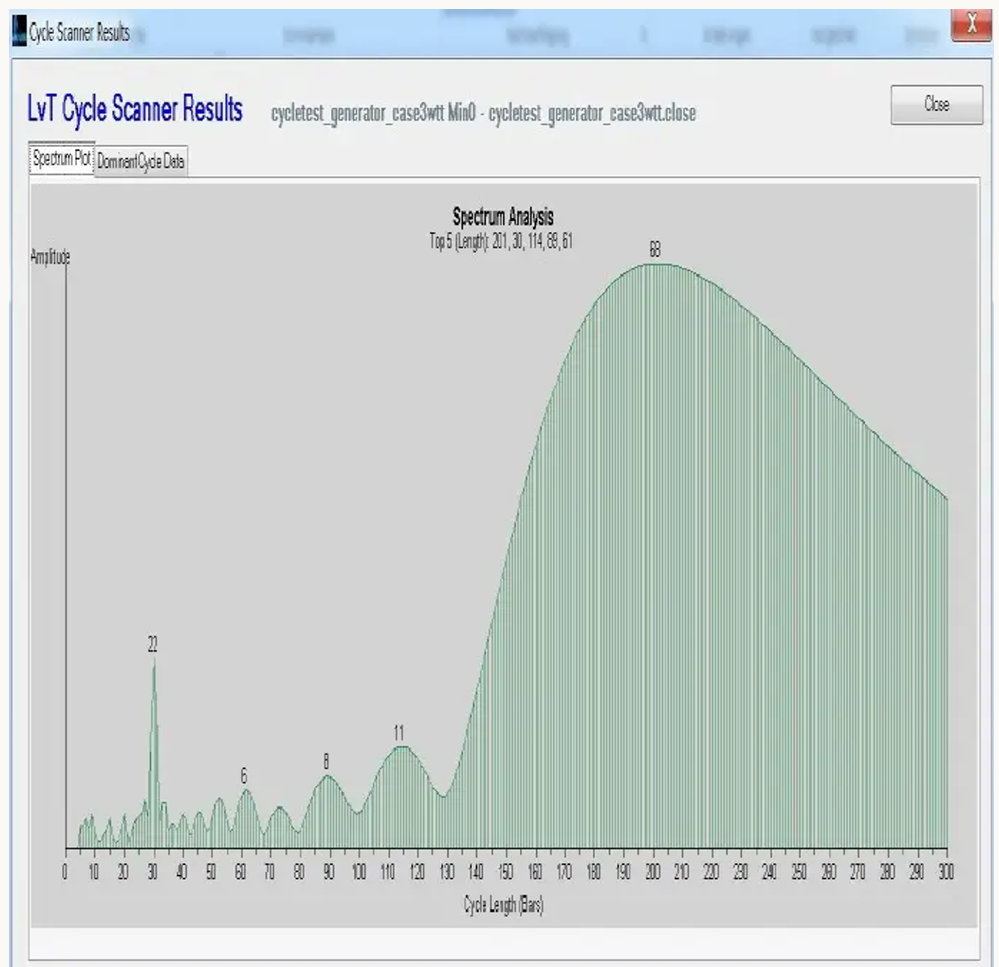

##### Step 2: Plot Active Cycles and Extend Them into the Future

Now that we know the cycles with lengths of 30 and 201 days are active, we can begin to develop a forecast. Thus, we will plot each cycle according to the information provided by the Cycle Scanner. Open the Cycle Plotter via the Cycles menu, and the scanner results can be loaded into the plotter toolkit simply by pressing the "Load Scanner Peaks" button in the upper-right corner of the window.

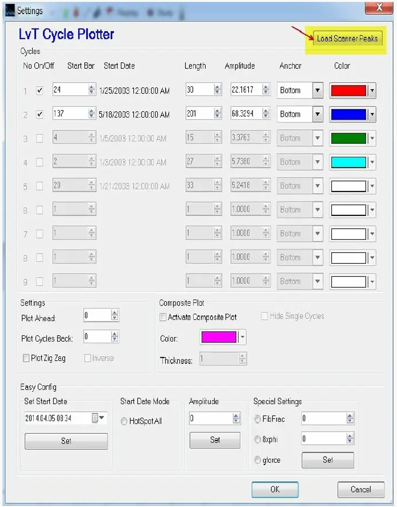

The first wave is plotted in line with the start date, amplitude, and length information. The second wave is also plotted according to the given start date, amplitude, and length information.

As the following illustration shows, you can now plot the cycles into the future.

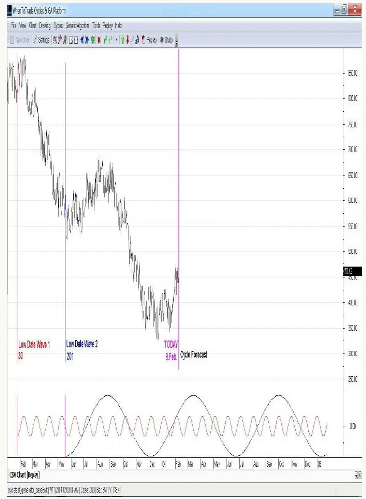

**Figure 2-11:** Plotting the Identified Cycles on the Chart and into the Future

##### Step 3: Build a Composite Cycle Based on the Identified Cycles

If more than one cycle is active, you must add all individual cycles into a "large" composite cycle. All you need to do is simply sum the information from each cycle into a composite. First, select a plotted cycle with the left mouse button. Once selected, press the right mouse button to display the context menu:

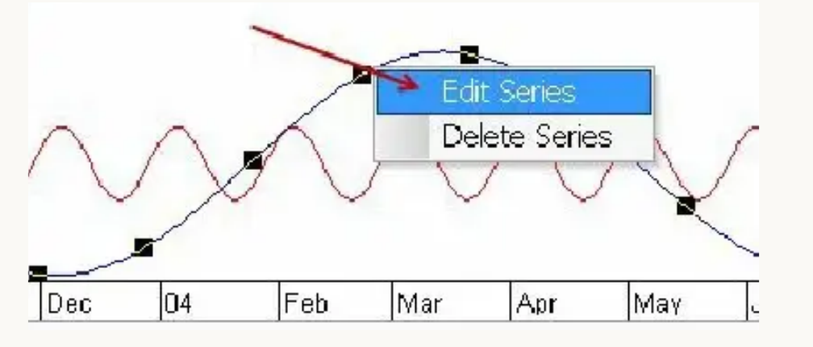

Choose "Edit Series" to reopen the settings panel. Now, select the option to plot the cycles as a composite cycle "Enable Composite Plotting." Choose whether you want to see the individual cycle signals, select the color, and thickness.

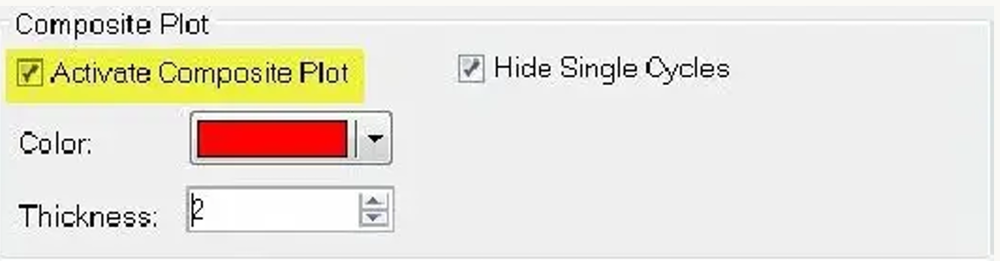

The following illustration shows the composite cycle derived from these two cycles.

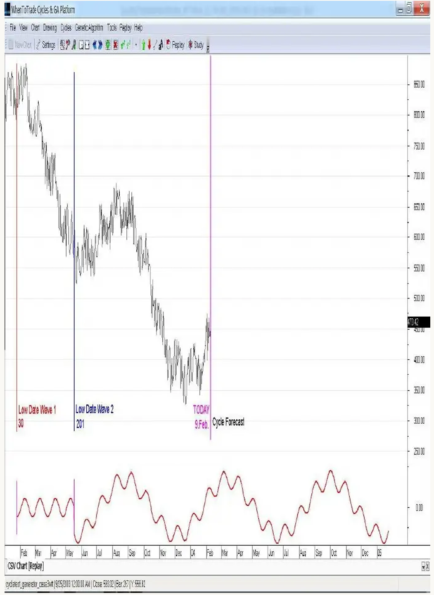

**Figure 2-12:** Composite Cycle Based on Two Separate Cycles.

##### Step 4: Mark Expected Future Turning Points

Now, we can see how this composite forecast will perform in the future. We are also able to detect instances where we expect a trend change. This information is important for going long or short in the market.

I have marked some instances on the following chart that denote a change in the composite cycle.

These turns forecast market turns. The cycles, of course, must remain active during the coming days/weeks.

We have just created our first cycle-based forecast!

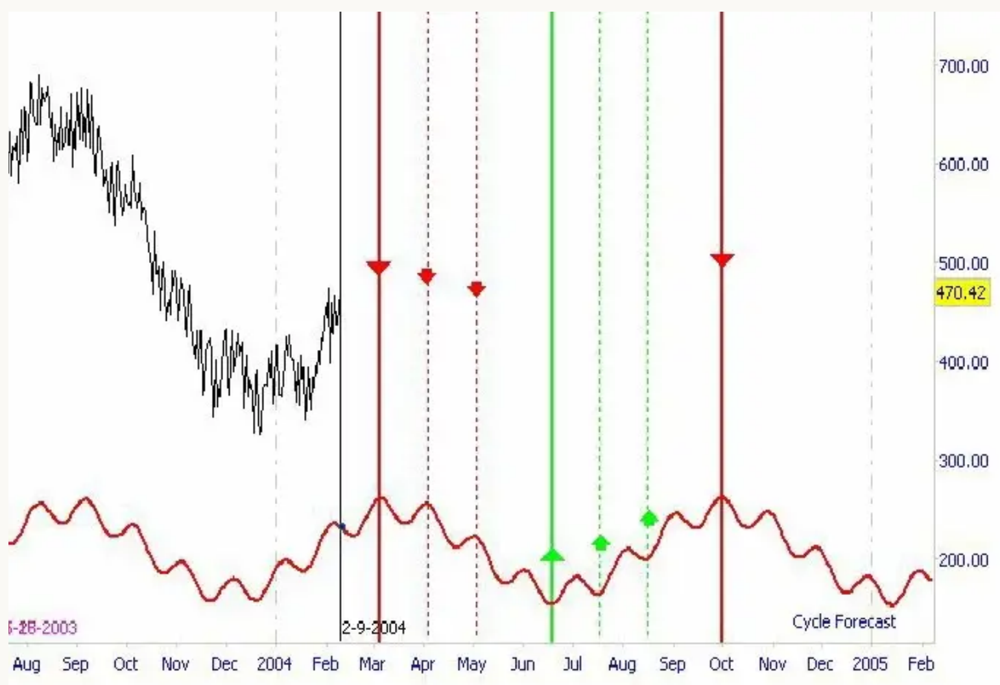

**Figure 2-13:** Mark Expected Turning Points Predicted by the Composite

##### Step 5: Just Watch How It Unfolds

Now, we can move forward in time. Our forecast will remain. The forecast was made on February 9, and as you can see, the forecast was able to detect future turning points all the way to the exact date.

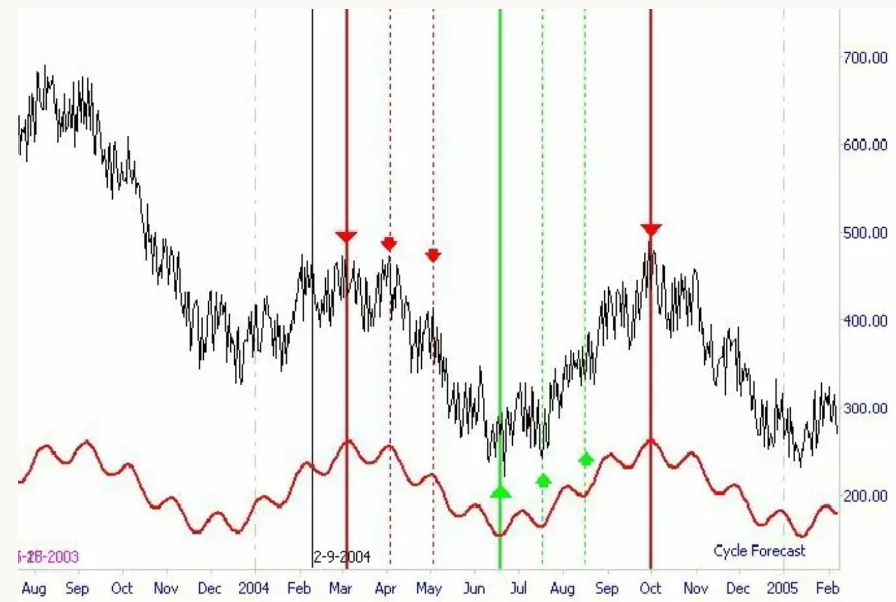

**Figure 2-14:** Real Dataset and Forecasts from February 9

Here with a smoothed price curve for better illustration:

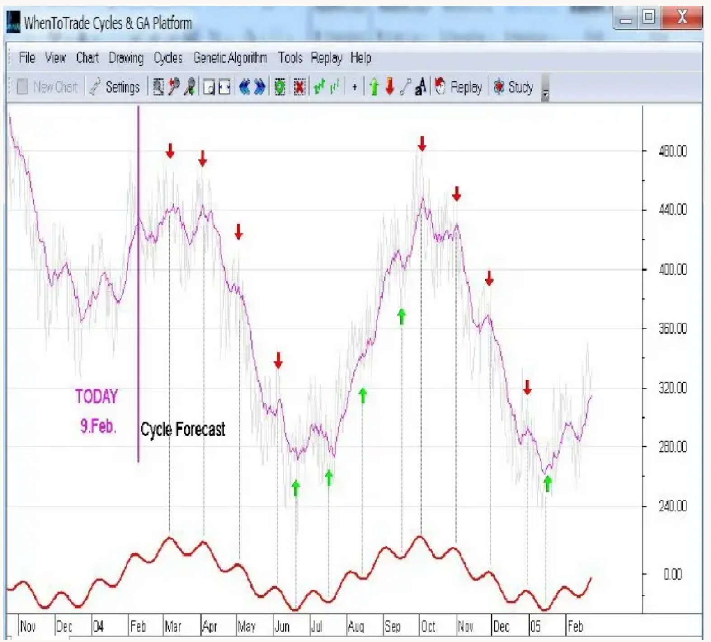

**Figure 2-15:** Real Dataset and Forecasts: How It Plays Out

As you can see, the cycle forecast is a trendless forecast. It is evident that the main trend shifts from a downward trend to a sideways trend—but the cycle forecasts have provided us with reliable information for trading. The trend change was not known at the time of the analysis.

This is, of course, only a theoretical example. The purpose of this example is to demonstrate how to build cycle prediction models. And you can see that if you have a reliable engine for identifying cycles, you will be able to build highly accurate prediction models. Despite a trend change and a large amount of noise in the signal, our engine was able to detect the appropriate cycles.

Using this forecasting method, you will now be able to plot cycles into the future to detect upcoming turning points.

#### Example 4: Dataset with 4 Cycles + Trend + Noise

Let’s increase the degree of complexity once again with the following dataset. We will use four different cycles with different wave phase shifts:

- Length - Amplitude

1 – 12 – 40
2 – 31 – 70
3 – 54 – 90
4 – 82 – 65

We will add different trends and a lot of noise. In this example, the average noise level is 1.5 times greater than the maximum amplitude of the wave with a length of 12 days. Consequently, it will be difficult to see whether the engine is able to detect this small cycle despite all the noise and trend change. This is what Dataset 4 looks like:

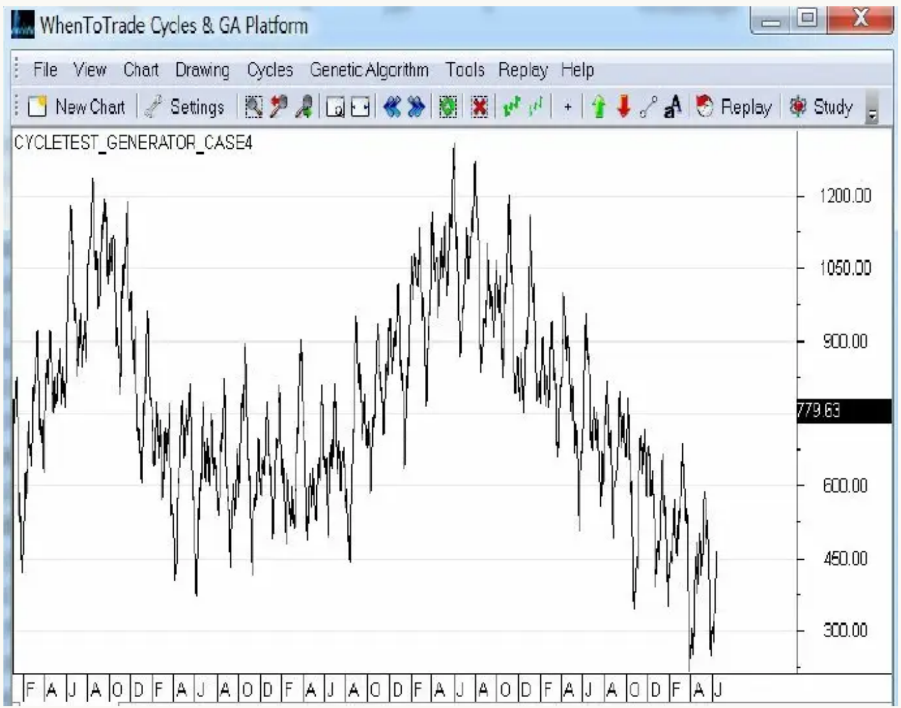

**Figure 2-16:** Sample Dataset 4

For our test, we will again use only one year of data history. This corresponds more closely to reality. I would recommend using 1–2 years of data history if analyzing cycles in a daily time frame. Let’s take a closer look at what I am talking about:

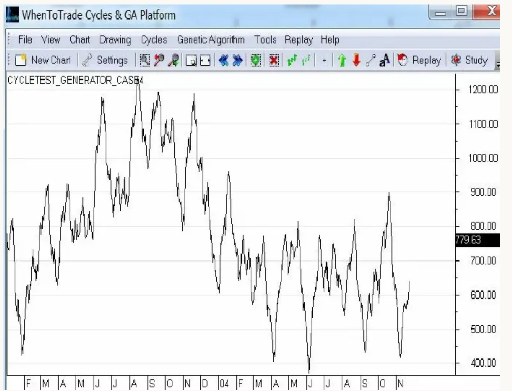

**Figure 2-17:** Zoom-In on Dataset 4

This example is also interesting because we can compare traditional cycle detection methods. If you connect the CIT-high-high and low-low on the chart, it appears that we have an active cycle running around 65 natural days.

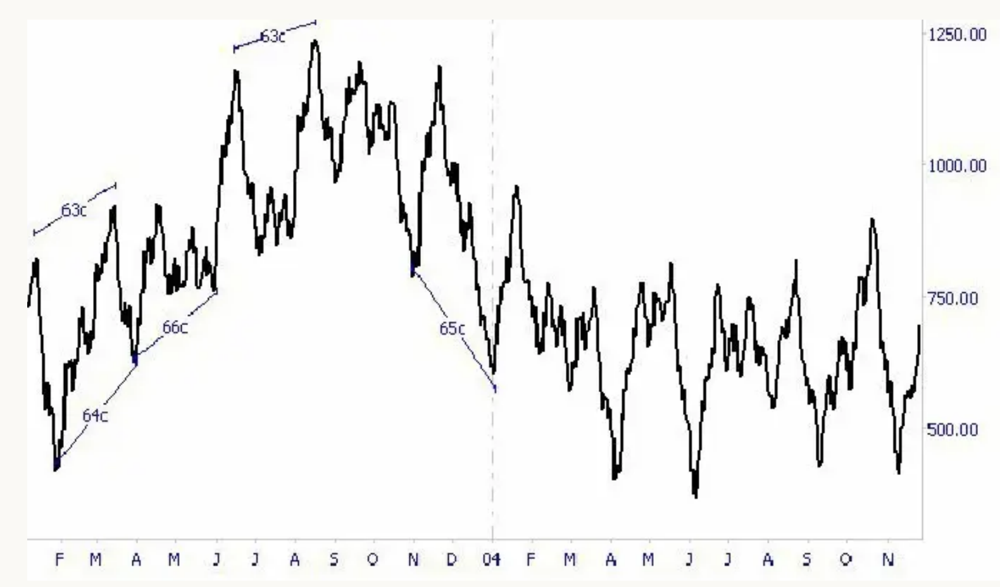

**Figure 2-18:** Dataset 4 – Visual Impression of a Cycle with a Length of 65 Days

However, we know this is sample data with no 65-day cycle! In other words, you cannot identify cycles using this "simple" method. It appears that we have an active 65-day cycle. But we will soon see that this cycle is not useful for prediction or trading.

To demonstrate this, let’s plot a 65-day cycle from the last low on January 4 and see if this is useful for future trading. The standard approach would be to use this 65-day cycle, which has been visually identified, and plot it into the future:

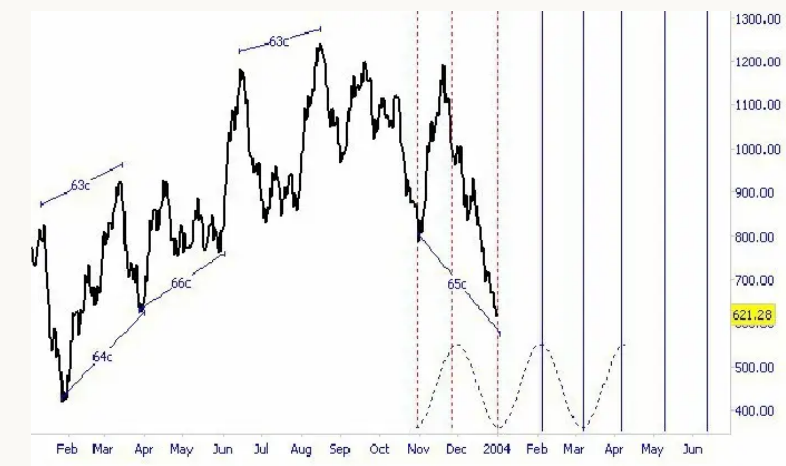

**Figure 2-19:** 65-Day Cycle Plotted Ahead

The blue lines on the chart indicate the expected turning point dates for this particular cycle. The information about the turning dates predicts:

- a high at the beginning of February,
- a low during the first half of March,
- a high at the beginning of April.

Now, let’s see how it plays out:

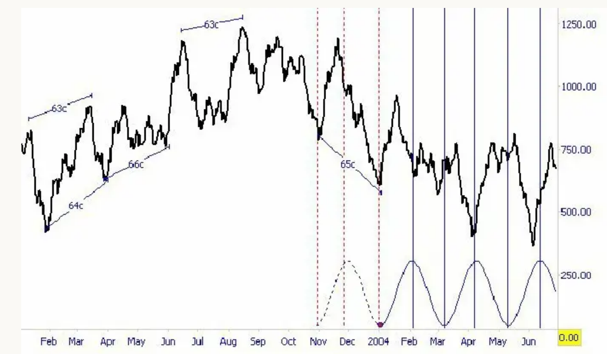

**Figure 2-20:** Dataset 4—65-Day Cycle Forecast and How It Plays Out

As you can clearly see, there is no correlation between the 65-day cycle we "detected" and the actual price behavior. If we had made a cycle forecast using this classical method, we would have been completely wrong. Normally, one concludes: "Okay, the 65-day cycle was inverted," because April did not have a high but a low. Thus, one would argue after the fact that the 65-day cycle was inverted.

However, we know from the example that this line of reasoning is completely wrong! There is no 65-day cycle, and there is no inversion. Cycle detection by visual recognition of highs/lows was completely mistaken.

I want to use this example to demonstrate that the key component of all cycle models is a robust and reliable cycle detection method. And as I have already shown, most common methods simply do not work. Now, let’s use our new algorithm to determine the active cycles using only one year of data history. Let’s start with the spectrum plot of the cycle analyzer for the same dataset:

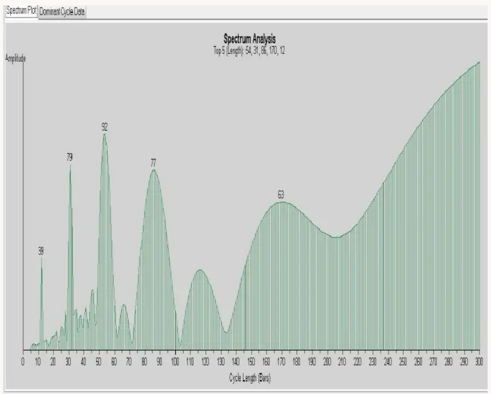

**Figure 2-21:** Cycle Scanner Plot for Dataset 4

We can clearly see the evident peaks of the cycles that were used to generate the dataset. Even our small 12-day cycle was recognized precisely with a sharp peak in the spectrum plot. Despite all the noise in these data. The question now is what we should do with the detected 117- and 170-day cycles?

After all, these cycles are not present in the dataset. Here is the printout from the output log:

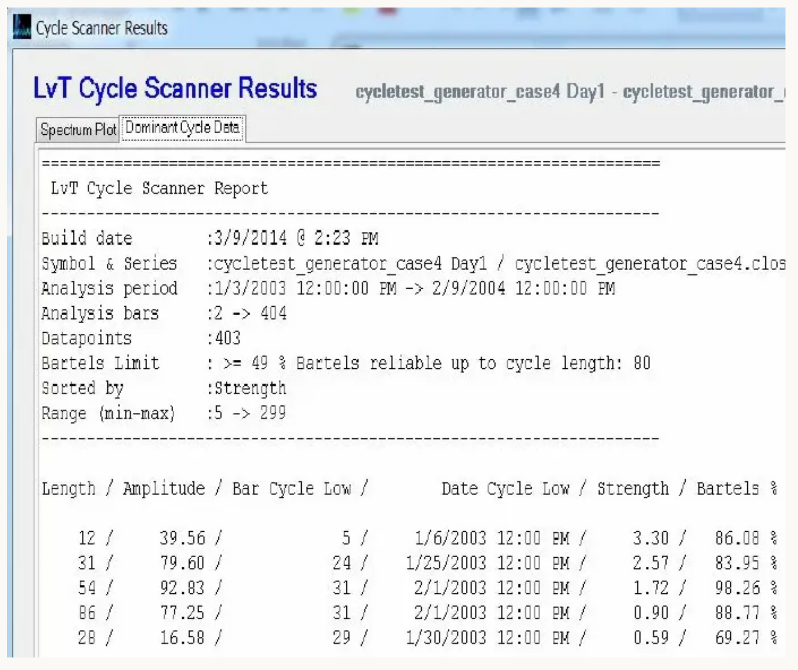

**Figure 2-22:** Cycle Analysis Result for Dataset 4

These cycles are obviously not included in our results list, the reason being our statistical post-processing using the engine built into the algorithm. These cycles are "resolved" because they have a low Bartels score (below 49). And this demonstrates the power of the combined algorithm created for this Cycle Scanner.

The list precisely shows the real cycles: 12, 31, 54, and 86 days (the actual length would be 85 days). If you take a look at the 28-day cycle, you can see the low "amplitude." This is also a complete derivative of the 12-day cycle (4 × 12). Thus, we can omit the 28-day cycle here.

The result is as clear as it can be! All cycles have been correctly identified in terms of cycle duration and amplitude. And the algorithm (correctly) did not detect a 65-day cycle, as we saw on the chart.

Therefore, the next step would be to apply the cycle forecasting method I introduced in Example 3. Let’s apply it to this case now.

#### Building the Forecast Model for Example 4

##### Step 1 Cycle Analysis

We have just completed this step. The previous report was published on February 9 using the data history from the year 2003. The engine provided us with information about the four cycles (12, 31, 54, and 86 days), including their low dates and amplitude. We will enter them into the chart in the next step.

##### Step 2 Plot Active Cycles and Extend Them into the Future

Now, we are able to plot the four cycles with their correct low offset dates and project these cycles into the future. The data are derived from the output of the cycle scanner and imported into the Cycle Plotter via the "Load Scanner Results" button, as shown below.

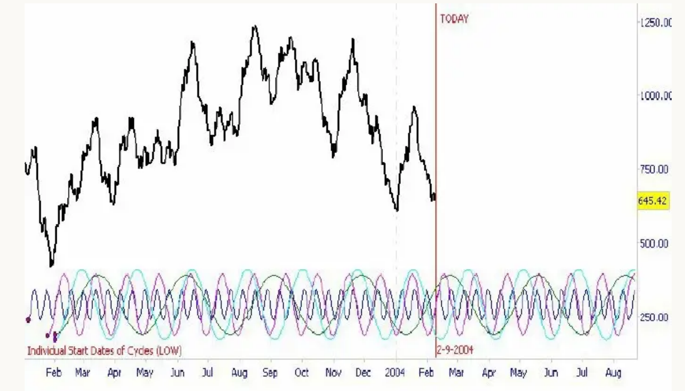

**Figure 2-23:** Dataset 4 – Individual Cycles Projected for the Detected Cycles

##### Step 3 Build a Composite Cycle from the Detected Cycles

It will become more complicated now when we enter four cycles into the chart and build a forecast based on these cycles. Of course, you can plot each individual cycle to determine when they are in "alignment" in terms of their lows and/or highs to detect turning points. For this, you will need to build a composite model. But that involves nothing more than simply summing the four cycles. It’s easy. So let’s see what the combination of these four cycles looks like.

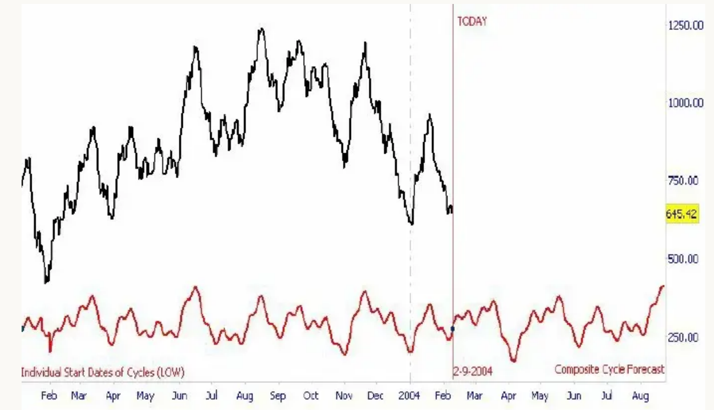

**Figure 2-24:** Composite Cycle Forecast for Dataset 4

##### Step 4 Mark Expected Future Turning Points

The next step is to identify the major future turning points of the composite cycle. These instances are the dates on which a significant change in the market trend is expected. To simplify reading, I have only marked the major expected highs and lows. There are, of course, more than that. But why not just take a closer look!

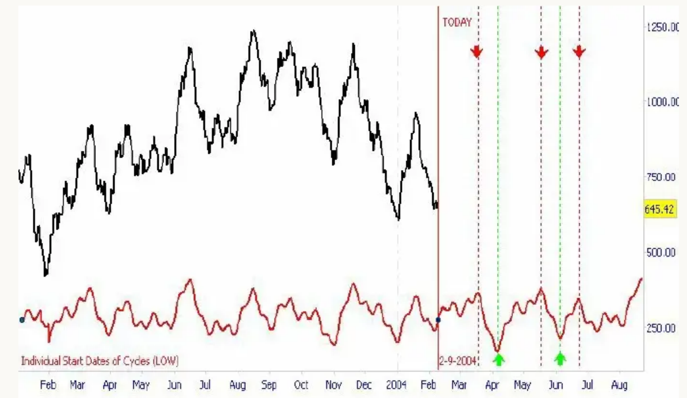

**Figure 2-25:** Forecast of Turning Points (TCI) in the Coming Months

##### Step 5 Just Watch How It Unfolds

Now, let’s see how this forecast would have played out.

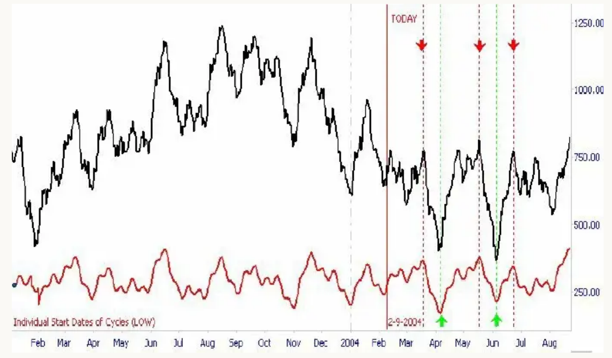

**Figure 2-26:** Composite Forecast and Outcome

I think there is no need to comment on this chart. You can see for yourself how precisely the composite forecast identified the correct turning points. And not only are the marked ones correct.

Every single turning point in the composite forecast corresponds to a turn in the sample market. Take a closer look at the chart and study it a bit.

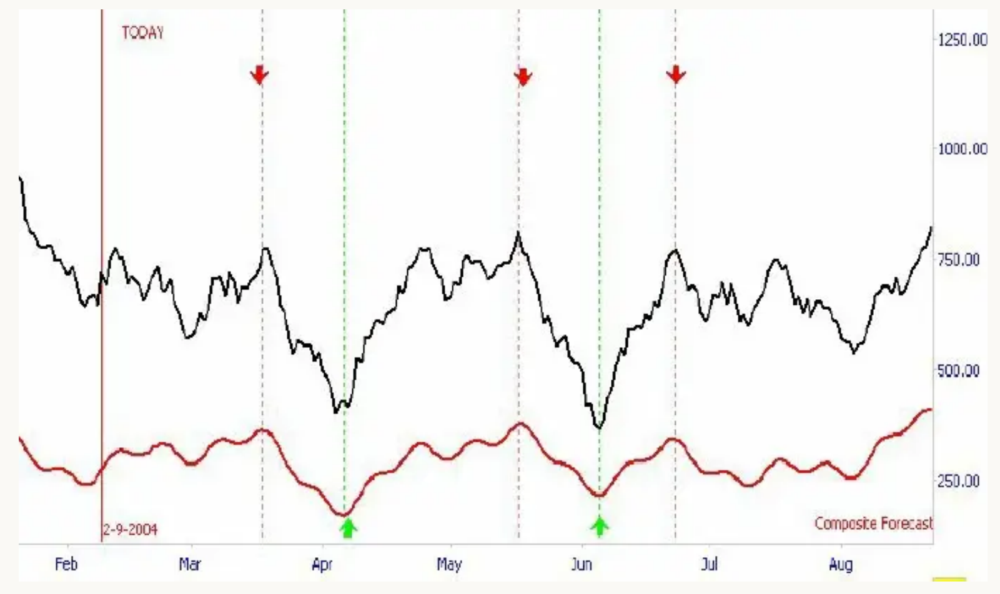

**Figure 2-27:** Comparison Between the Composite Forecast and Sample Data

Compare this result with the visual cycle detection method illustrated earlier on the 65-day cycle. The benefits of the Cycle Scanner’s results are clearly visible.

This is, of course, only sample data and not real market data. But there are two important points I would like to make about all these test datasets:

1. It is important to demonstrate that the algorithm is capable of detecting cycles under simulated market conditions with noise, trends, and different cycles running in parallel.
2. You should gain a general understanding of a simple cycle prediction method using the detected cycles to forecast future turning points.

Before moving on to real markets, let’s conduct one final heavy stress test using our engine to see whether the new algorithm can master this test as well.

#### Example 5: Dataset with 5 Cycles + Noise + Changing Trends and Strengths

Again, we increase the complexity by adding a new cycle and increasing trend levels and trend changes. We will, of course, also add random noise on top of everything. We will use the following five cycles for the next dataset:

Wave – Length – Amplitude

1 – 30 – 40
2 – 50 – 60
3 – 95 – 55
4 – 195 – 110
5 – 230 – 150

Just to demonstrate that any time frame can be used with this engine, I chose an intraday time frame similar to normal trading times (09:30–16:00) on a one-minute chart. This is what it looks like:

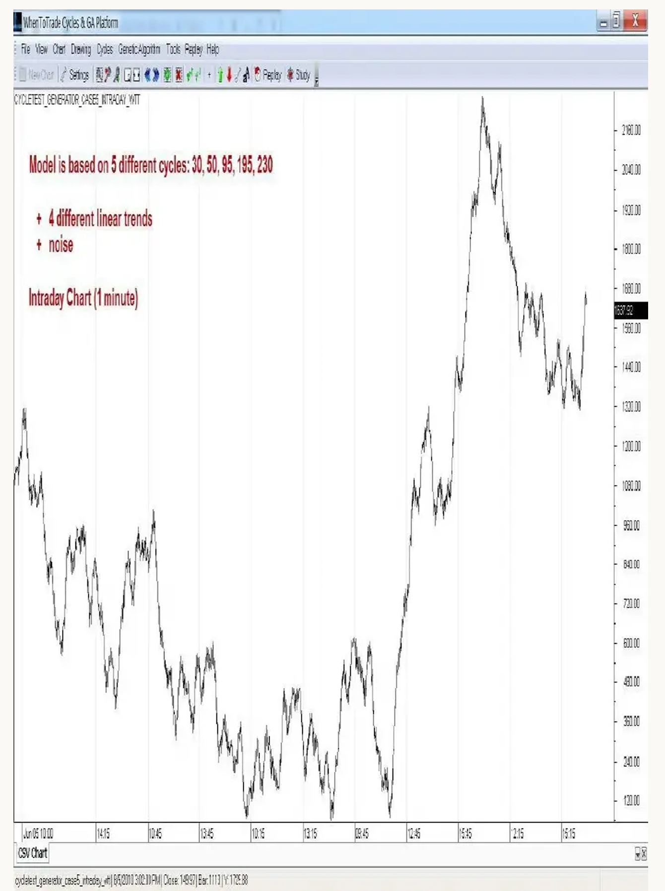

**Figure 2-28:** Sample Dataset 5

You can see that this sample data is very similar to real markets. And it is based exclusively on the five cycles, different trends, and noise. Thus, it reveals that all characteristics approaching real markets are included in the model. Now, let’s see what cycle information the new algorithm will be able to provide.

In the first run, we will use only one day’s data history to analyze the cycles. This is also how it would be carried out in real markets—the last trading day is used to extract cycles, and this information is used to predict upcoming turning points.

Below is the analysis report for the intraday data from May 6.

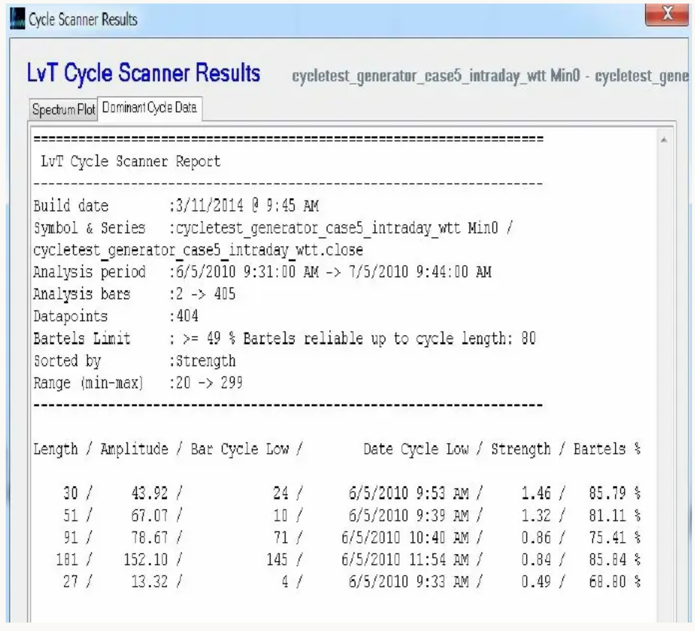

**Figure 2-29:** Cycle Scanner Result for Dataset 5 (One Day’s Data History)

There is some information we are seeing here for the first time: The Cycle Scanner provides exactly the low dates (phase offset) with precision to the hour when using intraday charts!

The scanner was now able to extract four cycles: the 30-, 51-, 91-, and 181-minute cycles. The 27-minute cycle was omitted due to its low amplitude compared to the other four cycles. That is, the maximum error rate here with reference to the longest cycle of 195 minutes (actual) versus 181 minutes (detected) is only 8%. The cycle with a length of 230 minutes was not detected because there were insufficient data in the analysis windows (only one day). It is therefore not surprising that the scanner was unable to detect the 230-minute cycle (approx. 4 hours) in just 8 hours of test data.

In other words, we are now facing the situation where the scanner does not detect all cycles, and a cycle with an 8% error rate was one of the identified cycles. This is similar to reality—there will always be some errors in detection, and it is inevitable that some longer-term cycles will be missed. Therefore, this is not really surprising from an analytical standpoint.

The same analysis can be performed via the CycleScanner API endpoint and our provided Excel Workbook:

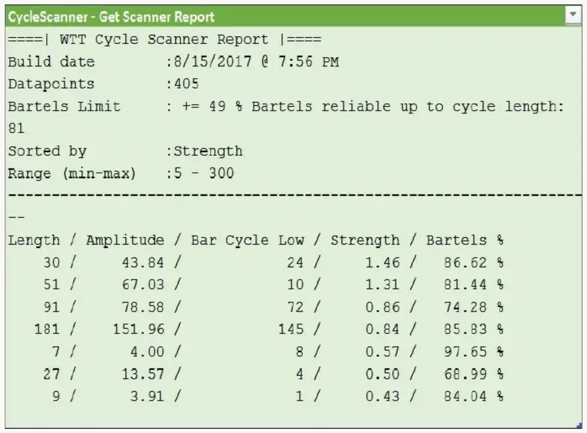

**Figure 2-30:** CycleScanner Excel Workbook Output for Example 5

But now, let’s see what happens if we use these four detected cycles, including the erroneous cycle, in a forecast model. Will it be reliable enough for trading purposes?

Thus, let’s enter the four detected cycles with their low dates and amplitudes into the chart. This would have been the situation if you had entered them just after the open on May 7 with only one day’s data history.

The forecast for Dataset 5 and individual cycles:

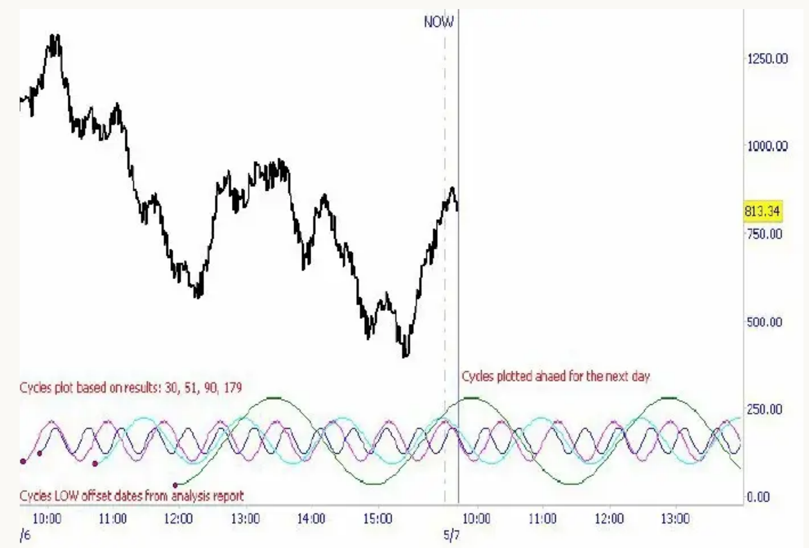

**Figure 2-31:** The forecast for Dataset 5 and individual cycles

Again, the method needs to summarize all individual cycles into a composite. This is the composite image for the detected individual cycles, with the major turning points already indicated on the chart. This is the method used to build a trading forecast for the next day.

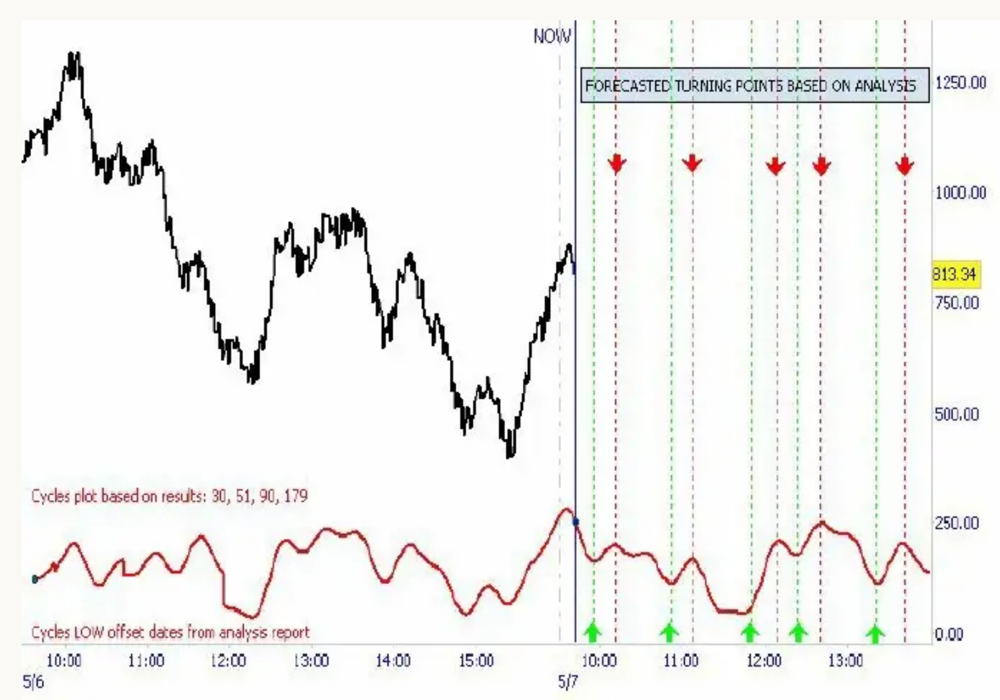

**Figure 2-32:** Dataset 5 with the Composite Cycle Forecast Based on Cycle Scanner

This chart would have been our trading forecast for May 7. We have identified the future times for the day when we expect the market to turn. Let’s see what this forecast brings:

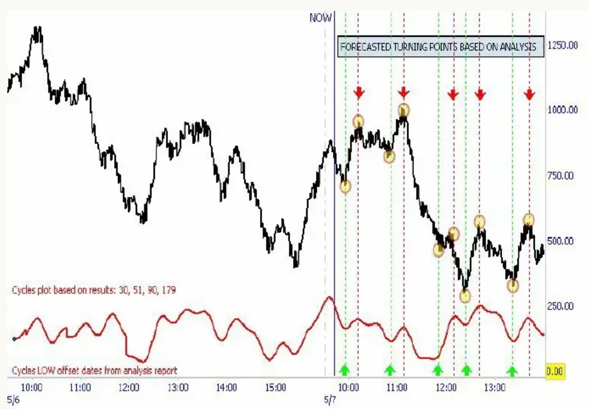

**Figure 2-33:** The Composite Forecast Based on the Scanner and Sample Dataset 5

Once again, the cycle scanner was highly precise in predicting the turning points down to the minute! This example shows what you can expect in a real-world market. Even if there is an error in the correct cycle length and even if a cycle is "missed," the forecast based on the Cycle Scanner’s results is reliable and robust for building tradable forecasts. And that is what it’s all about. We need tradable forecasts. And we will get them.

This was the last example to demonstrate the potential of the new algorithm using sample data. This last sample dataset closely approximates real market conditions. And we have now seen that the Cycle Scanner’s results are very precise for building forecasts.

### 2.4 The Cycle Scanner Algorithm

If you are an engineer, you can imagine how difficult this journey was: a full workload of all the mathematical material, coding, testing, and individual development to optimize existing algorithms. If you are in trading, it doesn’t matter in the end.

We should consider this figure to gain an understanding of how the Cycle Scanner works:

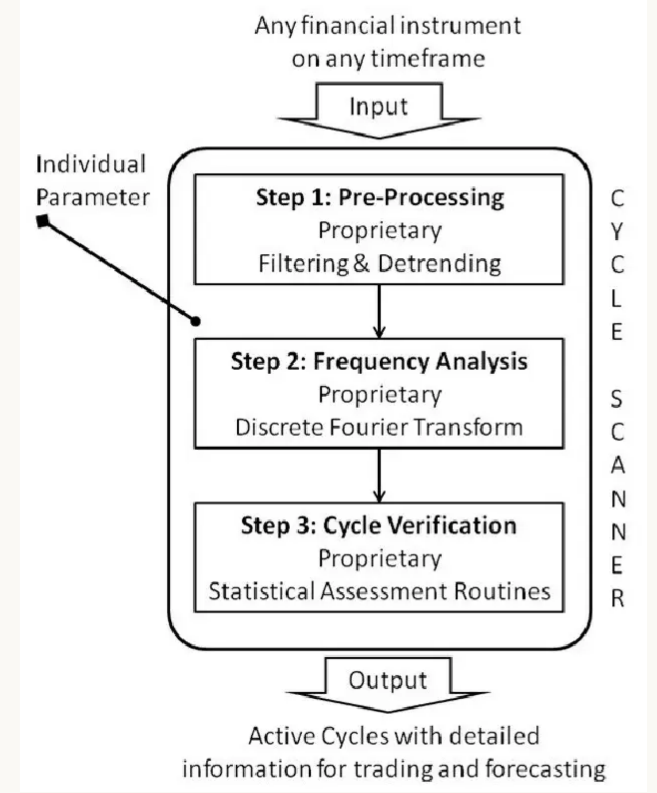

**Figure 2-34:** Overview of the "Cycle Scanner"

A New Area of Cyclic Analysis at Your Disposal

So far, I have shown and demonstrated how reliable and robust this new engine is. It is very important to test the engine with sample data for which we know the cycle information. However, all examples and stress tests have shown that this new algorithm is capable of handling all the characteristics of financial datasets, including noise, trends, and changing cycles over time. It can overcome the problems of all known individual analysis routines. The combination and adaptation of different algorithms produce this great result.

All sample datasets are available via our website at whentotrade.com. I can assure you that I have carried out thousands of such examples. It is, after all, very important that you are able to trust a new engine before applying it to financial markets. I hope you have realized that you can trust this new algorithm. In the following chapters, I will show you how to use it for real trading purposes. Then, you will be able to test and reconstruct all the examples shown. I have included these data so that you can familiarize yourself with the Cycle Scanner before applying it to real data. This powerful tool is lying right in front of you. You can connect the Cycle Scanner to any device and use any time period. The complete algorithm is embedded in the WTT software. It is just a few clicks away.

You are now also able to use the Cycle Scanner’s results to build forecasts for future turning points.

You have just reached Chapter 2 of this book. And you already have the most powerful cycle detection engine for financial markets at your disposal.

### 2.5 Using the Cycle Scanner: A Step-by-Step Guide

The Cycle Scanner was developed in C++ to provide the best analytical performance in a real-time environment. The engine is already integrated and works with all WhenToTrade "WTT" and Wave59 versions. Additionally, the Cycle Scanner is also available through our public API endpoint to integrate with your toolset of choice. For a quick start, an Excel workbook indicator script and NinjaTrader are provided in the next two chapters.

#### LVT Cycle Scanner

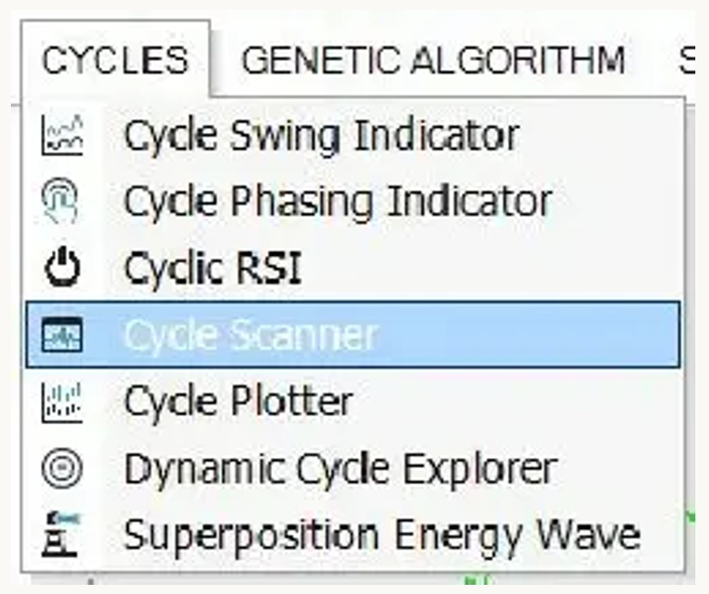

This tool has the following parameter options:

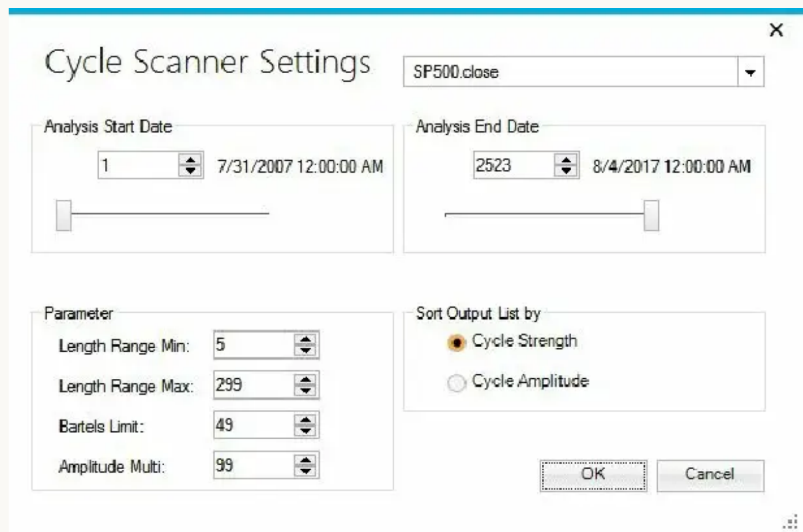

**Figure 2-35:** Cycle Scanner Parameter Input Box

#### Start and End Date

The start and end dates define the data period to be used in the algorithm to detect cycles. These are very important parameters because they determine the dataset to be used for the analysis engine. As was the case in the examples, I recommend using 1–2 years of data for analyzing daily charts and 1–2 days of 1-minute data history for analyzing intraday charts. The best start and end dates are market highs and lows. So, select the highs and/or lows for the start/end date and try to construct a period of 1–2 years (daily) or 1–2 days (intraday).

#### Bartels Limit

The post-processing engine applies a cycle verification engine based on statistical routines. The Bartels score indicates the "reliability" of a cycle’s presence in the current data. The value is measured in percentage. A low value indicates a low statistical alignment between the cycle and the actual data. A high value indicates a high statistical alignment between the cycle and the actual data.

This post-processing engine should be used as a second filter for the results. The frequency analysis delivers all detected cycles by this procedure. Subsequently, only cycles with a high Bartels score should be detected by the engine.

That is, I would recommend avoiding cycles with a Bartels score below 40%.

#### Min/Max Length

This defines the cycle lengths you want the data to be analyzed for. If you only want to analyze cycles with a length between 50 and 100 days, enter 50 for length_min and 100 for length_max. You can define the range that the Cycle Scanner should search. The maximum cycle length is 299, and the minimum length is 5 (always measured in number of bars).

#### Sort By: Strength or Amplitude

Cycles have two key characteristics: length and amplitude. Typically, cycles are sorted by amplitude because the cycle with the largest amplitude will have the highest influence on market movements. However, when it comes to trading, we are interested in cyclic strength per unit of time, which is measured in bars on the price chart. A better value can be obtained if we sort cycles according to the level of influence relative to price movement per bar. This value can be very easily calculated: simply divide the amplitude by the cycle length. This gives the price change in cycle terms per bar. This cycle is called "strength" in my algorithm.

When set to "strength," the cycles in the output log will be sorted according to the cycle strength value. When set to "amplitude," they will be sorted by amplitude.

#### Amplitude Multiplier

You can set a value that acts as a multiplier for the detected amplitudes. When working with small price changes (e.g., currency data), you may want to stretch the small amplitudes with a constant factor. You can set this constant factor here as the multiplier value. It will not disrupt the cycle analysis and only helps to visually plot cycles with larger amplitude values.

The result of the cycle analyzer is printed to the output log. There, you will find all relevant information about the detected cycles. It consists of a spectrum plot and a detailed data results tab:

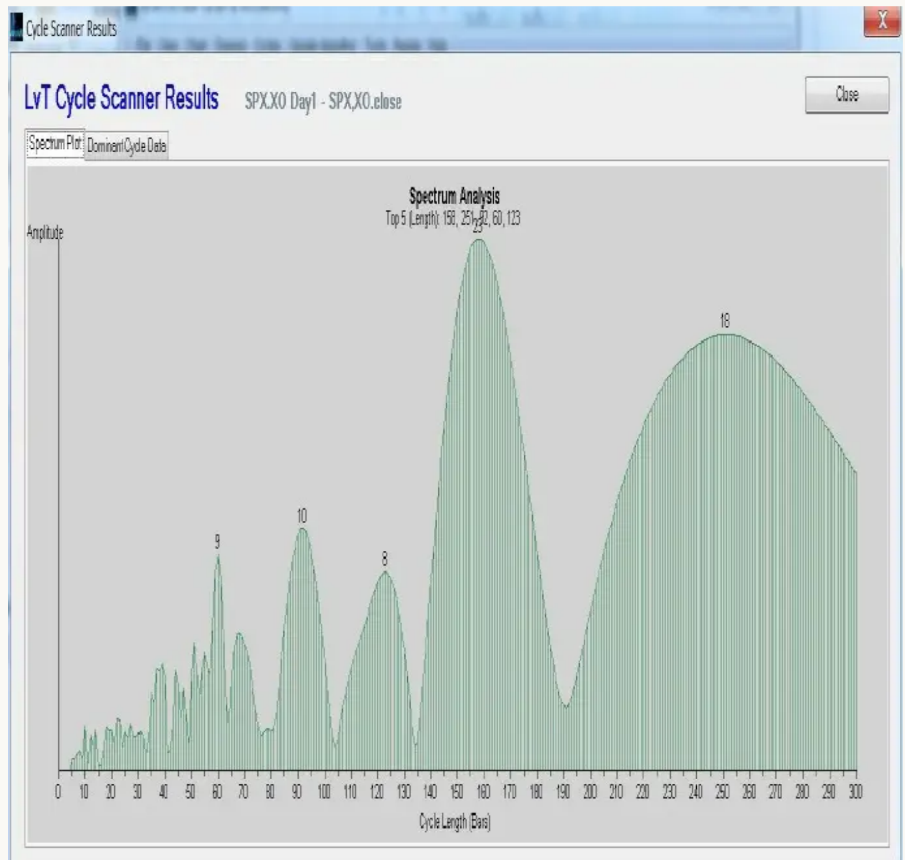

**Figure 2-36:** Cycle Spectrum Plot

The header of the Cycle Data tab provides basic information about when the analysis was carried out, which data were used for the analysis, and the setup.

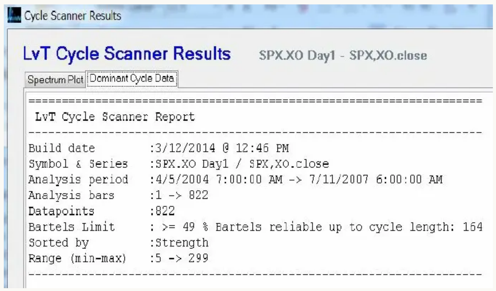

**Figure 2-37:** Cycle Analyzer Log Header

The second part of the cycle data tab contains the table with the spectrum analysis results. The detected cycles are sorted by cycle strength or amplitude (as indicated in the header).

Each cycle line includes the following information:

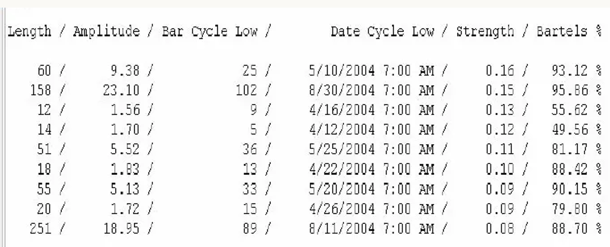

**Figure 2-38:** Cycle Parameter

### 2.6 Cycle Scanner – Excel Workbook

The Excel workbook allows you to analyze raw data with the Cycle Scanner. The output is like the results in the WTT charting platform. Ensure you enter a working API key in the top-left corner. The dataset to be analyzed must be placed in the worksheet’s "dataset" column A. Once updated with your chosen data, the "Update" button calls the API queries.

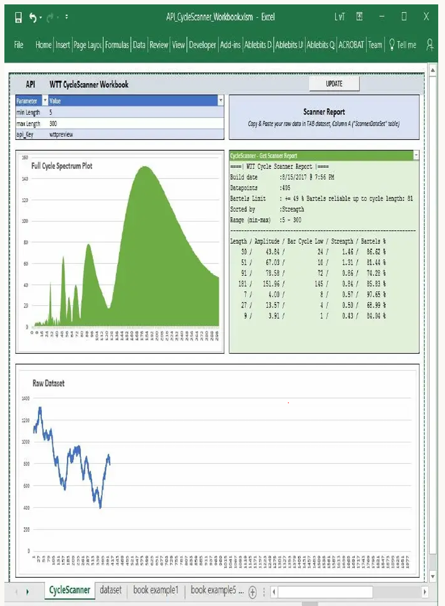

**Figure 2-39:** Cycle Scanner Excel Workbook

Download the Cycle Scanner Excel Workbook: [www.whentotrade.com/Excel/CycleScanner](https://www.whentotrade.com/Excel/CycleScanner)

### 2.7 Cycle Scanner – NinjaTrader Script

Integration of the Cycle Scanner API allows readers to use the scanner toolset to receive current active cycles for any dataset from any platform. The provided NinjaTrader indicator displays the Cycle Scanner results in the output log and the active cycles in the top-left corner of the chart window. A more detailed description of a similar script’s source code is also available in Chapter 6.6.

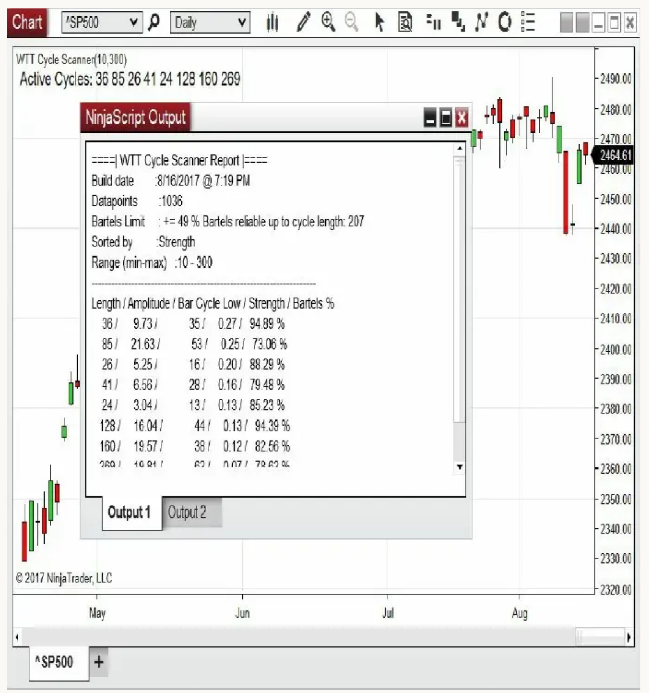

**Figure 2-40:** Cycle Scanner Indicator NinjaTrader in Action

Download NT8 NinjaTrader Source Code

Ensure you use a valid personal API key or use the public test key wttpreview to start your first cycle analysis from our cloud for free. [www.whentotrade.com/NT8/CycleScanner](https://www.whentotrade.com/NT8/CycleScanner)

### 2.8 Cycle Scanner – API Endpoint Specification

The CycleScanner allows you to analyze an individual time series array and returns the cycle spectrum for the dataset under consideration. In addition to the entire spectrum, the response contains a list of peaks in the spectrum to identify the corresponding cycle length.


```text
POST "https://api.marketcycles.online/api/CycleScanner?api_Key=..&.."
```

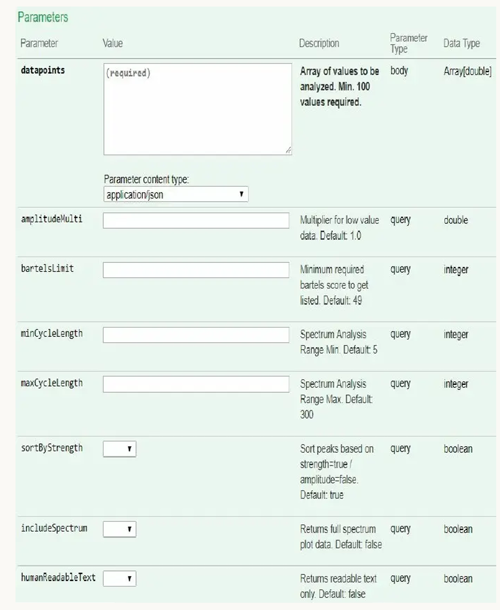

Documentation: [www.whentotrade.com/apidocs/CycleScanner](https://api.marketcycles.online/swagger/ui/index#!/MarketCycles/PostCycleScanner)

### 2.9 The Cycle Plotter

The Cycle Plotter can plot up to eight individual cycles on the chart. The plotter is also capable of constructing a composite from all cycles. The plotter is used for sample datasets and to "verify" the results of the Cycle Scanner. You can use the plotter to manually plot different cycles on the chart. It can also be used for learning purposes and to reconstruct the examples presented here.

#### LvT_Cycle_Plotter

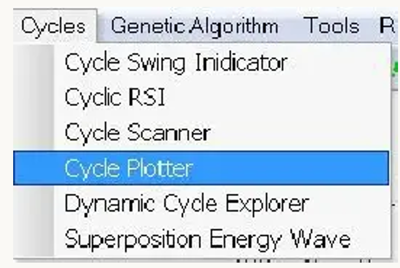

Parameters:

The parameters should be self-explanatory. Just play with them a bit. However, I want to mention an important benefit:
You can directly roll over the results from the Cycle Scanner’s data tab into the Cycle Plotter. Simply press the button in the upper-left corner of the settings window labeled "Load Scanner Peaks," and the results will be populated into the settings screen from the last Cycle Scanner analysis run.

This makes it very easy to check the results of a detected cycle on the chart.

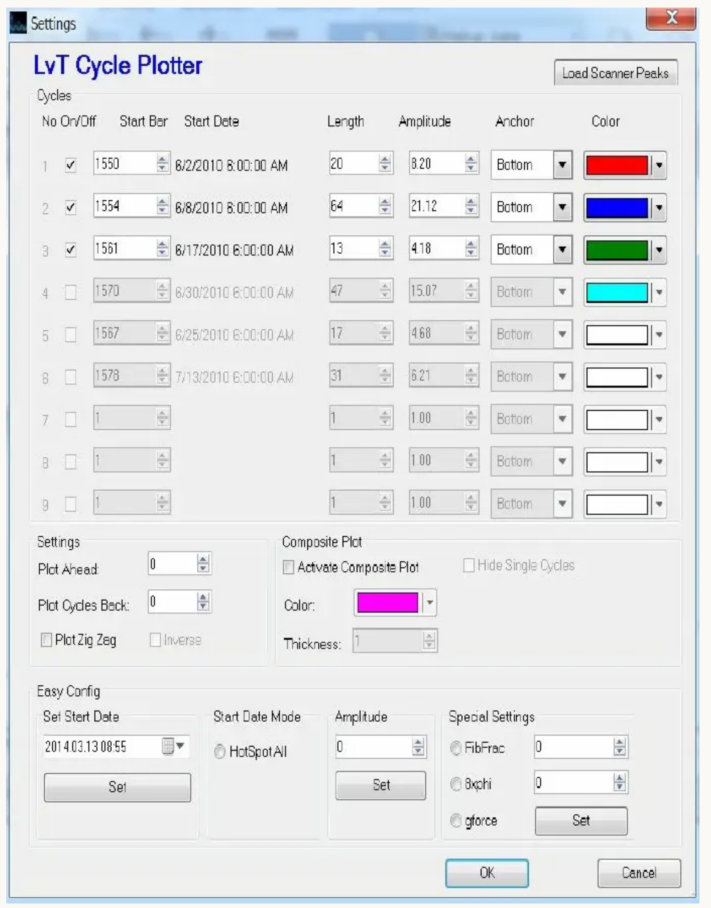

**Figure 2-41:** Cycle Plotter Parameter

Finally, the cycle will be plotted based on all information derived from the Cycle Scanner. And using the "Enable Composite Plotting" option, you can switch between a composite plot of all cycles or an individual plot.

#### Using the Cycle Plotter in Wave59

It is a bit different to do this within the Wave59 Cycles plug-in. However, you can copy and paste the results from the script log into the Cycle Plotter manually. Here is how to do it:

##### Step 1: Copy the Full Line for the Cycle from the Output Log

First, select a full line including the quotes and press CTRL+C or right-click.


##### Step 2: Open the Start Date Parameter in the Cycle Plotter

Switch to the table and insert the Cycle Plotter or configure the Cycle Plotter indicator and open the start date of the wave you want to use. Mark or delete the information.


##### Paso 3: Pasta línea completa de registro analizador ciclo

Presione CTRL + V o haga clic en el botón derecho del ratón y "pegar" para insertar la línea completa.

Posteriormente, el guión va a reconocer que toda la información ciclo se ha entrado en esta línea y por lo tanto no tenerse en cuenta los siguientes campos individuales para la duración del ciclo y la amplitud.


