# Decoding the Hidden Market Rhythm

## 6. CYCLE EXPLORER DYNAMICS: PREDICTING MARKET TURNS

We’ll now explore alternative ways to use cyclic information for trading. Traditional cycle approaches rely on two critical factors:

First, the cycle detection algorithm is decisive. Which dominant cycle should be used for forecasting or tuning technical indicators? If the wrong cycle is detected on the "left side" of the chart, every trading approach and forecast will fail on the "right side." We’ve already introduced our cycle scanner framework to solve this.

Second, even if the right cycles are detected, financial market cycles aren’t "static." Despite their dynamic nature, traditional approaches project cycles as simple or composite static waves into the future. Dominant cycles continuously vary in length, amplitude, and phase shift due to their internal core parameters. This means a dominant 80-day cycle might fluctuate between 76 and 84 days—it remains an "80-day" cycle, but its contraction or expansion isn’t detectable if you rely on a simplistic static projection.

Most cycle systems fail over time due to one of these two issues. For successful cycle trading, accept that no cycle detection algorithm can fully handle financial data’s characteristics. Even more crucially, cycles have a dynamic nature and won’t stay static over time.

These facts aren’t new. Yet, I haven’t found any tool or approach addressing both problems. Traditional financial market cycle approaches haven’t advanced much since Hurst’s work and digital signal processing math—variations exist, but no real progress. Now that we can detect genuine cycles with our cycle scanner, we need an additional approach to handle their dynamic characteristics.

> This leads us to the dynamic approach: the **Cycle Explorer**, introduced next.

So far, I’ve shown how to detect cycles and tune indicators using the dominant market vibration length from our cycle scanner. But the dominant market vibration score can be used differently. Another approach is determining which actual cycle is dominant at each new bar. Once we know the cycle’s wavelength, we can apply specific techniques to identify its real phase. The phase tells us when to expect the next major high or low in the market.

I consider this dynamic because cycles constantly change in phase and wavelength. That’s why static cycle frameworks often fail in financial markets. You can detect cycles based on past data, but applying this static information (wavelength, amplitude, phase) to forecast future periods ignores that the identified cycle’s phase, amplitude, and wavelength will vary over time. This effect is often paraphrased in articles as: "Cycles appear and disappear."

### 6.1 Introducing the Dynamic Cycle Explorer Method

Now, I’ll introduce a dynamic approach for building tradable forecasts. Every time a new bar appears, we reassess the dominant cycle in terms of wavelength, amplitude, and phase offset. Then, we plot this cycle into the future—but focus only on the next expected turning point. We’ll call this turning point **ETA (Estimated Time of Arrival)**.

As we move forward in time, each new bar updates the next expected turning point. This dynamic forecast, based on the current dominant market cycle, provides real-time insights into when the next turning point will occur and its direction. The ETA updates with every new bar.

The difference between this and many cycle researchers’ approaches is now clear. I don’t apply a static cycle framework and try to fit the market to it. You often read about the importance of the 4-year cycle, 50-week cycle, or 7-year cycle and how these "static" cycles apply to real market conditions.

That’s not my approach. I don’t offer a static cycle framework. I provide a dynamic model that identifies which cycles are active at any given time. I use this method to stay "prepared" for major market turning points, not to blindly trade ETAs. However, when combined with other tools like Fibonacci levels, it creates powerful trading setups.

Charts speak louder than words. But first, let me introduce some new indicators and tools. So far, we’ve developed a new method for detecting cycles in financial instruments. When applying cycles to trading, we also need visual information about cycle presence in the given data. Focusing solely on theoretical cycles isn’t enough.

We must isolate the current cycles with detected wavelengths from the available financial data. These cycles won’t look like sine waves. Markets aren’t as clean as sinusoidal cycles—they continuously change in amplitude, phase, and wavelength. Thus, the detected cycle will differ from a theoretical sine wave structure. But we need past visual information to verify our "theoretical" cycle and the financial instrument’s actual cyclic behavior with this particular wavelength. We must filter out all cycles with wavelengths longer or shorter than our selected period. Ultimately, we only want to observe the financial data’s behavior relative to our chosen cycle length.

Now, we can overlay the relevant information we have for the detected cycle length:

- The isolated cyclic price behavior based on our wavelength;
- The theoretical cycle (sine wave plot) based on the detected phase and amplitude.

This information is invaluable for analyzing past price behavior. We can now see the recent phases and amplitude changes of the cycle. We can build a "visual correlation" between the theoretical cycle and the cyclic price behavior.

#### Plotting Price Cycles in Financial Markets – Visualizing Price Cycles

First, we need a method to isolate individual cycles from price data. We must find a way to plot the cyclic behavior of price data, not just the theoretical cycle. One way is to filter out all longer and shorter cycles.

Much has been written about these techniques. I won’t repeat all algorithms here. A highly effective way to filter longer and shorter cycles is using a special subset of two centered moving averages. This method was first introduced by Brian J. Millard in his book *Channels and Cycles: A Tribute to J.M. Hurst*. It’s called the **"Smoothed Detrend"** or **"Cycle Highlighter."**

His cycle isolation method is superior because it requires only one value: the wavelength of the cycle we want to isolate.

To apply this technique, a centered moving average with a length equal to the cycle’s wavelength is set. A second centered moving average is then calculated with half the length. Finally, the difference between these two averages is determined.

If you want more details on using centered moving averages to extract cyclic information, I recommend reading Millard’s book. Millard’s technique is useful because our new cycle detection engine (introduced in the previous chapter) provides the value we need—the cycle’s wavelength.

We can use the detected dominant market vibration value as input for the cycle highlighter. Now, we can discern the cyclic behavior of price data from the past.

As with all centered averages, the difference between the two averages will show missing points at the plot’s start and end. Thus, this technique can’t help build forecasts, but it helps visually understand the cycle and compare the detected cycle with past cyclic price behavior.

So, I’ll extend the cycle highlighter method, taking the basic idea further. I’ll call this new approach the **"Dynamic Cycle Explorer."** This technique has a built-in cycle highlighter. A critical factor when using dominant cycles for forecasting is comparing the isolated cyclic price movement of the past wavelength with the theoretical dominant cycle based on actual phase and amplitude information.

When we overlay all the obtained information, we get a visual tool for detecting past phase and amplitude changes. This tells us how "reliable" or "stable" this cycle was in the past. We’ll also use this information to fine-tune our displacement points (the last low or high) for cyclic analysis.

The next figure shows all elements of the Cycle Explorer technique. For demonstration, I used data from the first chapter example. We know this data includes a 30-day natural cycle. The chosen date for real analysis is April 1, 2007.

This is what the Cycle Explorer shows:

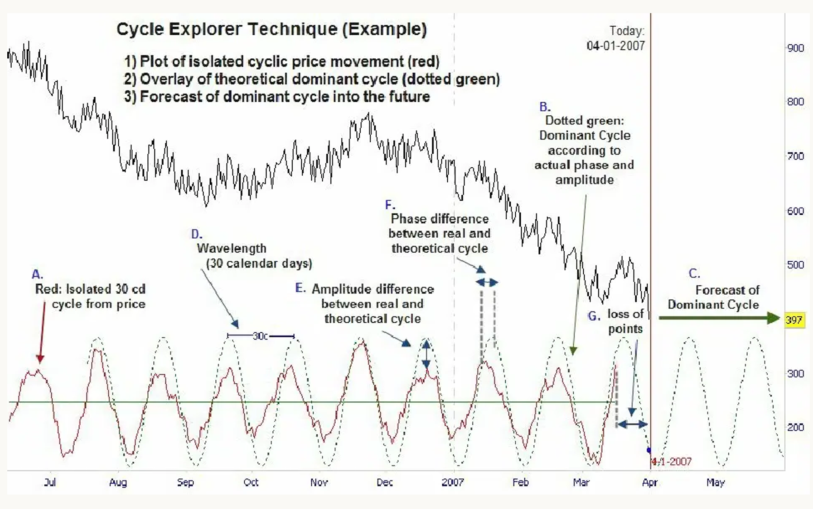

**Figure 6-1:** Elements of the Cycle Explorer Tool

##### Key Cycle Explorer Factors

1. Isolated Price Cycle (Red Line)
   The red line is the cyclic price behavior extracted with a 30-day natural length. All other elements are filtered out. The method used here is Brian J. Millard’s cycle highlighter.

2. Dominant Cycle Plot (Green Dotted Line)
   This includes a built-in mechanism to detect the offset and amplitude of the given 30-day natural cycle based on real price information. The offset low here is January 4, 2007. Thus, we know the cycle’s current offset.

   Using this information, the theoretical (sine wave-like) cycle is plotted backward as an overlay. Now, we can discern the relevant information: the real cyclic price behavior and the ideal cyclic movement for the given 30-day natural length.

3. Forecasted Cycle
   Based on the determined phase state of the 30-day cycle, the cycle is projected forward. Thus, we can detect future turning points of this ideal cycle.

4. Current (Detected Dominant) Cycle Length
   The detected cycle length is marked on the chart—here, a 30-day cycle. This length was automatically detected by the Cycle Explorer tool.

5. Price and Cycle Amplitude Difference
   This is a key visible element: at each cycle’s valley and peak, we compare the ideal amplitude with the real amplitude of both plots. The amplitude difference reveals whether this cycle length was active during the given period.

   Thus, we can observe the dynamic flow of cycles disappearing (cyclic price amplitude drops to zero) and reappearing (amplitude matches the ideal cycle).

   This is the first indicator capable of visually showing when a cycle disappears or is present.

6. Phase Difference (High/Low)
   The other information we can now obtain is the deviation of the last high/low shifts between cyclic price movements and the ideal cycle. We can determine whether the cyclic component based on the given wavelength is stable (in sync) or not.

   To do this, we look at the last turning points of the ideal cycle. The closer the isolated price cycle’s turning points are to the ideal cycle’s, the more synchronized they are—making forecasted turning points more reliable regarding timing.

7. Missing Points
   The algorithms using centered moving averages for the cycle highlighter show missing points at the plot’s end. This equals half the selected cycle length. In our example, we can’t see the real cyclic price movement for the last 15 calendar days.

   For forecasting, plotting the theoretical cycle into the future with the current phase offset is crucial. You’ll see the green dotted line smoothly continues the red line.

We used example cyclic data to show how this indicator works. The red line closely follows the ideal green line because we used theoretical cycles for this model. The difference arises because trends and random noise were added to the test data.

When you see a "good match" between the isolated price cycle and the ideal cycle, there’s a high probability that the right-side projection will be valuable for trading. Let’s see this in an example.

This would be our "ideal" forecast based on the 30-day cycle projection—zooming into the previously shown chart:

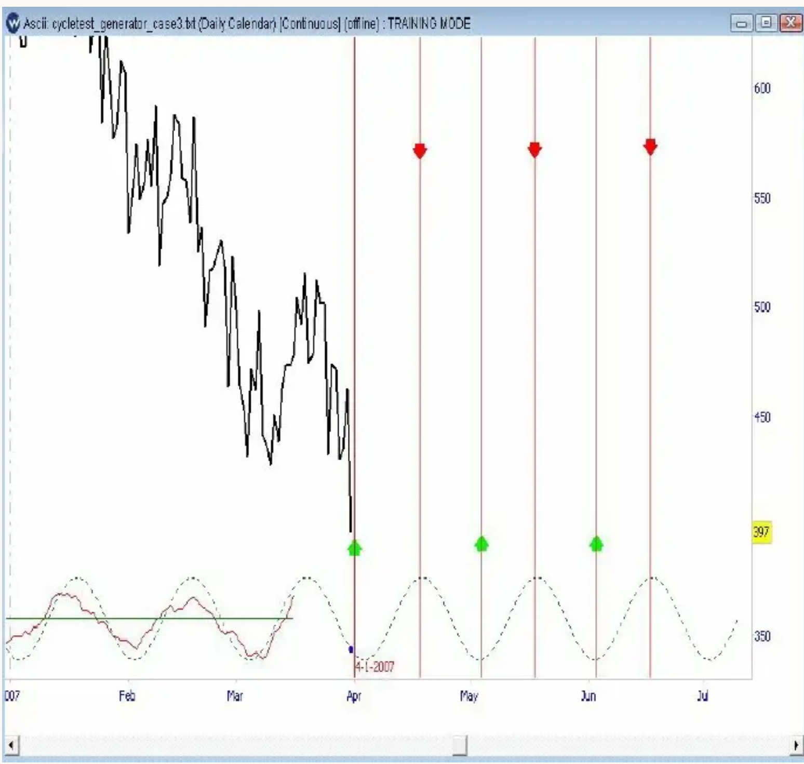

**Figure 6-2:** Ideal 30-Day Cycle Projection

And this would be the result of this sample dataset:

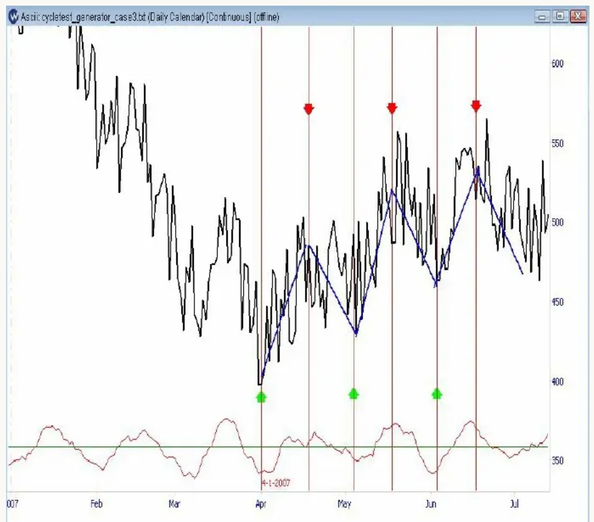

**Figure 6-3:** Result of the 30-Day Cycle Projection

In other words, if you have a "good match" for the identified cycle length between the isolated cyclic price movement and the ideal cycle, the cycle projection will be valuable for the chart’s right side and trading.

Cycles can only be used predictively when they’re in a regular phase. This example demonstrates that. Now, let’s review another example with a cycle length not present in the data using the **Manual Cycle Explorer**.

The difference between the Dynamic and Manual Cycle Explorer tools is that the dynamic engine automatically detects the dominant market vibration. In the Manual Cycle Explorer, you manually set the cycle length you want to examine.

Our example shows how to "check" whether a static cycle chart will work for projection. Let’s test if a 46-day cycle length is present in the market. We manually input the value 46 into the Manual Cycle Explorer tool. (Note: This cycle isn’t present in the sample dataset from the first chapter.)

The Manual Cycle Explorer produces the following figure:

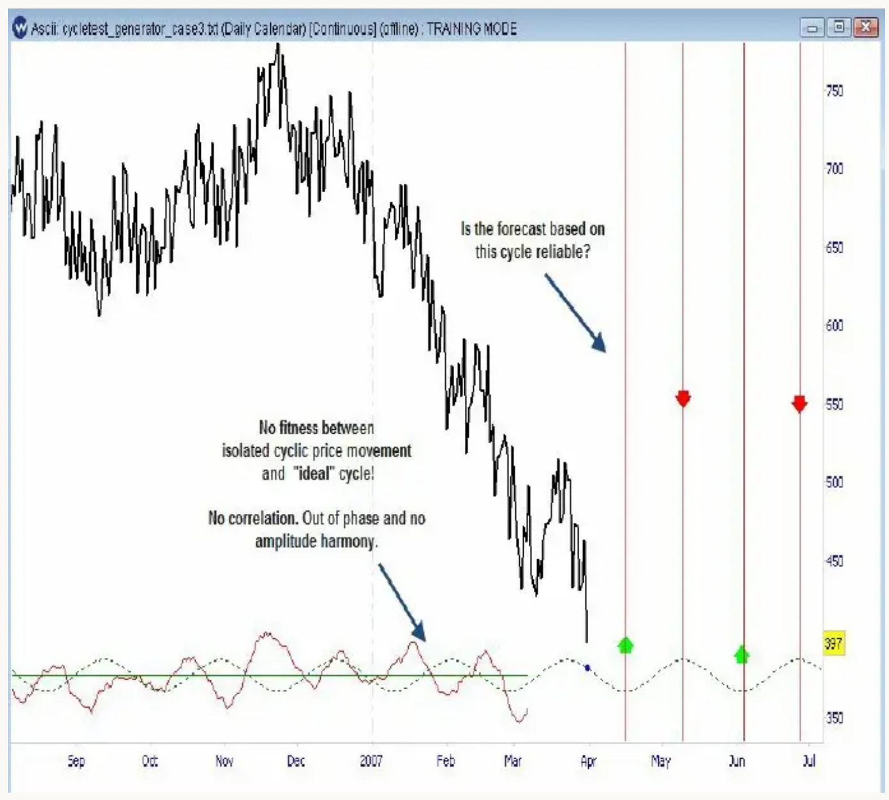

**Figure 6-4:** Manual Cycle Explorer Example

The critical information is visible in the chart. The ideal 46-day cycle and the isolated cyclic price movement of the same length aren’t synchronized.

Neither phase (high/low between both lines) nor amplitude correlate highly. As mentioned earlier, you shouldn’t use this cycle for forecasting!

However, without the ability to review past data for a given cycle up to the present, you can’t verify the cycle’s validity. You’d have to blindly "trust" newsletters and hope they’re correct. Now, you have a powerful tool to analyze predictive information across current cycles.

In our example, visual inspection alone told us not to use this cycle length for trading.

But let’s review the full example. The market turning points forecasted based on this cycle are marked with arrows in the records.

The next chart shows what would have happened if you traded this cycle:

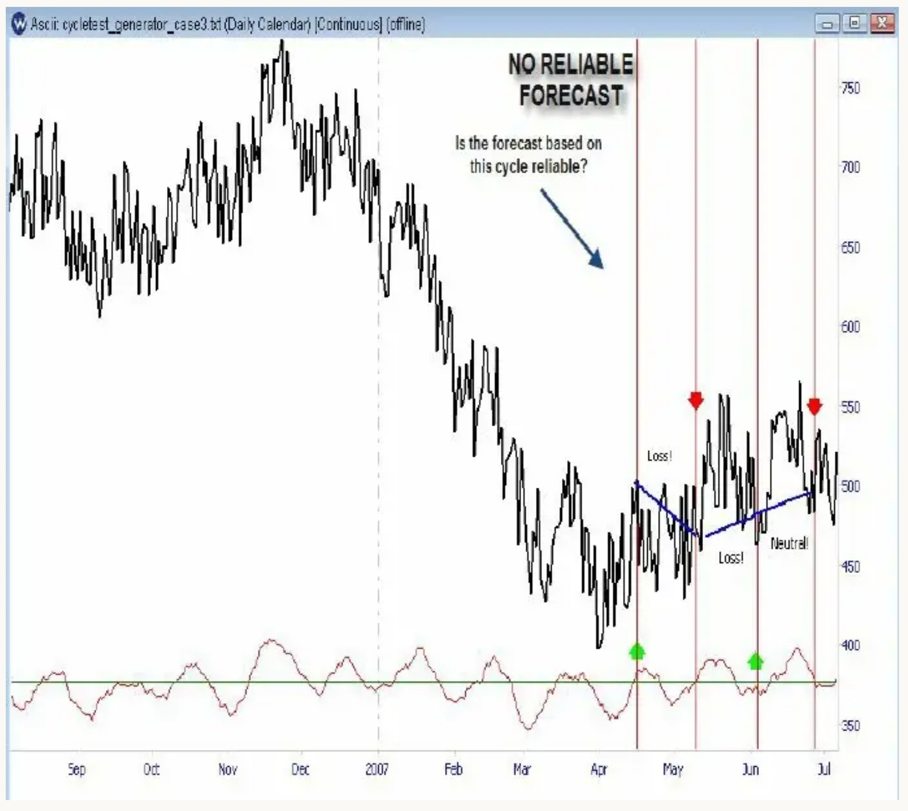

**Figure 6-5:** Review of the 46-Day Cycle

No tradeable information would have come from this cycle.

Now, it’s clear: If there’s no match in past data, don’t use the given cycle’s projection!

These examples show how vital information about different cycles’ states can be determined using market data. This lets us identify which cycles are in a regular phase—when their contribution to the overall movement can be estimated—and which cycles are in a disordered phase based on price action.

You can now sort cycles usable for forecasting from those you shouldn’t use.

#### The "Dynamic" Component of Cycle Explorer

The Cycle Explorer is a combination of three fundamental tools:

1. The plot of the isolated cyclic price movement.

2. The plot of the "ideal" cycle based on the actual phase and amplitude in the past.

3. The projection of the "ideal" cycle based on the actual phase and amplitude into the future.

But this new tool has an additional built-in feature:

The **automatic detection engine for the real dominant cycle**. This means you don’t have to input the wavelength you want to examine. The wavelength is automatically detected using our powerful algorithm introduced in earlier chapters. Just select a significant past turning point as the starting point for automatic cycle analysis. The tool will then display all relevant information mentioned above.

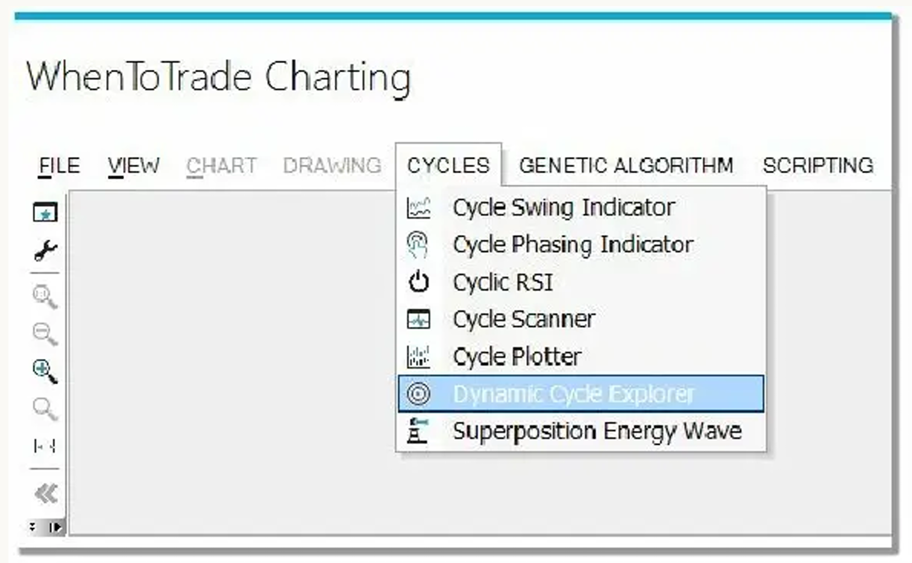

The best part? A new calculation is performed at every new bar. In other words, no "static" cycle is used here.

The real dominant cycle is determined at every new bar. The Cycle Explorer indicator updates with each new bar. You can apply this technique to any timeframe.

Now, you have the new Dynamic Cycle Explorer toolkit at your disposal, ready for any financial instrument.

If you want to check static cycles, you can also use the manual version. Just input the cycle length you want to explore, and the chart will show its suitability.

In the next chapter, I’ll demonstrate how to build tradable forecasts using this new powerful indicator alone.

#### Using Cycle Explorer for Quality Control in Static Cycle Frameworks

Even if you don’t plan to use this method, the Cycle Explorer is valuable for evaluating static cycle frameworks. If you read a cycle newsletter stating that "the 50-week cycle is about to bottom," switch to a weekly chart, set the Manual Cycle Explorer to 50 weeks, and compare the actual cyclic price data of this length with the "ideal" cycle.

You’ve now gained the knowledge to "check" whether this information is reliable for trading on the chart’s right side.

You can perform quality control for any static cycle on your own. The Cycle Explorer will show recent phase and amplitude changes of this cycle.

You can verify whether any given cycle is active, in sync with the market, or has disappeared.

This gives you a technical indicator to monitor cycle expansions or contractions at every new bar. Cycles continuously expand and contract from their original wavelength.

This is what often causes static cycle approaches to fail. Now, you can measure the cycle’s "flow."

Walter Bressert first proposed that trading on the idea of fixed time intervals (static cycles) is unrealistic. The Cycle Explorer builds on this idea, evolving into a visual indicator for the first time in practical trading.

This tool can also verify information included in many cycle newsletters and static cycle frameworks of a given length.

#### Cycle Explorer as a Visual Confirmation Tool

You might ask:

> "Why do we need the Dynamic Cycle Explorer when the algorithm from earlier chapters already detects the most dominant cycle?"

You have a point. If the algorithm is superior, we wouldn’t need this visual tool. But I still don’t fully trust my own engine providing dominant market vibration information. I know the algorithm works. Yet, putting money on the line is also a "mental game." I need visual confirmation—I need to see it with my own eyes! The cycle scanner engine is thus a "left-brain" tool—proprietary digital signal processing. The Cycle Explorer’s visual plotting engine is a "right-brain" tool. Seeing the correlation between actual cyclic price movement and the ideal cycle for the given dominant length sends my brain a "green light" to put money on the line.

That’s critical. Most cycle research only presents ideas on building forecasts. I wanted a visual confirmation tool revealing cycle suitability at a glance.

When the Cycle Explorer image on the chart’s left side shows a well-matched cycle, I can use the given projection on the right side for real-money trading.

### 6.2 Building a Forecast Based on the Dynamic Cycle Explorer

Now, I’ll share examples of how this concept has guided me over the past year. Again, my approach doesn’t involve cherry-picking or curve-fitting. These examples were published in real-time to a small trusted cycle group. If any reader remains skeptical after reading my book, I’ll gladly prove these examples were published in real-time.

This book is the first to present the technique I’ve used to produce these forecasts. After reading it, you’ll also be able to apply this method. I’m revealing all relevant information and introducing all required tools in this book. Treat this newly acquired knowledge with respect—misused, it could be ineffective. Used correctly, it’s crucial to unlocking financial market cycles’ power.

As seen in the introductory chapter on the cycle detection engine, more than one cycle is always active in the market. Now, I’ll introduce a forecasting method using **two dominant cycles**. This model incorporates the idea that we must consider both long-term and short-term cycles together. Therefore, we’ll observe the dominant cycle for a short-term period and one for a long-term horizon.

All we need to do is set our Dynamic Cycle Explorer to extract the dominant cycle for a given window. We’ll use these two window sets to determine dominant cycles:

- **Short-term dominant cycle window**: Wavelength range between 20–100 bars.
- **Long-term dominant cycle window**: Wavelength range between 100–200 bars.

If working with daily charts, I recommend using calendar days for cyclic analysis—**not** trading days. The main influence on daily charts comes from external forces (like astrological cycles), which don’t pause on weekends when trading stops.

#### Step-by-Step Guide to Building a Tradable Forecast Model (S&P Index)

Let’s start with an example shortly before the major market low in February 2009. We’ll check if we could have predicted the March 2009 low using our forecasting technique.

**Current Date:** February 25, 2009.

##### Step 1: Detect and Project the Short-Term Dominant Cycle

Use the Dynamic Cycle Explorer tool (found in the WTT Main Menu).

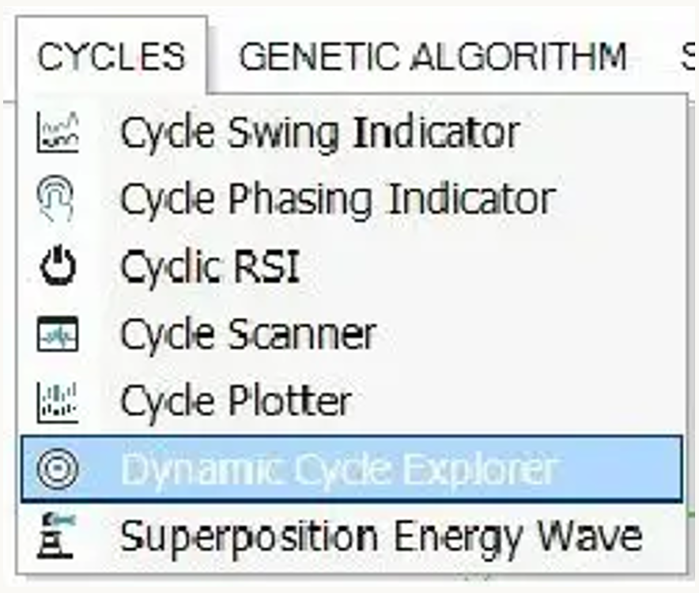

###### A. Set the Dynamic Cycle Range Filter (Min./Max.)

Set the cycle length range you want to monitor when opening the script in the input parameter. For example, monitor the short-term dominant cycle on a daily chart using a 20–100 interval.

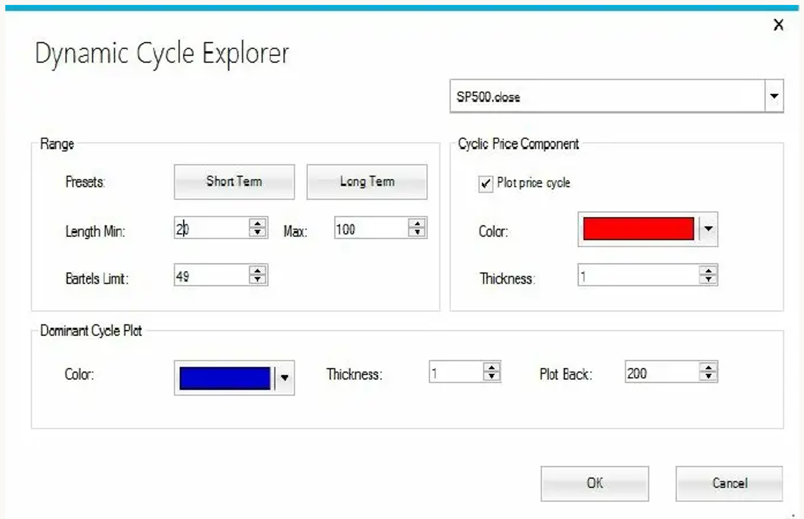

After adjusting the parameter, set the back-review period’s starting point by clicking a hotspot on the chart with the mouse. The range is needed so the embedded Cycle Scanner engine automatically identifies the most active cycle within this range.

###### B. Set Anchor Start on the Chart Using the Mouse

The anchor is used to identify the dominant cycle’s period via proprietary Fourier analysis routines from the real data point (last bar on the chart) back to the anchor point. This determines how much historical data is used for cycle detection. If identifying longer-term cycles, use a longer history period. For short-term cycles, a shorter timeframe works. Dominant cycle detection works best using major market lows or highs as the anchor point.

Check the correlation between the dotted and red plots. If there’s a good match, you can be confident that the identified dominant cycle (dotted sine wave cycle) is in sync with the real market’s cyclic behavior (red line).

Here, we’ll use the major low on **July 15, 2008**, as the starting point. This fixes our back-review period for cycle analysis: **July 15, 2008–February 25, 2009.** Using 7–8 months of data for cycles up to 80/100 days is acceptable. We thus have a significant low and sufficient data for detection algorithms.

The example below shows the 20–100-day calendar range in the daily S&P 500 with the anchor point set to July 15, 2008. The algorithm automatically identifies the most active cycle length between 20 and 100 days. It also checks real phase and amplitude settings. The identified cycle is plotted as a dotted-line indicator. The given cycle length is also extracted based on current price and plotted as a continuous line. Thus, we can compare the cyclic price behavior for the given length with the theoretical cycle.

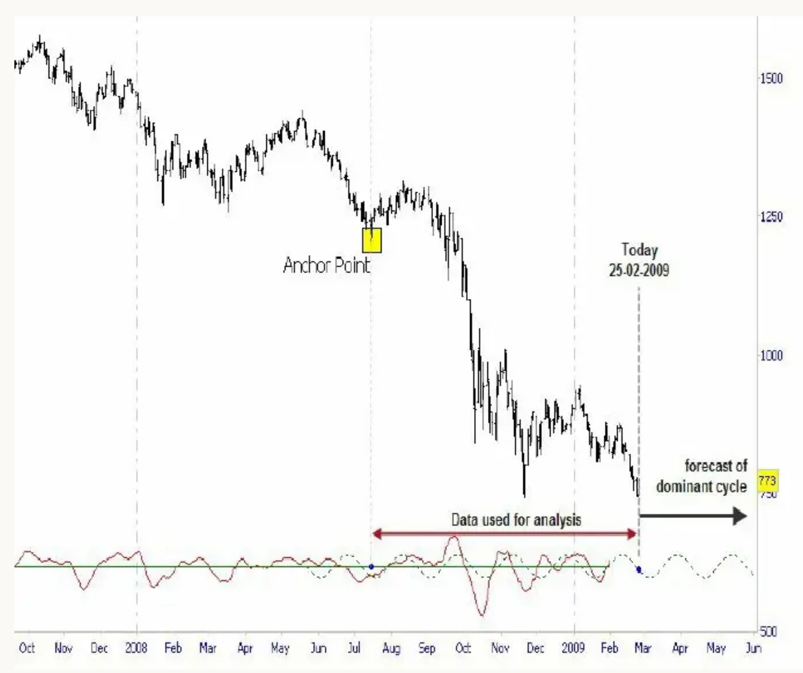

**Figure 6-6:** Short-Term Dominant Cycle

###### C. Verify the Detected Dominant Cycle Type’s Correlation with Cyclic Price Movement

You can only follow the dominant cycle if there’s a good correlation between cyclic price data (red indicator) and the sine wave cycle (green dotted line). Visually check the turning points of the theoretical cycle (green dotted line) and the real price behavior aligned with the detected wavelength (red line).

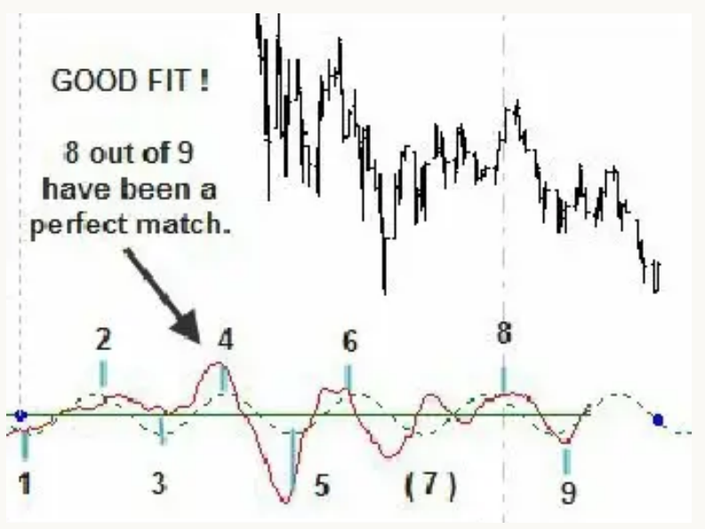

**Figure 6-7:** Verify Detected Cycle Type and Price Behavior

The market low used here as the anchor identified a dominant cycle with eight perfect turning points in the last four cycles. Only point 7 was off. This example proves this cycle was truly active in past price action.

###### E. Plot the Holder Indicator for Additional Information

Information on the identified dominant cycle will be printed in the holder indicator.

Here, we have a short-term dominant cycle with a wavelength of 32 bars (trading days) or approximately 46 bars (calendar days). We don’t need this number for our trading forecast. This number is purely informational.

In Wave59, you won’t see the cycle length directly on the chart. Instead, open the script log to view the current detected cycle length.

###### F. Use the Cycle for Projection

Now, use the cycle information to project future market behavior based on the short-term dominant cycle. It projects a low at the start of March.

###### 1. Initial Projection

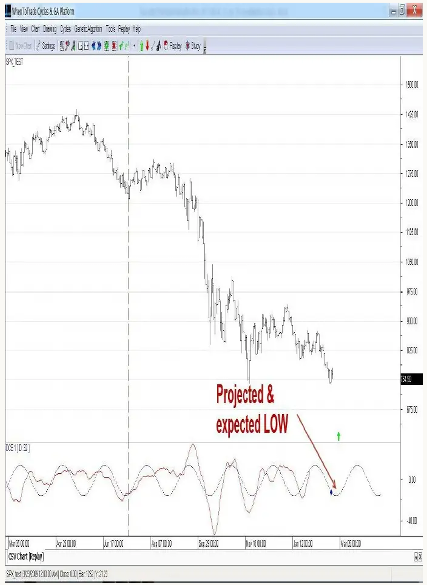

###### 2. Update and Verification at the Expected Arrival Time

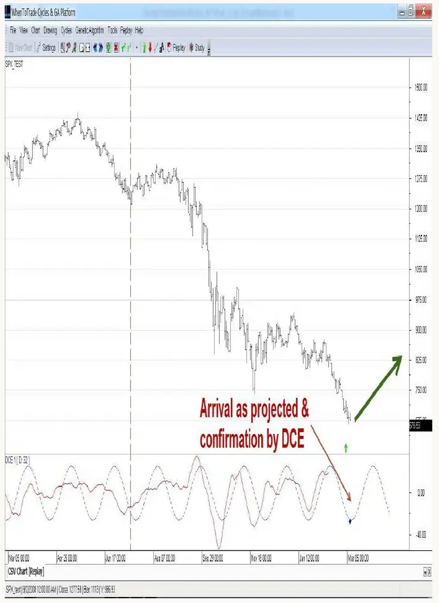

###### 3. Post-Fact Outcome & Initial Projection Result

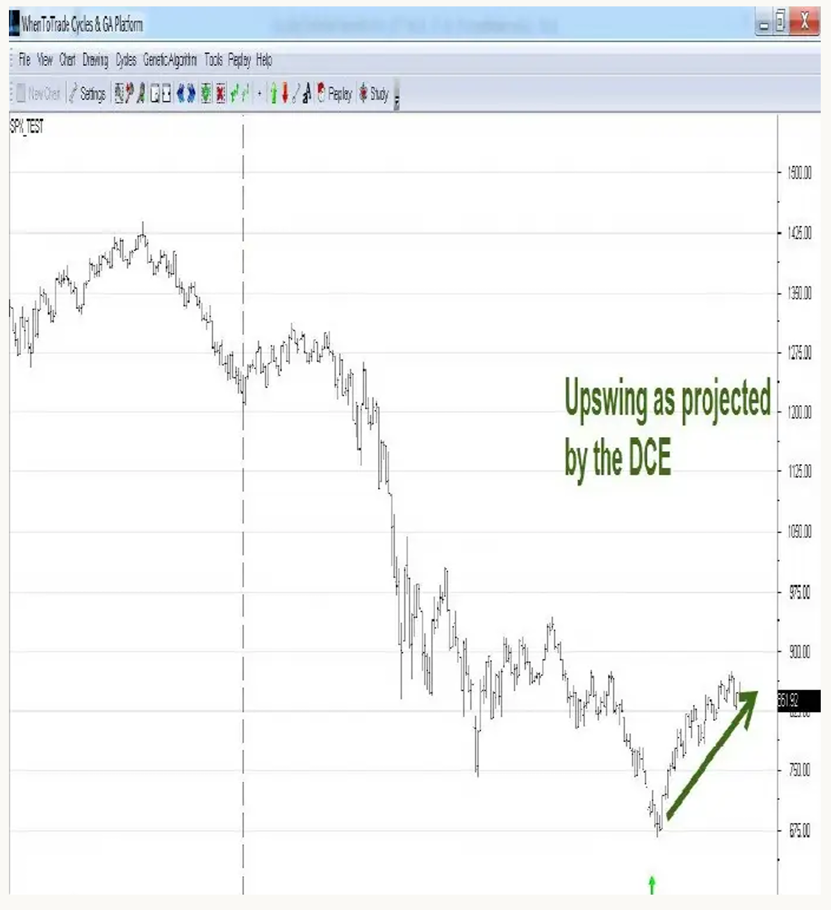

*Note:* I don’t recommend relying solely on short-term dominant cycles for forecasting. The best forecasts—based on my research—combine a long-term dominant cycle with a short-term one for better major turning point alignment.

Let’s add the long-term dominant cycle projection to our model.

##### Step 2: Identify and Project the Long-Term Dominant Cycle

###### G. Set Up an Additional Cycle Explorer

In this example, another cycle explorer is added to monitor a long-term dominant cycle of 100–200 wavelength (input parameter).

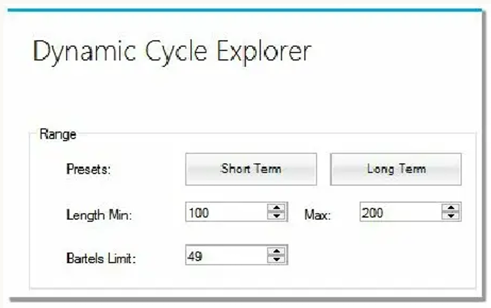

**Figure:** Range of parameters

Repeat steps A–D described earlier.

Set the anchor further back in the past due to a longer cycle requiring more historical data for detection Here, we used a major market high on **October 11, 2007.**

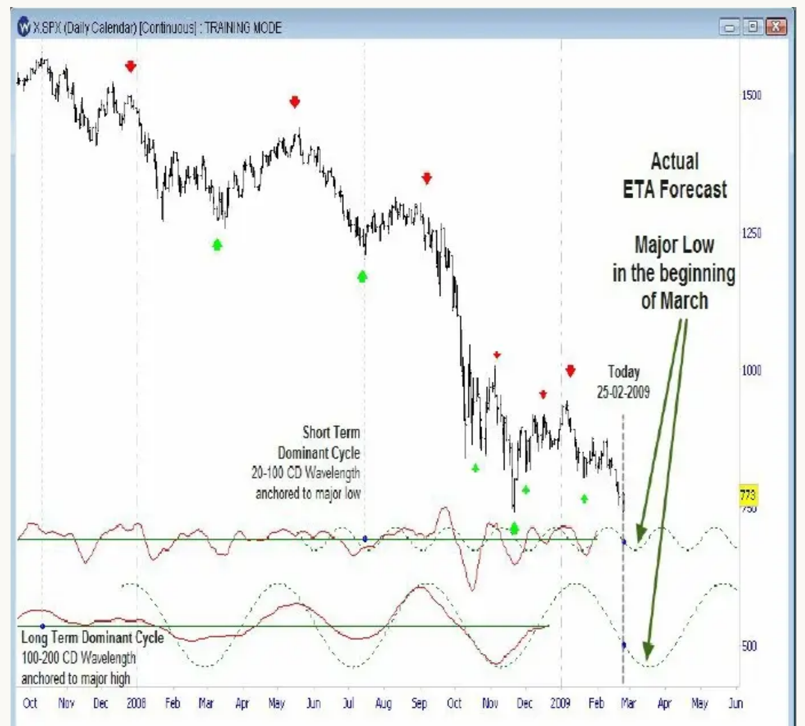

**Figure 6-8:** ETA Forecast for the Next Turning Point

Now, we see both dominant cycles on one chart. Again, visual inspection of the long-term dominant cycle shows a good match between the ideal cycle and cyclic price movement (red and green dotted lines). We can see this will be achieved in early March. Both cycles project a future low at this point. These cycles are plotted separately but are both included and add together in price data. Expect major market turning points when both dominant cycles forecast a low/high at the same date.

I call these situations **ETA (Estimated Time of Arrival)**. It’s like a car’s navigation system—the system tells you when to expect arrival at a point. Similarly, this technique tells us **when** (regarding time and direction—not price) we’ll reach the next major market turn.

Here, we’re warned of a major market low at the start of March 2009. But note: we didn’t select a fixed cycle framework. We only chose significant highs/lows and entered random ranges to search for dominant cycles Dominant cycles were detected fully automatically. Additionally, the same low was projected in March using trading days for the analysis.

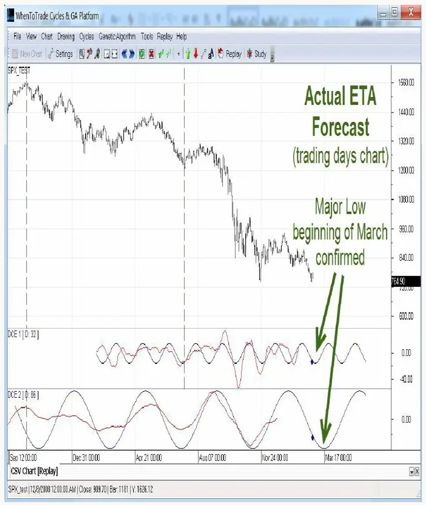

Seeing the same projection on both calendar and trading-day charts makes the signal even more trustworthy. I recommend checking both timelines.

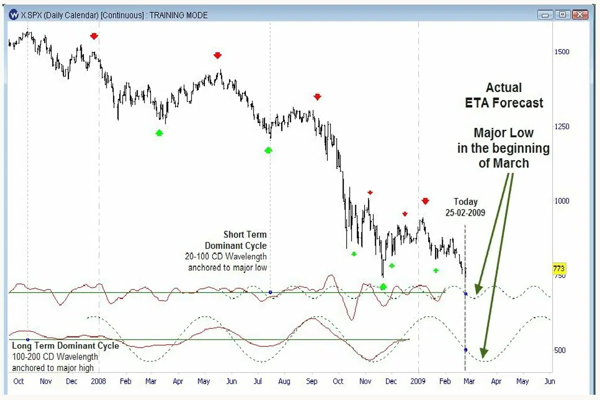

**Figure 6-9:** Full View of the ETA Projection Based on Cycles

You’ll also see six good turning-point matches between the sine wave cycle and real market behavior for this long-term length. Turning points matching the detected cycles are marked with red and green arrows. Thus, these cycles show high correlation with major turning points over the past year.

##### Step 3: Project the Next Major Turning Point

Now, apply the cyclic information from both long- and short-term dominant cycles to build our projections. Both cycles point toward a low in early March and will rise until the end of the month. Crucial turning points arise when dominant short- and long-term projections align—when both cycles reach a low simultaneously, the market will likely also bottom.

Thus, on February 25, you’d be notified that with the S&P 500 at 773, the long downtrend might end in early March. Closely watch other indicators in the coming weeks to fine-tune short position closings and prepare for a long market entry. We’ve built our first projection for the next ETA—the next turning point based on two dominant cycles. The key point: these tools automatically identified dominant cycles—no need to apply a static cycle framework. No need to pore over charts to detect cycles. Everything is done for you—just input the cycle range and select the last major high/low.

One of my main goals was encoding all cycle factors with great ease of use for trading. From a trader’s perspective, this can be done in minutes.

Let’s move forward to see what happened in early March 2009.

###### Updating the Forecast After the Predicted Turning Point / Polarity

Let’s fast-forward to **March 26**, using the same chart with the same indicators—no parameter changes. This date is interesting because we now see a solid low—as projected—in early March. The next question is how the market will develop.

Let’s apply the same method. I’ll introduce another forecasting method based on the two dominant cycles: **a polarity forecast.** First, check when both cycles reach the next alignment of their highs/lows. This occurs in early May—our next major ETA is thus **May 10**, marked on the chart with a red arrow.

But there’s more predictive trading information available. We don’t just want to forecast important times/dates. We also want to forecast high-probability trend periods. Will the market move up, down, or sideways? I call this **predictive cycle polarity forecast information.** This lets us forecast periods of bullish, bearish, and sideways trends—valuable for trading.

Building a polarity forecast is simple with two dominant cycles active on the chart:

| Cycle Trend Polarity | Expected Movement | Color |
| --- | --- | --- |
| Both cycles moving up (aligned) | Bullish trend | GREEN |
| Both cycles moving down (aligned) | Bearish trend | RED |
| One cycle moving up, the other down | Sideways movement | YELLOW |

The next chart shows both types of information. Forecasted periods are highlighted with the polarity value based on the introduced method. The next ETA is also marked.

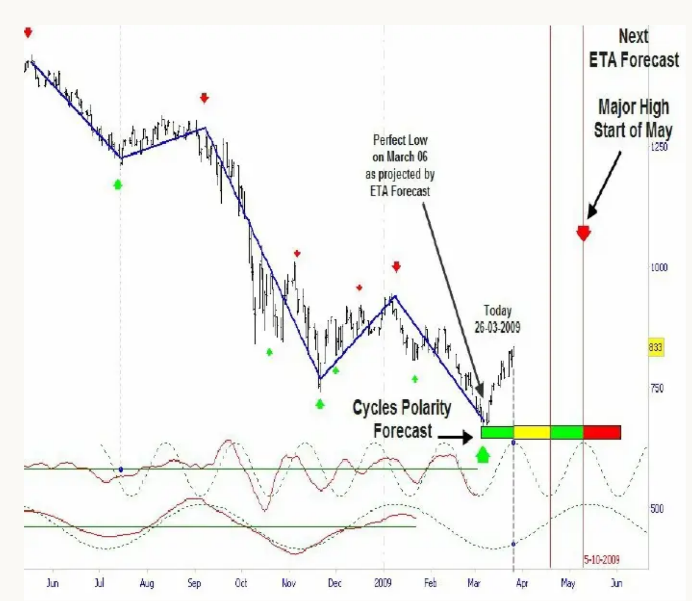

**Figure 6-10:** ETA and Polarity Forecast on March 26

This forecast provides the following trading information:

- Expect a sideways/neutral market from now until mid-April;
- Expect a bullish trend from mid-April until early May (around May 10);
- After May 10, expect the market to decline.

As the next forecasted turning point is May 10, let’s move forward. The next chart shows the result of this trading forecast:

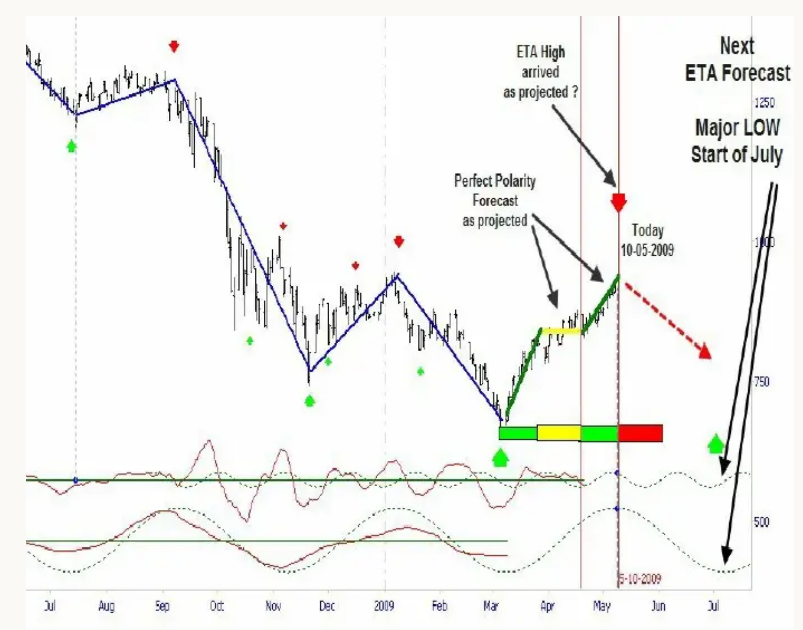

**Figure 6-11:** Polarity Review on May 10

Let’s review our polarity forecast:

- We had solid sideways to slightly upward moves until mid-April—precisely as projected.
- After this period, the market moved toward its next major turning point—the projected ETA of May 10.
- Did the market enter a downtrend now?

That’s the central question.

Our polarity forecast was accurate and provided solid position and intraday trading information. (The daily polarity projection can be used as a filter to allow trades only on intraday charts matching the day’s polarity.) The updated cycle projection with the two chart indicators aligns with our March 26 forecast - Both cycles show the high has been reached at this point. Our polarity forecast proved exact. Close our long position and open a short one (as indicated by the ETA projection).

Now, build/update our next polarity forecast based on the current state of dominant cycles.

###### Updating the Polarity Forecast and Next ETA

The next chart shows future expectations:

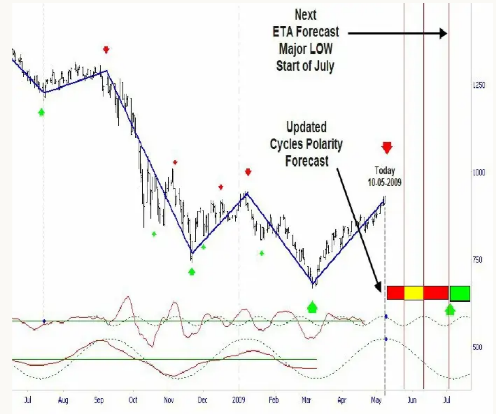

**Figure 6-12:** ETA and Polarity Forecast on May 10

We expect a bearish market trend with a sideways time window in early June. The decline should end by early July. Polarity zones are marked on the chart based on the presented method.

Let’s fast-forward to early July.

###### Polarity and ETA Review

First, a review. The polarity forecast has precisely guided us from our last forecast on May 10 to July 8 (see Figure 6-13).

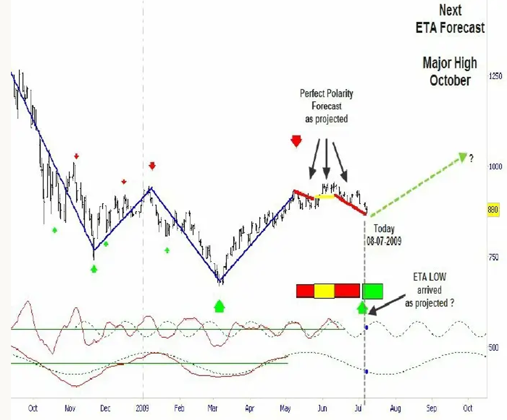

**Figure 6-13:** Polarity and ETA Review on July 8

We’ve reached our projected ETA for the next major market low. The next ETA forecast reveals a market high sometime in October. We’re now prepared for a long-awaited bullish trend.

I recommend using price-based technical indicators to enter the market for longer trades. Trade on price — not the forecast.

#### Full Review of All ETA Forecast Dates

These examples have shown us the estimated position of dominant cycles in the past and present. The core purpose of dominant cycle extraction in this example is predicting how the combined data will develop in the near future. I’ve introduced a simple forecasting method for projecting the expected timing of the next major market high or low. Additionally, I’ve shown how to predict market trend phases.

This is a real example based on my trading last year—the first time I’m opening my "books" to explain my approach in detail. This is also the first time I’m delivering the complete set of required indicators to do this yourself. Treat this newly acquired knowledge with respect. Misused, this tool/script could be ineffective. Used correctly, it’s crucial to unlocking financial market cycles’ power.

The next chart presents all projections in one view. Forecasted polarity zones are highlighted in their respective colors. Forecasted ETA points are marked with arrows. Note: All bottom dates and color-coded areas were projected in advance.

Why not test this trading method yourself? You’ll quickly grasp the importance of identifying dominant cycles We can now connect the dots between chapters. Because forecasted neutral polarity zones are time windows where standard technical indicators work best on intraday charts! You’ll now know in advance when to use technical indicators for intraday chart trading. The yellow areas are moments when I recommend using the method introduced in Chapter 0 (tuning indicators) Now, you can see how everything fits together—representing a complete trading approach.

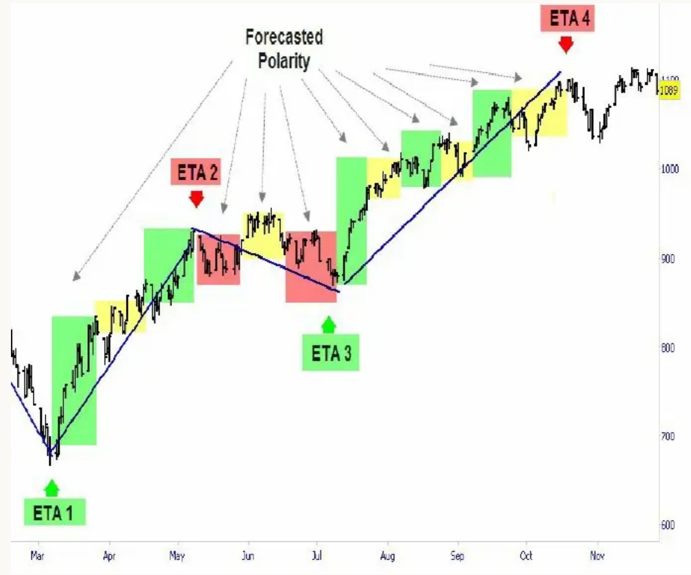

**Figure 6-14:** Full Review of All ETA and Polarity Forecasts

### 6.3 Combining a Semi-Static and Dynamic Forecasting Model for Trading

In the previous chapter, I introduced a quasi-semi-static forecasting technique based on two dominant cycles. I call it "semi-static" because it builds a forecast valid for the next month(s) until the next major ETA arrives. Update the forecast when the predicted ETA point arrives. The forecast is thus static from ETA to ETA—semi-static because we update the projection at each ETA point with a new cycle evaluation of the current phase and wavelength.

The next method combines this semi-static technique with a purely dynamic model. The dynamic model is again straightforward: Instead of waiting until the projected ETA arrives, update the forecast at every new bar. We can do this because calculations are automatic. Combining both methods has a beneficial advantage. First, we get a projection of the next ETA from the static projection. Mark this ETA on the chart with a fixed line at the given ideal cycle’s high/low. We also get an understanding of the timeline ahead. Then, update this cycle projection at every new bar. The Dynamic Cycle Explorer adjusts the projection based on the dominant cycle’s real phase state. It also accounts for cycles not being static over time—their phase and wavelength may vary. We accept this and don’t just follow the static projection. Instead, we identify the dominant cycle’s real phase and wavelength changes, arriving at a new projection for the next major turning point. We can then compare the latest static projection (red line on the chart) with the updated real projection, including the revised ideal cycle terrain. Now, we can "see" the cycle’s phase and wavelength changes. Instead of following a static cycle framework, we follow the cycle’s dynamic flow. This is the method used in the preview video on the website. I called this preview "The Magic Cycle Time." It’s the Dynamic Cycle Explorer in action. In this example, I removed the isolated cyclic price behavior represented by the red line. In the video, the Dynamic Cycle Explorer plots only the ideal green cycle. You’ve probably noticed this indicator’s additional capabilities. But I don’t want to reveal everything in the preview videos. You can reconstruct the video example with the Dynamic Cycle Explorer.

Using this combined technique, we’ve identified the following market turning points in advance.

Watch the included video after reading this example (Link: [http://www.whentotrade.com/dynamiccycles1/](http://www.whentotrade.com/dynamiccycles1/)).

To reconstruct this example for practice, use the following setup:

1. Open a daily chart of the **S&P 500 Index (X.SPX)**, adjusted for natural days;
2. Switch to replay mode to set the start bar to **October 7, 2008**.
   a) Attach the Dynamic Cycle Explorer to the chart with this setting: Min. Length = 75 (or 100 calendar days)
   b) Max. Length = 150 (or 200 for calendar days)
3. Anchor the analysis starting point to the **October 2007 high.**

To follow the approach, take these steps as shown in the video:

1. Mark the next ideal cycle high/low with a red line (fixed ETA forecast).
2. Fast-forward by pressing "space."
3. Follow the updated cycle projection from the Dynamic Cycle Explorer. The Cycle Explorer checks the real wavelength, phase, and amplitude at each new bar and updates the plot.
4. Pay close attention when the static or updated forecast reaches the projected high or low—whichever comes first.
5. Use additional technical indicators to time trades using this technique for trading. Trade the price—not the forecast!

#### The Dynamic Cycle Trading Approach in Action on the S&P 500

The following example illustrates the use of the Dominant Cycle Explorer in trading instruments. I will review the last two years of trading and show you how the Cycle Explorer was able to predict all the turning points ahead of time.

We begin our analysis on October 7, 2008. There has been a severe sell-off in the market over the last few days. This is an interesting moment to “turn on” our Cycle Explorer and see if we can get a sense of when this downturn will come to an end. We will use the long-term market high of October 12, 2007 as the anchor/starting point for the Cycle Explorer, along with a calendar-day chart.

This is the situation on October 7, 2008:

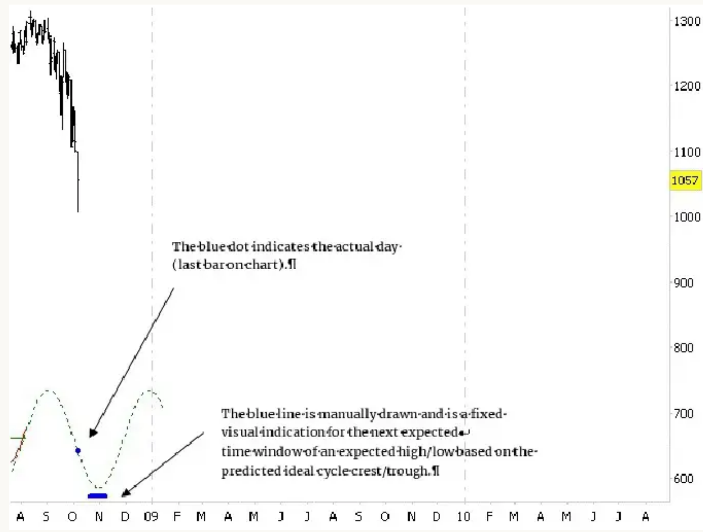

**Figure 6-15:** October 2008: Next low around late October

The Cycle Explorer reveals that there is still room for the market to move lower over the next week. The next market low is expected in late October.

Let’s fast-forward to late October now:

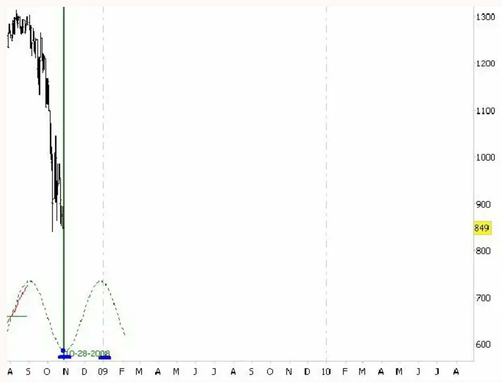

**Figure 6-16:** October 28 -> Next high in late 2008 / early 2009

From October 7 to October 28, the market fell another 200 index points, as predicted by the Dominant Cycle Explorer. We can now see the dominant cycle low precisely within the time window forecast on October 7. So this is a good time to close the short and enter a long trade. The next major market high is expected in late 2008 or early 2009, as indicated by the current dominant cycle plot.

Again, let’s see what happened around that time window.

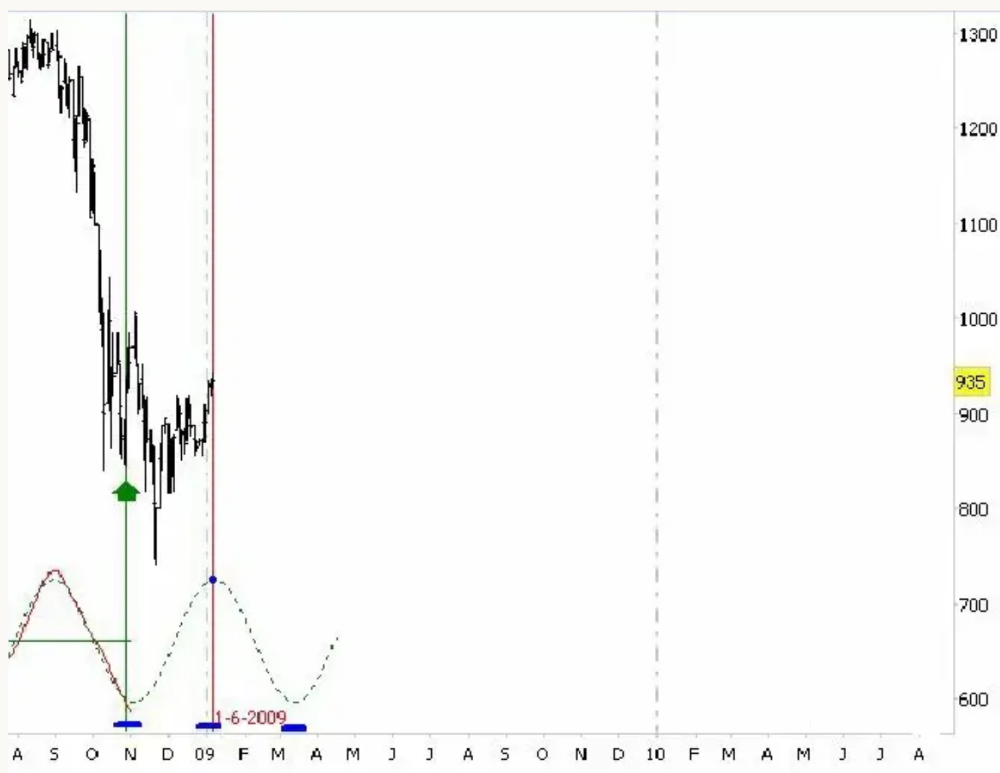

**Figure 6-17:** January 6, 2009 -> Next low around early March

We have advanced to the point where the Dynamic Cycle Explorer reaches the cycle high. The updated cycle high arrived precisely within the anticipated time window in early 2009—on January 6, 2009. The market rose from 849 to 935 points, a jump of about +10%. We can now book the long profit, close the long trade, and open a short position. The next market low is expected in early March. This was indicated on January 6 by the next ideal dominant cycle low plotted for early March. Please note that the following settings were not touched or changed at all.

Accordingly, we will go short and move forward in time until the Dynamic Cycle Explorer reaches the real-time cycle low.

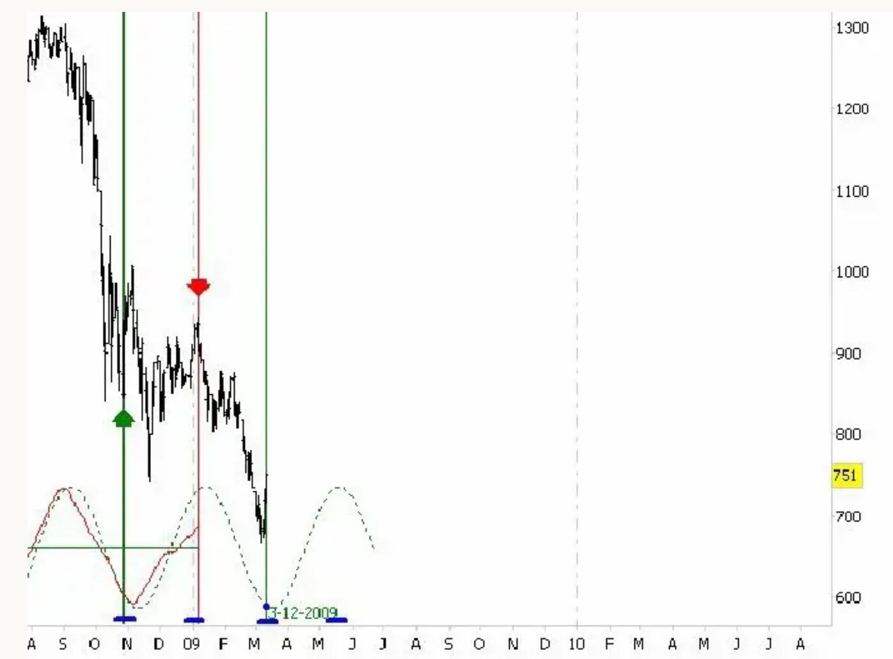

**Figure 6-18:** March 12 -> Next high in early May

Here we are on March 12, with the actual cycle low illustrated by the blue point of the updated dominant cycle. Once again, exactly as expected within the time window that was predicted on January 6—indicated by the blue line. The market moved down 184 points (from 935 to 751 points). With a downward move of around 19%, we are now in a position to close the short trade with a lucrative profit in line with the dominant cycle prediction. Now we will establish a long position.

The next expected market high is anticipated in early May. This time window is indicated on the chart by the blue line. This is the time window of interest.

Once again, the indicator settings remain the same. The algorithm adapts to the dominant market vibration with each new bar. That’s what makes it so special. You don’t have to worry about cycle analysis and a lot of tools. Everything is done by the Dominant Cycle Explorer. This is where cycle trading truly becomes simple.

Let’s move on to the next dominant cycle high in the indicator.

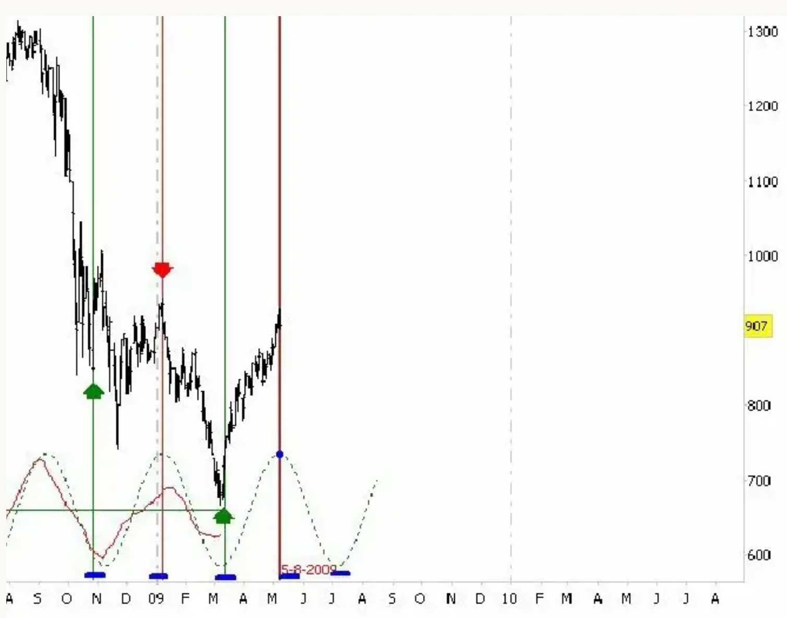

**Figure 6-19:** May 8 -> Next low expected in mid-July

The Cycle Explorer detects the dominant cycle high on May 8 at the beginning of the forecast time window (note: the blue line is set on the chart after the forecast is made to indicate the expected time window for the next turn. The ideal cycle plot—indicated by the green dotted line—can be adjusted after each new bar to specify where we are within the current ideal dominant cycle).

The market gained 156 points during this period, which corresponds to a 20% gain. The dominant cycle once again delivered a profitable trade and suggests closing the long position here and establishing a short. The next expected market low is projected for early July. We need to watch the market closely when we get to that point in time. Let’s move forward until the Dynamic Cycle Explorer reaches the next dominant cycle low.

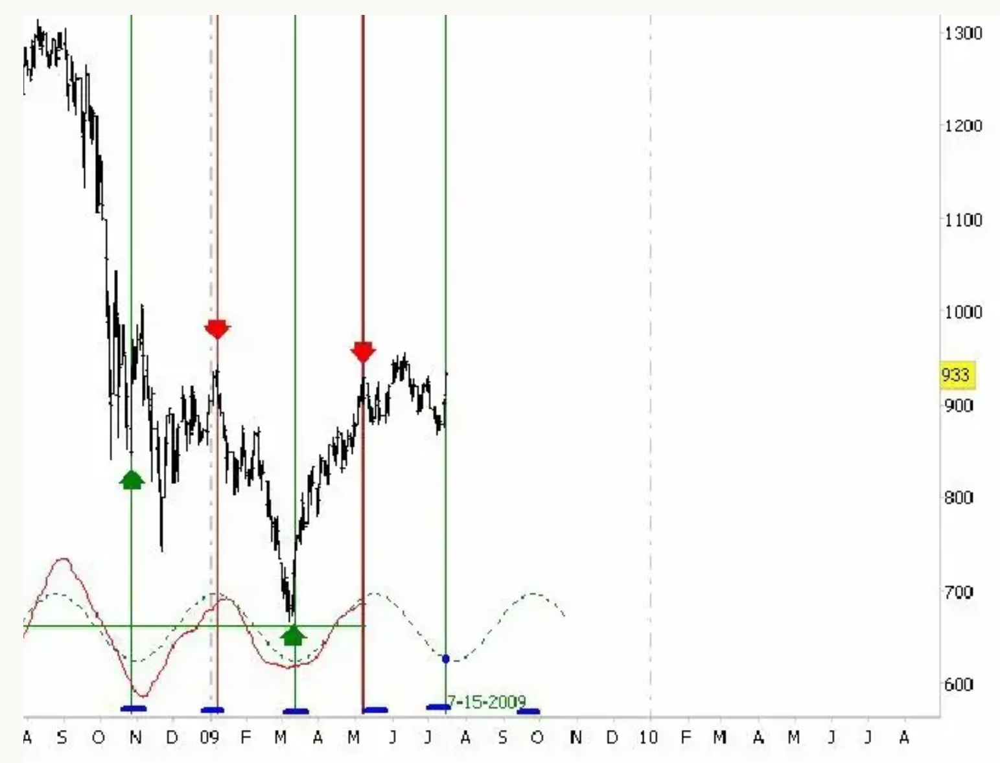

**Figure 6-20:** July 15 -> Next high expected around late September

On July 15, we reached the cycle low within the expected time window. The market moved down, but we were not able to pinpoint the exact high and low using the dominant cycle. That is a common situation. We should not expect the dominant cycle to detect the exact turns. The dominant cycle offers a high-probability representation in terms of the time window of the next major change in trend.

The market moved from 907 on May 8 to 933 points on July 15. So we have to cover our short trade here with a loss of 26 points.

As the Dominant Cycle Explorer shows, the next major market high is expected in late September. Therefore, we will establish a long position now and move forward until we arrive at the next dominant cycle high.

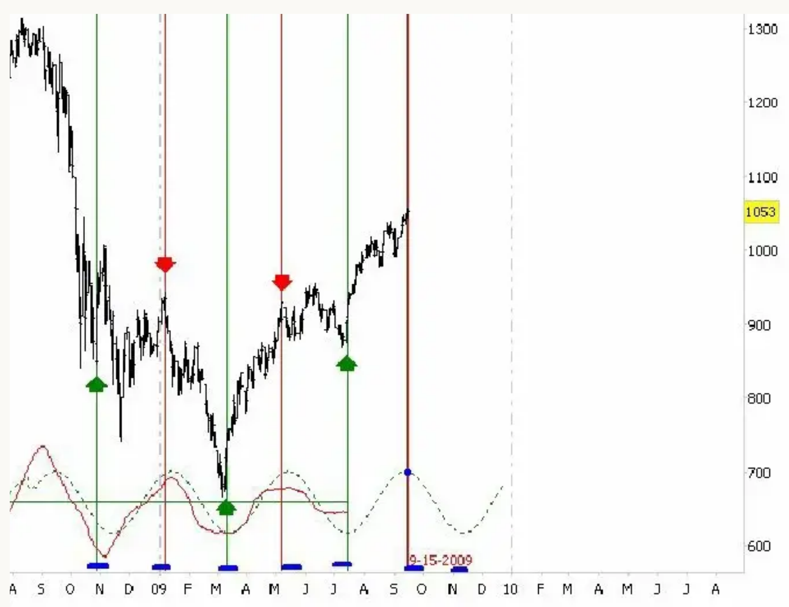

**Figure 6-21:** September 15 -> Next market low in early November

We reached the actual dominant cycle high on September 15, as indicated by the blue point on the updated dominant cycle indicator diagram. The high lies within the fixed expected time window that was forecast two months ago.

The market rose from 933 to 1,051 points—a gain of 118 points or 12%. Therefore, we close our long trade with a profit here and switch to a short position.

The time window for the next expected low is forecast for early November, as indicated by the dominant cycle low during that period. The occurrence is again marked on the chart by a fixed blue line. That is, the next two months are still ahead of us, and we will move forward until the Dominant Cycle Explorer signals a cycle low.

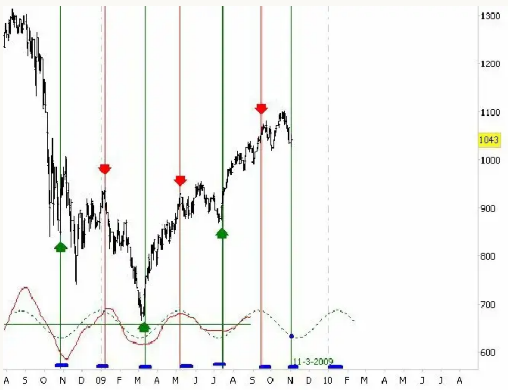

**Figure 6-22:** November 3 -> Next high at the beginning of January 2010

The Cycle Explorer denotes a cyclical low on November 3, as illustrated by the blue point and the actual cycle projection. Again, this falls precisely within the time window predicted by the September 15 forecast.

The market moved mostly sideways from 1053 to 1043 points during this period. Since we have been shorting the market, we can book a profit of 10 points here.

The next step should be an uptrend into early January 2010. This is the next expected time window within which the next major market top is anticipated.

We will now switch our short to a long position and move forward until the Cycle Explorer reaches the next dominant cycle high.

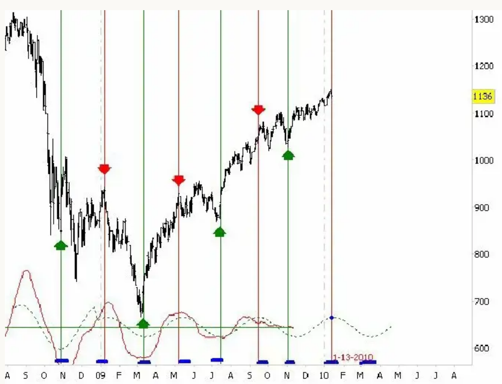

**Figure 6-23:** January 13 -> Next low around early March

The Cycle Explorer reaches the next cycle high on January 13 within the predicted time frame resulting from the November 3 analysis. The S&P 500 Index rose from 1043 to 1136 points with a gain of 93 points or 9%. We would like to close our long trade here and anticipate the next move to drive the S&P down with the dominant cycle pointing downward at the beginning of March.

To reiterate, the indicator settings have not changed at all. The anchor point is still the October 2007 high, and the range is still between 100 and 200 days for the Cycle Explorer to detect the dominant cycle. In other words, you do not have to spend hours analyzing different cycles, nor do you have to try to force the market into a static cycle framework. The Cycle Explorer does it for you with each new bar. You only need to input the important points—the anchor date and the range it should search. Let’s move forward to see where our Cycle Explorer will specify the next dominant cycle low.

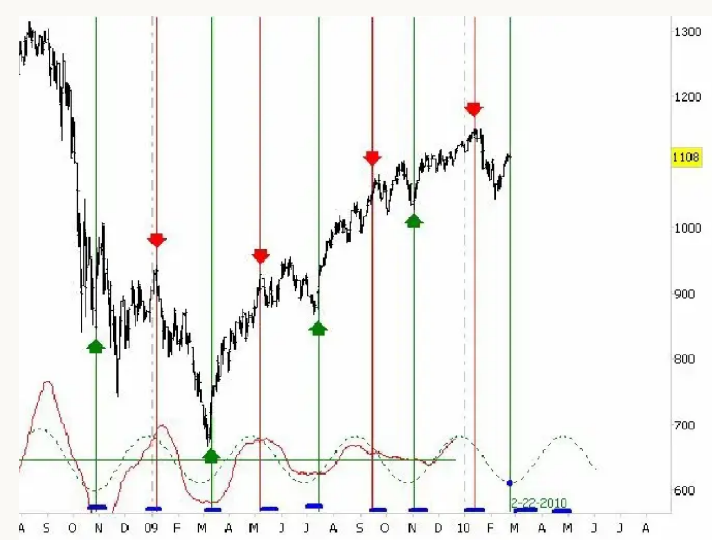

**Figure 6-24:** February 22 - next high around late April

Now the dynamic phase adjustment of the indicator is visible. We have an interesting situation here because the dominant cycle’s wavelength changed. On February 22, the Dynamic Cycle Explorer indicates the cycle low, as demonstrated by the blue point on the cycle projection. In this particular case, the low arrives earlier than our expected time window beginning in early March. The Cycle Explorer indicates that it has detected a larger change in the dominant cycle. The dynamic phase adjustment also occurred earlier—but now you can clearly see it on the chart. Price has already moved up, confirming that the cycle low has been reached.

Let’s follow the updated current cycle forecast. This means we will close our short trade here. The S&P 500 lost 28 points, from 1136 to 1108 points, which implies we booked a small profit of 28 points during this period.

Now we will switch to a long position and wait for the next major market top in late April. This time window is again marked with the blue line on the chart.

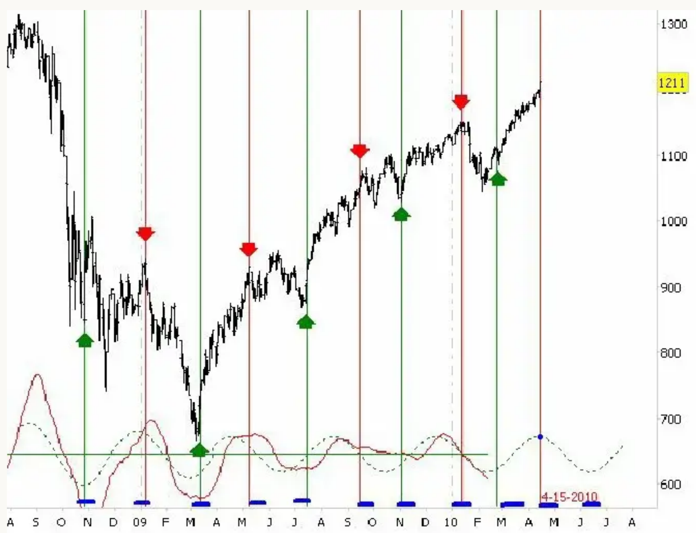

**Figure 6-25:** April 15 -> Next low around early June

The Cycle Explorer points to April 15 as the next dominant cycle high. As indicated by the blue line on the chart, this again falls within the time window predicted from our February 22 analysis. You have two indications here—the projection and the actual situation—that are aligned with the cycle high. The prediction provided a time window—the current Cycle Explorer updates also present the same situation on April 15.

The S&P index rose from 1108 to 1211 points, a gain of 103 points or +9%. According to our rules, we will close our long position here with a gain of more than 100 index points and switch to a short position. The next expected time window for the market bottom is the first half of June. So let’s move forward to see what the Dominant Cycle Explorer will tell us.

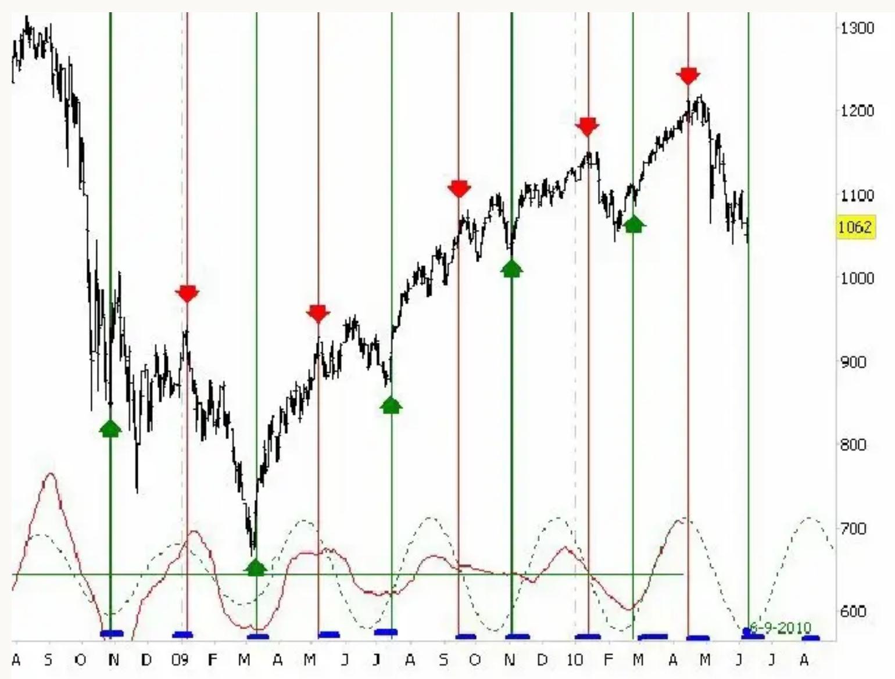

**Figure 6-26:** June 9 -> Next high at the beginning of August

The indicator shows the next dominant cycle low on June 9, as represented by the blue point at the minimum of the ideal cycle. Once again, this occurs as expected within the time window forecast in April.

The index lost 149 index points from 1211 to 1062 points, which equals a 12% loss. However, since we were short during this period, we can book the profit now. As the updated Dominant Cycle Explorer indicates, a rally is expected from now until early August. That means we will now enter a long position.

The next important time window is again marked on the chart with the blue line. We will be watching the market closely during this period. As usual, we will move forward bar-by-bar until the Cycle Explorer reaches the updated ideal cycle crest in real time.

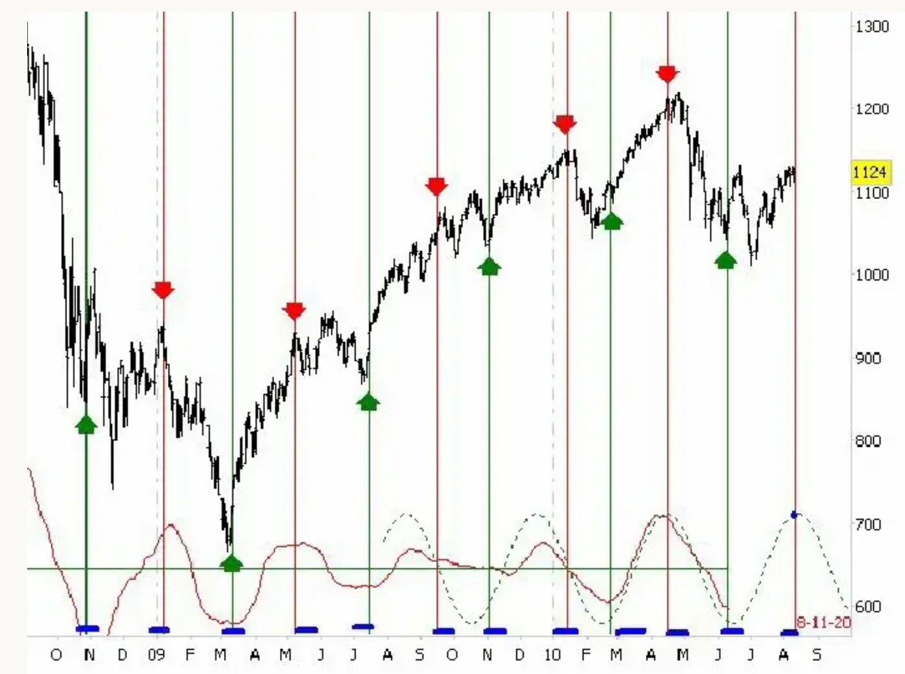

**Figure 6-27:** August 11 -> Current market high

The next occurrence arrives on August 11. The Dominant Cycle Indicator shows the arrival at the crest of a dominant cycle, illustrated by the blue point on the ideal cycle plot. Once again, it is no surprise that this occurs within the forecast time window.

The market rose from 1062 to 1124 points with a gain of 62 points. We can close the last long position with this profit and switch to a short position. We will follow the path of the dominant cycle with a short position now. The next expected move is a downward move.

This chart was inserted after the book had been completed to demonstrate that these methods still work today. I did not have to search for a point in time where this tool worked. Nor did I have to pick a specific time frame in which it worked. I have shown that this tool worked without interruption over a period of two full years.

Today is August 20, 2010, and the S&P index is 1072. The high indication was once again correct with an actual profit of 52 points.

The final chart shows the indicated market turns. These signals arrived ahead of time via the ideal cycle top/bottom prediction and were confirmed in real time by the updated dominant cycle plot with each new bar. And throughout the entire period, the indicator level was not modified. The anchor point was set to the market high in October 2007, and the environment was the detection of the dominant cycle within a range of 75 to 150 bars/trading days (100 to 200 bars/calendar days).

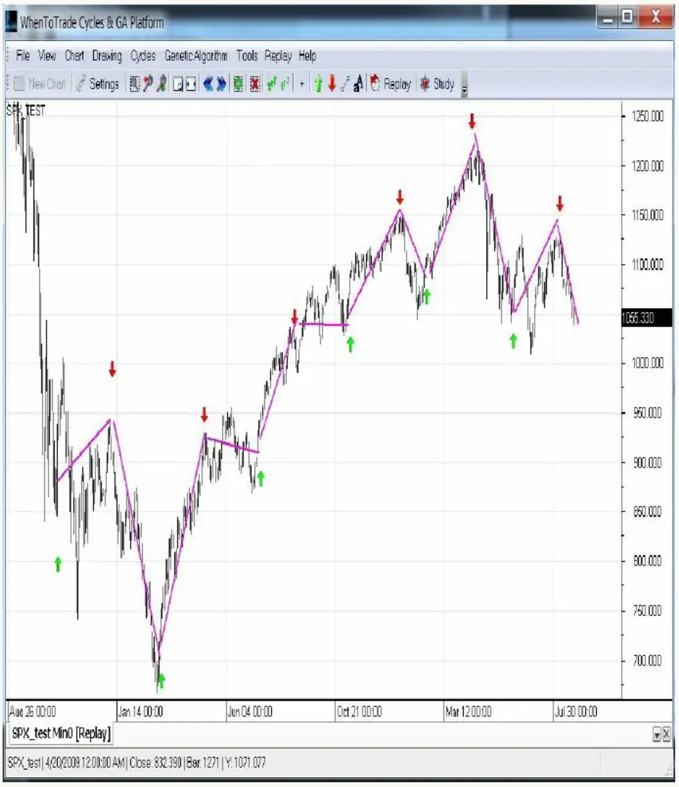

**Figure 6-28:** Signals over the last two years (2008–2010)

As you can see, it was not a static cycle framework or cycle that provided this result. It was the adaptive feature of the Cycle Explorer, which was able to detect and adapt to the market’s actual vibration. The result was a very precise forecast of the next market turn in terms of time and direction. The dynamic update of the next major cycle crest or trough with each new bar indicates the precise position.

You would have been able to follow this path simply by looking at the chart based on this cyclical approach. It is packaged and coded in an easy-to-use technical indicator.

The following table summarizes the last two years of using this indicator as described in this chapter.

| Date | Cycle Indicator | S&P 500 Index | Profit/Loss | Total swing cycle profit |
| --- | --- | --- | --- | --- |
| 10/7/2008 | -- Start | 1057 | - | - |
| 10/28/2008 | LOW | 849 | 208 | 208 |
| 1/6/2009 | HIGH | 935 | 86 | 294 |
| 3/12/2009 | LOW | 751 | 184 | 478 |
| 5/8/2009 | HIGH | 907 | 156 | 634 |
| 7/15/2009 | LOW | 933 | -26 | 608 |
| 9/15/2009 | HIGH | 1053 | 120 | 728 |
| 11/3/2009 | LOW | 1043 | 10 | 738 |
| 1/13/2010 | HIGH | 1136 | 93 | 831 |
| 2/22/2010 | LOW | 1108 | 28 | 859 |
| 4/15/2010 | HIGH | 1211 | 103 | 962 |
| 6/9/2010 | LOW | 1062 | 149 | 1111 |
| 8/11/2010 | HIGH | 1124 | 62 | 1173 |
| 8/20/2010 | -- final / TODAY | 1072 | 52 | 1225 |
| **Total absolute gain** | | 15 | | 1225 |

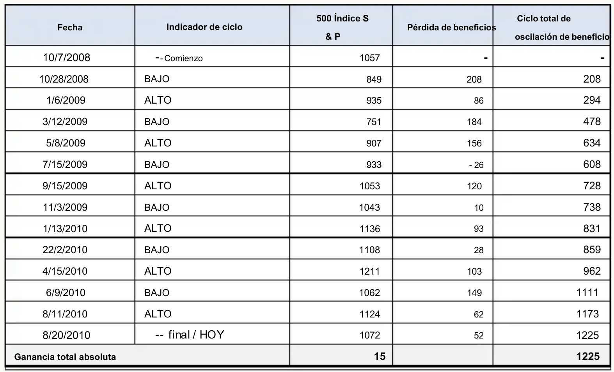

**Figure 6-29:** Summary of Cycle Explorer signals

The table presents impressive results in absolute numbers, as illustrated in the charts. A total of 13 trades were made. Only one of these 13 trades was a loss. This gives us an accuracy of 92% over the last two years. This simple study obtained a total of 1225 index points, which equals a gain of more than 100% compared to the starting level of the index at 1057 points. The simple buy-and-hold strategy for the respective index would have resulted in a gain of 15 points (1.4%).

The numbers speak for themselves. Keep in mind that all this cycle analysis was carried out by the indicator itself. You could have read thousands of cycle newsletters during this two-year period that would have driven you crazy with all the possible outcomes.

You have probably realized that this indicator is a simple tool for trading. The digital signal processing and the mathematics behind it are not simple. But that is not relevant for use in the trading domain. This method works best on daily time frames and data series. However, you can use it intraday as well as on weekly charts. Play around with this new weapon to familiarize yourself with it and treat it with respect.

### 6.4 Video Lessons – Dynamic cycles: S&P 500 bar-by-bar step view

Please review the step-by-step example in an uninterrupted bar-by-bar video. Click the video or link below.

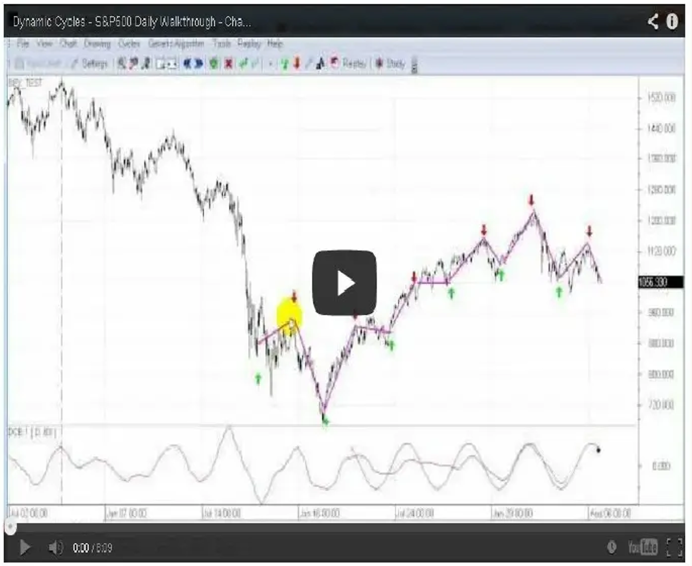

Review the uninterrupted bar-by-bar video for 2008–2010: [http://www.whentotrade.com/dynamiccycles1/](http://www.whentotrade.com/dynamiccycles1/)

### 6.5 Video Lessons – Weekly S&P 500 Long-Term Cycle

Please review the example described in a live, uninterrupted bar-by-bar video. Click the video image or link below:

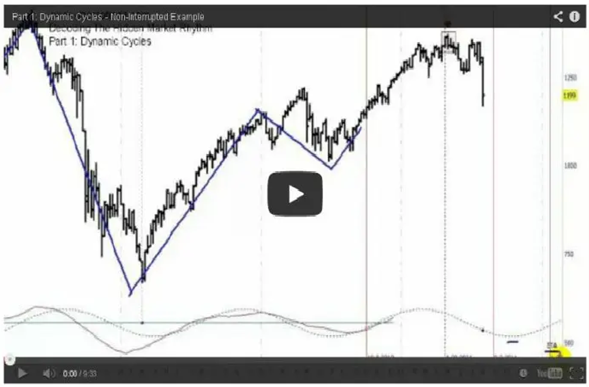

The day-by-day fine-tuning of the cycle during the critical September period is explained in depth in Chapter 8.2 “Cycles within cycles: Combining price and volatility cycles.”

Review the bar-by-bar video: [http://www.whentotrade.com/dynamiccycles2/](http://www.whentotrade.com/dynamiccycles2/)

### 6.6 Cycle Explorer – NinjaTrader Code Section

Our cloud-based Application Programming Interface (API) provides the cycle analysis engine through a separate endpoint. Integrating the API of the Dominant Cycle Explorer (DCE) toolset allows us to use and integrate dominant cycle information, such as length and phase, across different platforms. This chapter describes how to set up the Cycle Explorer introduced as an indicator in NinjaTrader.

We use the Newtonsoft.Json package to serialize and deserialize all cycle API calls. Therefore, you need to make sure it is installed and referenced.

```cs
// additional reference to required package
using Newtonsoft.Json;
```

#### 1 Script and initialization data

First, we define two new plots and the necessary parameters: one plot for the detected cycle and another plot for the derived actual price cycle. The offset settings are used to plot the cycle into the future. Therefore, the offset will be set depending on the “plotForward” parameter settings. The “plotForward” parameters allow us to draw the cycle into the future.

```cs
public class WTT_CycleExplorer : Indicator
{
  protected override void OnStateChange()
  {
    if (State == State.SetDefaults)
    {
      DrawOnPricePanel = false; // draw in the indicator panel

      // Add a plot to our NinjaScript Indicator
      AddPlot(new Stroke(Brushes.Red, 1), PlotStyle.Line, "Dominant Cycle");
      AddPlot(new Stroke(Brushes.Orange, 1), PlotStyle.Line, "Price Cycle");

      plotForward = 0;
      minCycleLength = 30;
      maxCycleLength = 290;
      apiKey = "";
      Name = "WTT_CycleExplorer";
      Calculate = Calculate.OnBarClose;
      IsOverlay = false;
    }
    else if (State == State.DataLoaded)
    {
      if (plotForward > 0) Offset = plotForward;
    }
  }
}
```

#### 2 Calling the CycleExplorer API endpoint

We call the CycleExplorer API only on the last bar of the chart. Before reaching our cloud engine, we collect all closing values from the price chart and prepare a data array that will be posted to our cycle engine. We will use a basic HttpClient call to connect to the cycle API endpoint. Before doing so, we prepare the POST payload with the dataset array under consideration (for example, the current close values of the selected chart). Now we are ready to make a call via client.PostAsync. Finally, before processing the returned data, we check whether the network call returned any errors.

```cs
protected override void OnBarUpdate()
{
  if (Count - 2 == CurrentBar) // Compute on the last completed, closed bar
  {
    string APIresultContent = "";

    // Get and prepare the close data array
    int seriesCount = Close.Count - 1;
    List<double> closeList = new List<double>();
    for (int i = 0; i <= seriesCount; i++)
      closeList.Add(Close.GetValueAt(i));

    // Call the WhenToTrade Cycles CycleExplorer POST API endpoint
    using (var client = new HttpClient())
    {
      // WhenToTrade API URL
      client.BaseAddress = new Uri("https://api.marketcycles.online/");

      // Load the close dataset via HTTP POST API call
      var content = JsonConvert.SerializeObject(closeList.ToArray());
      StringContent POSTcontent = new StringContent(content, Encoding.UTF8, "application/json");

      // POST API call
      var response =
        client.PostAsync("/api/CycleExplorer?MinCycleLength="
          + minCycleLength
          + "&MaxCycleLength=" + maxCycleLength
          + "&PlotForward=" + plotForward
          + "&includeTimeseries=true&api_key=" + apiKey, POSTcontent).Result;

      // Check for network errors
      if (response.IsSuccessStatusCode)
      {
        APIresultContent = response.Content.ReadAsStringAsync().Result;
      }
      else
      {
        string msg = response.Content.ReadAsStringAsync().Result;
        Draw.TextFixed(this, "ApiError", "API error: " + msg, TextPosition.TopLeft);
        return;
      }
    }
  }
}
```

#### 3 Obtain the dominant cycle information from the cloud engine

If we did not encounter network errors, we can now read and parse the data returned by the API (“APIresultContent”) into the internal cycle data (“dominantCycle”) via the JsonConvert method (see line 2). If this can be done without further errors, we are ready to access all dominant cycle information through our new dataset “dominantCycle.xyz”, where “xyz” represents the return value we are interested in.

To access individual information, we simply add the name of the value we want to use for “xyz.” For example, to get the current dominant cycle length, just use “dominantCycle.length.” We can now access all the data returned by the API call (see all parameters here). We are now in a position to perform further calculations within NinjaTrader using these values. For our CycleExplorer, we will now plot the current length and phase as text in the indicator window.

```c#
 // decode the cycle data returned by the API call
 var dominantCycle = JsonConvert.DeserializeObject(APIresultContent);

 // Check for API return errors?
 string statusCode = dominantCycle.statusCode != null ? dominantCycle.statusCode : "";
 bool error = statusCode.IndexOf("error", StringComparison.OrdinalIgnoreCase) >= 0;
 if (error)
 {
   Draw.TextFixed(this, "ApiError", "API error: " + statusCode, TextPosition.TopLeft);
   return;
 }

 // obtain cycle information from the key objects returned
 var cycleLength = dominantCycle.length;
 var currentPrice = dominantCycle.currentPrice;
 var timeSeries = dominantCycle.timeSeries;
```

#### 4 Plotting the indicator

Since we called the API with the parameter “IncludeTimeseries=true,” the returned dataset also includes a “dominantCycle.timeSeries” array, which gives us all the raw DominantCycle values to plot as an indicator. This way, we do not need to perform any cycle calculation on our own—all the necessary data has already been prepared by our cloud engine. We simply need to access the TimeSeries array and assign the values for each bar to our plots on the chart. We do this by assigning:

```c#
Value[Barnum] = timeSeries[datapointNum].dominantCycle
```

in a loop for each bar on the chart.

```c#
 // Fill indicator values from the TimeSeries range returned by the API (Info: called once for the complete chart)
 for (int i = 0; i <= CurrentBar; i++)
 {
   try {
     Values[0][CurrentBar - i] = timeSeries[i + plotForward].dominantCycle;

     if (timeSeries[i + plotForward].cycleHighlighter != null)
       Values[1][CurrentBar - i] = timeSeries[i + plotForward].cycleHighlighter;
   } catch (Exception ex)
   {
     // should never happen, but print to log just in case
     Print("Error: " + i + " - " + ex.Message);
   }
 }
```

#### Wrapping up

This example shows how easy it is, with just a few lines of code, to integrate the cloud-based cycles engine into any platform script or chart indicator. The cloud API is based on our underlying code base, which we have used for years in a trading environment and which powers our WTT charting platform.

By using the public API endpoints, you can recreate the cycle tools introduced with any preferred front-end application. This example introduces the simplicity of using an API to set up the Dynamic Cycle Explorer in NinjaTrader. The idea is to focus on a single indicator or strategy script, while all the cycle work is done in the cloud.

#### Cycle Explorer NinjaTrader in Q1 2017, for EUR/USD daily action

a) January 18, 2017 – Price: 1.0628 – Dominant: 42-day cycle – Status: downtrend starting – Low projection: from February

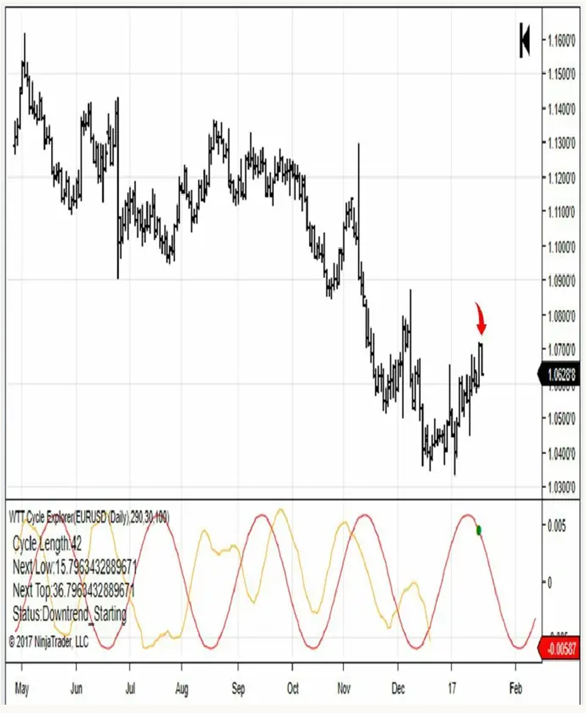

b) February 22, 2017 – Price: 1.0557 – Dominant: 42-day cycle – Status: uptrend starting – High projection: mid-March

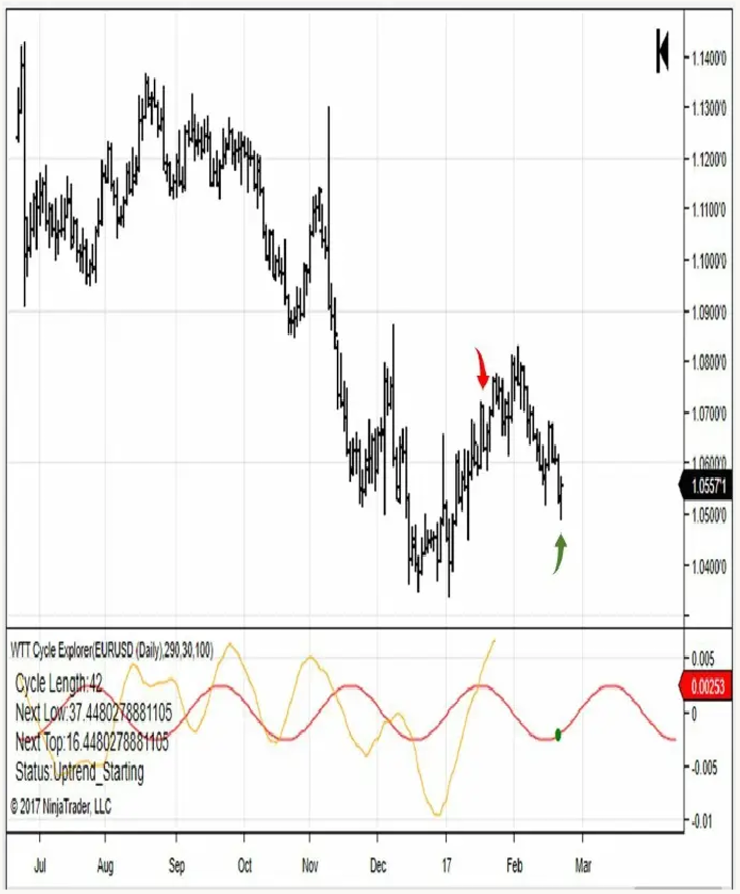

c) March 22, 2017 – Price: 1.0796 – Dominant: 42-day cycle – Status phase: Top arriving – Low projection: mid-April

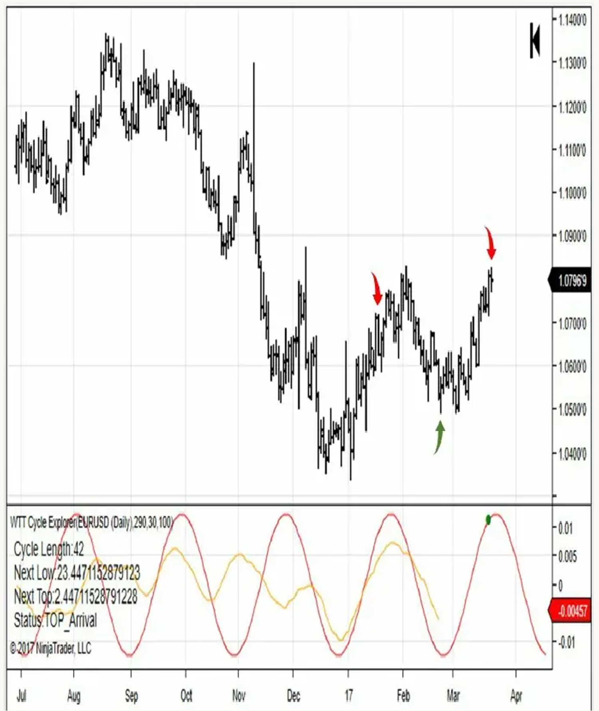

d) April 17, 2017 – Price: 1.0642 – Dominant: 42-day cycle – Status phase: Bottom approaching – High projection: mid-May

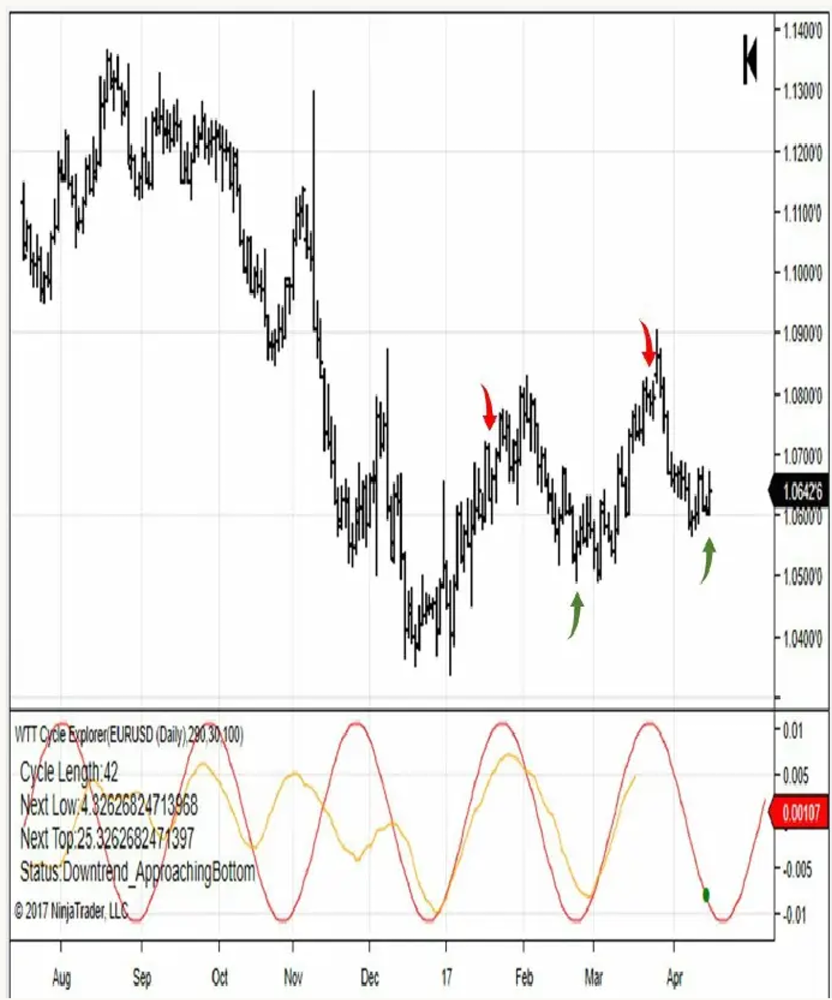

e) May 22, 2017 – Price: 1.1236 – Dominant: 41-day cycle – Status phase: TOP exiting – Low projection: from June

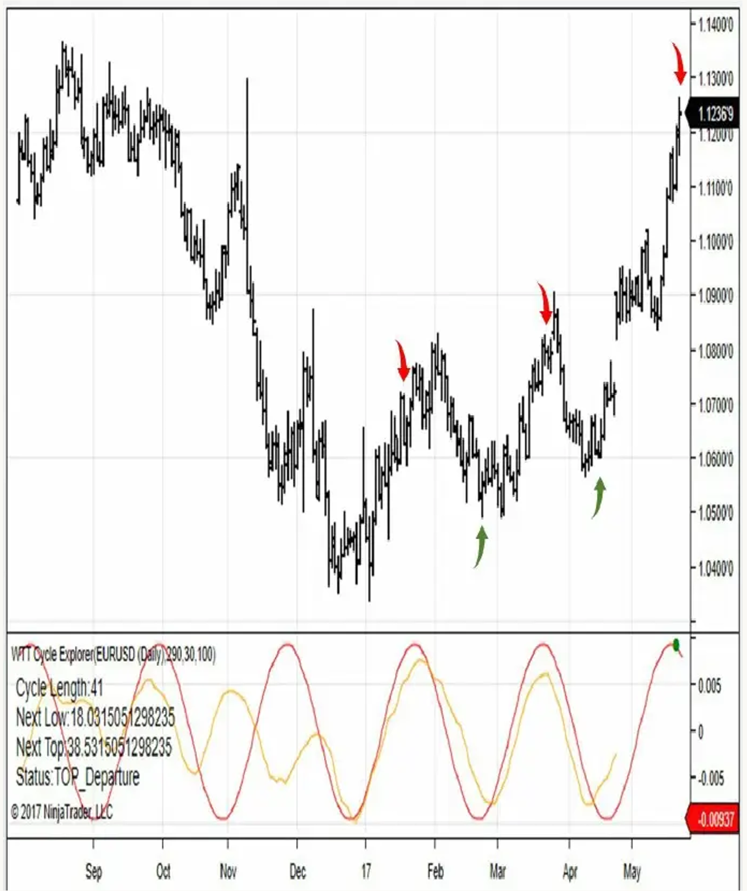

#### Download source code

The indicator source code for NinjaTrader NT8 can be downloaded at the following link. Make sure you use a valid personal API key or use the public trial key wttpreview to start your first cycle analysis from our cloud for free.

[www.whentotrade.com/NT8/CycleExplorer](www.whentotrade.com/NT8/CycleExplorer)

### 6.7 Cycle Explorer – API Endpoint Specification

The CycleExplorer allows you to analyze a single time series array (“prices”) and returns the dominant cycle information for the last determined data point. An optional TimeSeries object can be included to plot the dominant cycle on the chart. Documentation:

[www.whentotrade.com/apidocs/CycleExplorer](www.whentotrade.com/apidocs/CycleExplorer)


```text
POST "https://api.marketcycles.online/api/CycleExplorer?api_key=..&.."
```

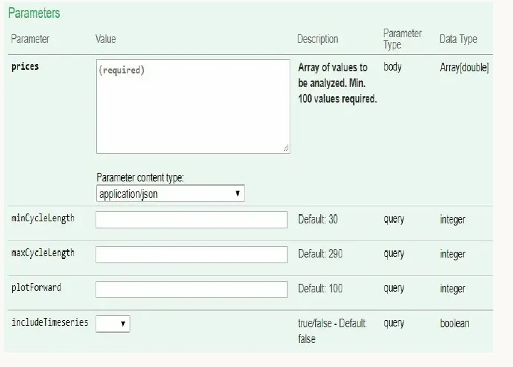

### 6.8 Market Cycles Explorer – Excel workbook for daily cycle analysis

Our cloud API also offers an additional endpoint that allows you to perform cycle analysis on more than 3,000 datasets for major indices, currencies, commodities, and cryptocurrencies without the need for additional charting platforms.

This endpoint provides an overview of the current daily dominant cycle for most available stocks and indices, even without the need for additional data subscriptions. The following example describes how to use this parameter to set up a workbook for cycle analysis. To help you get started quickly, we offer an example Excel sheet that allows you to pull dominant cycle information for ticker symbols and plot the chart with the cycle as an indicator. We need to use Excel’s Power Query functions to connect to external data sources. The following figure shows what the chart looks like in the workbook.

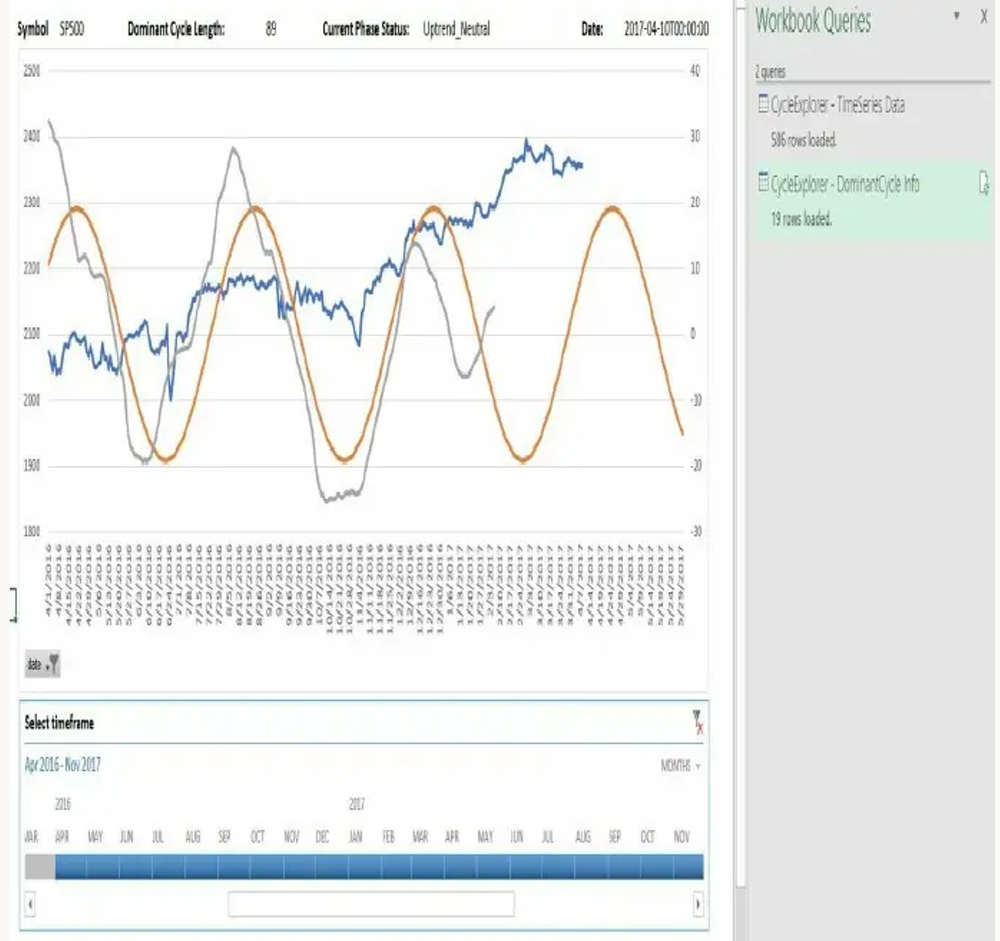

You can download the prebuilt workbook via the link provided at the end of this chapter. If you want to build a workbook yourself, the quick steps are:

#### 1. Create and configure a table named “Parameters” where all API parameters are available

Select the area where all the parameters of the API call are stored in your workbook and name the table “Parameters,” as indicated in the highlighted section.

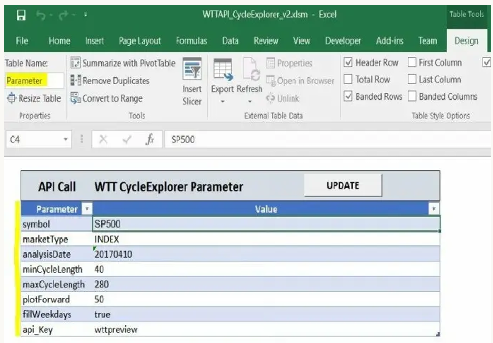

#### 2. Create a new query from Web

Once you have prepared the parameters section, we can start configuring our data query in Excel. Select the function via the menu “Data / Show Queries / From Other Sources / From Web.”

Enter a sample API address in the window, for example:

```text
https://api.marketcycles.online/api/CycleExplorer/EURJPY?marketType=FX&api_key=wttpreview
```

By doing that, an initial basic Power Query will be configured. We can change and edit this Power Query in the next step.

#### 3. Switch to “Home” / “Advanced Editor”

To change the query for use with our individual parameters from our table prepared in step 1, please select Home / Advanced Editor to open the Power Query editor.

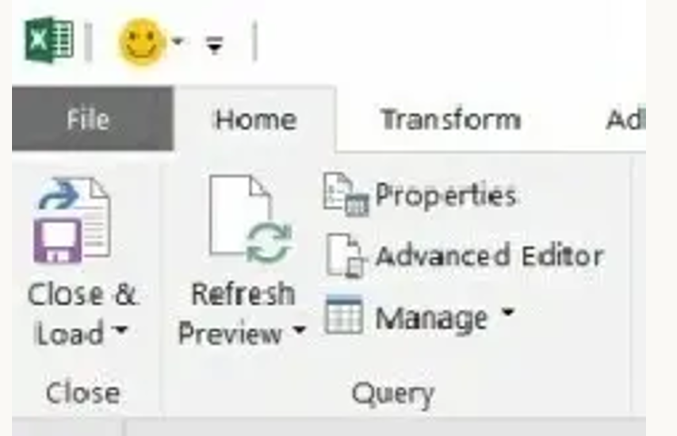

#### 4. Change or edit the Power Query

In the following window, the basic Power Query is available. However, to use our individual parameters, please copy and paste the following Power Query into the window.

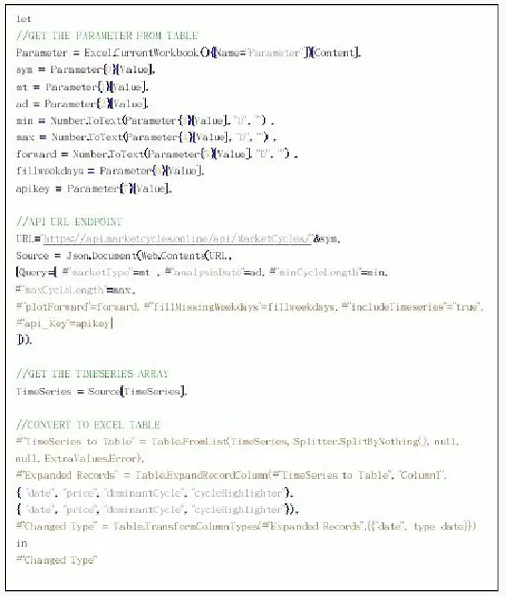

#### 5. Grant access to external sources

If necessary, you need to change the privacy settings to allow loading data from external sources. The following figure shows the windows that will open to allow public Internet access for the current workbook.

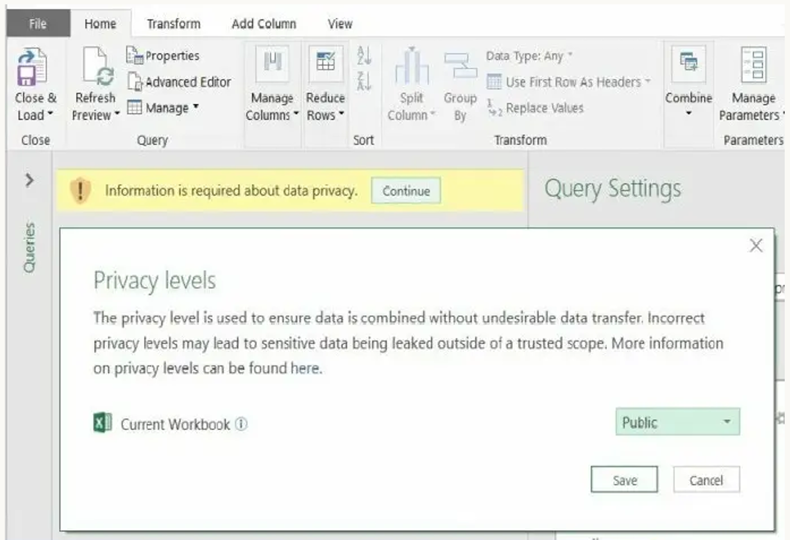

#### Excel workbook download

The Excel workbook can be downloaded at the following link. Make sure you use a valid personal API key or use the public trial key wttpreview to start your first cycle analysis from our cloud.

[www.whentotrade.com/Excel/MarketCycles](www.whentotrade.com/Excel/MarketCycles)

### 6.9 Market Cycles Explorer – API Endpoint Specification

End-of-day dominant cycle analysis for more than 3,000 U.S. companies, major global market indices, commodities, foreign exchange rates, and cryptocurrencies. Returns the current dominant cycle. Documentation:

[www.whentotrade.com/apidocs/MarketCycles](www.whentotrade.com/apidocs/MarketCycles)


```text
"https://api.marketcycles.online/api/MarketCycles/{symbol}?api_key=..&"
```


