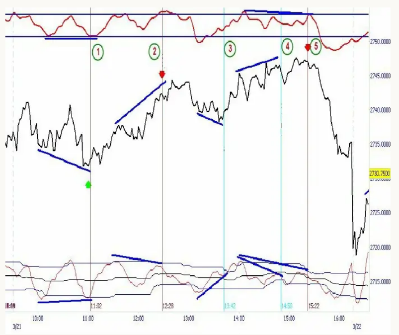
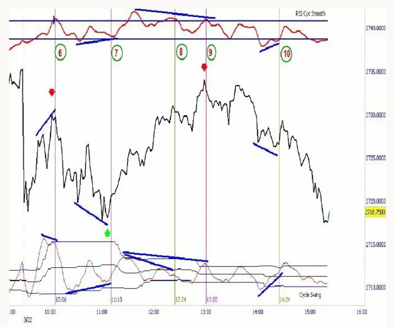
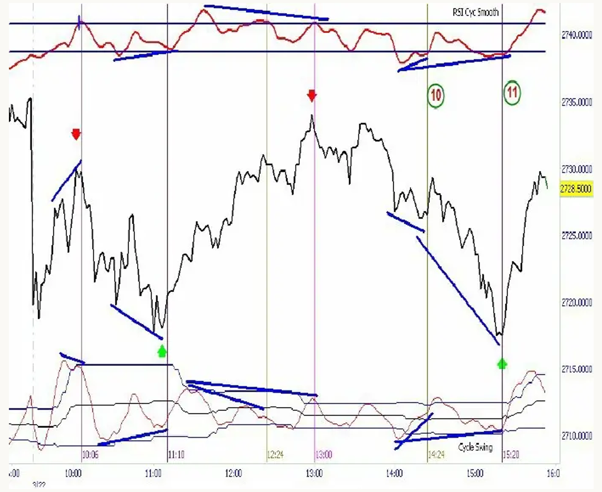
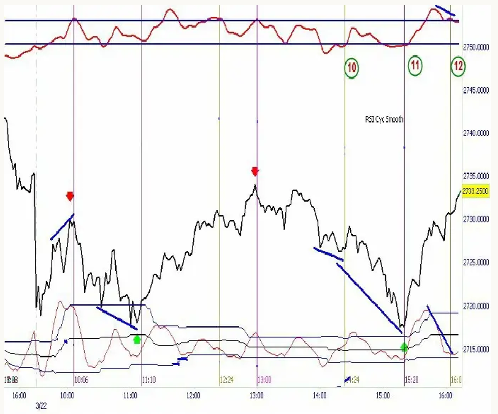
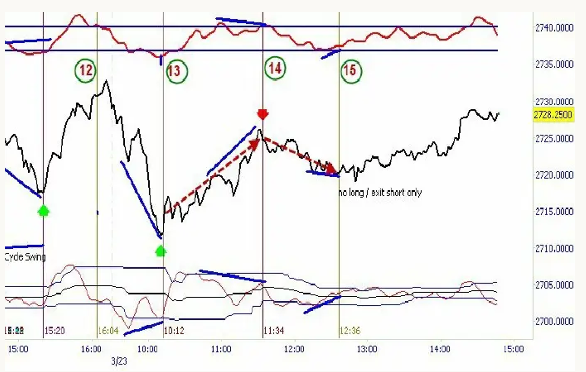

# Decoding the Hidden Market Rhythm

## 12. The CSI and CRSI Combo Trading Technique (Intraday)

The following trading strategy demonstrates the **Cycle Swing Indicator (CSI)** in combination with the **Cyclic Smoothed RSI (CRSI)** on a 2-minute chart. This section presents a simple set of standard rules for detecting correct and incorrect entry points.

I will use the **Nasdaq 100 E-mini futures contract (ENQ)** on a 2-minute chart to demonstrate this technique. We will analyze three consecutive trading days (March 21–23, 2012) to illustrate the results.

## Basic Technique

1. Look for divergences in the CSI and/or the CRSI.
2. The other indicator must confirm the divergence.
3. Pay close attention to the relationship between the **dynamic cycle swing bands** and the current value to distinguish correct signals from misleading ones.

The **Cycle Swing Indicator** is one of the most powerful momentum-like indicators because it is based on **cycle acceleration** rather than price behavior. Consequently, the CSI is fast, sharp, and lag-free.

The **CRSI** and the distance of the current CSI value from the dynamic bands provide additional trading insights. This technique identifies high-probability entry signals. Combined with proper trade and risk management rules, this forms a potent algorithm. It is easy to apply and does not involve a large number of rules or expectations. A straightforward method is necessary for fast-moving real-time 2-minute charts.

### 12.1 Day 1: March 21, 2012

**Figure 12-1**: Two-Minute Nasdaq E-mini Futures / March 21, 2012

#### Situation 1: Buy Signal (11:02)

- **CSI**: The Cycle Swing shows a bullish divergence with values below the lower band.
- **CRSI**: The CRSI confirms the bullish situation with a simultaneous bullish divergence.
- Both indicators show a bullish entry signal with the absolute CSI value at a level where there is room for upside. We go long relative to the market.

#### Situation 2: Classic Sell Signal (12:28)

- **CSI**: The Cycle Swing shows a bearish divergence with values touching the upper band.
- **CRSI**: The CRSI does not show a divergence but exhibits an extreme overbought condition that confirms the CSI’s bearish divergence.
- The bearish divergence is confirmed by the CRSI’s extreme overbought situation. We close the long position and go short relative to the market.

#### Situation 3: False Buy Signal - Close Only (13:42)

- **CSI**: The Cycle Swing shows a bullish divergence. However, the absolute position of the CSI is already at its upper dynamic band. This invalidates the bullish signal because there is insufficient room for upside based on cycle momentum. Instead, cycle acceleration is at a level where we expect downward pressure imminently.
- **CRSI**: Although a divergence in the CRSI is present, the lack of upside room for the CSI invalidates the bullish divergence.
- Conclusion: Ignore the bullish divergence; do not go long. Close the current short position and wait for the next safe opportunity.

#### Situation 4: False Sell Signal (14:50)

- **CSI**: The Cycle Swing shows a bearish divergence. However, the absolute position of the CSI is near its lower dynamic bands. This invalidates the bearish signal because there is insufficient room for downside based on cycle momentum.
- **CRSI**: Although a bearish divergence in the CRSI is present, the lack of downside room in the CSI invalidates the bearish signal.
- Conclusion: Ignore the bearish divergence; do not go short. If you are not already long, close your long position now.

#### Situation 5: Sell Signal (15:22)

- **CSI**: The bearish divergence is present. The absolute value of the CSI is not at the lower band but above the middle line, allowing for a short trade.
- **CRSI**: The CRSI shows a bearish divergence and is placed in an overbought condition.
- Conclusion: The sell signal from the CSI is confirmed by the CRSI. We go short.

#### Summary of Trades for March 21, 2012

We observed three confirmed trading signals, all of which were profitable. The signals captured the major turning points—the daily low and high. The CSI can precisely determine significant daily events with additional rules to validate or invalidate market conditions.

### 12.2 Day 2: March 22, 2012

The following day demonstrates the trading technique with an uninterrupted two-day example. **Figure 12-2** shows the technique’s ability to capture major market reversals.

**Figure 12-2**: Two-Minute Nasdaq E-mini Futures / March 22, 2012

#### Situation 6: Classic Sell Signal (10:06)

- **CSI**: The Cycle Swing shows a defined bearish divergence with values at the upper band.
- **CRSI**: The CRSI does not show a divergence but exhibits an extreme overbought condition that confirms the CSI’s bearish divergence.
- Conclusion: We close the existing position and go short.

#### Situation 7: Buy Signal (11:10)

- **CSI**: The Cycle Swing shows a defined bullish divergence with the absolute value positioned at the lower band.
- **CRSI**: The CRSI confirms the CSI’s buy signal, showing a simultaneous bullish divergence along with an additional absolute oversold condition.
- Conclusion: We close the previous short position and establish a new long position.

#### Situation 8: Invalid Sell Signal (12:24)

- **CSI**: The Cycle Swing signals a bearish divergence. However, the absolute position of the CSI is neither above the midbands nor near the upper band, invalidating the sell signal.
- **CRSI**: Although a bearish divergence is present, the lack of downside room in the CSI invalidates the bearish signal.
- Conclusion: Ignore the bearish divergence; do not go short. Close any existing long position.

#### Situation 9: Valid Sell Signal (13:00)

- **CSI**: A new bearish divergence is present. The absolute value of the CSI is above the middle band and near the upper dynamic band.
- **CRSI**: The CRSI is placed in an extreme overbought condition, confirming the bearish signal.
- Conclusion: We go short.

#### Situation 10: Invalid Buy Signal (14:24)

- **CSI**: The Cycle Swing signals a bullish divergence. However, the absolute position of the CSI is near the upper dynamic band above the middle line, implying imminent downward momentum.
- **CRSI**: Although a bullish divergence is present, the lack of upside room invalidates the buy signal.
- Conclusion: Ignore the bullish divergence; do not go long. Close any existing short position.

**Figure 12-3**: Two Similar Situations: Valid Buy at 14:24 and at 15:20

#### Situation 11: Valid Buy Signal (15:20)

- **CSI**: The Cycle Swing shows a bullish divergence, and the absolute position of the CSI is at the lower dynamic bands.
- **CRSI**: The CRSI confirms the buy signal with a simultaneous bullish divergence and an absolute oversold condition.
- Conclusion: We establish the next long position.

**Figure 12-4**: Follow-Up: No Valid Sell Signal at 16:00 / Close Long Only

#### Situation 12: No Sell Signal (16:04)

- **CSI**: The CSI shows a divergence, but the absolute position is too close to the lower band to allow for a weakness signal.
- **CRSI**: Although the CRSI shows a bearish divergence, it is irrelevant because the CSI’s position invalidates the sell signal.
- Conclusion: Close the long trade; do not go short.

#### Summary of Trades for March 22, 2012

We observed four confirmed trading signals: two long signals (11:10, 15:20) and two short signals (10:06, 13:00). The signals reflected the major highs and lows of the day. All signals were profitable and tradable.

### 12.3 Day 3: March 23, 2012

We examine the third uninterrupted day in sequence, applying the trading technique.

**Figure 12-5**: Two-Minute Nasdaq E-mini Futures / March 23, 2012

A **buy signal** was observed at **10:12** (Situation 13) with a CSI divergence confirmed by its absolute position and the CRSI. Approximately one hour later, at **11:34**, a **sell signal** was observed (Situation 14), reversing the long position into a short position.

At **12:36**, the CRSI signaled a bullish divergence, but the absolute position of the CSI near the upper band prevented a long position. Thus, we closed the existing short trade and took the profit without going long.

Over the three days of 2-minute Nasdaq 100 E-mini futures trading, this method signaled **nine trades**, all of which were profitable in an uninterrupted sequence. This example was taken from a live training session conducted during the three days of cycle trading.
