# Descifrando el mercado oculto Ritmo

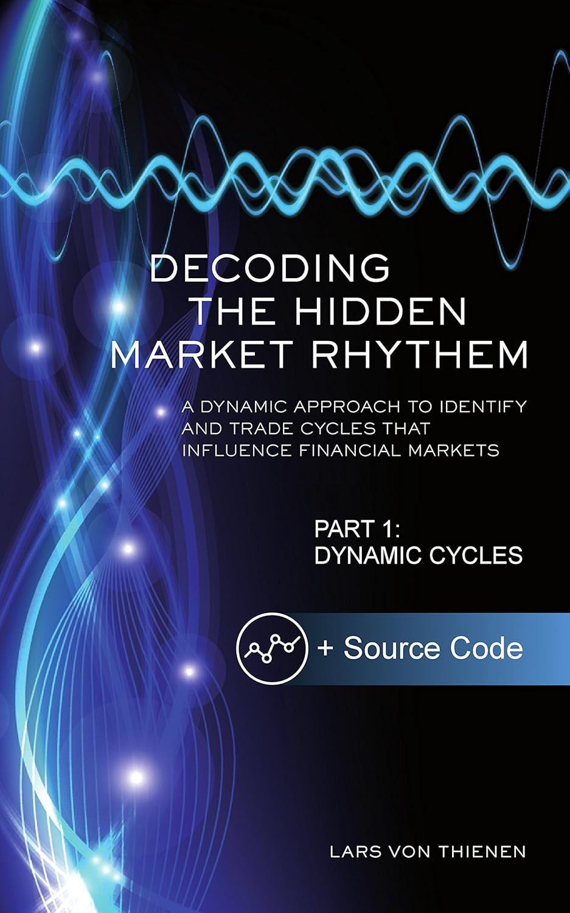

Parte 1: ciclos dinámicos

por Lars von Thienen

Un enfoque dinámico para identificar y ciclos comerciales que influyen en los mercados financieros

[www.whentotrade.com](www.whentotrade.com)

## Descifrando el mercado oculto Ritmo - Tercera Edición “Kindle”

Un enfoque dinámico para identificar y ciclos comerciales que influyen en los mercados financieros Parte 1: ciclos dinámicos (Release 2017.8 - Versión Kindle) Todos los derechos reservados.

Copyright © 2010-2017 Lars von Thienen / [www.whentotrade.com](www.whentotrade.com)

Todos los materiales de este libro, incluyendo, sin limitación, el texto, software, scripts, imágenes y vídeo los derechos de autor propiedad intelectual.

Todo presentado en este libro se considera otorgado para su uso personal, no comercial. No se le permite distribuir o vender el material o convertirla en cualquier otra forma que se la gente puede utilizar. Usted no puede copiar, reproducir, volver a publicar, cargar, publicar, transmitir o distribuir este material en cualquier forma o para cualquier otro propósito a menos que obtenga el permiso por escrito del autor en primer lugar. Este libro está diseñado para ayudar a los lectores a obtener educación de comercio. Se analizan formas de comercio de los mercados mediante el análisis de ciclo en el proceso de decisión. No hay garantías implícitas. Este libro no hace garantizar que que va a hacer el comercio de dinero en cualquier mercado.

El desempeño pasado de cualquier sistema de comercio se muestra o metodología no es necesariamente indicativa de resultados futuros. Los resultados hipotéticos o simulados tienen ciertas limitaciones inherentes. A diferencia de un registro de rendimiento real, los resultados simulados no representan operaciones reales. Además, dado que los oficios en realidad no han sido ejecutadas, los resultados pueden tener sub o sobre-compensado por el impacto, si hay, de ciertos factores del mercado, tales como la falta de liquidez.

Comercio implica el riesgo de pérdida. Por favor, considere cuidadosamente qué instrumentos de negociación son apropiadas para su situación financiera. El riesgo de pérdida en el comercio puede ser sustancial. Sin embargo, la capacidad para evaluar el riesgo es vital para la supervivencia de un comerciante. Por el contrario, sin riesgo no hay ganancia tampoco.

## Adelante: Tercera Edición “Kindle” (2017 Kindle)

La tercera edición de “Decodificación The Hidden Mercado Ritmo Parte 1” viene con un 100 páginas adicionales, que se complementan con nuevos ejemplos y las secciones de descarga de código fuente.

Los casos de uso ahora cubren un rango de 2009 hasta 2017, en todos los principales mercados - incluso Bitcoin se ha añadido a esta edición! Los algoritmos de ciclos originales siguen siendo los mismos en esta tercera versión y no han cambiado desde la versión inicial en 2009.

Además, en 2017, he decidido poner el marco ciclos en la nube pública. Así, en lugar de unirse a nuestra plataforma de gráficos WTT, que permite a los lectores a utilizar y acceder a las herramientas de ciclos de diferentes aplicaciones y plataformas de gráficos. Los lectores son libres de elegir la plataforma de su elección para integrar el marco de los ciclos.

Además, hemos decidido abrir nuestro repositorio de código fuente - se han añadido indicadores ya preparadas para NinjaTrader y MetaTrader. Esto se hizo para dar un inicio rápido para los lectores que deseen implementar las herramientas en diferentes formas y lenguajes de script.

Lars von Thienen de agosto de 2017

## Tabla de contenido

### 1. Se trata de ciclos

### 2. ¿Cómo detectar y medir los ciclos en el mercado de valores

- 2.1 El enfoque cíclico pone en práctica
- 2.2 El escáner Ciclo: Introducción de un algoritmo de detección de ciclo
- 2.3 Ejemplos: el escáner de ciclo en Acción
- 2.4 El escáner Algoritmo Ciclo
- 2.5 Uso del escáner Ciclo: Una guía paso a paso
- 2.6 Ciclo de escáner - Libro de Excel
- 2.7 Ciclo de escáner - Guión NinjaTrader
- 2.8 Escáner 2.8 Ciclo - API Punto de llegada Especificación
- 2.9 El trazador Ciclo

### 3. Ciclo escáner Marco: Algoritmo y Código

- 3.1 Paso 1: detrending
- 3.2 Paso 2: Detección Ciclo
- 3.3 Paso 3: Validación del ciclo
- 3.4 Paso 4: Clasificación
- 3.5 Resumen: La vibración dominante en el mercado
- 3.6 Sección del Código

### 4. indicadores técnicos de ajuste fino

- 4.1 La idea básica detrás del uso de la vibración dominante de mercado
- 4.2 Paso a paso: Operando con el intradía S&P 500 E-mini futuros
- 4.3 Trading S&P 500 E-mini intradía - Ejemplo 2
- 4.4 Resumen
- 4.5-cíclica Tuned RSI (CRSI) - Sección del Código

### 5. Los ciclos no son estáticas: La naturaleza dinámica de los ciclos de

- 5.1 Efecto A: Los cambios en la duración del ciclo
- 5.2 Efecto B: Los cambios en la fase del ciclo
- 5.3 Los efectos combinados
- 5.4 Lecciones en Video - Explicación de ciclos dinámicos

### 6. Explorador de ciclo dinámico: Predecir el siguiente turno de mercado

- 6.1 Introducción del método Explorador ciclo dinámico
- 6.2 La construcción de un pronóstico basado en el Explorador de ciclo dinámico
- 6.3 La combinación de un modelo semi-estático y dinámico de previsión para el comercio
- 6.4 lección en video - Dinámica Ciclos: S&P 500 bar-por-bar opinión
- 6.5 Lección Video - Semanal S&P 500 Ciclo Largo Plazo
- 6.6 Ciclo Explorer - Sección Código NinjaTrader
- 6.7 Ciclo Explorer - API Punto Especificación
- 6.8 Ciclos de mercado Explorer - Libro de Excel para el análisis de ciclo diario
- 6.9 ciclos del mercado Explorer - API Punto Especificación

### 7. ciclos dinámicos en oro y plata - de la teoría a la realidad

- 7.1 Ciclos dinámica de proyección: Abril / Mayo 2011
- 7.2 ciclos dinámicos de proyección: agosto de 2011
- 7.3 ciclos dinámicos de proyección: 2012 y marzo de 2013
- 7.4 Lecciones en Video - Ciclos de plata de llamadas en vivo

### 8. Ciclos de sentimiento: La medición y el miedo y la codicia de comercio

- 8.1 Negociación del “miedo” Ciclos de volatilidad
- 8.2 ciclos dentro de ciclos: Precio de combinación y los ciclos de volatilidad
- 8.3 Ciclos de sentimiento Trading Social Media
- 8.4 Lección vídeo: Ciclos de sentimiento de medios sociales
- 8.5 Trading ciclos de tensión financiera
- 8.6 Lección vídeo: Ciclos tensiones financieras
- 8.7 Mapeo de ciclos sentimiento al gráfico de precios - El “All In!” Caso

### 9. Ciclo Phasing Oscilador: Spotting Ciclo Alineaciones hizo fácil

- 9.1 El ciclo perfecto: Navegando a través de valles y picos
- 9.2 El ciclo de puesta en fase Simulador
- 9.3 El levantamiento de la cortina: la puntuación Ciclo Phasing in Action
- 9.4 Ciclo de Fases Score - Lección de vídeo
- 9.5 Ciclo de Fases Score - Sección Código NinjaTrader

### 10. Indicador de oscilación. Ciclo: Operando con el balanceo del ciclo dominante

- 10.1 El método de oscilación. Ciclo: Ciclo de aceleración
- 10.2 detección divergencia adaptativa
- 10.3 Trading las vueltas del Indicador de Ciclo oscilación
- 10.4 Ciclo: Parámetro y su uso
- 10.5 Ciclo: Sección del Código

### 11. Ciclo: La combinación de volumen, el alcance y los ciclos de precios

- 11.1 Ciclos de Volumen
- 11.2 Ciclos Rango de precios
- 11.3 Ciclos de Tiempo y Cluster Ciclo

### 12. La CSI y CRSI Combo Trading Technique (intradía)

- 12.1 Día 1: March 21, 2012
- 12.2 Día 2: March 22, 2012
- 12.3 Día 3: March 23, 2012

### 13. La introducción de algoritmos genéticos para detectar ciclos de mercado

- 13.1 Detección de ciclos en los datos financieros con un algoritmo genético
- 13.2 Ciclos Volumen intradía para el E-mini futuros S&P 500

### 14. Ciclos Toolbox y Ciclos API

### 15. Paperback versión del libro y Comentarios

### 16. Bibliografía

## 1. SE TRATA DE CICLOS

Este libro es acerca de los ciclos. Ciclos que influyen en nuestra vida aquí en la Tierra. Ciclos que representan los flujos de energía que influyen en los estados de ánimo y emociones de la gente. Ciclos que representan las energías procedentes del espacio exterior. Ciclos que se manifiestan en el valor medible del mercado de valores. Quiero introducir un enfoque sobre la manera de identificar los ciclos relevantes y cómo utilizar esta información para el comercio. Este enfoque no es del todo nueva. Pero la forma en que uso el “enfoque cíclico” es. Por otra parte, me tiro unos pocos de ciclos de energía del universo en la mezcla. Esta combinación es verdaderamente único en el que se explican todos los detalles y que este enfoque es descifrado en un enfoque comercial completa.

Los ciclos son importantes.

Ciclos nos rodean e influyen en nuestra vida diaria. Muchos eventos son cíclicos en movimiento. No es el reflujo y el flujo de las olas y la inhalación y la exhalación de los seres humanos.

Nuestro horario de trabajo diario es determinado por los ciclos de día y noche que vienen con la rotación de la Tierra alrededor de su propio eje. La órbita de la Luna alrededor de la Tierra hace que las mareas de los océanos. Ciclos también tienen un impacto en las mujeres de sus años de adolescencia en - el ciclo de la menstruación. Jardineros han entendido desde hace tiempo las ventajas de trabajar con ciclos para asegurar la germinación exitosa de semillas y la cosecha de alta calidad. Ellos trabajan en armonía con los ciclos para lograr los mejores resultados, los mejores cultivos. Experimentamos cuatro estaciones cada año, es decir, los cambios en el clima, como resultado de la rotación de la Tierra alrededor del sol Este ciclo estacional crea los cambios en las condiciones que afectan a todos los seres vivos de la Tierra. Un ciclo común basado en las condiciones estacionales es la migración de las aves, un habitual viaje de temporada llevada a cabo por muchas especies de aves.

Se podría esperar hasta principios de la primavera para plantar nuevas semillas para aprovechar el aumento de la energía pulsante de las temperaturas de la primavera de calentamiento. Saber cuándo se levantará el sol puede no parecer una predicción, porque lo asociamos con la predicción de la incertidumbre y el riesgo, pero es, sin embargo, una predicción de eventos futuros que es muy precisa.

Estos ciclos se basan en gran parte en los movimientos cíclicos del Sol y la Luna.

Sin embargo, existe una fuerte evidencia de que otros ciclos adicionales de energía en el universo influyen en nuestra vida aquí en la Tierra. La investigación independiente por la Universidad de California y la Universidad de Kansas ha revelado que el ascenso y la caída de las especies en la Tierra parece estar impulsado por los movimientos de nuestro sistema solar a medida que viaja a través de la Vía Láctea. Algunos científicos creen que esta fuerza cósmica puede proporcionar la respuesta a algunas de las mayores preguntas sobre la historia biológica de la Tierra (Schwarzschild, 2007). Por último, los ciclos tienen una larga historia en la explicación de nuestro comportamiento en la Tierra. Podemos volver mucho tiempo en la historia de reconocer que la vida sigue un camino de ciclos de tiempo. Incluso podemos encontrar referencia a esto en la Biblia.

> Un tiempo para todo
>
> Hay un tiempo para todo, y una estación para cada actividad bajo el cielo: un tiempo para nacer y tiempo de morir, tiempo de plantar y tiempo de arrancar, un tiempo de matar y tiempo de curar, tiempo de destruir, y tiempo de edificar, tiempo de llorar y un tiempo para reír, un tiempo para llorar y un tiempo para bailar, un tiempo para dispersan piedras y un tiempo para recogerlas, tiempo de abrazar y tiempo de abstenerse, un tiempo para buscar y un tiempo para renunciar, un tiempo para guardar y tiempo de tirar, un tiempo para rasgar y un tiempo para reparar, un tiempo para callar y un tiempo para hablar, un tiempo para amar y un tiempo para odiar, un tiempo de guerra y tiempo de paz.
>
> Ecl lesi como TES 3: 1 - 8

Si en efecto, hay un tiempo para todo lo que explica y predice nuestro comportamiento, esto también debe ser aplicable a las esperanzas económicas de la gente, que se manifiestan en el valor del mercado de valores.

Dos pioneros conocidos que aplicaron el análisis cíclico en el mercado de valores son WD Gann y JM Hurst. Gann utiliza patrones de tiempo y precio cíclicos y geométricos, pero no dio más detalles los detalles de su enfoque. Su trabajo sigue siendo un misterio para muchos de nosotros.

Hurst fue el primero en introducir el análisis del ciclo para el análisis técnico del mercado de valores. Incluso hoy en día, una gran cantidad de pronosticadores de ciclo, como Pedro Eliades, utilizar con éxito las técnicas de enfoque de Hurst esbozados en su trabajo seminal “La magia de la Utilidad de Operación de sincronización”. Por ejemplo, Hurst demostró que la única diferencia entre un patrón de cabeza y los hombros y un patrón de doble techo es la eliminación progresiva de los componentes cíclicos. Además, un documento publicado por tres autores de la MIT Laboratorio de Ingeniería Financiera en 2000 concluye que '' patrones técnicos proporcionan información. Se plantea la posibilidad de que [patrón] análisis puede agregar valor al proceso de inversión “(Mín;. Mamaysky; Wang; 2000)

Hoy tenemos pruebas de que la detección de patrones agrega valor al proceso de inversión y que todos los patrones técnicos se pueden reconstruir por medio de componentes cíclicos. En este sentido, debe ser valioso para pensar en términos de ciclos en lugar de utilizar un marco que consiste en patrones de los gráficos estáticos. Si este es el caso y ya ha sido ampliamente reconocido, ¿por qué sólo unos pocos comerciantes y los inversores que utilizan el análisis cíclico en el mercado de valores? La respuesta probable a esa pregunta es porque el análisis cíclico es extremadamente difícil de poner en práctica. Se requiere una gran cantidad de trabajo y algo de matemáticas complejas que no es fácil para todos a aplicar. Además, existen muchos obstáculos que impiden el uso del análisis del ciclo por los comerciantes: que debe ser valioso para pensar en términos de ciclos en lugar de utilizar un marco que consiste en patrones de los gráficos estáticos. Si este es el caso y ya ha sido ampliamente reconocido, ¿por qué sólo unos pocos comerciantes y los inversores que utilizan el análisis cíclico en el mercado de valores? La respuesta probable a esa pregunta es porque el análisis cíclico es extremadamente difícil de poner en práctica. Se requiere una gran cantidad de trabajo y algo de matemáticas complejas que no es fácil para todos a aplicar. Además, existen muchos obstáculos que impiden el uso del análisis del ciclo por los comerciantes: que debe ser valioso para pensar en términos de cicl

1. La brecha en el habla / lenguaje entre los investigadores de ciclo y los comerciantes Una de las razones análisis del ciclo es a menudo limitada a los investigadores científicos es la barrera lingüística. Esto se hace evidente en el siguiente ejemplo:

  1) “El apoyo real nivel identificados, junto con Fibonacci retroceso, sugiere la presencia de fuertes oportunidades de compra en el corto plazo “.
  2) “La magnitud de los primeros seis patrones de frecuencia y la significación estadística de la Q-score sugieren la presencia de un componente predecible de alta frecuencia en el mercado de valores.”

  A pesar de que ambas declaraciones tienen el mismo significado, la mayoría de los lectores comprenderán la primera declaración, pero encontrar la segunda desconcertante.
2. brecha en el conocimiento: experiencia comercial (visual) frente a los ciclos de cálculo (matemática)
  La segunda diferencia es atribuible a diferentes áreas de conocimiento. El análisis técnico es principalmente visual, mientras que el análisis del ciclo es principalmente numérico. El modo visual del análisis técnico es una de las pocas actividades cognitivas humanas donde las computadoras aún no tienen una ventaja absoluta sobre nosotros. Análisis numérico implica el estudio de los conjuntos de datos después el hecho. Pero en tiempo real ambientes, los comerciantes y los inversores deben decidir en el ahora y sus decisiones se basan principalmente en el reconocimiento de patrones visuales de las cartas. En muchos casos, el ojo humano puede realizar esta “extracción de señal” rápida y precisa. No hay, o más precisamente, sólo algunas herramientas de ciclo disponibles que pueden presentar la información visual extraído de análisis del ciclo numérico para el comerciante y funcionan como una guía visual.
3. Gap: Predicción contra el comercio (diferentes tipos de enfoques de mercado) El tercer análisis cíclico razón es una rareza en el comercio es la diferencia entre la previsión y el comercio.
  La mayoría de los comerciantes no están interesados en la predicción del futuro; en cambio, entran en un comercio basado en probabilidades, se aplican administración del dinero y salir del comercio pegue a reglas claras. Afirman que este es “el camino real de negociación”. Los operadores están convencidos de que pueden ganar dinero con sólo introducir el comercio de azar y mediante la aplicación de normas de gestión de dinero y de salida. En el otro extremo del espectro están los “analistas”. Este grupo de expertos no está interesado en las estrategias de manejo de dinero y de salida. Ellos únicamente basan su cotización en predecir el futuro comportamiento del mercado. Existe una brecha en la mentalidad de estos dos grupos caracterizados por un debate en curso sobre el comercio frente a la previsión.

  análisis cíclico es más de un método de pronóstico. Por lo tanto, no es sorprendente que esta herramienta no se puede encontrar en la caja de herramientas de un comerciante activo. El comerciante activo no está interesado en “predicción”. Él maneja su comercio.

Quiero tratar de subsanar esas deficiencias con esta publicación. Por lo menos un poco. Debido a que en el extremo, la esencia de análisis cíclico de negociación, se sencillo.

Usted no tiene que detenerse en cómo llegar a estos resultados en su cuenta. Es todo listo para su uso en el ámbito comercial para el comerciante que lo quiere todo en forma “visual”. Y las explicaciones que proporciono le dará los conocimientos y antecedentes necesarios sobre cómo utilizar eficazmente estas herramientas.

Este libro se diferencia de los tradicionales en los enfoques del ciclo, ya que no proporciona un marco estático de ciclos que deben ser exprimido en los datos. Es decir, yo no trato de hacer que el mercado “encajar” en un marco de ciclo particular que tiene al menos dos resultados diferentes posibles. "fallos" dentro de los marcos estáticos menudo se explican con un complejo conjunto de excepciones y desviaciones con nombre. La lista de excepciones después de un marco de bicicleta estática falla (por ejemplo: “Una inversión de ciclo tuvo lugar”) es de poco consuelo para el inversor que ha realizado inversiones sobre la base de una de las predicciones entregadas.

Voy a comenzar con los datos en bruto y la búsqueda de esos ciclos que existen. Lo haremos no seguir el camino de ciclos estáticos con una longitud fija o fase. Voy a presentar un enfoque dinámico sobre el uso de análisis de ciclo para el comercio. Este enfoque de ciclo se puede ajustar a la vibración actual en el mercado de valores.

Todas las herramientas de ciclo se explican en detalle y pueden ser fácilmente arrastrados 'n soltar en la tabla a través de nuestra plataforma WTT; o se puede integrar en sus propias aplicaciones a través de nuestro acceso a la API pública. Pero siempre recuerde:

> Un tonto con una herramienta sigue siendo un tonto.

Espero que usted trata a este conocimiento recién adquirido con respeto y sabiduría.

## 2. CÓMO DETECTAR Y CICLOS EN LA MEDIDA BOLSA DE VALORES

En este capítulo voy a introducir un nuevo algoritmo propietario para detectar ciclos activos en cualquier instrumento financiero para cualquier período de tiempo. Todos mis resultados de la investigación se han integrado en un motor de procesamiento de señales digitales para el análisis del ciclo. El motor está integrado en la plataforma de gráficos WhenToTrade y está disponible a través de una interfaz de programación de aplicaciones pública ( “API”) para utilizar las herramientas de ciclo con cualquier aplicación de terceros. Nuestro API elimina la necesidad de limitarse a nuestra plataforma WTT solamente. La robustez y la fiabilidad de este algoritmo se superan a la mayoría de los motores existentes que personalmente conozco. Por lo tanto, obtendrá un conjunto de herramientas único para la detección de ciclos. Con esta “arma”, usted será capaz de descubrir nuevas áreas para aplicar la información cíclica a negociación.

### 2.1 El enfoque cíclico pone en práctica

La mayoría de los enfoques tratan de identificar los ciclos basados en razones / fuerzas conocidas y aplicarlos a la evolución del precio real mediante la selección de la última cubeta visual o cresta y el trazado de la duración del ciclo conocido en el futuro. Tales enfoques tienen dos problemas principales:

(1) Usted debe ser capaz de “detectar” el derecho de alta o baja para establecer el punto de partida para la previsión del ciclo. Pero los mercados no suelen ser tan clara y es muy difícil identificar los máximos correctas / mínimos con los ojos en el gráfico. El mercado no sólo consiste en un ciclo - hay siempre un montón de ciclos activos al mismo tiempo, lo que hace prácticamente imposible detectar las correctas.

(2) Usted tiene que saber las razones / fuerzas detrás de cada ciclo y cuáles para seleccionar (como el movimiento de las mareas, las posiciones planetarias / aspectos, etc.). Sin embargo, simplemente hay demasiados factores del ciclo que podría ser activo. Siempre es fácil decir que uno era correcto o incorrecto después el hecho. También hay demasiados ciclos que tienen un alto potencial de probabilidad de influir en los mercados. En retrospectiva, siempre es fácil identificar qué ciclo se activa en un momento dado y por qué. Sin embargo, este enfoque es de poco, para identificar el momento justo en el momento para el comercio en tiempo real. Retrospectivamente, también parece muy probable que tales ciclos activos se refieren a puntos de inflexión importantes en el mercado. Sin embargo, hay simplemente demasiados ciclos potenciales que deben ser tomadas en consideración en tiempo real, es decir, cuando se mira hacia adelante. La evaluación de la probabilidad de antemano que un ciclo determinado será realmente activa en un momento determinado es como comprar el billete de lotería premiado.

Desde una perspectiva de investigación, que incluyen un gran número de estos enfoques en el análisis de los movimientos planetarios y su influencia en los mercados financieros. Sin embargo, mis propias experiencias también me dicen que estos enfoques no son adecuados para operar en tiempo real, es decir, para planificar el futuro. Por lo tanto, me gustaría presentar un enfoque alternativo. En principio, estoy convencido de que los ciclos astrológicos tienen una influencia en nosotros, en particular los relacionados con el Sol y la Luna.

Con referencia a la negociación del mercado de valores, sin embargo, estoy menos interesado en determinar con precisión qué ciclo astrológico en base al cual constelación, efemérides y los aspectos planetarios está ejerciendo actualmente influencia en el mercado. Más bien, me interesa "simplemente" en la identificación de los ciclos que son realmente activos en instrumentos financieros seleccionados (el índice) y su relevancia para el comercio el mercado de valores. Se podría comparar este enfoque de la ingeniería inversa. El punto final, ya que es (el índice) se toma y se descompone en sus componentes básicos para entender cómo todo se encadena. Los conocimientos obtenidos de esta manera se utilizan luego para los propios propósitos. En cuanto al resultado final, que no tiene ninguna importancia qué se utiliza uno u otro componente básico. En otras palabras, la razón por quéciclos específicos son activos no es importante - el quid de la cuestión es que son. Y esta idea por sí sola es significativa a un mayor proceso de esta información para llevar a cabo el éxito comercial. El punto de este enfoque fundamental, por lo tanto, es un método que puede determinar con precisión qué ciclo está activo actualmente con respecto a la longitud, amplitud y duración de la última de alta y baja de una serie de datos.

### 2.2 El escáner Ciclo: Introducción de un algoritmo de detección de ciclo

Para tomar prestado de la lengua de la ingeniería, análisis de frecuencia se utiliza para medir ciclos. Como los comerciantes, sin embargo, no debemos ser disuadidos por estos términos "técnicos". La frecuencia es otra cosa que "oscilaciones (ciclos) por período de tiempo". En el análisis técnico-matemático, la medición de la frecuencia es por lo tanto descrito en varias ocasiones. análisis de tiempo-frecuencia identifica el punto en el tiempo en el que varias frecuencias de la señal están presentes, por lo general mediante el cálculo de un espectro a intervalos de tiempo regulares.

La aplicación del análisis de frecuencia de los datos financieros es, en principio, nada nuevo y ya ha sido descrita en numerosos artículos. Sin embargo, los métodos actuales a menudo tropiezan con barreras en cuanto a la aplicación en los mercados financieros. Esto es atribuible a las características específicas de los mercados financieros. Los mercados financieros están influenciadas por numerosos ondas superpuestas, cuya fuerza y fases variar con el tiempo y por consiguiente no son constantes. Los datos también se superponen por los acontecimientos significativos de una sola vez (ruido) y tendencias cuasi-lineal. Los métodos clásicos de análisis de frecuencia no están diseñados para las características especiales de los mercados financieros. Por lo tanto, los métodos establecidos son en gran medida incapaces de proporcionar resultados fiables en cuanto a las señales de comercio prácticas se refiere.

Sin embargo, este libro está diseñado para su aplicación práctica en el comercio y la previsión y no pretende ser una publicación científica sobre nuevos algoritmos. En este contexto, me gustaría, por una parte, a abstenerse del debate académico sobre las ventajas y desventajas de los métodos individuales y, por el otro, para no repetir lo que ya se ha dicho en otras publicaciones. Para los lectores con una inclinación académica y que están interesados en los aspectos abordados aquí, las publicaciones de Meyer Analytics ([www.meyeranalytics.com](www.meyeranalytics.com)) y John Ehlers ([www.mesa.com](www.mesa.com)) son recomendados como lectura introductoria.

He experimentado con casi todos los enfoques y algoritmos de frecuencia análisis, en particular con los algoritmos de la Transformada Discreta de Fourier (DFT), la entropía análisis espectral máxima (MESA), y wavelets. En última instancia, sin embargo, ninguno de estos métodos de forma fiable y adecuadamente identificado ciclos para satisfacer mis necesidades. Se me ha llevado aproximadamente tres años de intensa investigación y desarrollo para moldear estos métodos con el propósito de detección de ciclo en instrumentos financieros de una manera verdaderamente fiable. Mi método está especialmente diseñado para el análisis de los conjuntos de datos de series de tiempo financieras. Combina las ventajas de los métodos actuales, sino que trata de la medida de lo posible para eliminar las desventajas de los enfoques individuales con referencia a las características específicas de las series de tiempo financieras. Mediante la combinación de métodos especiales DFT (incluyendo el algoritmo de Goertzel),

Sobre la base de mi experiencia como ingeniero, desarrollador de software, y el comerciante, he podido desarrollar e integrar este método en una plataforma de gráficos independiente. Además, he hecho los métodos accesibles a través de una API moderna, lo que permite integrar las herramientas en diferentes soluciones. Mi método propuesto proporciona el espectro de análisis de frecuencia para cada posible instrumento financiero y cada posible marco de tiempo. Los siguientes resultados se proporcionan de este modo:

1. La presentación de un espectro visual del análisis de onda de una longitud de 5 300 barras de precios;

2. Determinación de los picos en el análisis de espectro - es decir, los ciclos relevantes y significativos;

3. El filtrado de los valores derivados del análisis de frecuencia a través de validación estadística, es decir, la identificación de los ciclos que son realmente "activo";

4. La determinación de la fase precisa y la amplitud de cada ciclo activo;

5. Salida de los datos en una forma comprensible para los operadores, es decir,
    - la fase en la forma de la fecha del último punto bajo
    - la amplitud en la forma de la corriente precio escala, y
    - la longitud de la onda en forma del número de barras en el gráfico;

6. La determinación de la "fuerza" de un ciclo mediante el establecimiento del movimiento del precio por barra ( "fuerza de ciclo").

En el análisis del ciclo clásico, las olas con la amplitud más grande se describen generalmente como dominante. Sin embargo, para nosotros, ya que los operadores de la influencia relativa de un ciclo por unidad de tiempo - es decir, por barra en el gráfico - es de mucho mayor interés. Por lo tanto, el llamado ciclo de la fuerza se utiliza en última instancia como un valor de medición del ciclo con la mayor influencia por barra de precios. El valor con la fuerza ciclo más alto será utilizado de nuevo más tarde como que representa el ciclo dominante.

Estos resultados y el método matemático solos llenarían un libro entero por su propia cuenta. Como esta publicación está diseñada para propósitos más prácticos y tiene como objetivo avanzar en la aplicación exitosa del método en el comercio, prefiero a centrarse en cómo el método se aplica realmente.

Los siguientes ejemplos sirven para ilustrar la aplicación de este algoritmo analítico.

### 2.3 Ejemplos: El escáner Ciclo en el Ejemplo Acción 1: conjunto de datos con 2 ciclos

Este ejemplo es de una naturaleza más teórica, teniendo en cuenta que este tipo de datos "puro" no es, por supuesto, disponible en los mercados financieros. Me gustaría, sin embargo, empezar con este ejemplo con fines ilustrativos.

Antes de pasar a la serie financiera real, datos de prueba independientes se utilizan para su verificación. Estos datos de prueba se producen por separado y se leen en WhenToTrade plataforma de gráficos de nuevo para el análisis como gráficos diarios simples. Este caso se refiere a dos ondas simples, combinadas:

- Ciclo 1: La longitud de 30 / Amplitud de 40
- Ciclo 2: Longitud de 95 / Amplitud de 55


Figura 2-1: muestra de datos 1

El indicador en la parte inferior del gráfico muestra el espectro completo de la análisis de la onda. Dos picos pueden ser claramente identificados. El primero se encuentra en una longitud de precisión 30 y la segunda a una longitud de exactamente 95 días. Los datos también se encuentran en detalle en el registro:


Figura 2-2: Ciclo archivo de registro de escáner y espectro parcela para la muestra del conjunto de datos 1

El método era por lo tanto capaz de identificar las dos ondas con absoluta precisión con respecto a su longitud y amplitud. También será capaz de identificar la salida de las fases en función de la fecha de la primera baja.

La estadística resultado adicional de prueba (puntuación Bartels) de más del 98% también confirma la presencia real de los ciclos en la serie de datos. Cuando se trabaja con ciclos en los datos financieros, recomiendo sin tener en cuenta los ciclos identificados con una puntuación por debajo de 50% Bartels. Un valor más bajo indica que esta longitud de onda no tiene una presencia fiable estable en la serie de datos durante un período de tiempo específico. Tal información es particularmente relevante para su uso posterior en el comercio. Aunque un ciclo puede haber sido correctamente identificados por análisis de espectro, que puede muy bien ser que que este ciclo sólo se produce (o se ha producido) una o dos veces en toda la serie de datos. No queremos utilizar ciclos que sólo "aparecen una vez", como nuestras señales de operación. La prueba de Bartels es así una medida que indica si la presencia del ciclo estadísticamente identificado en la serie de datos a través de varios tiempos de ejecución podría ser confirmada.

El hecho de que estas dos ondas pueden ser identificados a pesar del uso de un marco de tiempo para el análisis que ni siquiera cubre dos longitudes de onda completas (en relación con 95 días) es de más importancia. A continuación se muestra el análisis de la prueba cuando sólo aproximadamente 170 puntos de datos (es decir, aproximadamente cinco meses de datos diarios) se utilizan para el análisis:


Figura 2-3: Diagrama de Spectrum para Conjunto de datos 1 con pequeña cantidad de datos


Figura 2-4: Detectado ciclos con pequeña cantidad de datos

Incluso el ciclo con una longitud de 95 días (tres meses) se identificó por lo tanto a una longitud medida de 104 días en esta serie de datos corto (una serie de análisis de sólo cinco meses) con una precisión de más del 90%.

Esta es otra ventaja importante de este nuevo método combinado. Mientras que los métodos clásicos a menudo requieren cuatro o más completos ondas de estar presente y la gama de análisis a ser de al menos 3-4 veces más largo que la longitud de onda más grande a ser identificado, menos de dos veces la longitud de onda más larga de datos analíticos es suficiente para completar el análisis en este caso.

### Ejemplo 2: conjunto de datos con 2 ciclos + tendencia

En este ejemplo, añadimos las tendencias de varias fuerzas de las olas previamente determinados. Esto refleja una característica clave de los mercados financieros y, por tanto, será de vital importancia más adelante. El algoritmo no necesariamente tiene que ser afectado por las tendencias.

Tenemos que asegurarnos de que los ciclos todavía se pueden identificar correctamente a pesar de las tendencias adicionales.

Aquí vamos a combinar dos ondas de nuevo y añadir arriba, hacia abajo y hacia los lados tendencias de diferentes puntos fuertes.

Los siguientes longitudes de onda se utilizaron para los datos de prueba:

- Wave 1: Longitud 30 / Amplitud 20
- Wave 2: Longitud 200/80 Amplitud En

consecuencia, el gráfico se ve así:


Figura 2-5: muestra de datos 2 / dos ondas con las tendencias lineales de diferente efectivo

El análisis de espectro sobre un marco de tiempo corto predefinido ahora proporciona el siguiente resultado:


Figura 2-6: Resultado del análisis de espectro para Conjunto de datos 2 en el registro de escritura

Es claramente visible que el algoritmo fue capaz de detectar ambos ciclos. El algoritmo no se vio afectada por las tendencias que se incluyeron. Tuvo éxito en “eliminar la tendencia” los datos antes del análisis de frecuencia. Es decir, el algoritmo tiene una función detrending patentada, ya que puede hacer frente a diferentes formas de tendencias y fuerzas. Como muestra este ejemplo, hemos incluido cuatro tendencias diferentes en el análisis. No obstante, el algoritmo fue capaz de filtrar todas estas tendencias.

Los otros ciclos identificados impresos en el registro con una longitud de 27 y 34 días pueden ser fácilmente clasifican como ruido no relevante. Esto es claramente discernible cuando se mira en la información de amplitud. Los dos primeros tenían una amplitud de precio de 20 y 74 (como era precisamente el caso de los ciclos de entrada). Y luego hay un gran salto en las amplitudes detectadas, de 74 a 1 y por debajo. Esta es una clara señal de que se puede pasar por alto esta información, debido a la amplitud de “baja” no tendrá ningún efecto. Conclusión:

El escáner de ciclo es capaz de tratar con diferentes tendencias.

### Ejemplo 3: conjunto de datos con 2 ciclos + tendencia + ruido

Ahora vamos a aumentar la complejidad y añadir la tercera característica de los mercados financieros: Una gran cantidad de ruido aleatorio. Este “ruido” puede, por ejemplo, ser generado por la noticia de que el mercado obliga a “saltar” en un sentido o en el otro. Vamos a utilizar el mismo conjunto de datos del Ejemplo 2 (longitud de onda de 30 y 200 con tendencias) para este ejemplo y añadir una gran cantidad de ruido a los datos. Esto es lo que nuestro conjunto de datos de prueba se parece ahora. Vaya por delante y compararla con la tabla anterior. Se puede ver claramente cómo distorsiona los datos de precios se ve y que el ciclo más pequeño se pierde en el ruido.


Figura 2-7: conjunto de datos de muestra 3 - 2 ondas + tendencias + ruido

En una nota: El nivel de ruido es mucho más alta que la amplitud del ciclo más pequeño. Así que tenemos una baja relación señal-ruido aquí con respecto al ciclo más pequeño. Una mirada más atenta a los datos demuestran lo que estoy hablando:


Figura 2-8: Primer plano de los mismos datos

Aquí viene el desafío para nuestro nuevo algoritmo:

1. El ciclo más largo plazo con una longitud de 200 días sólo se produce 1,5 veces en el conjunto de datos de un año. Por tanto, sería difícil detectar el ciclo de la carrera de 200 bares si sólo tenemos un corto tales la historia de los datos a analizar.

2. La onda a corto plazo con una longitud de 30 días está completamente “perdido” en la alta relación de ruido.

3. La tendencia a la baja real también distorsiona y se extiende el conjunto de datos.

Vamos a ver si nuestro algoritmo sigue siendo capaz de detectar los dos ciclos. Este es el resultado del análisis:


Figura 2-9: Análisis resultados para muestra de datos 3

Y otra vez:

El algoritmo no se vio afectada por toda la información de ruido y de tendencia. Eso correctamente identificados los dos ciclos con una longitud de 30 y 201 días. Los otros ciclos con una longitud de 15,27 y 34 días pueden ser “pasados por alto” si se compara con la amplitud de los dos primeros ciclos. Conclusión: El algoritmo es capaz de manejar una alta relación de ruido! Antes de pasar a  los datos financieros reales, te voy a dar una breve visión de la razón por la que esta información es tan importante y de especial interés para el comercio.

#### Paso a paso: ¿Cómo construir un pronóstico basado en la detección de ciclo

Cuando sabemos lo que los ciclos están impulsando el mercado, somos capaces de utilizar esta información para construir un pronóstico basado en ciclos. Ahora vamos a repasar esta técnica de pronóstico paso a paso.

##### Paso 1: Análisis del Ciclo

En cualquier punto dado en el tiempo, lleve a cabo un análisis del ciclo sobre la base de su marco de mercado / índice y el tiempo favorito. Vamos a utilizar el ejemplo del caso 3 para este escenario particular. Así que digamos que es 9 de febrero y estamos mirando el gráfico real.


Figura 2-10: Paso 1 - análisis de ciclo para datos del año pasado

Iniciar el escáner Ciclo que llevará a cabo el análisis del ciclo siguiendo los pasos explicados en los ejemplos anteriores. Para un análisis de un gráfico diario, yo recomendaría el uso de 1 - 2 años de datos diarios. En el presente ejemplo, estamos “única” Uso de un año para nuestro análisis. Los resultados de este análisis:


##### Paso 2: ciclos activos Terreno y ampliarlos en el futuro

Ahora que sabemos que los ciclos con una longitud de 30 y 201 días están activos, podemos empezar a desarrollar un pronóstico. Por lo tanto, vamos a trazar cada ciclo de acuerdo con la información proporcionada por el escáner Ciclo. Abrir el trazador del ciclo a través del menú Ciclos y los resultados del escáner se pueden cargar en el kit de herramientas plotter simplemente pulsando los “picos de escáner de carga” botón en la esquina superior derecha de la ventana. La primera onda se representa en línea con la fecha de inicio, la amplitud, y la información de longitud. La segunda onda también se representa de acuerdo con la fecha dada inicio, amplitud, y la información de longitud.

A medida que la siguiente ilustración se muestran, ahora se puede trazar los ciclos en el futuro.


Figura 2-11: Trazado de los ciclos identificados en la tabla y en el futuro

##### Paso 3: Construir un ciclo compuesto basado en los ciclos identificados

Si más de un ciclo está activo, hay que añadir todos los ciclos individuales en un ciclo compuesto “grande”. Todo lo que tiene que hacer es simplemente añadir la información de cada ciclo en un ciclo compuesto. En primer lugar, seleccione un ciclo trazada con el botón izquierdo del ratón. Una vez seleccionado, pulse el botón derecho del ratón para mostrar el menú contextual:


Elija “Serie Editar” para abrir el panel de configuración de nuevo. Ahora seleccione la opción para trazar los ciclos como un ciclo compuesto “Activar Terreno Compuesto”. Elegir si desea ver los ciclos de señales individuales, seleccione el color y el grosor.


La ilustración siguiente presenta el ciclo compuesto derivado de estos dos ciclos.


Figura 2-12: ciclo de síntesis basado en dos ciclos separados.

##### Paso 4: Mark espera que los futuros puntos de inflexión

Ahora podemos ver cómo esta previsión compuesta llevará a cabo en el futuro. Y también somos capaces de detectar incidencias en los que esperamos un cambio de tendencia. Esta información es importante para ir de venta larga o corta en el mercado.

He marcado algunas incidencias en la siguiente tabla que denotan un cambio en el ciclo compuesto.

Estos giros pronostican giros del mercado. Los ciclos tienen que, por supuesto, permanecer activo durante los próximos días / semanas.

Acabamos de crear nuestro primer pronóstico basado en los ciclos!


Figura 2-13: Mark espera puntos previstos por el compuesto girando ciclo

##### Paso 5: Sólo hay que ver cómo se resuelve

Ahora podemos seguir adelante en el tiempo. Nuestro pronóstico va a quedarse. El pronóstico se hizo el 9 de febrero y como se puede ver, el pronóstico era capaz de detectar futuros puntos de inflexión todo el camino hasta la fecha exacta.


Figura 2-14: conjunto de datos reales y las previsiones de 9 de febrero

Aquí con una curva trazada precio suavizado para una mejor ilustración:


Figura 2-15: conjunto de datos reales y las previsiones: ¿Cómo se juega

Como se puede ver, los ciclos de pronóstico es una previsión sin tendencia. Es evidente que la tendencia principal cambia de una tendencia a la baja a una tendencia hacia los lados - pero los ciclos de pronóstico nos ha proporcionado información fiable para el comercio. El cambio de tendencia no se conocía en el momento del análisis.

Esto es, por supuesto, solamente un ejemplo teórico. El propósito de este ejemplo es demostrar cómo construir modelos de predicción ciclo. Y se puede ver que si usted tiene un motor fiable para la identificación de los ciclos, usted será capaz de construir modelos de predicción de alta precisión. A pesar de un cambio de tendencia y una gran cantidad de ruido en la señal, nuestro motor fue capaz de detectar los ciclos adecuados.

El uso de este método de pronóstico, ahora será capaz de trazar los ciclos en el futuro para detectar futuros puntos de inflexión.

### Ejemplo 4: conjunto de datos con 4 ciclos + tendencia + ruido

Vamos a aumentar el grado de complejidad, una vez más con el siguiente conjunto de datos. Vamos a utilizar cuatro

ciclos diferentes, con diferentes desplazamientos de fase de la onda: - Longitud - Amplitud

```text
1 - 12 - 40 2 -
31 - 70, 3 - 54
a 90 4 a 82 -
65
```

Vamos a añadir diferentes tendencias y mucho ruido. En este ejemplo, el nivel de ruido promedio es de 1.5 mayor que el máximo. amplitud de la onda con una longitud de 12 días. En consecuencia, será difícil ver si el motor es capaz de detectar este pequeño ciclo pesar de todo el ruido y el cambio de tendencia. Esto es lo que se ve como conjunto de datos 4:


Figura 2-16: muestra de datos 4

Para nuestra prueba vamos a utilizar de nuevo sólo un año de historia de datos. Esto se corresponde con la realidad más adelante. Yo recomendaría el uso de 1-2 años de historia de datos si está analizando ciclos en un marco de tiempo diario. Vamos a echar un vistazo más de cerca lo que estoy hablando:


Figura 2-17: Zoom-in de conjunto de datos 4

Este ejemplo también es interesante, porque podemos comparar los métodos tradicionales de detección de ciclos. Si conecta el CIT-alta de alta y baja baja en el gráfico, parece que tenemos un ciclo de funcionamiento de alrededor de 65 días naturales.


Figura 2-18: Conjunto de datos 4 - Visual impresión de un ciclo con una longitud de 65 dias

Sin embargo, sabemos que se trata de datos de la muestra con ningún ciclo de 65 días! En otras palabras, no se puede identificar ciclos utilizando este método “simple”. Parece que tenemos un ciclo activo 65 días. Pero vamos a ver en breve que este ciclo no es útil para la predicción o el comercio.

Para demostrar esto, vamos a trazar un ciclo de 65 CD de la última baja del 4 de enero y ver si esto es útil para el comercio futuro. El enfoque estándar sería el uso de este ciclo de 65 CD que ha sido identificado visualmente y trazar en el futuro:


Figura 2-19: 65 ciclo CD trazada por delante

Las líneas azules en el gráfico indican las fechas de inflexión esperados de este ciclo particular. La información sobre las fechas que dan vuelta a predecir una: alta a principios del mes de febrero bajo durante la primera mitad de marzo de alta a principios de abril. Ahora vamos a ver cómo se juega:


Figura 2-20: Juego de datos 4-65 pronóstico del ciclo de CD y cómo se juega

Como se puede ver claramente, no existe una correlación entre el ciclo de 65 CD que hemos “detectado” y el comportamiento real de precios. Si hubiéramos realizado una previsión de ciclos de uso de este método clásico, hubiéramos sido totalmente equivocado. Normalmente, se deduce: “Ok, el ciclo de 65 CD fue invertida”, porque abril no tenía un alto, pero mínima. Por lo que sería argumentar despuésel hecho de que el ciclo de 65 CD fue invertida.

Sin embargo, sabemos por ejemplo que esta línea de razonamiento es totalmente equivocado! No existe un ciclo de 65 CD y no hay inversión. La detección de ciclos por reconocimiento visual de los máximos / mínimos estaba completamente equivocado.

Quiero utilizar este ejemplo para demostrar que el componente clave de todos los modelos del ciclo es un método de detección de ciclos robustos y fiables. Y como ya he demostrado, la mayoría de los métodos comunes simplemente no funcionan. Ahora vamos a utilizar nuestro nuevo algoritmo para determinar los ciclos activos usando sólo un año de historial de datos. Vamos a empezar con la trama del espectro del analizador de ciclo para el mismo conjunto de datos:


Figura 2-21: parcela escáner Ciclo de conjunto de datos 4

Podemos ver claramente los picos evidentes de los ciclos que se utilizaron para generar el conjunto de datos. Incluso  nuestro pequeño ciclo de 12 días fue reconocida con precisión con un pico agudo en el trazado del espectro. A pesar de todo el ruido en estos datos. La pregunta ahora es lo que debemos hacer con los ciclos detectados 117 y 170? Después de todo, estos ciclos no están presentes en el conjunto de datos. Esta es la copia impresa del registro de la escritura:


Figura 2-22: Resultado del análisis de ciclo para conjunto de datos 4

Estos ciclos, obviamente, no aparecen en nuestra lista de resultados, la razón de ser de nuestra post-procesamiento estadístico utilizando el motor incorporado en el algoritmo. Estos ciclos son “resuelto” porque tienen una baja puntuación de Bartels (por debajo de 49). Y que demuestra el poder del algoritmo combinado que se creó para este escáner Ciclo.

La lista muestra con precisión los ciclos reales: 12, 31, 54, y 86 días (la longitud real sería 85 días). Si se echa un vistazo en el ciclo de 28 días, se puede ver la baja “amplitud”. Este es también un derivado completo del ciclo 12er (4 * 12). Por tanto, podemos omitir el ciclo 28er aquí.
El resultado es tan clara como puede ser! Todos los ciclos se han identificado correctamente en términos de la duración del ciclo y la amplitud. Y el algoritmo (correctamente) no detectó un ciclo 65 días como hemos visto en el gráfico.

Por lo tanto, el siguiente paso sería aplicar el método de ciclo de pronóstico he introducido en el caso 3. Vamos a aplicar a este caso ahora.

#### Construyendo el modelo de pronóstico para el Ejemplo 4

##### Paso 1 - Análisis del Ciclo

Acabamos de completar este paso. El informe anterior fue publicado el 9 de febrero usando el historial de datos del año 2003. El motor nos proporcionó información sobre los cuatro ciclos (12, 31, 54 y 86 días), incluyendo sus fechas de baja y amplitud. Vamos a entrar en ellos en el gráfico en el siguiente paso.

##### Paso 2 - ciclos activos Terreno y ampliarlos en el futuro

Ahora estamos en condiciones de trazar los cuatro ciclos con sus fechas de desplazamiento correcta bajas y realizar una proyección de estos ciclos en el futuro. Los datos se deriva de la salida del escáner de ciclo y de la importación en la Plotter Ciclo a través del botón “Escáner resultados de la carga”, como se muestra a continuación.


Figura 2-23: Conjunto de datos 4 - ciclos individuales previstas para los ciclos detectados

##### Paso 3 - Construir un ciclo compuesto a partir de los ciclos detectados

Se obtendrá más complicado ahora, cuando entramos en cuatro ciclos en el gráfico y construimos un pronóstico basado en estos ciclos. Por supuesto se puede trazar cada ciclo individual para determinar cuando están en la “alineación” en términos de sus mínimos y / o máximos con el fin de detectar los puntos de inflexión. Para ello, tendrá que construir un modelo compuesto. Pero eso no implica nada más que la simple suma de los cuatro ciclos. Es fácil. Así que vamos a ver lo que la combinación de estos cuatro ciclos se parece.


Figura 2-24: pronóstico ciclo compuesto para conjunto de datos 4

##### Paso 4 - Mark espera que los futuros puntos de inflexión

El siguiente paso consiste en identificar el futuro principal puntos del ciclo compuesto de girar. Estas incidencias son las fechas en las que se espera un cambio importante en la tendencia del mercado. Para facilitar la lectura, sólo he marcado los grandes bajos y altos esperados. Hay, por supuesto, más que eso. Pero ¿por qué no acaba de tomar una mirada más cercana!


Figura 2-25: Previsión de puntos de inflexión (TCI) en los próximos meses

##### Paso 5 - Sólo hay que ver cómo se resuelve

Ahora vamos a ver cómo esta previsión habría jugado a cabo.


Figura 2-26: pronóstico compuesto y resultado

Creo que no hay necesidad de comentar en esta tabla. Se puede ver por sí mismo cómo precisa la previsión compuesta descubierto los puntos de inflexión correctas. Y no sólo son las marcadas correctas.

Cada punto de inflexión solo en el pronóstico de material compuesto se corresponde con un giro en el mercado muestra. Echar un vistazo más de cerca a la tabla y estudiar un poco.


Figura 2-27: Comparación entre el pronóstico del compuesto y muestra de datos

Comparar este resultado con el método de detección de ciclos visuales ilustrado anteriormente en el ciclo 65 de CD. Los beneficios de los resultados del ciclo del escáner son claramente visibles.

Esto es, por supuesto, sólo los datos de la muestra y no datos reales del mercado. Pero hay dos cosas importantes que me gustaría hablar acerca de todos estos datos de prueba:

1. Es importante demostrar que el algoritmo es capaz de detectar ciclos en las condiciones del mercado simulados con el ruido, las tendencias y los diferentes ciclos que se ejecutan en paralelo.
2. Usted debe obtener una comprensión general de un simple método de predicción ciclos usando los ciclos detectados para pronosticar los futuros puntos de inflexión.

Antes de pasar a los mercados reales, vamos a la conducta una última prueba de esfuerzo pesada usando nuestro motor para ver si el nuevo algoritmo puede dominar esta prueba también.

### Ejemplo 5: conjunto de datos con 5 ciclos + Ruido + cambiantes tendencias y fuerzas

de nuevo, sin aumentar la complejidad mediante la adición de un nuevo ciclo y aumentando los niveles de tendencia y los cambios de tendencia. Nosotros, por supuesto, también añadir ruido aleatorio en la parte superior de todo. Vamos a utilizar los siguientes cinco ciclos para el siguiente conjunto de datos:

```text
Wave - Longitud - Amplitud

1 - 30 - 40 2 - 50
- 60 3 - 95 a 55 4
a 195 - 110 5 -
230 a 150
```

Sólo para demostrar que se puede utilizar cualquier marco de tiempo con este motor, he elegido un marco de tiempo intradía similar a los tiempos comerciales normales 09:30-16:00 en un gráfico de un minuto. Esto es lo que parece:


Figura 2-28: muestra de datos 5

Se puede ver que esta muestra de datos es muy similar a los mercados reales. Y se basa exclusivamente en los cinco ciclos, diferentes tendencias, y el ruido. Por lo tanto, se revela que todas las características que se acercan a los mercados reales se incluyen en el modelo. Ahora vamos a ver lo que la información del ciclo del nuevo algoritmo será capaz de ofrecer.

En la primera carrera, sólo utilizaremos la historia de un día de datos para analizar los ciclos. Esta es también la forma en que se llevaría a cabo en los mercados reales -el último día de negociación se utiliza para extraer ciclos y esta información se utiliza para predecir los puntos de inflexión próximos.

A continuación se muestra el informe de análisis de los datos intradía de 6 de mayo.


Figura 2-29: resultado del escáner de ciclo para conjunto de datos 5 (un día de la historia de datos)

Hay alguna información que aquí estamos viendo por primera vez: El escáner Ciclo ofrece exactamente las fechas LOW (fase diferencial) con precisión a la hora cuando se utilizan los gráficos intradía!

El escáner ahora era capaz de extraer cuatro ciclos. Los 30, 51, 91, y 181 ciclos de minuto. El ciclo de 27 minutos se han omitido debido a su baja amplitudes en comparación con los otros cuatro ciclos. Es decir, la relación de error máximo aquí con referencia al ciclo más largo de 195 minutos (reales) en comparación con 181 minutos (detectados) es sólo el 8%. El ciclo con una longitud de 230 minutos no se detectó porque no se dispone de datos suficientes en las ventanas de análisis (sólo un día). Es por lo tanto no es sorprendente que el escáner no fue capaz de detectar el ciclo con una longitud de 230 minutos (aprox. 4 horas) en sólo 8 horas de datos de prueba.

En otras palabras, ahora nos enfrentamos a la situación de que el escáner no detecta todos los ciclos y que un ciclo con una tasa de errores de 8% fue uno de los ciclos identificados. Esto es similar a la realidad -no siempre habrá algunos errores en la detección y que es inevitable que se pierda algunos ciclos de más largo plazo. Por lo tanto, esto no es realmente sorprendente desde el punto de vista analítico.

El mismo análisis se puede realizar a través de la API de punto final CycleScanner y nuestra proporcionado Libro de Excel:


Figura 2-30: Salida CycleScanner libro de Excel para el Ejemplo 5

Pero ahora vamos a ver lo que pasa si usamos estos cuatro ciclos detectados, incluyendo el ciclo errónea en un modelo de pronóstico. ¿Será lo suficientemente confiable para fines comerciales?

Por lo tanto, vamos a entrar en los cuatro ciclos detectados con sus fechas bajo teniendo en cuenta y amplitudes en el gráfico. Esto habría sido la situación tenía que entró en ellos justo después de la abierta el 7 de mayo con un solo día de historial de datos.


Figura 2-31: La previsión del conjunto de datos 5 e individuales ciclos

De nuevo, el método necesita para resumir todos los ciclos individuales en un compuesto. Esta es la imagen de material compuesto para los ciclos individuales detectados con los puntos de inflexión principales ya se ha indicado en la tabla. Este es el método utilizado para construir un pronóstico de comercio para el día siguiente.


Figura 2-32: Juego de datos 5 con el ciclo compuesto pronóstico basado en Ciclo Escáner

Esta carta habría sido nuestro pronóstico de comercio para el 7 de mayo Nos hemos identificado los tiempos futuros para el día en el que esperamos que el mercado para convertir. Veamos lo que trae esta previsión:


Figura 2-33: La previsión del compuesto basado en el escáner y la muestra del conjunto de datos 5

Una vez más, el escáner del ciclo fue de gran precisión en la predicción de los puntos de inflexión hasta el minuto! Este ejemplo muestra lo que puede esperar en un mercado de bienes. Incluso si hay un error en la longitud del ciclo correcta e incluso si “se pierda” un ciclo, el pronóstico sobre la base de los resultados del escáner ciclo es fiable y robusto para la construcción de las previsiones negociables. Y de eso se trata. Necesitamos previsiones negociables. Y vamos a conseguirlos.

Este fue el último ejemplo para demostrar el potencial de la nueva algoritmo usando datos de muestra. Esta última muestra de datos acerca mucho a las condiciones reales del mercado. Y hemos visto ahora que los resultados del escáner Ciclo son muy precisos para las previsiones de construcción.

### 2.4 El escáner Algoritmo Ciclo

Si usted es un ingeniero, se puede imaginar lo difícil era este curso; una carga de trabajo completa de toda la materia matemática, la codificación, la prueba y el desarrollo individual para optimizar los algoritmos existentes. Si usted está en el comercio, no importa al final.

Hemos de tener en cuenta esta cifra para obtener una comprensión de cómo funciona el escáner Ciclo:


Figura 2-34: Visión general “Escáner Cycle”

#### Una nueva área de análisis cíclico a su alcance

Hasta ahora, he mostrado y demostrado cómo fiable y robusto este nuevo motor es. Es muy importante probar el motor de datos de ejemplo para los que conocemos la información del ciclo. Pero todos los ejemplos y pruebas de estrés han demostrado que este nuevo algoritmo es capaz de hacer frente a todas las características de los conjuntos de datos financieros incluyendo el ruido, las tendencias, y el cambio de ciclos en el tiempo. Puede superar los problemas de todos los conocidos rutinas de análisis individuales. La combinación y adaptación de diferentes algoritmos producen este gran resultado.

Todos los conjuntos de datos de muestra están disponibles a través de nuestro sitio Web en whentotrade.com. Les puedo asegurar que he llevado a cabo miles de tales ejemplos. Es, después de todo, muy importante para que usted sea capaz de confiar en un nuevo motor antes de aplicarlo a los mercados financieros. Espero que les haya dado cuenta de que se puede confiar en este nuevo algoritmo. En los siguientes capítulos, te voy a mostrar cómo utilizarlo con fines comerciales reales. A continuación, será capaz de probar y reconstruir todos los ejemplos que se muestran. He incluido estos datos con el fin de que pueda ser capaz de familiarizarse con el escáner Ciclo antes de aplicarlo a los datos reales. Este potente juguete está mintiendo justo en frente de usted. Se puede conectar el escáner Ciclo a cualquier dispositivo y utilizar cualquier período de tiempo. El algoritmo completo está integrado en el software WTT. Es sólo unos pocos clics de distancia.

Ahora se encuentra también capaz de utilizar los resultados del escáner Ciclo de construir las previsiones para los futuros puntos de inflexión.

Sólo se acaban de llegar al capítulo 2 de este libro. Y ya tiene el más poderoso motor de detección de ciclo para los mercados financieros a su alcance.

### 2.5 Uso del escáner Ciclo: Una guía paso a paso

El escáner Ciclo fue desarrollado en C ++ para ofrecer el mejor rendimiento analítico en un entorno en tiempo real. El motor ya está integrada y funciona con todas las versiones WhenToTrade “WTT” y Wave59. Además, el escáner ciclo también está disponible a través de nuestro punto final de la API pública para integrarse con el conjunto de herramientas de su elección. Para permitir un inicio rápido, un script indicador de libro de Excel y NinjaTrader se proporciona en los dos capítulos siguientes.

#### LVT escáner Ciclo


Esta herramienta tiene las siguientes opciones de parámetros: Figura 2-35: caja de entrada de parámetros del escáner Ciclo


#### Fecha de inicio y de finalización

La fecha de inicio y de finalización definen el período de datos a utilizar en el algoritmo para detectar los ciclos. Estos son parámetros muy importantes porque determinan que el conjunto de datos debe utilizar para el motor de análisis. Como fue el caso en los ejemplos, recomiendo el uso de 1-2 años de datos en el análisis de los gráficos diarios y 1-2 días de la historia de datos de 1 minuto en el análisis de los gráficos intradía. Las mejores fechas de inicio y fin son altas y bajas en el mercado actual. Así que selecciona los máximos y / o mínimos para la fecha de inicio / final y tratar de construir un periodo de 1-2 años (al día) o 1-2 días (intradía).

#### límite Bartels

El motor de post-procesamiento se aplica un motor de ciclo de verificación sobre la base de rutinas estadísticas. La puntuación Bartels indica la “fiabilidad” de la presencia de un ciclo en los datos actuales. El valor se mide en porcentaje. Un valor bajo indica una alineación estadística baja entre el ciclo y los datos reales. Un valor alto indica una alta alineación estadística entre el ciclo y los datos reales.

Este motor de post-procesamiento se debe utilizar como un segundo filtro de los resultados. El análisis de frecuencia ofrece todos los ciclos detectados por este procedimiento. Posteriormente, sólo los ciclos con una puntuación alta Bartels deben ser detectados por el motor.

Es decir, yo recomendaría evitando ciclos con un Bartels puntuación inferior al 40%.

#### Longitud min / max Longitud

Esto define el ciclo de longitudes que desea que los datos serán analizados en busca. Si sólo desea analizar los ciclos con una longitud de entre 50 y 100 días, 50 para entrar en length_min y 100 para length_max. Se puede definir el rango del escáner de Ciclos debe buscar. La longitud máxima de ciclos es 299 y la longitud mínima es de 5 (siempre medido en número de bares).

#### Ordenar por: fuerza o amplitud

Ciclos tienen dos características clave: La longitud y amplitud. Por lo general, los ciclos están ordenadas según la amplitud debido a que el ciclo con la mayor amplitud tendrá la más alta influencia en los movimientos del mercado. Pero cuando se trata de comercio, estamos interesados en la fuerza cíclica por unidad de tiempo, que se mide en barras en el gráfico de precios. Un valor mejor se puede obtener si clasificamos los ciclos de acuerdo con el nivel de influencia en relación con el movimiento de precios por barra. Este valor puede ser muy fácil de calcular: Basta con dividir la amplitud de la duración del ciclo. A continuación, obtener el cambio de precio en términos de ciclo por barra. Este ciclo se denomina” fuerza”en mi algoritmo.

Cuando se establece en “fuerza”, los ciclos en el registro de la escritura se ordenarán de acuerdo con valor de intensidad de ciclo. Cuando se establece en “amplitud”, serán ordenados según la amplitud.

#### Amplitud de múltiples

Se puede establecer un valor que funciona como un multiplicador para las amplitudes detectadas. Durante el trabajo con los cambios de precios pequeños (por ejemplo, datos de la divisa), quiere estirar las amplitudes pequeñas con un factor constante. Puede establecer este factor constante aquí como valor del multiplicador. No va a interrumpir el análisis del ciclo y sólo ayudar a los ciclos de la trama visualmente con valores más grandes para las amplitudes.

El resultado del analizador ciclo se imprime sobre el registro de la escritura. Allí encontrará toda la información relevante acerca de los ciclos detectados. Consiste en una parcela del espectro y una ficha detallada resultado de datos:


Figura 2-36: parcela espectro Ciclo

El encabezamiento de la pestaña Datos del ciclo proporciona información básica sobre cuándo se llevó a cabo el análisis, que los datos se utilizó para el análisis y en la puesta a punto.


Figura 2-37: Cabecera de registro analizador ciclo

La segunda parte de la ficha de datos ciclo comprende la tabla con los resultados del análisis de espectro. Los ciclos detectados están ordenados por fuerza ciclo o amplitud (como se indica en la cabecera).

Cada línea ciclo incluye la siguiente información:


Figura 2-38: parámetro Ciclo

### 2.6 Ciclo Scanner - Libro de Excel

El libro de Excel permite analizar los datos en bruto con el escáner Ciclo. La salida es como los resultados en plataforma de gráficos WTT. Garantizar que introduzca una clave de API de trabajo en la parte superior izquierda. El conjunto de datos que se examina debe ser puesto en la hoja de la columna “conjunto de datos” A. Una vez actualizada con los datos de su elección, el botón “Update” llamar a las consultas de la API.


Figura 2-39: Ciclo Excel escáner Worksbook

Descargar el libro de trabajo de Excel escáner Ciclo: [www.whentotrade.com/Excel/CycleScanner](www.whentotrade.com/Excel/CycleScanner)

### 2.7 Ciclo Scanner - Guión NinjaTrader

La integración de la API del escáner Ciclo permite a los lectores a utilizar el conjunto de herramientas del escáner para recibir los ciclos activos actuales para cualquier conjunto de datos desde cualquier plataforma. El indicador de NinjaTrader proporcionado representa los resultados del escáner ciclo en el registro de la escritura y los ciclos activos en la parte superior izquierda de la ventana del gráfico. Una descripción más detallada sobre un código fuente del script similar también está disponible en el capítulo 6.6.


Figura 2-40: Ciclo indicador escáner NinjaTrader en acción

#### Código Fuente NT8 NinjaTrader Descargar

Asegúrese de que utiliza una clave de API personal válida o utilizar la llave de la prueba pública wttpreviewpara iniciar su primera análisis del ciclo de nuestra nube de forma gratuita. [www.whentotrade.com/NT8/CycleScanner](www.whentotrade.com/NT8/CycleScanner)

### 2.8 Ciclo Scanner - API Punto Especificación

El CycleScanner permite analizar una matriz de series de tiempo individual y devuelve el espectro de ciclo para el conjunto de datos en consideración. Además de todo el espectro, la respuesta contiene una lista de picos en el espectro para identificar la longitud del ciclo correspondiente.


```text
POST "https://api.marketcycles.online/api/CycleScanner?api_Key=..&.."
```


Documentación: [www.whentotrade.com/apidocs/CycleScanner](https://api.marketcycles.online/swagger/ui/index#!/MarketCycles/PostCycleScanner)

### 2.9 El trazador Ciclo

El plotter ciclo puede trazar hasta ocho ciclos individuales en el gráfico. El trazador también es capaz de construir un compuesto a partir de todos los ciclos. El trazador se utiliza para los conjuntos de datos de muestra y para “verificar” los resultados del escáner Ciclo. Se puede utilizar el trazador para trazar manualmente diferentes ciclos en el gráfico. También se puede utilizar con fines de aprendizaje y reconstruir los ejemplos que aquí se presentan.

#### LvT_Cycle_Plotter


#### parámetros

El parámetro debe ser auto-explicativo. Sólo jugar con él un poco. Quiero mencionar un beneficio importante, sin embargo: Usted puede rodar directamente sobre los resultados de la ficha de datos del escáner del Ciclo en el plotter de ciclo. Sólo tiene que pulsar el botón situado en la esquina superior izquierda de la ventana Configuración de llamadas “puntas de carga del escáner” y los resultados se rellenarán en la pantalla de configuración desde el último ciclo de ejecución de análisis del escáner.

Esto hace que sea muy fácil de comprobar los resultados de un ciclo detectado en el gráfico.


Figura 2-41: parámetro plotter Ciclo

Por último, el ciclo se trazarán en base a toda la información derivada del escáner Ciclo. Y usando la opción “Activar Terreno Compuesto”, se puede cambiar entre una parcela compuesta de todos los ciclos o un parcela individual.

#### Utilizando el trazador del ciclo en Wave59

Es un poco diferente a hacerlo dentro de los Ciclos Wave59 plug-in. Sin embargo, puede copiar y pegar los resultados del registro de secuencia de comandos en el plotter ciclo de forma manual. Aquí es cómo hacerlo:

##### Paso 1: Copiar línea completa para el ciclo de registro de la escritura

En primer lugar, seleccione una línea completa incluyendo las comillas y presiona CTRL + C o haga clic en el botón derecho del ratón.


##### Paso 2: Abrir la fecha de inicio parámetro en plotter ciclo

Cambiar a la tabla e insertar el trazador de ciclo o configurar el indicador de ciclo de plotter y abrir la fecha de inicio de la onda que desea utilizar. Marcar o eliminar la información.


##### Paso 3: Pasta línea completa de registro analizador ciclo

Presione CTRL + V o haga clic en el botón derecho del ratón y “pegar” para insertar la línea completa.


Posteriormente, el guión va a reconocer que toda la información ciclo se ha entrado en esta línea y por lo tanto no tenerse en cuenta los siguientes campos individuales para la duración del ciclo y la amplitud.

## 3. ESCÁNER CICLO MARCO: ALGORITMO Y CÓDIGO

Ahora que podemos detectar ciclos con precisión quirúrgica, podemos empezar a aplicar nuestro nuevo motor de ciclo del escáner a los mercados reales. La información más valiosa en relación con el comercio y los ciclos es el llamado “ciclo dominante.” Para cualquier persona que quiera reconstruir y recodificar el marco del Ciclo de escáner, este capítulo se presentan los antecedentes completa sobre los algoritmos y códigos fuente utilizado.

### 3.1 Paso 1: detrending

El algoritmo tiene un filtro dinámico para detrending que se requiere para el preprocesamiento de datos. Detrending asegura que los datos que se examina no se ve afectada por las tendencias o eventos de una sola vez. La extracción de las tendencias lineales en los datos de series de tiempo es una condición previa necesaria para la investigación exitoso ciclo. En la literatura ciclo económico, el filtro de Hodrick y Prescott (1980) filtro (filtro HP) se ha convertido en el método estándar para la eliminación de los movimientos de largo plazo, al igual que las tendencias, a partir de los datos. Hodrick y Prescott propusieron el filtro HP para descomponer los datos de series temporales macroeconómicas en componentes de ciclo y tendencia. El filtro HP asume que los movimientos en las series de tiempo se compone de un componente de tendencia suave y lentamente cambiante. Mediante la eliminación de este componente de tendencia de la serie de datos, el filtro proporciona el comportamiento cíclico subyacente puro. Visualmente, esta técnica detrending es como dibujar una línea de tendencia a pulso lineal suave a través de los datos del gráfico trazados y la extracción de esta "mano alzada" línea de tendencia del conjunto de datos completo. El componente resultante sólo se basa en el comportamiento cíclico sin la tendencia subyacente. Ahora, podemos proceder y comenzar a aplicar el análisis de ciclo adicional en la siguiente etapa de detectar los ciclos que son dominantes y genuino dentro de este conjunto de datos filtrados.

Sin embargo, debemos tratar con cuidado la salida obtenida de este algoritmo detrending mecánica pura, ya que es bien sabido que esta técnica puede generar variantes de ciclo espurios; es decir, el filtro HP puede generar la dinámica del ciclo, incluso si no hay ninguno presente en los datos originales. Por lo tanto, la presencia de ciclos en los datos filtrados-HP no implica que existen ciclos reales en los datos originales. Por lo tanto, tenemos que aplicar mecanismos adicionales para validar genuinos ciclos identificados después y para eliminar posibles ciclos "no válido". Más tarde, en el paso 3 de nuestro marco del Ciclo de escáner, vamos a mostrar cómo eludir este problema mediante la inclusión de estadísticas de bondad de ajuste para nuestra genuina filtrado ciclo dominante.

Para optimizar el filtro HP y mantener estas deficiencias de ciclos espurios lo más pequeño posible, primero el ajuste adecuado de parámetro "λ" en el descomposición del filtro HP es importante. En segundo lugar, se necesitan pruebas adicionales sobre cómo los componentes cíclicos estimados comportan basan en evaluaciones de correlación cruzada para diferenciar los ciclos “genuinos” de los “falsos”. Ambos ajustes se han incorporado a nuestro marco escáner Ciclo para compensar las desventajas del filtro HP. Proporcionamos un ejemplo detallado en la Sección 9 del capítulo 2 con un conjunto de datos virtual de los diferentes ciclos, tendencias y ruido aleatorio para demostrar que la variante implementado puede detectar los ciclos más dominantes que son genuinos y se incluye en el conjunto de datos. Una revisión de las discusiones críticas sobre el método de filtro HP, sin embargo, indica que el filtro HP es probable que siga siendo el método estándar para eliminar la tendencia de todavía un largo tiempo por venir. Ravn y Uhlig concluyeron en 1997 de la siguiente manera:

> "Ninguno de los defectos y propiedades no deseables son particularmente convincente: el filtro HP ha resistido la prueba del tiempo y el fuego de la discusión extraordinariamente bien".

Para optimizar aún más el procesamiento previo detrending, los últimos hallazgos adicionales basados en el trabajo de Jim Hamilton (2016) podrían ser considerados. Sin embargo, el filtro HP cuenta con un amplio apoyo en el ámbito científico, y es ampliamente utilizado. Hemos sido capaces de utilizar con éxito el enfoque durante años en el pronóstico del ciclo: Nunca cambie un sistema que ejecuta demasiado rápido. Por lo tanto, se recomienda encarecidamente que cualquier persona que quiere reconstruir un marco detrending similar o más optimizado debe llevar a cabo más investigación en esta área.

### 3.2 Paso 2: Detección Ciclo

Ya que ahora tenemos el conjunto de datos cíclico preparado, el siguiente paso es descubrir los ciclos individuales que están activos. Posteriormente, el motor necesita para llevar a cabo un análisis espectral y luego aislar a los ciclos que son repetitivos y tienen las amplitudes más grandes. Por eso, tenemos que decidir en un algoritmo de detección de ciclo que se adapte a nuestro objetivo. La mayoría de los investigadores del ciclo están familiarizados con la transformada rápida de Fourier (FFT) y muchos "motores basados en FFT" están disponibles para detectar uno o más ciclos en los conjuntos de datos. Lo que muchos no saben, sin embargo, es que hay un subconjunto especial: el algoritmo de Goertzel.

Originalmente, se utilizó el algoritmo para detectar las frecuencias de tono "dominantes" que se utiliza en teléfonos de línea fija para la señalización DTMF, que fue desarrollado originalmente en 1958, mucho antes de que el período de los teléfonos inteligentes. ¿Alguna vez ha pensado en cómo la central telefónica sabe qué botón ha sido presionado? La respuesta es el algoritmo de Goertzel. Hoy en día, el algoritmo de Goertzel se utiliza ampliamente en las comunicaciones para detección de tonos y está integrado en el hardware como circuitos integrados para detectar tonos de un botón pulsado en tiempo casi real. Además, y más importante aún, el algoritmo de Goertzel fue diseñado originalmente para detectar ciclos en los conjuntos de datos que tienen características similares a los datos actuales de la serie financieros. El problema hace mucho tiempo que era un tono especial que se necesita para ser detectado en un lapso muy corto de los datos disponibles, y con un ruido considerable.

Por lo tanto, en lugar de utilizar Fourier estándar o transformadas de tren de ondas, por qué no usar una variante bien establecido de la transformada de Fourier discreta (DFT): el algoritmo de Goertzel? A medida que nuestros requisitos para la detección de ciclo en los mercados financieros son similares a los que se dirigía Goertzel en el caso de las líneas de teléfono antiguo?

Nuestra investigación muestra que el algoritmo de Goertzel ofrece resultados fiables en la descodificación de ciclos dominantes de conjuntos de datos financieros sin tendencia, superando otros métodos tales como wavelets o MESA.

Por supuesto, es necesario aplicar el Goertzel DFT (GDFT) de una manera especial, ya que es necesario aplicar una prueba GDFT en todas las longitudes de onda posibles y utilizar diferentes métodos para obtener la fase y la amplitud de la corriente. Es decir, para cubrir un espectro de longitud de ciclo completo, el algoritmo de Goertzel tiene una complejidad mayor que los algoritmos FFT. Sin embargo, utilizando el algoritmo de Goertzel para obtener la longitud del ciclo dominante de datos cortas y ruidosos, junto con versiones estándar para obtener la fase de corriente relacionada y la amplitud para la longitud del ciclo detectado, ayuda a generar todos los datos del ciclo dinámicas para el ciclo activo en el último punto de nuestro conjunto de datos en cuestión. Como no estamos interesados en el “promedio” la duración del ciclo de conjuntos de datos más largas, queremos que la duración del ciclo y fase que están activos en la última barra del gráfico. Por lo tanto,

Por último, este enfoque es apoyado por un estudio realizado por Dennis Meyers (2003) sobre el método Goertzel: [1]

> "Con datos muy ruidosos donde la intensidad de ruido es mayor que la intensidad de la señal, [...] , Sólo el Goertzel algoritmo puede identificar con éxito las frecuencias presentes".

Además, podemos ver una creciente cantidad de ruido que entran en juego para los mercados financieros. Algunos ejemplos de esto son operaciones de alta frecuencia, motores comerciales basadas-algo puro, o noticias alternativas. Por lo tanto, en nuestros ambientes de la vida real, no vamos a ver a los datos financieros "limpias" Establecer como se diluye por el ruido que oculta los ciclos reales subyacentes. El estudio muestra que el Meyers GDFT incluso supera el método propuesto "MESA" utilizado por John F. Ehlers, en la mayor parte de su investigación ciclo.

Por lo tanto, nuestro marco escáner ciclo se aplica el GDFT a los datos sin tendencia establecidos para cubrir todas las posibles longitudes de ciclo. Una vez que el ciclo más activo se detecta en base en el análisis completo GDFT espectro, utilizamos un plazo adicional para comprobar el estado actual fase menos en la última barra de nuestro conjunto de datos con un subconjunto más corta del conjunto original de datos completa, ya que estamos interesados en el estado de la duración del ciclo detectada en el punto del análisis, o la última barra disponible.

### 3.3 Paso 3: Validación Ciclo

Después de terminar el paso 2, obtendremos una lista de ciclos activos detectados. Paso 2 nos dio una lista de ciclos con longitud, amplitud y estado de fase de corriente en el extremo del conjunto de datos. Ahora, tenemos que validar y clasificar estos ciclos como nuestro enfoque está en busca de los ciclos más dominantes fuera de esta lista. Antes de empezar a hacer algún tipo de clasificación, volvamos a lo que ya introducido en el paso 1: Sobre la base de las trampas de la HP-filtro, que necesitamos para comprobar los ciclos detectadas mediante el uso de un segundo algoritmo para validar si un ciclo es genuina o tal vez espuria. Por lo tanto, este paso es importante evitar que los ciclos "virtuales" que no están en el conjunto de datos original y acaban de ser devueltos por el algoritmo detrending sí. Por lo tanto, aplicamos una forma especial de análisis de correlación estadística para cada longitud de ciclo detectado. En este paso, se evalúa la fiabilidad estadística de cada ciclo. El objetivo del algoritmo es excluir ciclos que han sido influenciados por los acontecimientos de una sola vez (al azar de noticias, por ejemplo) y los ciclos que no son genuinos. Uno de los algoritmos utilizados para este propósito es una prueba más sofisticada Bartels. La prueba se basa en matemáticas (estadísticas detalladas) y mide la estabilidad de la amplitud y la fase de cada ciclo.

prueba estadística Bartels' para la periodicidad, publicado en la Carnegie Institution of Washington, en 1932, fue abrazado por la Fundación para el estudio de los ciclos hace décadas como el único mejor prueba para un ciclo dado proyectado fiabilidad, robustez y, en consecuencia, la utilidad.

Fue publicado originalmente en 1935 por Julio Bartels en el Volumen 40 N ° 1 de la revista científica "Magnetismo Terrestre y Atmosférica Electricidad" con el título "Las fluctuaciones aleatorias, persistencia, y cuasi-periodicidades persistencia en geofísica y cósmicas." Más tarde, Charles E. Armstrong dio un breve ejemplo y caso de estudio sobre cómo aplicar la prueba Bartels en series temporales de datos financieros en 1973, titulado "Aplicación de la Prueba de Bartels Importancia de un análisis del ciclo de series de tiempo."

La prueba Bartels devuelve un valor que da la medida de la probabilidad de la autenticidad de un ciclo: valores van de 0 hasta 1, y cuanto menor es el valor, menos probable es que este ciclo se debe al azar, o al azar. La prueba considera tanto la consistencia y la persistencia de un ciclo dado dentro de los conjunto de datos se aplica a.

Para que sea legible más humano que estamos buscando una indicación fácil de leer si el ciclo es genuino, que acabamos de convertir el valor Bartels en bruto en un porcentaje que indica la probabilidad de que el ciclo se genuina mediante el uso de la fórmula de conversión:

```text
Ciclo genuino% = ( 1 - Bartels Partitura) * 100.
```

Esto nos da un valor entre 0% (al azar) y 100% (verdadero).

Esta prueba nos ayuda ahora para filtrar los posibles ciclos que podrían haber sido detectados en la etapa de detección de ciclo (paso 2), pero sólo había estado en la serie de datos por un período corto o al azar y debe, por tanto, no puede considerarse como ciclos dominantes en el la serie original de datos subyacente.

Como tenemos un porcentaje de puntuación final, sólo tenemos que definir un umbral individual por debajo del cual los ciclos deben ser omitidos. Recomendamos utilizar un umbral de> 49% y por lo tanto los ciclos con un genuino valor porcentual Bartels debajo del 49% debe ser saltado por cualquier técnica de previsión o de análisis del ciclo que siguen.

### 3.4 Paso 4: Clasificación

Un paso final importante en la toma sentido a la información cíclico es establecer una medida para la fuerza de un ciclo. Una vez que se ha completado el último paso, tenemos ciclos que son dominantes (en función de su amplitud) y genuino (teniendo en cuenta su fuerza motriz en el mercado financiero). Con fines de negociación, esto no es suficiente. La influencia precio de un ciclo por barra en el gráfico de comercio es la información más importante.

Te voy a dar algunos ejemplos comparando dos ciclos. Un ciclo tiene una longitud de onda de 110 bares y una amplitud de 300. El otro ciclo tiene una longitud de onda de 60 bares y una amplitud de solamente 200.

Por lo tanto, si aplicamos el método “estándar” para determinar el ciclo dominante, es decir, seleccionar el ciclo con la mayor amplitud, queremos seleccionar el ciclo con la longitud de onda de 110 y la amplitud de 300. Pero echemos un vistazo a la siguiente información - la fuerza del ciclo por barra:

- Longitud 110 / Amplitud 300 = Fuerza por barra: 300/110 = 2,7
- Longitud 60/200 = Amplitud de la fuerza por barra: 200/60 = 3,3 Para el comercio, es más importante saber qué ciclo tiene la mayor influencia para impulsar el precio por barra, y no sólo qué ciclo tiene la amplitud más alta!

Esa es la razón por la que estoy presentando el valor de medición “Fuerza Ciclo.” Nuestro escáner ciclo calcula este valor.

Dicho esto, para construir una clasificación basada en los ciclos de Izquierda, se recomienda clasificar estos ciclos en función de su "influencia" por barra de precios. Como estamos buscando los ciclos más dominantes, estos son los ciclos que influyen en el movimiento del precio más por sola barra.

Ordenar los resultados de acuerdo con la puntuación de fuerza de ciclo calculado. Ahora tenemos una lista de arriba hacia abajo de los ciclos que tienen la más alta influencia en los precios movimientos por barra. Y eso es precisamente lo que necesitamos!

### 3.5 Resumen: La vibración dominante en el mercado

Después de que el motor de análisis de ciclo ha terminado todas las cuatro etapas del ciclo, en la parte superior de la lista (con la mayor puntuación de fuerza ciclo) nos proporcionará la información sobre la vibración dominante en el mercado. De hecho, la longitud de onda de este ciclo es la vibración dominante en el mercado, que es muy útil para el comercio. Sin embargo, no sólo es el resultado limitado a la duración del ciclo (en base a nuestros ajustes en el paso 2, no sólo tenemos la longitud del ciclo dominante) pero también sabemos -y este es el estado actual fase de este ciclo muy el importante-(Importante : no la fase promediada en el conjunto de datos completo). Esto nos permite proporcionar proyecciones de ciclo más válidos en el lado "derecho" de la tabla para el comercio en lugar de utilizar el "promedio" estado de fase utilizado normalmente en los conjunto completo de datos para este ciclo.

Para los usuarios de MetaTrader, podría valer la pena señalar que, desde la publicación de la primera edición, en 2009, un desarrollo paralelo de un indicador “Goertzel Browser” comenzó con referencias a nuestro marco presentado. Por último, voy a utilizar la definición del “mercado dominante de la vibración”, porque todo este algoritmo y la idea detrás de él van más allá de la definición clásica de un ciclo dominante que se encuentran en la literatura.

### 3.6 Sección del código

Compartimos nuestro código fuente para los algoritmos de detección de ciclo introducidas. Nuestro motor de ciclos se implementa en C ++. Hemos integrado la biblioteca de C ++ directamente en nuestra plataforma de gráficos WhenToTrade y nuestro punto final de la API pública disponible en [https://api.marketcycles.online/](https://api.marketcycles.online/) . La plataforma de gráficos y API proporciona un funcionamiento fácil y un uso intu itivo y sin necesidad de codificación de bajo nivel.

Sin embargo, si se quiere desarrollar su propio motor de detección de ciclo para los propósitos individuales, compartimos las secciones de código fuente para cada algoritmo. Los siguientes repositorios públicos permiten una descarga directa.

- HP filtro de Código Fuente [www.whentotrade.com/code/hp-filter](www.whentotrade.com/code/hp-filter)
- Goertzel Código Fuente Algoritmo [www.whentotrade.com/code/Goertzel](www.whentotrade.com/code/Goertzel)
- Bartels Código Fuente de prueba [www.whentotrade.com/code/Bartels](www.whentotrade.com/code/Bartels)

## 4. DE AJUSTE indicadores técnicos

No basta con ciclos de medidas sólo con precisión. Ciclos y la medida dominante de mercado de vibración se deben aplicar en entornos comerciales reales. Vamos a empezar con un enfoque muy antiguo equipado con un algoritmo de estrenar.

La primera y más fácil de utilizar la vibración dominante de mercado es el de “afinar” los indicadores estándares técnicos. Esto no es una idea nueva - pero con los datos presentados en el capítulo anterior, podemos potenciar a las viejas ideas con un algoritmo de detección de ciclo robusta y dinámica.

Voy a presentar una estrategia de combinación que pares el popular oscilador RSI con los conceptos cíclicos de la vibración dominante de mercado. Esta combinación resuelve el problema de las señales de comercio viciados por lo comunes del análisis del oscilador tradicional filtrando a cabo.

El uso del escáner Ciclo en combinación con el RSI mostrará cómo la incorporación de análisis del ciclo de mejora en gran medida la exactitud y el valor de señales de oscilador.

### 4.1 La idea básica detrás del uso de la vibración dominante de mercado

Mucho se ha escrito acerca de la puesta a punto de indicadores técnicos que utilizan información sobre la duración del ciclo dominante. Voy a explicar los fundamentos siguiente.

La razón sólo utilizamos los indicadores técnicos con su ajuste de la longitud estándar de, por ejemplo, el 13, es atribuible a la falta de conocimiento acerca de cómo establecer el valor de la longitud correcta antes de tiempo. Uno de los principales inconvenientes de la utilización de indicadores técnicos con su establecimiento de normas de longitud es el problema de la filtración de las señales de comercio defectuosas.

Sobre la base de la lógica del algoritmo de cálculo, indicadores estándar funcionan mejor cuando su ajuste “interior” (el parámetro de longitud para el cálculo) está alineado con el dominante en el mercado de la vibración del movimiento del precio que ha de ser rastreado. 'Alineado' significa que el parámetro de entrada longitud es un número de armónicos de la longitud de onda dominante completo. La forma más fácil sería utilizar la armónica completa o media del mercado dominante de la vibración medido.

> Declaración 1: Establecer el parámetro de longitud de indicadores técnicos para un armónico lleno o medio de la vibración dominante de mercado.

Otro enfoque común (cuando no está seguro de cómo detectar el ciclo dominante) sería la de aplicar un poco de back-optimización para determinar qué ajuste de longitud habría tenido el mejor desempeño en el pasado y utilizar este valor para el comercio futuro. Pero incluso un entorno de respaldo optimizada es un valor fijo que no es capaz de adaptarse a las características reales del mercado.

El uso de períodos de longitud fija de respaldo optimizada o estandarizados en los indicadores técnicos conduce a resultados imprecisos en el lado derecho de la gráfica donde se realiza todo el comercio.

Dado que las longitudes de ciclo dominantes y desplazamientos de fase que impulsan el cambio en el mercado con el tiempo, el ajuste de los indicadores a estos extremos debe ser hecho de forma dinámica.

> Declaración 2: El parámetro de longitud se debe ajustar de forma dinámica.

Sin embargo, la clave para poner en práctica esta idea es tener un método fiable y preciso para detectar el ciclo dominante en un momento dado. La mayoría de los artículos por lo general sólo explican cómo ajustar el parámetro de longitud estándar de indicadores técnicos y luego te deja solo a la hora de ponerlo en práctica, es decir, la forma de detectar el ciclo dominante real por su cuenta. Usted puede suscribirse a boletines de noticias o pagar un montón de dinero para obtener este tipo de información. Sin embargo, me centraré en poner en práctica esta idea. Esta publicación le proporcionará toda la experiencia que se tiene que utilizar este método por su cuenta.

En el capítulo anterior, introduje los algoritmos necesarios para detectar el ciclo dominante en el mercado. Este algoritmo se incluye aquí y se ha simplificado de manera significativa por lo que se puede aplicar a cualquier tipo de gráfico con sólo dos clics del ratón. El último capítulo ya ha indicado que ahora tiene un poderoso motor de la derecha a su alcance que va a entregar la longitud de onda. Equipado con estas herramientas, que ahora son capaces de detectar dinámicamente la longitud de ciclo real en cualquier punto dado en el tiempo. Puede comenzar a utilizar esta información para afinar sus indicadores de inmediato. Vamos a empezar por revisar algunos ejemplos.

### 4.2 Paso a paso: Operando con el intradía S&P 500 E-mini futuros

Vamos a revisar el mercado en un gráfico intradía utilizando indicadores estándar. Elegiremos 18 de de mayo de 2010 para esta prueba (que es el ayer, es decir, el día antes de escribir estas líneas, por lo que no cherry picking aquí!). En primer lugar, vamos a ver en el gráfico basado aquí en un indicador RSI normal estándar:

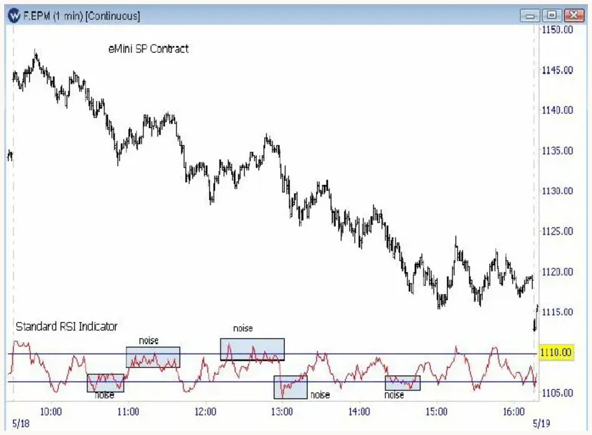

Figura 4-1: E-mini con el RSI norma el 18 de mayo - No intercambiable información

Se puede ver claramente a partir de la información de ruido de la RSI que hubiéramos tenido una gran cantidad de oficios whipsaw con una gran pérdida al final del día. Ahora vamos a ver si somos capaces de afinar el indicador RSI con la información derivada de la vibración dominante de mercado. Ahora vamos a ir sobre todo el método en detalle. Vamos a suponer que es el comienzo de la jornada el 18 de mayo Por lo tanto, vamos a tener que prepararse para la jornada de la mañana justo después el mercado se ha abierto.

#### Paso 1: diagrama de abierto y utilizando el analizador ciclo de ejecución de un día de historial de datos (aprox.)

Hemos adjuntado el kit de herramientas de ciclo del escáner al gráfico. Se eligió el período comprendido entre la fecha de inicio de la negociación el 17 de mayo hasta la mañana del 18 de mayo es decir, un día completo de la historia de datos.

A continuación, vamos a echar un vistazo a la ventana de resultados del escáner:

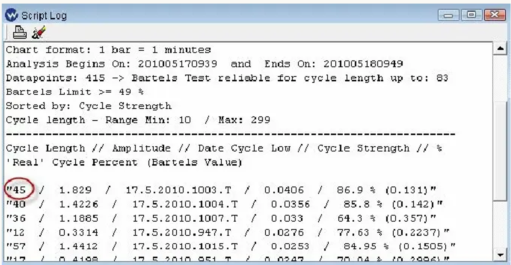

#### Paso 2: Detectar la vibración dominante de mercado

Si seguimos la definición de la vibración dominante de mercado presentado en la introducción de este capítulo (puntuación más alta de la fuerza de ciclo), el mercado dominante de la vibración detectada tiene una longitud de onda de 45 bares (minutos). La idea ahora es utilizar esta información para ajustar los indicadores. El enfoque más eficaz es tomar la mitad de la longitud de onda identificado como entrada para el parámetro de longitud de indicadores estándar. En este caso, la puntuación de 22 sería el medio cuerpo de la vibración dominante de mercado (45/2 = 22,5 -> pero vamos a utilizar sólo valores enteros completos para las posiciones de longitud, aquí 22).

#### Paso 3: Utilice la vibración de mercado para afinar los indicadores

Al inicio de la jornada, sabíamos que la vibración de mercado era de unos 45 minutos. Por lo tanto, vamos a utilizar 22 como la entrada de longitud para los indicadores estándar en el gráfico (gráfico de 1 minuto). En consecuencia, vamos a entrar en el indicador RSI en el gráfico estándar con una longitud individual de 22. Hemos completado nuestro “cíclico” ajuste fino del indicador RSI. Eso es. Es todo muy sencillo si se conoce el ciclo de mercado y la vibración puntuación dominante. Se trata sólo de establecer el valor de la longitud correcta para el indicador para estar en sintonía con la vibración de mercado.

##### revisión del desempeño del indicador RSI afinado cíclica

Vamos a revisar si este indicador RSI ajustado es capaz de obtener mejores resultados. La siguiente tabla muestra el día de la operación, incluyendo la RSI afinado cíclico. Las señales de comercio - una ruptura por debajo / por encima de las líneas superior / inferior (30 y 70) - están marcados como líneas azules en el gráfico para una fácil lectura.

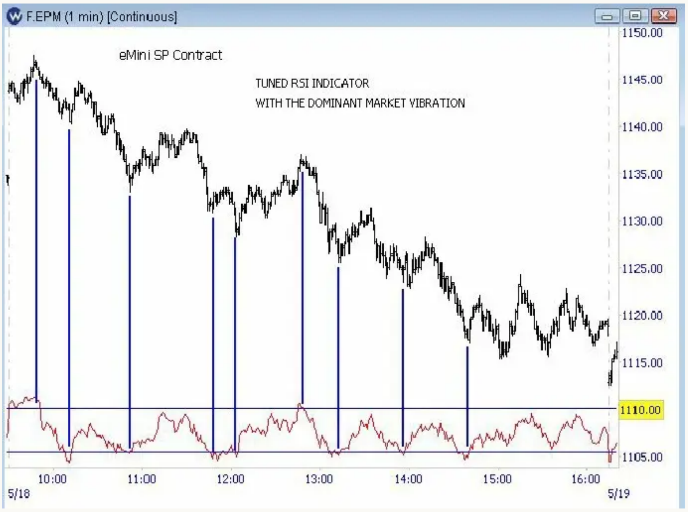

Figura 4-2: E-mini con cíclica RSI puesto a punto el 18 de mayo - el comercio Borrar señales

Se puede ver que cada señal de RSI estaba en alineación con importantes máximos / mínimos de mercado. Ahora el RSI es capaz de cumplir con su deber, ya que ahora está vibrando al ritmo del mercado. Esto es muy importante para los indicadores estándar. Normalmente, nadie sabe cómo configurar el parámetro “longitud” de la mayoría de los indicadores técnicos. O, alternativamente, que son capaces de ver inmediatamente despuésel hecho de qué entrada de longitud habría tenido el mejor desempeño. Pero en el comercio, lo haríahan sido el mejor parámetro para el indicador es irrelevante después del hecho.

Por lo tanto, necesitamos información sobre lo que es el mejor parámetro antes de tiempo. La vibración dominante de mercado, que podemos identificar usando nuestro nuevo motor, es capaz de entregar esta información. Si sólo utiliza la configuración estándar de longitud, que no está en alineación con la vibración dominante de mercado, la salida del indicador será inútil con respecto a las señales comerciales fiables. Puede comparar ambos gráficos al final de este capítulo. Verá claramente lo que estoy hablando (Figura 4-4 y la Figura 4-5).

##### Pero vamos a tomar un paso más adelante

Una vez que sabemos el componente cíclico del mercado, también somos capaces de aplicar un poco de ruido filtrado con casi cero lag. Por lo tanto, he integrado un motor de suavizado cíclica en el indicador RSI. Es el mismo indicador RSI, sólo que la señal de RSI se alisa por este nuevo “super cíclico suave”. La siguiente tabla muestra la misma RSI con un ajuste de la longitud de 22, suplementado por el motor de suavizado. Una ventaja importante se hace evidente ahora: Las señales de referencia a la ruptura por encima / por debajo de las líneas indicadoras inferior / superior siguen siendo los mismos, el filtrado casi cero lag no obstante. Ahora somos capaces de ver con claridad las divergencias entre el precio y el indicador RSI afinado cíclico. Estas divergencias no habrían sido fáciles de ver en el indicador RSI normales. Pero en esta versión cíclica afinado, las divergencias son fácilmente visibles. Y estas señales son aún más importantes que los saltos de línea. Las divergencias de este indicador se destacan en la siguiente tabla.

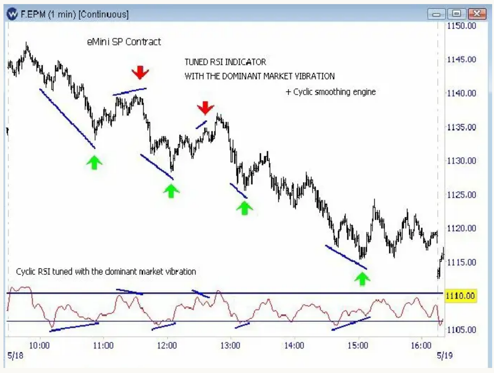

Figura 4-3: E-mini con cíclica afinado y RSI suavizado el 18 de mayo - señales clara divergencia

Las señales más potentes se alcanzan cuando hay una divergencia y una ruptura de la línea de señal superior / inferior como se detecta previamente. El indicador RSI en sintonía cíclica se puede activar a través del menú principal:

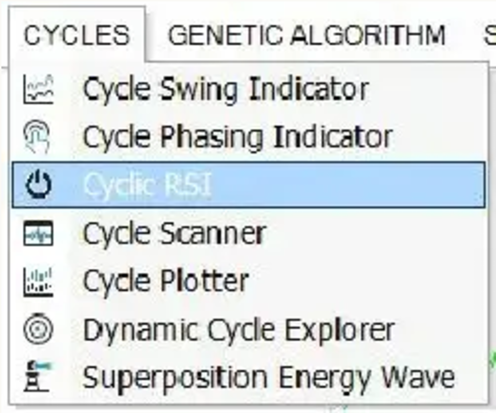

Los siguientes parámetros adicionales están disponibles: “vibración” especifica la sensibilidad para la detección de ciclo dominante y “Rango1” y “Rango2” el comportamiento adaptativo Bandas.

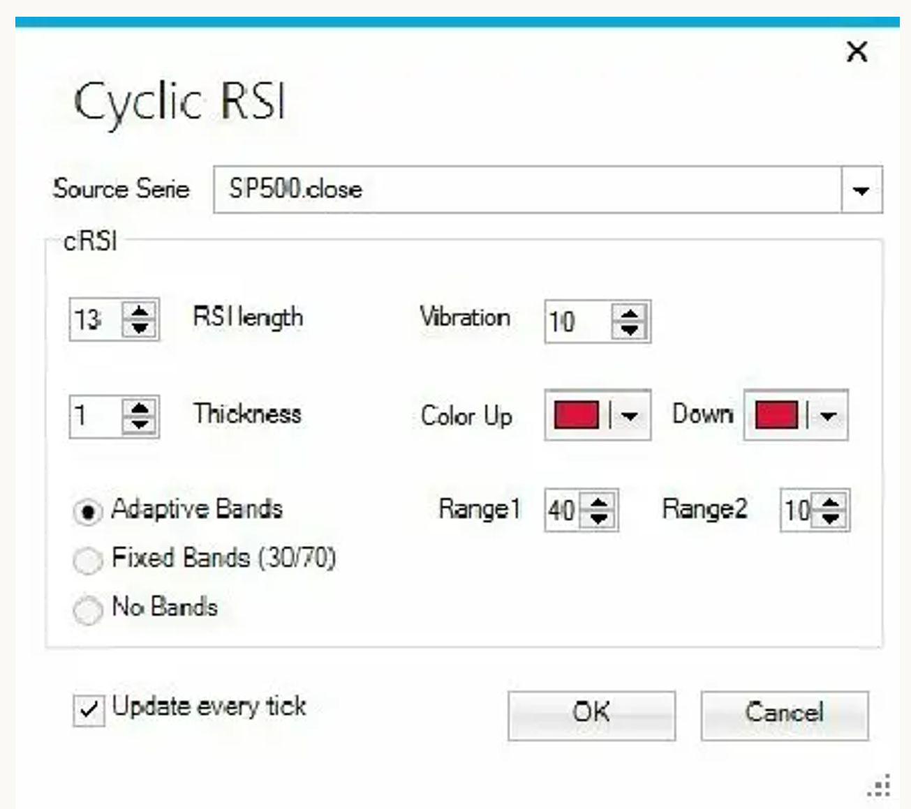

Por favor revise estas señales con el indicador RSI estándar en la página siguiente (Figura 4-4 y la Figura 4-5). Usted no habría sido capaz de ver estas señales con la configuración estándar de RSI.

Para entender mejor, he incluido una tabla grande aquí, incluyendo ambos indicadores. De este modo puede revisar los detalles de la carta por su cuenta y comparar estos dos señales de RSI más de cerca (Figura 4-6).

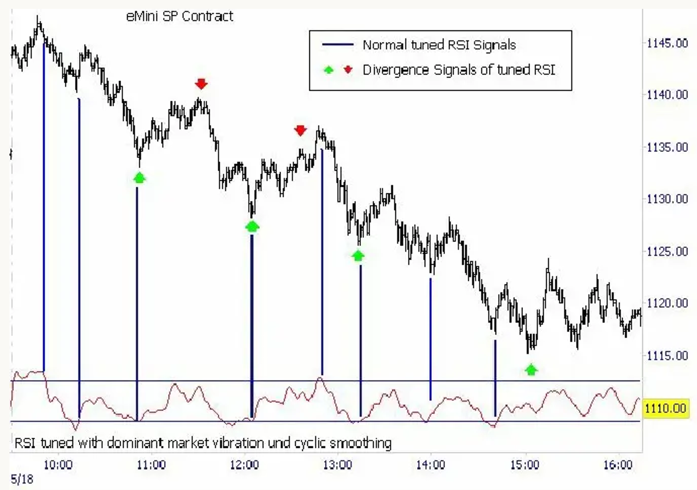

Figura 4-4: señales de comercio de RSI afinado cíclico

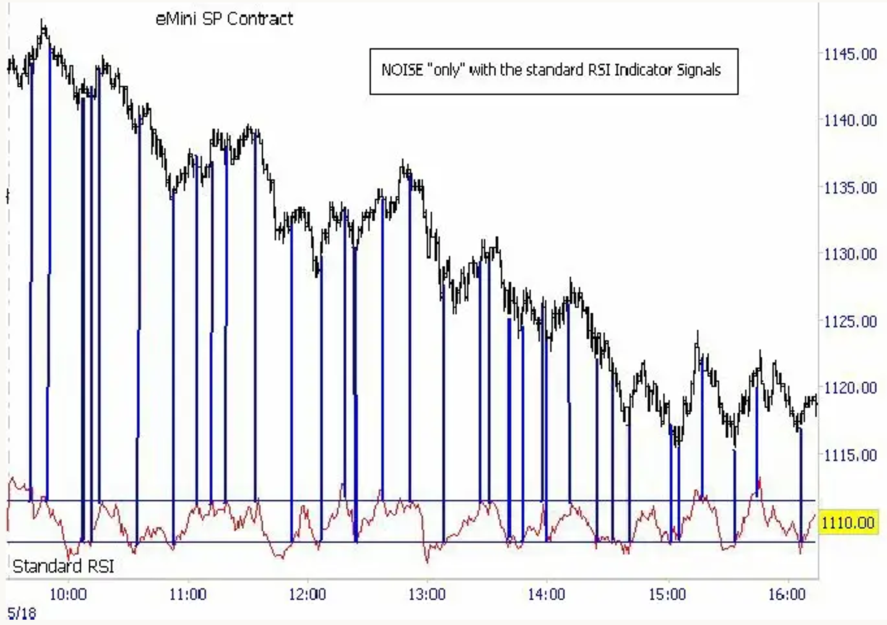

Figura 4-5: señales de comercio de RSI estándar

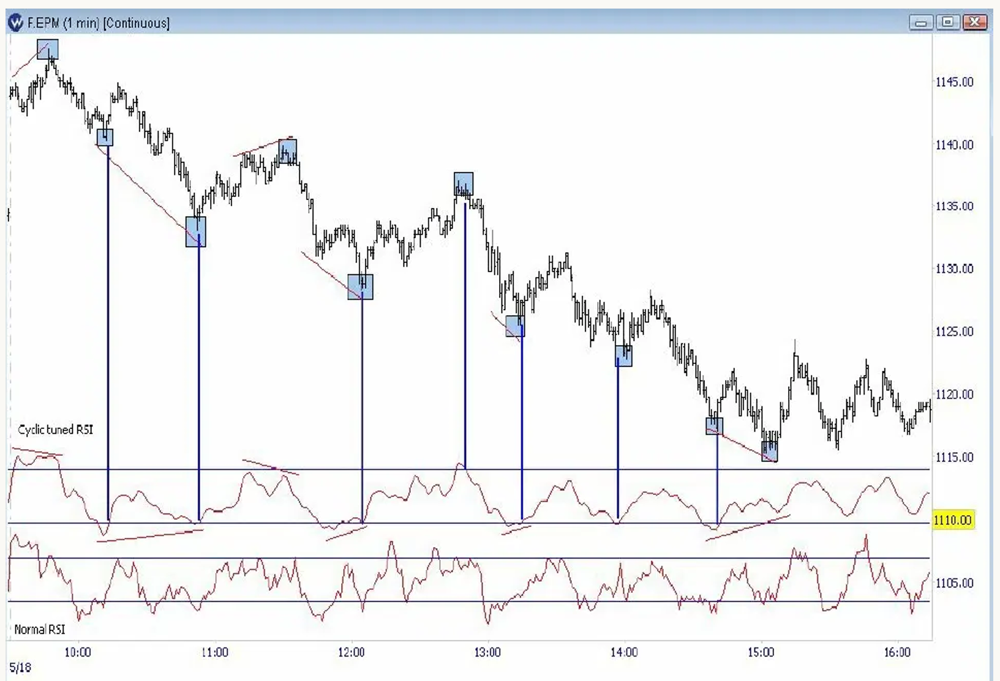

Figura 4-6: Comparación de las dos versiones de RSI / grande gráfico

### 4.3 Trading S&P 500 E-mini intradía - Ejemplo 2

Para demostrar que el hecho de que haya funcionado no sólo era “buena suerte”, vamos a pasar a la presente como estoy escribiendo esto y revisar si este método también habría trabajado en el siguiente día hábil. Para ello, vamos a utilizar el procedimiento estándar para afinar los indicadores técnicos que se presentan en el capítulo anterior.

#### Paso 1 - diagrama de abierto y utilizando el analizador ciclo de ejecución de un día de historial de datos (aprox.)

Vamos a utilizar el mismo gráfico. Para demostrar que este método funciona en cualquier marco de tiempo, vamos a cambiar a un marco de tiempo de 4 minutos. Por lo tanto, nos limitaremos a abrir el gráfico de 4 minutos para el 19 de mayo antes de comercio comienza a utilizar el historial de datos de 18 de mayo para el análisis. Se utilizó el último día de negociación de nuestro motor de análisis. Nos encontramos con el analizador de ciclo con los siguientes ajustes: Hora de inicio: 18 May 2010 / primera barra en el gráfico a las 09:34 Hora de finalización: 18 May 2010 / última barra en el gráfico a las 16:15

#### Paso 2 - Detectar la vibración dominante de mercado

Después de aplicar el analizador de ciclo con los ajustes de tiempo en el gráfico, hay que abrir el registro de secuencia de comandos para buscar los resultados de los análisis detallados. El registro de la escritura se ve de la siguiente manera:

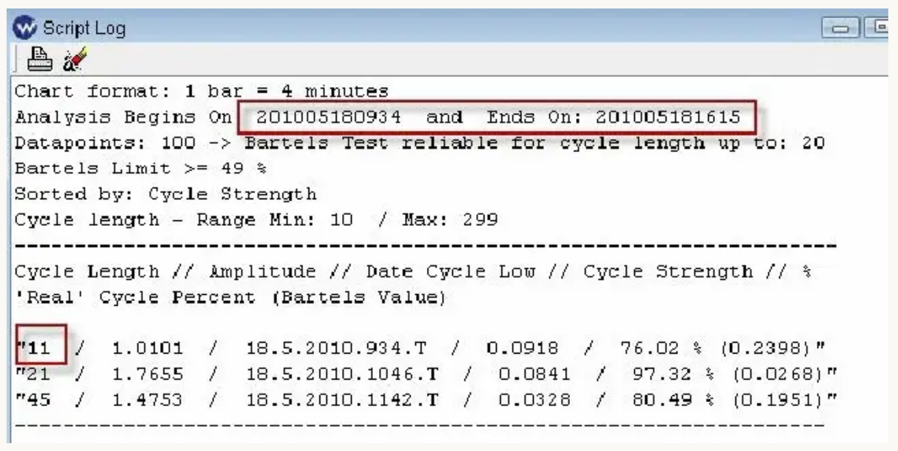

Figura 4-7: cíclica resultados de los análisis correspondientes al año 19 de mayo de

La vibración dominante de mercado tiene una longitud de 11 bares aquí. Obtendremos este valor antes dela negociación se inicia el 19 de mayo Es decir, tenemos información crucial antes de tiempo para afinar nuestros indicadores para el siguiente día hábil.

#### Paso 3 - Utilice la vibración de mercado para afinar los indicadores

El ajuste del mensaje de afinado cíclica para el día siguiente sería la mitad de la vibración dominante de mercado: 11/2 = 5,5 -> 5

Todo lo que tenemos que hacer es configurar el RSI con un ajuste de la longitud de 5. Abrir el RSI y establecer la duración a 5 y encender el suavizado cíclico.

#### Revisión del desempeño del indicador RSI afinado cíclica

La siguiente tabla muestra el día de la operación de 19 incluyendo ambos indicadores (mayo es decir, el estándar de RSI y la RSI con una longitud de 5 y la -switched en suavizado cíclico). Las señales de operación de la ruptura de la línea indicadora inferior / superior son presentados por pequeñas flechas. Las señales de divergencia adicionales se indican mediante flechas grandes.

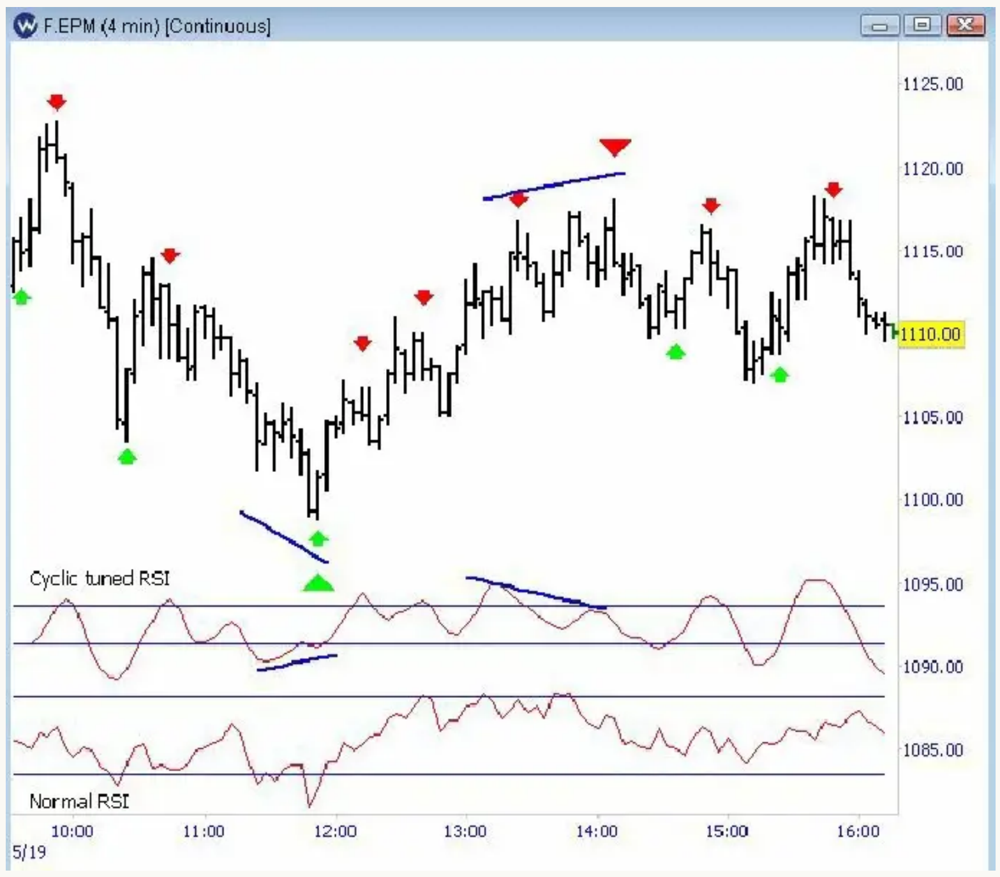

Figura 4-8: señales de operación de la RSI afinado cíclico

El afinado RSI cíclica identificó 14 señales de operación para mayo 19. Dos de estas 14 señales no habría sido comercializable, la señal de venta en torno a 12:15 la tarde y la señal de venta en torno a 24:40 Pero todas las demás señales tendrían estado comercializable. Llegamos así a una puntuación rentabilidad del 85% de estas señales. Puede comparar estos números a las señales del RSI estándar se presenta en la siguiente tabla. El RSI estándar identificado 8 señales de comercio (4 de largo, 4 corta). Pero sólo dos de ellos habría sido comerciable. Las otras señales habrían producido pérdidas y - más importante - la confianza en este indicador habría desaparecido. Creo que usted no tome la cuarta señal de compra después de tener tres “no” señales de compra. Pero vamos a seguir a los números: 2 de 8 señales implica una rentabilidad del 25%.

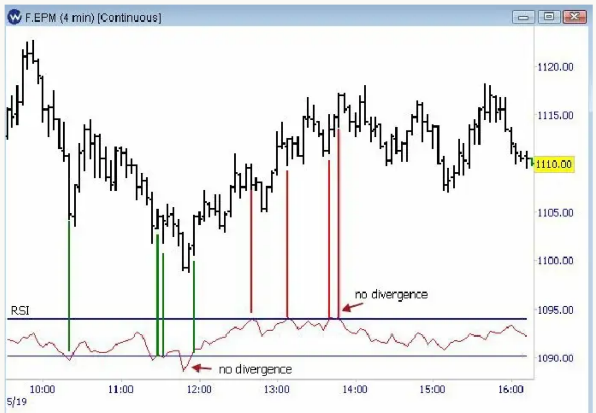

Figura 4-9: señales de operación de la RSI estándar

Este es el segundo día el indicador de afinado cíclico fue capaz de entregar señales comerciables. Y no olvidemos - el RSI estándar no fue capaz de entregar cualquier señal comerciales fiables en absoluto. Esta es la situación estándar que se pueden aplicar todos los días, todas las semanas y todos los meses. Va a tener una ventaja en el comercio en los mercados con los indicadores estándar afinado cíclicos!

| Indicador | Las señales de compra | Vender señales | Señales rentables | Rentabilidad |
| --- | --- | --- | --- | --- |
| **RSI estándar** | 4 | 4 | 2 | **25%** |
| **Cíclica afinado RSI** | 6 | 8 | 12 | **85%** |

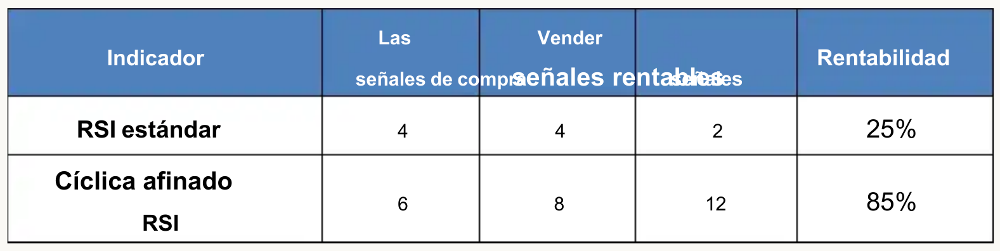

Figura 4-10: comparación rentabilidad de RSI y RSI afinado cíclicos

Elegí el RSI para fines de demostración. Pero funciona lo mismo con todos los ajustes de los parámetros de longitud para los indicadores técnicos. También puede afinar el estocástico o MACD con esta información también. Sólo tiene que utilizar la mitad del valor de la puntuación dominantes en el mercado de vibración.

### 4.4 Resumen

La idea de los indicadores técnicos de ajuste con la duración del ciclo dominante no es nueva. A medida que el nuevo y fiable motor, el escáner Ciclo, puede detectar la vibración dominante de mercado, que ahora son capaces de aplicar este método a cualquier marco del gráfico y el tiempo. Recomiendo el uso de aproximadamente 1-3 días de la historia de datos intradía al utilizar los gráficos intradía. El método también funciona en los gráficos diarios. Lo mejor es usar alrededor de 1-2 años de historia de datos para identificar los mejores parámetros para gráficos diarios.

También he incluido el indicador RSI con el motor de suavizado cíclico en la sección Menú principal Ciclos.

Usted está ahora en condiciones de a) poner a punto su indicador (s) yb) suavizar la señal aún más. Este método funciona con todos los indicadores técnicos. Pero mi investigación revela que funciona mejor con el RSI.

Para afinar el indicador RSI, recomiendo el uso de la mitad de la puntuación dominantes en el mercado de la vibración (primera puntuación que aparece en el escáner Ciclo cuando ordenado por la fuerza de ciclo). También puede utilizar el número completo, pero la mitad de la puntuación dominantes en el mercado de vibración funciona mejor. Por otra parte, usted tiene que mirar en la salida y el segundo vibración dominante también puede venir de vez en juego. Sólo familiarizarse con este método mediante la reproducción de los ejemplos que se muestran aquí por su cuenta.

Ideas y oportunidades para futuras investigaciones que utilizan este método incluyen:

- Indicadores de canales de afinado cíclicos (banda Bollinger, canal Keltner)
- Ajuste automático de la duración del periodo en cada nueva barra (no sólo todos los días)
- Breakout-sistema con los ajustes de longitud / velocidad cíclicos.

### 4.5 Cíclica-Tuned RSI (CRSI) - Sección del Código

Para utilizar el RSI ciclo de sintonía ( “CRSI”) en otras plataformas que nuestra plataforma de gráficos WTT, compartimos enlaces de origen códigos de descarga para MetaTrader y la aplicación NinjaTrader.

No dude en agarrar el último código y utilizarlo con su plataforma de gráficos favorito.

Indicador RSI cíclica para NinjaTrader [www.whentotrade.com/NT8/CRSI](www.whentotrade.com/NT8/CRSI)

Indicador RSI cíclica para MetaTrader [www.whentotrade.com/MetaTrader/CRSI](www.whentotrade.com/MetaTrader/CRSI)

Indicador RSI cíclica para TradingView [www.whentotrade.com/TradingView/CRSI](www.whentotrade.com/TradingView/CRSI)

## 5. CICLOS no son estáticas: La naturaleza dinámica de CICLOS

La suposición de que los ciclos son estáticos en el tiempo es engañosa con fines de negociación. Ciclos dominantes se transforman con el tiempo debido a la naturaleza de los parámetros internos de longitud y fase. Activo Ciclos dominantes no saltan bruscamente de un longitud (por ejemplo, 50) a otro (por ejemplo, 120). Típicamente, un ciclo dominante permanecerá activo durante un período más largo y varían alrededor de los parámetros básicos. Los “genes” del ciclo en términos de longitud, la fase y amplitud no son fijos y se transformarán en torno a los parámetros dominantes. Estos movimientos periódicos abundan en la naturaleza y el mundo hecho por el hombre. Los ejemplos incluyen un latido del corazón o los movimientos cíclicos de planetas. Aunque muchos movimientos reales se repiten intrínsecamente, pocos son perfectamente periódica. Por ejemplo, la frecuencia de zancada de un andador puede variar, y un corazón puede latir más lento o más rápido.

Una vez que una persona está en un estado dominante (como sentarse a escribir un libro), el ciclo de los latidos del corazón se estabilice a un ritmo aproximado de 85 latidos por minuto. Sin embargo, el ciclo exacto no permanecerá estático a 85 latidos por minuto, pero puede variar +/- 10%. La varianza no se considera un nuevo ciclo de latidos del corazón a los 87 ppm o 83 ppm, pero se considera lo mismo, la vibración activa dominante.

Este patrón se puede observar en el medio ambiente, además de ecuaciones matemáticas. movimientos cíclicos reales no son perfectamente uniforme; el período varía ligeramente de un ciclo al siguiente debido a cambios en los factores ambientales físicos.

Este comportamiento dinámico también es válido para los ciclos de los mercados financieros. Sin embargo, anticipándose a los valores actuales para la longitud y el ciclo de desplazamiento en tiempo real es crucial para identificar el siguiente turno. Se requiere un conocimiento de la activa parámetro del ciclo dominante y requiere la capacidad de verificar y realizar un seguimiento de la situación actual real y variaciones dinámicas que faciliten la proyección del siguiente evento significativo.

Figuras 1 a 3 proporciona una ilustración paso a paso de estos efectos. Las ilustraciones muestran un ciclo estático gris. La variación dinámica en el ciclo está representado por el rojo con los parámetros que se transforman ligeramente con el tiempo. Los puntos marcados A a D representan la desviación entre la estática ideal y el ciclo dinámico.

### 5.1 Efecto A: Los cambios en la duración del ciclo

El primer efecto es la contracción y la extracción de ciclos, o el “soplo ciclo.” Ciclos posibles se detectan a partir de los datos disponibles sobre el lado izquierdo de la gráfica. Los puntos A y B muestran un ajuste aceptable entre ambos ciclos. Sin embargo, el ciclo dinámico rojo tiene una mayor longitud de parámetros. Los datos anteriores revelan que esto no es importante, y hay un buen ajuste para la estática teórico y el ciclo dinámico en el punto A y B. Por desgracia, la futura zona de proyección en el lado derecho de la gráfica donde se realice la operación refleja una creciente desviación entre el ciclo estático y dinámico. La diferencia entre el ciclo estático y dinámico en los puntos C y D es ahora relativamente alta.

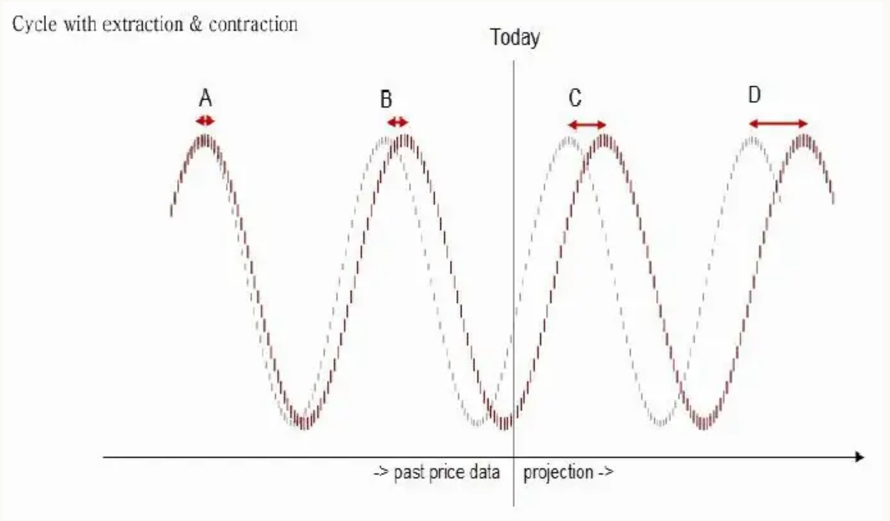

Figura 5-1: Efecto 1 - Cambios de cuerpo entero

El ciclo real “dinámica” tiene un parámetro con una longitud ligeramente mayor. La consecuencia es que las futuras desviaciones aumentan incluso cuando las desviaciones entre el ciclo teórico y real no son visibles en el área de análisis. Estas diferencias son cruciales para el comercio. A medida que se produce la negociación en el lado derecho de la tabla, los parámetros básicos ahora y para el siguiente turno de ciclo esperado se debe detectar. Un ajuste perfecto de los datos del pasado o una proyección de dos años no es una preocupación. La prioridad es el aquí y ahora, no un ajuste matemático con el pasado. Vueltas actuales del mercado deben estar en sintonía con el ciclo dinámico para detectar el siguiente turno. Por tanto, como un ciclo de latido del corazón individuo se aproxima a un número de la base, la longitud del ciclo variará alrededor del parámetro dominante + / 5%. Después de solamente el ciclo teórico estática no proporcionará información relativa a los siguientes puntos de inflexión esperados. Sin embargo, este no es el único efecto.

### 5.2 Efecto B: Los cambios en la fase del ciclo

El siguiente efecto se “turnos offset.” En este caso, el parámetro de longitud del ciclo es el mismo entre el teórico estático y el ciclo dinámico. El ciclo dinámico en el punto A presenta un ligero cambio de desplazamiento en la parte superior. En términos matemáticos, el parámetro de fase se ha transformado. Este efecto se mantiene fijo en el futuro. Se observa una desviación estática entre las altas y las bajas.

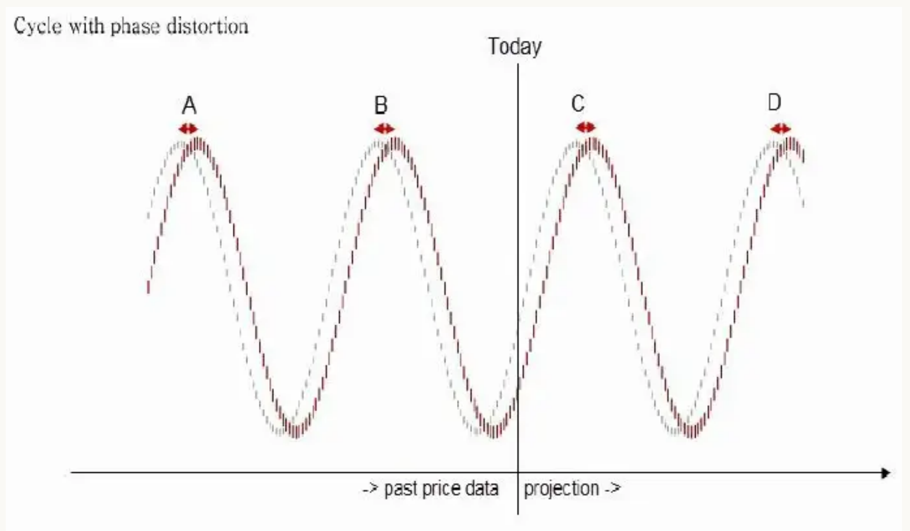

Figura 5-2: Efecto 2 - desfases

Aunque esto no es un efecto de una sola vez, la fase del ciclo dominante también va a cambiar de forma continua por +/- 5% alrededor de los parámetros dominantes centrales.

### 5.3 Los efectos combinados

En la práctica, ambos efectos se producen en paralelo y cambian continuamente alrededor de los parámetros dominantes centrales. La Figura 3 presenta una instantánea de los dos efectos con el teórico y el ciclo dinámico. La desviación en el área de proyección en los puntos C y D muestra que sólo siguiendo el ciclo teórico estático será rápidamente convertido en valor.

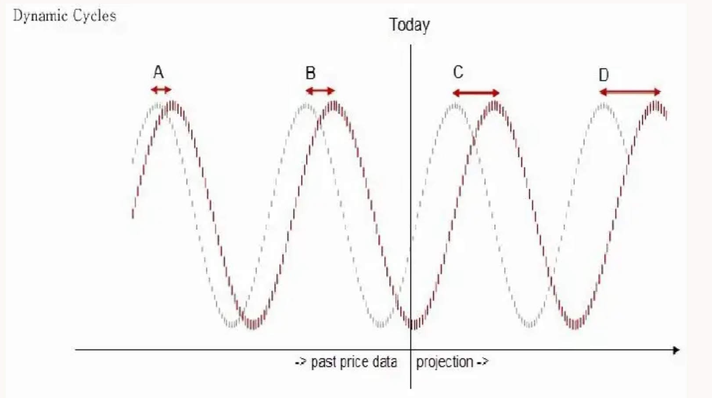

Figura 5-3: los efectos combinados (Gray: Ciclo estático / Rojo: ciclo dinámico) La desviación es en la medida en que, en el punto D, se espera que un ciclo de alta para el ciclo estático teórico (gris) mientras que el ciclo dinámico real (rojo) sigue siendo baja en el punto D.

Estos dos efectos se producen de una manera continua. Aunque la alineación en el pasado (puntos A y B) aparecen aceptable entre el ciclo estático y dinámico, la desviación en el área de proyección (puntos C y D) es tan alta que el comercio el ciclo estático conducirá al fracaso.

Un ejemplo de ciclo de pronóstico incorporar estos efectos explica la consecuencias en el lado derecho de la gráfica.

Comprobamos los dos ejemplos siguientes llamados “A” y “B”. El gráfico de precios es el mismo para ambos ejemplos, y está representada por una línea de negro en el gráfico. En ambos ejemplos, un ciclo dominante se detecta (parcela ciclo de rojo) y el precio se traza.

En ambos ejemplos, se detectan dos variaciones del mismo ciclo dominante. Las partes superiores y bajos muestran la alineación con los datos de precios y dos tapas de ciclo y dos puntos bajos del ciclo se alinean. Esto implica que el mismo ciclo dominante es activo en ambos gráficos. Hay ciclo dominante un núcleo y los dos ciclos detectados son variaciones de este mismo ciclo dominante.

Por lo tanto, desde una vista en perspectiva analítica, ambos ciclos podrían considerarse válido a partir de observaciones del conjunto de datos disponibles.

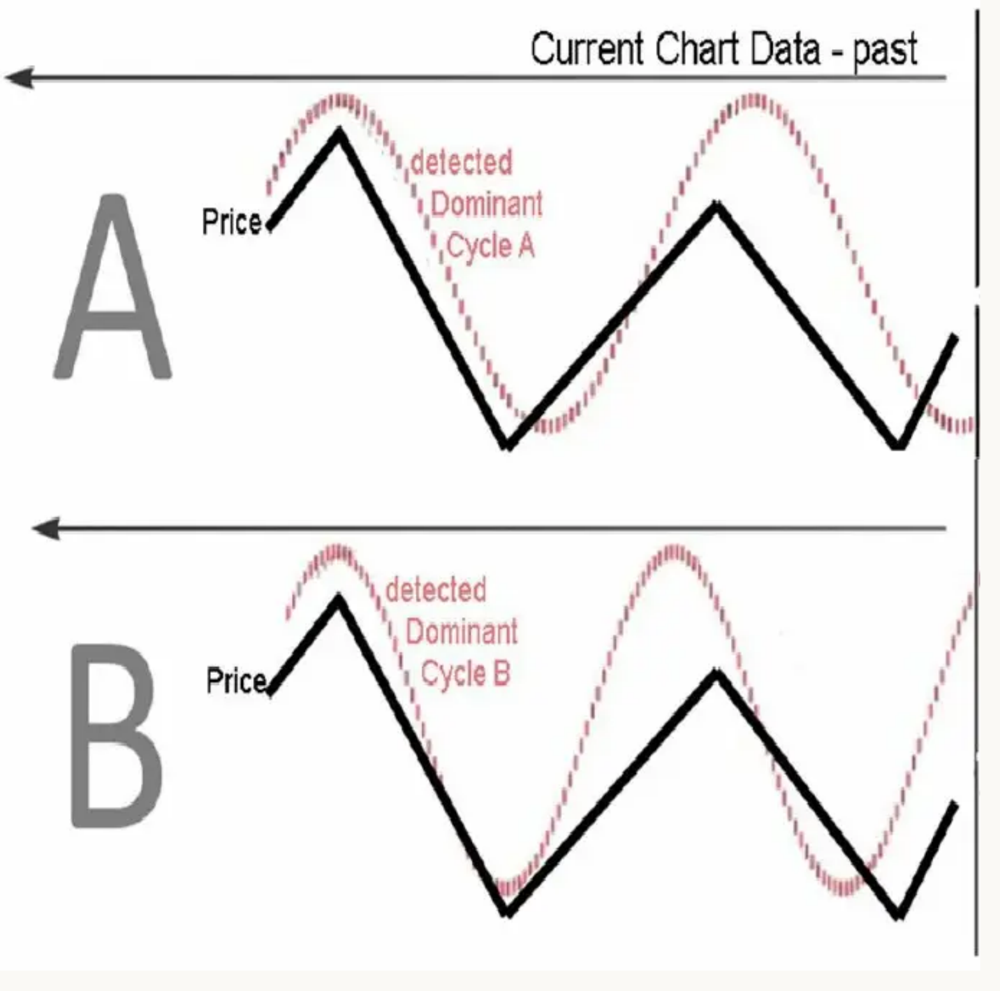

Figura 5-4: Tabla mismo precio - Dos ciclos detectados

Los efectos revelan que aunque el pasado desviación de los datos es convincente, que puede afectar significativamente el área de proyección. Examinamos la proyección de ambos ciclos.

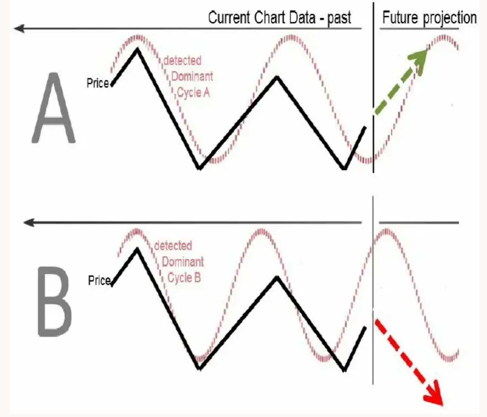

Figura 5-5: Proyección Ciclo de ambos ejemplos

Observamos dos proyecciones contrastantes. Ejemplo A muestra un ciclo de tocar fondo con un repunte proyectado a una tapa futuro. Ejemplo B muestra el contrario, un ciclo superando a cabo con una recesión futuro esperado.

Mientras que podemos detectar un ciclo dominante en la zona izquierda de la tabla, los parámetros dinámicos detallados son los diferenciadores significativos y son cruciales para una proyección válida y creíble.

proyecciones del ciclo estáticos clásicos a menudo fracasan por esta razón. La detección de la activo ciclo dominante representa una parte del proceso. La segunda parte es considerar los parámetros dinámicos actuales con respecto a la longitud y la fase de la segunda parte. Aunque el ajuste perfecto de un ciclo en el pasado distante entre precio y una bicicleta estática podría parecer convincente desde un punto de vista matemático, es engañosa porque ignora los componentes del ciclo dinámicos. Si lo hace, simplifica los cálculos, pero no tiene ningún valor para el comercio en el lado derecho de la gráfica. El examen de ciclos estáticos ajuste perfecto del pasado no es necesario. La observancia de dos a cinco correlaciones significativas de tapas y bajos, y la consideración de las actualizaciones de componentes dinámicos actuales cederán proyecciones del ciclo de comercio válidos.

Este ejemplo se basa la importancia de un enfoque que combina un motor de detección de ciclo dominante con una actualización de componentes dinámicos.

### 5.4 Lecciones en Video - Explicación de ciclos dinámicos

El siguiente video ilustra los dos efectos en la acción.

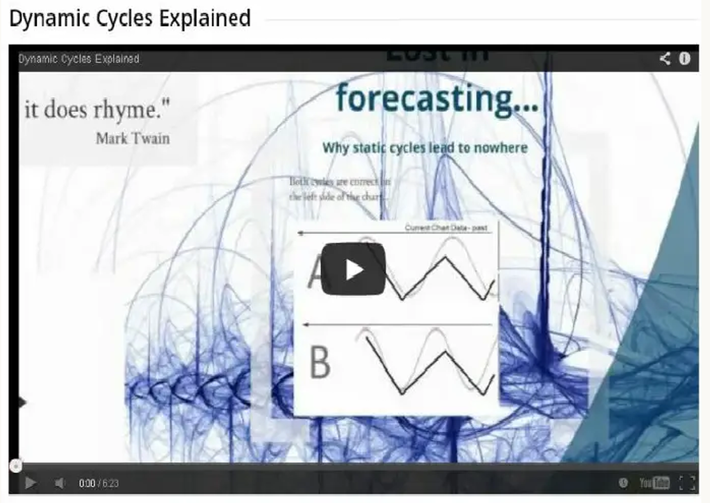

[Lecciones en Video ciclos dinámicos Explicación](http://www.whentotrade.com/wtt-dynamic-cycles-explained/)

## 6. DINÁMICA EXPLORER CICLO: PREDICCIÓN DE LA VUELTA mercado el próximo

Vamos a pasar a buscar otras formas de utilización de la información cíclica que tenemos para la negociación en los mercados. enfoques tradicionales de ciclo deben tomar dos factores cruciales para el éxito en consideración: En primer lugar, que el algoritmo de detección de ciclo se utiliza juega un papel decisivo. ¿Qué ciclo dominante debe usarse para pronosticar o ajustar los indicadores técnicos? Si se detecta el ciclo equivocado en el “lado izquierdo” de la tabla, cada enfoque comercial y la previsión se producirá un error en el “lado derecho” más importante de la tabla. Hemos introducido nuestro marco escáner ciclo en los capítulos anteriores para resolver esta tarea. En segundo lugar, incluso si se detectan los ciclos adecuados, los ciclos de los mercados financieros no son “estáticas”. A pesar de la naturaleza dinámica de los ciclos que impulsan los mercados, los enfoques tradicionales proyectan ciclos como teóricamente ondas simples o compuestas estáticas en el futuro. ciclos dominantes varían de forma continua en el tiempo en términos de longitud, amplitud y desplazamiento de fase en función de su parámetro de núcleo interno. Esto significa que el componente de longitud de un ciclo dominante con una longitud de 80 días puede variar fácilmente entre 76 y 84 días - pero sigue siendo un ciclo dominante de día “80”, no obstante. Sin embargo, no se sabe si un ciclo se ha contratado o ampliado si sólo se sigue una proyección estática simplista.

Por lo tanto, la mayoría de los sistemas actuales de ciclo se producirá un error en el largo plazo debido a uno de los dos problemas mencionados anteriormente. Si desea ciclos de negociar con éxito, usted debe aceptar el hecho de que no hay ningún algoritmo de detección de ciclo por ahí que puede hacer frente adecuadamente a las características de los datos financieros. Lo que es aún más relevante para cada enfoque comercial es el hecho de que los ciclos tienen un carácter dinámico y no permanecerán estáticos en el tiempo.

Estos hechos no son nuevos. Sin embargo, no he encontrado ninguna herramienta o enfoque que puede hacer frente a estos dos problemas principales. Los enfoques tradicionales de los ciclos de los mercados financieros no han avanzado mucho desde Hurst y la matemática de Procesamiento Digital de Señales - variaciones sin duda se han introducido, pero no se ha hecho ningún progreso real en este campo desde hace bastante tiempo. De manera que ahora somos capaces de detectar ciclos genuinas con nuestro marco escáner ciclo, necesitamos un enfoque adicional para hacer frente a las características dinámicas. Por lo tanto, el enfoque dinámico es el Explorador de Ciclo introducido en el capítulo siguiente.

Hasta ahora, he mostrado cómo detectar ciclos e indicadores afinar utilizando la longitud dominante de mercado de la vibración de nuestro marco escáner ciclo. Sin embargo, la puntuación dominantes en el mercado vibración se puede utilizar de diferentes maneras. Otro enfoque es determinar lo que el ciclo real es dominante en cada nueva barra. Cuando conocemos la longitud de onda del ciclo dado, podemos aplicar técnicas específicas para determinar la fase real de este ciclo. La fase proporciona información sobre cuándo esperar la próxima importante de alta / baja en el mercado.

Considero que esto es un enfoque dinámico, ya que es característico de los ciclos de sus fases y longitudes de onda que cambian continuamente con el tiempo. Esa es también la razón por marcos de bicicleta estática a menudo fallan cuando se aplican a los mercados financieros. Puede, por supuesto, detectar ciclos en base a los datos del pasado, pero cuando se aplica esta información estática a la longitud de onda, amplitud y fase de un ciclo de la construcción de los pronósticos de un período de tiempo futuro, no tener en cuenta que la fase, amplitud y longitud de onda del ciclo identificado variará con el tiempo. Este efecto se parafrasea comúnmente en artículos como: “Ciclos aparecen y desaparecen”.

### 6.1 Introducción del método Explorador ciclo dinámico

Ahora voy a introducir un enfoque dinámico para la construcción de las previsiones negociables. Cada vez que aparece una nueva barra, se volverá a evaluar el ciclo dominante en términos de longitud de onda, la amplitud y la fase de compensación. a continuación, vamos a trazar este ciclo en el futuro. Sin embargo, nos centraremos únicamente en el siguiente punto de inflexión esperado -. Eso es lo que nos interesa Podemos llamar a este punto de inflexión - ETA - hora prevista de llegada.

Luego, a medida que avanzamos en el tiempo, cada bar significa una actualización en el siguiente punto de inflexión esperado. Este pronóstico dinámico basado en el mercado dominante de la vibración proporciona información sobre el siguiente punto de inflexión en cuanto a tiempo y la dirección. Vamos a obtener información en tiempo real sobre cuándo esperar el siguiente punto de inflexión en el mercado. Esta información puede ser actualizada cada vez que aparece una nueva barra. Es decir, la información de ETA se actualiza en cada nueva barra.

Ahora la diferencia entre el enfoque de muchos investigadores ciclo y el mío debe ser evidente. No me aplico un marco con los ciclos estáticos y tratar de hacer el ajuste de mercado en ella. A menudo, se lee acerca de la importancia del ciclo de 4 años, el ciclo de 50 semanas, y el ciclo de 7 años y cómo estos ciclos “estáticos” se pueden aplicar a la situación real del mercado. Ese no es mi enfoque aquí. Yo no le ofrecen un marco de ciclo de “estática”. Ofrezco un modelo dinámico que determina qué ciclos están activos en un momento dado.

Yo uso este método con el fin de estar “preparados” para los puntos de inflexión importantes en el mercado. Yo no ciegamente el comercio de estos puntos de ETA. Sin embargo, cuando se usa en combinación con otras herramientas o los niveles de Fibonacci, tendrá muy potentes configuraciones de operar en el mercado.

Los gráficos pueden hablar más que mil palabras. Sin embargo, antes de pasar a revisar algunos ejemplos reales, déjeme introducen algunos nuevos indicadores y herramientas. Hasta ahora, hemos llegado a un nuevo método para la detección de ciclos en instrumentos financieros. Cuando aplicamos ciclos a negociación, también necesitamos información visual acerca de la presencia de los ciclos en los datos dados. No es suficiente para centrarse en los ciclos teóricos solo. Tenemos que aislar los ciclos actuales, con una longitud de onda detectada a partir de los datos financieros disponibles. Estos ciclos no se verá como ondas sinusoidales. Los mercados no son tan limpio como ciclos de onda sinusoidales. amplitudes, fases, y longitudes de onda Ciclos cambian continuamente con el tiempo. Por lo tanto, el ciclo detectado tendrá un aspecto diferente de una estructura de onda sinusoidal teórico. Pero necesitamos la información visual del pasado para verificar nuestro ciclo “teórico” y el comportamiento cíclico real del instrumento financiero con esta longitud de onda particular. Tenemos que eliminar todos los ciclos de los datos que tienen longitudes de onda más altas y más bajas que nuestra duración del ciclo. En última instancia, sólo queremos mirar el comportamiento de los datos financieros en relación con nuestra duración del ciclo seleccionado.

Ahora, podemos trazar la información relevante que tenemos en la duración del ciclo detectado una encima de la otra:

- El comportamiento cíclico aislado del precio basado en nuestra longitud de onda;
- El ciclo teórico (parcela de onda sinusoidal) en base a la fase detectada y amplitud.

Esta información es muy útil para analizar el comportamiento de precios en el pasado. Ahora tenemos la posibilidad de ver las últimas fases y los cambios de amplitud del ciclo. Podemos construir una “correlación visual” entre el ciclo teórico y el comportamiento de los precios cíclico. Trazado de los ciclos de precios en los mercados financieros - La visualización de los ciclos de precios Primero necesitamos un método para aislar los ciclos individuales a partir de los datos de precios. Es decir, tenemos que encontrar una manera de trazar el comportamiento cíclico de los datos de precios, no el ciclo teórico. Una forma de filtrar todos los ciclos más largos y más cortos. Mucho se ha escrito sobre estas técnicas. No voy a repetir todos los algoritmos aquí. Una forma muy eficaz de filtrar el más largo y ciclos más cortos es utilizar un sub-conjunto especial de dos medias móviles centradas. Este método fue introducido por primera vez por Brian J. Millard en su libro “Los canales y de ciclos: Un tributo a JM Hurst”. Se llama “Normal Normal Menos” o “ciclo de rotulador”. Su método de aislamiento de los ciclos es mucho más superior a otras técnicas, ya que sólo requiere un valor a ser especificada, es decir, la longitud de onda del ciclo que queremos aislar.

Para aplicar esta técnica, una media móvil centrada con una longitud igual a la longitud de onda del ciclo que ser aislado se establece. Una media móvil segundo centrado se calcula entonces con una longitud que es la mitad de la primera media. En el paso final, se determina la diferencia entre estas dos medias. Si usted está interesado en obtener información más detallada sobre el uso de medias móviles centradas para extraer información cíclica, recomiendo leer el libro de Millard. La técnica de Millard es muy útil para nosotros porque nuestro nuevo motor para la detección de ciclo introducido en el capítulo anterior nos proporcionó el valor que necesitamos - la longitud de onda del ciclo.

Podemos utilizar el valor dado para el Mercado detectado dominante de la vibración como entrada para el marcador ciclo. Ahora podemos discernir el comportamiento cíclico del precio de los datos del pasado.

Como es el caso con promedios centrados, la diferencia entre las dos medias expondrá una pérdida de puntos al principio y al final de la trama. Esta técnica por lo tanto no ayuda a construir pronósticos. Pero nos ayuda obtener una comprensión visual del ciclo y comparar el ciclo detectado con el comportamiento cíclico de los datos del pasado. Por lo tanto, voy a ampliar el método rotulador ciclo y tomar la idea básica más. Voy a llamar a este nuevo enfoque “Explorador de ciclo dinámico”. Esta técnica tiene un “built-in” rotulador ciclo. Un factor importante cuando se utilizan ciclos dominantes para el pronóstico es comparar el movimiento cíclico de longitud de onda aislado, más allá de precio con el ciclo dominante teórico basado en la información de la fase real y la amplitud.

Cuando construimos una superposición de toda la información obtenida, se obtiene una herramienta visual para detectar la fase pasado y los cambios de amplitud. Esto nos proporciona información sobre cómo “fiable” o “estable” este ciclo fue en el pasado. También vamos a utilizar esta información para afinar nuestra puntos de desplazamiento (última bajo o alto) para el análisis cíclico.

La siguiente figura muestra todos los elementos de la técnica de Explorador de Ciclo. Para fines de demostración, he utilizado el ejemplo de datos desde el primer capítulo. Sabemos que los datos incluyen un ciclo con una duración de 30 días naturales. La fecha elegida para el análisis real utilizando este conjunto de datos del 1 de abril 2007.

Esto es lo que el Explorador de ciclo se mostrará:


Figura 6-1: Elementos de la herramienta Explorador de Ciclo

Explorador de ciclo - factores interesantes:

1. ciclo de precios aislada (línea roja)
   La línea roja es el comportamiento de los precios cíclico se extrajo con una longitud de 30 días naturales. Todos los demás elementos se han filtrado de los datos de precios. El método utilizado en este caso es resaltador ciclo de Brian J. Millard.

2. parcela ciclo dominante (punteado línea verde)
   Esto incluye un mecanismo incorporado para detectar desplazamiento y la amplitud del ciclo de 30 días calendario dado el real. Este desplazamiento se calcula sobre la base de la información obtenida último precio. En este caso el desplazamiento bajo es el 4 de enero de 2007. Por lo tanto, sabemos que el desplazamiento real del ciclo es hoy en día. Usando esta información, el teórico (onda sinusoidal similares) ciclo se traza hacia atrás como en superposición. Ahora podemos discernir la información relevante: El comportamiento de los precios cíclica real y el movimiento cíclico ideal para la longitud dada de 30 días naturales.

3. Ciclo pronosticada
   De acuerdo con el estado de fase determinada del ciclo de 30 CD, el ciclo se proyecta y se representa en el futuro. Por lo tanto, se puede detectar futuros puntos de inflexión de este ciclo ideal.

4. Actual (detectado dominante) la duración del ciclo
   La longitud del ciclo detectado está marcado en la tabla. Se puede ver que es el ciclo 30 de CD. Esta longitud se detectó automáticamente por la herramienta Explorador de Ciclo.

5. Diferencia de precio y ciclo de amplitud
   Este es un elemento importante que es visible: en el punto valle y la cresta de cada ciclo dado, podemos comparar el ideal con la amplitud real de ambas parcelas. La diferencia en las amplitudes revela si esta longitud de ciclo estuvo presente en el tiempo dado o no. por tanto, se puede observar el flujo dinámico cuando los ciclos desaparecen (la amplitud cae a cero del movimiento de precios cíclico) y cuando los ciclos son muy activos (la amplitud es la misma que la amplitud ciclo ideal).

   Este es el primer indicador que es capaz de ilustrar visualmente los puntos en el tiempo cuando un ciclo dado desaparece o está presente. Esta información es muy útil en el punto actual en el tiempo (es decir, en la actualidad). De este modo se puede comprobar si la amplitud del movimiento de precios cíclica hoy es menor que la amplitud ideales dado. En ese caso, el ciclo está perdiendo energía. Pero si la amplitud es cerca del ciclo ideal, entonces el ciclo es real y presente.
6. Diferencia de fase (alto / bajo)
   La otra información que son capaces de obtener ahora es la desviación de los últimos desplazamientos altas / bajas entre los movimientos de los precios cíclicos y el ciclo ideal. Podemos determinar si el componente cíclico basado en la longitud de onda dada es estable (es decir, en sincronización) o no. Para ello, tenemos que mirar a los últimos puntos de inflexión del ciclo ideal. Cuanto más cerca de los puntos de inflexión del ciclo de precios aislado y el ciclo ideal son, es decir, el más sincronizados que son, el más fiable son los puntos de inflexión pronosticados con referencia a la información sobre el tiempo.
7. Pérdida de puntos
   Los algoritmos utilizados con promedios móviles centrados para el marcador ciclo revelan una pérdida de puntos al final de la trama. Esto equivale a la mitad de la longitud del ciclo seleccionado. No podemos ver el movimiento de los precios cíclica real de los últimos 15 días del calendario en el gráfico en nuestro ejemplo. A los efectos de la previsión, por lo tanto, es muy importante para trazar el ciclo teórico en el futuro con la fase de desplazamiento real. Se puede ver que la línea verde de puntos es una continuación suave de la línea roja. Hemos utilizado los datos cíclicos de ejemplo para mostrar cómo funciona este indicador. La línea roja es, obviamente, muy cerca de la línea verde ideal, ya que hemos utilizado ciclos teóricos para construir este modelo. La diferencia es atribuible al hecho de que se añadieron las tendencias e información de ruido aleatorio a los datos de prueba.

Cuando te encuentras con un “partido” como entre el movimiento de los precios cíclico y el ciclo ideal, existe una alta probabilidad de que la proyección en el lado derecho de la gráfica será útil para el comercio. Veámoslo en el ejemplo:

Esto sería nuestro pronóstico “ideal” basado en la proyección 30 de CD. Proporciona una mirada más cercana a la tabla presentada anteriormente.


Figura 6-2: Ideal proyección 30 CD (ejemplo de conjunto de datos 3)

Y este sería el resultado de este conjunto de datos de muestra:


Figura 6-3: Resultado de la proyección 30 CD

En otras palabras, si usted tiene un “buen partido” para la duración del ciclo identificado entre el movimiento cíclico aislado del precio y el ciclo ideal, entonces la proyección ciclo será de mucho valor para el lado derecho de la tabla y para el comercio. Ciclos sólo se pueden utilizar en un sentido predictivo cuando están pasando por una fase regular. Eso es lo que demuestra este ejemplo. Ahora, vamos a revisar otro ejemplo con una longitud de ciclo que no está presente en los datos. Para ello, vamos a utilizar el “Explorador de ciclo manual”. La diferencia entre la dinámica y el Manual conjunto de herramientas de ciclo Explorer es que el motor dinámico detecta automáticamente el dominante mercado de vibración. En el Manual de Explorador de ciclo, tiene que configurar manualmente la duración del ciclo que desea revisar. Nuestro ejemplo muestra cómo “comprobar” si un cuadro de la bicicleta estática va a funcionar para fines de proyección o no. por lo tanto vamos a comprobar si una longitud de ciclo de 46 CD está presente en el mercado. Tenemos que introducir manualmente el valor 46 en la herramienta Explorador de Ciclo Manual (nota: Este ciclo no está presente de acuerdo con el conjunto de datos muestra introducida en el primer capítulo).

El Explorador de ciclo manual proporciona la siguiente figura:


Figura 6-4: Manual Ciclo ejemplo Explorador

La información importante se indica en el gráfico. Es claramente visible que el ciclo 46 CD ideal y el movimiento del precio cíclico aislado de la misma longitud no están sincronizados. Ni la fase (alto / bajo de dos líneas), ni la amplitud tienen una correlación alta. Como ya se ha mencionado anteriormente, estos resultados indican que no hay que utilizar este tipo de ciclo para el pronóstico! Sin embargo, si usted no tiene la posibilidad de revisar los datos del pasado para un ciclo dado hasta el presente, no se puede comprobar si un ciclo es realmente válida o no. Puede solamente a ciegas “confiar” en boletines y rezar que tienen razón. Sin embargo, ahora usted tiene una poderosa herramienta que le ayudará a analizar la información predictiva en diferentes ciclos actuales.

En nuestro ejemplo, sabíamos por una verificación visual solamente que no podríamos usar esta longitud de ciclo para el comercio. Pero revisemos el ejemplo completo. Los puntos de inflexión del mercado previstas en base a este ciclo están marcados con flechas en las listas de éxitos.

La siguiente tabla muestra el resultado si se hubiera utilizado este ciclo de negociación:


Figura 6-5: Revisión del ciclo de 46 CD

No hay información de este ciclo habría sido comercializables en absoluto. Ahora se puede ver claramente que: Si usted no tiene una coincidencia en los datos del pasado, no utilice la proyección del ciclo dado!

Estos ejemplos sirven para mostrar cómo la información importante sobre el estado de los diversos ciclos puede determinarse utilizando los datos del mercado. A través de esto significa que podemos determinar si un ciclo particular está pasando por una fase regular, es decir, cuando se puede estimar su contribución al movimiento global. También somos capaces de identificar aquellos ciclos que pasan por una fase desordenada basado en el movimiento de precios. Ahora puede ordenar los ciclos que se pueden utilizar para la previsión y los que no debería.

#### El componente “dinámica” del Explorador de ciclo

El Explorador de ciclo es una combinación de tres herramientas fundamentales:

1. La trama de la movimiento de precios cíclico aislado.
2. La trama de la ciclo “ideal” de acuerdo con la fase real y la amplitud en el pasado.
3. La proyección del ciclo “ideal” de acuerdo con la fase real y la amplitud en el futuro.

Pero esta nueva herramienta tiene una característica incorporada adicional:

El motor de detección automática para el ciclo dominante real. Esto implica que usted no tiene que entrar en la longitud de onda que se desea examinar mediante el Explorador de Ciclo. La longitud de onda se detecta de forma automática a través de nuestra nueva y potente algoritmo introducido en los capítulos anteriores. Basta con seleccionar un importante punto de inflexión en el pasado como el punto de partida para el análisis del ciclo automático. Posteriormente, la herramienta aparecerá en el gráfico de la presentación de forma automática toda la información pertinente se mencionó anteriormente.

Y lo mejor es que un nuevo cálculo se realiza en cada nueva barra. En otras palabras, no hay ningún ciclo “estática” se utiliza aquí. El ciclo dominante real se determina en cada nueva barra. El Indicador de Ciclo Explorer se actualiza cada vez que aparece una nueva barra. Se puede aplicar esta técnica a cualquier marco de tiempo.


Ahora tiene el nuevo kit de herramientas Explorador de ciclo dinámico a su alcance. Está listo para ser aplicado a su instrumento financiero preferido. Si desea comprobar los ciclos estáticos, también se puede utilizar la versión manual del indicador. Basta con introducir la duración del ciclo desea explorar y su idoneidad aparecerá en el gráfico.

Voy a demostrar cómo construir previsiones negociables construido únicamente en este nuevo y poderoso indicador en el siguiente capítulo.

Utilizando el Explorador de ciclo como un control de calidad para los marcos de bicicleta estática Incluso si usted no planea utilizar este método, el Explorador de ciclo es de mucho valor cuando se trata de marcos de bicicleta estática. Por lo tanto, si usted lee en el boletín ciclo que “el ciclo de 50 semanas está a punto de abajo ahora”, introduzca un gráfico semanal, configurar el Explorador de ciclo manual con una duración de 50 semanas y comparar los datos reales de precios cíclicos de esta longitud con el ciclo “ideal”. Ahora que ha adquirido el conocimiento de cómo “comprobar” si esta información es fiable para el uso en el lado derecho de la gráfica donde su comercio se lleva a cabo. Puede llevar a cabo un control de calidad para cualquier estática dada ciclo por su cuenta. El Explorador de ciclo mostrará los últimos cambios de fase y amplitud de este ciclo. Puede revisar por su cuenta si cualquier ciclo dado está activo, si está en sintonía con el mercado o si ha desaparecido.

Ahora tiene un indicador técnico para comprobar la cantidad de expansiones o contracciones reales de los ciclos en cada nueva barra. Ciclos de expansión y contracción de su longitud de onda original de forma continua. Esto es lo que a menudo causa ciclos enfoques “estáticos” fallen. Sin embargo, ahora se puede medir el “flujo” del ciclo. Fue Walter Bressert quien propuso por primera vez que tratar de comercio basado en la idea de que algo debe suceder en un intervalo fijo de tiempo (bicicleta estática) era realista. El Explorador del ciclo se basa en esta idea y se ha desarrollado en un indicador visual para la primera vez que se pone en 'práctica comercial'. Esta herramienta también se puede utilizar para comprobar la información incluida en muchos boletines de ciclo en ciclo marcos estáticos de una longitud dada.

El Explorador de ciclo como una herramienta de confirmación visual Tal vez la siguiente pregunta viene a la mente:

“¿Por qué necesitamos el Explorador de ciclo dinámico cuando el algoritmo presentado en los primeros capítulos ya es capaz de detectar el ciclo más dominante?”

Tiene un punto. Si el algoritmo es superior a los demás, no necesitamos esta herramienta visual. Pero aún no me fío de mi propio motor que me proporciona información sobre la corriente dominante de mercado de vibración. Yo sé que el algoritmo funciona. Pero poner dinero en la línea también es un “juego mental”. Necesito un poco de confirmación visual de que puedo ver con mis propios ojos! El motor de ciclo del escáner es, pues, una herramienta “cerebro izquierdo”. Se trata de procesamiento de señal digital de propiedad. El motor de trazado visual del Explorador de Ciclo es una herramienta de “cerebro derecho”. Si realmente puedo ver la correlación del movimiento de precios cíclico y el ciclo ideal del ciclo dominante dado, mi cerebro me envía una “luz verde” para poner mi dinero en la línea.

Eso es muy importante. La mayoría de investigaciones ciclo sólo se presenta ideas sobre cómo construir pronósticos. Yo quería una herramienta de confirmación visual que revela la idoneidad de los ciclos con sólo mirarlos.

Cuando la imagen Explorador de ciclo en el lado izquierdo de la gráfica presenta un ciclo wellmatched, puedo usar la proyección dada en el lado derecho de la gráfica para el comercio con dinero real.

### 6.2 La construcción de un pronóstico basado en el Explorador de ciclo dinámico

Ahora voy a dar algunos ejemplos sobre cómo utilizar este concepto que me ha guiado durante el último año. Una vez más, mi enfoque no implica cherry picking o ajuste de curvas. Estos ejemplos se han publicado en tiempo real a un pequeño grupo de ciclos de confianza. Si algún lector está siendo escépticos después de leer mi libro, con mucho gusto demostrar que éstos ejemplos fueron publicadas en tiempo real.

Este libro, por primera vez, presentar la técnica que he aplicado para producir estos mapas y pronósticos. Después de leer este libro, usted también será capaz de utilizar esta técnica. Yo estoy revelando toda la información pertinente y la introducción de todas las herramientas necesarias en este libro y estoy a entregar a usted. Tratar este conocimiento recién adquirido con el debido respeto - si se usan de manera inapropiada, esta herramienta / script podría ser ineficaz. Si ocupado de
manera apropiada, será crucial para liberar el poder de los ciclos de los mercados financieros.

Como hemos visto en el capítulo introductorio en el motor de detección de ciclo, siempre hay más de un ciclo activo en el mercado. Ahora voy a introducir un método de pronóstico para la construcción de las previsiones con dos ciclos dominantes. Este modelo incorpora la idea de que tenemos que tener cuidado ciclos de largo plazo y corto plazo, que tienen que ser considerados en conjunto. En consecuencia, vamos a observar el ciclo dominante para un período de tiempo corto plazo, así como que para un horizonte temporal de largo plazo.

Todo lo que tenemos que hacer es configurar nuestra Explorador ciclo dinámico que extrae el ciclo dominante para una ventana determinada. Utilizaremos estos dos conjuntos de ventanas para determinar los ciclos dominantes:

- Ventana para el ciclo dominante a corto plazo: Rango de longitud de onda entre 20 - 100 bares de ventana para ciclo
- dominante a largo plazo: campo de longitud de onda entre 100 - 200 bar.

Si está trabajando con gráficos diarios, recomiendo el uso de días del calendario para el análisis cíclico de gráficos diarios, no días de negociación. La principal influencia en los gráficos diarios se origina de fuerzas externas (tales como los ciclos astrológicos) y estas fuerzas no se detienen los fines de semana cuando no se realice la operación.

#### Paso a paso guía para construir un modelo de pronóstico comercializables (S&P Index)

Vamos a empezar con este ejemplo, que ocurrió poco antes de la importante baja del mercado en febrero de 2009. Vamos a ver si habríamos sido capaces de predecir la mayor baja en marzo de 2009 con nuestra técnica de pronóstico. Actual Fecha: 25 de febrero de 2009.

##### Paso 1: Detectar y proyectar el ciclo dominante a corto plazo

Utilice la herramienta Explorador de ciclo dinámico para determinar el ciclo dominante a corto plazo. Se puede encontrar en el Menú Principal WTT.


###### A. Conjunto del filtro de Rango Dinámico Ciclo (mín. / Máx.)

Establecer el rango de longitud de ciclo que le gustaría controlar al abrir la secuencia de comandos en el parámetro de entrada. Por ejemplo, en un gráfico diario supervisar el ciclo dominante a corto plazo usando un intervalo de 20 a 100.


Después de haber ajustado el parámetro, establecer el punto de partida del período de revisión retrospectiva como un punto caliente en el gráfico con el ratón. Se necesita la gama ya que el motor del escáner Ciclo incrustado identificará automáticamente el ciclo más activo dentro de esta gama particular.

###### B. Introducir inicio de anclaje en el gráfico utilizando el ratón y haga clic en la barra de anclaje

El inicio se utiliza para identificar el período del ciclo dominante por medio de rutinas de análisis de Fourier de propiedad desde el punto de datos real (última barra en el gráfico) de vuelta al punto de anclaje. Esto determina la cantidad de historial de datos que se utilizará para la detección de ciclo. Si desea identificar los ciclos de más largo plazo, se debe utilizar un período de la historia más larga de datos. En consecuencia, si se quiere detectar ciclos de corto plazo, se puede utilizar un marco de tiempo más corto. detección de ciclo dominante funciona mejor si se utiliza mínimos principales mercados o máximos como el punto de anclaje.

Echar un vistazo a la correlación entre la trama de puntos y rayas de color rojo y verde. Si usted tiene una buena correspondencia entre ambos, entonces usted puede estar seguro de que el ciclo dominante identificado (salpicado ciclo de onda sinusoidal) está en sintonía con el comportamiento cíclico del mercado real (línea roja).

Vamos a utilizar la mayor baja del 15 de julio de 2008 como punto de partida aquí. Este es el punto fijo para nuestro período de revisión retrospectiva para el análisis del ciclo: 15 Julio 2008 al 25 de febrero de 2009. Es aceptable el uso de 7-8 meses de datos para ciclos de hasta una longitud de 80/100 días. Tenemos así un importante datos de baja y suficientes para la detección de algoritmos.

A continuación se muestra el ejemplo para el período seleccionado de 20-100 días de calendario en el diario S&P 500 con el conjunto de punto de anclaje al 15 de julio de 2008. El algoritmo identifica automáticamente la longitud del ciclo más activo entre 20 y 100 días. El algoritmo también comprueba los ajustes de fase y de amplitud reales. El ciclo identificado se representa en el gráfico como un indicador con una línea de puntos. La duración del ciclo dado también se extrae en base al precio actual y se representaron como una línea continua. Estamos por lo tanto capaz de comparar el comportamiento de los precios cíclica de la longitud dada con el ciclo teórico.


Figura 6-6: ciclo dominante a corto plazo

###### C: Comprobar que el tipo de ciclo predominante detectado en relación con el movimiento de precios cíclica

Sólo se puede seguir el ciclo dominante si existe una buena correlación entre el comportamiento cíclico de los datos de precios (indicador de rojo) y el ciclo de onda sinusoidal (línea verde de puntos). Por lo tanto, tenemos que comprobar visualmente los puntos finales de giro del ciclo teórico (Línea de puntos verde) y el comportamiento precio real alineada con la longitud de onda detectada (línea roja).


Figura 6-7: Comprobar que el tipo de ciclo detectado y comportamiento de los precios

Este punto de mínima mercado usado aquí el ancla ha identificado un ciclo dominante que tiene ocho puntos de inflexión perfectos en los últimos cuatro ciclos. El único punto 7 estaba apagado. Este ejemplo demuestra que este ciclo era verdaderamente activa en el pasado en el movimiento de los precios.

###### E. parcela indicador de control del titular para obtener información adicional

Cualquier información sobre el ciclo dominante identificado será impreso en el titular indicador. En nuestro caso, tenemos un ciclo dominante a corto plazo con una longitud de onda de 32 bares (días de negociación) o aprox. 46 bares (días calendario). No necesitamos esta información para nuestro pronóstico de aquí negociación. Este número es sólo para fines informativos.

Dentro Wave59, usted no será capaz de ver la duración del ciclo en el gráfico directamente. En su lugar, usted tiene que abrir el registro de secuencia de comandos para ver la duración del ciclo corriente detectada.

###### F. Uso ciclo para la proyección

Ahora puede utilizar la información del ciclo de proyectar el futuro comportamiento del mercado basado en el ciclo dominante a corto plazo. Se proyecta una baja próxima al comienzo de marzo.

###### 1. Proyección Inicial


###### 2. Actualización y verificación en el momento de llegada prevista


###### 3. Después del hecho desenlace & resultado de la proyección inicial


Nota al pie: Sin embargo, no lo recomiendo sólo con ciclos dominantes a corto plazo para el pronóstico. Las mejores previsiones - según mi investigación - se basa en un ciclo dominante a largo plazo y un ciclo a corto plazo para una mejor ajustar los puntos de inflexión importantes. Vamos a añadir, por tanto, la proyección del ciclo dominante a largo plazo para nuestro modelo también.

##### Paso 2: Identificar y proyectar el ciclo dominante a largo plazo

###### G. Configurar el Explorador de ciclo adicional

En este ejemplo, un explorador ciclo adicional se ha añadido para controlar un ciclo dominante a largo plazo de 100 a 200 de longitud del ciclo (parámetro de entrada).


Figura: Rango de parámetro de entrada para la detección de ciclo dominante a largo plazo

Repita los mismos pasos de A a D como se describe anteriormente.

El punto de acceso se establecerá más lejos en el pasado, debido a un ciclo más largo requiere más datos de la historia de las rutinas sean capaces de detectar el ciclo determinado. Por lo tanto, se utilizó un importante mercado de alta en 2007 (11 de octubre de 2007).


Figura 6-8: pronóstico ETA para el siguiente punto de inflexión

Ahora podemos ver los dos ciclos dominantes en un gráfico. Una vez más, la comprobación visual del ciclo dominante a más largo plazo revela que tenemos una buena coincidencia entre el ciclo ideal y el movimiento del precio cíclico (líneas de puntos rojas y verdes). Podemos ver que esto se logrará a principios de marzo. Ambos ciclos proyectan una baja futura en este punto en el tiempo. Estos ciclos se representan por separado, pero están ambos incluidos y añaden juntos en los datos de precios. Usted puede esperar grandes puntos de inflexión en el mercado cuando se prevé que ambos ciclos dominantes una baja / alta en la misma fecha. Yo llamo a estas situaciones “Hora estimada de llegada (ETA)”. Es similar al sistema de navegación en su coche. El sistema le proporciona información sobre lo que el tiempo que puede esperar a llegar a un punto determinado. Del mismo modo, esta técnica nos da información acerca de cuándo (con referencia al tiempo y la dirección - no precio) llegaremos a la siguiente turno mercado importante.

Nos alarmarse mínima mercado a principios de Marzo de 2009 cuando se mira en esta imagen. Pero hay que tener en cuenta: No se seleccionamos un marco de ciclo fijo con longitudes de ciclo conocidos. Sólo se seleccionaron importantes máximos / mínimos y entramos en una serie aleatoria de buscar ciclos dominantes. La detección de los ciclos dominantes se llevó a cabo completamente automático. Además de eso, se prevé que la misma baja prevista en marzo si días de mercado se utilizan en el análisis.


Si ve la misma proyección en los días del calendario y tabla de días de negociación, la señal será incluso más dignos de confianza. Recomiendo para comprobar tanto la línea de tiempo Opciones.


Figura 6-9: ver cuadro completo de la proyección ETA sobre la base de ciclos se puede ver que también tenemos seis buenos puntos de inflexión de ajuste entre el ciclo de la onda sinusoidal y el comportamiento de los precios de mercado para esta longitud a largo plazo. Los puntos de inflexión de acuerdo con los ciclos detectados están marcados en la tabla con flechas rojas y verdes. Así, podemos ver que estos ciclos tienen una alta correlación con los principales puntos de inflexión en el último año.

##### Paso 3: Proyectar la próxima gran punto de inflexión

Ahora vamos a aplicar la información cíclica derivada de los ciclos dominante longand a corto plazo para construir nuestras propias proyecciones. Ambos ciclos apuntan hacia un mínimo a principios de marzo. Y ambos ciclos subirán hasta el final de marzo. puntos de inflexión crucial será surgen cuando las proyecciones dominantes a corto y largo plazo son en alineación, es decir, cuando los dos ciclos de alcanzar un nivel bajo en el mismo punto en el tiempo, hay una alta probabilidad de que el mercado también llegará a la mínima.

Por lo tanto, se le notificará el 25 de febrero con el S&P 500 al 773 de que la larga tendencia a la baja, posiblemente, llegar a su fin a principios de marzo. Debemos tener un vistazo de cerca a otros indicadores durante las próximas semanas para afinar el cierre de posiciones cortas y para estar listo para ir de largo en el mercado. Ahora hemos construido nuestra primera proyección para la próxima hora estimada de llegada (ETA), el siguiente punto de inflexión basado en dos ciclos dominantes. El punto principal aquí es que las herramientas utilizadas han sido capaces de identificar los ciclos dominantes de forma totalmente automática - no hay necesidad de aplicar un marco estático de ciclos en el gráfico. No hay necesidad de poro sobre el gráfico para hora para detectar estos ciclos. Todo está hecho para ti, si usted entra en el rango de un ciclo y seleccionar la última importante alta / baja.

Uno de mis principales objetivos era codificar todos estos factores ciclo con una gran facilidad de uso con fines comerciales. Desde el punto de vista de un operador, esto puede ser logrado en minutos.

Ok, vamos a seguir adelante y ver lo que pasó a principios de marzo de 2009.

#### La actualización del pronóstico después del punto de inflexión de previsión / Polaridad

Vamos a avanzar en el tiempo para el 26 de marzo vamos a utilizar el mismo gráfico con los mismos indicadores, es decir, no vamos a cambiar cualquier parámetro de los indicadores. Esta fecha en particular es interesante, porque ahora podemos ver que teníamos un sólido de bajo - como se proyecta - a principios de marzo. La siguiente pregunta es cómo se desarrollará el mercado.

Vamos a aplicar el mismo método. Y voy a introducir otro método de pronóstico basado en los dos ciclos dominantes: Un pronóstico de polaridad. En primer lugar, vamos a comprobar cuando ambos ciclos se llega a la siguiente alineamiento de sus máximos / mínimos. Este es el caso a principios de mayo. Nuestro siguiente punto de ETA importante será, pues, el 10 de mayo Este evento está marcado en la carta con una flecha roja.

Sin embargo, hay mucha más información que son capaces de utilizar con fines de negociación predictivos. Nosotros no sólo queremos pronosticar fechas importantes / veces. También queremos pronosticar periodos con una alta probabilidad en términos de tendencia. ¿El mercado de moverse hacia arriba, abajo o de lado? Me refiero a esto como información predictiva pronóstico polaridad del ciclo. Con esta información, podemos pronosticar períodos de tendencias alcistas, bajistas, y mercados hacia los lados. Esta información también será de gran valor para el comercio. Es bastante fácil de construir un pronóstico polaridad cuando se tienen dos ciclos dominantes activas en el gráfico:

ciclos                          Tendencia Polaridad Movimiento                            esperada

Ambos ciclos se están moviendo en la                                            VERDE tendencia alcista alineación UP                                                                     POSITIVO

Ambos ciclos se están moviendo en la                                           NEGATIVO Tendencia a la baja alineación ABAJO                                                                    ROJO

Un ciclo se mueve hacia arriba / el              No hay                        AMARILLO otro se mueve hacia abajo                        tendencia hacia los lados      NEUTRO

El siguiente cuadro muestra ambos tipos de información. Los períodos pronosticados están resaltados con el valor de polaridad de acuerdo con el método introducido. Y la próxima ETA también se muestra en el gráfico.


Figura 6-10: ETA y el pronóstico de polaridad el 26 de marzo

Esta previsión nos proporciona la siguiente información para el comercio:

- Esperar que un mercado lateral / neutral desde ahora hasta mediados de abril; Esperar una
- tendencia alcista a partir de entonces desde mediados de abril hasta principios de mayo (Alrededor del 10 de mayo);
- Después de 10 de mayo de esperar que el mercado disminuya. Como el próximo punto de inflexión pronosticó que sería el 10 de mayo vamos a pasar adelante en el tiempo. La siguiente tabla presenta el resultado de esta previsión de comercio.


Figura 6-11: revisión Polaridad el 10 de mayo

Vamos a revisar nuestro pronóstico de la polaridad:

Tuvimos un lado sólidas a ligeramente al alza el mercado se mueve hasta mediados de abril. Precisamente como se proyecta. Después de este período, el mercado se movió hacia su próximo punto de inflexión importante, la ETA proyectado - 10 de mayo ¿El mercado de entrar en una tendencia a la baja ahora? Esa es la cuestión central. Nuestro pronóstico polaridad estaba en el dinero y nos proporcionó información sólida sobre la posición y intradaytrading (se puede utilizar la proyección de polaridad diaria como un filtro para permitir que sólo las señales de comercio en los gráficos intradía con referencia a la polaridad de cada día.) La proyección ciclo de actualización con los dos indicadores de la tabla se encuentra en alineación con nuestro pronóstico a cabo el 26 de marzo: Los dos ciclos revelan que el alto que se ha alcanzado en este punto en el tiempo.

Nuestro pronóstico polaridad resultó exacta - Ahora vamos a cerrar nuestra posición larga y abrir uno corto (como se muestra por la proyección ETA). Y vamos a construir / actualizar nuestro pronóstico siguiente polaridad basado en el estado actual de los ciclos dominantes.

La actualización de la previsión de la polaridad y la próxima ETA La siguiente tabla muestra las expectativas futuras:


Figura 6-12: ETA y pronóstico polaridad el 10 de mayo

Esperamos una baja tendencia del mercado con una ventana de tiempo de lado a principios de junio. La reducción debería llegar a su fin a principios de julio. Las zonas de polaridad son más marcados en el gráfico basado en el método presentado anteriormente.

Vamos a pasar rápidamente a tiempo para el comienzo de julio.

#### Revisión de la polaridad y ETA

En primer lugar, vamos a empezar con una revisión. Una vez más, la previsión de polaridad nos ha guiado con precisión desde nuestra última previsión incorporada el 10 de mayo hasta la fecha, 8 de julio (ver Figura 6-13).

Nos hemos trasladado a nuestra Tiempo estimado de llegada prevista (ETA) durante la próxima baja importante mercado. El siguiente previsión de ETA revela un alto en algún mercado en octubre. Por lo tanto, estamos preparados ahora a buscar una tendencia al alza larga espera en el mercado. Yo recomendaría el uso de indicadores técnicos basados en el precio para entrar en el mercado desde hace mucho comercio. Operar en el precio - no el pronóstico.


Figura 6-13: revisión Polaridad y pronóstico ETA el 8 de julio

#### Revisión completa de todas las fechas previstas CIT

Estos ejemplos nos han mostrado la posición estimada de los ciclos dominantes en el pasado y presente. El propósito fundamental de este ejemplo en cuanto a la extracción de los ciclos dominantes es predecir cómo los datos combinados se desarrollarán en un futuro próximo. He introducido un método de pronóstico sencilla sobre cómo proyectar el punto de espera en el tiempo para el próximo gran mercado de alta o baja. Además, le he mostrado cómo predecir tendencias fases del mercado. Este es un ejemplo real basado en mi comercio el año pasado. Y esta es la primera vez que estoy abriendo mis “libros” para explicar mi enfoque en detalle. Esta es la primera vez que voy a entregar el conjunto de indicadores completa requerida para que usted pueda hacer esto por su cuenta.

La siguiente tabla presenta todas las proyecciones en un gráfico. Las zonas de polaridad predichos se destacan en sus respectivos colores. Los puntos de ETA predichos están marcados con flechas en el gráfico. Tenga en cuenta que todas las fechas de transporte de fondos y áreas código de colores se han proyectado con antelación.

¿Por qué no se revise este método de negociación por su cuenta? Usted va a entender rápidamente la importancia de identificar los ciclos dominantes. Ahora podemos empezar a conectar los puntos entre los diferentes capítulos. Debido a que las zonas de polaridad neutros pronosticados son las ventanas de tiempo durante el cual los indicadores técnicos estándar funcionan mejor en los gráficos intradía! Por lo tanto, usted sabrá de antemano cuándo utilizar los indicadores técnicos para los gráficos intradía de comercio. Las áreas amarillas son los momentos en los que yo recomendaría usar el método presentado en el capítulo 0 (puesta a punto de indicadores). Ahora se puede ver cómo todo se junta para representar un enfoque comercial completa.


Figura 6-14: Revisión completa de todas las previsiones de ETA y la polaridad

### 6.3 La combinación de un modelo semi-estático y dinámico de previsión para el comercio

En el capítulo anterior se ha introducido una técnica de pronóstico cuasi-semi-estática basada en dos ciclos dominantes. Lo llamo 'semi-estático', ya que implica la construcción de una previsión que será estática durante el mes siguiente (s) hasta que surge el siguiente punto de ETA importante. Vamos a actualizar el pronóstico cuando se presenta el punto de ETA predicho. En consecuencia, la previsión es estática de ETA a ETA. Es semi-estática porque ponemos al día la proyección en cada punto con una nueva evaluación del ciclo actual de ETA en la fase y la longitud de onda.

El siguiente método combina la técnica de semi-estático presentado con un modelo puramente dinámica. El modelo dinámico es de nuevo bastante simple. En lugar de esperar hasta que se presente la ETA proyectada, vamos a actualizar el pronóstico en cada nueva barra. Podemos hacer esto debido a que los cálculos se realizan automáticamente. Hay una ventaja beneficiosa para la combinación de ambos métodos. En primer lugar, vamos a obtener una proyección de la siguiente ETA desde la proyección estática. Vamos a marcar esta ETA en el gráfico con una línea fija en el ciclo ideal junto dado de alta / baja. También vamos a obtener una comprensión de la línea de tiempo por delante. A continuación, vamos a actualizar esta proyección ciclo en cada nueva barra. El Explorador de ciclo dinámico se ajustará la proyección de conformidad con el estado real de fase del ciclo dominante. También se tiene en cuenta que un ciclo no será estática en el tiempo y que la fase y la longitud de onda pueden variar. Aceptamos este hecho no sólo siguiendo la proyección estática, que identificará los cambios de fase y la longitud de onda real del ciclo dominante y llegar a una nueva proyección en el siguiente punto de inflexión importante del ciclo dominante. Entonces podemos comparar la última proyección estática (línea roja en el gráfico) con la proyección real actualizado incluyendo el terreno revisada del ciclo ideal. Ahora podemos “ver” cambios de fase y la longitud de onda del ciclo. Y en lugar de seguir un marco de bicicleta estática, podemos seguir el flujo dinámico del ciclo. En otras palabras, nuestro método semi-estática nos da un tiempo estimado de llegada. Y además, gracias a nuestro Explorador de ciclo dinámico, que reciben una actualización de la ETA en cada nueva barra. Aceptamos este hecho no sólo siguiendo la proyección estática, que identificará los cambios de fase y la longitud de onda real del ciclo dominante y llegar a una nueva proyección en el siguiente punto de inflexión importante del ciclo dominante. Entonces podemos comparar la última proyección estática (línea roja en el gráfico) con la proyección real actualizado incluyendo el terreno revisada del ciclo ideal. Ahora podemos “ver” cambios de fase y la longitud de onda del ciclo. Y en lugar de seguir un marco de bicicleta estática, podemos seguir el flujo dinámico del ciclo. En otras palabras, nuestro método semi-e Este es el método que se utilizó en la vista previa de vídeo en la página web. Llamé a esta previsualización “El ciclo Magic Time”. Es el Explorador de ciclo dinámico en acción. En este ejemplo, he quitado el aislamiento del comportamiento de los precios cíclico representado por la línea roja. En el video, el Explorador de ciclo dinámico sólo se traza el ciclo ideal verde. Probablemente se han dado cuenta ahora que este indicador tiene aún más capacidades. Pero yo no quiero revelar todo en los videos de presentación. Puede reconstruir el ejemplo de vídeo con el Explorador de ciclo dinámico.

Usando esta técnica combinada, hemos sido capaces de identificar los siguientes puntos de inflexión en el mercado antes de tiempo.

Por favor, ver el vídeo incluido cuando haya leído este ejemplo (Enlace: [http://www.whentotrade.com/dynamiccycles1/](http://www.whentotrade.com/dynamiccycles1/)). Si desea reco nstruir este ejemplo para fines de entrenamiento, utilice la siguiente configuración:

1. Abrir un gráfico diario del Índice S&P 500 (X.SPX) ajustado en días naturales;

2. Interruptor de volver a jugar de modos para fijar la barra de inicio al 7 de octubre de 2008. 1. Una el Explorador de ciclo dinámico a la carta con la siguiente configuración: Longitud mínima = 75 (o 100 días de calendario) 2. Max Longitud = 150 (o 200 para días de calendario)

3. Ancla el punto de partida para el análisis al máximo de Octubre de 2007.

Para reconstruir el enfoque, siga los pasos como se muestra en el video:

1. Marcar el siguiente ciclo ideal de alta / baja con una línea roja en un gráfico (previsión ETA fijo).

2. Avanzar en el tiempo pulsando “espacio”.

3. Siga la proyección ciclo actualizada del Explorador de ciclo dinámico. El Explorador Ciclo comprueba la longitud de onda real, fase y amplitud en cada nueva barra y actualiza la trama.

4. Presta mucha atención a incidentes cuando el pronóstico actualizado o estática llega a la previsión de alta o baja. Lo que venga primero.

5. Utilice los indicadores técnicos adicionales a tiempo sus entradas y salidas comerciales al usar esta técnica para el comercio. No opere el pronóstico - Comercio el precio!

#### El enfoque comercial ciclo dinámico en acción en el S&P 500

El siguiente ejemplo ilustra el uso del Explorador de ciclo dominante en el comercio de bienes. Voy a revisar los últimos dos años de negociación y te mostrará cómo el Explorador del ciclo fue capaz de predecir todos los puntos de inflexión antes de tiempo.

Comenzamos con nuestro análisis, el 7 de octubre de 2008. No ha habido una caída severa en el mercado durante los últimos días. Es un punto interesante en el tiempo de “convertir” en nuestro Explorador de ciclo y comprobar si podemos tener una idea de cuándo esta recesión llegará a su fin. Vamos a utilizar el alta a largo plazo de mercado del 12 de octubre de 2007 como punto de anclaje / partida del Explorador de ciclo, así como un gráfico de día calendario.

Esta es la situación, el 7 de octubre de 2008:


Figura 6-15: Octubre de 2008: A continuación mínima alrededor de finales de octubre

El Explorador de Ciclo revela que todavía hay espacio para que el mercado se mueve aún más bajo a lo largo de la próxima semana. La próxima baja en el mercado se espera que a finales de octubre.

Vamos a avanzar rápidamente a finales de octubre de ahora:


Figura 6-16: 28 de octubre -> Siguiente alta a finales de 2008 / principios

Del 7 de octubre al 28 de octubre el mercado cayó otros 200 puntos de índice como se predijo sea el Explorador de Ciclo dominante. Ahora podemos ver la baja en el ciclo dominante precisamente dentro de la ventana de tiempo previsto el 7 de octubre Así que este es un buen momento para cerrar el corto y entrar en un comercio de largo. Se espera que el próximo gran mercado a finales de 2008 o comienzos de 2009, según lo indicado por la trama actual ciclo dominante.

Una vez más, vamos a ver lo que pasó alrededor de esa ventana de tiempo.


Figura 6-17: 6 Enero 2009 -> Siguiente mínima alrededor de principios de marzo

Hemos avanzado hasta el punto en el que el Explorador de ciclo dinámico alcanza el alto ciclo. El ciclo de actualización alta llegó precisamente en el plazo previsto a principios de 2009 - el 6 de enero de 2009. El mercado subió de 849 a 935 puntos, un salto de alrededor de + 10%. Ahora podemos reservar el largo lucro, cerrar la operación larga y abrir una posición corta. La próxima baja en el mercado se espera que a principios de marzo. Esto se indica el 6 de enero por el próximo ciclo bajo dominante ideales trazada a principios de marzo. Por favor, tenga en cuenta que los ajustes siguientes no fue tocado o cambiado en absoluto.

En consecuencia, vamos a ir corto y avanzar en el tiempo hasta que el Explorador de ciclo dinámico llega al bajo número de ciclos en tiempo real.


Figura 6-18: March 12 -> Siguiente alta a principios de mayo

Aquí es donde nos encontramos el 12 de marzo, con el ciclo real de baja ilustrada por el punto azul del ciclo dominante actualizada. Una vez más, precisamente como se esperaba dentro de la ventana de tiempo que se predijo el 6 de enero - indicado por la línea azul. El mercado se movió hacia abajo 184 puntos (de 935 a 751 puntos). Con un movimiento hacia abajo de alrededor del 19%, ahora estamos en condiciones de cerrar el corto comercio con un beneficio lucrativo acuerdo con la predicción del ciclo dominante. Ahora vamos a establecer una posición larga.

Se espera que el próximo mercado de alta esperado a principios de mayo. Esta ventana de tiempo se indica en el gráfico por la línea azul. Esta es la ventana de tiempo de interés.

Una vez más, los configuración de los indicadores siguen siendo los mismos. El algoritmo se adapta a Mercado vibración dominante en cada nueva barra. Eso es lo que lo hace tan especial. Usted no tiene que molestarse con el análisis del ciclo y una gran cantidad de herramientas. Todo se hace por el Explorador de Ciclo dominante. Aquí es donde realmente se convierte en el comercio de ciclo sencillo.

Vamos a pasar al siguiente ciclo dominante de alta en el indicador.


Figura 6-19: 8 de Mayo -> Siguiente baja esperada a mediados de julio

El Explorador de ciclo detecta el ciclo dominante de alta el 8 de mayo en el comienzo de la ventana de tiempo pronosticado (hay que tener en cuenta:. La línea azul se fijó en la tabla después de que el pronóstico se hace para indicar la ventana de tiempo esperado para el siguiente turno El ideal parcela ciclo - indicado por la línea punteada verde - se puede cambiar después de cada nueva barra para especificar dónde nos encontramos en el actual ciclo dominante ideal).

El mercado obtuvo 156 puntos durante este tiempo que a su vez se corresponde con una ganancia de 20%. El ciclo dominante aún otra entregada comercio rentable y sugiere el cierre de la posición larga aquí y el establecimiento de una corta. El siguiente mercado baja esperada se proyecta para principios de julio. Tenemos que vigilar de cerca el mercado cuando se llega a este punto en el tiempo. Vamos a avanzar en el tiempo hasta que el Explorador de ciclo dinámico llega al siguiente ciclo bajo dominante.


Figura 6-20: 15 Julio -> Siguiente alta esperada en torno a finales de septiembre

El 15 de julio, llegamos al bajo número de ciclos dentro de la ventana de tiempo esperado. El mercado se movió hacia abajo, pero no hemos sido capaces de determinar la alta y baja usando el ciclo dominante precisa. Esa es una situación común. No hay que esperar el ciclo dominante para detectar las vueltas exactas. El ciclo dominante ofrece una alta probabilidad que representa en términos de la ventana de tiempo de la siguiente cambio importante en la tendencia.

El mercado llega desde el 8 de mayo 907 a 933 puntos el 15 de julio Así que tenemos que cubrir nuestra operación corta aquí con una pérdida de 26 puntos.

Como muestra el Explorador de ciclo dominante, se espera que el próximo gran mercado a finales de septiembre. Por lo tanto, vamos a establecer una posición larga ahora y avanzar hasta llegar a la siguiente ciclo alto dominante.


Figura 6-21: 15 Septiembre -> Siguiente baja en el mercado a principios de noviembre

Alcanzamos el ciclo dominante real de alta el 15 de septiembre como lo indica el punto azul en el diagrama indicador del ciclo dominante actualizada. Las altas se encuentra dentro del marco de tiempo fijo espera pronosticado hace dos meses.

El mercado subió de 933 a 1.051 puntos - una ganancia de 118 puntos o 12%. Por lo tanto, cerramos o comercial de largo con un beneficio aquí y cambiar a una posición corta.

La ventana de tiempo para la próxima baja esperada se prevé para principios de noviembre, indicado por el bajo número de ciclos dominante durante este tiempo. La ocurrencia es de nuevo marcada en el gráfico por una línea azul fijo. Es decir, los próximos dos meses aún están por delante de nosotros y nos van a avanzar hasta que el Explorador de Ciclo dominante señala un ciclo bajo.


Figura 6-22: November 3 -> Siguiente alta al comienzo de Enero de 2010

El Explorador ciclo denota una baja cíclica el 3 de noviembre como se ilustra por el punto y el ciclo de proyección azul real. De nuevo, esto se encuentra precisamente dentro de la ventana de tiempo predicho del pronóstico de septiembre 15 años.

El mercado se movió hacia los lados sobre todo de 1053 a 1043 puntos durante este periodo. Como hemos estado vendiendo corto el mercado, podemos reservar una ganancia de 10 puntos aquí.

El próximo paso debería ser una tendencia al alza hasta principios de enero 2010. Esta es la ventana de tiempo esperada próxima dentro de la cual se espera que la próxima parte superior de mercado importante.

Vamos a cambiar nuestra corta a una posición larga ahora y avanzar hasta que el Explorador de ciclo alcanza el siguiente ciclo alto dominante.


Figura 6-23: 13 Enero -> Siguiente mínima alrededor de principios de marzo

El Explorador ciclo alcanza el siguiente ciclo de alta el 13 de enero dentro del marco de tiempo predicha resultante del análisis de 3 de noviembre El índice S&P 500 subió de 1043 a 1136 puntos con una ganancia de 93 puntos o 9%. Nos gustaría cerrar nuestra operación larga aquí y esperar el siguiente movimiento para conducir el S&P abajo con el ciclo dominante apuntando hacia abajo en el comienzo de marzo.

Para reiterar, la configuración de los indicadores no han cambiado en absoluto. El punto de anclaje sigue siendo el máximo de octubre de 2007 y el rango es todavía entre 100 y 200 días para el Explorador de ciclo para detectar el ciclo dominante. En otras palabras, usted no tiene que pasar horas analizando diferentes ciclos y que no tiene que tratar de exprimir el mercado en un marco de bicicleta estática. El Explorador de ciclo lo hace por usted en cada nueva barra. Sólo tiene que introducir los puntos importantes - la fecha de anclaje y el rango que debe buscar. Vamos a avanzar para ver donde nuestra Explorador Ciclo especificará el próximo ciclo bajo dominante.


Figura 6-24: 22 Febrero - alta siguiente en torno a finales de abril

Ahora el ajuste de la fase dinámica del indicador está visible. Tenemos una situación interesante aquí porque la longitud de onda del ciclo dominante cambió. El 22 de febrero, el Explorador de ciclo dinámico indica la baja el ciclo, como lo demuestra el punto azul en la proyección ciclo. En este caso particular, el bajo viene antes de nuestra ventana de tiempo de espera que se inicia a principios de marzo. El Explorador de ciclo significa que se ha detectado un cambio mayor en el ciclo dominante. El ajuste de la fase dinámica también se llevó a cabo a principios - pero ahora se puede ver claramente en el gráfico. El precio ya se ha movido hacia arriba, lo que confirma que la baja del ciclo se ha alcanzado.

Vamos a seguir la previsión actualizada ciclo actual. Esto significa que vamos a cerrar nuestra operación corta aquí. El S&P 500 perdió 28 puntos, por debajo de 1136 a 1108 puntos, lo que implica que reservamos una pequeña ganancia de 28 puntos durante este periodo.

Ahora vamos a cambiar a una posición larga y esperar que el siguiente inicio importante mercado a finales de abril. Esta ventana de tiempo es de nuevo marcada con la línea azul en el gráfico.


Figura 6-25: 15 Abril -> Siguiente mínima alrededor de principios de junio

El explorador Ciclo puntos al 15 de abril como el siguiente ciclo alto dominante. Tal como se indica por la línea azul en el gráfico, de nuevo dentro de la ventana de tiempo predicha a partir de nuestro análisis el 22 de febrero Usted tiene dos indicaciones aquí - la proyección y la situación real - que están en alineación con el ciclo alto. La predicción dio una ventana de tiempo - el Ciclo de Explorador real actualizaciones también pueden presentar la misma situación el 15 de abril.

El índice S&P subió de 1108 a 1211 puntos, una ganancia de 103 puntos o + 9%. De acuerdo con nuestras reglas, vamos a cerrar nuestra posición larga aquí con una ganancia de más de 100 puntos de índice y cambiar a una posición corta. La siguiente ventana de tiempo esperado para el mercado al final es la primera quincena de junio. Así que vamos a seguir adelante para ver lo que el Explorador de Ciclo dominante nos dirá.


Figura 6-26: 9 Junio -> Siguiente alta al comienzo del mes de agosto

El indicador muestra el siguiente ciclo bajo dominante el 9 de junio como se representa por el punto azul en el mínimo del ciclo ideal. Una vez más, esto ocurre como se espera dentro de la ventana de tiempo pronosticado en abril.

El índice perdió 149 puntos de índice a partir de 1211 a 1062 puntos, lo que equivale a una pérdida de 12%. Sin embargo, como hemos sido corta durante este período, podemos reservar el beneficio ahora. A medida que el Explorador de Ciclo dominante actualizada indica, es de esperar un repunte a partir de ahora hasta principios de agosto. Eso significa que ahora vamos a entrar en una posición larga.

La siguiente ventana de tiempo importante se marcó de nuevo en la carta con la línea azul. Estaremos viendo de cerca el mercado durante este período. Como de costumbre, vamos a pasar hacia adelante Bar-por-bar hasta el Explorador de ciclo llega a la cima ciclo ideal actualizados en tiempo real.


Figura 6-27: August 11 -> Mercado Actual alta

La siguiente aparición llega el 11 de agosto del Indicador de Ciclo dominante muestra la llegada a la cresta de un ciclo dominante ilustrada por el punto azul en la trama ciclo ideal. Una vez más, no es de extrañar que esto ocurre dentro del ventana de tiempo previsto.

El mercado subió de 1062 a 1124 puntos con una ganancia de 62 puntos. Podemos cerrar la última posición larga con este beneficio y cambiar a una posición corta. Vamos a seguir el camino del ciclo dominante, con una posición corta ahora. El siguiente movimiento esperado es un movimiento hacia abajo.

Esta tabla se insertó después de haber terminado el libro para demostrar que estos métodos todavía trabajan hoy en día. Yo no tengo que buscar una situación en el tiempo en que esta herramienta funcionó. Y yo no tengo que elegir un marco de tiempo específico en el que se trabajó. He mostrado que esta herramienta trabajó sin interrupción alguna durante un período de dos años completos.

Hoy es agosto 20 de 2010 y el índice S&P es 1072. El alto indica una vez más fue correcta con un beneficio real de 52 puntos.

El gráfico final muestra los indicados vueltas de mercado. Estas señales han llegado antes de tiempo a través de la parte superior ciclo ideal de predicción / fondo y se han confirmado en tiempo real por la trama ciclo dominante actualizado en cada nueva barra. Y durante todo el periodo, el nivel indicador no se modificó. El punto de anclaje se fija en el mercado elevada en octubre de 2007 y el entorno era la detección del ciclo dominante entre una gama de 75 y 150 bares / día de negociación (100 y 200 bares / días naturales).


Figura 6-28: Señales en los últimos dos años (2008 - 2010)

Como se puede ver, no fue un marco de ciclo o ciclo estático que suministra este resultado. Era la característica adaptativa del Explorador de ciclos, que era capaz de detectar y adaptarse a la vibración real del mercado. El resultado fue un pronóstico muy precisa del siguiente turno de mercado en términos de tiempo y dirección. La actualización dinámica de la siguiente cresta importante ciclo o artesa en cada nueva barra indica la posición precisa.

Usted habría sido capaz de seguir este camino en solitario mirando el gráfico basado en este enfoque cíclico. Está equipado y codificado en un indicador técnico-fácil de usar.

La siguiente tabla resume los últimos dos años de uso de este indicador como se describe en este capítulo.

| Fecha | Indicador de ciclo | S&P 500 Index | Pérdida de beneficios | Ciclo total de oscilación de beneficio |
| --- | --- | --- | --- | --- |
| 10/7/2008 | -- Comienzo | 1057 | - | - |
| 10/28/2008 | BAJO | 849 | 208 | 208 |
| 1/6/2009 | ALTO | 935 | 86 | 294 |
| 3/12/2009 | BAJO | 751 | 184 | 478 |
| 5/8/2009 | ALTO | 907 | 156 | 634 |
| 7/15/2009 | BAJO | 933 | -26 | 608 |
| 9/15/2009 | ALTO | 1053 | 120 | 728 |
| 11/3/2009 | BAJO | 1043 | 10 | 738 |
| 1/13/2010 | ALTO | 1136 | 93 | 831 |
| 22/2/2010 | BAJO | 1108 | 28 | 859 |
| 4/15/2010 | ALTO | 1211 | 103 | 962 |
| 6/9/2010 | BAJO | 1062 | 149 | 1111 |
| 8/11/2010 | ALTO | 1124 | 62 | 1173 |
| 8/20/2010 | -- final / HOY | 1072 | 52 | 1225 |
| **Ganancia total absoluta** | | **15** | | **1225** |


Figura 6-29: Resumen de las señales de Explorador de ciclo

La tabla presenta los resultados impresionantes en números absolutos, como se ilustra en los gráficos. Se han realizado 13 operaciones en total. Sólo uno de estos 13 oficios era una pérdida. Esto nos da una precisión del 92% en los últimos dos años. Este sencillo estudio obtuvo un total de 1225 puntos de índice, lo que equivale a una ganancia de más del 100% en comparación con el inicio del índice en 1057 puntos. El simple compra y la estrategia de retención para el índice respectivo habrían dado lugar a una ganancia de 15 puntos (1,4%).

Los números hablan por si mismos. Tener en cuenta que todo este análisis del ciclo se llevó a cabo por el propio indicador. Se podía haber leído miles de boletines de ciclo durante este período de dos años que habría conducido loco con todos los posibles resultados.

Probablemente se haya dado cuenta de que este indicador es una herramienta sencilla para el comercio. El procesamiento de señales digitales y las matemáticas detrás de él no lo es. Pero eso es que no tienen relevancia para el uso en el ámbito comercial. Este método funciona mejor en marcos de tiempo diario y series de datos. Sin embargo, puede usarlo en intradía, así como en gráficos semanales. Jugar un poco con esta nueva arma para familiarizarse con ella y tratarla con respeto.

### 6.4 Lecciones en Video - ciclos dinámicos: S&P 500 barra de bar a paso opinión

Por favor revise el ejemplo paso a paso de una manera no interrumpida de vídeo barra de bar. Haga clic en vídeo o vincular a continuación.


Revisar la no interrumpida bar-por-video bar para 2008-2010: [http://www.whentotrade.com/dynamiccycles1/](http://www.whentotrade.com/dynamiccycles1/)

### 6.5 Lecciones en Video - Semanal S&P 500 Ciclo Largo Plazo

Por favor revise el ejemplo descrito en un video en vivo no interrumpida bar-por-bar. Clic sobre la imagen de vídeo o enlace de abajo:


El ciclo de ajuste fino al día durante el período crítico de setiembre se explica en profundidad en el capítulo 8.2 “ciclos dentro de ciclos: La combinación de precios y la volatilidad ciclos”.

Revisar el video bar-por-bar: [http://www.whentotrade.com/dynamiccycles2/](http://www.whentotrade.com/dynamiccycles2/)

### 6.6 Ciclo Explorer - Sección Código NinjaTrader

Nuestra programación de aplicaciones basado en la nube Interface (API) proporciona el motor de análisis de ciclo a través de un punto final separada. La integración de la API del conjunto de herramientas dominante Explorador de Ciclo (DCE) nos permite utilizar e integrar la información del ciclo dominante, como por ejemplo, como la longitud y la fase, en diferentes plataformas. En este capítulo se describe cómo configurar el Explorador de Ciclo introducido como un indicador en NinjaTrader.

Utilizamos el paquete Newtonsoft.Json para serializar y deserializar todas las llamadas a la API del ciclo. Por lo tanto, es necesario asegurarse de que ha instalado y se hace referencia al paquete.

```cs
1  utilizando Newtonsoft.JSON; // referencia adicional a paquete necesario
```

#### 1) Guión y datos de inicialización

En primer lugar, se definen dos nuevas tramas y los parámetros necesarios: una trama para el ciclo detectado y otra parcela para el ciclo precio real derivada. Los ajustes de los desplazamientos se usan para trazar el ciclo en el futuro. Por lo tanto, el desplazamiento se establecerá depende de los ajustes de parámetros de “plotForward”. Los parámetros “plotForward” nos permiten extraer el ciclo en el futuro.

```cs
1  público clase WTT_CycleExplorer : Indicador
2  {
3
4    protegido anular vacío OnStateChange ()
5    {
6      if(Estado == Estado.Configurar valores predeterminados)
7      {
8        DrawOnPricePanel = falso; // pintura en el panel de indicadores
9
10       // Añade una parcela en nuestro Indicador NinjaScript
11       AddPlot(nuevo Carrera(cepillos.rojo, 1), PlotStyle.Línea, "Ciclo dominante");
12       AddPlot(nuevo Carrera(cepillos.naranja, 1), PlotStyle.Línea, "Ciclo de precio");
13
14       plotForward = 0;
15       minCycleLength = 30;
16       maxCycleLength = 290;
17       Clave API = "";
18       Nombre = "WTT_CycleExplorer";
19       Calcular = Calcular.OnBarClose;
20       IsOverlay = falso;
21     }
22
23     else if (Estado == Estado.dataloaded)
24     {
25       if(plotForward > 0) Desplazamiento = plotForward;
26     }
27
28   }
```

#### 2) Llamar a la API de punto final CycleExplorer

Llamamos a la API CycleExplorer sólo en la última barra del gráfico. Antes de llegar a nuestro motor de nube, recogemos todos los valores de cierre del gráfico de precios y preparamos una matriz de datos, que será publicado en el motor de nuestro ciclo. Vamos a utilizar una llamada básica HTTPClient para conectarse a punto final de la API del ciclo. Antes de hacerlo, sólo preparamos la carga útil POST con la matriz de datos del conjunto de datos bajo consideración (por ejemplo, valores cercanos actuales de la carta seleccionada). Ahora, estamos listos para hacer una llamada a través “ client.PostAsync”. Por último, antes de procesar los datos devueltos, comprobamos si la llamada red ha devuelto ningún error.

```cs
1  protegido anular vacío OnBarUpdate ()
2  {
3    if(Contar-2 == CurrentBar) // Calcular el último acabado, barra cerrada
4    {
5      cuerda APIresultContent = "";
6
7      // Obtener y preparar la matriz de datos cerca
8      En t seriesCount = Cerrar.Contar - 1;
9      Lista<doble> closeList = nuevo Lista<doble>();
10     para(En t yo =0; yo <= seriesCount; yo ++)
11       closeList.Añadir(Cerrar.getValueAt(yo));
12
13     // Llama a la API Ciclos CycleExplorer POSTAL punto final WhenToTrade
14     utilizando(var cliente = nuevo HttpClient())
15     {
16       // WhenToTrade URL de la API
17       cliente.BaseAddress = nuevo Uri("Https://api.marketcycles.online/");
18
19       // Cargar el conjunto de datos de cerca de HTTP llamada API de la POST
20       var contenido =JsonConvert.SerializeObject(closeList.ToArray());
21       StringContent POSTcontent = nuevo StringContent(contenido,
22                                   codificación.UTF8, "Application / json");
23
24       // POSTAL llamada de API
25       var respuesta =
26         cliente.PostAsync("/Api/CycleExplorer?MinCycleLength="
27           + minCycleLength
28           + "& MaxCycleLength=" + maxCycleLength
29           + "& PlotForward=" + plotForward
30           + "Y includeTimeseries=true y api_key" + Clave API, Publicar Contenido).Resultado;
31
32       // Compruebe si hay errores en la red
33       if(respuesta.IsSuccessStatusCode)
34       {
35         APIresultContent =
36            respuesta.Contenido.ReadAsStringAsync().Resultado;
37       } más {
38         cuerda msg =respuesta.Contenido.ReadAsStringAsync().Resultado;
39         Dibujar.TextFixed(esta, "ApiError", "API error:" + msg ,
40           TextPosition.Arriba a la izquierda);
41         regreso;
42       }
43   }
```

#### 3) Obtener la información del ciclo dominante desde el motor nube

Si no tuviéramos errores de red, ahora podemos leer y analizar los datos devueltos de la API, “APIresultContent”,en los datos de ciclo interno, “DominantCycle”,a través del método JsonConvert (véase la línea 2). Si esto se puede hacer sin errores

adicionales, estamos listos para acceder a toda la información del ciclo dominante a través de nuestro nuevo conjunto de datos “DominantCycle.xyz”:donde “xyz” representa el valor de retorno que nos interesa.

Para acceder a la información individual, simplemente añadimos el nombre del valor que queremos utilizar para “XYZ”. Por ejemplo, para obtener la duración del ciclo dominante en la actualidad, sólo tiene que utilizar “DominantCycle.length”. Ahora podemos acceder a todos los datos devueltos por la llamada a la API (ver todos los parámetros aquí). Ahora estamos en condiciones de hacer más cálculos dentro de NinjaTrader con estos valores. Para nuestro CycleExplorer, ahora vamos a trazar la longitud actual y la fase como texto en la ventana del indicador.

```cs
1  // decodificar los datos del ciclo de llamada a la API
2  var dominantCycle = JsonConvert.DeserializeObject(APIresultContent);
3
4  // Prueba de errores de retorno de la API?
5  5cuerda código de estado = dominantCycle.Código de estado != nulo ? dominantCycle.Código de estado : "";
6  bool error = código de estado.Índice de ("error", StringComparison.OrdinalIgnoreCase) >= 0;
7  if(error)
8  {
9    Dibujar.TextFixed(esta, "ApiError", "API error:" + código de estado, TextPosition.Arriba a la izquierda);
1    0regreso;
11 }
12
13 // obtener información de ciclo de la llave del objeto devuelto
14 varduración del ciclo = dominantCycle.longitud;
15 varprecio actual = dominantCycle.precio actual;
16 dieciséis varseries de tiempo = dominantCycle.Series de tiempo;
```

#### 4) Trazado del indicador

Como llamamos a la API con el parámetro “IncludeTimeseries = true”, el conjunto de datos devuelto incluye también una “dominantCycle.TimeSeries” matriz, lo que nos da todos los valores DominantCycle primas para trazar como un indicador. De esta manera, no es necesario hacer ningún cálculo de ciclo por nuestra cuenta - todos los datos que se necesita ya estaba preparado por nuestro motor de nube. Sólo tenemos que acceder a la matriz TimeSeries y asignar los valores para cada barra a nuestras parcelas en el gráfico. Hacemos esto mediante la asignación:

`Valor [Barnum] = TimeSeries [datapointNum] .dominantCycle`

en un bucle para cada barra en el gráfico.

```cs
1  // Llenar valores de los indicadores de ciclo de gama TimeSeries de retorno de la API (Info: llamado una sola vez para el gráfico completo)
2  para(En t yo = 0; yo <= CurrentBa ; yo ++)
3  {
4    tratar {
5      Valor[CurrentBar - yo] = series de tiempo[yo + plotForward].dominantCycle;
6
7      if( series de tiempo[yo + plotForward].cycleHighlighter ! = nulo)
8         Valores[1][CurrentBar - yo] = series de tiempo[yo + plotForward].cycleHighlighter;
9    } captura(excepción ex)
10   {
11      // nunca debe suceder, pero en el caso de impresión para iniciar la sesión
12      Impresión("Error:" + yo + "-" + ex.Mensaje);
13   }
14 }
```

#### Envolviendolo

El ejemplo muestra lo fácil que es, con sólo unas pocas líneas de código, para integrar el motor ciclos basado en la nube en cualquier script de plataforma o de los indicadores de gráficos. La API de nube se basa en nuestra base de código subyacente, que usaríamos durante años en un entorno comercial y que alimenta nuestra plataforma de gráficos WTT.

Mediante el uso de los puntos finales de API públicas, puede reconstruir las herramientas de ciclo introducidas con cualquier aplicación front-end preferido. En este ejemplo se introduce la sencillez de uso de una API para configurar el Explorador de ciclo dinámico en NinjaTrader. La idea es centrarse en un indicador o estrategia de secuencias de comandos individuales, y el trabajo del ciclo se hace todo fuera de la nube.

#### Explorador Ciclo NinjaTrader en el Q1 de 2017, por la acción diaria EUR / USD

a) Enero 18 de, 2017 - Precio: 1,0628 Dominante: ciclo de 42 días - Estado: tendencia a la baja de inicio - Proyección de baja: a partir de febrero


b) de 22 de febrero, 2017 - Precio: 1,0557 Dominante: ciclo de 42 días - Estado: Arranque tendencia alcista - Proyección de alta: mediados de marzo


c) 22 de Mar., 2017 - Precio: 1.0796
Dominante: ciclo de 42 días - Fase de estado: Top llegada - Proyección de baja: mediados de abril


d) Apr. 17 de, 2017 - Precio: 1,0642
Dominante: ciclo de 42 días - Fase de estado: Abajo se aproxima - Proyección de alta: mediados de mayo


e) 22 may, 2017 - Precio: 1,1236
Dominante: ciclo de 41 días - Fase de estado: TOP salida- Proyección de baja: a partir de junio


#### Descargar código fuente

El código fuente indicador para NinjaTrader NT8 se puede descargar en el siguiente enlace. Asegúrese de que utiliza una clave de API personal válida o utilizar la llave de la prueba públicawttpreview para iniciar su primera análisis del ciclo de nuestra nube de forma gratuita.

[www.whentotrade.com/NT8/CycleExplorer](www.whentotrade.com/NT8/CycleExplorer)

### 6.7 Ciclo Explorer - API Punto Especificación

El CycleExplorer permite analizar un conjunto de series temporales individuales [] “precios” y devuelve la información del ciclo dominante para el último punto de datos determinado. Un objeto TimeSeries opcional puede ser incluido para trazar el ciclo dominante en el gráfico. Documentación:

[www.whentotrade.com/apidocs/CycleExplorer](www.whentotrade.com/apidocs/CycleExplorer)


```text
POSTAL "https://api.marketcycles.online/api/CycleExplorer?api_Key=..& .."
```


### 6.8 Los ciclos del mercado Explorer - Libro de Excel para el análisis de ciclo diario

Nuestro API nube también ofrece un punto final adicional que permite hacer el análisis del ciclo de más de 3000 conjuntos de datos para los principales índices, divisas, materias primas y cripto-monedas sin la necesidad de plataformas de gráficos adicionales.

Este punto final se ofrece una visión general sobre el ciclo dominante diario actual para la mayoría de las acciones y
los índices disponibles, incluso sin la necesidad de tener las suscripciones de datos adicionales. El siguiente ejemplo
describe cómo utilizar este parámetro para configurar un cuaderno de trabajo para el análisis del ciclo. Para que
pueda comenzar rápidamente, ofrecemos un ejemplo de hoja de Excel que permite levantar la información ciclo
dominante para la desactivación de artefactos explosivos símbolos de cotización y para trazar el gráfico con el ciclo
como indicador. Tenemos que utilizar las funciones de alimentación de consulta disponibles en Excel para
conectarse a fuentes de datos externas. La siguiente figura muestra cómo la gráfica se ve como en el libro.


Puede descargar el libro antes de la construcción ya hecha a través del enlace que aparece abajo al final de este capítulo. Si usted quiere construir un libro por su cuenta, los pasos rápidos son:

#### 1. Crear y configurar una tabla denominada "Parámetros" donde todos los parámetros de la API están disponibles

Seleccione el área donde se almacenan todos los parámetros de la llamada a la API de su libro y el nombre de la tabla “Parámetro” como se indica en la sección resaltada en amarillo.


#### 2. Crear una nueva consulta desde web

Una vez que haya preparado la sección de parámetros, podemos comenzar a configurar nuestra consulta de datos en Excel. Seleccione la función a través del menú “Datos / muestran consultas / De otras fuentes / De la Web”.

Un introducir una dirección de ejemplo API en la ventana por ejemplo:

```text
https://api.marketcycles.online/api/CycleExplorer/EURJPY?marketType=FX&api_Key=wttpreview
```

Al hacer eso, una consulta de potencia inicial básico será de configuración. Podemos cambiar y editar esta consulta poder ahora en el siguiente paso.

#### 3. Cambiar a "Inicio" / "Editor avanzado"

Para cambiar la consulta para el uso con nuestros parámetros individuales de nuestra mesa preparada desde el paso 1, por favor seleccione Inicio / Editor Avanzado para abrir el editor de consultas de energía.


#### 4. Cambiar o editar la consulta poder

En la siguiente ventana, la consulta de energía básica está disponible. Sin embargo, para utilizar nuestros parámetros individuales, por favor, copie y pegue la siguiente consulta de alimentación en la ventana.


##### 5. Conceder acceso a fuentes externas

Si es necesario, es necesario cambiar la configuración de privacidad para permitir la carga de datos de fuentes externas. La siguiente figura muestra las ventanas que se abrirá para permitir el acceso a Internet pública para el libro actual.


#### Libro de Excel Descargar

El libro de Excel se puede descargar en el siguiente enlace. Asegúrese de que utiliza una clave de API personal válida o utilizar la llave de la prueba públicawttpreview para iniciar su primera análisis del ciclo de nuestra nube.

[www.whentotrade.com/Excel/MarketCycles](www.whentotrade.com/Excel/MarketCycles)

### 6.9 Los ciclos del mercado Explorer - API Punto Especificación

Al final del día el análisis de ciclo dominante por más de 3.000 empresas de Estados Unidos, los principales índices del mercado mundial, las materias primas, las tasas de cambio de divisas y monedas de cifrado. Devuelve ciclo dominante actual. Documentación: [www.whentotrade.com/apidocs/MarketCycles](www.whentotrade.com/apidocs/MarketCycles)

```text
https://api.marketcycles.online/api/MarketCycles/{symbol}?api_Key=..&
```


## 7. Ciclos dinámicos en oro y plata - DESDE

Teoría a la realidad Es hora de revisar el Explorador de Ciclo viven en acción: Los siguientes capítulos revisan algunos ejemplos en vivo realizados en público con el Explorador de ciclo en oro y plata. Lunes 15 de abril de 2013, la mayor caída de un día en los mercados de oro / plata impulsó el siguiente titular en los medios financieros.

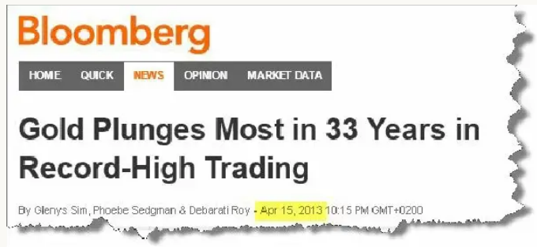

Figura 7-1: Bloomberg línea Headline News, 15 de Abril, 2013 [2]

Los futuros de oro y plata sufrieron su mayor caída en un día desde la década de 1980 el 15 de abril de 2013, con la plata un 11% sólo para ese día.

Una breve revisión de los mercados de plata desde una perspectiva analista ciclo de muestra que se espera que este evento y no es de extrañar en absoluto.

En 2011, los futuros de plata experimentaron una parabólica movimiento hacia arriba. Este escenario se controló en el espacio público y demuestra la aplicación de herramientas de ciclo de las operaciones en tiempo real.

### 7.1 Los ciclos dinámicos de proyección: Abril / Mayo 2011

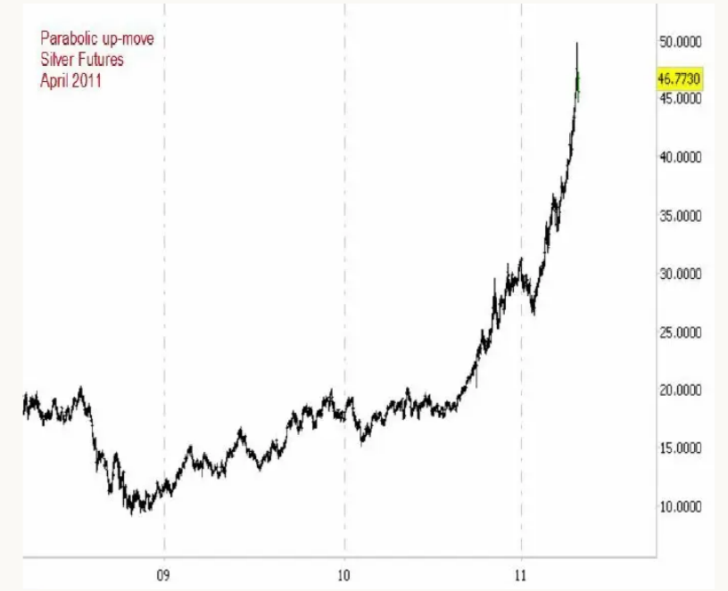

Figura 7-2: Hasta parabólica movimiento de plata de futuros - 27 abril 2011

La coyuntura crítica parabólica en abril de 2011 se preveía, y emitió un análisis del ciclo de antemano para mostrar este importante evento. [ 3]

El análisis reveló un ciclo dominante, con una longitud de 117 días de negociación, que había sido sólida y estable desde el año 2009! Por lo tanto, existe una fuerte probabilidad de que este ciclo de 117 días podría pronosticar los siguientes puntos de inflexión importantes. El ciclo dominante era ya activo y detectada en 2009 (véase Figura 7-3) - un tutorial bar-por-bar desde 2009 hasta el día del análisis (mayo de 2011) reveló que este ciclo de 117 días proyecta todos los puntos de inflexión a partir del año 2009 para el 2011.

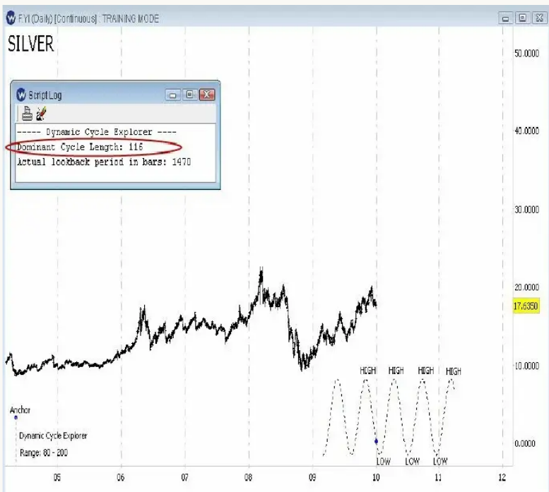

Figura 7-3: Detectado Ciclo de 116 días en el final de 2009 (Publicado en Público Foro) [ 4]

Las altas y bajas proyectadas están representados por las palabras ALTA / BAJA en el ciclo ploteados en el año 2010/2011.

Durante el año 2010, el ciclo se mantiene activa. El explorador ciclo dinámico seguimiento de los cambios de desplazamiento (el ciclo bajo provoca un +/- movimiento en algunos bares) y la respiración del ciclo (longitudes cambiar entre 115 y 118 días). La Figura 7-4 muestra el ciclo de actualización progresó hasta mayo de 2011. El anclaje y ajuste del indicador de ciclo de explorador dinámicos no han cambiado. El registro de secuencia de comandos que detecta la longitud del ciclo de 117 días muestra que el ciclo se mantiene activa. La línea azul punteada es la proyección del ciclo actual, basado en los cambios dinámicos para offset y aliento.

Las etiquetas marcadas “ALTO” / “BAJO” en la Figura 4 no se han cambiado. Estas etiquetas se colocan en base al análisis y la proyección hacia adelante desde el final del año 2009 (véase la figura 7-3). El cambio dinámico es visible en este ciclo debido a una ligera desviación entre la línea azul punteada indicada por la nueva proyección y los antiguos marcadores de texto (véase la figura 7-4).

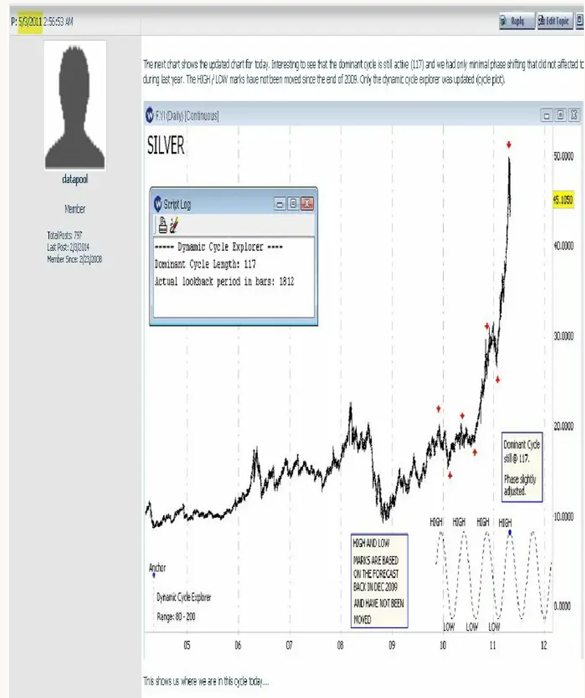

Figura 7-4: en tiempo real Advertencia público referente a una mayor Top basa en un ciclo de 117 días (3 de mayo de 2011); etiquetas de alta / baja se han escrito para trazar finales de 2009 [5]

Aquí se observa el comportamiento dinámico. Incluso con un ciclo dominante consistente, una proyección estática no debe ser seguido. El componente dinámico debe ser actualizado después de cada nueva barra para alinear la “llegada” fecha de la próxima proyecta baja o alta en base a los cambios actuales.

Este mismo ciclo, actualizado por el componente dinámico, ahora proyecta una alta esperada en los futuros de la plata el 3 de mayo de 2011. Este análisis se realizó en vivo y se ha publicado en el foro público de Internet.

Me alarma por el movimiento parabólico de plata durante las últimas semanas. Aunque, es difícil anticipar el final de un movimiento parabólico. Sin embargo, los ciclos pueden guiar el análisis mediante la detección y la proyección de la ciclo dominante actual. El explorador ciclo dinámico es la herramienta apropiada.

El explorador ciclo dinámico indica el final del movimiento parabólico durante los últimos días después de que el precio comenzó a caer. Si un movimiento parabólico termina y un ciclo dominante proyecta una parte superior, esta es una oportunidad comercial interesante. Estábamos en cuenta el 3 de mayo de 2011 que este ciclo proyecta todos los puntos de inflexión en 2010. Esto llevó a mí a compartir públicamente este análisis el 3 de mayo de 2011, después de que el precio de la plata se disparó a más de 45 dólares estadounidenses y el ciclo dominante proyecta un tope principal.

Durante los próximos cuatro días después de la proyección y la tabla de ciclos pública, futuros de la plata cayeron 22% a 35 dólares estadounidenses.

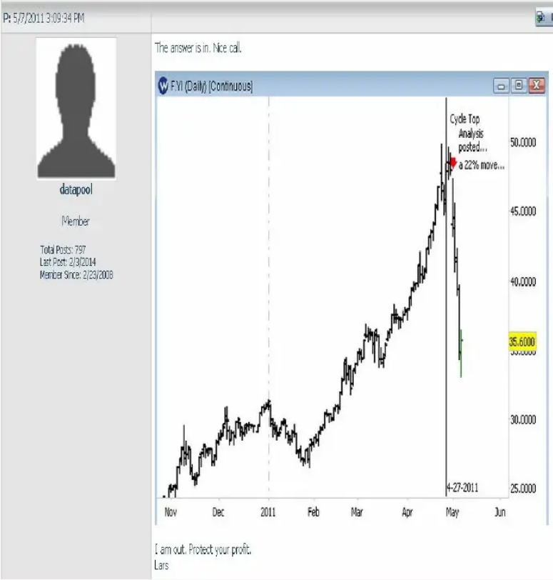

Figura 7-5: Actualización de precios - futuros de la plata Abandonado 22% después de la llamada

Esto representa un ejemplo perfecto de la detección y predicción de los eventos del mercado cíclicos. Recuerdo este ejemplo porque se mantuvo estable entre 2009 y proyecta la parte superior del mercado principal de 2011.

### 7.2 Ciclos dinámica de proyección: agosto de 2011

Tres meses más tarde, el 20 de agosto de 2011, he publicado una actualización pública ciclo posterior con una advertencia con respecto al siguiente próxima gran alta se espera que ocurra durante las próximas cuatro semanas.

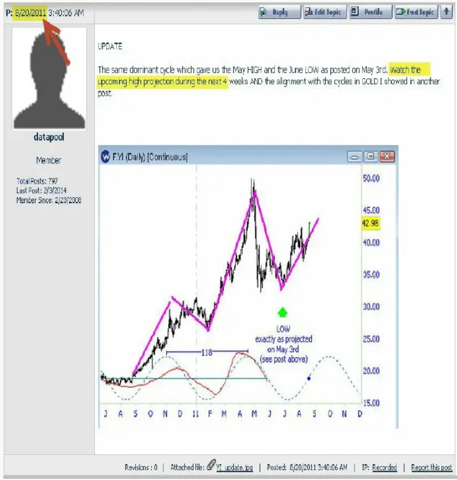

Figura 7-6: Pronosticada Ciclo superior de proyección dentro de las próximas cuatro semanas (Publicado 20 de agosto de del 2011) [6]

Que vuelva a comprobar la validez de la proyección ciclo de plata, se requiere un ciclo dominante verificación cruzada con los mercados correlacionados. Una tapa ciclo similar debe ser proyectado para el oro porque hay una alta correlación entre los productos de oro y plata. Por lo tanto, he comprobado los ciclos dinámicos de oro de agosto 20, 2011. El siguiente post fue publicado en el foro público de Internet:

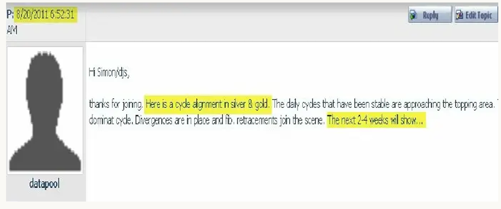

La siguiente tabla con el ciclo dominante detectada del explorador ciclo dinámico se adjuntó a dicho puesto público.

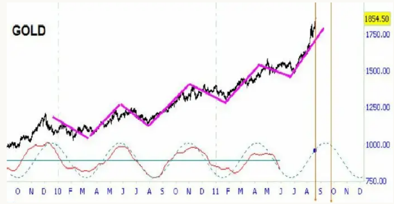

Figura 7-7: El ciclo dominante que ha identificado el Explorador de ciclo dinámico el 19 de agosto 2011 proyectó una alta durante la primera mitad septiembre de 2011 [7]

Exactamente tres semanas después de la advertencia fue publicada, precios de la plata se redujo en aproximadamente un 30% a 28 dólares en septiembre de 2011.

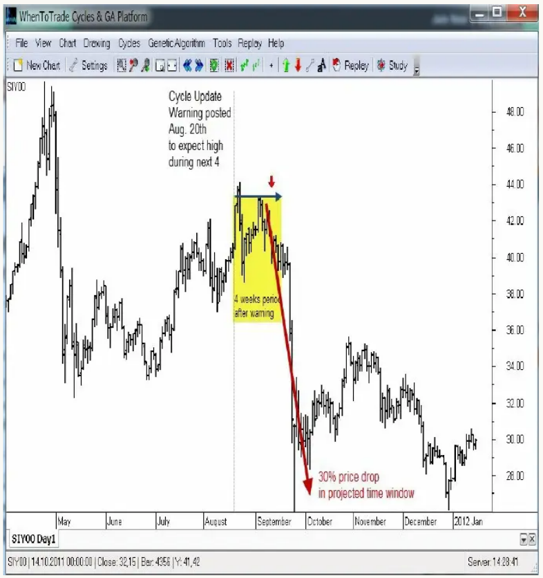

Figura 7-8: De plata los precios cayeron un 30% en la ventana de tiempo proyectado Tras la convocatoria pública

Pocos analistas ciclo colocan sus investigaciones en el dominio público por adelantado debido al riesgo de fracaso. Yo uso estas mismas herramientas para mi propio comercio y confío en compartir ejemplos de antemano. En conclusión: El ciclo se detectó a finales de 2009. Fue seguido por el explorador ciclo dinámico en 2010. Dos proyecciones del ciclo precisos fueron emitidos por adelantado en 2011 a la comunidad pública. la predicción futura del ciclo debe ser sencillo.

### 7.3 Los ciclos dinámicos de proyección: 2012 y marzo de 2013

Ahora, volviendo a la titular de noticias Bloomberg introducido desde el comienzo de este capítulo. precios de la plata se redujo más del 10% durante un día de mayo de 2013. Los titulares que aparecen al comienzo del capítulo refleja la sorpresa del público y los profesionales de la industria. Sin embargo, la reacción habría sido muy diferente tenían el ciclo de la plata dominante esbozado recibido el debido reconocimiento.

El ciclo identificado y rastreado mantuvo activo en 2013. Esto implica que el ciclo dominante, con una longitud de 117 días de negociación previsto todos los puntos de inflexión entre los años 2011 y 2013. El ciclo reveló todas las partes superiores e inferiores para otros dos años después de la detección de el Explorador de ciclo dinámico y la participación del público en 2011.

Figura 7-9 ilustra una cuenta de ciclos estática para mostrar que la distancia de las tapas y bajos es de aproximadamente 117 bares. El explorador ciclo le guía con precisión a través de estos puntos, como se muestra en los ejemplos.

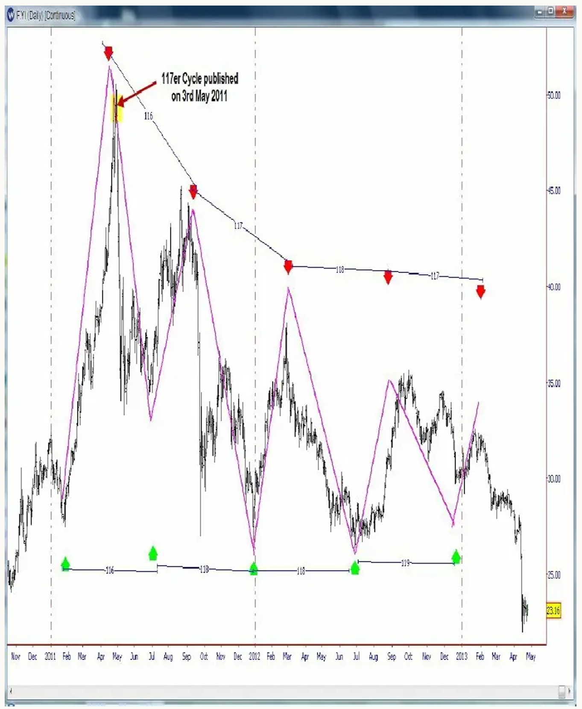

Figura 7-9: Ciclos estática Revisión de los 117 días del ciclo dominante Mencionados pueden 2011

La caída en abril de 2013 estaba en la sección precisa de la desaceleración cíclica esperada proyectada para comenzar en febrero de 2013. El mercado de cumplirse. Los eventos del mercado con respecto a la plata han proporcionado un ejemplo de libro de texto clásico de la detección exitosa, la proyección y el comercio para los ciclos dominantes. Este ciclo fue estable en la medida en que incluso la trama estática - como se muestra en la Figura 79 - refleja un ciclo precisa. Si ha seguido este ciclo dominante a través del explorador de ciclo dinámico, los turnos diarios exactos de las proyecciones superiores e inferiores podrían ser seguidos en tiempo y actualizados por barra de bar. et a empezar una guía detallada a partir de febrero de 2013. Un ciclo dominante a corto plazo con una duración de 40 días está activo y se muestra para el mercado del oro en. Este ciclo dinámico a corto plazo se controló entre diciembre de 2012 y se dio a conocer en el foro abierto Wave59 el 22 de febrero de 2013, por un cliente ciclos kit de herramientas. Una vista previa de la baja esperada el 22 de febrero y el alto esperado al final del mes de marzo fue publicada. El gráfico en la figura 710 se unió al palo mostró el ciclo detectado que proyecta mínima el 23 de febrero y espera que el próximo alta al final de marzo.

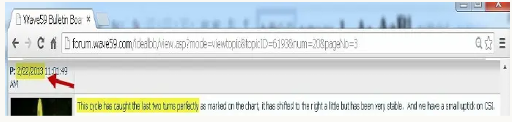

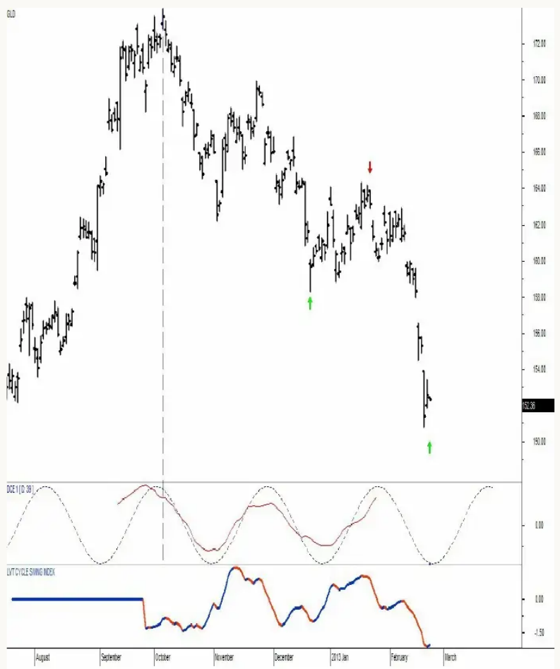

Figura 7-10: Análisis del Ciclo de Oro en tiempo real Proyección de la baja en Febrero / Alto contenido de marzo de [8]

Por lo tanto, la proyección pública ciclo del oro a corto plazo mostró una situación de esperar una tapa de mercado en oro al final de marzo de 2013.

Pasemos de nuevo a nuestros ciclos de plata.

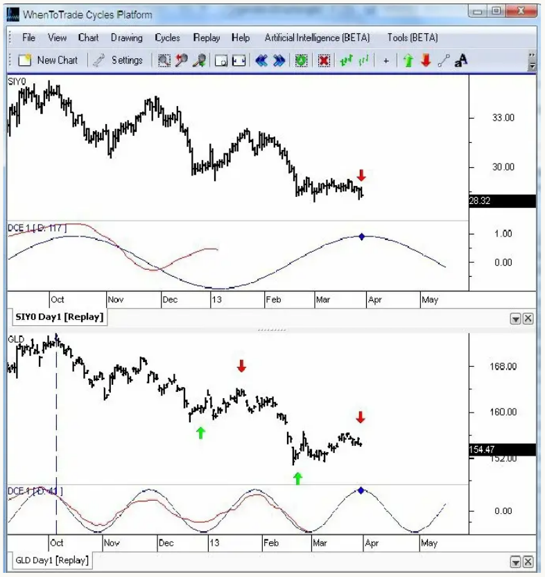

Figura 7-11 presenta una vista detallada del ciclo dinámico dominante a finales de marzo de 2013.

El Explorador de ciclo dinámico ha identificado nuevamente los ciclos dominantes de forma automática con la configuración estándar. El ciclo 177er apareció de nuevo en la plata. Figura 7-11: Análisis del ciclo de Explorador Dinámico - Marzo 2013

En primer lugar, el ciclo 117er mencionado originalmente en 2011 todavía está activo. En segundo lugar observamos un inter-mercado alineación ciclos dentro de ciclos entre la plata y oro para el ciclo corto plazo muestra públicamente en febrero de 2013. sigue siendo el ciclo de 117 días con respecto a los futuros de la plata. El ciclo de largo plazo se alineó a la baja en el año 2004; el mismo ajuste de indicador se utilizó en mayo de 2011 (véase la figura 7-4) para proyectar la principal superior 2011 con este ciclo a largo plazo.

Figura 7-11 muestra una alineación de ciclos de dentro de los ciclos de imagen perfecta. Ambos ciclos proyectan un tope principal mercado. A raíz de esto fue la mayor caída de oro y plata visto durante los últimos 33 años. [9]

Aquí está el gráfico actualizado después de la caída en los mercados de oro y plata en abril de 2013.

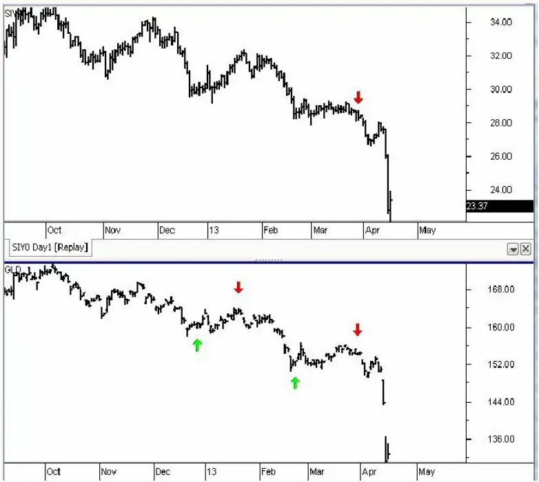

Figura 7-12: La mayor caída durante los últimos 33 años después de una Ciclos-dentro-ciclos de alineación

Esta revisión debe dar garantías de que los ciclos dominantes que están activos durante un período prolongado son significativos. Este análisis completo se llevó a cabo antes de los acontecimientos durante los últimos dos años. Sólo las llamadas reales que se realizaron y publicaron públicamente con antelación son revisados y no he elegido ejemplos sesgados.

Los mensajes en el foro público se proporcionan como referencia histórica. Por desgracia, Wave59 decidió mover su foro de software a una nueva plataforma en el 2016 sin mantener los antiguos puestos accesible. “Plata - movimiento parabólico - ¿qué sigue?” publicado abril 2011

[http://forum.wave59.com/idealbb/view.asp?topicID=5576](http://forum.wave59.com/idealbb/view.asp?topicID=5576)

"Oro," - " Este ciclo ha cogido las dos últimas vueltas perfectamente [...]”, publicada el 22 de febrero de, 2013

[http://forum.wave59.com/idealbb/view.asp?topicId=6193&num=20&pageno=3](http://forum.wave59.com/idealbb/view.asp?topicId=6193&num=20&pageno=3)

### 7.4 Lecciones en Video - Ciclos de plata de llamadas en vivo

Un video paso a paso de este análisis está disponible e incluye todos los detalles explicados en este capítulo:

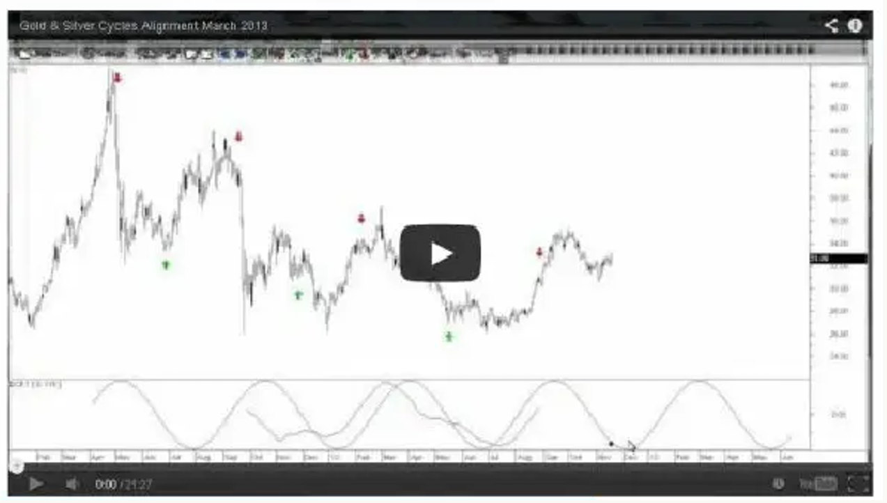

Lección de vídeo: Ciclos de plata [http://www.whentotrade.com/silver-cycles/](http://www.whentotrade.com/silver-cycles/)

## 8. CICLOS DE OPINIÓN: MEDICIÓN Y MIEDO Y COMERCIO CODICIA

En 1949, la inversión leyenda Benjamin Graham caracteriza elocuente la naturaleza cíclica de los mercados financieros en su libro “El Inversor Inteligente”:

> “El mercado es un péndulo que oscila siempre entre optimismo insostenible (que hace las reservas demasiado caro) y el pesimismo injustificado (lo que los hace demasiado barato). El inversor inteligente es un realista que vende a los optimistas y los pesimistas de compra“.

Hoy en día, el campo emergente de los conjuntos de datos de sentimiento apoyar el punto de vista de Graham, que proporciona una base empírica sólida para el sesgo reacción exagerada que es a menudo el factor determinante en los mercados cíclicos.

Normalmente, el estado de ánimo sube y baja positiva y negativamente. Por lo tanto, el sentimiento aumenta y disminuye en forma de ciclos dinámicos. estado de ánimo social se refiere a un sentimiento, emoción o actitud sobre algo, y, por supuesto, puede tener un rango de valores. Cada vez que el estado de ánimo está relacionado con las empresas, la economía, o activos, el carácter de los eventos se desarrollará en los activos financieros relacionados. El miedo y abatimiento representa un extremo, mientras que emoción y euforia representa el otro extremo del espectro. Comprensión del péndulo de la codicia y el miedo es la mejor herramienta que un comerciante puede tener a su disposición

Los ciclos son la estructura importante aquí, porque el sentimiento no salta rápidamente de un estado a otro - como un péndulo.

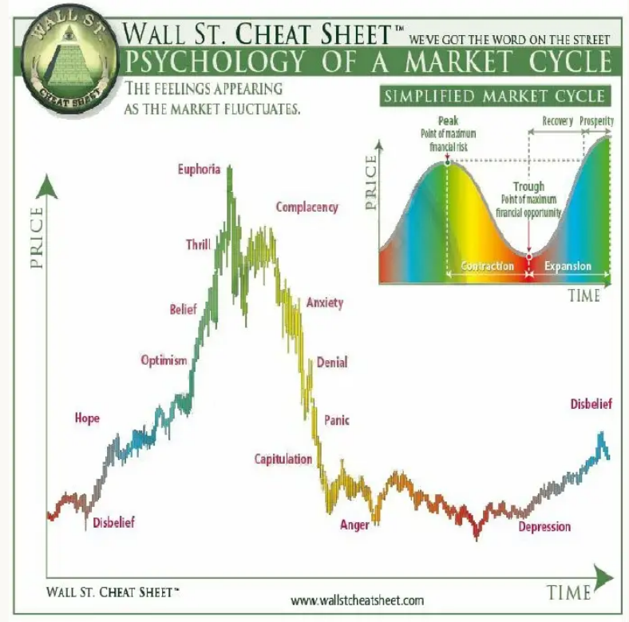

Figura 8-1: Mercado péndulo que oscila siempre entre alcista y extremos bajistas. [10]

Un cambio de estado de ánimo requiere tiempo; Por lo tanto, la confianza se mueve en ciclos dinámicos u ondas. Este es un proceso similar a los cambios de temperatura del aire: la temperatura exterior no salta de un estado a otro. Por lo tanto, el reto es detectar y predecir la extrema puntos de inflexión llamado “Máximo Riesgo Financiero” (Thrill / Euphoria) y “Oportunidad económica máxima” (Pánico / Capitulación).

Los aspectos fascinantes de la ciclicidad del mercado es que el inversor medio mal underperforms en todos los ámbitos porque él o ella es propensa a perseguir un rendimiento casi las cimas del mercado y pánico cerca de los suelos del mercado. Por esta razón, una medida eficaz del sentimiento puede ser de gran valor en la identificación de los puntos calientes de riesgo financiero máximo o una oportunidad dentro del ciclo sentimiento dominante.

O dicho con una de las citas más famosas de Warren:

> “Sea temeroso cuando otros son codiciosos y Codicioso cuando otros son temerosos."

En consecuencia, si usted tiene conjuntos de datos que proporcionan “miedo y la codicia” información de estado de ánimo en bruto en relación con los activos financieros, por un lado, y por otro lado tener herramientas cíclicos que son capaces de descifrar y realizar un seguimiento de los ciclos dominantes, tiene las herramientas necesarias para predecir y pronosticar sentimiento “puntos calientes”. Conseguir una manija en ciclos de “estrés financiero” en el mercado mejoraría sustancialmente la habilidad de negociación.

En este capítulo se proporcionarán ejemplos de comercio basado en ciclos de sentimiento

- el índice de volatilidad ( “VIX”),
- Social Media sentimiento ( “Twitter”) y
- el Índice de tensiones financieras (Fed de St. Louis, Símbolo: STLFSI).

### 8.1 Comerciales “miedo” Ciclos de volatilidad

Una medida popular de la confianza del mercado para el índice S&P 500 es el índice de volatilidad del Chicago Board Options Exchange (Símbolo: VIX). A menudo se refiere como el índice del miedo.

El VIX medidas de volatilidad y tiene una relación inversa con el mercado de valores. Cuanto más los incrementos de valor VIX, el más pánico que hay en el mercado. Cuanto más VIX disminuye en valor, más complacencia que hay en el mercado.

Como medida de la complacencia y el pánico, el índice VIX se utiliza a menudo como un indicador contrario. lecturas extremadamente bajas VIX indican un alto grado de complacencia y generalmente son considerados como bajista. A la inversa, extremadamente altas lecturas VIX indican un alto grado o la ansiedad o incluso pánico y son considerados como alcista.

Sería útil para detectar los ciclos de confianza del comerciante. Porque las emociones oscilar de pánico de venta a un exceso de confianza de compra en forma de ciclos, los indicadores de confianza son un vehículo útil para transferir conjunto de herramientas de nuestro ciclo a. Si somos capaces de predecir los máximos o mínimos esperados sentimiento con nuestro enfoque de análisis del ciclo, podemos usar esta información líder para fines de negociación. Vamos a utilizar las condiciones el 20 de febrero de 2009 para nuestro ejemplo.

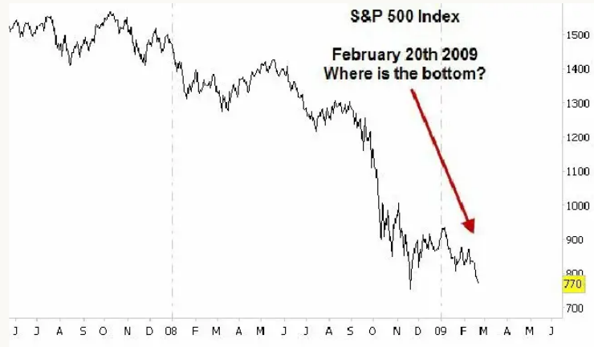

Figura 8-2: S&P 590 el 20 de febrero - ¿Dónde está la baja?

El mercado cayó duro al principio del año 2009. Este sería un punto interesante en el tiempo para ver lo que los ciclos de sentimiento nos decían aquí. Será el mercado disminuya más o esto es quizá ya la baja? Esta fue una pregunta caliente alrededor de este tiempo. Así que vamos a ver lo que los ciclos de sentimiento se nos han mostrado.

Vamos a utilizar dos indicadores ciclo explorador dinámicas para supervisar la situación de la tan real y los ciclos dominantes a corto plazo. Vamos a utilizar la configuración estándar del Explorador de ciclo dinámico. Así que nada de especial con referencia a los ajustes del indicador. Este caso se presenta a continuación.

#### El largo y corto plazo Explorador ciclo dinámico

El rango de largo plazo se establece en: 100 - 200 días naturales o 75 - 150 días de negociación.

La versión a largo plazo está anclada al 10 de octubre, de 2007 bajo del índice de volatilidad. Esto corresponde al mercado de todos los tiempos del índice S&P en 2007. La situación es de extrema comodidad de comprar en el sentimiento alineación con un importante mercado de alta.

El rango de corto plazo para el siguiente indicador se fija en 30 - 100 Calendario o aprox. 20 - 75 días de negociación. La versión a corto plazo está anclado al número de julio 15 High del índice de volatilidad que está vinculada a la baja del mercado en el S&P 500. Es otro extremo pánico en el mercado que está en alineación con un alto sentimiento.

La siguiente tabla muestra el ajuste en el índice VIX el 20 de febrero Se puede ver los datos VIX primas y los dos indicadores del explorador ciclo dinámico aplicado a la gráfica. Las fechas de anclaje se resaltan en la tabla.

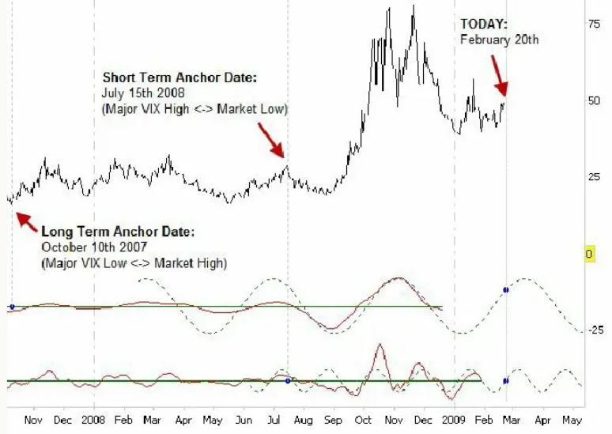

Figura 8-3: volatilidad ciclos set-up el 20 de febrero

Tal vez usted se está preguntando por qué no se han utilizado los últimos extremos altos alrededor de octubre / noviembre de 2008 A continuación. Hay una razón particular para esto: El historial de datos de febrero 2009 a noviembre 2008 hace no nos dan suficientes puntos de datos para llevar a cabo nuestro análisis del ciclo. Esa es la razón por la que hemos utilizado el sentimiento cresta extrema (mercado de bajos) en julio de 2008 y la depresión extrema confianza del (mercado de alto) en octubre de 2007. Estos dos mercados VIX resulta corresponde al mercado se vuelve. Así que tenemos dos puntos en los que el sentimiento del mercado y el comportamiento de los precios están en alineación. Dos buenos puntos en el tiempo para iniciar nuestro análisis de ciclo para los ciclos de sentimiento.

El ciclo dominante detectado a largo plazo tiene una longitud de 128 días de calendario y el ciclo dominante a corto plazo una longitud de 48 días naturales. Esto se puede ver en el registro de indicador o mediante la medición del ciclo de alto-a-alto bar longitud por bar. Tenga en cuenta que estas longitudes de ciclo no se derivaron de un marco ciclo estático - estos ciclos fueron completamente detectados automáticamente por nuestro motor de análisis de ciclo introducido en el segundo capítulo.

Pero antes de poder utilizar este análisis para la predicción, tenemos que revisar si esta configuración sería fiable de acuerdo con nuestras reglas.

##### a) comprobación de la aptitud de ciclos entre ciclos ideales y teóricas

La primera revisión de calidad implica una comprobación visual de la correlación del ideal detectado (punteado línea verde) y el ciclo sentimiento real (línea roja). Especialmente los altibajos del ciclo ideal y real deben estar en estrecha alineación. La siguiente tabla es una vista en primer plano de las dos parcelas indicadoras en el gráfico VIX. Para una mejor lectura, los datos en bruto VIX no se muestra porque sólo estamos interesados en el estado de los ciclos aquí. No necesitamos los datos en bruto debido a que la línea roja es el movimiento cíclico de los datos en bruto para la longitud del ciclo del ciclo detectado y la línea verde de puntos representa el ciclo ideal trazado. Todas las demás longitudes de ciclo se han filtrado de los datos prima original.

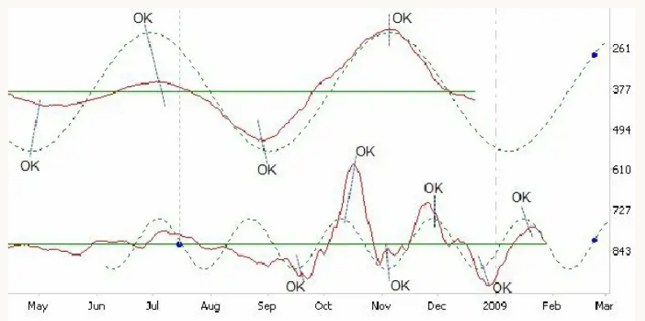

Figura 8-4: Zoom-in en dominante parcela ciclos de volatilidad (comprobación visual)

La cifra revela que tenemos un buen ajuste entre el ideal (verde) y los ciclos reales (rojo) en ambos ciclos dominantes detectados automáticamente. Las incidencias están marcados con una pequeña línea y el texto “OK”.

Este análisis ha pasado nuestra primera comprobación de calidad. La próxima revisión de la calidad será cotejar los ciclos sentimiento con el comportamiento del índice de mercado. Incluso si tenemos un buen ajuste de los ciclos de sentimiento, tenemos la confirmación de que estos ciclos sentimiento también representan importantes puntos de inflexión en los mercados de valores.

##### b) Para comprobar la alineación entre las sincronizaciones de ciclo volatilidad dominantes y los principales puntos bajos mercado / máximos

La siguiente tabla muestra los ciclos VIX en las ventanas inferiores y el índice S&P 500 en las ventanas superiores. El eje de tiempo entre ambos gráficos está en sincronía. Estamos en condiciones de realizar un seguimiento de los giros importantes de los ciclos de sentimiento en el mercado.

Las flechas en el gráfico muestran incidencias más bajas, donde los ciclos a largo y corto plazo son a la vez en sus mínimos / máximos. Cuando dos ciclos de diferente longitud están en sincronía con referencia a sus máximos / mínimos, es importante controlar estas incidencias. Debido a la fuerza de aditivo se pondrá en juego en estos incidencias.

Las incidencias en los que tenemos un alineamiento de la largo y ciclo dominante a corto plazo en el pasado también se resaltan con flechas verdes y rojas y el gráfico de precios de la S&P 500 puede verse en la mitad superior.

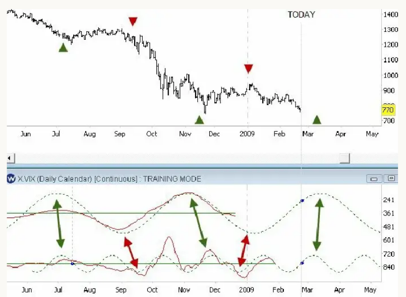

Figura 8-5: S&P 500 y alineaciones de ciclo volatilidad dominantes

Como podemos ver, tenemos una buena alineación entre los principales sincroniza ciclo sentimiento dominante y los principales puntos de inflexión mercado. Hemos pasado nuestra segunda prueba. Ahora, podemos utilizar este análisis para el pronóstico. Y como muestra el gráfico, la siguiente incidencia en el que se espera la próxima alineación ciclo de confianza entre el largo y el ciclo dominante a corto plazo en la primera quincena de marzo de 2009.

Así que esta es la información importante que queremos. No prevemos meses o años por delante. Pero la información que generamos el 20 de febrero habría significado una alerta máxima para la primera quincena de marzo de 2009. En lo que respecta a la negociación, esto nos dice que esperaríamos que la venta continúe en marzo y a continuación tocado fondo principal en la primera quincena de marzo.

Podemos utilizar otros indicadores para afinar nuestra entrada en el mercado. Por lo que estamos buscando cerrar nuestras posiciones cortas en el comienzo de marzo y el establecimiento de una posición alcista de largo plazo en la primera quincena de marzo. La siguiente tabla muestra cómo el pronóstico realizado el 20 de febrero habría jugado con el gráfico de precios progresado.

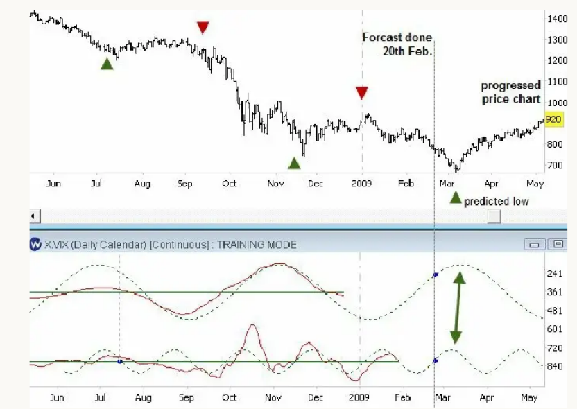

Figura 8-6: La previsión de volatilidad ciclos de 20 de febrero y un progresaron gráfico de precios

La técnica ciclo dominante - aplicado a los indicadores de sentimiento - nos advirtió en febrero con precisión claro que el clímax de venta terminaría en el primer quincena de marzo de 2009. Y fue en el clavo.

#### Ciclos sentimiento Seguimiento progresiones

Éstos son sólo algunos cortos progresiones de seguimiento de los ciclos de sentimiento. La proyección mostró un posible extrema confianza en el comienzo de marzo. Aquí está la actualización cuando los indicadores dinámica de actualización de llegar a su ciclo precisa de alta el 13 de marzo.

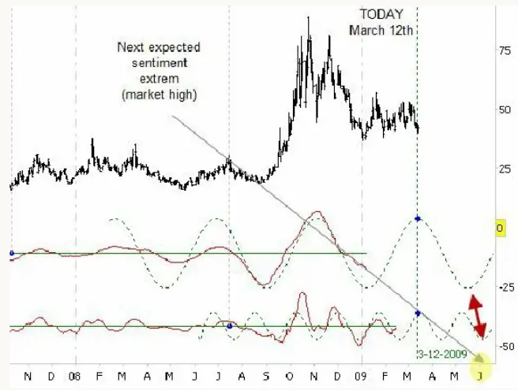

Figura 8-7: Estado de ciclos de sentimiento el 12 de marzo

Se puede ver en la figura 8-8 que había una predicción perfecta de la parte inferior del mercado en marzo y un pronóstico preciso de la próxima gran mercado que se espera a principios de junio de 2009. Lo que lo hace tan especial es que estas previsiones se basan en dominante ciclos derivadas de las mediciones sentimiento, no de precio.

La siguiente tabla destaca los resultados de los dos extremos de sentimiento proyectados en la primera quincena de marzo y principios de junio de 2009 basada en nuestro análisis del ciclo sentimiento de febrero y marzo de 2009. Una vez más, por favor, tenga en cuenta que la duración del ciclo predominante detectado no se mantuvo constante. El indicador detecta la vibración activa de mercado y ajusta automáticamente la longitud del ciclo dominante. Incluso si los ajustes del indicador no han cambiado (rango y el ancla), el indicador ajusta automáticamente la fase y la longitud de onda en cada nueva barra de acuerdo con la vibración real del mercado. Al igual que el sistema de navegación automática en su coche. Se actualiza automáticamente la hora estimada de llegada de conformidad con las condiciones reales de conducción, como el tráfico y la velocidad. Esto es exactamente lo que la dinámica del ciclo Explorador dominante va a hacer en la serie de tiempo financieras.

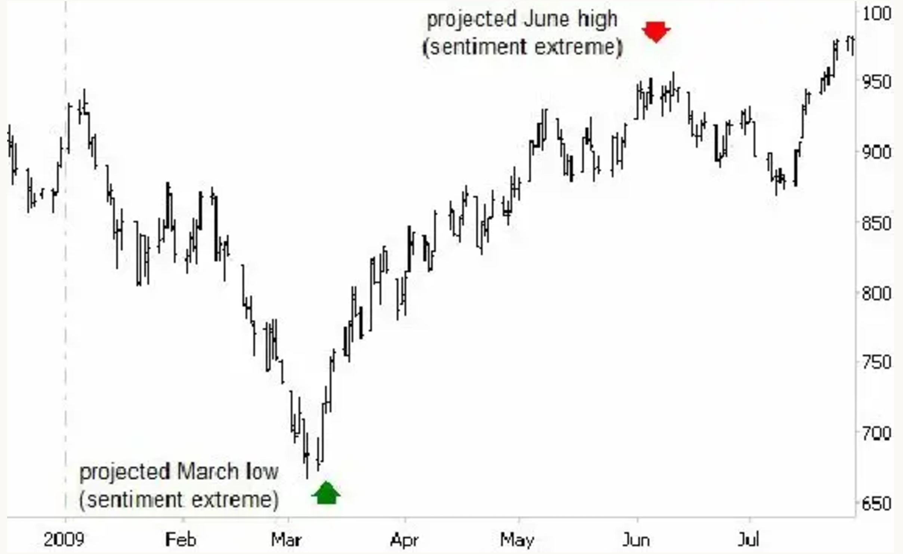

Figura 8-8: Resultado de proyección ciclo sentimiento dominante desde Febrero / Marzo 2009

La siguiente tabla es un “avance rápido” para mostrar que los principales mercados de alta / baja se acompaña de una correcta alineación de los extremos del ciclo sentimiento pronosticadas. El gráfico muestra el análisis real a finales de marzo de 2010. Una vez más, el punto de anclaje y la configuración de distribución no han sido tocados. Los ajustes de ambos indicadores siguen siendo los mismos que en el comienzo de este ejemplo!

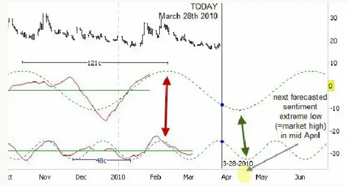

Figura 8-9: El sentimiento de proyección extrema 28 de marzo de 2.010

Se puede ver que ambos ciclos dominantes tuvieron su última alineación extrema en febrero de 2010 que correspondía a la mayor parte inferior en 2010. Ahora, a finales de Marzo de 2010 toda la comunidad de análisis técnico está discutiendo cuando la recuperación llegará a su fin. Nuestro enfoque ciclos sentimiento dominante nos da una imagen clara. Es de esperar que la próxima extrema confianza a mediados de abril. El siguiente gráfico muestra esta situación y cómo se habría jugado a cabo.

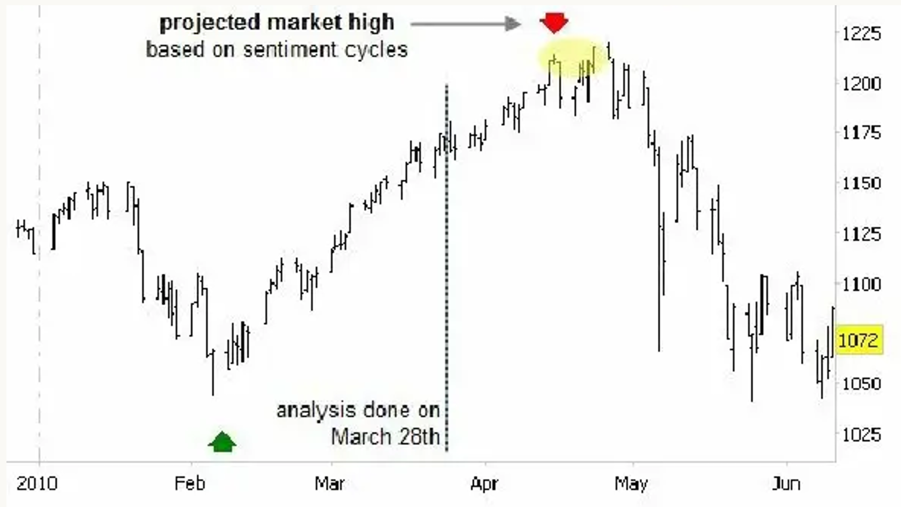

Figura 8-10: Previsión de alta mercado a mediados de abril

### 8.2 Ciclos dentro de ciclos: Precio de combinación y los ciclos de volatilidad

El siguiente ejemplo es una combinación de precios y la volatilidad ciclos. En este caso, el ciclo VIX se utiliza más tarde para verificar y confirmar los cambios posibles de ciclo de la serie principal de precios. Esto demuestra la importancia de la verificación cruzada de detectar ciclos en los conjuntos de datos relacionados. Y más importante, muestra el hecho de que los ciclos de sentimiento dominantes pueden dar un precursor en los cambios del ciclo de precios.

#### La onda portadora dominante en el gráfico de precios - Octubre 2010

Voy a utilizar un “intermarket dinámico ciclos dentro de ciclos de enfoque de” ejemplo para demostrar el poder de este enfoque.

Vamos a empezar en octubre de 2010 con la perspectiva a largo plazo en el gráfico semanal del índice S&P 500.

El explorador ciclo dinámico está unido a la carta. El indicador detecta el ciclo dominante y comprueba posibles desplazamientos de longitud y de fase para esta onda portadora en cada bar. El ejemplo se basa en la configuración estándar puras de este indicador totalmente automatizado - no hay manera de copia de optimizar o curva de ajuste esta herramienta. Usted habría llegado exactamente a la misma situación si se hubiera unido a la carta por su cuenta en el día dado. La onda portadora dominante se representa como un ciclo teórico azul en la parte inferior de la tabla y automáticamente extiende en el futuro. Si nos fijamos en el pasado, podemos ver que el ciclo detectado se adapta muy bien a los picos y valles de la historia de los precios.

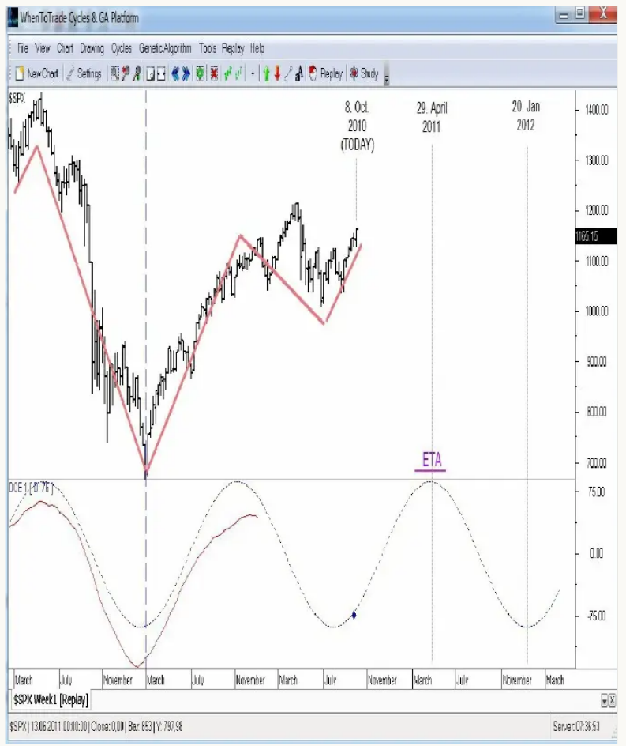

Figura 8-11: semanal S&P 500 con el ciclo dominante y proyección ETA (8 de octubre de 2010)

Lo que nos interesa es el siguiente punto de ETA, representada por el punteada línea azul, la palabra ETA y la línea púrpura de la manga: Se espera que la próxima gran parte superior para llegar alrededor del 29 de abril de 2011. Por consiguiente, estamos en una fase de expansión que se espera que dure durante los próximos 6 meses a partir de ahora. Esa es la imagen que el análisis del ciclo actual nos da - la onda portadora a largo plazo que nos guiará en cuando nuestras operaciones en el gráfico diario. Ahora vamos a observar el punto de ETA semana a semana para comprobar si la proyección va a cambiar o no. No utilizamos este análisis de una sola vez como una proyección fija que no puede ser modificado. En lugar de ello, actualizamos esta proyección todas las semanas una vez que se obtiene la siguiente barra. Esto significa que vamos a seguir el ciclo dominante principal y comprobar si la longitud o la fase del ciclo ha cambiado, lo que podría conducir a una proyección ajustada ETA.

Comparo este tipo de análisis con la navegación de Garmin en su coche. Le proporciona la hora actual estimada de llegada a su destino. Este tiempo de llegada se actualiza continuamente en tiempo real en función de las condiciones del tráfico dados. Esto es precisamente lo que vamos a ver con el ciclo dominante: Vamos a revisar su estado actual en cada bar y ajustar nuestra proyección ETA si es necesario. Por lo tanto, si nos movemos hacia adelante en el tiempo, nuestro punto de ETA se hará más y más precisa de bar en bar.

#### El pico se detecta con antelación - Mayo 2011

A medida que avanzamos en el tiempo, la siguiente tabla muestra el estado del ciclo a mediados de mayo. La proyección ETA azul y la línea de puntos marcados con “29. Inocentes”no se han movido desde octubre de 2010. A medida que el ciclo de proyección actualizada dominante actual indica, la longitud y la fase se ha desplazado ligeramente a medida que avanzamos hacia el 29 de abril de 2011. El pico ahora se proyecta para mediados de mayo como se indica por el ciclo dominante y actualizada el punto azul de la barra actual. El ciclo de núcleo es todavía el mismo que en octubre de 2010 - sólo la fase y la longitud han ligeramente desplazado y el explorador dinámica fue capaz de detectar y ha seguido la vibración “interior” de este ciclo dominante. La configuración del indicador no ha cambiado en absoluto durante todo el tiempo.

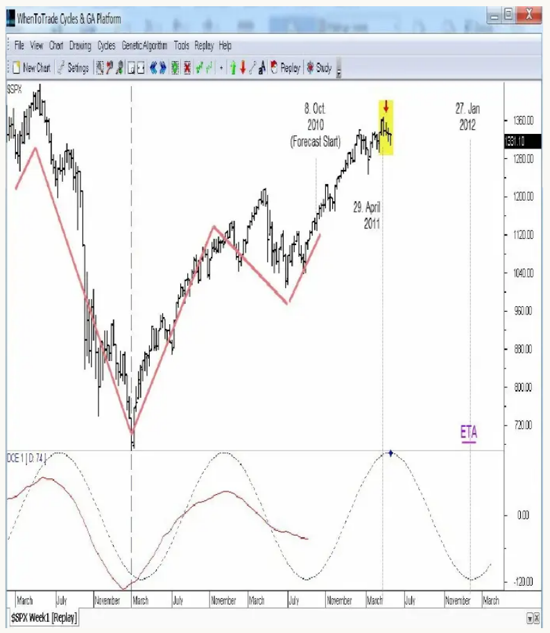

Figura 8-12: Actualización de proyección ciclo en el mayo de 2011 con el ciclo desplazado pico

En general, parece que el mercado ya alcanzó su punto máximo en la proyección original para 29 de abril. El ciclo dominante actualizada está ahora también en el pico de corriente proyección. El cuadro resaltado en la carta con la flecha roja confirma esta basado en la proyección original a partir de octubre y el estado actual del ciclo dominante a mediados de mayo. Esta es una señal válida alta que el ciclo dominante se mantuvo estable y que puede determinar el pico de la onda portadora que hemos estado siguiendo ahora desde octubre de 2010. La tendencia alcista ha llegado a su fin, evidentemente. Y podemos ver esto antes de los movimientos de precios. Ahora, ya que hemos llegado a la cima, queremos saber cuándo la próxima hora estimada de llegada (ETA) para la baja esperada será. Este punto se destacó una vez más por la línea de puntos azul - de fecha 27 de enero de 2012. Si se compara esta proyección a la de octubre verá que la baja proyectada se ha desplazado del 20 al 27 enero. Este es nuestro enfoque - sólo estamos interesados en la siguiente ETA, no la proyección bicicleta estática completa. Por último, podemos verlo: El pico se produce a mediados de mayo de 2011 y que espera una tendencia a la baja hasta el comienzo de 2012. En este punto en el análisis del ciclo, volvemos a avanzar por la barra de bar y sigue la onda portadora para detectar cambios en la longitud o la fase del ciclo dominante.

#### Tras la vibración del ciclo dominante - Septiembre 2011

Para el período comprendido entre el pico en mayo hasta octubre de 2011, estamos en condiciones de seguir la transformación del ciclo dominante activo utilizando el explorador ciclo dinámico: A medida que avanzamos compás por compás a partir de octubre, vemos que los contratos de ciclo y que la fase poco se desplaza, con el resultado de que el proyectado ETA se acerca más y más cerca del día en curso.

Por favor, ver un video corto para revisar la barra de comportamiento dinámico no interrumpida por la barra en: [http://www.whentotrade.com/dynamiccycles2/](http://www.whentotrade.com/dynamiccycles2/) (Véase el capítulo 6.5 “Lección de vídeo - Semanal S&P 500 Ciclo Largo Plazo”).

La siguiente tabla presenta el estado del ciclo, el 2 de septiembre de 2011. Observamos que la próxima ETA se actualiza en función del estado actual del ciclo dominante. El siguiente ETA en el gráfico a largo plazo se espera ahora a ser de 7 de octubre de 2011 en lugar de enero de 2012. comparar los dos último ciclo proyecciones de mayo y septiembre - se puede ver que sigue siendo la misma onda portadora general dominante: Tres picos y valles alineados dos a un comportamiento de precios - y se espera que el siguiente valle que se produzca en octubre en lugar de enero. Este es el poder del enfoque dinámico - que analiza el ciclo dominante activa con referencia al comportamiento de los precios actuales y las vibraciones - no el ciclo estático “curva de ajuste” al pasado! Si solamente consideramos nuestra proyección estática de mayo, todavía estaríamos esperando una baja en enero 2012.

Como estamos monitoreando continuamente el ciclo dominante, ahora sabemos que se espera que la inmersión de este ciclo dominante para llegar antes.

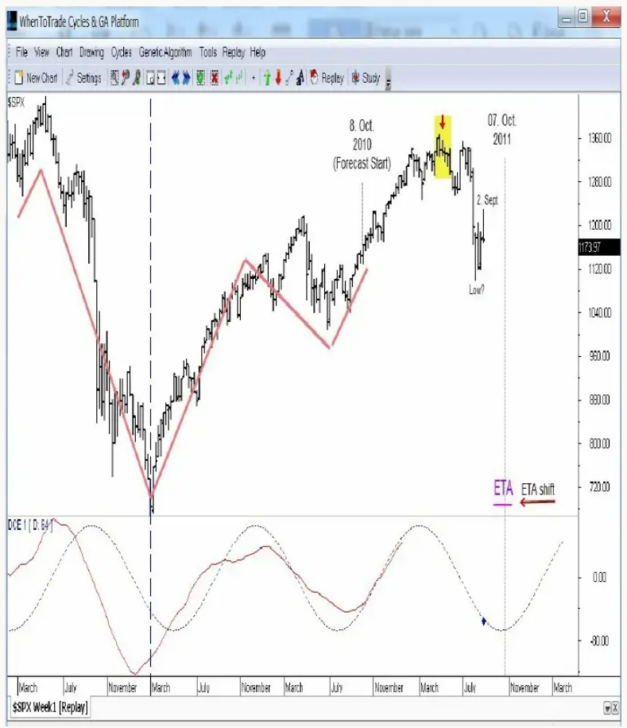

Figura 8-13: de cambio dinámico de la proyección de inmersión se esperaba con actualizado ETA (2 de septiembre de 2011)

Si nos fijamos en el análisis real de 2 de septiembre más de cerca, podemos ver que ya hemos entrado en el período mínimo cíclico, que durará hasta mediados de octubre. Si está familiarizado con el análisis del ciclo, usted sabe que un punto de inflexión esperado nunca ocurrirá precisamente en el día / semana de un pico de onda sinusoidal o baja. Por lo tanto, debemos estar preparados para una posible recuperación a partir de ahora ya que hemos trasladado a la parte baja del ciclo. Esta coyuntura es interesante porque el precio ya cayó hace 3 semanas.

> La cuestión principal en este punto es: ¿El ciclo de ahora quizá llegado al fondo?

#### Ciclos dentro de ciclos - El sentimiento en septiembre de 2011

Para responder a esta pregunta, aplicamos los ciclos dentro de ciclos de enfoque. Medir el tiempo de la operación, tenemos que pasar a la siguiente periodo de tiempo inferior. Para determinar si ya se ha alcanzado el fondo, tenemos que analizar la onda portadora diaria dominante. Y para añadir un bono extra al enfoque ciclos, voy a utilizar ciclos de sentimiento en el marco de tiempo al día en lugar del diario S&P 500 para analizar nuestra posición en el mercado. Los mercados están impulsados por las emociones. Por lo tanto, si somos capaces de analizar el ciclo actual sentir, tenemos la fuente y la información que conduzca a comportamiento de los precios. El índice de volatilidad (VIX) es una medida útil para el sentimiento del mercado. Por lo tanto, para determinar si nos acercamos o ya estamos en una importante baja el 2 de septiembre de 2011, aplicamos nuestro trabajo cíclico para el VIX, el 2 de septiembre de 2011.

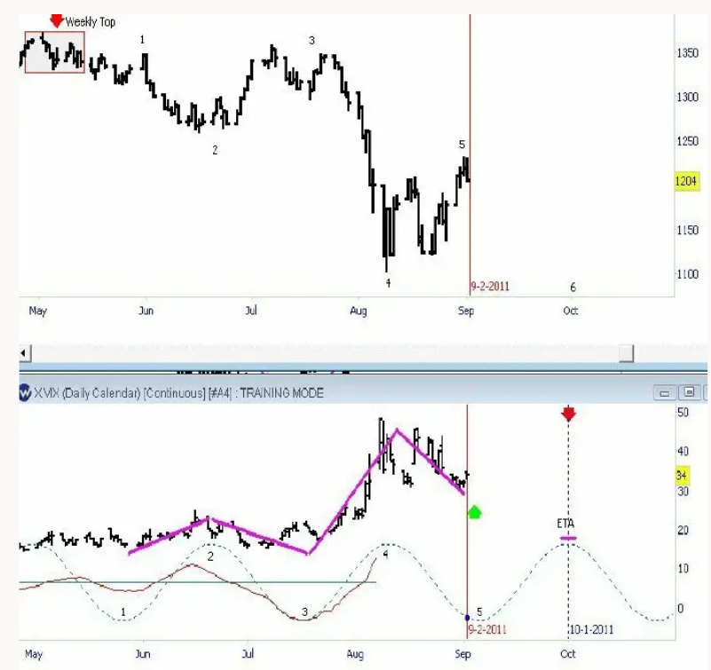

Figura 8-14: Daily S&P 500 con VIX y el sentimiento dominante actual ciclo (2 de septiembre de 2011)

El pico principal mercado que hemos identificado correctamente utilizando el análisis del ciclo semanal está representado por la pequeña caja en la parte superior diagrama de S&P. Nos faltan desde mayo. Ahora nos atribuimos el mismo indicador para el gráfico diario del VIX (gráfico inferior). Aplicamos la misma configuración estándar, es decir, nada especial de nuevo. Basta con arrastrar el explorador ciclo dinámico en el gráfico. El algoritmo detecta y traza la onda portadora dominante actual a la derecha en el gráfico. Los principales cambios del ciclo detectado están marcados con los números 1 a 5 en el VIX y S&P gráfico. Se puede ver que tenemos una correlación inversa del ciclo sentimiento: el pico del ciclo Un sentimiento corresponde a un mercado de bajos y viceversa. Esto confirma que el ciclo predominante detectado automáticamente en el VIX es válido con respecto a los principales puntos de inflexión del mercado. El 2 de septiembre de 2011 - la fecha hemos cambiado nuestra atención de la proyección de ciclo largo plazo para determinar si se había producido ya el dip - vemos claramente que el giro real punto No. 5 se produce con una esperada baja en el índice de confianza a tomar forma ahora (= alta mercado). Se espera que la próxima proyección de ETA a ocurrir durante un período de lectura alta confianza, superando el 1 de octubre de 2011 (punto 6). ¿Qué significa esto con respecto a nuestra pregunta principal: ¿Hay que establecer una operación larga debido a que el ciclo de largo plazo es la formación mínima en este momento? La respuesta es bastante simple: El gráfico diario revela que el precio ha aumentado desde la principal baja en agosto (punto 4). Sin embargo, sabemos basado en este ciclo el sentimiento de poca intensidad que el mercado ha alcanzado un pico diario en el punto 5! No es un buen momento para realizar una operación larga, porque esperamos que el mercado se mueva hacia abajo en el punto 6 proyectado como lo muestra el ciclo de ETA sentimiento del 1 de octubre de 2011.

Además, podemos obtener un mensaje claro ahora mediante la combinación de largo y análisis del ciclo dominante a corto plazo: Si sólo se veía en el gráfico diario, va a ir corto ahora. Sin embargo, en base a sus conocimientos sobre el ciclo más largo plazo, usted sabe que se espera un importante mercado baja a tomar forma durante este tiempo - no es la situación a largo plazo que necesariamente gustaría colocar operaciones cortas en (sólo se permite en el modo agresivo) ! Por lo tanto, el análisis a largo plazo nos protege de la colocación de una operación corta aquí. Por otro lado, si sólo se utiliza la proyección a largo plazo, es probable que quiera ir mucho. En este caso, el análisis a corto plazo nos impide ir de largo ahora en la situación actual de la confianza del mercado.

Apoyo ahora viene del enfoque de ciclos dentro de otros ciclos: Sabemos por el ciclo a largo plazo que podemos esperar una baja a tomar forma en las próximas semanas a principios de octubre. El actual ciclo corto plazo proyecta el próximo mercado baja para empezar a formar alrededor de 1 de octubre. Aquí lo tenemos: Un ajuste de la proyección a largo y corto plazo, una importante baja esperada en torno a 1 Octubre de 2011. Este es el momento en el marco de tiempo diario ahora. No ir de largo el 2 de septiembre de 2011. Espere hasta principios de octubre antes de establecer la siguiente posición larga importante.

#### ciclo sentimiento actual encaja en la onda de largo plazo - Octubre 2011

Una vez más, vamos a pasar adelante en el tiempo y la pista el día de la onda portadora sentimiento dominante de día del 2 de septiembre en adelante. La siguiente tabla ilustra la situación el 4 de octubre. El mismo ciclo dominante es todavía activo que el indicador demuestra. De nuevo sólo un ligero cambio tuvo lugar, según lo indicado por los puntos 1-5 y la marca de ETA con la línea azul, que no se han movido desde que nuestro análisis original. El pico del ciclo actual debería haber sido alcanzado como el análisis de 4 de octubre de espectáculos.

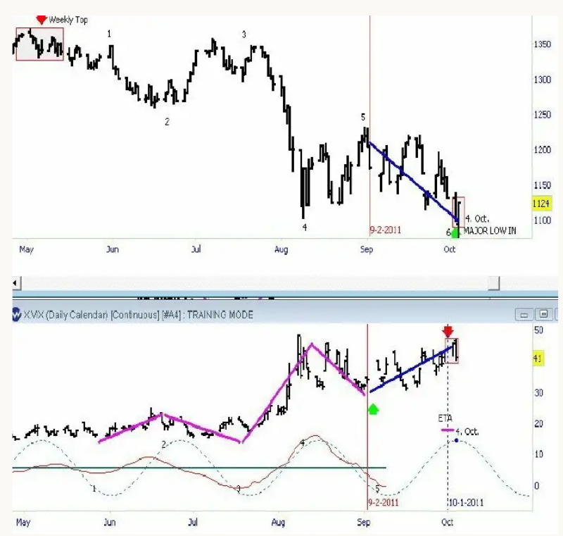

Figura 8-15: Daily S&P 500 y VIX con ciclo actualizado (4 de octubre de 2011)

Podemos observar que el precio reducido durante el tiempo de la confianza en el VIX se lleva hasta nuestra ventana ETA. Al igual que lo fue proyectado por la onda portadora dominante que ha identificado. Y ahora que nos acercamos al proyectado ETA, nuestro análisis del ciclo actual confirma que alcanzó un máximo en el índice de confianza del 4 de octubre (= mercado baja). Por lo tanto, en base a la proyección y el estado actual del ciclo, tenemos un ciclo sentimiento de imagen perfecta y válida cuyo pico ahora se proyecta durante 4 de octubre de 2011. El mercado se ha reducido a un nivel que es aún más bajo que el mínimo anterior de vuelta en agosto - por lo tanto, la proyección sentimiento de 2 de septiembre nos protegió de ir mucho demasiado pronto. Una, el comercio a corto agresiva estrechamente monitoreado nos habría dado el beneficio adicional durante el viaje en el sentimiento.

Ahora tenemos nuestros ciclos dentro de ciclos de alineación - no puede ser más clara: El largo plazo de proyección semanal ciclo sentimiento ETA revela una baja el 7 de octubre (ver Figura 8-13). El corto plazo de proyección diaria ciclo sentimiento ETA confirma esta baja el 4 de octubre (Figura 8-14 y Figura 8-15). Tenemos un ciclo imagen perfecta alineación dentro de los ciclos. La única diferencia es que no hubiéramos sido capaces de detectar esta alineación ciclo con las herramientas tradicionales de proyección ciclo estáticas! Necesitamos que el componente dinámico que le da algo extra. Además, con el componente dinámico que ahora es capaz de ver la formación de los ciclos en la barra de avance por la barra y podemos preparar. La tenemos en ahora: Un importante bajo el 4 de octubre 2011 demostrado por los ciclos. Tenga en cuenta: Ni siquiera mejor precio, nos puede dar esta información para 4 de octubre. Sin indicador técnico, hay una línea de tendencia, sin herramienta alguna habría indicado una baja importante basada únicamente en el precio. Los ciclos dinámicos sobre los precios y el sentimiento, sin embargo, tener.

Vamos a pasar adelante en el tiempo para ver cómo esta coyuntura se desarrolla. La siguiente tabla muestra el resultado en el gráfico de la derecha.


Figura 8-16: Daily S&P gráfico con pico de mercado identificados y el mercado baja actualizado para hoy

La baja proyectada por 4-7 de octubre de 2011 se produjo justo a tiempo. El mercado se ha movido hasta después como proyectado por la onda portadora a largo plazo. La línea azul en el gráfico de la derecha presenta el resumen del comercio del ejemplo descrito aquí. Comenzamos con la fase de expansión funcionamiento en octubre, identificó el pico principal como se proyecta en mayo y con éxito puesto a punto la baja del mercado con los ciclos dentro de ciclos de enfoque en combinación con el ciclo de la confianza en octubre. El ejemplo completo se basa en el explorador ciclo dinámico estándar. No se ha llevado a cabo la optimización o ajuste de curvas. Y no estoy cherry picking una situación específica aquí. Un análisis puro de lo que los ciclos dentro de ciclos de enfoque nos mostraron en relación con la perspectiva a largo plazo a partir de octubre de 2010, hasta la actualidad. Este enfoque se puede aplicar a cualquier símbolo en cualquier período de tiempo. A pesar de que este enfoque puede parecer simple, la disciplina en el trato con el movimiento proyecciones y validación de los ciclos de detección automática, es necesario para que sea un éxito.

> En cuanto a operaciones intradía, el enfoque de los ciclos de dinámica es más complicado que para los gráficos diarios.

¿Por qué? Debido a que hay una gran cantidad de interferencia ciclos activos durante el mismo tiempo en plazos intra-día como 5, 10 o 30 minutos, lo que hace difícil la detección de la onda portadora más activo individual. ciclos dominantes saltar por encima de una onda portadora a la siguiente - que no se muevan sin problemas como lo hacen en los gráficos diarios. Esta es la zona en la que es necesaria una investigación adicional. Espero que este capítulo es una revelación al hecho de que los ciclos respiran con el tiempo y no se mantienen fijos. Si acostumbras a este hecho y puede desarrollar o utilizar herramientas que pueden convertir esta idea en parcelas visuales negociables a través de algoritmos optimizados, las proyecciones del ciclo de este tipo le impulsan hacia el siguiente nivel de la negociación y la previsión. Adicionalmente,

### 8.3 Ciclos de sentimiento de negociación de medios sociales

En los últimos años, los medios de comunicación social se ha convertido en omnipresente e importante para las redes sociales y la comunicación en línea entre los participantes en el mercado para las noticias del mercado de valores. En este capítulo se muestra cómo el sentimiento medios de comunicación social puede ser utilizado para predecir los ciclos financieros. En particular, se muestra cómo se utiliza la charla social de Twitter para pronosticar el mercado se convierte en el par de divisas EUR / USD.

#### Un caso en tiempo real basado en el par EUR / USD

En el volátil mundo de las monedas, siempre vale la pena entender el cuadro grande. Independientemente de su horizonte de negociación, lo mejor es determinar el ciclo dominante antes de continuar.

> La situación en el año 2015 de marzo de - EUR / USD a reanudar su tendencia bajista o la experiencia de un gran cambio?


Figura 8-17: EUR / USD el 20 de marzo º, 2015

El par EUR / USD se negociaba a 1,081 después de una pausa de una tendencia a la baja de varios años.

En este punto, siempre es de gran importancia saber si esto es sólo una pausa en la tendencia a la baja en general y si uno esperaría par EURUSD para reanudar a la baja. En esos momentos, los ciclos de sentimiento pueden guiar el proceso. En primer lugar, necesitamos información sobre el estado de ánimo cruda EUR / USD. PsychSignal es una empresa que proporciona información sentimiento sociales derivados de Twitter chats de internet ([www.psychsignal.com](www.psychsignal.com)). A cada segundo en cada rincón de Internet, millones de personas están expresando sus emociones en Twitter alimenta individuo. En este contexto, PsychSignal escucha estado de ánimo de la multitud a través twitter y construye los datos de confianza alcistas / bajistas agrupados ac-cording a los activos financieros - en nuestro caso, el par EURUSD. Tal bajista datos de Twitter alcista / preprocesado está disponible en los servicios de PsychSignal, en Quandl o servicios similares que “escuchan” a saltos de twitter.

Figura 8-18 muestra el valor compuesto sentimiento Twitter trazada en un gráfico en el panel superior. Tenemos, además, se alisó los datos mostrados por la línea roja. Además, tenemos que ejecutar algoritmos de detección de ciclo para la puntuación compuesta sentimiento social. Nuestro conjunto de herramientas Explorador de ciclo dinámico está diseñado específicamente para detectar y realizar un seguimiento de los ciclos que no permanecen estáticos en los conjuntos de datos en tiempo real. Esto es muy importante porque no queremos detectar ciclos estáticos que se ajustan al pasado - necesitamos ciclos que pueden explicar el pasado, pero se centran más en permanecer en sincronía con las características actuales del mercado.

#### Ciclo El sentimiento actual en el EUR / USD

El ciclo dominante de 208 días también se muestra en el gráfico en el panel inferior. El ciclo se detecta automáticamente. Las vueltas se han mapeado con flechas rojas y verdes contra el gráfico sentimiento crudo en el panel superior. La figura 8-18 muestra el PsychSignal EUR / USD Índice alcista / bajista sentimiento medios de comunicación social y el ciclo detectado dominante (208 días) a través del Explorador de ciclo dinámico de WhenToTrade Ciclos conjunto de herramientas.

En teoría, al igual que con todos los vehículos de sentimiento, las puntuaciones funcionan como indicadores contraindicaciones. Por lo tanto, los puntos extremos de una tendencia al alza deben corresponder a las cimas del mercado, y las puntuaciones compuestas bajistas extremas deben corresponder a los suelos del mercado. La ventana en la parte inferior del gráfico muestra el ciclo dominante detectada como una línea azul. El texto indicador muestra que hay un ciclo subyacente con una longitud activa de 208 días en el conjunto de datos sentimiento EUR / USD. El rojo representa gráficamente los datos detrás del ciclo azul muestra que tenemos un partido válido be-Tween el ciclo ideal y los movimientos de puntuación reales sobre el sentimiento. Puede comparar los máximos y los fondos de este partido ciclo con grandes vueltas en el índice de confianza.


Figura 8-18: Detectado Ciclo El sentimiento en el EUR / USD el 20 de marzo lo tanto, tiene una pista sobre el hecho de que un ciclo de 208 días ha impulsado el sentimiento social durante los últimos dos años. El punto más importante es el día actual, ya que no es necesario un ajuste perfecto en el pasado distante. Además, sabemos que los ciclos tienen un carácter dinámico; Por lo tanto, el período de tiempo más importante es el pasado actual en la que los parámetros del ciclo tienen que estar en alineación con el mundo real.

Antes de empezar a interpretar las condiciones actuales, sin embargo, hay que comprobar si este ciclo - que sólo se relaciona con el sentimiento social y no tiene nada que ver con los datos de precio real - tiene correlaciones a turnos en el precio de EUR pair.Thus divisas / USD , la Figura 8-19 muestra el tipo de cambio EUR / USD trazada en la parte superior de este análisis. Las vueltas del ciclo dominante descubierto están marcados con flechas rojas y verdes en el gráfico de precios.


Figura 8-19: tipo de cambio EUR / USD gira en sincronización con el sentimiento detectado ciclo

Podemos ver que tenemos un ajuste ideal entre el ciclo de precios y el sentimiento social de vueltas del par de divisas. Sin embargo, este ciclo no se hace visible en el tipo de cambio solo; Además, el ciclo no predice la fuerza de cada movimiento. Para ver la situación con mayor claridad, hemos añadido una línea púrpura para conectar las flechas en el tipo de cambio.

En este contexto, se hace claramente visible que es más interesante para descifrar el patrón subyacente en forma de ciclos dinámicos sentimiento que tratar de interpretar los datos de la confianza primas. En general, las vueltas primas de Twitter estado de ánimo no coincidirá con el precio se convierte precisamente porque hay retrasos, el ruido y las distorsiones entre el estado de ánimo y los eventos que se desarrollan. En consecuencia, no estamos interesados en los giros micro exactas del estado de ánimo en el gráfico de precios; en cambio, estamos buscando el ciclo de estado de ánimo general para cambiar su dirección.

Se puede apreciar que tenemos un ciclo de confianza válida de 208 días corridos - que apunta al “punto caliente” de la oportunidad económica máxima en el día del análisis.

Como resultado, podemos prestar mucha atención a donde estamos ahora en este ciclo sentimiento. El análisis de los datos se llevó a cabo el 20 de marzo de 2015. El punto azul en el ciclo marca el día actual del análisis. El punto importante aquí es que el ciclo dominante muestra una parte inferior inminente con una lectura extrema de pesimismo. Así que esperamos que el sentimiento se eleve en las próximas semanas con un aumento de precio esperado del EUR / USD pasando en paralelo. Por lo tanto, no podemos esperar que la tendencia a la baja para reanudar en breve; en cambio, es de esperar una importante arriba-columpio en el par de divisas que sigue el patrón de sentimiento activo dominante.

Ahora nos movemos hacia adelante seis semanas y comprobar el pronóstico. Figura 8-20 muestra el precio misma EUR / USD que se mostró a principios de este ejemplo y progresa ocho semanas al 15 de mayo de 2015:


Figura 8-20: resultados del pronóstico 8 semanas después de la llamada

El análisis ha demostrado ser extremadamente precisa. El par EUR / USD terminó su largo abajo a la tendencia de marzo de 2015 y comenzó una fuerte alza. A sólo seis y ocho semanas después de la previsión, los precios aumentaron más del 5%. Por lo tanto, se trata de una previsión real basado en el poder de las herramientas de seguimiento ciclo dinámico y la nueva zona de conjuntos de datos disponibles sentimiento. En este capítulo se sustenta la importancia de la investigación cíclico en los conjuntos de datos de sentimiento social, a fin de prever importantes giros del mercado. Por lo tanto, la combinación de los datos de confianza del estado de la técnica con los últimos análisis del ciclo de pre-dicción y herramientas de WTT ofrece una vista única en los mercados financieros.

Pero no sólo hizo este análisis proyecta un derecho repunte a tiempo. El análisis de los sentimientos cíclico predijo el mayor aumento 30 días precio desde 2013. (véase la figura 8-21)


Figura 8-21: cambio 30 días del par EUR / USD con mayor aumento después de pronóstico

Es importante mencionar que el análisis del ciclo mostrado en este capítulo sobre el EUR / USD estado de ánimo se llevó a cabo en vivo y en tiempo real. Este ejemplo no era palmitas. Se lo dijimos a nuestra comunidad el 20 de marzo el año 2015 sobre este tema en tres artículos de noticias públicos:

- la revista Internet pública WTT el 22 de marzo de 2015: [https://www.whentotrade.com/euro-dominant-social-media-sentimiento-de-ciclo/](https://www.whentotrade.com/euro-dominant-social-media-sentimiento-de-ciclo/)
- vía pública noticia de última hora LinkedIn pulso el 22 de marzo de 2015: “Euro - dominante de medios sociales Ciclos de sentimiento”, Fuente: [https://www.linkedin.com/pulse/euro-dominant-social-media-sentimiento-ciclos-Lars-von-thienen](https://www.linkedin.com/pulse/euro-dominant-social-media-sentimiento-ciclos-Lars-von-thienen)
- a través del blog PsychSignal pública el 23 de marzo de 2015: “Euro ajustado a rebotar como ciclo de sentimiento se vuelve positivo”, Fuente: [https://psychsignal.com/psychsignal-blog/](https://psychsignal.com/psychsignal-blog/)

### 8.4 Lección de vídeo: Ciclos de sentimiento de medios sociales

Por favor revise el ejemplo descrito en un “making of” de vídeo en directo. Clic sobre la imagen de vídeo o enlace de abajo:


Lección de vídeo “Ciclos de sentimiento social media”: [https://www.whentotrade.com/sentiment-cycles/](https://www.whentotrade.com/sentiment-cycles/)

### 8.5 Operando con ciclos de esfuerzos financieros

La comprensión de los ciclos sentimiento de tensión financiera es fundamental para la generación de retornos en el actual entorno de mercado. ciclos sentimiento influyen en el movimiento de los mercados financieros y están directamente relacionados con los estados de ánimo de las personas. Conseguir una manija en ciclos de “estrés financiero” en el mercado mejoraría sustancialmente la habilidad de negociación. Afortunadamente, el Índice Fed de St. Louis tensión financiera (Símbolo: STLFSI) es un conjunto de datos que proporciona información sobre el nivel actual “estrés financiero” en el mercado. En este capítulo, se destaca la importancia de detectar ciclos en los conjuntos de datos de “estrés financiero” para detectar los puntos de inflexión en los índices financieros. El siguiente estudio de caso ejemplifica la importancia de los ciclos sentimiento y la capacidad de predicción del Explorador de ciclo dinámico de nuevo. El Explorador de ciclo dinámico funciona en el supuesto de que los ciclos no son estáticos en el tiempo. Recapitulemos el enfoque DCE introducido en el capítulo: Introducción del método Explorador ciclo dinámico:

> Cada vez que aparece una nueva barra en el gráfico, el Explorador de ciclo dinámico vuelve a evaluar el estado del ciclo dominante actual en cuanto a la longitud, la fuerza y la eliminación gradual. Posteriormente, se actualiza este ciclo mediante el trazado que en las proyecciones futuras. Sin embargo, un comerciante se centrará sólo en el siguiente punto de inflexión esperado, que es lo que un analista de mercado le interesa. El DCE no se utiliza para predecir un ciclo estático completa en el futuro. Estamos interesados en determinar y monitorear el siguiente punto de inflexión en base a la eliminación gradual de la onda portadora detectada dominante, que es el punto en el tiempo donde se espera que el mercado para convertir.
>
> A medida que avanzamos en el tiempo, cada bar significa una actualización del punto de inflexión esperado por una nueva evaluación de la situación actual de la duración del ciclo dominante y fase. Este pronóstico dinámico basado en el estado actual del ciclo dominante proporciona información sobre el tiempo y la dirección del siguiente punto de inflexión. Obtenemos información en tiempo real acerca de cuándo esperar el siguiente punto de inflexión en el mercado, ya que continuamente reevaluar los parámetros de la onda portadora dominante. Esta información se actualiza cada vez que aparece una nueva barra.

Se utilizó esta técnica en un informe de mercado que fue publicado el 8 de junio de 2014 en la sección de revistas WhenToTrade a disposición del público. [ 11]

Durante el tiempo de junio de 2014, la mayoría de los analistas financieros publicados perspectivas alcistas después de una fuerte tendencia alcista en los principales mercados:


Figura 8-22: Situación del mercado novena de junio de, 2014 durante una fuerte tendencia alcista

Estos son los puntos en el tiempo donde el análisis del ciclo puede proporcionar resultados adicionales. Para ver si los ciclos confirmar o invalidar el pronóstico de la corriente principal. Hemos utilizado los datos de confianza para comprobar si los ciclos sentimiento confirmarían el público perspectiva “optimista”.

La Fed de St. Louis Índice de tensiones financieras (STLFSI) es un vehículo que puede ser utilizado para analizar los datos de confianza. Se ha creado usando análisis de componentes principales, un método estadístico para la extracción de los factores responsables de la correlación de un conjunto de variables. El estrés financiero ha sido identificado como el principal factor que influye en el movimiento conjunto de las variables de mercado designadas; la extracción de este factor permite la Fed de St. Louis para crear un índice interpretables. El índice se construye utilizando series de datos semanales para una variedad de tipos de interés, spread de crédito, y las medidas de volatilidad.

Podemos aplicar nuestras herramientas ciclo dinámico de este conjunto de datos y ver si podemos detectar importantes ciclos dominantes que pronostican los extremos de tensión financiera. Este ejercicio se llevó a cabo el 8 de junio con el DCE (véase la figura 8-23).


Figura 8-23: Índice Fed de St. Louis de tensiones financieras (semanal) con DCE Indicador

El explorador detecta un ciclo de ciclo activo “estrés financiero” con una duración de 78 semanas que dio seguimiento a los últimos grandes movimientos del mercado. Esto se muestra en el panel inferior de la tabla donde tuvo lugar el análisis del ciclo en los datos FRED. Se accede a los datos fuente a través de nuestros datos integrados Quandl se alimentan a través del símbolo FRED / STLFSI y se analizó con el Explorador de ciclo dinámico en la plataforma WhenToTrade. Sin embargo, también es posible utilizar la API de 2017 WTT introducido con una clave de prueba libre de utilizar el ciclo Explorer desde cualquier aplicación de gráficos. [ 12]

Una vez que haya obtenido un ciclo dominante desde los datos de confianza, puede empezar a trazar las curvas en el gráfico de precios para comprobar si se correlacionan con el precio de ciclo gira. La siguiente figura muestra las fechas del ciclo de giro detectado a partir del Índice de tensiones financieras asigna al índice Dow Jones.


Figura 8-24: ciclo sentimiento Mapping a la tabla de índice Dow Jones (8 Junio de 2014)

El ciclo azul muestra el ciclo predominante detectado de forma automática; los principales giros se indican con flechas rojas y verdes en el gráfico de precios para mostrar la correlación con el Índice Dow Jones.

El, el análisis de ajuste de fase dinámico integrado proyecta mínima extrema actual en el índice de estrés financiero en el punto de análisis (8 de junio). Una baja en el índice de extrema tensión financiera se correlaciona a máximos de mercado. La corriente baja en el índice de estrés financiero también se vio como una importante baja esperada del ciclo dominante actual “estrés”. Por lo tanto, el DCE señaló una posible alta mercado en el momento del análisis.

Como se discutió en el capítulo 8.2, siempre se debe verificar en forma cruzada para otros ciclos dominantes, especialmente en otros marcos de tiempo / vehículos. Otro vehículo sentimiento que se conoce comúnmente es el índice de volatilidad (VIX) - a menudo llamado el índice de “miedo”. Introdujimos este enfoque ya en el capítulo 7.1. Un análisis del ciclo dominante en el VIX mostró otro extremo sentimiento en el marco de tiempo diario. El ciclo dominante diaria, que fue detectado de forma automática con una longitud de 155 bares, proyecta un sentimiento diario “miedo” baja el 8 de junio.


Figura 8-25: análisis del ciclo VIX - 8 junio 2 014

Rrecap: mínimos índice del miedo también se correlacionan a máximos de mercado. El VIX y el ciclo dominante se muestran en el panel gráfico inferior de la figura 8-25. El ciclo azul fue detectado automáticamente por el DCE en los datos diarios. Este ciclo (línea azul) Ahora se asigna al gráfico de precios en la siguiente figura. Una vez más, ahora tenemos que validar si el ciclo se vuelve sentimiento VIX se correlacionan con las vueltas de precios.


Figura 8-26: Tabla de Índice con mapeadas 155 días ciclo VIX (como de 8 de junio 2014)

Ahora tenemos dos ciclos adicionales de sentimiento a mano: La primera del ciclo semanal del índice de tensiones financieras. Y en segundo lugar, la del índice VIX diario.

En el momento del análisis (el 8 de junio º, 2014), estos dos ciclos estaban en perfecta alineación, que es una alineación de ciclos de dentro de ciclos muy importante.

> El punto interesante es que tenemos dos ciclos sentimiento dominantes diferentes de diferentes conjuntos de datos y diferentes marcos de tiempo que entra en la alineación, y ambos ciclos dominantes proyectan alta de mercado actual.

Ahora, por favor, revisar y comparar los datos de análisis del ciclo alcista contra las declaraciones de analysist financiera que se muestran al principio de este capítulo. Los ciclos nos dio una perspectiva diferente completa en el mercado con una advertencia para una próxima parte superior del mercado. No hemos podido encontrar este tipo de pronóstico “ADVERTENCIA” es los medios de comunicación. Sin embargo, hemos hecho público este análisis en nuestra revista de internet en el mismo día exacto de 8 de junioº, 2014.

Por favor revise los mensajes originales en nuestra revista en línea [ 13].

#### Avance rápido…. lo que los mercados realmente tenía

Más tarde, el 8 de agosto de 2014, una revisión de los índices de primer orden que revela el alto ocurrieron los muy próximos días después de la previsión fue publicada. Los principales mercados internacionales registraron una fuerte caída después de que se publicó el análisis del ciclo.


Figura 8-27: Gota de -10% en Europea Blue Chips (Euro Stoxx 50) Después Ciclos de la señal de junio de 2014, el 8

Blue chips Internacional registrados en Europa se redujo en un 10% (Figura 8-27) y el índice compuesto NYSE Amex (Figura 8-28) registrado el mayor cambio de tendencia después de los ciclos de la señal en los vehículos de sentimiento. expertos ciclo no han sido sorprendidos por este movimiento. Ciclos nos mostraron este cambio sentimiento de antemano. Desde una perspectiva a corto plazo para el mes por delante, los ciclos de la parte superior de aviso podría haber sido demasiado pronto - pero los mercados cambiaron en una tendencia a la baja durante más de un año después de que el pronóstico y nunca miraron hacia atrás (ver Figura 8-28).


Figura 8-28: punto de inflexión en índice de mercado importante de los EEUU (XAX) después de ciclos de la señal el 8 de junio 2014

Este ejemplo no sólo demuestra la capacidad de la DCE para predecir los ciclos sentimiento antes de tiempo, pero también hace hincapié en la importancia de analizar los ciclos de tensión financiera como otra medida de la confianza, además de la ya fuentes de datos introducidos sentimiento VIX y los medios sociales en los capítulos anteriores.

### 8.6 Lección de vídeo: Ciclos de tensiones financieras

Por favor revise el pronóstico en nuestra videoteca. Clic sobre la imagen de vídeo o enlace de abajo:


Lección de vídeo “Ciclos tensiones financieras”: [www.whentotrade.com/financial-stress-cycles/](www.whentotrade.com/financial-stress-cycles/)

### 8.7 “! En general” - mapeo de ciclos de sentimiento a la evolución del precio El Caso

Como se muestra en el capítulo anterior, un escenario ideal para la enseñanza de los inversores a buscar alineaciones de ciclo implica una consideración de múltiples conjuntos de datos relacionados sentimiento. Nunca es aconsejable operar sobre la base de un solo ciclo de nuestro conjunto de herramientas de DCE. Por otra parte, el comercio cuando ciertos ciclos de sentimiento alinean ilustra perfectamente (a) cómo los procesos-topping mercado requiere tiempo y (b) que una proyección cíclico nunca serán absolutamente precisa. Estos ciclos hacen, sin embargo, nos proporcionan indicios que sugieren que un techo de mercado puede estar acercándose. En este manera, estos ciclos pueden ser tratados como indicadores principales para la predicción de las cimas del mercado. El equipo de la onda de Elliot Internacional se hace eco de estos sentimientos:

> “A menudo nos referimos a las cimas del mercado de valores como un proceso porque que se producen con el tiempo. La razón es que la emoción subyacente a un pico es de esperanza, que se disipa de forma difusa. Algunos índices de acciones y sectores arriba antes que otros, pelar lejos de la tendencia alcista del mercado “.
>
> Ondas de Elliot Internacional

En este capítulo se resume otra coyuntura verdadera publicado en la revista en línea WTT pública el 29 de marzo de 2015. El anuncio estaba destinado a ser una alarma previa de un mercado de la parte superior inminente. Unos días después de la entrada, el ciclo sentimiento medios de comunicación social (proporcionado por PsychSignal) alineado con la previsión del ciclo VIX (miedo). La alineación entre las PsychSignal, VIX, y los ciclos de precios dio un mensaje claro a los inversores: “¡Todo dentro!"

Usted ya debe estar familiarizado con el enfoque DCE. A continuación, añadimos una herramienta enfocada ciclo que puede ayudar en el análisis de mercado. Esta herramienta está destinada a proporcionar un medio para facilitar la validación si un ciclo dentro del conjunto de datos se correlaciona con el sentimiento vueltas reales de la serie de datos relacionados con los precios.

Específicamente, vamos a demostrar una característica de ciclo de mapeo que se incluye en la plataforma de gráficos WTT. Esta característica permite la asignación directa de ciclos o indicador se vuelve de un vehículo a otro (sin la necesidad de codificación o secuencias de comandos), proporcionando de ese modo al usuario con potenciales estadísticas comerciales asociadas con esos ciclos. Mediante el uso de esta herramienta, el usuario puede solicitar estadísticas de rendimiento de los distintos ciclos, visualizadas con diferentes gráficos. Esto es útil si desea realizar un análisis del ciclo de conjuntos de datos de sentimiento y el mapa de ese ciclo se convierte en el gráfico de precios relacionados en revisión. Por ejemplo, si está analizando los ciclos de los datos VIX, giros de este ciclo deben ser validados en el gráfico de precios S&P 500. Normalmente, esto se puede hacer mediante la conversión de los mínimos y máximos del ciclo de la tabla sentimiento hacia el gráfico de precios.


Figura 8-29: WTT "Activa Mapa de la serie" característica

En citado 29 de marzo de º, 2015, observamos una alineación interesante de ciclos; información relacionada con esta alineación se hizo pública en nuestra sección de la revista de Internet, en el que advierte de una inminente principal mercado.

El puesto de la revista en línea y gráficos relacionados se pueden encontrar en el siguiente enlace: [https://www.whentotrade.com/spx-vix-dynamic-cycles-snapshot/](https://www.whentotrade.com/spx-vix-dynamic-cycles-snapshot/)


Figura 8-30: SPX a largo plazo DCE - Instantánea mercado el 29 de marzo º, 2015

El 27 de marzoº, El DCE registrado una proyección superior ciclo dinámico con una longitud actual de 112 días naturales. Ahora podemos utilizar el “Mapa de la serie Turns” función para cotejar los resultados comerciales estática de este ciclo estático. Para ello, sólo es necesario activar la función de (a) seleccionar el indicador DCE1 como la serie de origen (b) utilizando el SPX como el origen y el destino de la carta, y (c) seleccionar la opción “Mostrar Trade Statistics” (véase La figura 8-31).


Figura 8-31: Ciclo vueltas Mapa y Comercio DCE

Con estas opciones seleccionadas, pulsando el botón “Mapa Turns”, todos los giros se dibujan como las operaciones en la tabla de destino seleccionado. Además, si es seleccionado, una nueva ventana aparecerá y presentar las métricas de rendimiento detallados comercio. Todas las fechas de negociación, las estadísticas de rendimiento, la equidad y la información pueden ser revisados en diferentes pestañas. De esta manera, se puede cruzar a validar ciclos distintos de los precios en el gráfico de precios con el clic de un ratón.

El ciclo de 112 días de calendario detectada a partir de la serie de datos VIX exhibe una exactitud rendimiento de aproximadamente 60%. Figura 8-32 muestra la curva de las acciones de todos los oficios. El precio estaba en una clara tendencia al alza durante todo el período. Sin embargo, una precisión de 60% con respecto a las operaciones a corto es bastante bueno para este conjunto de datos. Tenga en cuenta que el comercio de un ciclo de éxito en las fases de tendencias con las operaciones en contra de la tendencia muestra una fuerza cíclica “fuerte” subyacente, y por lo tanto un ciclo genuino.


Figura 8-32: La equidad Curve Trading DCE vueltas de ciclo

Más importante aún, vamos a ver si podemos utilizar los datos de confianza adicionales para crossvalidate esta coyuntura ciclo a partir del gráfico de precios SPX. Como hemos aprendido de los capítulos anteriores, utilizaremos los datos VIX y aplicar nuestra Explorador ciclo dinámico.


Figura 8-33: Análisis VIX a largo plazo DCE

Este análisis-realizada el 27 de marzo º ( el mismo día que el análisis del ciclo SPX) -showed un ciclo dominante 224 días de calendario para los datos VIX. La fase actual ciclo indicó que ya hemos pasado el punto de mínimo “miedo”, lo que sugiere que los niveles de estrés financieros aumentarán a partir de ese punto en adelante. Tomados en conjunto, estos factores sugieren una tapa de mercado, lo que confirma las conclusiones del análisis del ciclo de SPX. Primero vamos a cotejar el rendimiento del ciclo de 224 días calendario “miedo” en el gráfico de precios para ver si proporciona turnos válidos para el comercio. Para ello, activamos la función de mapeo y el mapa cambia el ciclo de los datos VIX a la evolución del precio SPX, dibujo automáticamente flechas para visualizar señales de comprar o vender, y que muestra las estadísticas de comercio en una ventana separada.


Figura 8-34: 224 días calendario Ciclo VIX - estáticos SPX Trading Resultados 2011-2015

Una precisión de aproximadamente 73% muestra una fuerte correlación entre los dos conjuntos de datos, lo que sugiere la presencia de un ciclo de precios dominante. Por otra parte, un análisis visual de las vueltas en el gráfico de precios muestra que incluso los cortos operaciones del ciclo sentimiento han sido rentable durante la fase de tendencia alcista de la SPX. Figura 8-35 muestra los datos de la confianza y se detectó ciclo de DCE en el panel inferior, y las señales asignadas en el SPX en el panel superior de precio.


Figura 8-35: 224cd VIX ciclo - Trades asignan a gráfico SPX

Como puede determinarse a partir de la tabla anterior, publicamos el momento en nuestra revista en línea de inmediato debido a la alineación del SPX 112 días del ciclo y el ciclo de 224 días VIX. Estos momentos representan las características exactas que los comerciantes buscan ciclo. Sin embargo, como suele ser el caso con las proyecciones del ciclo, se vuelve no siempre ocurren en el día exacto proyectada. En el caso de esta previsión, el índice S&P 500 subió otro 2% después de la vuelta proyectada. Debido a este aumento continuado después de la proyección, recibimos preguntas sobre si nuestra proyección ciclo publicado en marzo puede haber sido inexacta.

Este ejemplo ilustra la necesidad de ciclos detectado transversal Validar. Para ello, en este caso, utilizamos las redes sociales los datos de confianza de “Twitter” a través de nuestro socio PsychSignal. Más específicamente, podemos aplicar el Explorador de ciclos al dato de confianza Twitter utilizando el mismo protocolo. En primer lugar, adjuntamos el Explorador de ciclo dinámico y asignar los turnos en el gráfico de precios. El panel inferior de la Figura 8-36 muestra el crudo sentimiento “Twitter” con el ciclo dominante detectada; El panel superior muestra las vueltas asigna al gráfico de precios. El análisis muestra que el DCE Twitter sentimiento respecto a la BSA siguió un claro ciclo de 238 días. Este ciclo se evidencia por las parcelas azul y rojo en el panel de DCE. Este gráfico muestra la utilidad intrínseca del escáner ciclo. Sin el escáner ciclo, uno nunca será capaz de detectar estos ciclos utilizando datos en bruto sentimiento de Twitter.

El “mapeo gira” característica tiene otra función opcional importante: Puede cambiar el ciclo gira hacia adelante o atrás para la ejecución de operaciones. Hemos integrado esta opción cambiando porque es probable que el sentimiento se volvería antes de cualquier cambio en el gráfico de precios. Así, en lugar de asignar los ciclos sentimiento de Twitter directamente en el gráfico de precios, es posible determinar la cantidad de tiempo entre un cambio en el sentimiento y un cambio en el precio. Al cambiar vueltas hacia el futuro-significado que espera el comerciante de x días después de un cambio en el sentimiento de ejecutar una solución de compromiso es posible determinar cómo este cambio afecta a las estadísticas comerciales. Mediante el uso de esta característica, se hace posible probar diferentes valores del “cambio” para optimizar el desempeño del comercio.


Figura 8-36: Ciclo DCE Social Media - Abril el año 2015

Al cambiar las partes superiores e inferiores de los ciclos de sentimiento de medios sociales detectadas en el futuro para la ejecución de operaciones, se observó que el desplazamiento de las señales de ciclo sentimiento en el futuro por 28 días proporcionado una exactitud de 64% para ese ciclo. En la práctica, esto significa que usted operar la señal de 28 días después de que ha sido revelado. Esto permite un montón de tiempo de espera para preparar el comercio. A través de este análisis, no sólo hemos descubierto el ciclo de sentimiento, pero también reveló el plazo de tiempo entre la aparición de sentimientos y la reacción de los precios en el mercado de valores. Mediante el análisis de los datos de este modo, también sabemos que tenemos aproximadamente 28 días antes de un giro de ciclo se desarrollará en el S&P 500.


Figura 8-37: Cartografía del ciclo Twitter desplazado a la tabla de precios

Así, en el punto del análisis a mediados de abril de 2015, actualizamos nuestro público ciclos de unión con la afirmación “all-in en el corto!” Además de ver un aumento del 2% en el índice SPX, hemos sido capaces de predecir que un techo de mercado era inminente. Cuando se actualiza este análisis, el Índice de Valor de la línea hizo su máximo diario y luego comenzó una tendencia a la baja de los siguientes cuatro meses. [ 14]


Figura 8-38: Revisión después de los hechos: Desaceleración como se manifiesta en predicho Junio Julio

Mediante la revisión de los ejemplos de este capítulo, usted debe tener una idea acerca de la utilidad de la combinación de ciclos dominantes por validación cruzada de varios sentimiento y precio ciclos.

## 9. CICLO DE FASES Oscilador: LOCALIZACIÓN DE CICLO DE ALINEACIONES HECHO FACIL

Después de revisar los pasos fundamentales en un enfoque comercial exitoso ciclo dominante en los últimos capítulos, podemos pasar a pensar en cómo hacer que esta información sea más “legible por humanos.”

Con base en la experiencia y la retroalimentación de los comerciantes, que no es fácil de leer e interpretar todos los parámetros del ciclo para el éxito comercial, incluso con un motor de ciclo “a la mano.” Ciclos comerciales pronóstico es más un arte que simplemente la determinación de compra y venta de señales a partir de un gráfico de precios. Por lo tanto, sería útil para optimizar la salida de ciclo más en un formato más “legible”. En lugar de valores de fase matemáticos, la presentación de las fases en un formato legible por humanos, tales como “acercarse a la parte superior” o “a partir de tendencia a la baja” es más fácil de usar.

Por otra parte, la experiencia demuestra que no es prudente centrarse sólo en un ciclo dominante o de mercado. Desde varios ciclos están activas simultáneamente, analysist también debe prestar atención a los mercados relacionados o indicadores subyacentes para obtener información sobre la negociación válida de otros ciclos. Diferentes ciclos en diferentes mercados pueden neutralizar los movimientos generales de precios o amplificar comportamiento de los precios. Tirando de información diaria para todos los mercados de forma manual y aplicando el análisis del ciclo varias veces para cada mercado / indicador es un proceso difícil. Para simplificar esta rutina diaria básica, la MarketCycles públicas API punto final incorpora ahora un proceso automatizado para realizar un análisis diario para la mayoría de los mercados importantes en el motor de ciclos.

Los puntos finales de API y API MarketCycles CycleExplorer convertir el ciclo dominante en información de texto simple, legible por humanos de dónde estamos en el ciclo actual. Con base en el criterio de valoración MarketCycles para los índices principales, la salida de API aparece en un panel de control web pulido en la página web pública WhenToTrade y se distribuye a través de un correo electrónico rueda de prensa diaria directamente a los suscriptores. Esto facilita una visión general de los ciclos dominantes en cada mercado, ciclos dentro de ciclos de información con una “puntuación de modulación de fase” para los ciclos activos a largo y corto plazo actuales, y una visión amplia de los mercados relacionados para validar entre mercados alineaciones de ciclo, como la lectura de la previsión del tiempo en el inicio de la jornada.

Sin embargo, los usuarios pueden crear este tipo de, informe legible ya hecho en los ciclos activos en los mercados financieros utilizando simplemente el “estado de fase” API y “phasing puntuación de” valores de retorno. La ciclos de tablero basado en la web es sólo un ejemplo del uso del punto final de la API MarketCycles - puede volver a crear estos cuadros de mando por su cuenta, incluso en Excel o una hoja de Google.

Ahora, una revisión de cómo utilizar esta información en la práctica sobre la base de algunos ejemplos de 04 hasta 05, 2017 en el mercado de plata debería arrojar más luz en esta función:

En abril, la plata se recuperó a un máximo de alrededor de 18,50 dólares y se detuvo por unos días. El 19 de abril de 2017, una mirada en el salpicadero diaria de los productos básicos muestra que el ciclo de la plata tiene una indicación de estado de fase “TOP llegada” con un precio de 18,22 dólares.


Figura 9-1: precio de la plata con ciclos de salpicadero (sección inferior) de abril 19, 2017

La vista rápida tablero de mandos en la Figura 9-1 “TOP llegada” y el texto de estado Indicador de fase NinjaTrader CycleExplorer en la Figura 9-2 “TOP salida” llevan a la conclusión de que el ciclo dominante parece ser en la parte superior. Sin embargo, un solo ciclo, no se debe confiar en su propia. Por lo tanto, el tablero de instrumentos web de la Figura 9-1 proporciona información aún más útil:

Además, los ciclos de oro ( “AU_LPM”) confirmaron una oportunidad de “corto” al señalar una tendencia a la baja ya iniciado en oro por el estado de la fase “A partir tendencia bajista.”

Por lo tanto, parece que los mercados de oro y plata que estar en sintonía para los próximos días en un ciclo de movimiento a la baja dominante. Esto es importante la comida para llevar, ya que tenemos un breve resumen de dos mercados y el estado actual de ciclos, todo en una vista rápida a través de un panel de control que presenta la fase del ciclo en un formato de texto legible.

El estado de fase legible se entrega a través de la API pública e integrado en los puntos finales CycleExplorer y MarketCycles. La siguiente tabla muestra la secuencia de comandos NinjaTrader imprimir directamente el estado de fase legible actual en el área inferior izquierda del panel indicador.


Figura 9-2: Tabla de plata Futuros NinjaTrader con el Explorador de Ciclo 19a de abril de 2017

Así, basándose solamente en el estado de fase legible, podemos predecir una tendencia a la baja de la plata en los próximos días con alta confianza. A continuación, hay que controlar el precio y ciclos para identificar importantes cambios de pronóstico ciclo, como mantener un ojo en el pronóstico del tiempo durante un recorrido por la escalada de la montaña. El tablero de instrumentos web, alimentada diariamente por el punto final de la API MarketCycles, gestiona todo y se prepara una previsión financiera “tiempo”. Ahora se revisa la tabla para determinar la forma en que avanzaba la situación después de este análisis fue transmitido en vivo por nuestro tablero, del 19 de abril XX. La Figura 9-3 muestra una captura de pantalla de nuestro panel en vivo del 13 de mayo, 2017.


Figura 9-3: Ciclos Web en línea vista de panel para los productos básicos en mayo 13, 2017

El tablero de instrumentos muestra un pronóstico diferente para nuestros ciclos dominantes. El ciclo de la plata se encuentra ahora en una fase de “tendencia alcista de partida”, y el ciclo de mercado del oro relacionado se prevé que sea en su fase de “Tendencia bajista acercarse inferior”. La puntuación eliminación progresiva difiere de su valor teórico (en torno a -200); sin embargo, es así como los ciclos de trabajo: matemáticamente no existen perfectas condiciones. Sin embargo, la puntuación de puesta en fase es “indiferente” en este punto; es decir, que no indica una señal contradictoria de la parte inferior esperada del ciclo dominante. Al observar el indicador de NinjaTrader CycleExplorer de plata de futuros el 12 de mayo º, 2017, que rápidamente ver la misma información de estado legible “INFERIOR llegada” en la parte inferior izquierda del panel indicador (Ver Figura 9-4).


Figura 9-4: plata de futuros de mayo 12ª, 2017 con indicador Explorador Ciclo

Por lo tanto, la simple lectura el 12 de mayo º es que el mercado no se espera que se mueva hacia abajo mucho; en cambio, se proyecta que los mercados podrían tocar fondo aquí y comenzar una fase de ciclo de tendencia alcista. Si un usuario está en una ejecución corta, el comercio a corto debe ser cerrado aquí. Por otra parte, los comerciantes activos podrían ahora considerar ir de largo.

El gráfico muestra que la plata se redujo en más del 10% 18,2-16,3 desde nuestra señal salpicadero ciclos iniciales el 19 de abril de 2017. Una vez más, como casi todos los ejemplos utilizados en este libro, no es un caso en palmitas - esto sucedió vivir en delante de nuestros ojos con el tablero de mandos ciclos a disposición del público. Hemos publicado esta advertencia para una tapa de plata a través de nuestra revista Internet el 19 de º Abril en este enlace: [www.whentotrade.com/market-cycles-snapshot/](www.whentotrade.com/market-cycles-snapshot/).

### 9.1 El ciclo perfecto: Navegando a través de valles y picos

El ejemplo de futuros de plata introdujo cómo utilizar el estado de fase como información de texto, que se presenta cuando estamos en el ciclo dominante activo en un formato legible por humanos. Utilizando la información del ciclo de esta manera, no es necesario analizar y trazar el ciclo dominante actual con el Explorador de DynamicCycle en el gráfico visual; en la mayoría de los casos, lo que desea es saber dónde estamos en el ciclo actual. La información de estado del ciclo legible es exactamente lo que ofrecen los puntos finales de API CycleExplorer y MarketCycles. La siguiente figura muestra cómo la información del ciclo teórico se convierte en información legible por humanos mediante la puntuación de oscilador. El oscilador oscila entre -100 y +100. Cada valor tiene un estado de texto legible por humanos asociados.


Figura 9-5: información de estado legible para el actual ciclo dominante

Sin el punto final de la API MarketCycles que nos permite crear cuadros de mando para casi todos los índices principales, los comerciantes tendrían que tire hacia arriba de cada gráfico de precios de mercado de forma individual, adjunte su indicador del ciclo, y calcular todo el ciclo información por su cuenta. Hemos aprendido de nuestros usuarios que incluso esta información es difícil de convertir en acciones negociables. En lugar de verse obligados a hacer el análisis de ciclo de cada día en varias ocasiones, hemos decidido ofrecer un análisis del ciclo completo ya establecido para cada día en los principales mercados para que los usuarios puedan preparar de forma rápida y concentrarse en sus operaciones. Nuestro objetivo es reducir al mínimo el tiempo empleado en el análisis del ciclo.

Invitamos al lector a revisar nuestro panel de control en línea pública gratuita en nuestro sitio web. El tablero de instrumentos debe ser utilizado como una fuente de inspiración para lo que puede hacer o construir con el punto final MarketCycles. Si los lectores sin conocimientos técnicos sobre cómo integrar la API desean recibir este informe ciclo diario directamente en su bandeja de entrada antes del comienzo del día siguiente, también ofrecemos un servicio de conferencia de correo electrónico a diario que cubre muchos más mercados cubiertos. [15]

La API de ciclos ofrece a los usuarios muchas más posibilidades para la integración de este tipo de análisis en su propio trabajo. Para hacer eso, volver a nuestra integración MarketCycles API introducido en los capítulos 6.8 y 6.9, “ciclos del mercado Explorer - API Especificación de punto final”. Fases del Ciclo: oscilador legible para los ciclos dentro de otros ciclos

Como ya se mencionó, ambos puntos finales ciclos API incluyen información cycleswithin ciclos embebido basado en la casilla Puntuación eliminación progresiva es el resumen del estado de fase para dos ciclos dominantes “puntuación de eliminación.”: Un ciclo a largo plazo y su ciclo dominante correspondiente a corto plazo . Ambos ciclos se detectan de forma individual. La fase de cada ciclo se transfiere a un valor que oscila entre -100 y 100, por lo que la puntuación de puesta en fase del oscilador es un indicador de fácil lectura, con valores entre -200 y 200, donde 200 indicaría una alineación perfecta superior “matemática” de ambos ciclos y -200, una alineación perfecta inferior.

Los siguientes ejemplos 1-8 visualizar la puntuación de eliminación gradual para diferentes puntos en el tiempo. Detectamos y trazar un ciclo largo y corto plazo en el gráfico simplificado. La línea azul representa el día del análisis y muestra el resultado “puntuación de eliminación” en la parte superior izquierda de cada ventana. Las puntuaciones individuales para cada ciclo pueden encontrarse usando la figura en el capítulo anterior “ciclo perfecto” (véase la figura 9-5).

Ejemplos 1-4 muestran posibles ciclos Topping, su puntuación resultante eliminación gradual, y si el valor de la puntuación podría leerse como una señal válida o no.


Figura 9-6: Eliminación progresiva Ciclo Score Ejemplos 1-4

#### 1. Situación: Fases Puntuación 0

El ciclo de largo plazo es la cima de la “salida Top” (100) y el ciclo de corto plazo está en la corriente baja “Bottom salida” (-100). Esto da lugar a una puntuación de eliminación combinada de cero / 0. Los dos ciclos neutralizaría entre sí. En este caso, no se sabe con certeza qué ciclo es más dominante y no puede derivar señales de operación del oscilador.

#### 2. Situación: en extinción Puntuación = 195 (señal válida)

El ciclo a largo plazo es en una parte superior de corriente (100) y el ciclo corto plazo acaba de pasar la “tendencia bajista de partida” superior (+ 95), resultando en una puntuación eliminación combinada de 195. Este es un ciclo cuasi-perfecta dentro de la alineación de los ciclos para un proceso de relleno.

#### 3. Situación: en extinción Puntuación = 0

El ciclo de largo plazo está en una tendencia a la baja (= -50) y el ciclo de corto plazo se encuentra en una tendencia alcista actual (= 50), lo que resulta en una puntuación eliminación neutralizada de cero / 0. Por lo tanto, no sabemos a ciencia cierta qué ciclo es más dominante. En un mundo teórico, es de esperar un movimiento hacia los lados.

#### 4. Situación: en extinción Puntuación = 100

Los ciclos de largo y corto plazo son en el funcionamiento de una tendencia alcista (= 50), dando como resultado una puntuación de eliminación combinada de 100. En este caso, ambos ciclos confirman una tendencia alcista fase de ejecución sin un conocimiento exacto sobre el próximo punto de inflexión esperado. Sólo un vistazo a la trama visual nos mostraría una alineación superior ciclo próxima en un futuro próximo. Sin embargo, esta alineación no se deriva del valor de la puntuación eliminación gradual pura y requiere una comprobación adicional con, por ejemplo, el Explorador de Ciclo.

Para resumir los 4 primeros ejemplos: Sólo la segunda situación era una señal válida para una tapa de mercado. Los otros valores no nos permiten derivar información sobre la negociación con los valores de oscilador basado en la alineación a largo y corto plazo ciclos.

Los siguientes ejemplos, 5 a 8, muestran posibles ciclos que basa y sus lecturas de señal correspondientes:


Figura 9-7: Eliminación progresiva Ciclo Score Ejemplos 5-8

#### 5. Situación: Fases Puntuación -180 (señal válida)

El ciclo de largo plazo está en un estado “Acercándose Bottom” (= -80) y el ciclo de corto plazo está en un “Bottom de salida” (= -100), resultando en una puntuación eliminación combinada de -180: otro ciclo perfecto alineación para un fondo de mercado.

#### 6. Situación: en extinción Puntuación = -110

El ciclo de largo plazo está en un estado de fase “Acercándose Bottom” (= -80) y el ciclo corto plazo está en un estado “tendencia a la baja Neutral” (= -30). Esto se traduce en una puntuación combinada de eliminación gradual -110, mostrando una tendencia a la baja aún en marcha sin el conocimiento concreto de los cuales ciclo es más dominante en términos de tiempo al siguiente punto de inflexión. Es necesario comprobar la duración del ciclo concreto de cada ciclo para proyectar las próximas alineaciones ciclo. En este ejemplo, la inspección visual muestra una alineación de ciclo por delante en el gráfico. Por lo tanto, necesitamos una trama visual adicional para detectar el siguiente punto de inflexión en lugar de utilizar la puntuación de eliminación gradual solo.

#### 7. Situación: en extinción Puntuación = -45

El estado del ciclo a largo plazo es “Llegada Bottom” (= -95) y el ciclo de corto plazo está en un estado “Uptrend Neutral” (= 50), dando como resultado una puntuación de eliminación combinada de -45. En tal situación, la puntuación de eliminación gradual es indiferente, similar a los ejemplos 6 y 4. En estos casos, es necesario comprobar la trama visual para buscar alineaciones de ciclo en el futuro. No podemos derivar información sobre la negociación en estos niveles indiferentes basadas únicamente en la puntuación de eliminación gradual.

#### 8. Situación: en extinción Puntuación = -155 (señal válida)

La fase a largo plazo es en “Iniciando Uptrend” (= -95) y la fase del ciclo a corto plazo está en una fase de terminación “tendencia bajista” (= -60), resultando en una puntuación eliminación combinada de -155. En este caso, ambos ciclos confirman una posible fase de tocar fondo en el conjunto de datos.

En este caso, sólo los ejemplos 5 y 8 se fueron señales de comercio válidas basadas en la puntuación de eliminación gradual.

Al leer estos ejemplos, se puede ver que podemos derivar señales válidas si la lectura de partituras ciclo de eliminación gradual una) está por encima de 150, indicando las cimas del mercado, o segundo) está por debajo de -150, lo que indica bajos del mercado.

Ahora, convertimos el complejo matemáticas para analizar ciclos a largo y corto plazo dominantes en un oscilador simplificado, que podemos trazar en el gráfico ya que cada indicador. Este procedimiento convierte el análisis del ciclo complejo en un simple valor de oscilador de balanceo legible -200 a 200, además de bandas superior e inferior en 150 y -150, respectivamente. Si el oscilador ahora llega a las zonas por encima o por debajo de estas dos bandas, una alineación de ciclos-dentro-ciclos se happing. Como con cada oscilador, nos fijamos sólo en las lecturas extremas, que indican alineaciones ciclo-dentro-ciclo.

### 9.2 El ciclo de puesta en fase Simulador

Vamos a convertir estos ejemplos simples, teóricos en un entorno más complejo, con características como el mercado de valores. Utilizamos un conjunto de datos artificial basada en diferentes tendencias, el ruido, y dos ciclos dominantes. La línea de color negro en la parte superior de la figura siguiente es el resultado de este conjunto de datos virtuales - simulando un gráfico de precios al azar. A continuación el gráfico de precios simulada, representamos gráficamente el azul verde ciclos a largo plazo y corto plazo, como la técnica de ciclo explorador haría. Por último, el indicador de color púrpura en el panel inferior traza el oscilador de puntuación de eliminación gradual presentado como un indicador.


Figura 9-8: gráfico de precios al azar con ciclos dominantes y oscilador eliminación

Podemos ver claramente que en lugar de la detección de la alineación de ciclo entre los ciclos verde y azul por el ojo, el ciclo de puesta en fase del oscilador hace el trabajo mucho mejor con sólo comprobar la situación del oscilador por encima y por debajo de la banda superior e inferior. El gráfico pone de relieve los puntos en los que el oscilador alcanza lecturas extremas en o por encima de nuestras bandas de umbral superior e inferior.

El ejemplo muestra que podemos omitir el análisis del ciclo individual y sólo tiene que utilizar el ciclo de puesta en fase del oscilador. El indicador Score Ciclo Phasing convierte las alineaciones fase del ciclo en un indicador simplificado, legible por humanos en el gráfico de precios.

El único inconveniente del oscilador es que es no proporciona una mirada hacia el futuro, como el Explorador de ciclo, por ejemplo, que proyecta el siguiente inicio esperado o baja en el futuro. Por lo tanto, el oscilador le atribuye la condición de alineación ciclo-dentro-ciclo en la barra actual, mientras que el explorador ciclo podría darle una mirada hacia el futuro. Dicho esto, la puntuación ciclo de eliminación gradual le dice lo que está sucediendo ahora, mientras que el explorador ciclo muestra que lo que se puede esperar en el futuro cercano. Una pareja perfecta utilizar juntos!

Para revisar los fundamentos de la puntuación ciclo de puesta en fase con mayor profundidad, hemos creado una calculadora de eliminación gradual ciclo virtual que reconstruye la tabla virtual anteriormente e incluye todos los cálculos para que pueda comprobar las matemáticas detrás de esta técnica. No sólo proporciona las fuentes de matemáticas, sino que también le permite jugar simplemente con la configuración de la duración del ciclo dominantes con los gobernantes en la parte izquierda de la ventana para ver cómo la tabla de valores de precio oscilador de ciclo y cambian.


Figura 9-10: Ciclo Phasing Simulador

Este simulador debe hacerlo sentir cómodo con la comprensión de la técnica antes de aplicarlo a los mercados reales. El ciclo de puesta en fase Puntuación simulador está disponible en: [https://www.whentotrade.com/cycle-phasing-calculator/](https://www.whentotrade.com/cycle-phasing-calculator/)

### 9.3 El levantamiento de la cortina: la puntuación Ciclo Phasing in Action

Es el momento de pasar de la teoría a la práctica y revisar el indicador de ciclo de eliminación gradual en los mercados reales. En primer lugar, utilizamos los movimientos actuales en Bitcoin / USD en un gráfico de 1h de 10 junio-6 agosto 2017.

El panel inferior muestra nuestro indicador Score Ciclo Fases en acción. No es necesario seleccionar cualquiera parámetros puesto que el indicador utiliza el marco de ciclo completo con detección ciclo dinámico automático para los ciclos de largo y corto plazo en el bar real y la convierte en los valores de oscilador. Tenga en cuenta que estos cálculos se repiten en cada nueva barra y por lo tanto el indicador necesita una gran cantidad de recursos informáticos.


Figura 9-11: Tabla de 1h Bitcoin con el Indicador de Fases del Ciclo

Las características del oscilador parecen prometedores. Normalmente, la mayoría de los osciladores estándar permanecen mucho tiempo por encima o por debajo de los umbrales de las bandas, lo que lleva a períodos largos extremos que harían señales de comercio que se derivan casi imposible. Este no es el caso con el nuevo ciclo de puesta en fase del oscilador: el indicador sólo se mantiene por encima / debajo de las bandas para un corto período de tiempo - lo que indica períodos claras y nítidas con las oportunidades comerciales de alta probabilidad. Destacamos estos períodos en amarillo en la tabla anterior.


Figura 9-12: Large gráfico Bitcoin 1h con señales Score Ciclo de Fases

El siguiente ejemplo muestra cómo el ciclo de eliminación gradual indicador fue capaz de detectar los giros de la diaria índice S&P 500 durante 2015-2016.

#### NinjaTrader - S&P 500 + Daily Índice WTT ciclos han Indicador 2015-2016


Figura 9-13: NinjaTrader S&P 500 Index - Señales de Fases del Ciclo de 2015-2016

Las lecturas extremas indicador oscilador por encima de 150 y por debajo de -150 alineaciones de ciclo indicados entre los ciclos dominantes a largo y corto plazo para el S&P 500. Las lecturas extremas, lo que indica posibles ventanas a su vez, se han destacado en la carta y enriquecido con flechas para mayor claridad. Por favor revise nuestra lección de video para más ejemplos y opinión.

### 9.4 Fases del Ciclo de Score - Lección de vídeo


Lecciones en Video “Fases del Ciclo”: [https://www.whentotrade.com/video-lesson-cycle-phasing/](https://www.whentotrade.com/video-lesson-cycle-phasing/)

### 9.5 Fases del Ciclo de Score - Sección Código NinjaTrader

Nuestra programación de aplicaciones basado en la nube Interface (API) ofrece el ciclo de eliminación gradual de motor a través de un punto final separada. La integración de la API del cálculo del ciclo de puesta en fase nos permite utilizar e integrar la puntuación de eliminación gradual en diferentes plataformas.

#### Sección del Código de Clave

```cs
1  protegido anular vacío OnBarUpdate()
2  {
3    if(CurrentBar > 751) // Iniciar una vez 700 bares están disponibles como retroactivo
4    {
5      cuerda APIresultContent = "";
6
7      // Obtener y preparar la matriz de datos cerca
8      // --- preparar los datos
9      closeList.Claro ();
10     para(En t pag = 0; pag <= 750; pag ++)
11       closeList.Añadir(Cerrar[750 - pag]);
12
13     // Llama a la API Ciclos CycleExplorer POSTAL punto final WhenToTrade
14     // Cargar el conjunto de datos de cerca de HTTP llamada API de la POST
15     varcontenido =JsonConvert.SerializeObject(closeList.ToArray());
16     StringContent POSTcontent = nuevo StringContent( contenido,
17             codificación.UTF8, "Application/json");
18
19     // POSTAL llamada de API
20     varrespuesta = cliente.PostAsync("/Api/CycleExplorer?MinCycleLength="
21       + minCycleLength + "Y maxCycleLength =" + maxCycleLength
22       + "Y plotForward = 0 & includeTimeseries = false y api_key ="
23       + ClaveAPI, PublicarContenido).Resultado;
24
25     // Compruebe si hay errores en la red
26     if(respuesta.IsSuccessStatusCode)
27     {
28       APIresultContent=respuesta.Contenido.ReadAsStringAsync().Resultado;
29      }
30      más
31      {
32        cuerdamsg = respuesta.Contenido.ReadAsStringAsync().Resultado;
33        Dibujar.TextFixed(esta , "ApiError", "API error:" + msg,
34          TextPosition.Arriba a la izquierda);
35        regreso;
36      }
37
38
39      // decodificar los datos del ciclo de llamada a la API
40      var dominantCycle = JsonConvert.DeserializeObject<dinámica>(APIresultContent);
41
42      // Prueba de errores de retorno de la API?
43      cuerdacódigo de estado = dominantCycle.Código de estado != nulo ?
44                   dominantCycle.Código de estado : "";
45      bool error = código de estado.Índice de("error",
46             StringComparison.OrdinalIgnoreCase) >= 0;
47      if(error)
48      {
49        Dibujar.TextFixed(esta, "ApiError", "API error:" + código de estado,
50            TextPosition.Arriba a la izquierda);
51        regreso;
52      }
53
54      // obtener información de ciclo de la llave del objeto devuelto
55      varduración del ciclo = dominantCycle.longitud;
56
57      // Variante A: Uso puntuación de ciclo dominante
58      // var cyclePhase = dominantCycle.phase_score;
59
60      // Variante B: utilizar la puntuación de fase de ciclo largo y corto plazo
61      varcyclePhase = dominantCycle.PhasingScore;
62
63      DominantCyclePhase[0] = cyclePhase;
64    }
65 }
```

Por favor revise también el capítulo 6.6 “Explorador de ciclo - NinjaTrader área de instrucciones” para más detalles sobre el código fuente similar a utilizar la API de integración.

#### descargar código fuente

El código fuente indicador para NinjaTrader NT8 se puede descargar en el siguiente enlace. Asegúrese de que utiliza una clave de API personal válida o utilizar la llave de la prueba públicawttpreview para iniciar su primera análisis del ciclo de nuestra nube de forma gratuita.

[https://www.whentotrade.com/NT8/CyclePhasing](https://www.whentotrade.com/NT8/CyclePhasing)

info: El indicador de ciclo Phasing hace el cálculo de los ciclos dominantes para cada barra - Por lo tanto, es necesaria una clave personal válida si se desea trazar este indicador en el gráfico con los datos históricos! Solo para aclarar: El indicador no vuelve a calcular los valores de los indicadores históricos. Así, el indicador de traza es siempre lo que se verá - el indicador no vuelve a calcular. Sólo el cálculo en cada nueva barra necesita una llamada a la API. Si usted tiene un gráfico con mucha historia, la trama indicador inicial podría tomar tiempo antes de que se hayan procesado todos los bares históricos.

## 10. INDICADOR ciclo de alternancia: Operando con la oscilación de la DOMINANTE CICLO

Hasta ahora, he presentado una técnica que puede ser utilizada para los indicadores estándar afinar con el ciclo dominante, un método de pronóstico dinámico basado en diferentes ciclos dominantes y cómo construir las previsiones de polaridad para su uso como un mapa de mercado.

Ahora, vamos a desarrollar estas ideas en los ciclos aún más.

Uno de mis objetivos personales era construir el indicador de “perfecta”. Sólo un indicador en mi gráfico que puede guiar a través de mi comercio. Sólo un indicador que señala operaciones de alta probabilidad, en tiempo real. Sólo un indicador de que es fácil de leer visualmente. Ya sabes lo que estoy tomando aproximadamente. Durante mi investigación del ciclo, he desarrollado miles de diferentes indicadores basados en el motor de ciclo fundamental presentado en el segundo capítulo. Los buenos, los malos y los que eran tan-tan.

Y un día, cuando menos lo esperaba, allí estaba! Después de desarrollar y tirar miles de indicadores codificados, me encontré con esta trama, que era de alguna manera extraordinaria. Era evidente que éste era especial. Tomó un montón de noches sin dormir para llevar a cabo evaluaciones adicionales. Y valió la pena todas esas noches de insomnio. Hoy en día, que el comercio a menudo utilizando sólo este indicador. No estoy presentando miles de estudios de indicadores aquí. Podría, sin embargo, llenar cientos de páginas con ideas sobre la codificación indicador. Pero sólo quiero enfocar y escribir sobre “cosas que funcionan para el comercio”.

Ahora es el momento adecuado para presentar a mi siguiente idea, debido a que es una síntesis de los capítulos anteriores. Por un lado, voy a utilizar el ciclo dominante como la vehículo de medición básica, y, por otro, quiero construir un indicador oscilante. Así, en lugar de “ajuste fino”antiguo indicadores con la información sobre la longitud de onda dominante real o la construcción de las previsiones bicicleta estática, que comenzaron a construir una nuevoIndicador cuyas medidas se basan en el ciclo dominante ideales identificado. No se trata de pronosticar el siguiente cambio importante en la tendencia. Simplemente quería saber en tiempo real cuál es el estado real de la vibración dominante de mercado en este bar dada. No se trata de proyectar el ciclo ideal en el futuro. Se trata de la situación real del ciclo en esta barra respectiva.

Me decidí a centrarse en la medición de dónde estamos en el oscilación real del ciclo. Es decir, en lugar de prever el ciclo ideal en el futuro, yo sólo quería saber dónde estamos en el columpio del ciclo dominante. Como ya he explicado, mi motor de ciclo es capaz de realizar un seguimiento de las fases, la amplitud y los cambios de longitud de onda del ciclo dominante, de conformidad con la vibración de mercado. Por lo tanto, el estado de la oscilación real puede variar de un bar a otro. Por lo tanto, no me esperaba un tipo de onda senoidal parcela ideales suave. Pero la trama me debe dar una idea visual de dónde estamos en el swing real.

### 10.1 El método del ciclo de oscilación: la aceleración del ciclo

La medición del estado del ciclo se consigue mediante la medición de la cantidad de movimiento del componente cíclico dominante real. Para calcular el impulso cíclico, que necesitamos para pronosticar la barra de un ciclo de delante. A continuación, podemos crear el impulso del componente cíclico sin tendencia en base a la siguiente fórmula ideal: oscilación de ciclo = aceleración del ciclo dominante en el bar verdaderos La información de swing ciclo se calculará en cada bar. Y debido a que estamos en condiciones de seguir el desplazamiento de la fase, amplitud y longitud de onda en cada bar, tenemos información dinámica y actualizada sobre las fuerzas subyacentes del ciclo - la aceleración del ciclo.

Tenga en cuenta que esta información se basa en los datos sin tendencia. Este indicador mostrará la fuerza cíclica que se balancea alrededor de la tendencia real. El cálculo se basa en la aceleración del ciclo dominante real, que se actualiza en cada nueva barra. La salida se representa en el diagrama como cualquier otro indicador. La siguiente imagen resume el método:


Figura 10-1: El método de ciclo de alternancia

#### Criterios de evaluación para el nuevo Indicador de Ciclo oscilación

Para determinar la eficacia de este indicador para el uso en el área de comercio, tenemos que establecer nuestros criterios de medición. Por lo tanto, voy a presentar cinco parámetros principales de indicadores fiables y compararlos con el indicador mejor de su clase disponible en la actualidad. Uno de los mejores indicadores por ahí es curva suave impulso de Ultra Wave59. A medida que el concepto de ciclo de oscilación es similar a la cantidad de movimiento del precio, voy a utilizar este indicador como una guía de comparación. Los principales criterios para los indicadores técnicos son:

- Suavidad
  Hay dos formas comunes para generar una curva suave indicador: 1) El ajuste de la longitud del cálculo indicador; 2) Un algoritmo adicional de suavizado: media móvil simple, media móvil exponencial media o móvil ponderado además del cálculo indicador. Sin embargo, las medias móviles se basan en los datos del pasado, lo que significa que van a la zaga de los datos actuales. Para el comercio, necesitamos señales oportunas y cualesquiera retardos a destruir los puntos de entrada y salida rentables. Por lo tanto, tenemos que mantener un ojo en el retraso de la señal.
- retraso cero
  Los objetivos contradictorios plantean importantes retos:
  Si se agrega suavidad estándar para un indicador, también está añadiendo lag y recibirá entradas tardías después de la mayor parte del movimiento ya se ha producido. Por otro lado, si quieres un indicador sin demoras, perderá la suavidad y producir una gran cantidad de oficios whipsaw.
  Sin embargo, necesitamos dos cosas: La suavidad para evitar operaciones whipsaw y señales sin demoras para los oficios oportunos. Para lograr ambos objetivos, podemos utilizar algunos útil algoritmos de suavizado de propiedad que están ahí fuera. El principal inconveniente de estos algoritmos avanzados es que incluso si usted tiene una señal suave y lagfree, todavía se perderá nitidez. Por lo tanto, tenemos los siguientes criterios de evaluación Indicador: Definición
- Nitidez en los puntos de inflexión
  Al agregar suavidad a un indicador, un problema frecuente es que se pierde la nitidez en la trama visual. Incluso cuando se tiene retraso cero, a menudo se puede no ver el turn / señal de acuerdo con la elevada suavidad de la curva. por lo tanto, también necesitamos el tercer criterio: Suave, lag-libre, y agudo. Esta característica es a menudo importante - no es sólo acerca de la suavidad. Para el comercio en tiempo real que necesita un pico agudo en el indicador lisa para ver realmente la señal bajo condiciones de tiempo real. En situaciones en tiempo real, no se puede ver el lado “correcto” del indicador. Un giro brusco del indicador en tiempo real sin retraso es un requisito previo para utilizar con éxito en el comercio.
- Robusta y adaptable a las condiciones del mercado
  Este criterio ya se abordó en uno de los primeros capítulos sobre la puesta a punto de indicadores estándar. La mayoría de los indicadores necesitan un ajuste de la longitud de los cálculos. Y el ajuste de longitud suele ser muy importante para el indicador para estar en sintonía con la vibración del mercado. Un falso fraguado del parámetro de longitud influirá considerablemente la calidad de la señal. He presentado maneras de utilizar el motor de ciclo para seleccionar la configuración correcta antes de que comience el día de negociación. Pero sería aún mejor si el indicador podría adaptarse automáticamente a la vibración real del mercado. Un indicador sólido no depende de la posición de longitud. Pero lo mejor, por supuesto, sería un indicador de adaptación que establece la longitud adecuada de conformidad con la vibración dominante en el mercado por sí solo.
- detección divergencia Accurate
  Una gran cantidad de señales de alta probabilidad indicadores son discernibles por las divergencias entre el oscilador y la curva de precios (impulso, RSI). Por lo tanto, si un indicador es capaz de detectar los extremos del mercado con buenas parcelas de divergencia en el indicador, el mejor calificado que es para uso comercial.

Hay varios indicadores avanzados por ahí con algoritmos optimizados para añadir suavidad y sin retraso. Estos indicadores se pueden encontrar en Wave59: Media Móvil Adaptativa (AMA) y Ultra Smooth Momentum (USM). También existe el kit indicador muy conocido desarrollado por la investigación Jurikes. Estos indicadores como el VEL y JMA son muy similares.

He aquí un resumen de estos indicadores avanzados en consideración de los criterios introducidos.


Figura 10-2: comparación Criterios para la evaluación indicador técnico

Cuando cree que ha encontrado un mejor indicador, hay que compararlo con los indicadores de las mejores en su clase que hay. No elijo la USM aquí para demostrar que es un indicador de “malo”. No me malinterpreten. De hecho, la USM es uno de los mejores indicadores que hay. Yo sólo estoy usando esta comparación para comprobar si el nuevo indicador realmente tiene un valor adicional.

Ahora vamos a evaluar el nuevo Indicador de Ciclo oscilación paso a paso con los criterios introducidos. Voy a elegir diferentes tipos de instrumentos financieros y los marcos de tiempo para demostrar que este concepto funciona en cualquier mercado y para cualquier período de tiempo.

#### Evaluación de las características indicadoras un ciclo de alternancia la aceleración del ciclo es el impulso que lleva el precio

Vamos a pasar a la carta y revisar las características del Indicador de Ciclo Swing. Un gráfico puede decir más que mil palabras. Voy a utilizar el mes en curso de negociación, es decir, al escribir esto. No tengo a cereza elegir una fecha del pasado en los que esto ha funcionado. De hecho, funciona todo el tiempo. Una y otra vez. Esa es la razón por la que pueden utilizar los datos de precios actual - no cherry picking aquí!

También voy a usar una cantidad sin cortes de tiempo y no sólo centrarse en unos pocos días. Voy a utilizar la historia sin cortes de comportamiento comercial del mes pasado del contrato E-mini S&P 500. Ahora podemos determinar y estudiar las señales de oscilación para el swing.

#### Primer ciclo característica del swing

> Super suave
>
> El Indicador de Ciclo oscilación tiene el mismo como la suavidad - a efectos de comparación - la curva de impulso ultra lisa. La curva suave está emparejado con un movimiento cero lag. Esto dará lugar a una reducción cantidad de oficios whipsaw.

El siguiente cuadro presenta la curva de impulso ultra lisa y el Indicador de Ciclo de oscilación en un gráfico intradiario de 30 minutos del contrato 500 E-mini futuros S&P. Las flechas rojas y verdes con la indicación de los precios representan señales de comercio generados por el indicador de oscilación del ciclo en tiempo real. Estos hechos están marcados en el gráfico para una fácil lectura. Se puede ver claramente lo bien que el indicador es capaz de detectar todos los grandes oscilaciones en el mercado. Vamos a repasar estas señales cuando explico la tabla. Volvamos al primer criterio importante de los indicadores - suavidad.

Esta gráfica demuestra visualmente que el indicador de oscilación es muy similar a la Ultra Smooth Momentum.

Esta tabla sólo se utiliza aquí para demostrar que la oscilación de ciclo es un indicador muy suave. Un indicador suave es crucial para el comercio en tiempo real.


Figura 10-3: Oscilación del Ciclo - Super suave

En lugar de medir el impulso de precios, el swing ciclo mide la fuerza de la fase cíclica dominante. Por lo tanto, parece similar, pero tiene algunas ventajas “incorporadas” en base al método de cálculo distinta utilizada aquí.

#### Segundo ciclo característico oscilación

> Líder, retraso cero y en el tiempo
>
> El oscilación del ciclo es precisamente en el tiempo con referencia a los puntos de inflexión en el indicador y el mercado. En comparación con el “mejor en su clase” USM, los cables ciclo de oscilación en un promedio de 2-3 bares.

Vamos a utilizar la misma tabla como arriba para revisar este criterio. Pero ahora los puntos de inflexión de la oscilación de ciclo y Indicador USM están vinculados con la herramienta de barra de bar en el gráfico. Los correspondientes giros de la oscilación del ciclo y el USM están interconectadas con las líneas azules. El número indica el número de barras que se encuentran entre las espiras conectadas.

vueltas de suma importancia están indicados. Ahora podemos ver que las vueltas en el oscilación del ciclo son visibles 2-3 bares más temprano que en la curva de la USM. Esto es particularmente significativo porque la curva de USM es ya un indicador de “retraso cero” - a pesar de ser muy suave. Para aquellos que están familiarizados con las herramientas basadas en la investigación Jurikes, es la misma que la comparación de los turnos con el RSX o indicador VEL.


Figura 10-4: Gráfico 2 - swing Ciclo conduce por 2-3 bares

Esto realmente rápido rendimiento del Indicador de Ciclo oscilación combinada con la ultra-suavidad le dará una nueva ventaja competitiva en el comercio. En el gráfico de 30 minutos que significa que usted será capaz de entrar en sus operaciones de 60-90 minutos antes de lo que el comerciante que utiliza los indicadores de las mejores en su clase, como la USM. Esto puede mejorar significativamente su beneficio comercial.

Para entender mejor el valor de esta actuación, ahora vamos a examinar las tres primeras operaciones del 12 de mayo - 18 de 2010 en detalle.

##### I. Zoom-in en la primera señal el 13 de mayo

Este es un primer plano de la primera señal del comercio del Indicador de Ciclo Swing. El gráfico que ilustra la señal que aparece en el indicador de oscilación del ciclo en tiempo real se ve en el lado izquierdo. El gráfico en la parte derecha muestra el punto en el que la señal de comercio habría sido visible en el indicador de USM.


Figura 10-5: La ventaja competitiva de la oscilación de ciclo para entrada del comercio (1 de 3)

Vamos a analizar la diferencia entre las dos señales siguientes.

1. Señal en el columpio ciclo (gráfico de la izquierda)
  La señal de comercio fue visible en el columpio ciclo de acuerdo con la clara divergencia que se formó entre el precio y el indicador. Los futuros se han trasladado a un máximo más alto, mientras que el ciclo de oscilación registró una menor altura con el cierre de la barra actual.
  Si hubiéramos sólo se utiliza el indicador de USM, que habría conseguido ninguna señal clara divergencia. El USM no nos muestran un turno ahora. Por lo tanto, la entrada de la señal de ciclo de oscilación habría sido en 1163 puntos, mientras que no hubo señal en la USM.
2. Señal en el USM (gráfico de la derecha)
  El gráfico de la derecha muestra una incidencia que implica 2 bares (= 60 minutos) posteriores. Sólo ahora vemos la divergencia en la curva de la USM. El USM solamente registró una menor alta en esta barra y que ahora han indicado esta señal de divergencia en la curva de USM.

  El oscilación del ciclo es ahora más bajo, pero a su vez registró el 2 bares antes. Es decir, el contrato de futuros cotiza a 1154, 9 puntos por debajo de la señal de entrada de la oscilación del ciclo.

  Este es el momento en el que todos los demás operadores son capaces de detectar esta señal el comercio con los osciladores impulso ultra suaves “mejores en su clase” reales.

Ahora puede ver claramente la importancia de estar 2-3 bares por delante. En el momento en otros comerciantes habrían empezado a entrar por la desaceleración esperada en base a la señal de divergencia, ya habríamos reservado una ganancia respetable de 9 puntos 60 minutos antes.

El pleno desarrollo de esta señal abarcó 1.164 a 1.115 puntos - un considerable salto de 50 puntos. Usando el swing ciclo en cuando, este comercio se que han dado una ventaja de 9 puntos. Esto equivale a 18% de la plena marcha! El swing de ciclo se habría incrementado su beneficio en este comercio por sí solo en un 18% en comparación con los actuales indicadores de las mejores en su clase como el USM, VEL o RSX.

Tenga en cuenta: Para el comercio con precisión el swing completo es, por supuesto, hipotético. Pero esto se utiliza para medir la ventaja de la oscilación de ciclo en el comercio de bienes con referencia al precio de movimiento, no sólo en términos de medición de barras.

##### II. Zoom-in en la segunda señal el 17 de mayo

Vamos a pasar a la siguiente señal de divergencia registrada por la oscilación del ciclo. El gráfico de la izquierda muestra la situación de dos días laborables después, cuando una señal de divergencia alcista se registró en el Indicador de Ciclo Swing.


Figura 10-6: ventaja competitiva de oscilación ciclo para la entrada del comercio (2 de 3)

1. Señal en el columpio ciclo (gráfico de la izquierda) Los futuros han registrado mínima inferior, mientras que la oscilación del ciclo registró una mayor baja con el cierre de la barra actual. El oscilación del ciclo se presentó y la señal de divergencia se encuentra en el Indicador de Ciclo Swing. Y de nuevo la señal de divergencia -no es visible en la curva de impulso ultra lisa en ese punto en el tiempo. El USM sigue girando hacia abajo y no ha registrado una alta baja aquí. La entrada para esta señal de compra en el columpio del ciclo es en 1119 puntos.

2. Señal en el USM (gráfico de la derecha)

El gráfico de la derecha presenta la situación a 1 bar (= 30 minutos) más tarde. Ahora la divergencia también se registra en la curva USM con la recuperación y la alta bajo formando en el USM.

En este punto en el tiempo, el contrato de futuros ya tiene 6 puntos y el comercio se encuentra en 1125 puntos.

Esto demuestra una vez más el comercio la ventaja de la oscilación ciclo - el swing ciclo habría desencadenado la Operación 6 puntos antes. En otras palabras, tendríamos una ganancia de 6 puntos “reservado” una vez que otros comienzan a notar incluso esta señal.

Esta segunda fase de expansión pasó de 1115 a 1135 puntos - 20 puntos movimiento. La ventaja de capturar 6 puntos más de esta fase de expansión de 20 puntos usando la oscilación de ciclo es igual a una ventaja 30% en comparación con cuando se usan los otros indicadores. Incluso si es sólo un bar en esta segunda comercio - en comparación con el swing completo, esto se traduce en un aumento del beneficio del 30%.

##### III. Zoom-in en la tercera señal el 18 de mayo

Este es el siguiente sin cortar la señal, tercero de comercio registrado por la oscilación de ciclo. La tabla ilustra la siguiente situación en la que una clara divergencia bajista apareció en el Indicador de Ciclo Swing.


Figura 10-7: ventaja competitiva de oscilación ciclo para la entrada del comercio (3 de 3)

1. Señal en el columpio ciclo (gráfico de la izquierda)
  Los futuros se han trasladado a un alto superior como de la barra de cierre real. El Indicador de Ciclo oscilación también está rechazando - ultra suave, pero a tiempo con el mercado. Pero el swing ciclo no se movió a un máximo más alto en este turno. Por lo tanto, una baja tendencia puesta a punto ahora es evidentemente visible al cierre de este bar. El contrato de futuros se negocia a 1137 puntos.

  Esta vez, no hay vuelta en la curva de impulso ultra suave. Y- lo que también se diferencia de las dos primeras oscilaciones - la curva de impulso ya es mayor que el último alto. Así que no hay vuelta o divergencia en la USM.
2. Encender el USM (gráfico de la derecha)
  El gráfico de la derecha ilustra la situación en 3 bares (= 90 minutos) posteriores. Ahora la vuelta también se ha registrado en la curva USM con la desaceleración de la trama indicador. Pero la curva USM también se ha movido a un máximo más alto como el precio. Por lo tanto, NO señal de divergencia aparece en la curva Momentum ultra lisa.

Por favor revise esta tercera situación ilustrada en la primera tabla (véase la Figura 10-3). Este fue uno de los mayores cambios durante todo el mes anterior. El swing comenzó a las 11.35 puntos y se movió hasta 1067 puntos sólo dos días después: Un movimiento de 68 puntos sustancial en total. Este movimiento y la entrada correspondiente no se registró por la curva Momentum ultra lisa. En su lugar, utilizando el swing ciclo, nuestra entrada en tiempo real habría sido 1137 puntos, como se muestra arriba.

Cuando se compararon los dos primeros columpios, el swing ciclo nos dio un incremento en las ganancias de + 18% y + 30%. Con respecto a la tercera vez, sólo era visible con el swing ciclo. Es decir, el operador que utiliza sólo el indicador avanzado quizá habría perdido por completo este gran entrada del comercio.

Esto nos lleva a la tercera característica muy importante del Indicador de Ciclo Swing.

#### Tercera característica ciclo de oscilación: Detección de divergencia adaptativa

El ciclo de oscilación auto-adapta a la dominante Vibración mercado. Por lo tanto, no tiene un ajuste “longitud”. La ventaja es que es capaz de detectar cada señal de divergencia entre el precio y el indicador con una precisión extraordinaria. Estamos por lo tanto capaz de identificar el comercio más alta probabilidad reglajes.

Estas señales de divergencia son por lo general en la que cada alineación principal da vuelta del instrumento dado que se está midiendo con el Indicador de Ciclo Swing. Debido a la naturaleza del algoritmo - “medir el impulso del ciclo dominante, no el precio” - que nunca se pierda un giro importante en el mercado. Mi investigación muestra que cada punto de inflexión importante en el mercado se acompaña de una señal de divergencia en el columpio del ciclo. Por tanto, existe una alta probabilidad de que un giro significativo seguirá cuando se “ve” una divergencia en el columpio del ciclo.

Estas tres características hacen que el indicador de ciclo de oscilación especialmente único. No hay ningún indicador por ahí que es capaz de combinar todas estas características en un solo indicador. Esa es la razón por la que con frecuencia sólo se cambiaría el uso de este indicador único. Un gráfico limpio y sólo un indicador sobre el mismo. Espere hasta que la divergencia viene - y simplemente pulsar el botón. Estas características se mostrarán en cualquier instrumento financiero. Ahora vamos a examinar este comportamiento y este tipo de señal para el comercio en el, oro, y el mercado de divisas S&P 500.

### 10.2 detección divergencia adaptativa La repetición de patrones en las tapas y fondos de ciclo

El propósito principal del Indicador de Ciclo oscilación es detectar los comerciales de alta probabilidad set-ups que se producen en las cimas de ciclo y el fondo. Estas tapas de ciclo tienen un patrón común:

Cuando un ciclo alcanza un máximo, el precio se queda, porque las emociones que impulsan el precio al puntos de inflexión extremas restringen la energía del ciclo puro. En consecuencia, se verá que forma el precio de un mayor alta (o más baja baja) de acuerdo con las emociones “overshooting” de los participantes del mercado. A pesar del hecho de que la energía que impulsa estas emociones ya está disminuyendo y la formación de un menor alta (o superior bajo). Este comportamiento es muy común en los extremos del ciclo.

El Indicador de Ciclo de oscilación, que ahora son capaces de medir con precisión estas situaciones. Este es el patrón que se mostrará en cada punto de inflexión importante: Una divergencia entre el precio y el swing ciclo. La explicación de esto es sencillo y claro:

Cuando la energía del ciclo entrante se ralentiza (medido por el swing ciclo), mientras que las emociones de los participantes del mercado están en los extremos (movimiento de precios), existe un desequilibrio entre las fuerzas cíclicas y los movimientos de precios que se resolverá muy rápidamente. Estos son los montajes comerciales de alta probabilidad de que todos estamos buscando.

He elegido tres instrumentos financieros diferentes para demostrar la precisión de este patrón en los extremos del ciclo.

- Ejemplo 1: S&P E-mini futuros / 30 min. Ejemplo 2:
- Futuros de oro / 30 min. Ejemplo 3: GBP / USD
- Forex / 5 min.

Por favor, estudie los siguientes tres gráficos para familiarizarse con este patrón de comercio y las ventajas del Indicador de Ciclo Swing.


Figura 10-8: Ejemplo 1 / Ciclo Signals oscilación Divergencia - S&P E-mini Los futuros / 30min

#### 1. Revisión del Indicador de Ciclo Swing en una 30 minutos a contrato de S&P 500 E-mini futuros

El gráfico de 30 minutos en el contrato E-mini futuros se utilizó en los ejemplos anteriores (Figura 10-8). Cada punto de inflexión fue capturado por un patrón de divergencia mediante el indicador de ciclo de oscilación.

Hubo tres situaciones en las que el comercio reglajes aparecieron solamente en el columpio del ciclo:

- do) El bajista puesta a punto en 1135 puntos el 18 de mayo Esta señal indica el comienzo de la mayor apogeo durante el período de selección. La Ultra Smooth Momentum registró un máximo más alto, no un alto inferior.

- re) El bajista puesta a punto en 1095 puntos el 27 de mayo
  Esta señal fue el resultado de las características “afilados” de la oscilación del ciclo. A menudo, cuando un indicador es demasiado suave, se pierde la capacidad de ver las vueltas. Este es un ejemplo. El oscilación del ciclo, sin embargo, sigue siendo afilada - incluso cuando el indicador es suave. Sin embargo, la señal en la suavidad no era visible en el Ultra Smooth Momentum.

- mi) La alcista puesta a punto en 1069 puntos el 2 de junio
  Esta señal fue seguido por un 12 punto repunte recta. Otra buena posibilidad de que el comercio fue de nuevo sólo es visible en el indicador de ciclo de oscilación. Esto se debe a la naturaleza adaptativa del algoritmo. El oscilación del ciclo está siempre en vibración con el mercado. Estas tres señales indican el comienzo de tres oscilaciones durante el último mes:
  - Primer golpe: 68 punto de desplazamiento (movimiento hacia abajo durante tres días) segundo
  - oscilación: 26 punto de desplazamiento (movimiento hacia abajo por dos días)
  - En tercer lugar oscilación: 12 puntos movimiento (hacia arriba para mover un día).

  Tres de alta probabilidad set-ups con un total de alrededor de 110 puntos que eran accesibles solamente en el columpio del ciclo.


Figura 10-9: Ejemplo 2 / Ciclo Signals oscilación Divergencia - Los futuros de oro /30 minutos

#### 2. Revisión del ciclo de fluctuación del indicador en un contrato de futuros de oro de 30 minutos

La siguiente tabla muestra el contrato de futuros / oro YG en un marco de tiempo de 30 minutos (Figura 10-9). Las señales de divergencia están resaltados en el gráfico. Las señales de operación son más marcados con flechas verdes y rojas. Las señales que sólo han sido visibles en el columpio ciclo se resaltan con una pequeña caja alrededor de las flechas.

En este gráfico, el swing ciclo fue capaz de capturar 15 comerciales set-ups con el patrón de divergencia. Todos los comerciales reglajes han sido seguidos por un cambio de precio de una mayor magnitud (= negociables montajes).

Sin embargo, 8 de las señales de comercio solamente 15 han sido identificados por la oscilación de ciclo. O, dicho de otro modo: Los indicadores de estado actual de la técnica se habrían perdido el 50% de las señales de entrada. Es decir, se obtiene mucho más alta probabilidad montajes con este nuevo Indicador de Ciclo Swing.


Figura 10-10: Ejemplo 3 / Ciclo Signals oscilación Divergencia - GBP / USD Forex

#### 3. Revisión del Indicador de Ciclo Swing en un par de divisas GBP / USD 5 minutos

La tercera tabla (Figura 10-10) muestra el indicador de oscilación del ciclo en el mercado de divisas. El “cable” par - GBP frente al dólar - se utiliza aquí. Estoy utilizando un ejemplo intradía 5 minutos para ejemplificar un marco de tiempo diferente. Además, los operadores de divisas a menudo sólo se intercambian pequeños marcos de tiempo.

Todas las divergencias se destacan en el Indicador de Ciclo de oscilación con líneas azules y flechas rojas y verdes correspondientes en el gráfico de precios. Una vez más, una caja se coloca alrededor de las flechas cuando la señal sólo fue visible en el columpio ciclo.

Podemos concluir que los cambios al final del día sólo aparecieron en el Indicador de Ciclo Swing. Estos tres cambios de alrededor de 14:00, 17:00, 20:30 y eran grandes giros comerciales con alta probabilidad set-ups. Sin embargo, estos cambios habrían sido sólo negociables con los cambios de ciclo.

Se utilizaron estos tres tipos de instrumentos financieros aquí para demostrar que esta técnica funciona en cualquier instrumento y cualquier marco de tiempo.

### 10.3 Operando con las vueltas del Indicador de Ciclo oscilación : Permanecer en la vibración con el mercado

Hay, por supuesto, formas adicionales y distintas de utilizar el indicador de ciclo de oscilación para el comercio. Se puede utilizar cualquier técnica que se utiliza con señales de oscilador. Voy a introducir otro método muy importante ahora. Una gran ventaja de la oscilación de ciclo es que es rápido, agudo, y sin problemas. Por lo tanto, suena interesante utilizar sólo las vueltas del Indicador de Ciclo oscilación para el comercio. Por lo tanto, tratamos de negociar cada cíclico de alta y baja del indicador. Esta idea es muy similar a la idea de cambiar las situaciones de sobrecompra / sobreventa de los osciladores de clásicos como el RSI o el estocástico. Bandas se utilizan en los indicadores normales para indicar una situación de sobrecompra o sobreventa mercado. Cuando los indicadores de ruptura por encima o por debajo de estas bandas, se utiliza como una “señal para el comercio”. Vamos a combinar estas dos ideas:

- Operar en los extremos del ciclo (en comparación con las situaciones de sobrecompra / sobreventa)
- Utilizar bandas para indicar cuando el precio cambia de ciclo altas para el siguiente ciclo de baja y viceversa.

El indicador de ciclo de alternancia no tiene escala estática de 1 a 100. La escala de parámetros puede cambiar de acuerdo con la amplitud y la fuerza de los ciclos. Por lo tanto necesitamos “bandas de adaptación” que son capaces de adaptarse a esta situación. Tenemos que volver a calcular la zona de oscilador que se ajusta dinámicamente basándose en el comportamiento reciente del Indicador de Ciclo oscilación subyacente. En el Plataforma WhenToTrade, no necesitamos para codificar esto por separado, podemos utilizar la función incorporada para realizar esta idea.

Ok, ahora que estamos listos, podemos recurrir a las señales:

- VENDER
  Cuando el indicador de oscilación del ciclo se rompe por debajo de la banda de adaptación superior. Podemos referimos a esto como una venta porque hay una alta probabilidad de que el ciclo ha llegado y que acaba de pasar su cresta. Según la naturaleza de los ciclos, el movimiento cíclico posterior tiene que ser hacia abajo.
- COMPRAR
  Cuando el indicador de oscilación del ciclo se rompe por encima de la banda inferior adaptativo.
  Podemos referimos a esto como una compra porque hay una alta probabilidad de que el ciclo ha alcanzado y superado su punto más bajo. Por lo tanto, la siguiente fase cíclica con un movimiento esperado tiene hacia arriba para seguir.

La siguiente tabla muestra un ejemplo de esta idea intradía para el contrato de futuros E-mini. El Indicador de Ciclo oscilación se representa con las bandas de adaptación. Las señales se resaltan en la tabla de acuerdo con las reglas.

Yo, por supuesto, no recomendaría su uso como un sistema de comercio de swing autónomo. Pero se puede reconocer que los extremos ciclo de oscilación tienen una alta correlación con los cambios en la tendencia de los precios. Por lo tanto, estas señales indican comerciales alta probabilidad montajes.

Incluso puede aumentar la precisión de estas señales cuando ve a los extremos del ciclo (gire por encima / debajo de las bandas), seguido de una señal de divergencia. Estos son muy potentes configuraciones.

Este es otro ejemplo para demostrar cómo se puede utilizar el indicador de ciclo de oscilación para el comercio. Para darle algunas ideas que se puede ampliar por su cuenta, me gustaría introducir un sencillo sistema de comercio automatizado como punto de partida en el siguiente capítulo.


Figura 10-11: oscilación del ciclo con bandas y señales

El desarrollo de los sistemas de comercio basado en el indicador de ciclo de oscilación La idea es utilizar el método extremo del ciclo introducido y construir un sistema de comercio de swing alrededor de este único indicador. El sistema de comercio de cada señal de compra / venta. He añadido una regla de “sacar provecho” para proteger la ganancia. Es una regla simple que cerrar la operación si el beneficio alcanza el verdadero rango promedio.

Esto es bastante sencillo y se presenta aquí sólo para fines de demostración. Que será un ejemplo de cómo iniciar la construcción de estrategias de operación automatizados alrededor de este único indicador. Para la evaluación del sistema, voy a utilizar los últimos tres meses de una historia intradía 3 minutos para el ES (E-mini contrato de futuros).

#### Aquí están los hechos para este estudio

período de evaluación del sistema: 3 últimos meses (abril - junio 2010) / 3 minutos Carta de barras para el análisis:

7820 bares

Instrumento: S&P 500 E-mini contrato de futuros (ES) Trading:

Un contrato

regla de entrada: compra / venta de señales de bandas de swing ciclo romper Tome

regla de lucro: Cerrar el comercio si la ganancia = ATR salida regla de pérdida / Stop:

ninguno

#### Y aquí están las estadísticas del sistema


Figura 10-12: informe System (prueba de oscilación del ciclo)

En primer lugar, lo que es impresionante es la tasa de precisión del 75%. Es muy raro para lograr un alto puntaje de dicha precisión con sólo un único indicador y un simple conjunto de reglas.

En segundo lugar, la distribución de la ganancia a corto y largo es igualmente welldistributed. La mitad de las ganancias proviene de corta y la otra mitad del tiempo vientos alisios. Eso es muy equilibrado.

Por otra parte, la relación de ganar / pérdida de 0,5 no es aceptable. Es atribuible al hecho de que no hemos utilizado una regla de pérdida de salida / parada aquí. Este sería el siguiente paso para optimizar los resultados. El factor de ganancia de 1,6 es bastante razonable.

El beneficio global para el comercio de un contrato es, por supuesto, aceptable. Con 316 comercios distribuidos más de 57 días de negociación, tenemos un promedio de aproximadamente cinco operaciones por día. Eso es satisfactorio para un marco de tiempo de 3 minutos, pero ya a un máximo que sería aceptable. Tal vez habría que añadir una regla de filtrado para evitar algunos oficios.

La reducción absoluta parece un poco demasiado alto. La razón de esto es que no hemos aplicado una regla de pérdida de la parada en el sistema. Como ya se ha mencionado, una regla de pérdida de la parada tiene que ser aplicado para mejorar la relación de ganancias / pérdidas y mantener la menor caída.


Figura 10-13: curva de equidad

La curva de la equidad se ve bien. Un análisis de la gama “plana” en abril está en alineación con el mercado, es decir, el mercado también era plana durante este período. La volatilidad del mercado aumentó a lo largo de mayo y junio. Podemos ver que el sistema funciona muy bien en los mercados volátiles en los que los cambios de ciclo se pueden identificar y negocian agradablemente. Pero también es interesante que durante los períodos planas el beneficio del sistema no disminuye. Esto normalmente se observa con indicadores estándar donde tendríamos un montón de oficios whipsaw. Este no es el caso con el swing ciclo. El sistema se mantuvo estable durante este período y no entró en territorio negativo. Y eso está bien!


Figura 10-14: el beneficio mensual de estudio del sistema

No hay meses que terminó con una pérdida. Las tres meses habrían sido rentable.

Esto es sólo una demostración sobre cómo iniciar la construcción de un sistema de comercio en torno a este indicador. Sería un buen punto de partida para ampliar esta idea. El QScript se incluye en la caja de herramientas y se puede utilizar para la investigación y desarrollo de sistemas de comercio.

### 10.4 Indicador de ciclo de oscilación: Parámetro y su uso

Usando el swing ciclo es simple. Sólo es necesario para encender el indicador de ciclo de alternancia en el menú “Ciclos”:


### 10.5 Indicador de ciclo de oscilación: Sección del Código

Para utilizar el indicador de ciclo de oscilación ( “CSI”) en otras plataformas que nuestra plataforma de gráficos WTT, compartimos códigos fuente descarga enlaces para MetaTrader y la aplicación NinjaTrader.

No dude en agarrar el último código y utilizarlo con su plataforma de gráficos favorito.

Indicador de oscilación del ciclo para MetaTrader [www.whentotrade.com/MetaTrader/CSI](www.whentotrade.com/MetaTrader/CSI)

Indicador de oscilación del ciclo para NinjaTrader [www.whentotrade.com/NT8/CSI](www.whentotrade.com/NT8/CSI)

Indicador de oscilación del ciclo para TradingView [www.whentotrade.com/TradingView/CSI](www.whentotrade.com/TradingView/CSI)

## 11. CICLO DE GRUPO: COMBINACIÓN DE VOLUMEN, GAMA Y PRECIO CICLOS

Las ventajas de aplicar el análisis de múltiples plazo al utilizar los indicadores técnicos están bien documentados. Cuando las señales de un periodo de tiempo mayor y menor de acuerdo, la eficacia y la probabilidad de señales técnicas aumenta considerablemente. Cuando añadimos análisis basado en el ciclo de nuestro arsenal de comercio, podemos añadir otra técnica marco del gráfico múltiple, que es muy similar al enfoque de múltiples marcos de tiempo.

Ciclos no sólo se manifiestan en forma de tiempo. Un número de ciclos son importantes durante la jornada. Nuestros gráficos basados en el tiempo sólo proporcionan el punto de vista basado en el tiempo de los ciclos. Mediante la aplicación de herramientas de análisis de ciclo para el gráfico de precios, tratamos de detectar ciclos basados en el tiempo dominante y tratar de identificar el cambio esperado en la tendencia en función del tiempo.

El cambio en las tendencias (TCI) que son evidentes en el gráfico de precios durante una sesión intradía no son atribuibles a los ciclos basados en el tiempo solamente. Esto es un factor importante, así como de peso por la que no será capaz de detectar la mayoría de las TIC mediante el uso de herramientas de ciclo en un gráfico basado en el tiempo.

Una nueva técnica de negociación surge si combinamos el análisis del ciclo basado en el tiempo con otros ciclos de mercado importantes.

### 11.1 Ciclos de Volumen

Una de las formas más importantes del comportamiento cíclico, especialmente en los gráficos intradía futuras, es el volumen. Si nos fijamos en un solo día, hay una cantidad fija de dinero o “comerciantes” que tratan de entrar y salir del mercado. Por ejemplo, si todos los participantes en el mercado se invierten completamente en el lado largo basado en el volumen disponible, el mercado se reducirá, independientemente de las señales o no del análisis técnico basado en el tiempo. No hay ningún volumen de la izquierda para empujar la condición actual más alto. Volumen nos dice que vamos a ver una caída antes de que el mercado puede comenzar a crecer de nuevo. Dicho de señales son sólo es perceptible cuando se puede encontrar, detectar y proyectar el ciclo dominante en términos de volumen actualmente disponibles para el comercio.

En primer lugar, para aplicar esta forma de análisis del ciclo de volumen, necesitamos un gráfico basado en el volumen en lugar de tablas basadas en el tiempo. Una herramienta de gráficos que permite trazar el gráfico como se necesita un gráfico basado en el volumen. Esto implica que cada barra contiene una cantidad fija de volumen. Una nueva barra se trazará si el volumen se mueve negociados más allá del nivel de corte volumen permitido para cada barra. En segundo lugar, una herramienta de gráficos es necesario que permite la detección, monitoreo y pronóstico de los ciclos dominantes que representan la fuerza subyacente de los movimientos de los precios representados. Un ciclo dominante pronosticado en un gráfico de volumen que da una idea acerca de los puntos de inflexión futuro con referencia a los siguientes bares. Pero estos futuros bares no se refieren al momento en el futuro - estas proyecciones se refieren a una cantidad de volumen operado en un punto en el que se podría esperar al siguiente punto de inflexión. Incluso si los gráficos de barras y de tiempo- volumebased parecen similares en cuanto a su forma visual - que miden la trama y dos factores totalmente independientes: el tiempo y volumen. tablas de volumen son una forma ideal de la aplicación de herramientas de ciclo porque los ciclos de volumen juegan un papel importante, especialmente en los gráficos intradía.

Veamos un ejemplo de cómo combinar las señales de ciclo de tiempo y gráficos basados en el volumen. En primer lugar, sólo utilizaremos una herramienta de ciclo: el indicador de ciclo de oscilación (CSI). Este indicador mide el impulso basado en la corriente ciclo dominante activa en lugar de utilizar los datos de precios de primas. Detecta los ciclos activos y utiliza la aceleración del ciclo dominante subyacente para indicar el impulso. Esto resulta en un indicador de momento ultra-agudo, no rezagado y suave basado en el análisis del ciclo.

La siguiente tabla ilustra esta técnica de análisis de ciclo en un gráfico de volumen de los futuros Emini durante una semana completa del 11 de febrero a 15. Cada barra tiene un volumen de 15k. Las señales de comercio derivados están marcados en el gráfico basado en la divergencia y las vueltas extremas del indicador de ciclo de oscilación. Este indicador puede, en particular, ser utilizado para divergencias porque es un indicador principal que es agudo en los giros y suave durante los períodos ruidosos. Esta característica no está disponible entre los indicadores estándar que normalmente hacen que el comercio de las divergencias imposibles cuando se utilizan indicadores normales. Mediante la aplicación de la CSI, la divergencia se ve típicamente 1-2 bares antes de la vuelta despliega su fuerza.


Tabla 1: Una semana gráfico de barras de volumen en los futuros de Emini (ESH3, 15k / bar, 11-15 de febrero)

Las señales de operación están marcados en el gráfico con las flechas y el momento en que se hicieron visibles. Como se muestra en el gráfico, un paso importante seguido en la dirección propuesta después de cada señal. Esto ya es una evidencia del potencial del análisis cíclico basado en los gráficos del volumen puros. Ahora podemos ver los giros previstos en los ciclos de volumen dominantes. La divergencia indica en cuyo punto el flujo de volumen debe moverse en la otra dirección para resolver los extremos volumen actual - en tales situaciones, el precio será simplemente siga el volumen. Por lo tanto, los comerciantes deben cambiar de
posiciones largas a cortas para liberar un volumen suficiente para permitir que un nuevo movimiento arriba-se desarrollan. Sin el volumen posible para una nueva posición larga, el precio debe declinar primera - y viceversa. Este es un ciclo muy importante que debe ser seguido en los gráficos basados en el volumen.

### 11.2 Ciclos rango de precios

Otra importante ciclo que se puede medir se basa únicamente en el precio. Además de los ciclos de volumen y en basadas en el tiempo, cada instrumento sigue su patrón de precios intrínseca. Un contrato cambia de un rango de precios a otro en forma de ciclos. Estos son ciclos en la “vertical”, donde se representa gráficamente precio, no en el “horizontal”, donde se registra el volumen o tiempo. Para detectar estos ciclos, tenemos que cambiar a los gráficos de rango de precios. Este es un gráfico que traza una nueva barra después de que se ha excedido un rango específico de precios en el comercio. Esto implica que un contrato se moverá en pasos a precios constantes - de arriba a abajo. Ahora, se introduce el conjunto de herramientas de ciclo, lo que nos permite detectar el rango de precios dominante subyacente de nuestro vehículo comercial. Mediante la aplicación de herramientas de ciclo, ahora podemos medir otro ciclo completo independiente: ciclos rango de precios que no están conectados a cualquiera de volumen o tiempo. Esto es lo que hace que el análisis del ciclo tan único!

La siguiente tabla presenta los futuros Emini para el mismo período, simplemente representan en las barras del intervalo. Cada barra tiene una gama de 1,5 puntos.


Gráfico 2: Una semana gráfico de barras rango de precios en los futuros de Emini (1,5 puntos / bar, 11-15 de febrero)

Una vez más, las señales de comercio se han marcado en la carta con las flechas y el momento en que se hizo visible. Y de nuevo, después de cada señal, un paso importante en la dirección seguida propuesta - en este caso, sin embargo, basada puramente en ciclos rango de precios.

### 11.3 Ciclos de Tiempo y Cluster Ciclo

La siguiente tabla muestra el mismo periodo para el contrato de futuros Emini en un gráfico basado en el tiempo con 10 minutos para cada barra durante horas de comercio. Vamos a utilizar el mismo indicador ciclo de alternancia de detectar giros importantes en función de los ciclos basados en el tiempo dominantes. Ahora, todos los tres tipos de señales se combinan en este gráfico basado en el tiempo. Las señales procedentes de la tabla de volumen están marcados con el V, el gráfico de rango de precios con RB y las señales basadas en el tiempo con T.


Gráfico 3: Una semana diagrama basado en el tiempo en los futuros Emini con todas las señales (10 min, 11-15 de febrero)

Ahora, todo el potencial de múltiples marcos ciclo comercial se desarrolla: vemos que casi todos los cambios importantes en las tendencias han sido detectados por nuestro indicador de ciclo. Es importante para mapear las señales en el gráfico basado en el tiempo debido a que vivimos y el comercio en el dominio basado en el tiempo. Por lo tanto, estos tres tipos de gráficos (Volumen, precio, tiempo) debe ser monitoreada en el entorno comercial real en paralelo con los indicadores del ciclo. Las señales son entonces mapeados sobre el gráfico basado en el tiempo que es el gráfico de la ejecución de operaciones primaria. Este enfoque muestra que todos los giros se basan principalmente en el comportamiento cíclico, es decir, en la ley natural pura que ahora se puede observar en el gráfico de precios. Sin embargo, los ciclos basados en el tiempo no son el único factor que influye en el comportamiento del mercado. Y esta es la razón por la cual una gran cantidad de puntos de inflexión importantes están escondidos en las listas basadas en el tiempo. Esto explica las divergencias triples en los gráficos basados en el tiempo: son atribuibles al hecho de que los ciclos de volumen y / o precios aún no están en los ciclos de tiempo son - que todavía tienen que mantenerse en movimiento. Sin embargo, cuando los ciclos de volumen y precio están en sincronía con el tiempo, es el momento para su mudanza. En otras palabras, No se concentre en los ciclos basados en el tiempo solamente. Si se agrega ciclos de volumen y rango de precios a los ciclos basados en el tiempo, puede descifrar casi todos los movimientos del mercado en los gráficos intradía. Usted será capaz de ver y decodificar dichas señales importantes de comercio si se aplica el potencial de los ciclos de los gráficos del volumen y el alcance. Es importante analizar los ciclos en estos tres tipos de gráficos, y no sólo los indicadores puramente técnicos. Los ciclos son la fuerza motriz, y no de precio trazan. o resumir: el potencial más alto se desarrolla cuando los ciclos de tiempo, el volumen y rango de precios están en sincronía y formar un clúster ciclo. Estos hechos están marcados en amarillo en el gráfico basado en el tiempo numerados del 1 al 4. Después de cada alineación, los movimientos más significativos del inicio de la semana completa se desplieguen. Esto es lo que desea buscar en el entorno comercial en tiempo real. El gráfico muestra una semana de acción transacciones de la jornada no interrumpida y revela cuatro grupos. Usted será recompensado si se presta mucha atención a los tres marcos de ciclo y espera hasta que estén alineados cuando los ciclos entran en juego. Este es el momento en el que desea colocar sus operaciones intradía.

## 12. El CSI Y CRSI TÉCNICA COMBO COMERCIO (INTRADIARIO)

La siguiente estrategia de negociación demuestra el indicador de ciclo de oscilación (CSI) en combinación con el indicador cíclico alisada RSI (CRSI) en un gráfico de 2 minutos. Voy a presentar un simple conjunto de reglas estándar para la detección de los puntos de entrada correctas e incorrectas.

Voy a utilizar el Nasdaq 100 E-mini futuros contrato (ENQ) en un gráfico de dos minutos para demostrar esta técnica. Vamos a utilizar tres días ininterrumpidos en un gráfico de 2 minutos para ilustrar el resultado (21 al 23 de marzo de 2012). La técnica básica es la siguiente:

1. Busque divergencias en el CSI y / o la CRSI.
2. El otro indicador debe confirmar la divergencia.
3. Mira de cerca la relación entre las bandas dinámicas ciclo de fluctuación y el valor actual de diferenciar correcta de señales engañosas.

La oscilación de ciclo es uno de los más poderosos indicadores de momentum “similar” porque se basa en la aceleración del ciclo en lugar de comportamiento de los precios. En consecuencia, el CSI es rápido, agudo, y sin retraso.

El CRSI y la distancia del valor actual de CSI a las bandas dinámicas proporcionan asesoramiento comercial adicional. Esta técnica identifica las señales de entrada del comercio de alta probabilidad. Junto con el comercio y la gestión de riesgos conjuntos de reglas, este es un potente algoritmo. Es fácil de aplicar y no contiene una gran cantidad de reglas o expectativas. Un método directo es necesario para un movimiento rápido 2- carta minuto en tiempo real.

Figura 12.1 presenta un gráfico ENQ de dos minutos para el 21 de marzo de 2012. Se muestra la CSI en la base del gráfico y la CRSI en la parte superior del gráfico. Ambos indicadores utilizan el estándar, la configuración de fuera de la caja. Los puntos de interés están marcados con los números. Una revisión paso a paso de los eventos explica esta técnica.

### 12.1 Día 1: March 21, 2012


Figura 12-1: dos minutos NASDAQ Emini Futuros / 21 de marzo 2012

#### Situación 1: Compra de señal (11:02)

CSI clásico:El oscilación Ciclo muestra una divergencia alcista con valores por debajo de la banda inferior.

CRSI: El CRSI confirma la situación alcista con una divergencia alcista simultánea.

Ambos indicadores muestran una señal de entrada alcista con la posición absoluta CSI en un valor donde hay espacio para la boca. Vamos largo con respecto al mercado.

#### Situación 2: venta clásica de la señal (12:28)

CSI:El oscilación Ciclo muestra una divergencia bajista con los valores de tocar la banda superior.

CRSI: El CRSI no muestra ninguna divergencia. Sin embargo, el CRSI muestra una condición extrema que confirma la divergencia bajista de la CSI.

La divergencia bajista se confirma por la extrema situación de sobrecompra CRSI. Cerramos la posición larga y ir en corto con respecto al mercado.

#### Situación 3: Falso señal de compra - Cierre solamente (13:42)

CSI corta: La oscilación del ciclo muestra una vez más una divergencia alcista. Sin embargo, la posición absoluta de la CSI ya está en su banda dinámica superior. Esto invalida la señal alcista, porque no hay suficiente espacio para la boca basado en el impulso del ciclo. En cambio, la aceleración del ciclo se encuentra en una posición en la que esperamos presión a la baja en un futuro próximo. Esta no es una situación que pase mucho tiempo.

CRSI: A pesar de que una divergencia en la CRSI está en su lugar. La falta de espacio para el CSI ya se invalida una divergencia alcista.

La conclusión es simple. Ignorar la divergencia alcista; no ir de largo. Cerrar la posición corta establecida ahora y esperar a la siguiente situación segura.

#### Situación 4: Falso Venta de señal (14:50)

CSI:Esto es lo contrario de las observaciones de la situación 3.

El oscilación Ciclo ahora muestra una divergencia bajista. Sin embargo, la posición absoluta de la CSI está cerca de sus bandas inferior dinámicos. Esto invalida la señal bajista porque no hay suficiente espacio para el lado negativo basado en el impulso ciclo. En cambio, la aceleración del ciclo se encuentra en una posición en la que esperamos presión al alza. Esta no es una situación que ir corto.

CRSI: A pesar de que una divergencia en la CRSI está en su lugar. La ausencia de habitación por el lado negativo de la CSI que invalida una señal bajista. Por lo tanto, ignoramos la CRSI. Una vez más, se utiliza el mismo conjunto de reglas. Ignorar la divergencia bajista; no ir corto. (Si no está mucho tiempo en el mercado, cerrar su posición larga ahora.)

#### Situación 5: Señal de venta (15:22)

CSI: Situación 5 es similar a la de Situación 4. La divergencia bajista está en su lugar y se señaliza activamente por la trama indicador. Sin embargo, En contraste, el valor absoluto de la CSI no está en la banda inferior. La CSI se coloca por encima de la línea media. Esto es significativo porque la divergencia bajista ya no está incapacitada por la posición. En cambio, en la sala de CSI a la baja permite una operación corta. Hay que comprobar que el CRSI puede confirmar la señal bajista.

CRSI: El CRSI muestra una divergencia bajista y se coloca en una situación de sobrecompra.

La señal de venta de la CSI se confirma por el CRSI, que muestra una señal de venta válida.

Un resumen de las Operaciones para el 21 de marzo de, 2012

Observamos tres señales de comercio confirmados, todos los cuales han sido rentables y comercializables. Las señales atrapados los principales puntos de inflexión -la baja y alta del día. El CSI puede determinar con precisión los acontecimientos diarios, significativas con reglas simples adicionales para validar o invalidar la situación del mercado.

### 12.2 Día 2: March 22, 2012

Al día siguiente, muestra la técnica de comercio con un ejemplo ininterrumpido de dos días. La figura 12.2 demuestra la capacidad de la técnica para atrapar a los principales cambios de la mayoría de los días de mercado.


Figura 12-2: Dos minutos NASDAQ Emini Futuros / 22 de marzo de, 2012

#### Situación 6: venta clásica de la señal (10:06)

CSI: El oscilación Ciclo muestra una divergencia bajista definido con los valores en la banda superior.

CRSI: El CRSI no muestra una divergencia. Sin embargo, el CRSI muestra una condición de sobrecompra extrema que confirma la divergencia bajista de la CSI.

La divergencia bajista de la CSI se confirma por la situación de sobrecompra CRSI. Esto representa una señal de venta clásico para establecer el comercio de al lado corto.

#### Situación 7: señal de compra (11:10)

CSI clásico: El oscilación Ciclo muestra una divergencia alcista definida con el valor absoluto colocado en la banda inferior.

CRSI: El CRSI confirma la señal de compra CSI, mostrando una divergencia alcista similares simultáneamente con una condición de sobreventa absoluta adicional. Ambos indicadores muestran una señal de entrada alcista. Cerramos la posición corta anterior y establecer una nueva posición larga al  mismo tiempo.

#### Situación 8: Venta no válida de la señal (12:24)

CSI: La oscilación Ciclo ahora señala una divergencia bajista. Sin embargo, la posición absoluta de la CSI es ni por encima de los midbands ni cerca de la banda superior. Esto es necesario para confirmar la divergencia bajista. Por lo tanto, la posición absoluta en / por debajo de la banda central invalida la señal de venta de la divergencia bajista. La posición de la CSI no permite el establecimiento de una operación corta.

CRSI: Aunque una divergencia bajista en el CRSI está en su lugar, la ausencia de espacio para la baja en la CSI invalida una señal bajista. Por lo tanto, ignoramos la CRSI como un indicador de confirmación.

Ignoramos la divergencia bajista y no vamos corto. Sin embargo, cerramos ninguna operación en posición larga.

#### Situación 9: Venta Válido señal (13:00)

CSI:Situación 9 es similar. Un nuevo divergencia bajista está en su lugar y es visible en la parte superior de la trama CSI actual. En contraste, sin embargo, el valor absoluto de la CSI está por encima de la banda media y la CSI se coloca por encima de la banda dinámico superior. Esta es la situación ideal - una divergencia con la posición absoluta encima de la banda dinámico superior. Hay que asegurarse de que el CRSI confirma la señal bajista.

CRSI:El CRSI se coloca en una situación de sobrecompra extrema. La señal de venta de la CSI se confirma por el CRSI, lo que nos da una señal de venta válida.

#### Situación 10: inválido señal de compra (14:24)

CSI:La oscilación Ciclo señala una divergencia alcista. Sin embargo, la posición absoluta de la CSI está cerca de la banda dinámica superior por encima de la línea media. Esto implica que el impulso cíclico inminentemente darse la vuelta a la baja, lo cual no es una situación que pase mucho tiempo. Por lo tanto, la posición absoluta de la CSI invalida la divergencia alcista.

CRSI:Aunque una divergencia alcista en el CRSI está en su lugar, la ausencia de piezas en la boca de la CSI invalida una señal de compra. Ignoramos la CRSI como un indicador de confirmación.

Ignoramos la divergencia alcista y no vamos larga. Sin embargo, cerramos ninguna operación en posición corta.


Figura 12-3: dos situaciones similares: Comprar válida a las 14:24 y a las 15:20 Comprar Válido

#### Situación 11: Válido señal de compra (15:20)

CSI:Ahora, el columpio ciclo muestra otra divergencia alcista y la posición absoluta de la CSI es en las bandas inferior dinámicos. Esta no es la misma situación que se observa antes, y ahora tenemos una señal de compra válida. Debemos obtener la confirmación de la CRSI.

CRSI:La cíclico alisada RSI confirma la señal de compra CSI con una divergencia alcista observada simultáneamente con una situación de exceso de ventas absoluta. Ambos indicadores muestran una señal de entrada alcista, y establecemos la siguiente posición larga.


Figura 12-4: Seguimiento: No Venta señal válida a las 16:00 / Cierre largo Sólo

#### Situación 12: ninguna señal de venta (16:04)

CSI: La CSI muestra una divergencia; sin embargo, la posición absoluta está demasiado cerca de la banda inferior para permitir que una señal de debilidad. Esperamos que el impulso de ciclo a su vez hacia arriba, lo que no permite una operación corta.

CRSI: El CRSI muestra una divergencia bajista. Sin embargo, esto no se basa en el recuento de la señal de  venta ya invalidado desde la posición de CSI. El resultado sugiere simplemente cerrando el comercio de largo y no ir en corto.

#### Un resumen de las Operaciones el 22 de marzo, 2012

Observamos cuatro señales de dos comerciales confirmados señales largas a las 11:10 y 15:20 y dos señales cortas a las 10:06 y las 13:00. Las señales reflejadas las principales altas y bajas del día. Por otra parte, todas las señales han sido rentables y comercializables.

### 12.3 Día 3: March 23, 2012

Examinamos el tercer día sin interrupción en la secuencia de la aplicación de la técnica de negociación.


Figura 12-5: Dos minutos NASDAQ Emini Futuros / 23 de marzo de, 2012

Los eventos 23 de marzo de 2012 serán resumidos ahora que las lecturas del indicador se han explicado.

Una señal de compra se observa a las 10:12 con una divergencia CSI confirmada por la posición absoluta y la CRSI (Situación 13). Aproximadamente una hora después, a las 11:34, se observa una señal de venta que invierte la posición larga actual en una posición corta (Situación 14). Una hora más tarde de nuevo, a las 12:36, la CRSI señala una divergencia alcista. Sin embargo, la posición absoluta de la CSI cerca de la banda superior permite una posición larga. Por lo tanto, cerramos el comercio de ejecución corta y tomamos la ganancia. Nosotros no vamos larga.

Por último, en el tercer día de operaciones utilizando esta técnica, tenemos una larga y una corta comercio, los cuales han sido rentable. Los tres días de 2minute Emini futuros sobre el Nasdaq 100 señalizan nueve oficios, todos los cuales han sido rentables en una secuencia ininterrumpida.

Este ejemplo fue extraído de una sesión de entrenamiento en vivo llevado a cabo durante los tres días del método de negociación ciclo.

## 13. INTRODUCCIÓN Los algoritmos genéticos para detectar los ciclos del mercado

### 13.1 La detección de ciclos en los datos financieros con un algoritmo genético

Dado que los mercados financieros son cíclicos, es importante para los comerciantes para detectar ciclos actuales, dominante, vivo. Para lograr esto, diferentes tipos de rutinas y algoritmos de las áreas de procesamiento de señal digital y el análisis de frecuencia se aplican a menudo a la serie de datos financieros. Sin embargo, estas rutinas asumen que los ciclos incorporados en los datos son estáticos durante períodos de tiempo largos. Ciclos en series de tiempo financieras son dinámicos, morphing con el tiempo en longitud, amplitud y desplazamiento de fase. Como resultado, a menudo es difícil de detectar los ciclos dominantes subyacentes correctas utilizando procesamiento de señales digitales. previsiones del ciclo se han hecho tradicionalmente basado en el ciclo activo actual, donde el ciclo predominante detectado (es decir, una instantánea del ciclo en el tiempo) se considera estática y extrapola hacia el futuro. Sin embargo, este supuesto simplifica demasiado el comportamiento del mercado y con frecuencia resulta en ciclos futuros estimados mal sin tener en cuenta los componentes dinámicos. Por lo tanto, un enfoque comercial basado en el ciclo exitoso debe permitir que el usuario siga el componente dinámico del ciclo dominante y ajustar el pronóstico del ciclo continuamente, al igual que la forma en que un sistema de posicionamiento geográfico (GPS) ajusta continuamente la hora de llegada prevista basándose en la velocidad , carretera y las condiciones de tráfico actuales.

Los algoritmos genéticos (gas) podrían proporcionar este tipo de enfoque mediante el seguimiento de las condiciones del mercado y la adaptación de parámetros dinámica con el tiempo basado en el conjunto de datos subyacente. El enfoque GA difiere de procesamiento de señal digital tradicional en que, en lugar de tratar de evaluar todas las combinaciones posibles, se utiliza un proceso de evolución natural para determinar óptima soluciones.

GAs se basan en los principios de la evolución, incluyendo la “supervivencia del más apto”, y son aplicables a muchos problemas de optimización. Esta técnica imita la evolución biológica como estrategia de resolución de problemas, en el que el GA utiliza un conjunto de posibles soluciones a un problema codificados como entradas y una métrica llamada la “función de aptitud” que permite a cada solución candidata a ser evaluado cuantitativamente. Además, el gas se puede utilizar para optimizar las funciones que tienen, las limitaciones no lineales dinámicos (por ejemplo, la longitud, la fase y amplitud). El gas también se puede utilizar para detectar ciclos dominantes. Para utilizar este enfoque de detección de ciclo en el proceso de la evolución natural, las matemáticas financieras de los ciclos necesitan ser codificado en el GA. Por lo tanto, la función de ciclo es como el cromosoma y los parámetros del ciclo son similares a los genes. Consideremos, por ejemplo, un genoma que contiene un conjunto de cromosomas que representan un ciclo de onda sinusoidal, donde cada cromosoma tiene genes específicos con la longitud, desplazamiento de fase, y amplitud. Los genes que constituyen el cromosoma pueden evolucionar con el tiempo a través de cruce, mutación y selección natural. Una población aleatoria es entonces construido con un número especificado de genomas que contienen diferentes cromosomas y genes. Una función de adecuación valora la calidad de cada genoma, por ejemplo, de acuerdo con el desempeño comercial basado en los parámetros del ciclo (ciclo de máximos vender, comprar puntos bajos del ciclo). Una población aleatoria es entonces construido con un número especificado de genomas que contienen diferentes cromosomas y genes. Una función de adecuación valora la calidad de cada genoma, por ejemplo, de acuerdo con el desempeño comercial basado en los parámetros del ciclo (ciclo de máximos vender, comprar puntos bajos del ciclo). Una población aleatoria es entonces construido con un número especificado de genomas que contienen diferentes cromosomas y genes. Una función de adecuación valora la calidad de cada

De esta población, el GA luego evalúa cada candidato que queda en la población ciclo aleatoria de acuerdo con la función de aptitud. se eliminan los candidatos con funciones de aptitud muy pobres. Sin embargo, por pura casualidad, algunos candidatos pueden tener mayor aptitud, mostrando el rendimiento del sistema de comercio rentable, mientras que la venta de los máximos del ciclo y la compra de los mínimos del ciclo. candidatos prometedores ciclo se retienen y se podrá reproducir, con algunos de los ejemplares que contienen mutaciones al azar (o cambios). Estas crías comprenden la generación siguiente, formando un nuevo conjunto de soluciones candidatas ciclo que se someten a una segunda ronda de evaluación de la aptitud. Los nuevos candidatos con la falta de ejercicio son eliminados de nuevo, y, por casualidad, algunas mutaciones pueden mejorar aún más la aptitud de otros candidatos. Mejorado candidatos son de nuevo preferentemente seleccionados y se permite que reproducir, aumentando de forma iterativa la aptitud media de la solución de conjunto con cada ronda. Repitiendo este proceso para cientos o miles de rondas, las soluciones de ciclo fuertes con los resultados de rendimiento comerciales ideales pueden ser descubiertos. Con este enfoque, podemos inyectar ciclos aleatorios y que el GA para evolucionar los parámetros del ciclo de acuerdo con las reglas de la evolución natural hasta que encontremos los ciclos “ajuste” óptimas para el comercio.

El resultado es una longitud de ciclo estático basado en el candidato más apto. Aunque este resultado es como los de las técnicas de procesamiento de señales digitales, otros aspectos del enfoque ofrecen beneficios adicionales. Un GA consiste en una población en forma de candidatos que pueden seguir evolucionando. Por lo tanto, el algoritmo completo no necesita volver a aplicar al conjunto de datos original a medida que se introducen nuevos datos. La nueva población simplemente continúa evolucionando con que llegan nuevos datos sobre los precios. Por lo tanto, los candidatos más aptos evolucionan y se adaptan de forma continua con el mercado, la simulación de la dinámica natural del sistema con el GA. AGs han demostrado ser una estrategia de solución de problemas enormemente poderosa y exitosa, lo que demuestra dramáticamente el poder de los principios evolutivos. Gas han sido utilizados en una amplia variedad de campos para desarrollar soluciones que son a menudo más eficiente,

Los principios subyacentes GAs se pueden aplicar fácilmente a las operaciones financieras con nuestros ciclos WhenToTrade Plataforma y el módulo integrado de la ingeniería genética.

A efectos de demostración, se utilizaron los datos de los diarios Standard and Poor (S&P) 500 Índice de 2004-2011 fueron utilizados como insumos en la AG, y S&P de datos a partir de 2012 a 2013 para fines de validación.

La lógica siguiente se utilizó y se codifica a través de un script en el GA para esta vitrina (ver Figura 13-1):

Un, bicicleta estática independiente individuo debe ser utilizado para la entrada larga (es decir, comprar los puntos bajos del ciclo), entrada corta (es decir, vender los máximos del ciclo), de largo la salida (es decir, vender a cubrir en el ciclo de máximos), y la salida corta (es decir, comprar para cubrir en los bajos del ciclo ) señales. Dentro del GA codificada, se dejó que la gama para cada longitud de ciclo (= bares) a mutar entre 30 y 120 bares, y se dejó que la gama para la posible fase del ciclo de desplazamiento de mutar entre 1 y 120 bares.

Por lo tanto, cada ciclo individual tenía un recuento de 91 * 120 = 10.920 combinaciones posibles. Debido a que cada compra se podría combinar con cualquier venta y con cualquier señal de salida de larga o corta-salida, el espacio total de búsqueda consistió 14,219,703,912,960,000 combinaciones de ciclo. Por lo tanto, este ejemplo consistió en más de 14 mil billones de posibles sistemas de comercio, un número que no se puede evaluar con algoritmos de fuerza bruta, incluso durante  años en los ordenadores personales. La siguiente figura muestra la configuración inicial de la plataforma WTT como una secuencia de comandos individuales para la compra, venta, cromosomas y genes de salida de duración y salida de corta:


Figura 13-1: Configuración inicial para cromosomas y genes para la genética algoritmo (GA)

La plataforma WTT consta de un lenguaje de script que crea cromosomas individuales basadas en análisis técnicos estándar y funciones de ciclo. Después de los cromosomas y genes han sido pobladas y la función de aptitud individuo ha sido aplicado, el GA puede ser iniciado. La función de aptitud a continuación, examina las combinaciones del ciclo que conducen a una pendiente ascendente constante en las curvas de valores basados en las normas comerciales.

La siguiente pantalla “Especies” muestra los momentos cuando el GA tiene nacidos mejores genomas principales:


Figura 13-2: Evaluación de los genomas más aptos durante el procesamiento de GA

En esta pantalla, se añade una nueva línea de la tabla en los puntos cuando se genera un genoma mejorado. La primera columna muestra el tiempo transcurrido en minutos. En este ejemplo, después de sólo 19 segundos, una combinación ciclo muy rentable fue generada por la GA (que puede ser monitoreado en tiempo real). Esta pantalla también muestra las métricas de rendimiento necesarios, incluyendo el número de la calidad del sistema y el crecimiento teórico de una cuenta de cartera de prueba. La línea resaltada muestra los resultados comerciales para el ciclo seleccionado; 1173 puntos de S&P eran negociados dentro del período dentro de la muestra con una rentabilidad de 59% y un factor de ganancia de 2,84.

La siguiente captura de pantalla muestra la pestaña “TOP10”, que enumera los 10 genomas actuales con los más altos niveles de condición física de la población en general:


Figura 13-3: Evaluación de los 10 genomas con la más alta aptitud métricas y sus datos de scripts

Esta información puede ser usada para revisar las estadísticas de rendimiento de la población actual ciclo. La tabla superior muestra los parámetros de rendimiento, mientras que el gráfico inferior muestra la curva de la equidad. Además, la curva de la equidad inferior también se representa para el período dentro de la muestra en el lado izquierdo de la línea roja y para el período de fuera de la muestra en el lado derecho de la línea roja. Los datos gris describe el índice S&P, mientras que los puntos azules representan la equidad del sistema.

El área derecha de la ventana muestra las secuencias de comandos que corresponden con los parámetros del ciclo utilizados. De este modo, durante la navegación por la tabla superior con todos los genomas, las métricas de rendimiento más bajos y secuencias de comandos del lado derecho se actualizan y muestran los parámetros del sistema correspondientes.

En el ejemplo mostrado en la Figura 13-3, la curva de la equidad para la zona fuera de la muestra fue consistentemente con pendiente, que muestra una combinación ciclo robusto. Los ciclos evolucionado también fueron rentables durante dos años en el período fuera de la muestra, que no se utilizan para parametrizar el GA. Además, para cada genoma, las métricas de rendimiento detalladas para la entrada y fuera del periodo de muestra están disponibles en la pestaña “Informe del sistema”.

Este enfoque ofrece muchas ventajas sobre los métodos clásicos de detección de ciclo y algoritmos de fuerza bruta estándar para optimizar los sistemas de comercio:

- En primer lugar, un AG puede ser usado para evaluar un gran espacio de búsqueda en cuestión de minutos para encontrar soluciones rentables, lo cual es particularmente valioso para los conjuntos de datos intra-día.
- En segundo lugar, este enfoque puede ser utilizado para detectar ciclos dominantes dentro de una serie de datos financieros mediante la codificación de las características y parámetros de los ciclos en el genoma.
- En tercer lugar, una población analizada se pueden guardar y volver a correr con nuevos puntos de datos, eliminando la necesidad de volver a escanear los conjuntos de datos completos.

De esta manera, la solución de ciclo se adapta dinámicamente y, por tanto, capta las características reales de los ciclos dinámicos en los mercados financieros. Finalmente, los parámetros y las señales detectadas se pueden representar en un gráfico y se utilizan para detectar los futuros puntos de giro, como se muestra en la siguiente captura de pantalla:


Figura 13-4: Ciclos de que han sido detectados por el GA; trazada en una gráfico con las señales de comercio

Con este enfoque, el usuario puede permanecer en sincronía con componentes dinámicos, y los ciclos pueden evolucionar sobre la base de un proceso de evolución natural. Además, ingeniería sobre-matemáticas de recuadro negro de los dominios de análisis de frecuencia y procesamiento de señales son innecesarios. Nuestra plataforma WTT consta de un módulo integrado GA con la capacidad de integrar una variedad de pasos descritos aquí.

#### Lecciones en Video: GA Trading System Ejemplo - Daily S&P 500

Lecciones en Video “Algoritmo Genético - Daily S&P 500”: [www.whentotrade.com/ga-cycles-sp500](www.whentotrade.com/ga-cycles-sp500)

### 13.2 Ciclos Volumen intradía para los futuros E-mini S&P 500

Otra forma de analizar los ciclos de datos financieros es detectar los ciclos de volumen negociado. En particular, existen correlaciones interesantes entre la cantidad fija de volumen negociado y precio reversiones de transacciones de la jornada. Los recuentos de volumen estáticas pertinentes durante el día pueden ser interpretados de la siguiente manera. Si todos los operadores disponibles en ese día han pasado de largo (expresado como la cantidad fija de volumen de operación), el precio debe disminuir al menos un par de puntos de índice para liberar el volumen de las operaciones a largo subsiguientes. Si se puede detectar estas cifras de volumen estáticas que pueden explicar los movimientos de precios intradía, se tiene una ventaja para su estrategia de negociación.

Por lo tanto, en lugar de ciclos basados en el tiempo, tiene mucho sentido para buscar la cantidad fija de ciclos de volumen de detectar mercado se vuelve.

Sin embargo, una vez que han detectado las correlaciones entre activos ciclos de volumen y los movimientos de precios, este comportamiento no permanecer estático. Es, por lo tanto, muy difícil mantener el ritmo de los ciclos de volumen dominantes ya que estos ciclos son dinámicos. , los ciclos diarios de volumen se ajustará de acuerdo a los operadores disponibles, ya que representan el volumen disponible que necesita ser cambiado en cualquier dirección para la dirección del movimiento de los precios de cambiar. Un algoritmo genético (GA) es un camino prometedor para detectar ciclos de volumen y para incorporar el flujo de comerciantes diaria. Es una nueva alternativa al uso de procesamiento de señal digital para la detección de posibles ciclos. Similar a los cromosomas en un genoma, un AG comprobará posibles posiciones de longitud de ciclo para, señales largas corta, y salida. Las transformadas genoma basado en un proceso evolutivo que implica mutación, cruzado, y la supervivencia del más apto. Del mismo modo, sobre la base de una población aleatoria de genomas ciclo, el GA evolucionará para detectar ciclos de volumen útiles en diferentes puntos de partida y optimizar estos ciclos basados en las reglas de la evolución natural. Cada genoma se mide contra una función de aptitud especial que simplemente comprueba la curva de las acciones si habría cambiado estos ciclos de volumen. La curva de la equidad en pendiente suave hacia arriba tendrá la puntuación más alta de la aptitud y la mejor calificación para los ciclos en el proceso de la evolución.

Esta estrategia requiere una plataforma de gráficos y análisis que se pueden trazar los datos, aplicar el análisis del ciclo, el uso del gas, y aplicar alertas en función de las estrategias identificadas para el comercio en tiempo real. El software de gráficos WhenToTrade le permite incorporar todos estos requisitos en su estrategia comercial. El siguiente ejemplo ilustra la aplicación de esta estrategia de ciclos de volumen de operaciones en la práctica. La estrategia se aplica antes de las horas de mercado y ha sido grabado en directo. Por lo tanto, puede revisar el resultado del comercio a través del enlace de video al final de este artículo.

Esta estrategia utiliza un gráfico de 8000-volumen para los futuros S&P 500 Emini; es decir, una barra se trazará después de que el volumen de operaciones ha alcanzado 8000. Por lo tanto, el eje x indica cantidad fija un lineal de volumen y no el tiempo. Por lo tanto, la longitud del ciclo en estos gráficos no representa un período de tiempo fijo, pero una cantidad fija de volumen.

En nuestro ejemplo, hemos creado nuestra estrategia de transacciones de la jornada el 17 de enero de 2014 a 07 a.m. hora de Nueva York, a una hora antes de la apertura del gran mercado estadounidense. Aplicamos el GA a los datos de los anteriores dos semanas para evolucionan los genomas de ciclo. Imagen 1 representa la configuración. Datos de enero 2-15 se utiliza para el proceso de GA. Los datos para el período fuera de la muestra, Enero 15-16 se utiliza para verificar los resultados.


Figura 13-5: Configuración de datos

Utilizamos el índice de fuerza relativa (RSI) para analizar los ciclos de volumen en el gráfico de precios. El RSI funciona como un oscilador y es de naturaleza cíclica; Por lo tanto, se puede utilizar para detectar ciclos. Una vez que el RSI para las barras de volumen cruza un valor especial, se generará una señal. Cada señal de comercio tiene dos parámetros de un ajuste de longitud para el RSI y un valor de umbral individual que representa el valor de corte para la señal que se genera. La combinación del umbral de cruce y la longitud RSI representa medidas de ciclo activo de uso a través del indicador de RSI. Nos permitimos combinaciones individuales de estos parámetros para señales largas, cortas, y salida. Por lo tanto, se supone que los diferentes ciclos son activos para señales largas y cortas. Ajuste del ciclo diferente para largo / corto nos permite mantener la sincronía con las características reales de las emociones de los comerciantes,

La secuencia de comandos genérica para aplicar esta señal es la siguiente: Cruce (RSI (cerca, longitud), TRESHOLD)

A continuación, aplicamos el GA para comprobar qué parámetros han sido capaces de generar una curva de la equidad de pendiente ascendente constante durante el periodo indicado. El GA se realizó durante sólo 3-5 minutos y los genomas más aptos de la población fueron identificados (ver Figura 13-6).

Hay un beneficio importante de GA sobre algoritmos de optimización de la fuerza bruta. Una técnica de fuerza bruta comprueba cada combinación de parámetros para óptimos locales. Para nuestro ejemplo, esto implicaría el siguiente espacio de búsqueda. La longitud RSI puede tomar valores entre 5-35 y el umbral de cruce puede tomar 30 valores diferentes. Por lo tanto, cada señal independiente puede tener 30 * 30 = 900 combinaciones posibles de parámetros. Esto se traduce en un espacio de búsqueda de más de 600 mil millones estrategias comerciales posibles (900x900x900x900). Un algoritmo de fuerza bruta debe comprobar todas las combinaciones para la mejor combinación. En la mayoría de los casos, esto no es posible dentro de un corto período de tiempo y, por lo tanto, no es aplicable en una configuración de transacciones de la jornada donde se requieren los resultados en la mañana antes de que abra el mercado. Por otra parte, el GA puede detectar combinaciones rentables dentro de los tres minutos en este enorme espacio de búsqueda basado en las reglas de la evolución natural. El proceso de evolución natural es más similar al comportamiento de los ciclos y el componente dinámico dentro de los mercados. Así, la características de GA son similares a la forma en que los ciclos de los mercados financieros en coche. Figura 13-6 traza las características del sistema de comercio para cada genoma identificados a partir de la población. Los genomas se ordenan por la función de aptitud que busca constantes se curva hacia arriba de capital pendiente en base a los criterios de aptitud dadas. Figura 13-6: GA resulta después de tres minutos


Figura 13-6: GA resulta después de tres minutos

La línea azul indica la marcada genoma superior actual, junto con los correspondientes resultados del sistema de comercio. La curva de las acciones para el genoma seleccionado se muestra en el panel inferior izquierdo y las combinaciones de parámetros relacionados para los ciclos de entrada y salida de la RSI se muestran en la derecha el panel de la pantalla. El GA fue capaz de detectar ciclos dentro del oscilador RSI del gráfico de volumen que genera una rentabilidad de 76% o 86 puntos Emini futuros a partir de enero 2-15. La curva de las acciones es una línea de pendiente ascendente constante que indica el beneficio constante por el comercio y bajo riesgo. Incluso la curva de las acciones outof-muestra para los últimos dos días (el área a la derecha de la línea roja) presenta el mismo comportamiento, lo cual es prometedor.

Sobre la base de estas estadísticas, la GA parece ser apto para ser aplicado a las condiciones reales del mercado. Por lo tanto, hemos aplicado este sistema para vivir las condiciones del mercado. Los scripts generados en el panel derecho de la Imagen 2 ahora se pueden incorporar en cualquier tiempo real del módulo de alerta. La plataforma WTT incluye un generador de alerta. Por lo tanto, los guiones junto con los parámetros fueron incorporados en el motor de alerta en vivo y activan unos minutos antes de la apertura del mercado. En imagen 3, la línea de “ALERT START” indica cuando se aplicó la alerta. A partir de ese punto en el tiempo, el sistema está  supervisando la tabla de volumen de acuerdo con las normas y las señales de entrada en tiempo real. Las alertas se muestran en una ventana de alerta especial, se escriben en un archivo para su posterior procesamiento, y se representan directamente en el gráfico como flechas rojas y verdes en tiempo real como nuevas barras se representan. Figura 13-7 representa los resultados después de la configuración de comercio se aplicó a la tabla al  mercado abierto. Las flechas se representaron en tiempo real.


Figura 13-7: señales de operación en tiempo real de los parámetros detectados combinaciones

Como se ve en la Figura 13-7, nuestras combinaciones de parámetros de ciclo detectado para las señales de entrada y salida generado ocho oficios durante el día. De estos ocho oficios, siete eran rentables y generan un beneficio total de más de 11 puntos de futuros e-mini para el día de la operación. Las operaciones mostradas en el gráfico no se han incorporado a posteriori. Este comportamiento se registró durante el día y se puede ver la secuencia de comandos en un modo directo, donde las últimas dos señales son generadas en el gráfico durante la grabación en vivo. El enlace de video para este día de negociación se encuentra al final de este artículo.

En este ejemplo se utilizó en nuestra academia de aprendizaje para ilustrar cómo utilizar y configurar el GA. Se demuestra el poder de la combinación de análisis del ciclo, los gráficos de volumen, y gas. De este modo, se pone de manifiesto el poder de lo que es posible si se tiene el conocimiento y las herramientas a mano para utilizar el poder de los ciclos y gas. El conocimiento sobre cómo aplicar estas herramientas en el entorno comercial real es a menudo más importante que estas herramientas por sí solas. En este capítulo se mostró cómo aplicar un motor de genética para preparar sus sistemas de comercio para el día de la operación. Lección de vídeo: Trading intradía Volumen Ciclos El vídeo en tiempo real, que muestra (1) que el GA se ha ejecutado antes de mercado abierto y (2) el método de seguimiento de las señales generadas en tiempo real, está disponible aquí para su revisión:

#### Lección de vídeo “Ciclos intradía algoritmo genético”


[www.whentotrade.com/ga-cycles](www.whentotrade.com/ga-cycles)

## 14. CICLOS DE CAJA Y CICLOS API

Este manual utiliza los scripts y código disponible en la plataforma de gráficos WhenToTrade independiente, ciclos Wave59 complemento o la API de ciclos WTT pública. El módulo WTT tiene funcionalidades de investigación y análisis adicionales, tales como un módulo de Ingeniería Genética. El motor de ciclo principal está construida en un código de alta velocidad basado en C ++. Los algoritmos básicos del uso de las matemáticas y algoritmos de procesamiento de señales descritas en el capítulo 2: “Cómo detectar y ciclos de medidas en el mercado de valores” y el capítulo 3: “ciclo del marco de escáner: Algoritmos y Código”.

El módulo de plataforma de gráficos WTT está disponible desde el WhenToTrade.com página web.


Figura 14-1: WTT Aplicación plataforma de gráficos

Las funciones del ciclo también se puede acceder desde el menú Wave59 si usted es un cliente existente Wave59. El ciclo de plug-in debe adquirirse y activarse. El menú Ciclos W59 es visible sólo después de que se haya registrado para el ciclo WTT plug-in adicional.


Figura 14-2: Wave59 Ciclo pantalla de menú

### Interfaz de programación de aplicaciones pública “API”

Desde 2017, también ofrecemos una integración API pública para las herramientas de ciclo presentados. Una interfaz de programación de aplicaciones (API) es un conjunto de instrucciones de programación y las normas de acceso a las aplicaciones de software basadas en la Web. Liberamos nuestra API ciclos al público para que otros desarrolladores de software pueden integrar las herramientas de ciclo en diferentes soluciones y plataformas de gráficos. Una API es una interfaz de software para el software, no una interfaz de usuario. La API se asemeja a "software como servicio" (SaaS) para nuestras herramientas de ciclo ya que los desarrolladores no tienen que empezar desde cero cada vez que escriben un sistema de indicadores o de comercio basado en el análisis del ciclo. En lugar de construir una aplicación central que trata de hacer todo - como la cartografía, el comercio y el ciclo de análisis - una aplicación puede subcontratar ciertas responsabilidades de análisis del ciclo de nuestro motor de ciclos a distancia. Por lo tanto, los desarrolladores y los usuarios son libres de elegir su solicitud de elección e integrar con nuestras herramientas de ciclo a través de la API pública. WhenToTrade ciclo pública API de interfaz de comprobación contoneo


Figura 14-3: WhenToTrade ciclo pública API de interfaz de comprobación contoneo

Más información sobre la API se puede encontrar en nuestra documentación en línea actual: [www.whentotrade.com/apidocs](www.whentotrade.com/apidocs)

Para probar y utilizar las herramientas proporcionadas en este libro, puede utilizar la siguiente clave de API pública gratuita wttpreviewen todas las llamadas a la API. La clave pública tiene límites de frecuencia a asegurar un uso estable para clientes públicos y registrados. los límites de frecuencia reales se pueden encontrar en nuestra documentación de la API.

## 15. Paperback LIBRO VERSIÓN Y COMENTARIOS

¡Gracias por leer! Me gustaría invitarle a compartir sus pensamientos. Sólo ¡hacer clic! [https://www.whentotrade.com/amz-book1-kindle-review](https://www.whentotrade.com/amz-book1-kindle-review)

A medida que se han incluido una gran cantidad de gráficos, por favor, compruebe el versión de bolsillo para las cartas impresas de alta calidad: [https://www.amazon.com/Decoding-Hidden-Market-Rhythm-WhenToTrade/dp/1974658244](https://www.amazon.com/Decoding-Hidden-Market-Rhythm-WhenToTrade/dp/1974658244)

## 16. BIBLIOGRAFÍA

Ackert L., B. Iglesia, Deaves R. (2003): “La emoción y los mercados financieros”, Banco de la Reserva Federal de Atlanta, Economic Review, del segundo trimestre de 2003, página 33-41.

Amstrong, Charls E. (1973): "La aplicación de la prueba de significación Bartels a la vez Serie Ciclo Análisis", Fuente: [http://cyclesresearchinstitute.org/pdf/cycles-general/bartel.pdf](http://cyclesresearchinstitute.org/pdf/cycles-general/bartel.pdf) Bartels, R. (1982): “La versión Rango

de Prueba de la Tasa de von Neumann de aleatoriedad”, Revista de la Asociación Americana de Estadística, vol. 77, No. 377, (marzo, 1982), pp. 40-46.

Bressert, Walter (1991): “El poder del oscilador / Ciclo Combinaciones”, publicado por Bressert Marketing Group, Chicago.

Carolan, C. (1993): “La espiral calendario y su efecto sobre los mercados financieros y los acontecimientos humanos”, Nueva Biblioteca Clásicos.

Cogley T, Nason J (1992) Efectos del filtro Hodrick-Prescott en tendencia y la diferencia de tiempo estacionaria de la serie: Implicaciones para la investigación del ciclo económico. El artículo en el Journal of Economic Dynamics and Control. Fuente: [https://www.researchgate.net/publication/223299158_Effects_of_the_Hodrick-Prescott_filter_on_trend_and_difference_stationary_time_series_Implications_for_business_cycle_research](https://www.researchgate.net/publication/223299158_Effects_of_the_Hodrick-Prescott_filter_on_trend_and_difference_stationary_time_series_Implications_for_business_cycle_research) Fre “La decodificación de un ordenador antiguo: Nuevas exploraciones han revelado cómo el mecanismo de Antici movimiento lunar y predijo eclipses, entre otros trucos sofisticados”, Scientific American, diciembre de 2009, p

Hamilton, James D. (2016): “¿Por qué nunca debe usar el filtro HodrickPrescott”, Departamento de Economía, Universidad de California en San Diego. fuente [http://econweb.ucsd.edu/~jhamilto/hp.pdf](http://econweb.ucsd.edu/~jhamilto/hp.pdf)

Hurst, JM (1970): “La magia de la Utilidad de Operación de sincronización”, Comerciantes Prensa, reimpreso febrero de 2000. Jackson, M. (2003): “! Exprés, contuvo la Spot”, La IRM trimestral, Volumen 13 Número 1.

Krivelyova, A., Robotti, C. (2003): “Playing the Field: geomagnéticas tormentas y el mercado de valores”, Documento de Trabajo, octubre de 2003, Banco de la Reserva Federal de Atlanta. [http://www.frbatlanta.org/filelegacydocs/wp0305b.pdf](http://www.frbatlanta.org/filelegacydocs/wp0305b.pdf) Kolesnik, A .; Borodin, A .; Pobachenko, S .; Kolesnik, S. (2005): “Un mecanismo electromagnético de las relaciones Sol-Tierra”, Documento de trabajo, INTERNACIONAL JOURNAL OF Geomagnetismo y Aeronomía, VOL. 6, 18 octubre de 2005.

Lo, A .; Mamaysky, H .; Wang, J. (2000): “Fundamentos del Análisis Técnico: Algoritmos computacional, la inferencia estadística y la implementación empírica”, Documento de Trabajo 7613, la Oficina Nacional de Investigación Económica, MIT Laboratorio de Ingeniería Financiera.

Merriman, R. (1997): “El último libro de la sincronización de la bolsa, vol. IV: solar-lunar correlaciones a los ciclos comerciales a corto plazo”, lo buscan Publicaciones. Meyer, D.

(2003): “MESA vs Goertzel-DFT”, documento de trabajo, [http://meyersanalytics.com/publications2/MesaVsGDFT.pdf](http://meyersanalytics.com/publications2/MesaVsGDFT.pdf) Millard, B. (1999): “Canales y de ciclos: Un tributo a JM Hurst”, Comerciantes Press.

Muller, R., Rohde R. (2005): “La biodiversidad va y viene”, Universidad de California en Berkeley, [http://www.lbl.gov/Science-Articles/Archive/Physfossil-biodiversity.html](http://www.lbl.gov/Science-Articles/Archive/Physfossil-biodiversity.html)

NOAA Clima Espacial Centro de Predicción (2010): “Perfil de la meteorología espacial”, [http://www.swpc.noaa.gov/primer/primer_2010.pdf](http://www.swpc.noaa.gov/primer/primer_2010.pdf ) Palmer, S .; Rycroft, M .; Cermack, M. (2006): “La actividad solar y geomagnética, campos de frecuencia extremadamente baja magnéticos y eléctricos y la salud humana en la superficie de la Tierra”, encuestas en geofísica, Volumen 27, Número 5, página 557-595.

Puetz, Stephen J. (2009): “La Teoría Unificada de ciclo: ¿Cómo Ciclos dominan la estructura del universo y la vida en la Tierra Influencia”, En las afueras de prensa. Phillips, T. (2008): “La Luna y la cola magnética” de Vuelo Espacial Goddard de la NASA Centrar, [www.nasa.gov/topics/moonmars/features/magnetotail_080416.html](www.nasa.gov/topics/moonmars/features/magnetotail_080416.html)

Ravn, M .; Uhlig, H. (1997): “En el ajuste de la HP-filtro para la frecuencia de observaciones”. Tilburg Universidad de Trabajo Papel. Fuente: [https://core.ac.uk/download/pdf/6794914.pdf](https://core.ac.uk/download/pdf/6794914.pdf)

Schwarzschild, B. (2007): “La variación de flujo de rayos cósmicos podría explicar los ciclos de la biodiversidad”, Physics Today, American Institute of Physics, octubre de 2007, páginas 18-20.

[http://www.physics.ku.edu/top/PTO000018.pdf](http://www.physics.ku.edu/top/PTO000018.pdf) Taylor, R. (2006): “Paradigma”, Savas Beatie.

Tomes, R. (1989): “Hacia una teoría unificada de los ciclos”, Fundación para el estudio de los ciclos, actas de conferencias de febrero de 1990, del Instituto de Investigación Ciclos.

---

[1] Fuente: [Meyer Analytics](http://meyersanalytics.com/publications2/MesaVsGDFT.pdf)

[2] Fuente: [http://www.bloomberg.com/news/2013-04-15/gold-extends-un-mercado-a-pérdidas-como-inversores-reducir-ETP-holdings.html](http://www.bloomberg.com/news/2013-04-15/gold-extends-un-mercado-a-pérdidas-como-inversores-reducir-ETP-holdings.html) Fuente: “Plata - movimiento parabólico - lo que se viene” / 27 de abril y 3 de mayo de 2011 publicaciones.

[3] [http://forum.wave59.com/idealbb/view.asp?topicID=5576](http://forum.wave59.com/idealbb/view.asp?topicID=5576)

[4] Fuente: [http://forum.wave59.com/idealbb/view.asp?topicID=5576](http://forum.wave59.com/idealbb/view.asp?topicID=5576)

[5] Fuente: [http://forum.wave59.com/idealbb/view.asp?topicID=5576](http://forum.wave59.com/idealbb/view.asp?topicID=5576)

[6] Fuente: [http://forum.wave59.com/idealbb/view.asp?mode=viewtopic&topicId=5576&num=20&pageno=2](http://forum.wave59.com/idealbb/view.asp?mode=viewtopic&topicId=5576&num=20&pageno=2)

[7] Fuente: “El latido de oro” [http://forum.wave59.com/idealbb/view.asp?topicId=5745](http://forum.wave59.com/idealbb/view.asp?topicId=5745)

[8] Fuente: [http://forum.wave59.com/idealbb/view.asp?topicId=6193&num=20&pageno=3](http://forum.wave59.com/idealbb/view.asp?topicId=6193&num=20&pageno=3)

[9] Fuente: [http://www.bloomberg.com/news/2013-04-15/gold-extends-un-mercado-a-pérdidas-como-inversores-reducir-ETP-holdings.html](http://www.bloomberg.com/news/2013-04-15/gold-extends-un-mercado-a-pérdidas-como-inversores-reducir-ETP-holdings.html)

[10] Fuente: “Tu chuleta a la psicología de los ciclos del mercado [Infografía]” 29 de junio de 2010, [https://www.cheatsheet.com/trading/your-chuleta-to-the-ciclos-de-mercado-psicología-de--infographic.html](https://www.cheatsheet.com/trading/your-chuleta-to-the-ciclos-de-mercado-psicología-de--infographic.html)

[11] Referencia: El análisis fue publicada antes de tiempo: [https://www.whentotrade.com/financial-stress-low-low-low-low-low/](https://www.whentotrade.com/financial-stress-low-low-low-low-low/)

[12] Artículo sobre cómo utilizar el Explorador de Ciclo API WTT manualmente a través de Excel Add-On: [https://www.whentotrade.com/api-based-dominant-cycle-analysis-excel-libro/](https://www.whentotrade.com/api-based-dominant-cycle-analysis-excel-libro/)

[13] previsión inicial: [https://www.whentotrade.com/financial-stress-low-bajo-bajo-bajo-bajo/](https://www.whentotrade.com/financial-stress-low-bajo-bajo-bajo-bajo/)

[14] Puede revisar la entrada de la revista pública con las tablas publicadas aquí: [https://www.whentotrade.com/spx-vix-dynamic-cycles-snapshot/](https://www.whentotrade.com/spx-vix-dynamic-cycles-snapshot/)

[15] Ciclos todos los días Email Reunión informativa con la información del ciclo dominante en la actualidad para los principales mercados: [https://www.whentotrade.com/product/daily-cycles-rueda/](https://www.whentotrade.com/product/daily-cycles-rueda/)


