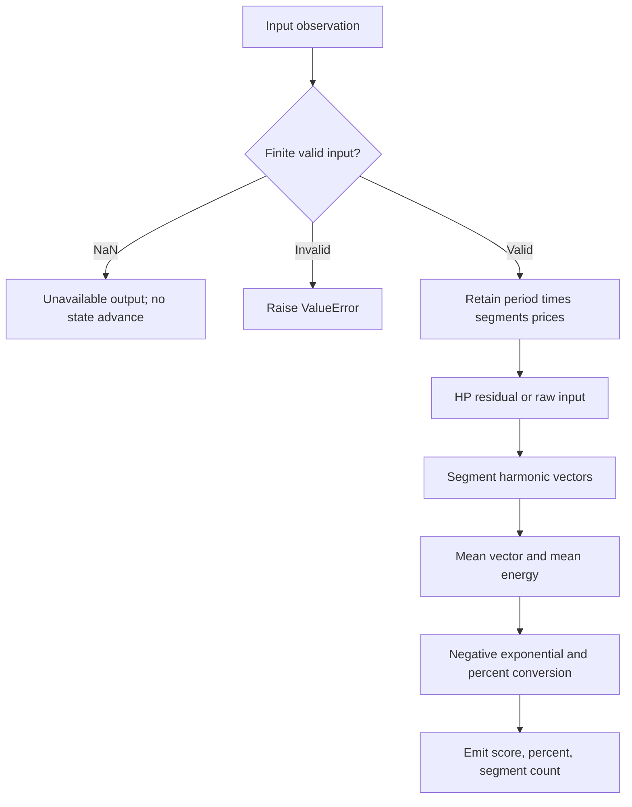

# Bartels Periodicity Score

This folder is the standalone **research prototype master reference implementation** of `BartelsPeriodicityScore`. Its numeric authority is `bartels-periodicity-score.py`; this document contains the theoretical rationale, complete disclosed equations, explicit reconstruction choices, and porting contract. No source book, sibling folder, framework, NumPy, pandas, network service, or third-party package is required to run or port the numerical code.


## Principles and source contract

Part 1 §3.3 and whitepaper Step 3 validate detected periods by consistency
of harmonic amplitude and phase across consecutive cycles. The analogy is
arrows representing each cycle: aligned arrows reinforce, inconsistent
arrows cancel. The supplied `BartelsScore.cpp` gives this **harmonic
periodicity score**, rather than the unrelated Bartels rank test sometimes
found in statistics libraries.

The master preserves its summation definition with full-precision $\pi$.
It restricts periods to integers so the phase clock and complete-segment
boundary agree. It requires at least two segments and gives NaN for absent
evidence or exactly zero harmonic energy. The source returns raw zero for
zero completed segments, which its percentage conversion misleadingly maps
to 100% genuine. That behavior is explicitly repaired here.

## Complete mathematical calculation

For candidate period $P$ and $m$ complete consecutive segments, with oldest
sample first and zero-based absolute within-window index $x$, the source uses

$$\theta_x=\frac{(360/P)(x+1)}{180}\pi.$$

For segment $j$, $x=jP,\ldots,(j+1)P-1$:

$$a_j=\sum_x y_x\sin\theta_x,\qquad b_j=\sum_x y_x\cos\theta_x.$$

$$\bar a=\frac1m\sum_j a_j,\quad\bar b=\frac1m\sum_j b_j,
\quad E=\frac1m\sum_j(a_j^2+b_j^2),$$

$$A=\sqrt{\bar a^2+\bar b^2},\quad A_{\rm rms}=\sqrt E,
\quad a_1=A_{\rm rms}/\sqrt m,\quad r=A/a_1,$$

$$B=\exp(-r^2)=\frac1{\exp(r^2)},\qquad G=100(1-B).$$

The implementation uses the negative exponential to avoid avoidable
overflow in the equivalent reciprocal expression. Lower $B$ and higher
$G$ mean greater harmonic consistency. `$G$ genuine percent` is the book's
display convention, **not a calibrated posterior probability** that a
tradable cycle exists. The whitepaper recommends accepting $G>49$; this
diagnostic emits the score without embedding a trading decision.

By Cauchy–Schwarz, $r^2\le m$. Perfectly aligned equal vectors yield
$B=e^{-m}$ and $G=100(1-e^{-m})$, not exactly 100%. For the recommended five
segments that ceiling is approximately 99.326%. Cancellation produces
$B\approx1$. An exact zero vector sum is valid cancellation when $E>0$;
$E=0$ itself is unavailable evidence. Floating-point cancellation can leave
tiny nonzero energy for a mathematically constant series; no arbitrary
epsilon gate is added to the published numeric definition.

The streaming buffer holds exactly $W=Pm$ prices and publishes only when
all configured segments are present, index $Pm-1$. The batch helper can
score available complete segments (at least its configured minimum), ignoring
an incomplete trailing segment and honoring its maximum count.

The Hodrick–Prescott decomposition writes $x_i=\tau_i+c_i$ and chooses trend
$\tau$ by minimizing the complete disclosed smoothness objective:

$$\min_{\tau_0,\ldots,\tau_{N-1}}
\sum_{i=0}^{N-1}(x_i-\tau_i)^2+
\lambda\sum_{i=0}^{N-3}(\tau_i-2\tau_{i+1}+\tau_{i+2})^2.$$

Let $D$ be the second-difference matrix, whose row is $[1,-2,1]$. Then

$$A\tau=x,\qquad A=I+\lambda D^TD,\qquad c=x-\tau.$$

For $N\ge6$, the diagonal and two upper diagonals of this symmetric
pentadiagonal matrix, indexed from zero, are

$$a_0=a_{N-1}=1+\lambda,\quad a_1=a_{N-2}=1+5\lambda,
\quad a_i=1+6\lambda\ (2\le i\le N-3),$$

$$b_0=b_{N-2}=-2\lambda,\quad b_i=-4\lambda\ (1\le i\le N-3),
\quad b_{N-1}=0,$$

$$c_i=\lambda\ (0\le i\le N-3),\quad c_{N-2}=c_{N-1}=0.$$

Here $c_i$ denotes a matrix diagonal coefficient, not the cyclical residual.
The code follows the supplied forward elimination and backward substitution
in `hp_filter.cpp`, retaining its arithmetic order. For an independent
derivation, a banded $LDL^T$ solve gives the same mathematical solution:

$$\ell_{i,i-2}=c_{i-2}/d_{i-2},$$
$$\ell_{i,i-1}=
\frac{b_{i-1}-\ell_{i,i-2}d_{i-2}\ell_{i-1,i-2}}{d_{i-1}},$$
$$d_i=a_i-\ell_{i,i-1}^{2}d_{i-1}-\ell_{i,i-2}^{2}d_{i-2}.$$

Terms with negative indices are omitted. Solve $Ly=x$, then $Dz=y$, then
$L^T\tau=z$. This supplementary derivation explains why only two preceding
states are required; a port should preserve the **actual master's** forward
loop to reproduce its floating-point results. The objective has a unique
solution for finite $\lambda\ge0$. At $\lambda=0$, $\tau=x$ and the residual
is zero. A constant or linear sequence has zero second differences and is
preserved mathematically, up to numerical roundoff.

The physical analogy is a flexible ruler fitted to observations: the first
term holds it near prices; the second resists changes of slope. Increasing
$\lambda$ makes the ruler harder to bend. This analogy explains smoothing,
not evidence that a financial series contains a real periodic force. The
book and whitepaper explicitly acknowledge that HP filtering can create
apparent cycles and require subsequent validation.


`smoothing=0` uses raw input; positive values score the rolling HP residual.
This preprocessing choice is explicit. The stream does not select its own
period, reuse stale segment sums after changing periods, or rank candidates.

## Input and output contract

`update(price)` accepts one chronological scalar observation. A missing NaN returns unavailable output without advancing state. Infinity, booleans, malformed parameters and input-contract violations raise `ValueError`. Reset preserves configuration and clears every numerical history.

| Output | Meaning and porting representation |
|---|---|
| `score` | Raw Bartels harmonic consistency score, 0…1; lower is more consistent; NaN means unavailable. |
| `genuine_percent` | 100 × (1 − raw Bartels score); harmonic consistency display percentage; NaN means unavailable. |
| `segments` | Configured number of complete tested segments, represented as float for fixtures; NaN means unavailable. |

Named numeric outputs can map to zpano scalar plots; lower/upper map to `Band`, and pivot offsets map to `Levels`/`Polyline`. They intentionally carry numbers rather than colors. The zero-lag EMA returns a scalar float. Output snapshots do not share mutable recursive state with later updates.

All recurrence/state operations use Python binary64 floats and full-precision `math.pi`. Porting requires binary64 equivalents and the documented iteration order. Numerical overflow is rejected; after an arithmetic failure reset before reusing the instance. Parameter/input validation and skipped NaNs themselves do not mutate state. Priming means data availability, not settled IIR transients, statistical significance, or predictive performance.

## Configuration

| Parameter | Shortcut | Default | Valid range | Purpose |
|---|---|---|---|---|
| `period` | `P` | `20` | integer ≥3 | Configured wavelength tested, in accepted bars |
| `segments` | `M` | `5` | integer ≥2 | Complete cycle segments required for streaming score |
| `smoothing` | `L` | `0.0` | finite real ≥0 | HP penalty; zero disables preprocessing in spectral/Bartels wrappers |

Values that are finite but too extreme for resolvable binary64 arithmetic can be rejected during calculation. There is no undocumented automatic retuning; construct another configured instance and replay required history when changing parameters.

## Calculation flow



Startup NaNs and any output-specific readiness gates described above are applied while preserving the documented internal calculations. Rolling analysis recomputes the fixed window and emits only the current snapshot. It never overwrites previously emitted stream observations.

## Reference parameter combinations

The following combinations are generated automatically; the number is below the requested limit of 64. Every numeric output gets one 252-element array per combination in each language.

| Case | Parameters | What it tests |
|---|---|---|
| 1 | `period=20, segments=5, smoothing=0.0` | Default five complete 20-bar segments on raw prices. |
| 2 | `period=3, segments=2, smoothing=0.0` | Minimum integer period and two complete segments. |
| 3 | `period=10, segments=5, smoothing=0.0` | Short candidate with recommended five segments. |
| 4 | `period=20, segments=2, smoothing=0.0` | Fewer full segments produce earlier output. |
| 5 | `period=20, segments=5, smoothing=1600.0` | HP residual used as the diagnostic input. |
| 6 | `period=40, segments=5, smoothing=0.0` | Longer cycle with five complete segments. |
| 7 | `period=42, segments=6, smoothing=0.0` | Exactly 252 bars give the first output at the end. |
| 8 | `period=60, segments=5, smoothing=0.0` | Five 60-bar segments exceed the record. |

## Generating and porting fixtures

From this folder run:

```sh
python3 bartels-periodicity-score.py
python3 bartels-periodicity-score.py --generate-reference-data
```

The first command demonstrates chronological updates for every configuration. The second regenerates all expected fixtures and verifies the saved Python decimals. The example embeds the exact 252 shared `INPUT_CLOSE` values; auxiliary OHLC is read from the copied local `test_testdata.py`. All five input fixture files are preserved, including their matching OHLC arrays.

Python identifiers follow `EXPECTED_<shortcut><value>_..._<OUTPUT>`. Integral-valued floats use their shortest integer spelling, fractional dots become underscores, and a period tuple is encoded in order (for example `P20_40`). Multiple outputs have explicit suffixes. Spectrum suffixes `A20`, `PH20`, and `TO20` mean amplitude, first-window sine phase, and trough offset for the 20-bar bin; `DOM`, `AMP`, and `PHASE` mean the selected candidate fields.

Before each array, the first comment repeats “What it tests” and identifies its output; the next records full parameter names/values. Arrays contain **15 significant decimal digits** and NaNs at each unavailable output position. Calculations are never rounded internally.

| Language | Identifier and shape | Missing value |
|---|---|---|
| Python | `EXPECTED_... = [...]` | `math.nan` |
| Go | `var expected... = []float64{...}` | `math.NaN()` |
| TypeScript | `export const expected...: number[] = [...]` | `NaN` |
| Rust | `pub fn expected_...() -> Vec<f64>` inside copied test module | `f64::NAN` |
| Zig | `pub fn expected...() [252]f64` | `nan` from `std.math.nan(f64)` |

The Go package is the folder name with hyphens/underscores removed. Expected Rust suffixes are lowercase; other language parameter shortcuts remain uppercase. Correct language spellings (`math.NaN()`, `f64::NAN`) are used in place of typographical variants in the request.

The generator first saves Python arrays, reads them back, checks length/field set/decimal precision, and only then copies those saved values into the other languages. Generated blocks are replaceable/idempotent and preserve the input arrays. Ported implementations should compare NaN masks exactly and finite binary64 results with an appropriate absolute/relative tolerance; 15-digit fixtures are rounded decimal references, not promises of cross-platform bit identity.

The parent-folder verification scripts check all saved language values and compile/load the fixtures. Numerical tests additionally use independent DFT sums, HP normal equations, known harmonic vectors, analytic wave superposition, calendar boundaries, and reset/missing-input behavior. These checks validate the specified algorithms; they do not validate the books’ trading-performance claims.

## References and BibTeX

1. Lars von Thienen, *Decoding the Hidden Market Rhythm, Part 1: Dynamic
   Cycles*, 2017. Numerical sections are linked to the supplied chapter/code
   archive: [chapter 3](../../2017-decoding-the-hidden-market-rhythm-1/ch03.md),
   [chapter 4](../../2017-decoding-the-hidden-market-rhythm-1/ch04.md),
   [chapter 6](../../2017-decoding-the-hidden-market-rhythm-1/ch06.md), and
   [downloaded source directory](../../2017-decoding-the-hidden-market-rhythm-1/code/).
2. Lars von Thienen, *Decoding the Hidden Market Rhythm, Part 2: Metonic
   Cycles*, second edition/release 2017, [local complete book](../../2017-decoding-the-hidden-market-rhythm-2/content.md),
   especially §§10.1–10.3, chapter 11, and §§12.3–12.5.2.
3. Lars von Thienen, Foundation for the Study of Cycles,
   [*The Cycle Scanner Algorithm*, whitepaper](../../the-cycle-scanner-algorithm-whitepaper/content.md).
   The local document supplies no publication year; none is invented.
4. Robert J. Hodrick and Edward C. Prescott, “Postwar U.S. Business Cycles:
   An Empirical Investigation,” *Journal of Money, Credit and Banking*,
   29(1), 1997, pp. 1–16. The original working-paper formulation dates to 1980.
5. Gerald Goertzel, “An Algorithm for the Evaluation of Finite Trigonometric
   Series,” *The American Mathematical Monthly*, 65(1), 1958, pp. 34–35.
6. Julius Bartels, “Random fluctuations, persistence, and quasi-persistence
   in geophysical and cosmical periodicities,” *Terrestrial Magnetism and
   Atmospheric Electricity*, 40(1), 1935. Cited by the supplied whitepaper.
7. Charles E. Armstrong, “Applying the Bartels Test of Significance to a Time
   Series Cycle Analysis,” 1973, as cited by the whitepaper. Bibliographic
   detail beyond the supplied citation is not asserted.
8. J. Welles Wilder Jr., *New Concepts in Technical Trading Systems*,
   Trend Research, 1978, for the explicit underlying Wilder RSI convention.
9. The [zpano output types](../../../../external/zpano/py/indicators/core/outputs/)
   and [prepared Ehlers examples](../../../john-ehlers/prepared-for-conversion/)
   inform packaging/output contracts, not replacement numerical algorithms.

The source-specific scripts and C++ extracts are numerical authorities where
named above. HP, GDFT, Bartels, cRSI and CSI extracts carry Lars von Thienen's
2017 [CC BY 4.0](https://creativecommons.org/licenses/by/4.0/) notice: retain
author/book/site attribution and indicate adaptations. The DRO source states
[MPL 2.0](https://www.mozilla.org/en-US/MPL/2.0/); its Python numerical
extraction retains that source notice. Part 2 itself states all rights
reserved; its formulas are described here as the supplied research source,
without claiming that its book inherits the gist license.

```bibtex
@book{vonThienen2017Dynamic,
  author = {von Thienen, Lars},
  title = {Decoding the Hidden Market Rhythm, Part 1: Dynamic Cycles},
  year = {2017},
  url = {https://www.whentotrade.com/},
  note = {Supplied chapter archive and accompanying numerical source extracts}
}
@book{vonThienen2017Metonic,
  author = {von Thienen, Lars},
  title = {Decoding the Hidden Market Rhythm, Part 2: Metonic Cycles},
  year = {2017},
  edition = {2},
  note = {Kindle release 2017; supplied complete local text}
}
@techreport{vonThienenCycleScanner,
  author = {von Thienen, Lars},
  title = {The Cycle Scanner Algorithm},
  institution = {Foundation for the Study of Cycles},
  note = {Supplied whitepaper; publication date not stated}
}
@article{hodrickPrescott1997,
  author = {Hodrick, Robert J. and Prescott, Edward C.},
  title = {Postwar U.S. Business Cycles: An Empirical Investigation},
  journal = {Journal of Money, Credit and Banking},
  year = {1997}, volume = {29}, number = {1}, pages = {1--16}
}
@article{goertzel1958,
  author = {Goertzel, Gerald},
  title = {An Algorithm for the Evaluation of Finite Trigonometric Series},
  journal = {The American Mathematical Monthly},
  year = {1958}, volume = {65}, number = {1}, pages = {34--35}
}
@article{bartels1935,
  author = {Bartels, Julius},
  title = {Random fluctuations, persistence, and quasi-persistence in geophysical and cosmical periodicities},
  journal = {Terrestrial Magnetism and Atmospheric Electricity},
  year = {1935}, volume = {40}, number = {1}
}
@misc{armstrong1973,
  author = {Armstrong, Charles E.},
  title = {Applying the Bartels Test of Significance to a Time Series Cycle Analysis},
  year = {1973},
  note = {Citation as supplied by the Cycle Scanner whitepaper}
}
@book{wilder1978,
  author = {Wilder, J. Welles Jr.},
  title = {New Concepts in Technical Trading Systems},
  publisher = {Trend Research}, year = {1978}
}
@misc{vonThienenNumericalExtracts2017,
  author = {von Thienen, Lars},
  title = {HP Filter, Goertzel, Bartels Score, Cyclic RSI, and Cycle Swing source extracts},
  year = {2017}, url = {https://www.whentotrade.com/},
  note = {Downloaded local code archive; source files carry CC BY 4.0}
}
@misc{vonThienenDRO,
  author = {von Thienen, Lars},
  title = {Detrended Rhythm Oscillator, Pine v5 source},
  note = {Supplied dro.pinesctipt; MPL 2.0; ZigZag helpers credit LonesomeTheBlue}
}
@misc{zpanoOutputContracts,
  title = {zpano Indicator Core Output Types},
  note = {Local external/zpano/py/indicators/core/outputs; structural compatibility reference}
}
@misc{preparedEhlersMasters,
  title = {Prepared Ehlers Streaming Research Prototype Masters},
  note = {Local inputs/john-ehlers/prepared-for-conversion; fixture and packaging examples}
}
```
