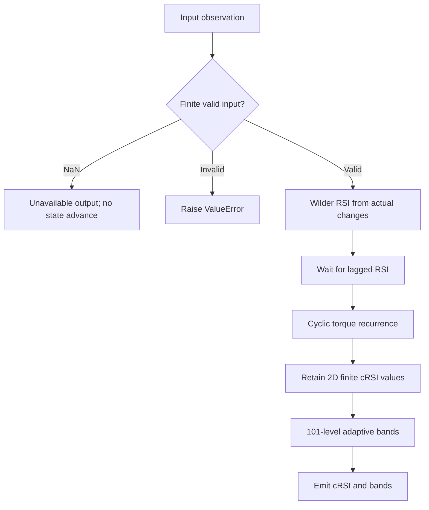

# Cyclic-Smoothed Relative Strength Index

This folder is the standalone **research prototype master reference implementation** of `CyclicSmoothedRSI`. Its numeric authority is `cyclic-smoothed-relative-strength-index.py`; this document contains the theoretical rationale, complete disclosed equations, explicit reconstruction choices, and porting contract. No source book, sibling folder, framework, NumPy, pandas, network service, or third-party package is required to run or port the numerical code.


## Principles and source contract

Part 1 chapter 4 tunes ordinary indicator periods to a full or half harmonic
of the market's measured wavelength. The analogy is tuning a receiver or
oscillator to an observed rhythm instead of always using a default period.
The available Pine script configures the dominant cycle; it does **not**
detect or continuously adjust that cycle itself. Its `vibration` controls
smoothing torque, despite prose describing broader proprietary detection.

This master follows the Pine parameter meaning: dominant period $D$, RSI
length $L=\lfloor D/2\rfloor$, and cyclic memory $M=2D$. NinjaTrader and
MetaTrader instead use `CycleLength` directly as the RSI length; their
initialization and lag rounding also differ. In particular the C# source
uses ceiling for the smoothing lag. These variants must not share fixtures
without translating their parameters and startup conventions.

## Complete mathematical calculation

For accepted closes $x_t$, define actual adjacent-close changes, gains, and losses:

$$\Delta_t=x_t-x_{t-1},\quad u_t=\max(\Delta_t,0),\quad d_t=\max(-\Delta_t,0).$$

There is no change before the first supplied close. For length $L$, seed with
the first $L$ actual changes (requiring $L+1$ closes):

$$U_L=\frac1L\sum_{j=1}^{L}u_j,\qquad D_L=\frac1L\sum_{j=1}^{L}d_j.$$

After that seed, Wilder's running moving averages are

$$U_t=\frac{(L-1)U_{t-1}+u_t}{L},\qquad
D_t=\frac{(L-1)D_{t-1}+d_t}{L}.$$

$$R_t=\begin{cases}
100,&D_t=0,\\
0,&D_t\ne0\ \text{and}\ U_t=0,\\
100-\dfrac{100}{1+U_t/D_t},&\text{otherwise}.
\end{cases}$$

The down-zero branch is evaluated first, following the supplied cRSI Pine
source. A constant-price seed consequently gives RSI 100, rather than the
50 convention used by some libraries. The first $L$ public RSI positions are
NaN. The complete underlying RSI definition is supplied here because Part 2
uses RSI as a named primitive without defining its platform internals.


With vibration $V$, the supplied cyclic smoothing is

$$\gamma=\frac2{V+1},\qquad \ell=\lfloor(V-1)/2\rfloor,$$
$$v_t=\gamma(2R_t-R_{t-\ell})+(1-\gamma)v_{t-1}.$$

Wait for $\ell+1$ finite raw RSI values. The previous cRSI is zero before the
first valid recurrence, following `nz(crsi[1])`; it is not seeded to RSI.
The lag compensation reduces EMA delay by extrapolating RSI movement. It can
overshoot 0 or 100; the master does not clip cRSI back to the raw RSI range.

For the most recent $M$ finite oscillator values $v_j$, compute

$$v_{\min}=\min_jv_j,\quad v_{\max}=\max_jv_j,\quad
\delta=(v_{\max}-v_{\min})/100,\quad q=Q/100.$$

Search the **101 discrete levels** in the stated order. The lower band is
the first $v_{\min}+k\delta$ for which

$$\frac1M\sum_j\mathbf1[v_j<v_{\min}+k\delta]\ge q,\qquad k=0,\ldots,100.$$

The upper band is the first $v_{\max}-k\delta$ for which

$$\frac1M\sum_j\mathbf1[v_j\ge v_{\max}-k\delta]\ge q.$$

The inequalities intentionally differ. This grid method is not an interpolated
quantile, and substituting a statistics-library percentile changes fixtures.
For a constant window both bands equal its sole value. The source lower-band
loop has no successful positive-fraction test in that case; this master uses
the common constant value instead of allowing the initialized sentinel/zero
to escape. It also calculates min and max independently: the source's
`if maximum ... else if minimum ...` can miss the minimum on an increasing
sequence. Those are explicit source repairs. Bands require $M$ actual finite
oscillator outputs; NaN startup is not padded with zero.


The first cRSI is at index $L+\ell$; complete bands are at index
$L+\ell+2D-1$. `value_warmup_bars` and `warmup_bars` expose those distinct
availability boundaries. Default first value is index 14 and first bands
index 53. `is_primed` means all three outputs are available.

Optional fixed 30/70 chart lines, fill colors, manual divergence reading,
and trading examples are presentation/strategy material, not additional
numeric outputs. Port the recurrence and band inequalities exactly.

## Input and output contract

`update(price)` accepts one chronological scalar observation. A missing NaN returns unavailable output without advancing state. Infinity, booleans, malformed parameters and input-contract violations raise `ValueError`. Reset preserves configuration and clears every numerical history.

| Output | Meaning and porting representation |
|---|---|
| `value` | Cyclic-smoothed RSI; dimensionless oscillator; overshoot outside 0…100 is permitted; NaN means unavailable. |
| `lower` | Lower adaptive tail band from the 101-level search; cRSI oscillator units; NaN means unavailable. |
| `upper` | Upper adaptive tail band from the 101-level search; cRSI oscillator units; NaN means unavailable. |

Named numeric outputs can map to zpano scalar plots; lower/upper map to `Band`, and pivot offsets map to `Levels`/`Polyline`. They intentionally carry numbers rather than colors. The zero-lag EMA returns a scalar float. Output snapshots do not share mutable recursive state with later updates.

All recurrence/state operations use Python binary64 floats and full-precision `math.pi`. Porting requires binary64 equivalents and the documented iteration order. Numerical overflow is rejected; after an arithmetic failure reset before reusing the instance. Parameter/input validation and skipped NaNs themselves do not mutate state. Priming means data availability, not settled IIR transients, statistical significance, or predictive performance.

## Configuration

| Parameter | Shortcut | Default | Valid range | Purpose |
|---|---|---|---|---|
| `dominant_cycle` | `D` | `20` | integer ≥10; RSI length floors D/2 | Configured wavelength; not automatically detected |
| `vibration` | `V` | `10` | integer ≥2; lag floors (V−1)/2 | cRSI torque and lag |
| `leveling` | `Q` | `10.0` | finite real strictly between 0 and 50 | Tail fraction in percent for 101-level bands |

Values that are finite but too extreme for resolvable binary64 arithmetic can be rejected during calculation. There is no undocumented automatic retuning; construct another configured instance and replay required history when changing parameters.

## Calculation flow



Startup NaNs and any output-specific readiness gates described above are applied while preserving the documented internal calculations. Rolling analysis recomputes the fixed window and emits only the current snapshot. It never overwrites previously emitted stream observations.

## Reference parameter combinations

The following combinations are generated automatically; the number is below the requested limit of 64. Every numeric output gets one 252-element array per combination in each language.

| Case | Parameters | What it tests |
|---|---|---|
| 1 | `dominant_cycle=20, vibration=10, leveling=10.0` | Pine default dominant cycle and full adaptive band memory. |
| 2 | `dominant_cycle=10, vibration=10, leveling=10.0` | Minimum dominant period and earliest band readiness. |
| 3 | `dominant_cycle=21, vibration=10, leveling=10.0` | Odd dominant period explicitly floors the RSI length. |
| 4 | `dominant_cycle=40, vibration=10, leveling=10.0` | Longer cycle with greater band history. |
| 5 | `dominant_cycle=100, vibration=10, leveling=10.0` | Very long memory remains unprimed for bands on 252 closes. |
| 6 | `dominant_cycle=20, vibration=3, leveling=10.0` | Short vibration changes torque and integer lag. |
| 7 | `dominant_cycle=20, vibration=6, leveling=10.0` | Even vibration explicitly uses floor for half-bar lag. |
| 8 | `dominant_cycle=20, vibration=10, leveling=5.0` | Wider tail bands use five-percent leveling. |
| 9 | `dominant_cycle=20, vibration=10, leveling=20.0` | Inner tail bands use twenty-percent leveling. |

## Generating and porting fixtures

From this folder run:

```sh
python3 cyclic-smoothed-relative-strength-index.py
python3 cyclic-smoothed-relative-strength-index.py --generate-reference-data
```

The first command demonstrates chronological updates for every configuration. The second regenerates all expected fixtures and verifies the saved Python decimals. The example embeds the exact 252 shared `INPUT_CLOSE` values; auxiliary OHLC is read from the copied local `test_testdata.py`. All five input fixture files are preserved, including their matching OHLC arrays.

Python identifiers follow `EXPECTED_<shortcut><value>_..._<OUTPUT>`. Integral-valued floats use their shortest integer spelling, fractional dots become underscores, and a period tuple is encoded in order (for example `P20_40`). Multiple outputs have explicit suffixes. Spectrum suffixes `A20`, `PH20`, and `TO20` mean amplitude, first-window sine phase, and trough offset for the 20-bar bin; `DOM`, `AMP`, and `PHASE` mean the selected candidate fields.

Before each array, the first comment repeats “What it tests” and identifies its output; the next records full parameter names/values. Arrays contain **15 significant decimal digits** and NaNs at each unavailable output position. Calculations are never rounded internally.

| Language | Identifier and shape | Missing value |
|---|---|---|
| Python | `EXPECTED_... = [...]` | `math.nan` |
| Go | `var expected... = []float64{...}` | `math.NaN()` |
| TypeScript | `export const expected...: number[] = [...]` | `NaN` |
| Rust | `pub fn expected_...() -> Vec<f64>` inside copied test module | `f64::NAN` |
| Zig | `pub fn expected...() [252]f64` | `nan` from `std.math.nan(f64)` |

The Go package is the folder name with hyphens/underscores removed. Expected Rust suffixes are lowercase; other language parameter shortcuts remain uppercase. Correct language spellings (`math.NaN()`, `f64::NAN`) are used in place of typographical variants in the request.

The generator first saves Python arrays, reads them back, checks length/field set/decimal precision, and only then copies those saved values into the other languages. Generated blocks are replaceable/idempotent and preserve the input arrays. Ported implementations should compare NaN masks exactly and finite binary64 results with an appropriate absolute/relative tolerance; 15-digit fixtures are rounded decimal references, not promises of cross-platform bit identity.

The parent-folder verification scripts check all saved language values and compile/load the fixtures. Numerical tests additionally use independent DFT sums, HP normal equations, known harmonic vectors, analytic wave superposition, calendar boundaries, and reset/missing-input behavior. These checks validate the specified algorithms; they do not validate the books’ trading-performance claims.

## References and BibTeX

1. Lars von Thienen, *Decoding the Hidden Market Rhythm, Part 1: Dynamic
   Cycles*, 2017. Numerical sections are linked to the supplied chapter/code
   archive: [chapter 3](../../2017-decoding-the-hidden-market-rhythm-1/ch03.md),
   [chapter 4](../../2017-decoding-the-hidden-market-rhythm-1/ch04.md),
   [chapter 6](../../2017-decoding-the-hidden-market-rhythm-1/ch06.md), and
   [downloaded source directory](../../2017-decoding-the-hidden-market-rhythm-1/code/).
2. Lars von Thienen, *Decoding the Hidden Market Rhythm, Part 2: Metonic
   Cycles*, second edition/release 2017, [local complete book](../../2017-decoding-the-hidden-market-rhythm-2/content.md),
   especially §§10.1–10.3, chapter 11, and §§12.3–12.5.2.
3. Lars von Thienen, Foundation for the Study of Cycles,
   [*The Cycle Scanner Algorithm*, whitepaper](../../the-cycle-scanner-algorithm-whitepaper/content.md).
   The local document supplies no publication year; none is invented.
4. Robert J. Hodrick and Edward C. Prescott, “Postwar U.S. Business Cycles:
   An Empirical Investigation,” *Journal of Money, Credit and Banking*,
   29(1), 1997, pp. 1–16. The original working-paper formulation dates to 1980.
5. Gerald Goertzel, “An Algorithm for the Evaluation of Finite Trigonometric
   Series,” *The American Mathematical Monthly*, 65(1), 1958, pp. 34–35.
6. Julius Bartels, “Random fluctuations, persistence, and quasi-persistence
   in geophysical and cosmical periodicities,” *Terrestrial Magnetism and
   Atmospheric Electricity*, 40(1), 1935. Cited by the supplied whitepaper.
7. Charles E. Armstrong, “Applying the Bartels Test of Significance to a Time
   Series Cycle Analysis,” 1973, as cited by the whitepaper. Bibliographic
   detail beyond the supplied citation is not asserted.
8. J. Welles Wilder Jr., *New Concepts in Technical Trading Systems*,
   Trend Research, 1978, for the explicit underlying Wilder RSI convention.
9. The [zpano output types](../../../../external/zpano/py/indicators/core/outputs/)
   and [prepared Ehlers examples](../../../john-ehlers/prepared-for-conversion/)
   inform packaging/output contracts, not replacement numerical algorithms.

The source-specific scripts and C++ extracts are numerical authorities where
named above. HP, GDFT, Bartels, cRSI and CSI extracts carry Lars von Thienen's
2017 [CC BY 4.0](https://creativecommons.org/licenses/by/4.0/) notice: retain
author/book/site attribution and indicate adaptations. The DRO source states
[MPL 2.0](https://www.mozilla.org/en-US/MPL/2.0/); its Python numerical
extraction retains that source notice. Part 2 itself states all rights
reserved; its formulas are described here as the supplied research source,
without claiming that its book inherits the gist license.

```bibtex
@book{vonThienen2017Dynamic,
  author = {von Thienen, Lars},
  title = {Decoding the Hidden Market Rhythm, Part 1: Dynamic Cycles},
  year = {2017},
  url = {https://www.whentotrade.com/},
  note = {Supplied chapter archive and accompanying numerical source extracts}
}
@book{vonThienen2017Metonic,
  author = {von Thienen, Lars},
  title = {Decoding the Hidden Market Rhythm, Part 2: Metonic Cycles},
  year = {2017},
  edition = {2},
  note = {Kindle release 2017; supplied complete local text}
}
@techreport{vonThienenCycleScanner,
  author = {von Thienen, Lars},
  title = {The Cycle Scanner Algorithm},
  institution = {Foundation for the Study of Cycles},
  note = {Supplied whitepaper; publication date not stated}
}
@article{hodrickPrescott1997,
  author = {Hodrick, Robert J. and Prescott, Edward C.},
  title = {Postwar U.S. Business Cycles: An Empirical Investigation},
  journal = {Journal of Money, Credit and Banking},
  year = {1997}, volume = {29}, number = {1}, pages = {1--16}
}
@article{goertzel1958,
  author = {Goertzel, Gerald},
  title = {An Algorithm for the Evaluation of Finite Trigonometric Series},
  journal = {The American Mathematical Monthly},
  year = {1958}, volume = {65}, number = {1}, pages = {34--35}
}
@article{bartels1935,
  author = {Bartels, Julius},
  title = {Random fluctuations, persistence, and quasi-persistence in geophysical and cosmical periodicities},
  journal = {Terrestrial Magnetism and Atmospheric Electricity},
  year = {1935}, volume = {40}, number = {1}
}
@misc{armstrong1973,
  author = {Armstrong, Charles E.},
  title = {Applying the Bartels Test of Significance to a Time Series Cycle Analysis},
  year = {1973},
  note = {Citation as supplied by the Cycle Scanner whitepaper}
}
@book{wilder1978,
  author = {Wilder, J. Welles Jr.},
  title = {New Concepts in Technical Trading Systems},
  publisher = {Trend Research}, year = {1978}
}
@misc{vonThienenNumericalExtracts2017,
  author = {von Thienen, Lars},
  title = {HP Filter, Goertzel, Bartels Score, Cyclic RSI, and Cycle Swing source extracts},
  year = {2017}, url = {https://www.whentotrade.com/},
  note = {Downloaded local code archive; source files carry CC BY 4.0}
}
@misc{vonThienenDRO,
  author = {von Thienen, Lars},
  title = {Detrended Rhythm Oscillator, Pine v5 source},
  note = {Supplied dro.pinesctipt; MPL 2.0; ZigZag helpers credit LonesomeTheBlue}
}
@misc{zpanoOutputContracts,
  title = {zpano Indicator Core Output Types},
  note = {Local external/zpano/py/indicators/core/outputs; structural compatibility reference}
}
@misc{preparedEhlersMasters,
  title = {Prepared Ehlers Streaming Research Prototype Masters},
  note = {Local inputs/john-ehlers/prepared-for-conversion; fixture and packaging examples}
}
```
