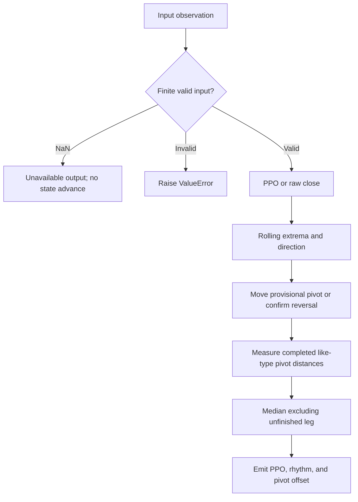

# Detrended Rhythm Oscillator

This folder is the standalone **research prototype master reference implementation** of `DetrendedRhythmOscillator`. Its numeric authority is `detrended-rhythm-oscillators.py`; this document contains the theoretical rationale, complete disclosed equations, explicit reconstruction choices, and porting contract. No source book, sibling folder, framework, NumPy, pandas, network service, or third-party package is required to run or port the numerical code.


## Principles and source contract

The source uses detrending to suppress a slow baseline, then measures
distances between alternating turning points. Its analogy is timing
successive heartbeats or strides: the useful output is the rhythm's duration,
not merely its height. A median resists a few unusually long/short intervals.

`dro.pinesctipt` is the provided filename (including its typo). Its comments
and DPO display label are misleading: executable detrending is a
**percentage price oscillator (PPO)** using two EMAs. No classical centered
or shifted Detrended Price Oscillator is substituted. This master separates
numeric state from chart lines and labels. In the source, disabling distance
labels stops populating the distance array; that presentation dependency is
removed. Numeric zero extrema are recognized instead of being discarded
by Pine's boolean conversion. These repairs are disclosed adaptations.

## Complete mathematical calculation

For each EMA of length $L$, $\alpha_L=2/(L+1)$,
$E_{L,0}=x_0$, and

$$E_{L,t}=\alpha_L x_t+(1-\alpha_L)E_{L,t-1}.$$

The detrended input is

$$p_t=100\frac{E_{F,t}-E_{S,t}}{E_{S,t}},\qquad F=3,\ S=50.$$

With `detrend=False`, use $p_t=x_t$. At a zero slow EMA PPO is undefined:
emit NaN, do not add that value to the extrema window, and retain the raw
accepted-price index for pivot distances. This differs from a missing input,
which is skipped entirely. Positive ordinary market prices avoid this case.

Over the last $Z$ finite PPO values, mark

$$H_t=\mathbf1[p_t=\max p],\qquad L_t=\mathbf1[p_t=\min p].$$

Newest extrema win ties. Set direction to +1 if $H_t$ alone is true, −1 if
$L_t$ alone is true, and retain the preceding direction if both/neither are
true. A constant window therefore has no fabricated reversal. On direction
change prepend a new `(value,index)` pivot. While direction stays unchanged,
move the current pivot only for a strictly more extreme value.

Write pivots newest first as $(a_j,i_j)$. Pivot 0 is **provisional**;
pivots 1 onward are confirmed by a later opposite direction. Completed
like-type pivot distances are

$$C_j=i_j-i_{j+2},\qquad j=1,\ldots,K-3.$$

They equal sums of two neighboring completed half-cycle legs. Require at
least five pivots, then take the ordinary median of the retained distances:

$$\widehat P_t=\operatorname{median}(C_1,C_2,\ldots).$$

Retain at most `cycle_memory + 3` pivots, giving at most `cycle_memory`
full-cycle measurements. This is a direct numeric formulation of the
source's completed-leg intent; its chart-array mutation and initialization
are not claimed to match bit for bit. Confirmed pivot indices never move.
The provisional pivot value/offset may change on subsequent observations.

Internally the first-price-seeded EMA and ZigZag operate immediately, but
public PPO/direction/pivot values wait for $S$ accepted prices when detrending
is on (`warmup_bars=S-1`). With detrending off they are available immediately.
Cycle length additionally requires sufficient reversals and has no finite
universal warmup bound: a monotone input may never produce a completed cycle.
The reported pivot offset is $i_0-t\le0$ in accepted bars; it is suitable for
conversion to zpano level/polyline offset fields without rewriting old output.

## Input and output contract

`update(price)` accepts one chronological scalar observation. A missing NaN returns unavailable output without advancing state. Infinity, booleans, malformed parameters and input-contract violations raise `ValueError`. Reset preserves configuration and clears every numerical history.

| Output | Meaning and porting representation |
|---|---|
| `value` | PPO percent when detrending is enabled; otherwise raw price; NaN means unavailable. |
| `direction` | Current ZigZag direction: −1 down, 0 not established, +1 up; NaN means unavailable. |
| `cycle_length` | Median completed like-type pivot distance; accepted bars; can stay NaN indefinitely; NaN means unavailable. |
| `pivot_value` | Current provisional pivot; PPO percent or raw price according to detrend switch; NaN means unavailable. |
| `pivot_offset` | Provisional pivot index minus current index; signed nonpositive accepted bars; NaN means unavailable. |

Named numeric outputs can map to zpano scalar plots; lower/upper map to `Band`, and pivot offsets map to `Levels`/`Polyline`. They intentionally carry numbers rather than colors. The zero-lag EMA returns a scalar float. Output snapshots do not share mutable recursive state with later updates.

All recurrence/state operations use Python binary64 floats and full-precision `math.pi`. Porting requires binary64 equivalents and the documented iteration order. Numerical overflow is rejected; after an arithmetic failure reset before reusing the instance. Parameter/input validation and skipped NaNs themselves do not mutate state. Priming means data availability, not settled IIR transients, statistical significance, or predictive performance.

## Configuration

| Parameter | Shortcut | Default | Valid range | Purpose |
|---|---|---|---|---|
| `fast_length` | `F` | `3` | integer ≥1; less than slow_length | Fast EMA length |
| `slow_length` | `S` | `50` | integer ≥2; greater than fast_length | Slow EMA length and public startup gate |
| `zig_period` | `Z` | `30` | integer ≥5 | Finite detrended outputs in extrema window |
| `cycle_memory` | `M` | `15` | integer ≥3 | Maximum completed full-cycle measurements retained |
| `detrend` | `D` | `True` | bool | PPO preprocessing on/off |

Values that are finite but too extreme for resolvable binary64 arithmetic can be rejected during calculation. There is no undocumented automatic retuning; construct another configured instance and replay required history when changing parameters.

## Calculation flow



Startup NaNs and any output-specific readiness gates described above are applied while preserving the documented internal calculations. Rolling analysis recomputes the fixed window and emits only the current snapshot. It never overwrites previously emitted stream observations.

## Reference parameter combinations

The following combinations are generated automatically; the number is below the requested limit of 64. Every numeric output gets one 252-element array per combination in each language.

| Case | Parameters | What it tests |
|---|---|---|
| 1 | `fast_length=3, slow_length=50, zig_period=30, cycle_memory=15, detrend=True` | Published PPO lengths and 30-bar ZigZag extrema. |
| 2 | `fast_length=3, slow_length=50, zig_period=5, cycle_memory=15, detrend=True` | Short extrema window detects more completed rhythms. |
| 3 | `fast_length=3, slow_length=50, zig_period=10, cycle_memory=15, detrend=True` | Intermediate extrema window. |
| 4 | `fast_length=2, slow_length=20, zig_period=10, cycle_memory=15, detrend=True` | Faster PPO detrending. |
| 5 | `fast_length=5, slow_length=100, zig_period=30, cycle_memory=15, detrend=True` | Longer PPO trend memory. |
| 6 | `fast_length=3, slow_length=50, zig_period=5, cycle_memory=3, detrend=True` | Short completed-cycle median memory. |
| 7 | `fast_length=3, slow_length=50, zig_period=10, cycle_memory=15, detrend=False` | Source switch off: ZigZag uses raw close prices. |
| 8 | `fast_length=3, slow_length=300, zig_period=30, cycle_memory=15, detrend=True` | Slow EMA initialization exceeds the 252-sample record. |

## Generating and porting fixtures

From this folder run:

```sh
python3 detrended-rhythm-oscillators.py
python3 detrended-rhythm-oscillators.py --generate-reference-data
```

The first command demonstrates chronological updates for every configuration. The second regenerates all expected fixtures and verifies the saved Python decimals. The example embeds the exact 252 shared `INPUT_CLOSE` values; auxiliary OHLC is read from the copied local `test_testdata.py`. All five input fixture files are preserved, including their matching OHLC arrays.

Python identifiers follow `EXPECTED_<shortcut><value>_..._<OUTPUT>`. Integral-valued floats use their shortest integer spelling, fractional dots become underscores, and a period tuple is encoded in order (for example `P20_40`). Multiple outputs have explicit suffixes. Spectrum suffixes `A20`, `PH20`, and `TO20` mean amplitude, first-window sine phase, and trough offset for the 20-bar bin; `DOM`, `AMP`, and `PHASE` mean the selected candidate fields.

Before each array, the first comment repeats “What it tests” and identifies its output; the next records full parameter names/values. Arrays contain **15 significant decimal digits** and NaNs at each unavailable output position. Calculations are never rounded internally.

| Language | Identifier and shape | Missing value |
|---|---|---|
| Python | `EXPECTED_... = [...]` | `math.nan` |
| Go | `var expected... = []float64{...}` | `math.NaN()` |
| TypeScript | `export const expected...: number[] = [...]` | `NaN` |
| Rust | `pub fn expected_...() -> Vec<f64>` inside copied test module | `f64::NAN` |
| Zig | `pub fn expected...() [252]f64` | `nan` from `std.math.nan(f64)` |

The Go package is the folder name with hyphens/underscores removed. Expected Rust suffixes are lowercase; other language parameter shortcuts remain uppercase. Correct language spellings (`math.NaN()`, `f64::NAN`) are used in place of typographical variants in the request.

The generator first saves Python arrays, reads them back, checks length/field set/decimal precision, and only then copies those saved values into the other languages. Generated blocks are replaceable/idempotent and preserve the input arrays. Ported implementations should compare NaN masks exactly and finite binary64 results with an appropriate absolute/relative tolerance; 15-digit fixtures are rounded decimal references, not promises of cross-platform bit identity.

The parent-folder verification scripts check all saved language values and compile/load the fixtures. Numerical tests additionally use independent DFT sums, HP normal equations, known harmonic vectors, analytic wave superposition, calendar boundaries, and reset/missing-input behavior. These checks validate the specified algorithms; they do not validate the books’ trading-performance claims.

## References and BibTeX

1. Lars von Thienen, *Decoding the Hidden Market Rhythm, Part 1: Dynamic
   Cycles*, 2017. Numerical sections are linked to the supplied chapter/code
   archive: [chapter 3](../../2017-decoding-the-hidden-market-rhythm-1/ch03.md),
   [chapter 4](../../2017-decoding-the-hidden-market-rhythm-1/ch04.md),
   [chapter 6](../../2017-decoding-the-hidden-market-rhythm-1/ch06.md), and
   [downloaded source directory](../../2017-decoding-the-hidden-market-rhythm-1/code/).
2. Lars von Thienen, *Decoding the Hidden Market Rhythm, Part 2: Metonic
   Cycles*, second edition/release 2017, [local complete book](../../2017-decoding-the-hidden-market-rhythm-2/content.md),
   especially §§10.1–10.3, chapter 11, and §§12.3–12.5.2.
3. Lars von Thienen, Foundation for the Study of Cycles,
   [*The Cycle Scanner Algorithm*, whitepaper](../../the-cycle-scanner-algorithm-whitepaper/content.md).
   The local document supplies no publication year; none is invented.
4. Robert J. Hodrick and Edward C. Prescott, “Postwar U.S. Business Cycles:
   An Empirical Investigation,” *Journal of Money, Credit and Banking*,
   29(1), 1997, pp. 1–16. The original working-paper formulation dates to 1980.
5. Gerald Goertzel, “An Algorithm for the Evaluation of Finite Trigonometric
   Series,” *The American Mathematical Monthly*, 65(1), 1958, pp. 34–35.
6. Julius Bartels, “Random fluctuations, persistence, and quasi-persistence
   in geophysical and cosmical periodicities,” *Terrestrial Magnetism and
   Atmospheric Electricity*, 40(1), 1935. Cited by the supplied whitepaper.
7. Charles E. Armstrong, “Applying the Bartels Test of Significance to a Time
   Series Cycle Analysis,” 1973, as cited by the whitepaper. Bibliographic
   detail beyond the supplied citation is not asserted.
8. J. Welles Wilder Jr., *New Concepts in Technical Trading Systems*,
   Trend Research, 1978, for the explicit underlying Wilder RSI convention.
9. The [zpano output types](../../../../external/zpano/py/indicators/core/outputs/)
   and [prepared Ehlers examples](../../../john-ehlers/prepared-for-conversion/)
   inform packaging/output contracts, not replacement numerical algorithms.

The source-specific scripts and C++ extracts are numerical authorities where
named above. HP, GDFT, Bartels, cRSI and CSI extracts carry Lars von Thienen's
2017 [CC BY 4.0](https://creativecommons.org/licenses/by/4.0/) notice: retain
author/book/site attribution and indicate adaptations. The DRO source states
[MPL 2.0](https://www.mozilla.org/en-US/MPL/2.0/); its Python numerical
extraction retains that source notice. Part 2 itself states all rights
reserved; its formulas are described here as the supplied research source,
without claiming that its book inherits the gist license.

```bibtex
@book{vonThienen2017Dynamic,
  author = {von Thienen, Lars},
  title = {Decoding the Hidden Market Rhythm, Part 1: Dynamic Cycles},
  year = {2017},
  url = {https://www.whentotrade.com/},
  note = {Supplied chapter archive and accompanying numerical source extracts}
}
@book{vonThienen2017Metonic,
  author = {von Thienen, Lars},
  title = {Decoding the Hidden Market Rhythm, Part 2: Metonic Cycles},
  year = {2017},
  edition = {2},
  note = {Kindle release 2017; supplied complete local text}
}
@techreport{vonThienenCycleScanner,
  author = {von Thienen, Lars},
  title = {The Cycle Scanner Algorithm},
  institution = {Foundation for the Study of Cycles},
  note = {Supplied whitepaper; publication date not stated}
}
@article{hodrickPrescott1997,
  author = {Hodrick, Robert J. and Prescott, Edward C.},
  title = {Postwar U.S. Business Cycles: An Empirical Investigation},
  journal = {Journal of Money, Credit and Banking},
  year = {1997}, volume = {29}, number = {1}, pages = {1--16}
}
@article{goertzel1958,
  author = {Goertzel, Gerald},
  title = {An Algorithm for the Evaluation of Finite Trigonometric Series},
  journal = {The American Mathematical Monthly},
  year = {1958}, volume = {65}, number = {1}, pages = {34--35}
}
@article{bartels1935,
  author = {Bartels, Julius},
  title = {Random fluctuations, persistence, and quasi-persistence in geophysical and cosmical periodicities},
  journal = {Terrestrial Magnetism and Atmospheric Electricity},
  year = {1935}, volume = {40}, number = {1}
}
@misc{armstrong1973,
  author = {Armstrong, Charles E.},
  title = {Applying the Bartels Test of Significance to a Time Series Cycle Analysis},
  year = {1973},
  note = {Citation as supplied by the Cycle Scanner whitepaper}
}
@book{wilder1978,
  author = {Wilder, J. Welles Jr.},
  title = {New Concepts in Technical Trading Systems},
  publisher = {Trend Research}, year = {1978}
}
@misc{vonThienenNumericalExtracts2017,
  author = {von Thienen, Lars},
  title = {HP Filter, Goertzel, Bartels Score, Cyclic RSI, and Cycle Swing source extracts},
  year = {2017}, url = {https://www.whentotrade.com/},
  note = {Downloaded local code archive; source files carry CC BY 4.0}
}
@misc{vonThienenDRO,
  author = {von Thienen, Lars},
  title = {Detrended Rhythm Oscillator, Pine v5 source},
  note = {Supplied dro.pinesctipt; MPL 2.0; ZigZag helpers credit LonesomeTheBlue}
}
@misc{zpanoOutputContracts,
  title = {zpano Indicator Core Output Types},
  note = {Local external/zpano/py/indicators/core/outputs; structural compatibility reference}
}
@misc{preparedEhlersMasters,
  title = {Prepared Ehlers Streaming Research Prototype Masters},
  note = {Local inputs/john-ehlers/prepared-for-conversion; fixture and packaging examples}
}
```
