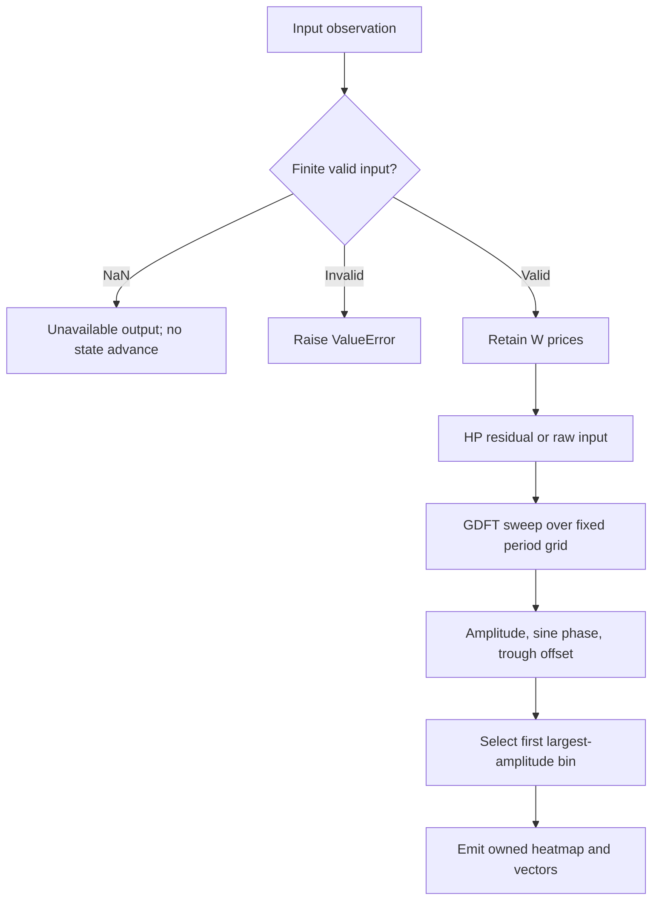

# Goertzel Cycle Spectrum

This folder is the standalone **research prototype master reference implementation** of `GoertzelCycleSpectrum`. Its numeric authority is `goertzel-cycle-spectrum.py`; this document contains the theoretical rationale, complete disclosed equations, explicit reconstruction choices, and porting contract. No source book, sibling folder, framework, NumPy, pandas, network service, or third-party package is required to run or port the numerical code.


## Principles and source contract

Part 1 §3.2 and whitepaper Step 2 identify the supplied single-frequency
GDFT as the numerical component for testing candidate wavelengths. This
master sweeps a **configured fixed grid** and emits an amplitude heatmap,
phase/offset vectors, and the largest-amplitude candidate. It performs no
undisclosed local-peak suppression, dynamic penalty adjustment, Bartels
filtering, or separate recent-window phase refinement.

## Complete mathematical calculation

The Hodrick–Prescott decomposition writes $x_i=\tau_i+c_i$ and chooses trend
$\tau$ by minimizing the complete disclosed smoothness objective:

$$\min_{\tau_0,\ldots,\tau_{N-1}}
\sum_{i=0}^{N-1}(x_i-\tau_i)^2+
\lambda\sum_{i=0}^{N-3}(\tau_i-2\tau_{i+1}+\tau_{i+2})^2.$$

Let $D$ be the second-difference matrix, whose row is $[1,-2,1]$. Then

$$A\tau=x,\qquad A=I+\lambda D^TD,\qquad c=x-\tau.$$

For $N\ge6$, the diagonal and two upper diagonals of this symmetric
pentadiagonal matrix, indexed from zero, are

$$a_0=a_{N-1}=1+\lambda,\quad a_1=a_{N-2}=1+5\lambda,
\quad a_i=1+6\lambda\ (2\le i\le N-3),$$

$$b_0=b_{N-2}=-2\lambda,\quad b_i=-4\lambda\ (1\le i\le N-3),
\quad b_{N-1}=0,$$

$$c_i=\lambda\ (0\le i\le N-3),\quad c_{N-2}=c_{N-1}=0.$$

Here $c_i$ denotes a matrix diagonal coefficient, not the cyclical residual.
The code follows the supplied forward elimination and backward substitution
in `hp_filter.cpp`, retaining its arithmetic order. For an independent
derivation, a banded $LDL^T$ solve gives the same mathematical solution:

$$\ell_{i,i-2}=c_{i-2}/d_{i-2},$$
$$\ell_{i,i-1}=
\frac{b_{i-1}-\ell_{i,i-2}d_{i-2}\ell_{i-1,i-2}}{d_{i-1}},$$
$$d_i=a_i-\ell_{i,i-1}^{2}d_{i-1}-\ell_{i,i-2}^{2}d_{i-2}.$$

Terms with negative indices are omitted. Solve $Ly=x$, then $Dz=y$, then
$L^T\tau=z$. This supplementary derivation explains why only two preceding
states are required; a port should preserve the **actual master's** forward
loop to reproduce its floating-point results. The objective has a unique
solution for finite $\lambda\ge0$. At $\lambda=0$, $\tau=x$ and the residual
is zero. A constant or linear sequence has zero second differences and is
preserved mathematically, up to numerical roundoff.

The physical analogy is a flexible ruler fitted to observations: the first
term holds it near prices; the second resists changes of slope. Increasing
$\lambda$ makes the ruler harder to bend. This analogy explains smoothing,
not evidence that a financial series contains a real periodic force. The
book and whitepaper explicitly acknowledge that HP filtering can create
apparent cycles and require subsequent validation.


For spectral preprocessing, `smoothing > 0` uses the full window HP residual
$y=x-\tau$. **`smoothing=0` disables preprocessing and uses raw prices**;
it is not the identically zero residual of an HP solve at zero penalty.
The full batch trend is recomputed inside the current rolling window;
this uses only already accepted prices and is causal at the current endpoint.

For configured wavelength $P>2$ and an oldest-first $N$-sample window $y_j$,
define $\omega=2\pi/P$, $s=\sin\omega$, $c=\cos\omega$, and $b=2c$.
Reset the two delay states before **each window and each candidate period**:

$$q_{-2}=q_{-1}=0,\qquad q_j=bq_{j-1}-q_{j-2}+y_j.$$

After the last sample, let $Q_1=q_{N-1}$ and $Q_2=q_{N-2}$. The supplied
source computes the final complex value and explicitly rotates its reference:

$$r_1=Q_1-Q_2\cos\omega,\quad i_1=Q_2\sin\omega,$$

$$C=\cos((N-1)\omega),\quad S=\sin((N-1)\omega),$$

$$R=r_1C+i_1S,\qquad I=i_1C-r_1S.$$

These equal the real and imaginary parts of the negative-exponent transform

$$X(\omega)=\sum_{j=0}^{N-1}y_j e^{-i\omega j}.$$

The published amplitude, **sine** phase, and trough offset are

$$A_P=\frac{2\sqrt{R^2+I^2}}N,\qquad
\phi_P=\frac\pi2+\operatorname{atan2}(I,R),$$

$$o_P=P\left(\frac34-\frac{\phi_P}{2\pi}\right).$$

The returned phase references the **first sample of the window**. It is not
an end-of-window phase or the proprietary scanner's separately fitted recent
phase. It remains in the source's unwrapped interval $[-\pi/2,3\pi/2]$.
The modeled wave and slope at offset $u$ are

$$w_P(u)=A_P\sin(2\pi u/P+\phi_P),$$
$$w'_P(u)=A_P(2\pi/P)\cos(2\pi u/P+\phi_P).$$

Use $u=N-1$ for the current observation and $u=N-1+h$ for an $h$-bar
projection. The source's $o_P$ is an unwrapped offset from the window start;
the next trough's distance from the current endpoint is

$$\operatorname{ETA}_{\min}=(o_P-(N-1))\bmod P.$$

Amplitude zero has no meaningful phase. This master returns amplitude zero
and phase/offset NaN in the exact zero-vector case, instead of manufacturing
a phase from `atan2(0,0)`. A zero-amplitude modeled wave still evaluates to
zero. No epsilon-based energy gate, taper/window weighting, mean subtraction,
least-squares amplitude correction, or spectral normalization is added.

The physical analogy is a receiver measuring a chosen tone in a short noisy
record, historically used for telephone signaling. It does not require the
frequency to occupy an integer FFT bin. Rectangular-window leakage still
occurs: non-integer cycles, trends, and nearby components affect amplitude
and phase. The $2/N$ amplitude is exact for isolated, coherently sampled
sinusoids away from DC and Nyquist; it is not generally an exact regression
coefficient for arbitrary fractional periods.


The integer period grid is

$$\mathcal P=\{P_{\min},P_{\min}+s,\ldots,P_{\max}\},$$

requiring the positive integer step to land on $P_{\max}$. Select

$$P_* = \operatorname*{arg\,max}_{P\in\mathcal P} A_P,$$

with the first (shortest) period winning an exact tie. If every amplitude is
zero, dominant period and phase are NaN. The heatmap contains absolute
amplitude in price units, not dB, power, color, or normalized probability.
Each returned list belongs to that output snapshot. `time` is optional plot
metadata and does not change the equally spaced accepted-bar calculation.

All outputs wait for $W$ prices. Periods longer than $W$ are allowed for
research but poorly resolved; no correctness or predictability is inferred
from an available number. Work is $O(WK)$ for $K$ periods, plus $O(W)$ HP;
storage is bounded by window and grid sizes. Fixtures serialize every bin's
amplitude, phase, and trough offset as separate 252-element arrays.

## Input and output contract

`update(price, time=None)` accepts one equally spaced scalar observation; time is plot metadata. A missing NaN returns unavailable output without advancing state. Infinity, booleans, malformed parameters and input-contract violations raise `ValueError`. Reset preserves configuration and clears every numerical history.

The named tuple returns an owned zpano-compatible `Heatmap` (time, parameter grid, min/max, values), corresponding phase/trough-offset tuples, and dominant period/amplitude/phase. Empty startup uses an empty heatmap and vectors plus NaN scalar outputs.

All recurrence/state operations use Python binary64 floats and full-precision `math.pi`. Porting requires binary64 equivalents and the documented iteration order. Numerical overflow is rejected; after an arithmetic failure reset before reusing the instance. Parameter/input validation and skipped NaNs themselves do not mutate state. Priming means data availability, not settled IIR transients, statistical significance, or predictive performance.

## Configuration

| Parameter | Shortcut | Default | Valid range | Purpose |
|---|---|---|---|---|
| `window` | `W` | `128` | integer ≥6 | Accepted prices in each rolling analysis |
| `min_period` | `MIN` | `5` | integer ≥3 | First spectrum wavelength |
| `max_period` | `MAX` | `50` | integer ≥ min_period | Last spectrum wavelength, inclusive |
| `step` | `S` | `1` | integer ≥1; divides max_period−min_period | Spectrum wavelength spacing |
| `smoothing` | `L` | `1600.0` | finite real ≥0 | HP penalty; zero disables preprocessing in spectral/Bartels wrappers |

Values that are finite but too extreme for resolvable binary64 arithmetic can be rejected during calculation. There is no undocumented automatic retuning; construct another configured instance and replay required history when changing parameters.

## Calculation flow



Startup NaNs and any output-specific readiness gates described above are applied while preserving the documented internal calculations. Rolling analysis recomputes the fixed window and emits only the current snapshot. It never overwrites previously emitted stream observations.

## Reference parameter combinations

The following combinations are generated automatically; the number is below the requested limit of 64. Every numeric output gets one 252-element array per combination in each language.

| Case | Parameters | What it tests |
|---|---|---|
| 1 | `window=128, min_period=5, max_period=50, step=1, smoothing=1600.0` | Default complete 5..50 period grid with HP preprocessing. |
| 2 | `window=100, min_period=20, max_period=20, step=1, smoothing=0.0` | Single configured period, matching the published GDFT function. |
| 3 | `window=40, min_period=5, max_period=25, step=5, smoothing=0.0` | Short raw-price grid exposes trend leakage. |
| 4 | `window=40, min_period=5, max_period=25, step=5, smoothing=1600.0` | Same grid with HP detrending. |
| 5 | `window=200, min_period=10, max_period=50, step=10, smoothing=1600.0` | Long window and coarse period spacing. |
| 6 | `window=20, min_period=10, max_period=50, step=10, smoothing=1600.0` | Period longer than window is permitted but poorly resolved. |
| 7 | `window=252, min_period=8, max_period=32, step=8, smoothing=160.0` | Only the final observation produces a spectrum. |
| 8 | `window=253, min_period=10, max_period=30, step=10, smoothing=1600.0` | Window beyond the supplied record emits empty spectra. |

## Generating and porting fixtures

From this folder run:

```sh
python3 goertzel-cycle-spectrum.py
python3 goertzel-cycle-spectrum.py --generate-reference-data
```

The first command demonstrates chronological updates for every configuration. The second regenerates all expected fixtures and verifies the saved Python decimals. The example embeds the exact 252 shared `INPUT_CLOSE` values; auxiliary OHLC is read from the copied local `test_testdata.py`. All five input fixture files are preserved, including their matching OHLC arrays.

Python identifiers follow `EXPECTED_<shortcut><value>_..._<OUTPUT>`. Integral-valued floats use their shortest integer spelling, fractional dots become underscores, and a period tuple is encoded in order (for example `P20_40`). Multiple outputs have explicit suffixes. Spectrum suffixes `A20`, `PH20`, and `TO20` mean amplitude, first-window sine phase, and trough offset for the 20-bar bin; `DOM`, `AMP`, and `PHASE` mean the selected candidate fields.

Before each array, the first comment repeats “What it tests” and identifies its output; the next records full parameter names/values. Arrays contain **15 significant decimal digits** and NaNs at each unavailable output position. Calculations are never rounded internally.

| Language | Identifier and shape | Missing value |
|---|---|---|
| Python | `EXPECTED_... = [...]` | `math.nan` |
| Go | `var expected... = []float64{...}` | `math.NaN()` |
| TypeScript | `export const expected...: number[] = [...]` | `NaN` |
| Rust | `pub fn expected_...() -> Vec<f64>` inside copied test module | `f64::NAN` |
| Zig | `pub fn expected...() [252]f64` | `nan` from `std.math.nan(f64)` |

The Go package is the folder name with hyphens/underscores removed. Expected Rust suffixes are lowercase; other language parameter shortcuts remain uppercase. Correct language spellings (`math.NaN()`, `f64::NAN`) are used in place of typographical variants in the request.

The generator first saves Python arrays, reads them back, checks length/field set/decimal precision, and only then copies those saved values into the other languages. Generated blocks are replaceable/idempotent and preserve the input arrays. Ported implementations should compare NaN masks exactly and finite binary64 results with an appropriate absolute/relative tolerance; 15-digit fixtures are rounded decimal references, not promises of cross-platform bit identity.

The parent-folder verification scripts check all saved language values and compile/load the fixtures. Numerical tests additionally use independent DFT sums, HP normal equations, known harmonic vectors, analytic wave superposition, calendar boundaries, and reset/missing-input behavior. These checks validate the specified algorithms; they do not validate the books’ trading-performance claims.

## References and BibTeX

1. Lars von Thienen, *Decoding the Hidden Market Rhythm, Part 1: Dynamic
   Cycles*, 2017. Numerical sections are linked to the supplied chapter/code
   archive: [chapter 3](../../2017-decoding-the-hidden-market-rhythm-1/ch03.md),
   [chapter 4](../../2017-decoding-the-hidden-market-rhythm-1/ch04.md),
   [chapter 6](../../2017-decoding-the-hidden-market-rhythm-1/ch06.md), and
   [downloaded source directory](../../2017-decoding-the-hidden-market-rhythm-1/code/).
2. Lars von Thienen, *Decoding the Hidden Market Rhythm, Part 2: Metonic
   Cycles*, second edition/release 2017, [local complete book](../../2017-decoding-the-hidden-market-rhythm-2/content.md),
   especially §§10.1–10.3, chapter 11, and §§12.3–12.5.2.
3. Lars von Thienen, Foundation for the Study of Cycles,
   [*The Cycle Scanner Algorithm*, whitepaper](../../the-cycle-scanner-algorithm-whitepaper/content.md).
   The local document supplies no publication year; none is invented.
4. Robert J. Hodrick and Edward C. Prescott, “Postwar U.S. Business Cycles:
   An Empirical Investigation,” *Journal of Money, Credit and Banking*,
   29(1), 1997, pp. 1–16. The original working-paper formulation dates to 1980.
5. Gerald Goertzel, “An Algorithm for the Evaluation of Finite Trigonometric
   Series,” *The American Mathematical Monthly*, 65(1), 1958, pp. 34–35.
6. Julius Bartels, “Random fluctuations, persistence, and quasi-persistence
   in geophysical and cosmical periodicities,” *Terrestrial Magnetism and
   Atmospheric Electricity*, 40(1), 1935. Cited by the supplied whitepaper.
7. Charles E. Armstrong, “Applying the Bartels Test of Significance to a Time
   Series Cycle Analysis,” 1973, as cited by the whitepaper. Bibliographic
   detail beyond the supplied citation is not asserted.
8. J. Welles Wilder Jr., *New Concepts in Technical Trading Systems*,
   Trend Research, 1978, for the explicit underlying Wilder RSI convention.
9. The [zpano output types](../../../../external/zpano/py/indicators/core/outputs/)
   and [prepared Ehlers examples](../../../john-ehlers/prepared-for-conversion/)
   inform packaging/output contracts, not replacement numerical algorithms.

The source-specific scripts and C++ extracts are numerical authorities where
named above. HP, GDFT, Bartels, cRSI and CSI extracts carry Lars von Thienen's
2017 [CC BY 4.0](https://creativecommons.org/licenses/by/4.0/) notice: retain
author/book/site attribution and indicate adaptations. The DRO source states
[MPL 2.0](https://www.mozilla.org/en-US/MPL/2.0/); its Python numerical
extraction retains that source notice. Part 2 itself states all rights
reserved; its formulas are described here as the supplied research source,
without claiming that its book inherits the gist license.

```bibtex
@book{vonThienen2017Dynamic,
  author = {von Thienen, Lars},
  title = {Decoding the Hidden Market Rhythm, Part 1: Dynamic Cycles},
  year = {2017},
  url = {https://www.whentotrade.com/},
  note = {Supplied chapter archive and accompanying numerical source extracts}
}
@book{vonThienen2017Metonic,
  author = {von Thienen, Lars},
  title = {Decoding the Hidden Market Rhythm, Part 2: Metonic Cycles},
  year = {2017},
  edition = {2},
  note = {Kindle release 2017; supplied complete local text}
}
@techreport{vonThienenCycleScanner,
  author = {von Thienen, Lars},
  title = {The Cycle Scanner Algorithm},
  institution = {Foundation for the Study of Cycles},
  note = {Supplied whitepaper; publication date not stated}
}
@article{hodrickPrescott1997,
  author = {Hodrick, Robert J. and Prescott, Edward C.},
  title = {Postwar U.S. Business Cycles: An Empirical Investigation},
  journal = {Journal of Money, Credit and Banking},
  year = {1997}, volume = {29}, number = {1}, pages = {1--16}
}
@article{goertzel1958,
  author = {Goertzel, Gerald},
  title = {An Algorithm for the Evaluation of Finite Trigonometric Series},
  journal = {The American Mathematical Monthly},
  year = {1958}, volume = {65}, number = {1}, pages = {34--35}
}
@article{bartels1935,
  author = {Bartels, Julius},
  title = {Random fluctuations, persistence, and quasi-persistence in geophysical and cosmical periodicities},
  journal = {Terrestrial Magnetism and Atmospheric Electricity},
  year = {1935}, volume = {40}, number = {1}
}
@misc{armstrong1973,
  author = {Armstrong, Charles E.},
  title = {Applying the Bartels Test of Significance to a Time Series Cycle Analysis},
  year = {1973},
  note = {Citation as supplied by the Cycle Scanner whitepaper}
}
@book{wilder1978,
  author = {Wilder, J. Welles Jr.},
  title = {New Concepts in Technical Trading Systems},
  publisher = {Trend Research}, year = {1978}
}
@misc{vonThienenNumericalExtracts2017,
  author = {von Thienen, Lars},
  title = {HP Filter, Goertzel, Bartels Score, Cyclic RSI, and Cycle Swing source extracts},
  year = {2017}, url = {https://www.whentotrade.com/},
  note = {Downloaded local code archive; source files carry CC BY 4.0}
}
@misc{vonThienenDRO,
  author = {von Thienen, Lars},
  title = {Detrended Rhythm Oscillator, Pine v5 source},
  note = {Supplied dro.pinesctipt; MPL 2.0; ZigZag helpers credit LonesomeTheBlue}
}
@misc{zpanoOutputContracts,
  title = {zpano Indicator Core Output Types},
  note = {Local external/zpano/py/indicators/core/outputs; structural compatibility reference}
}
@misc{preparedEhlersMasters,
  title = {Prepared Ehlers Streaming Research Prototype Masters},
  note = {Local inputs/john-ehlers/prepared-for-conversion; fixture and packaging examples}
}
```
