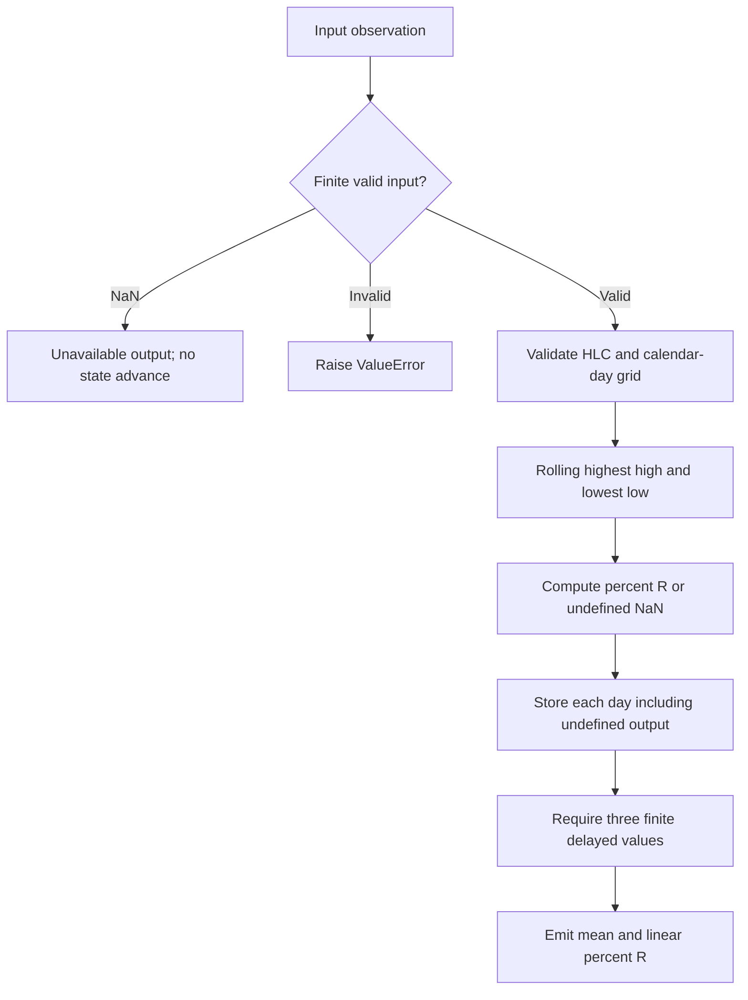

# Metonic Williams Percent R

This folder is the standalone **research prototype master reference implementation** of `MetonicWilliamsR`. Its numeric authority is `metonic-williams-percent-r.py`; this document contains the theoretical rationale, complete disclosed equations, explicit reconstruction choices, and porting contract. No source book, sibling folder, framework, NumPy, pandas, network service, or third-party package is required to run or port the numerical code.


## Principles and source contract

Part 2 §12.4 applies the generic Metonic transform to PercentageR examples.
This master specifies conventional Williams %R using completed **high, low,
and close** bars, then applies the fixed daily-delay average. Part 2 does not
provide the underlying PercentageR platform code or its default lookback;
length 13 is this research master's explicit default, matching the generic
RSI example's horizon. It is not asserted as the only Williams %R convention.

The underlying oscillator measures a close's position within its recent
price channel. A close near the channel top is near 0; one near the bottom
is near −100. The Metonic clock shifts and averages historical channel
positions. A close-only extrema surrogate would be a different indicator
and is not silently used to satisfy a scalar-only input interface.

## Complete mathematical calculation

For the last $L$ completed daily HLC observations:

$$H_t=\max_{0\le j<L}\operatorname{high}_{t-j},\qquad
L_t=\min_{0\le j<L}\operatorname{low}_{t-j},$$

$$r_t=-100\frac{H_t-\operatorname{close}_t}{H_t-L_t}.$$

Require `low <= close <= high` on every supplied bar. When $H_t=L_t$,
the underlying oscillator is undefined and is stored as NaN for that day;
do not replace it with zero or compress its calendar position. The current
Metonic result is unavailable whenever any selected historical value is
undefined. With nonzero ranges $r_t\in[-100,0]$.

Part 2 proposes repeating historical indicator states using a Metonic clock.
Its motivating astronomical comparison is an approximate common period:

$$19(365.24)\approx254(27.322)\approx235(29.5306)\approx6939\ \text{days}.$$

Those rounded astronomical quantities explain the book's analogy; they are
**not computed by this indicator**. The executable source fixes the daily
delays to

$$D=(6939,4016,2922),$$

described as roughly 19, 11, and 8 years. The chosen integers follow the
code and §12.3, rather than re-deriving rounded year/month products. Prose
occurrences of 6393 or 2029 are inconsistent with that executable definition.
The master's floating-point constants use `math.pi`; the astronomical
decimal values above are quoted observations, not numerical filter constants.

For an underlying daily indicator $f_t$, the disclosed cyclic-time transform is

$$m_t=\frac{f_{t-D_1}+f_{t-D_2}+f_{t-D_3}}3.$$

These are **calendar-day** indices. Insert all missing weekends and holidays
using the preceding completed full bar **before** running the underlying
indicator. Do not compute on trading days and fill its outputs afterward:
that changes smoothing, window lengths, and delays. `fill_calendar_days`
provides a standard-library iterator over `(date, payload)` records; for HLC
or open/close input, retain all required prices in the payload.

`time` may be a `datetime.date`, or omitted only when the caller promises
an already complete daily grid. In dated mode each accepted date must be
exactly the preceding accepted date plus one day. Duplicates, reversals,
gaps, datetimes, and mixing dated/undated modes are rejected before changing
state. A skipped NaN does not invent a calendar day: the caller must later
supply a finite filled record for that date before proceeding.

Every accepted day occupies one delay slot even when the underlying indicator
is not yet primed. If $B$ is its number of initial unavailable days, the
first complete composite is at zero-based index $B+\max D$, requiring
$B+\max D+1$ accepted days. Missing historical terms are not replaced with
zero and the denominator is not reduced. The retained buffer has
$\max D+1$ entries, so a 19-year history requirement is bounded storage.

For a future offset $h$, the historical-template forecast is

$$m_{t+h}=\frac{f_{t+h-D_1}+f_{t+h-D_2}+f_{t+h-D_3}}3,
\qquad 0\le h\le\min D.$$

Within this bound all required source dates are already known at $t$.
Looking up these historical states is not reading future prices. It is an
assumption of future repetition, not an established forecast probability.
This master emits the current value; a CLI can export the known template
over a forecast grid without changing the numerical transform.

Part 2 also discusses averaging six corresponding years (8, 11, 19, 27,
30, 38) and §12.5.2 changes the clock to **ordinal trading day within year**:

$$m_{Y,k}=\frac16\sum_{d\in\{8,11,19,27,30,38\}}f_{Y-d,k}.$$

That is a distinct mapping, not a fixed number of daily bars. This master
implements the explicitly coded **three fixed calendar delays**. It does not
silently implement a year/day-ordinal or six-year variant. The author's
gravity/geomagnetism → emotion → price explanation motivates his model;
the numerical code neither measures those forces nor establishes causation.


Set $f_t=r_t$ to obtain

$$m_t=\frac{r_{t-6939}+r_{t-4016}+r_{t-2922}}3.$$

The underlying first output is at index $L-1$; the first composite is at
$L-1+\max D$, provided all selected historical ranges are nonzero. Defaults
are indices 12 and 6951. A zero historical range can create later gaps even
after initial priming. `is_primed` describes current composite availability.
The mean remains within −100…0 when all terms are available.

The example drives every update with the requested close and reads matching
high/low from the copied local input fixtures. It does not synthesize those
fields from closes. Calendar gap filling must repeat the entire HLC bar.

## Input and output contract

`update(close, high, low, time=None)` accepts matching actual daily prices. A missing NaN returns unavailable output without advancing state. Infinity, booleans, malformed parameters and input-contract violations raise `ValueError`. Reset preserves configuration and clears every numerical history.

| Output | Meaning and porting representation |
|---|---|
| `value` | Mean of three delayed HLC Williams %R states; −100…0; NaN means unavailable. |
| `linear_percent_r` | Underlying current HLC Williams %R; −100…0; NaN at zero range; NaN means unavailable. |

Named numeric outputs can map to zpano scalar plots; lower/upper map to `Band`, and pivot offsets map to `Levels`/`Polyline`. They intentionally carry numbers rather than colors. The zero-lag EMA returns a scalar float. Output snapshots do not share mutable recursive state with later updates.

All recurrence/state operations use Python binary64 floats and full-precision `math.pi`. Porting requires binary64 equivalents and the documented iteration order. Numerical overflow is rejected; after an arithmetic failure reset before reusing the instance. Parameter/input validation and skipped NaNs themselves do not mutate state. Priming means data availability, not settled IIR transients, statistical significance, or predictive performance.

## Configuration

| Parameter | Shortcut | Default | Valid range | Purpose |
|---|---|---|---|---|
| `length` | `L` | `13` | integer ≥1 | Underlying smoothing/window length in daily or accepted bars |
| `delay1` | `D1` | `6939` | integer ≥1, distinct from other delays | First historical calendar-day lookup |
| `delay2` | `D2` | `4016` | integer ≥1, distinct from other delays | Second historical calendar-day lookup |
| `delay3` | `D3` | `2922` | integer ≥1, distinct from other delays | Third historical calendar-day lookup |

Values that are finite but too extreme for resolvable binary64 arithmetic can be rejected during calculation. There is no undocumented automatic retuning; construct another configured instance and replay required history when changing parameters.

## Calculation flow



Startup NaNs and any output-specific readiness gates described above are applied while preserving the documented internal calculations. Rolling analysis recomputes the fixed window and emits only the current snapshot. It never overwrites previously emitted stream observations.

## Reference parameter combinations

The following combinations are generated automatically; the number is below the requested limit of 64. Every numeric output gets one 252-element array per combination in each language.

| Case | Parameters | What it tests |
|---|---|---|
| 1 | `length=13, delay1=6939, delay2=4016, delay3=2922` | Production calendar delays: linear %R available, composite unprimed. |
| 2 | `length=13, delay1=19, delay2=11, delay3=8` | Short synthetic delays give finite HLC-based composites. |
| 3 | `length=1, delay1=19, delay2=11, delay3=8` | Single HLC bar underlying range. |
| 4 | `length=14, delay1=19, delay2=11, delay3=8` | Conventional fourteen-day underlying window. |
| 5 | `length=50, delay1=100, delay2=60, delay3=40` | Longer HLC window and larger synthetic delay buffer. |
| 6 | `length=13, delay1=8, delay2=19, delay3=11` | Unsorted delays retain identical average semantics. |
| 7 | `length=13, delay1=239, delay2=100, delay3=50` | First complete composite arrives at the final sample. |
| 8 | `length=13, delay1=240, delay2=100, delay3=50` | Delayed underlying range still unavailable at record end. |

**Fixture limitation:** the supplied record contains 252 undated market bars, not 19 years of daily history. Reference generation assigns consecutive artificial dates beginning 2000-01-01 solely to exercise calendar indexing. Short delays such as 19/11/8 are **synthetic test settings, not Metonic years**. Production-delay composites correctly remain NaN; finite underlying outputs are still serialized. Independent long-history tests exercise the real 6939/4016/2922 lookup arithmetic. No repeated price padding is inserted before these 252 reference outputs.

## Generating and porting fixtures

From this folder run:

```sh
python3 metonic-williams-percent-r.py
python3 metonic-williams-percent-r.py --generate-reference-data
```

The first command demonstrates chronological updates for every configuration. The second regenerates all expected fixtures and verifies the saved Python decimals. The example embeds the exact 252 shared `INPUT_CLOSE` values; auxiliary OHLC is read from the copied local `test_testdata.py`. All five input fixture files are preserved, including their matching OHLC arrays.

Python identifiers follow `EXPECTED_<shortcut><value>_..._<OUTPUT>`. Integral-valued floats use their shortest integer spelling, fractional dots become underscores, and a period tuple is encoded in order (for example `P20_40`). Multiple outputs have explicit suffixes. Spectrum suffixes `A20`, `PH20`, and `TO20` mean amplitude, first-window sine phase, and trough offset for the 20-bar bin; `DOM`, `AMP`, and `PHASE` mean the selected candidate fields.

Before each array, the first comment repeats “What it tests” and identifies its output; the next records full parameter names/values. Arrays contain **15 significant decimal digits** and NaNs at each unavailable output position. Calculations are never rounded internally.

| Language | Identifier and shape | Missing value |
|---|---|---|
| Python | `EXPECTED_... = [...]` | `math.nan` |
| Go | `var expected... = []float64{...}` | `math.NaN()` |
| TypeScript | `export const expected...: number[] = [...]` | `NaN` |
| Rust | `pub fn expected_...() -> Vec<f64>` inside copied test module | `f64::NAN` |
| Zig | `pub fn expected...() [252]f64` | `nan` from `std.math.nan(f64)` |

The Go package is the folder name with hyphens/underscores removed. Expected Rust suffixes are lowercase; other language parameter shortcuts remain uppercase. Correct language spellings (`math.NaN()`, `f64::NAN`) are used in place of typographical variants in the request.

The generator first saves Python arrays, reads them back, checks length/field set/decimal precision, and only then copies those saved values into the other languages. Generated blocks are replaceable/idempotent and preserve the input arrays. Ported implementations should compare NaN masks exactly and finite binary64 results with an appropriate absolute/relative tolerance; 15-digit fixtures are rounded decimal references, not promises of cross-platform bit identity.

The parent-folder verification scripts check all saved language values and compile/load the fixtures. Numerical tests additionally use independent DFT sums, HP normal equations, known harmonic vectors, analytic wave superposition, calendar boundaries, and reset/missing-input behavior. These checks validate the specified algorithms; they do not validate the books’ trading-performance claims.

## References and BibTeX

1. Lars von Thienen, *Decoding the Hidden Market Rhythm, Part 1: Dynamic
   Cycles*, 2017. Numerical sections are linked to the supplied chapter/code
   archive: [chapter 3](../../2017-decoding-the-hidden-market-rhythm-1/ch03.md),
   [chapter 4](../../2017-decoding-the-hidden-market-rhythm-1/ch04.md),
   [chapter 6](../../2017-decoding-the-hidden-market-rhythm-1/ch06.md), and
   [downloaded source directory](../../2017-decoding-the-hidden-market-rhythm-1/code/).
2. Lars von Thienen, *Decoding the Hidden Market Rhythm, Part 2: Metonic
   Cycles*, second edition/release 2017, [local complete book](../../2017-decoding-the-hidden-market-rhythm-2/content.md),
   especially §§10.1–10.3, chapter 11, and §§12.3–12.5.2.
3. Lars von Thienen, Foundation for the Study of Cycles,
   [*The Cycle Scanner Algorithm*, whitepaper](../../the-cycle-scanner-algorithm-whitepaper/content.md).
   The local document supplies no publication year; none is invented.
4. Robert J. Hodrick and Edward C. Prescott, “Postwar U.S. Business Cycles:
   An Empirical Investigation,” *Journal of Money, Credit and Banking*,
   29(1), 1997, pp. 1–16. The original working-paper formulation dates to 1980.
5. Gerald Goertzel, “An Algorithm for the Evaluation of Finite Trigonometric
   Series,” *The American Mathematical Monthly*, 65(1), 1958, pp. 34–35.
6. Julius Bartels, “Random fluctuations, persistence, and quasi-persistence
   in geophysical and cosmical periodicities,” *Terrestrial Magnetism and
   Atmospheric Electricity*, 40(1), 1935. Cited by the supplied whitepaper.
7. Charles E. Armstrong, “Applying the Bartels Test of Significance to a Time
   Series Cycle Analysis,” 1973, as cited by the whitepaper. Bibliographic
   detail beyond the supplied citation is not asserted.
8. J. Welles Wilder Jr., *New Concepts in Technical Trading Systems*,
   Trend Research, 1978, for the explicit underlying Wilder RSI convention.
9. The [zpano output types](../../../../external/zpano/py/indicators/core/outputs/)
   and [prepared Ehlers examples](../../../john-ehlers/prepared-for-conversion/)
   inform packaging/output contracts, not replacement numerical algorithms.

The source-specific scripts and C++ extracts are numerical authorities where
named above. HP, GDFT, Bartels, cRSI and CSI extracts carry Lars von Thienen's
2017 [CC BY 4.0](https://creativecommons.org/licenses/by/4.0/) notice: retain
author/book/site attribution and indicate adaptations. The DRO source states
[MPL 2.0](https://www.mozilla.org/en-US/MPL/2.0/); its Python numerical
extraction retains that source notice. Part 2 itself states all rights
reserved; its formulas are described here as the supplied research source,
without claiming that its book inherits the gist license.

```bibtex
@book{vonThienen2017Dynamic,
  author = {von Thienen, Lars},
  title = {Decoding the Hidden Market Rhythm, Part 1: Dynamic Cycles},
  year = {2017},
  url = {https://www.whentotrade.com/},
  note = {Supplied chapter archive and accompanying numerical source extracts}
}
@book{vonThienen2017Metonic,
  author = {von Thienen, Lars},
  title = {Decoding the Hidden Market Rhythm, Part 2: Metonic Cycles},
  year = {2017},
  edition = {2},
  note = {Kindle release 2017; supplied complete local text}
}
@techreport{vonThienenCycleScanner,
  author = {von Thienen, Lars},
  title = {The Cycle Scanner Algorithm},
  institution = {Foundation for the Study of Cycles},
  note = {Supplied whitepaper; publication date not stated}
}
@article{hodrickPrescott1997,
  author = {Hodrick, Robert J. and Prescott, Edward C.},
  title = {Postwar U.S. Business Cycles: An Empirical Investigation},
  journal = {Journal of Money, Credit and Banking},
  year = {1997}, volume = {29}, number = {1}, pages = {1--16}
}
@article{goertzel1958,
  author = {Goertzel, Gerald},
  title = {An Algorithm for the Evaluation of Finite Trigonometric Series},
  journal = {The American Mathematical Monthly},
  year = {1958}, volume = {65}, number = {1}, pages = {34--35}
}
@article{bartels1935,
  author = {Bartels, Julius},
  title = {Random fluctuations, persistence, and quasi-persistence in geophysical and cosmical periodicities},
  journal = {Terrestrial Magnetism and Atmospheric Electricity},
  year = {1935}, volume = {40}, number = {1}
}
@misc{armstrong1973,
  author = {Armstrong, Charles E.},
  title = {Applying the Bartels Test of Significance to a Time Series Cycle Analysis},
  year = {1973},
  note = {Citation as supplied by the Cycle Scanner whitepaper}
}
@book{wilder1978,
  author = {Wilder, J. Welles Jr.},
  title = {New Concepts in Technical Trading Systems},
  publisher = {Trend Research}, year = {1978}
}
@misc{vonThienenNumericalExtracts2017,
  author = {von Thienen, Lars},
  title = {HP Filter, Goertzel, Bartels Score, Cyclic RSI, and Cycle Swing source extracts},
  year = {2017}, url = {https://www.whentotrade.com/},
  note = {Downloaded local code archive; source files carry CC BY 4.0}
}
@misc{vonThienenDRO,
  author = {von Thienen, Lars},
  title = {Detrended Rhythm Oscillator, Pine v5 source},
  note = {Supplied dro.pinesctipt; MPL 2.0; ZigZag helpers credit LonesomeTheBlue}
}
@misc{zpanoOutputContracts,
  title = {zpano Indicator Core Output Types},
  note = {Local external/zpano/py/indicators/core/outputs; structural compatibility reference}
}
@misc{preparedEhlersMasters,
  title = {Prepared Ehlers Streaming Research Prototype Masters},
  note = {Local inputs/john-ehlers/prepared-for-conversion; fixture and packaging examples}
}
```
